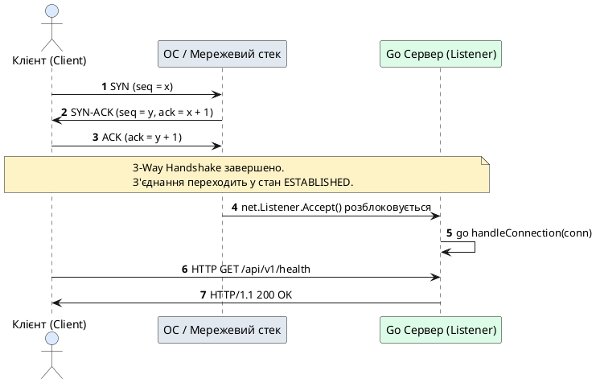
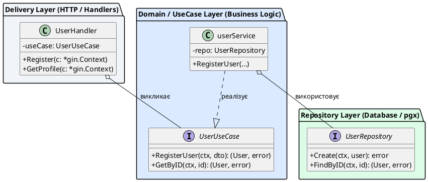

# Скіл: Створення лекцій для коледжу (College Lectures Creator)

Цей скіл призначений для написання структурованих, зрозумілих та методично вивірених лекційних матеріалів у доступному інженерному стилі для студентів коледжів (рівень: фаховий молодший бакалавр / бакалавр за спеціальностями 121 «Інженерія програмного забезпечення», 122 «Комп'ютерні науки» тощо).

---

## 1. Фундаментальні мовні та стилістичні стандарти

### 1.1. Мова та термінологія
- **Виключно українська мова** для всього навчального матеріалу, пояснень, заголовків, коментарів до коду та підписів діаграм.
- **Перше згадування англійських термінів:** обов'язково вказуйте оригінальний англійський термін у круглих дужках при першому введенні поняття.
  - *Приклади:* покажчики (*pointers*), аналіз втечі (*escape analysis*), зрізи (*slices*), качина типізація (*duck typing*), конвеєр обробки (*middleware pipeline*), взаємна автентифікація (*mutual TLS / mTLS*).
- **Пріоритет індустріальних англіцизмів:** уникайте штучних або застарілих кальок, які не вживаються в реальній інженерній практиці.
  - **Правильно:** фреймворк, роутер / маршрутизатор, хендлер / обробник, мідлвар, патерн, пул з'єднань, десеріалізація, вебсокет, репозиторій.
  - **Неправильно:** каркас (замість фреймворку), павутиння (замість веб), перехоплювач (де стандартно вживається middleware/interceptor).
- **Термінологія ООП:** Використовувати термін **«наслідування»** (_inheritance_), а не «спадкування».
- **Жодних штучних кальок.** Якщо розробники вголос кажуть англійське слово, у тексті теж англійське. Правило «мікс»: **назви речей** — англійською латиницею (так їх студент бачить у виводі, IDE й документації), **дії** — звичайними українськими дієсловами без віддієслівних іменників: «зберіть проєкт», але «після build», а не «після збирання».

  | Не пишемо | Пишемо |
  |---|---|
  | збирання, система збирання, сервер збирання | build, build-система, CI-сервер |
  | збірка (файл `.dll`) | assembly |
  | середовище виконання | runtime |
  | запускач | apphost (нативний файл програми), muxer (`dotnet`) |
  | навантаження (Visual Studio) | workload |
  | залежна від фреймворку / самодостатня | framework-dependent / self-contained |
  | цільова платформа | target framework |
  | референсні збірки | reference assemblies |
  | заглушка | stub |
  | гаряче перезавантаження | hot reload |
  | відновлення пакетів | restore пакетів |
  | налагоджувач, налагодження, символи налагодження | дебагер, дебаг, debug-символи |
  | точка зупинки | breakpoint |
  | простір імен | namespace |
  | конвеєр | pipeline |
  | однофайлові програми | file-based програми |
  | ключ (опція команди) | опція: «опція `-c Release`» |
  | розкладка клавіш (у налаштуваннях IDE) | keymap |
  | оболонка | shell |
  | «у папці встановлення» | «у папці, куди встановлено .NET» |

  Назви, які в IDE стоять англійською (Step Over, Watch, Locals, Call Stack), лишаються англійськими. Англійське слово в латиниці не відмінюється: «з assembly», «у runtime», «до наступного breakpoint». Дублі на кшталт «**runtime** (*runtime*)» не пишуться: англійський термін у дужках потрібен лише після українського. Усталені українські терміни лишаються: метадані, маніфест, точка входу, код виходу, змінна середовища, методи розширення, збирач сміття (GC).

### 1.2. Тон викладення: сухо, по суті, без заумності
- **Пишіть як інженер, що пояснює колезі:** прямо, конкретно, з фактами й прикладами. Без академічних зворотів і без усної мови лектора.
- **Сувора заборона псевдонаукових та «заумних» слів** (зліва — як не писати, справа — як писати):
  - *«інтерпретабельність»* → *«зрозумілість / прозорість логіки»*
  - *«предикат»* → *«умова перевірки / правило (if)»*
  - *«ациклічний орієнтований граф»* → *«деревоподібна схема / структура»*
  - *«мажоритарне голосування»* → *«голосування більшості»*
  - *«декорельовані»* → *«незалежні / різноманітні (не повторюють одне одного)»*
  - *«консиліум»* → *«спільне голосування / команда моделей»*
  - *«розрив генералізації»* → *«різниця між навчанням і тестом (перенавчання)»*
  - *«термінальні листки»* → *«кінцеві листки з відповідями»*
  - *«нездатність до екстраполяції»* → *«не вміє прогнозувати поза відомим діапазоном»*
  - *«інференс»* (без пояснення) → *«отримання прогнозу / відповіді (інференс)»*
  - надмірна філософія чи канцеляризми (*«іманентна дихотомія»*, *«трансцендентний»*) → конкретні факти і логіка.
- **Повні речення та закінчені думки:** категорично уникайте уривчастих тез чи списків без пояснень, але й не наливайте води. Кожна теза має бути змістовною і показувати «як це працює на практиці».
- **Сухо і по суті.** Кожне речення або повідомляє факт, або ставить питання, на яке відповідає наступний текст. Визначення й пояснення подавайте прямо, без вступних фраз.
- **Заборонені заповнювачі** (вони нічого не повідомляють і звучать як усна мова лектора):
  - «поговоримо за хвилину», «настав час», «зробимо крок углиб», «перейдемо до», «тепер зрозуміло»;
  - «найчесніша / чесна / справжня відповідь», «справжній компілятор», «чудове нагадування», «цікаво, що», «несподіванка»;
  - «ментальна модель», «під капотом», «магія», «просто», «всього лише» (якщо це не точна кількісна характеристика);
  - риторичне «Здається, що…» як зачин, а також вигуки й похвала студенту.
- **Місток між розділами** — це або конкретний зв'язок із названим попереднім поняттям («У RAM лежать числа. Як записується саме число?»), або питання-проблема. Не пишіть порожніх переходів.
- **Приклад замість оцінки.** Замість «чудовий приклад, що…» напишіть сам факт: «Компілятор обчислив `2 + 3` заздалегідь, тому в байт-коді лише `5`».
- **Звертання до аудиторії** («розглянемо», «зверніть увагу», «зауважте») допустимі, але рідко: не більше одного-двох разів на розділ, і лише там, де треба привернути увагу до пастки або винятку.

### 1.3. Жодних емодзі — лише іконки

> **СУВОРА ЗАБОРОНА ЕМОДЗІ.** У лекціях, практичних і домашніх завданнях не використовуються емодзі (🎯 🛠️ 📋 ✅ ❌ ❓ 💡 ⚠️ 🚀 тощо). Емодзі поруч з іконкою компонента дублюють одне одне, на різних ОС виглядають по-різному і засмічують текст.

- **Заголовки (`##`, `###`)** — лише текст: `## Питання для самоперевірки`, а не `## ❓ Питання…`.
- **`title` карток і `label` акордеонів** — лише текст, візуальний знак дає атрибут `icon`: `::card{title="Навчальні цілі" icon="i-lucide-graduation-cap"}`, `:::accordion-item{label="Спробуйте: псевдоніми типів" icon="i-lucide-clipboard-list"}`.
- **«Так / ні» у тексті і списках** — рядкова іконка Lucide на початку пункту (обов'язково з класом `inline-block`, інакше вона має нульовий розмір і не видна):

  ```markdown
  - :icon{name="i-lucide-circle-check" class="inline-block text-green-500"} **Варто:** …
  - :icon{name="i-lucide-circle-x" class="inline-block text-red-500"} **Не потрібно:** …
  ```

- **Коментарі в коді** — словами: `// правильно`, `// помилка компіляції`, `// краще так`.
- **Картинки matplotlib** — без емодзі (шрифт DejaVu їх не має, замість символу буде квадрат).

Типові іконки: цілі — `i-lucide-graduation-cap`, стек — `i-lucide-cpu`, завдання — `i-lucide-clipboard-list`, розв'язок — `i-lucide-check-circle`, питання — `i-lucide-help-circle`, порада «коли що» — `i-lucide-lightbulb`, переваги / вади — `i-lucide-thumbs-up` / `i-lucide-thumbs-down`.

---

## 2. Педагогічні та методичні принципи

### 2.1. Текст — основа статті, код — лише ілюстрація
Лекція — це не шпаргалка з кодом і короткими коментарями. Це **розгорнуте концептуальне пояснення**.
- Код ніколи не подається «голим». Кожен лістинг коду має спиратися на попередній текст, який пояснює задачу, та супроводжуватися наступним покроковим аналізом рядків.
- Код покликаний підкріпити сформульовану теоретичну тезу, а не замінити її.

### 2.2. Розкриття суті без «води»
Кожне ключове поняття чи механізм повинні містити зрозуміле пояснення: навіщо це потрібно, яка фізична чи алгоритмічна логіка стоїть за цим, і як це застосовується в коді. Глибина «чому так зроблено» обов'язкова: рішення мови чи платформи пояснюється через проблему, яку воно закриває.

### 2.3. Плавні концептуальні мости (Bridge Building)
Починайте новий підрозділ із короткого зв'язку з тим, що студент уже знає. Якщо студенти пройшли попередній курс (наприклад, C++ перед C#), спирайтесь на ці знання і не пояснюйте з нуля, але без явних посилань на лекції іншого курсу.

**«Так само, як у C++» — не привід пропустити основу.** Навіть якщо конструкція пишеться так само, як у знайомій мові, розділ починається з плавного вступу: що це і навіщо, анатомія синтаксису (схема з підписаними частинами), програма з **усіма формами запису** і пояснення кожної форми (`::field-group`). Лише після цього — відмінності від C++ і пастки. Не можна відкривати розділ фразою «пишеться так само, як у C++» і одразу переходити до відмінностей. Еталон — розділ «Змінна: ім'я, тип і значення» в `content/01.csharp/01.fundamentals/04.variables-types-literals.md`; так само побудовані «Будова виразу» і «Групи операторів» у лекції 08, «Будова if», «Будова умовного оператора», «Будова switch» у лекції 09.

### 2.4. Передбачення запитань («А що, якщо...?»)
Випереджайте типові запитання та помилки студентів до того, як вони сформулюються:
- *«А що станеться, якщо клієнт раптово розірве TCP-з'єднання під час запису в сокет?»*
- *«Чому ми повертаємо покажчик на структуру, а не копію значення?»*
Виділяйте такі відповіді через `::note`, `::warning` або `::accordion`.

### 2.5. Усі способи і «коли що»
- Якщо одну задачу можна розв'язати кількома способами (оголошення змінної, публікація програми, перетворення типів), показуйте **усі способи** поруч — через `::field-group` / `::field` або `::code-group`.
- Після переліку способів додавайте блок «коли що»: `::callout{icon="i-lucide-lightbulb"}` із заголовком і списком з іконками «так / ні» (розділ 1.3, формат — розділ 4.2).
- Для нового синтаксису давайте **анатомію конструкції**: схема matplotlib, де кожна частина виразу підписана.

### 2.6. Реальні виводи
Будь-який вивід програми, число в тексті чи на картинці, розмір файлу, час виконання береться з **реального запуску** на заявленій версії платформи. Приклади зберігаються в репозиторії (`samples/<курс>/<розділ>/NN-тема/`), щоб їх можна було перезапустити скриптом. Якщо результат залежить від машини, вкажіть, на чому його отримано (ОС, процесор, версія).

### 2.7. Міні-завдання «Спробуйте» всередині матеріалу
Після кожного нового поняття — маленьке самодостатнє завдання на 2–5 хвилин, яке студент виконує майже за інструкцією, щоб звикнути до концепції.
- **Не копіпаст** коду з тексту вище: завдання змінює умову (інші типи, інше значення, інший прапорець), щоб студент повторив дію сам.
- Містить: інструкцію по кроках, очікуваний вивід (`::terminal-preview`) і схований розв'язок із поясненням, чому вийшло саме так.
- Формат — два елементи акордеона: `Спробуйте: …` і `Розв'язок` (приклад у 4.9).

### 2.7.1. Поглиблений матеріал: рамка «Поглиблено»
Матеріал поза програмою модуля (у плані курсу позначений `[+]`) обгортається компонентом `deep-dive` — фіолетова рамка з міткою «Поглиблено». Рамка завжди розгорнута. Студентам не пишемо, що поглиблене не входить у тести й домашні: це правило для автора.

- **Рівнів два:** основне (без позначки) і поглиблене (у рамці). Інших позначок обов'язковості немає.
- **Що можна обгорнути:** цілий підрозділ разом із заголовком (`###` або `##`) або окрему вставку всередині основного розділу (абзац, таблиця, схема, анімація). Заголовки всередині рамки потрапляють у зміст сторінки.
- **Рамка завжди з п'ятьма двокрапками**, бо всередині можуть бути акордеони (4) з елементами (3) і вкладеними компонентами (2):

  ```markdown
  :::::deep-dive

  ### Багаторівнева компіляція

  Текст, схеми, ::::accordion з міні-завданням…

  :::::
  ```

- **Основний текст не спирається на поглиблений.** Якщо приклад потрібен і основному матеріалу (як програма `CsHello` для розділу про IL), він лишається поза рамкою, а в рамку йде лише поглиблене порівняння.
- **Міні-завдання «Спробуйте»** до поглибленого розділу лежать усередині його рамки.
- **Самоперевірка, шпаргалка і практичні завдання в кінці лекції — лише з основного матеріалу.** Поглиблене ніколи не потрапляє в тести Wayground і домашні завдання.
- **Огляд на початку лекції:** третя картка в `::card-group` після «Навчальних цілей» і «Технологічного стеку» — `::card{title="Поглиблено" icon="i-lucide-telescope"}` з реченням «Розділи поза програмою модуля. У тексті вони позначені фіолетовою рамкою.» і списком посилань на поглиблені розділи (`[Назва](#slug-заголовка)`). Якщо рамка — вставка без власного заголовка, посилання веде на заголовок розділу, в якому вона стоїть. Навчальні цілі формулюються лише з основного матеріалу.

### 2.8. Структура лекції
1. `# Заголовок` і `::card-group` з картками: «Навчальні цілі» (`i-lucide-graduation-cap`), «Технологічний стек» (`i-lucide-cpu`: версії, інструменти, папка прикладів) і, якщо в лекції є поглиблений матеріал, «Поглиблено» (`i-lucide-telescope`, розділ 2.7.1).
2. Основний матеріал: розділи `##` / `###`, схеми, міні-завдання «Спробуйте» після кожного поняття, блоки «коли що».
3. `## Питання для самоперевірки` — акордеон із 6–10 питаннями на розуміння (не на пам'ять) і відповідями.
4. `## Шпаргалка` — таблиця «термін / що це / де побачити або як записати».
5. `## Практичні завдання` — 3–5 нескладних завдань на 5–15 хвилин, кожне з прихованим розв'язком. Вони відрізняються від міні-завдань: поєднують кілька понять лекції, вимагають письмової відповді «чому» і, де доречно, скріншота результату.
6. `## Домашнє завдання` — лише якщо курс його передбачає для цієї лекції (зазвичай остання лекція модуля).

### 2.9. Домашні та практичні завдання, які не розв'язує ШІ за студента
- Завдання нескладні: рівень складності не має штовхати до генерації коду.
- Акцент на **спостереженні та поясненні**: запустити, виміряти, порівняти зі своєю машиною, пояснити розбіжність своїми словами.
- Вимагайте **скріншоти** власних результатів (вивід терміналу, вміст папки, IL у декомпіляторі) з позначеними ключовими місцями.
- **Бали в тексті завдань не пишуть** — ні в заголовках рівнів і завдань, ні в правилах. Рівні описуються словами («рівень 3 замінює рівні 1 і 2»), система оцінювання лишається у викладача.

---

## 3. Візуалізація: matplotlib, PlantUML, анімації

> **СУВОРА ЗАБОРОНА ПСЕВДОГРАФІКИ (ASCII Art):**
> Категорично заборонено використовувати текстову ASCII-псевдографіку (рамки `┌───┐`, `│...│`, стрілочки `───►` тощо у блоках коду).
> Будь-які схеми, процеси, структури даних, порівняння й числові ілюстрації малюються **головним інструментом — matplotlib** (PNG-картинки, розділ 3.0). PlantUML (`::plant-uml`) або Mermaid (`::mermaid`) використовуйте лише для діаграм послідовностей, взаємодії та класів, які незручно малювати вручну.

Візуалізація є обов'язковою для кожної лекції, її має бути багато: схема на кожне поняття, яке має структуру, процес чи числа. Картинки мають бути легкочитними та виконаними на **світлому фоні**.

### 3.0. matplotlib: головний інструмент візуалізації

Кожна картинка створюється Python-скриптом із matplotlib. Скрипт зберігається в репозиторії, PNG генерується з нього, а в `.md` вставляється посилання.

**Авто-шлях.** Папка для зображень визначається за шляхом до `.md` файлу *без числових префіксів*:

- `content/07.tools/02.kubernetes/01.why.md` → `public/images/tools/kubernetes/why/`
- `content/01.csharp/01.fundamentals/01.dotnet-platform.md` → `public/images/csharp/fundamentals/dotnet-platform/`
- `content/05.python/01.core/00.how-computers-run-programs.md` → `public/images/python/core/how-computers-run-programs/`

**Скрипти.** Шлях до скрипта повторює шлях до зображень, тільки корінь `tools/figures/` замість `public/images/`:

- `tools/figures/python/core/how-computers-run-programs/01-pipeline.py` → `public/images/python/core/how-computers-run-programs/01-pipeline.png`

Імена файлів: `NN-короткий-опис.png`, де `NN` — порядковий номер у статті. Скрипт сам визначає папку виводу за власним розташуванням і створює її.

**Запуск.** matplotlib підключається без встановлення в проєкт:

```bash
uv run --python 3.13 --with matplotlib python tools/figures/<шлях>/01-name.py
```

**Вставка в статтю** (альтернативний текст обов'язковий, він же підпис):

```markdown
{.diagram-img}
```

Для широких схем і графіків — `{.wide-img}`.

**Стиль картинок:**
- білий фон, темний текст `#1E293B`, заливки з палітри `#E2E8F0`, `#DBEAFE`, `#DCFCE7`, `#FEF3C7`, акценти `#2563EB`, `#16A34A`, `#D97706`, `#DC2626`;
- шрифт DejaVu Sans (є в matplotlib і підтримує кирилицю), для коду DejaVu Sans Mono;
- підписи українською, великий розмір шрифту (не менше 12 pt для тексту), `dpi=200`, `bbox_inches="tight"`;
- одна думка на картинку, мінімум елементів, без декоративних ефектів;
- числа та виводи на картинках беруться з реального запуску, а не вигадуються;
- спільні функції (`box`, `arrow`, `canvas`, `save`, кольори) лежать у `tools/figures/_style.py` — імпортуйте їх, а не дублюйте;
- символ `$` у тексті екрануйте як `\$`, інакше matplotlib сприйме його як формулу;
- після генерації відкрийте PNG і перевірте, що текст не виходить за межі блоків і не перекривається лініями (підкладка `bbox=dict(fc="white", ec="none")`).

### 3.1. Вимоги до PlantUML (лише для послідовностей і класів)
- Обов'язково використовуйте директиву `skinparam style plain` або чітку світлу палітру (`skinparam backgroundColor #FFFFFF`, чіткі темні лінії `#1E293B`, м'які кольори заливки `#E2E8F0`, `#DBEAFE`, `#FEF3C7`).
- Огортайте діаграми в компонент Docus `::plant-uml`.

#### Приклад діаграми послідовності (Sequence Diagram):
````markdown
::plant-uml{alt="TCP Handshake та передача даних"}



::
````

#### Приклад діаграми структури/класів (Clean Architecture Layers):
````markdown
::plant-uml{alt="Шари Clean Architecture"}



::
````

### 3.2. Анімації та відео
- **Анімація процесу** (стек обчислень крок за кроком, рух байтів у пам'яті, виконання циклу) робиться через `matplotlib.animation.FuncAnimation` і вставляється як `<video controls autoplay loop muted playsinline poster=…>` з двома `<source>`: mp4 і webm. Запасний `` з GIF усередині `<video>` не додається: Nuxt пропускає його через оптимізатор зображень, і той повертає помилку 400. Голий GIF теж не використовується: його не можна поставити на паузу. Файли — `public/videos/<шлях-як-у-картинок>/anim-NN-name.{mp4,webm,gif,png}`. Покрокову анімацію (стан → кадр) зручно робити функцією `save_steps(__file__, steps, draw)` з `tools/figures/_style.py`: вона малює кожен стан, збирає mp4, webm, gif і постер із потрібного кадру. Після рендеру витягніть кілька кадрів (`ffmpeg -ss <сек> -i file.mp4 -frames:v 1 frame.png`) і перевірте, що текст не виходить за краї.
- **Пояснювальні відео HyperFrames** спочатку лише плануються: у місці, де відео допоможе, лишайте коментар-слот `<!-- VIDEO … -->` за форматом із `temp/cnn-media-slots.md` (скіл `lesson-video-hyperframes`). Лекція має бути повністю зрозумілою без відео.

---

## 4. Використання Docus MDC компонентів (Суворий синтаксис)

> **КРИТИЧНЕ ПРАВИЛО ФОРМАТУВАННЯ DOCUS:**
> 1. Закриваючий тег `::` завжди має починатися з початку нового рядка без жодних пробілів.
> 2. Перед кожним закриваючим `::` **обов'язково повинен бути порожній рядок** (особливо після списків або блоків коду), щоб автоформатери не зміщували теги!
> 3. Для компонентів із вкладеними елементами суворо дотримуйтесь **ієрархії двокрапок (colon levels)**: `::::accordion` (4) → `:::accordion-item` (3) → вкладені `::terminal-preview`, `::warning`, `::tip`, `::code-group` тощо (2).
> 4. Значення атрибута з подвійними лапками всередині беруть в одинарні лапки: `::field{name='var title = "Звіт";' type="..."}` (перевірено в браузері; HTML-сутності на кшталт `&quot;` не використовуйте).
> 5. Рядковий код, що містить зворотний апостроф, записують подвійними апострофами: ``` ``<>f__AnonymousType0`2`` ```, інакше код обривається на першому `` ` ``.
> 6. Екранування `\"` в атрибуті не працює: `::terminal-preview{title="… \"текст\" …"}` ламає розбір, і сирий `::` потрапляє на сторінку. Код з лапками виносьте в окремий блок коду перед компонентом, а заголовок лишайте коротким.
> 7. Заголовок `##` / `###` має містити слова, а не лише символи: `### &, |, ^, ~` отримує порожній `id`, і зміст сторінки падає з помилкою `querySelectorAll('#')`. Пишіть `### Побітові І, АБО, XOR і НЕ`.

### 4.1. Картки та групи карток (`::card-group`, `::card`)
Використовуються для вступних цілей лекції, ключових концепцій та підсумкового закріплення матеріалу.

```markdown
::card-group

::card{title="Навчальні цілі" icon="i-lucide-graduation-cap"}

- Опанувати принципи роботи Berkeley Sockets API у середовищі Go.
- Зрозуміти різницю між блокуючим введенням/виведенням та подійно-орієнтованим планувальником Netpoller.

::

::card{title="Технологічний стек" icon="i-lucide-cpu"}

- **Платформа:** Go 1.25
- **Приклади:** `samples/go/network/01-sockets/`

::

::
```

### 4.2. Акценти та примітки (`::note`, `::tip`, `::warning`, `::caution`, `::callout`)

> **Пастка: абзаци в цих компонентах злипаються.** `::callout`, `::note`, `::tip`, `::warning`, `::caution` розгортають абзаци (`mdc-unwrap="p"`): кілька абзаців усередині виводяться **одним рядком без розривів**. Тому всередині такого компонента — **один абзац тексту**, а все, що має йти окремими рядками, оформлюйте **списком** (списки не розгортаються). Кілька жирних «підзаголовків» абзацами поспіль ламають верстку.

```markdown
::note
У середовищі Go функція `net.Listen` створює неблокуючий сокет на рівні ОС, інтегрований із внутрішнім мережевим полінгом середовища виконання (*runtime netpoller*).
::

::warning
Протокол TCP не гарантує, що один виклик `Write()` на клієнті відповідатиме одному виклику `Read()` на сервері.
::
```

Блок «коли що» — заголовок одним абзацом, далі список з іконками:

```markdown
::callout{icon="i-lucide-lightbulb"}
**Коли який спосіб**

- :icon{name="i-lucide-circle-check" class="inline-block text-green-500"} **Залежна від фреймворку** — серверні застосунки, де .NET встановлено.
- :icon{name="i-lucide-circle-check" class="inline-block text-green-500"} **Native AOT** — консольні утиліти, де важливий миттєвий старт.
- :icon{name="i-lucide-circle-x" class="inline-block text-red-500"} **Не обирайте Native AOT** для програм, що активно використовують рефлексію.

::
```

### 4.3. Команди для різних ОС та інструментів (`::tabs`, `::tabs-item`)
Якщо команда відрізняється між ОС чи інструментами, показуйте її вкладками: `PowerShell (Windows)` / `bash / zsh (macOS, Linux)`, або `pip` / `uv` / `poetry`, або CLI / IDE.

````markdown
::tabs

::tabs-item{label="PowerShell (Windows)"}

```powershell
$env:DOTNET_JitDisasmSummary = 1
dotnet out/app.dll
```

::

::tabs-item{label="bash / zsh (macOS, Linux)"}

```bash
DOTNET_JitDisasmSummary=1 dotnet out/app.dll
```

::

::
````

### 4.4. Порівняння підходів та альтернатив (`::code-group`)

````markdown
::code-group

```go [Чистий net/http]
http.HandleFunc("/api/v1/user", func(w http.ResponseWriter, r *http.Request) {
    w.Header().Set("Content-Type", "application/json")
    json.NewEncoder(w).Encode(user)
})
```

```go [Фреймворк Gin]
r := gin.Default()
r.GET("/api/v1/user", func(c *gin.Context) {
    c.JSON(http.StatusOK, user)
})
```

::
````

### 4.5. Структура проєкту (`::code-tree`)

````markdown
::code-tree

```go [cmd/server/main.go]
package main

func main() {
    // Точка входу в застосунок
}
```

```go [internal/domain/user.go]
package domain

type User struct {
    ID    string `json:"id"`
    Email string `json:"email"`
}
```

::
````

### 4.6. Термінальні результати та логи (`::terminal-preview`)

Простий вивід — блоком `text` всередині компонента:

````markdown
::terminal-preview{title="dotnet run type-sizes.cs"}
```text
byte     System.Byte      1 Б
int      System.Int32     4 Б
```
::
````

Вивід із підсвіткою — рядками `<div class="line">`:

```markdown
::terminal-preview{title="go run cmd/server/main.go" :cursor="true"}

<div class="line"><span class="opacity-40">$</span> <strong class="font-bold">go run cmd/server/main.go</strong></div>
<div class="line"><span class="text-blue-400 font-bold">INFO</span> Server listening on address <span class="text-green-400 font-bold">:8080</span></div>
::
```

### 4.7. Візуалізація пам'яті та налагодження (`::memory-view`, `::debugger-view`)
Використовуйте для пояснення тем роботи з покажчиками, адресації, структур пам'яті стеку/купи та аналізу втечі (Escape Analysis):

```markdown
::debugger-view{title="Goroutine Local Frame" :variables='[{"name": "conn", "type": "net.Conn", "value": "0x00c0000a4020"}, {"name": "buffer", "type": "[]byte (len=1024, cap=1024)", "value": "[0x47, 0x45, 0x54, ...]"}]'}
::
```

### 4.8. Покрокові інструкції (`::steps`)

```markdown
::steps

### Створення сокета слухача
Сервер зв'язується з обраним портом за допомогою системного виклику `bind` та переходить у режим очікування через `listen`.

### Прийом з'єднання у циклі
Основний потік блокується на виклику `Accept()` до моменту надходження нового запиту від клієнта.

::
```

### 4.9. Інтерактивні запитання та завдання (Акордеони: `::::accordion`, `:::accordion-item`)

Використовуйте для запитань для самоконтролю, міні-завдань «Спробуйте», практичних завдань та прихованих розв'язків.

> **СУВОРЕ ПРАВИЛО ВЕРСТКИ АКОРДЕОНІВ (ІЄРАРХІЯ ДВОКРАПОК):**
> 1. Зовнішній контейнер відкривається як `::::accordion` (4 двокрапки) і закривається як `::::`.
> 2. Кожен елемент відкривається як `:::accordion-item{label="..." icon="..."}` (3 двокрапки) і закривається як `:::`.
> 3. Будь-які вкладені MDC-компоненти всередині (наприклад, `::terminal-preview`, `::tabs`, `::warning`, `::code-group`, `::plant-uml` тощо) мають рівень з 2 двокрапками (`::` ... `::`). Це запобігає передчасному закриттю акордеона парсером MDC.
> 4. Обов'язково додавайте порожній рядок перед кожним закриваючим тегом (`:::`, `::::`).
> 5. У `label="..."` не використовуйте лапки (`\"`), зворотні слеші, зворотні апострофи (`` ` ``), код і емодзі: вони ламають розбір атрибута або дублюють іконку. Код із питання переносьте в тіло елемента. Допустимі лише звичайний текст, `«ялинки»` та апостроф.

**Питання для самоконтролю:**

```markdown
::::accordion

:::accordion-item{label="Чому не можна ігнорувати помилку, яку повертає conn.Close()?" icon="i-lucide-help-circle"}

Помилка при закритті може свідчити про скидання невідправлених буферів операційної системи (TCP RST) або збій дескриптора файлу. Її логування потрібне для діагностики витоків дескрипторів (*file descriptor leaks*).

:::

::::
```

**Міні-завдання «Спробуйте» з очікуваним виводом і прихованим розв'язком:**

````markdown
::::accordion

:::accordion-item{label="Спробуйте: псевдоніми типів" icon="i-lucide-clipboard-list"}

1. Створіть файл `aliases.cs`.
2. Виведіть `typeof(float).FullName` і `typeof(ulong).FullName`.

Очікуваний вивід:

::terminal-preview{title="dotnet run aliases.cs"}
```text
System.Single
System.UInt64
```
::

:::

:::accordion-item{label="Розв'язок" icon="i-lucide-check-circle"}

```csharp [aliases.cs]
Console.WriteLine(typeof(float).FullName);
Console.WriteLine(typeof(ulong).FullName);
```

Ключові слова C# — псевдоніми типів CTS: `float` — це `System.Single`.

:::

::::
````

Практичні завдання в кінці лекції оформлюються так само, з мітками `Завдання N. Назва` і `Розв'язок завдання N`.

### 4.10. Математичні та формальні формули (`::math-formula`)

> **ВАЖЛИВО:** Сирий синтаксис формул `$$...$$` чи `$...$` не підтримується автоматично. Будь-які математичні вирази, формули та формальні позначення мають оформлюватися виключно через компонент `::math-formula`:

**Блоковий режим:**
```markdown
::math-formula
\text{Connection} = \{\text{Protocol}, \text{Source IP}, \text{Source Port}, \text{Destination IP}, \text{Destination Port}\}
::
```

**Вбудований (inline) режим:**
```markdown
Формула :math-formula{tex="E = mc^2" inline} у середині тексту.
```

---

## 5. Перевірка перед здачею

- Запустіть локальний сервер (`pnpm dev`) і відкрийте сторінку: немає сирих `::` у тексті, усі картинки завантажуються, акордеони й вкладки відкриваються, рядкові іконки видно.
- `grep -nP "[\x{1F300}-\x{1FAFF}\x{2600}-\x{27BF}]" <файл>.md` не знаходить жодного емодзі.
- Усі виводи в лекції збігаються з повторним запуском прикладів.

---

> **ЗАБОРОНА ЧИСЛОВОЇ НУМЕРАЦІЇ В ЗАГОЛОВКАХ:**
> Ніколи не використовуйте штучні числові префікси в заголовках (`## 1. `, `### 1.1. `, `### 1.2. ` тощо).
> Заголовки (H2 `##`, H3 `###`) мають бути природними, змістовними та описовими (наприклад: `## Архітектурний контекст та еволюція систем`, `### Проблема монолітів минулого`).
