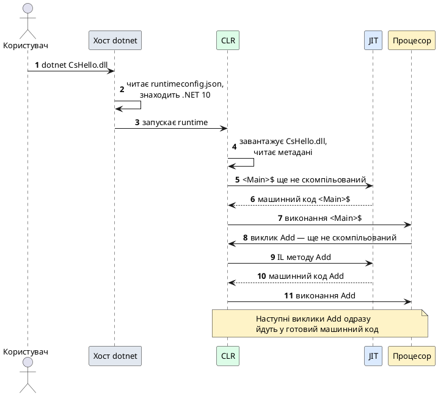

# Платформа .NET: звідки вона і як влаштована

::card-group

::card{title="Навчальні цілі" icon="i-lucide-graduation-cap"}

- Пояснити, які проблеми попередніх технологій розв'язує .NET і чому вона з'явилася саме у 2002 році.
- Розрізняти складові платформи: CLR, CTS, CLS, BCL/FCL, і пояснити роль кожної.
- Описати шлях програми від `Program.cs` до машинних команд процесора та порівняти його з pipeline C++.
- Читати вміст assembly: IL-код, метадані, маніфест.
- Пояснити, коли і навіщо JIT компілює методи в машинний код.
- Порівняти .NET Framework, .NET Core, .NET Standard і сучасний .NET та обґрунтувати вибір .NET 10.

::

::card{title="Технологічний стек" icon="i-lucide-cpu"}

- **Платформа:** .NET 10 (LTS), SDK 10.0.404, runtime 10.0.15
- **Мова:** C# 14
- **Інструменти:** `dotnet` CLI, `ilspycmd` (перегляд IL), SharpLab (онлайн)
- **Приклади:** `samples/csharp/fundamentals/01-dotnet-platform/`

::

::card{title="Поглиблено" icon="i-lucide-telescope"}

Розділи поза програмою модуля. У тексті вони позначені фіолетовою рамкою.

- [IL трьох мов: C#, F#, Visual Basic](#мови-платформи)
- [Stub і JIT: як CLR підміняє адресу методу](#jit-компіляція-під-час-виконання)
- [Багаторівнева компіляція](#багаторівнева-компіляція)
- [Альтернативи JIT: ReadyToRun і Native AOT](#альтернативи-jit-readytorun-і-native-aot)
- [Цикл релізів: LTS і STS](#цикл-релізів-lts-і-sts)

::

::

---

## Звідки взялася платформа .NET

Курс C++ показав повний цикл: вихідний код компілюється в машинні команди конкретного процесора, програміст сам виділяє і звільняє пам'ять, а помилка в індексі масиву може тихо зіпсувати сусідні дані. Платформа .NET виникла як відповідь саме на ці властивості. Щоб зрозуміти, які рішення в ній прийнято, корисно бачити, яку проблему кожне з них закриває.

### Етапи розвитку технологій програмування

Кожен етап розвитку мов програмування розв'язував головну проблему попереднього і залишав нову.

{.diagram-img}

::field-group

::field{name="Машинний код і асемблер" type="1950-ті"}
Програма — це послідовність команд конкретного процесора. Перенесення на інший процесор означає переписування з нуля.
::

::field{name="Процедурні мови: C" type="1972"}
Компілятор переводить один і той самий вихідний код у команди різних процесорів. Пам'ять керується вручну (`malloc` / `free`): забута `free` дає витік, повторна `free` або вихід за межі масиву ламає програму непередбачувано.
::

::field{name="Об'єктно-орієнтовані мови: C++" type="1985"}
Класи, наслідування, шаблони, RAII. Проте немає стандартного бінарного формату: клас, скомпільований MSVC, не можна безпечно використати з коду, скомпільованого GCC, бо компілятори по-різному кодують імена методів і розкладають об'єкти в пам'яті.
::

::field{name="Компонентна модель: COM" type="1993"}
Microsoft дала спосіб викликати код з однієї мови в іншій через бінарні інтерфейси. Ціна: реєстрація кожного компонента в системному реєстрі Windows, GUID-ідентифікатори, ручний підрахунок посилань. Оновлення спільної DLL однією програмою ламало інші програми, які чекали старої версії. Це явище отримало назву **«пекло DLL»** (*DLL hell*).
::

::field{name="Керований код: Java і JVM" type="1995"}
Компілятор створює не машинний код, а проміжний байт-код. Віртуальна машина виконує його на будь-якій ОС, сама звільняє пам'ять і перевіряє межі масивів. Платформа розрахована на одну мову — Java.
::

::field{name="Керований код для багатьох мов: .NET і C#" type="2002"}
Ідея керованого коду, як у Java, плюс спільний для всіх мов формат типів, бінарна сумісність без реєстру і можливість ставити кілька версій бібліотеки поруч.
::

::

### Причини появи .NET

Наприкінці 1990-х у Microsoft накопичилося чотири проблеми, які не розв'язувалися в межах наявних технологій.

1. **Помилки роботи з пам'яттю.** Більшість критичних вразливостей у програмах на C і C++ того часу були переповненнями буфера та зверненнями до звільненої пам'яті. Розв'язок — runtime, який сам звільняє пам'ять і перевіряє межі кожного звернення до масиву.
2. **«Пекло DLL».** Програми покладалися на спільні DLL у системних папках. .NET зберігає версію кожної бібліотеки в її метаданих і дозволяє мати поруч кілька версій.
3. **Складність COM.** Виклик коду між мовами вимагав інтерфейсних описів, GUID і ручного підрахунку посилань. У .NET усі мови компілюються в один проміжний формат і бачать типи одна одної напряму.
4. **Конкуренція з Java.** Microsoft мала власну реалізацію Java (Visual J++) з розширеннями для Windows. Sun Microsystems подала позов, і за мировою угодою 2001 року Microsoft припинила розвиток своєї JVM. Компанії потрібна була власна керована платформа, яку вона може розвивати без обмежень.

Результатом стала платформа .NET Framework 1.0 і нова мова C# 1.0 (лютий 2002). Головний архітектор C# — Андерс Гейлсберг (*Anders Hejlsberg*), раніше автор Turbo Pascal і Delphi.

::::accordion

:::accordion-item{label="А що, якщо Microsoft просто взяла б Java?" icon="i-lucide-help-circle"}

Через позов Sun вона не могла змінювати мову і віртуальну машину на свій розсуд, а Java на той момент була прив'язана до однієї мови. .NET від початку проєктувалася під кілька мов: CLR не знає, з якої мови прийшов IL-код. Тому з'явилися типи значень (`struct`), властивості, події, делегати і пізніше справжні узагальнення (*generics*), яких у JVM на рівні байт-коду немає досі.

:::

::::

### Хронологія: три гілки й одна платформа

Історія .NET — це три паралельні реалізації, які у 2020 році злилися в одну.

{.wide-img}

- **.NET Framework (2002–2019)** працює лише на Windows і встановлюється як частина ОС. Версія 4.8 — остання з новими можливостями; 4.8.1 отримує лише виправлення безпеки.
- **Mono (2004)** — незалежна реалізація з відкритим кодом для Linux, згодом основа Xamarin для iOS і Android та рушія Unity. У 2016 році Microsoft купила Xamarin.
- **.NET Core (2016)** — переписана з нуля кросплатформна реалізація з відкритим кодом. Її можна встановити поруч з іншими версіями або покласти разом із програмою.
- **.NET 5 (2020)** об'єднав напрями: слово «Core» прибрали з назви, номер 4 пропустили, щоб не плутати з .NET Framework 4.x. Відтоді виходить одна версія на рік: .NET 6, 7, 8, 9, 10, 11.

::note
Коли в сучасній документації чи вакансії пишуть «.NET», мають на увазі саме цю об'єднану платформу (.NET 5 і новіші). .NET Framework згадують окремо і повною назвою.
::

::::accordion

:::accordion-item{label="Спробуйте: перевірте встановлений .NET" icon="i-lucide-clipboard-list"}

1. Встановіть .NET 10 SDK, якщо його ще немає (детально встановлення і IDE розбираються в наступній лекції):

::tabs

::tabs-item{label="Windows"}

```powershell
winget install Microsoft.DotNet.SDK.10
```

::

::tabs-item{label="macOS"}

```bash
curl -sSL https://dot.net/v1/dotnet-install.sh | bash -s -- --channel 10.0
```

Скрипт ставить SDK у `~/.dotnet`. Додайте цю папку до `PATH` у `~/.zshrc`: `export PATH="$HOME/.dotnet:$PATH"`.

::

::tabs-item{label="Linux (Ubuntu)"}

```bash
sudo apt-get update && sudo apt-get install -y dotnet-sdk-10.0
```

::

::

2. Відкрийте новий термінал і виведіть список встановлених SDK командою `dotnet --list-sdks`.
3. Виведіть список runtime командою `dotnet --list-runtimes`.
4. Знайдіть рядок `Microsoft.NETCore.App 10.0.x`. Запишіть, скільки різних версій `Microsoft.NETCore.App` стоїть на вашій машині.

Очікуваний вигляд (номери патчів і шляхи у вас будуть інші):

::terminal-preview{title="dotnet --list-runtimes"}
<div class="line"><span class="opacity-40">$</span> <strong>dotnet --list-sdks</strong></div>
<div class="line">10.0.404 [/usr/local/share/dotnet/sdk]</div>
<div class="line"><span class="opacity-40">$</span> <strong>dotnet --list-runtimes</strong></div>
<div class="line">Microsoft.AspNetCore.App 10.0.15 [/usr/local/share/dotnet/shared/Microsoft.AspNetCore.App]</div>
<div class="line">Microsoft.NETCore.App <span class="text-green-400 font-bold">10.0.15</span> [/usr/local/share/dotnet/shared/Microsoft.NETCore.App]</div>
::

:::

:::accordion-item{label="Розв'язок і пояснення" icon="i-lucide-check-circle"}

SDK (*Software Development Kit*) — це компілятор, шаблони проєктів і команда `dotnet build`. Runtime — це CLR і бібліотеки, яких достатньо, щоб запускати готові програми. Розробнику потрібен SDK, а користувачу — лише runtime. На одній машині може стояти кілька runtime різних версій: кожна програма запускається на тій, під яку її зібрано.

Якщо команда `dotnet` не знайдена, термінал відкрито до встановлення: закрийте його і відкрийте знову, щоб оновилася змінна `PATH`.

:::

::::

---

## Архітектура платформи

У C++ між програмою і ОС стоїть лише стандартна бібліотека. У .NET між ними є ще один шар — runtime, який завантажує код, компілює його в машинні команди і стежить за пам'яттю.

{.diagram-img}

На схемі два види складових. **Програми**: CLR і BCL — це реальний код, який працює під час запуску. **Правила**: CTS і CLS — це специфікації, яких дотримуються компілятори мов і сам CLR.

### CLR: Common Language Runtime

**CLR** (*Common Language Runtime*) — це процес-хазяїн для керованого коду. Програма на C# не звертається до процесора напряму: її IL-код виконує CLR.

::field-group

::field{name="Завантажувач типів" type="class loader"}
Читає assembly з диска, знаходить у метаданих опис типу і будує його внутрішнє представлення в пам'яті лише тоді, коли тип уперше знадобився.
::

::field{name="JIT-компілятор" type="Just-In-Time"}
Перетворює IL-код методу в машинні команди процесора під час першого виклику методу. Детально — у розділі «JIT: компіляція під час виконання».
::

::field{name="Збирач сміття" type="Garbage Collector, GC"}
Знаходить об'єкти, на які більше не посилається жодна змінна, і звільняє їхню пам'ять. Аналога `delete` у C# немає. Покоління, фіналізація і `IDisposable` розбираються в модулі «Збирання сміття».
::

::field{name="Перевірка типів і меж" type="type safety"}
Звернення `array[10]` до масиву з 5 елементів не читає чужу пам'ять, а кидає `IndexOutOfRangeException`. Приведення об'єкта до несумісного типу кидає `InvalidCastException`. Невизначеної поведінки (*undefined behavior*) у звичайному C#-коді немає.
::

::field{name="Обробка винятків" type="exceptions"}
Єдиний механізм винятків для всіх мов: виняток, кинутий у бібліотеці на F#, перехоплюється в `catch` на C#.
::

::field{name="Потоки і безпека" type="threading"}
Керований пул потоків, примітиви синхронізації, модель пам'яті для багатопотокового коду.
::

::

::note
Вираз **керований код** (*managed code*) означає код, яким керує CLR: його пам'ять звільняє GC, а межі перевіряє runtime. Код C++, скомпільований у машинні команди, у термінах .NET називається **некерованим** (*unmanaged*, *native*).
::

### BCL і FCL: бібліотеки класів

**BCL** (*Base Class Library*) — базова бібліотека, яка постачається разом із CLR: типи `int` і `string`, колекції, робота з файлами, мережею, датами, текстом, потоками. Це аналог стандартної бібліотеки C++, але значно ширший: HTTP-клієнт, JSON, регулярні вирази й криптографія входять у стандартну поставку.

**FCL** (*Framework Class Library*) — історичний термін .NET Framework для BCL плюс прикладних фреймворків: ASP.NET для вебу, WinForms і WPF для вікон, ADO.NET для баз даних. У сучасному .NET їх називають окремо: BCL у складі `Microsoft.NETCore.App`, а ASP.NET Core та Windows Desktop — окремими спільними фреймворками (*shared frameworks*). Саме їх ви бачили у виводі `dotnet --list-runtimes`.

BCL фізично складається з багатьох assembly. Програма нижче питає в CLR, у якому файлі живе тип `Console`, а в якому `int`:

```csharp [manifest.cs (фрагмент)]
Console.WriteLine($"Console живе у: {typeof(Console).Assembly.GetName().Name}");
Console.WriteLine($"int живе у:     {typeof(int).Assembly.GetName().Name}");
```

::terminal-preview{title="dotnet run manifest.cs"}
<div class="line">Console живе у: System.Console</div>
<div class="line">int живе у:     System.Private.CoreLib</div>
::

`System.Private.CoreLib` — найнижча assembly BCL, тісно пов'язана з CLR: у ній лежать `Object`, `Int32`, `String`, `Array` та інші типи, без яких runtime не запуститься. Решта BCL розкладена по тематичних assembly: `System.Console`, `System.Net.Http`, `System.Text.Json`.

### CTS: Common Type System

**CTS** (*Common Type System*) — специфікація того, якими бувають типи в .NET: які є категорії типів (класи, структури, інтерфейси, переліки, делегати), як вони наслідуються, які члени можуть мати (поля, методи, властивості, події), які модифікатори доступу існують. Кожна мова .NET відображає свої конструкції на CTS.

Звідси головний практичний наслідок: ключове слово `int` у C# — це не окремий тип мови, а скорочення (*alias*) для типу CTS `System.Int32`.

```csharp [cts-names.cs]
Console.WriteLine($"int    -> {typeof(int).FullName}, {sizeof(int)} байти");
Console.WriteLine($"long   -> {typeof(long).FullName}, {sizeof(long)} байтів");
Console.WriteLine($"double -> {typeof(double).FullName}, {sizeof(double)} байтів");
Console.WriteLine($"char   -> {typeof(char).FullName}, {sizeof(char)} байти");
Console.WriteLine($"bool   -> {typeof(bool).FullName}, {sizeof(bool)} байт");
Console.WriteLine($"string -> {typeof(string).FullName}");

int a = 42;
System.Int32 b = 42;
Console.WriteLine($"int і System.Int32 — один тип: {a.GetType() == b.GetType()}");
```

`typeof(T)` повертає опис типу з метаданих, `FullName` — його повне ім'я з namespace, а `sizeof(T)` — розмір значення в байтах.

::terminal-preview{title="dotnet run cts-names.cs"}
<div class="line">int    -> System.Int32, 4 байти</div>
<div class="line">long   -> System.Int64, 8 байтів</div>
<div class="line">double -> System.Double, 8 байтів</div>
<div class="line">char   -> System.Char, <span class="text-amber-400 font-bold">2 байти</span></div>
<div class="line">bool   -> System.Boolean, 1 байт</div>
<div class="line">string -> System.String</div>
<div class="line">int і System.Int32 — один тип: <span class="text-green-400 font-bold">True</span></div>
::

Порівняно з C++ тут дві відмінності. По-перше, розміри фіксовані специфікацією: `int` завжди 4 байти, `long` завжди 8, незалежно від ОС і компілятора. У C++ `long` на 64-бітній Windows має 4 байти, а на Linux — 8. По-друге, `char` займає 2 байти, бо зберігає символ у кодуванні UTF-16, а не один байт ASCII. Обидві теми розбираються в лекції про змінні й типи.

::warning
CTS ділить усі типи на дві категорії: **типи значень** (*value types*: `int`, `double`, `bool`, структури) і **посилальні типи** (*reference types*: `string`, класи, масиви). Від категорії залежить, що копіюється при присвоєнні: саме значення чи посилання на об'єкт. Цій різниці присвячена окрема лекція. Тут достатньо запам'ятати, що поділ задає платформа, а не мова C#.
::

::::accordion

:::accordion-item{label="Спробуйте: псевдоніми типів" icon="i-lucide-clipboard-list"}

1. Створіть порожню папку і файл `aliases.cs` у ній.
2. За зразком `cts-names.cs` виведіть повне ім'я і розмір для типів `byte`, `short`, `float`, `decimal`.
3. Для `object` виведіть лише повне ім'я: `sizeof` до посилальних типів не застосовується.
4. Запустіть файл командою `dotnet run aliases.cs`.
5. Знайдіть тип, у якого ім'я CTS найменше схоже на ключове слово C#.

::terminal-preview{title="dotnet run aliases.cs"}
<div class="line">byte    -> System.Byte, 1 байт</div>
<div class="line">short   -> System.Int16, 2 байти</div>
<div class="line">float   -> System.Single, 4 байти</div>
<div class="line">decimal -> System.Decimal, 16 байтів</div>
<div class="line">object  -> System.Object</div>
::

:::

:::accordion-item{label="Розв'язок" icon="i-lucide-check-circle"}

```csharp [aliases.cs]
Console.WriteLine($"byte    -> {typeof(byte).FullName}, {sizeof(byte)} байт");
Console.WriteLine($"short   -> {typeof(short).FullName}, {sizeof(short)} байти");
Console.WriteLine($"float   -> {typeof(float).FullName}, {sizeof(float)} байти");
Console.WriteLine($"decimal -> {typeof(decimal).FullName}, {sizeof(decimal)} байтів");
Console.WriteLine($"object  -> {typeof(object).FullName}");
```

`float` у CTS називається `System.Single` (число одинарної точності), а `short` — `System.Int16` (16 біт). Імена CTS описують розмір у бітах, а ключові слова C# успадковані з C.

:::

::::

### CLS: Common Language Specification

CTS описує все, що вміє виразити платформа. Жодна мова не підтримує всього: Visual Basic не розрізняє регістр імен, тож не може викликати два методи `Count` і `count`, а частина мов не мала беззнакових цілих. Щоб бібліотеку на одній мові гарантовано можна було використати з будь-якої іншої, існує **CLS** (*Common Language Specification*) — підмножина CTS, яку зобов'язані підтримувати всі мови.

{.diagram-img}

Правила CLS стосуються лише **публічного** інтерфейсу бібліотеки: того, що бачать інші assembly. Усередині методів можна використовувати будь-які можливості мови. Компілятор C# перевіряє ці правила, якщо assembly позначено атрибутом `CLSCompliant`:

```csharp [cls-check.cs]
[assembly: System.CLSCompliant(true)]

Console.WriteLine(Counter.Next());

public static class Counter
{
    private static uint _value;

    public static uint Next() => ++_value;
}
```

Синтаксис класів розбирається в модулі про ООП. Тут важливі два рядки: перший вмикає перевірку CLS для всієї assembly, а метод `Next` повертає `uint` — беззнакове 32-бітне ціле. Поле `_value` теж має тип `uint`, але воно приватне, тому правила CLS на нього не поширюються.

::terminal-preview{title="dotnet run cls-check.cs"}
<div class="line"><span class="text-amber-400 font-bold">warning CS3002</span>: Return type of 'Counter.Next()' is not CLS-compliant</div>
<div class="line">1</div>
::

Програма працює: це попередження, а не помилка. Воно повідомляє, що мова без беззнакових типів не зможе коректно використати метод `Next`.

::callout{icon="i-lucide-lightbulb"}
**Коли думати про CLS**

- :icon{name="i-lucide-circle-check" class="inline-block text-green-500"} **Варто:** ви пишете бібліотеку, яку публікуватимуть у NuGet або використовуватимуть з інших мов .NET.
- :icon{name="i-lucide-circle-check" class="inline-block text-green-500"} **Варто:** публічний API приймає чи повертає числа — беріть `int`/`long` замість `uint`/`ulong`.
- :icon{name="i-lucide-circle-x" class="inline-block text-red-500"} **Не потрібно:** у коді звичайної програми, яку ніхто не підключатиме як бібліотеку.
- :icon{name="i-lucide-circle-x" class="inline-block text-red-500"} **Не потрібно:** для приватних полів і локальних змінних — правила CLS їх не стосуються.

::

::::accordion

:::accordion-item{label="Спробуйте: виправте попередження CLS" icon="i-lucide-clipboard-list"}

1. Створіть файл `cls-task.cs` з атрибутом `[assembly: System.CLSCompliant(true)]` у першому рядку.
2. Нижче додайте виведення `Console.WriteLine(Sizes.Big());`.
3. Наприкінці файлу оголосіть клас за шаблоном:

```csharp
public static class Sizes
{
    public static ulong Big() => 18_000_000_000_000_000_000;
}
```

4. Запустіть `dotnet run cls-task.cs` і знайдіть попередження `CS3002`.
5. Число 1,8 · 10¹⁹ не влазить у `long` (максимум ≈ 9,2 · 10¹⁸). Підберіть тип з CLS, який його вміщає, і переконайтеся, що попередження зникло, а число виводиться те саме.

::terminal-preview{title="dotnet run cls-task.cs"}
<div class="line"><span class="text-amber-400 font-bold">warning CS3002</span>: Return type of 'Sizes.Big()' is not CLS-compliant</div>
<div class="line">18000000000000000000</div>
::

:::

:::accordion-item{label="Розв'язок" icon="i-lucide-check-circle"}

```csharp [cls-task.cs]
[assembly: System.CLSCompliant(true)]

Console.WriteLine(Sizes.Big());

public static class Sizes
{
    public static decimal Big() => 18_000_000_000_000_000_000;
}
```

`decimal` входить у CLS і вміщає 28–29 значущих цифр, тому число не втрачає точності.

::terminal-preview{title="dotnet run cls-task.cs"}
<div class="line">18000000000000000000</div>
::

`dotnet run` не перебудовує файл, якщо він не змінився. Тому попередження видно лише при першому запуску після редагування.

:::

::::

### Мови платформи

Мову .NET визначає не синтаксис, а те, що її компілятор створює IL-код і метадані за правилами CTS. Microsoft підтримує три мови:

- **C#** — основна мова платформи. Нові можливості BCL і CLR першими з'являються саме для неї.
- **F#** — функціональна мова з виведенням типів і незмінними даними за замовчуванням.
- **Visual Basic** — нащадок VB6. Мова стабільна: Microsoft підтримує її в нових версіях .NET, але нових можливостей не додає.

Крім них, IL генерують сторонні компілятори: PowerShell, IronPython, Unity-скрипти тощо.

Приклад, на якому в цій лекції розбирається IL, — функція додавання і виведення `Add(2, 3)`:

```csharp [CsHello/Program.cs]
static int Add(int a, int b) => a + b;

Console.WriteLine(Add(2, 3));
```

Проєкт зібрано командою `dotnet build -c Release`, а IL-код показано інструментом `ilspycmd` (встановлення: `dotnet tool install -g ilspycmd`) з опцією `-il`. Нижче лише тіла двох методів:

```text [ilspycmd -il CsHello.dll]
// Add
ldarg.0
ldarg.1
add
ret

// <Main>$
ldc.i4.2
ldc.i4.3
call int32 Program::'<<Main>$>g__Add|0_0'(int32, int32)
call void [System.Console]System.Console::WriteLine(int32)
ret
```

Як читати ці інструкції, розбирається нижче в розділі «Мова IL».

:::::deep-dive

Перевіримо твердження «усі мови компілюються в один IL». Та сама програма на F# і Visual Basic:

::code-group

```fsharp [F# — Program.fs]
let add (a: int) (b: int) = a + b

System.Console.WriteLine(add 2 3)
```

```vb [Visual Basic — Program.vb]
Module Program
    Function Add(a As Integer, b As Integer) As Integer
        Return a + b
    End Function

    Sub Main()
        Console.WriteLine(Add(2, 3))
    End Sub
End Module
```

::

Після build тією самою командою:

::code-group

```text [C#]
// Add
ldarg.0
ldarg.1
add
ret

// <Main>$
ldc.i4.2
ldc.i4.3
call int32 Program::'<<Main>$>g__Add|0_0'(int32, int32)
call void [System.Console]System.Console::WriteLine(int32)
ret
```

```text [F#]
// add
ldarg.0
ldarg.1
add
ret

// main@
ldc.i4.5
call void [System.Console]System.Console::WriteLine(int32)
ret
```

```text [Visual Basic]
// Add
ldarg.0
ldarg.1
add.ovf
ret

// Main
ldc.i4.2
ldc.i4.3
call int32 VbHello.Program::Add(int32, int32)
call void [System.Console]System.Console::WriteLine(int32)
ret
```

::

Усі три компілятори використовують ті самі інструкції IL і викликають той самий `System.Console::WriteLine(int32)` з BCL. Відрізняються рішення, які приймає кожен компілятор:

- **C#** генерує `add` — додавання без перевірки переповнення: `int.MaxValue + 1` дає від'ємне число, як у C++.
- **Visual Basic** генерує `add.ovf` (*overflow*) — додавання з перевіркою: при переповненні CLR кине `OverflowException`. Так VB поводиться за замовчуванням.
- **F#** обчислив `add 2 3` ще під час компіляції: у головному методі лежить готова константа `ldc.i4.5`, а функція `add` залишилася в assembly лише для зовнішніх викликів.

::::accordion

:::accordion-item{label="Для допитливих: чому C# за замовчуванням не перевіряє переповнення?" icon="i-lucide-zoom-in"}

Перевірка коштує додаткову інструкцію на кожну арифметичну операцію. Дизайнери C# орієнтувалися на програмістів C і C++, для яких цілочисельна арифметика «по колу» звична, і обрали швидкість за замовчуванням. Для місць, де переповнення є помилкою (гроші, розміри буферів), C# має ключове слово `checked` і налаштування проєкту `CheckForOverflowUnderflow`. Обидва розбираються в лекції про числа та перетворення типів.

:::

::::

::::accordion

:::accordion-item{label="Спробуйте: змусьте C# згенерувати IL як у VB" icon="i-lucide-clipboard-list"}

1. Відкрийте [SharpLab](https://sharplab.io), у правому списку оберіть **IL**.
2. Вставте C#-програму з `Add` наведену вище і знайдіть у правій панелі метод з `add`.
3. Огорніть вираз `a + b` у `checked( … )`.
4. Знайдіть, яка інструкція змінилася.

Якщо працюєте офлайн, зберіть файл і подивіться IL через `ilspycmd`:

```bash
dotnet tool install -g ilspycmd
dotnet build checked-add.cs -c Release -o out
ilspycmd -il out/checked-add.dll
```

:::

:::accordion-item{label="Розв'язок" icon="i-lucide-check-circle"}

```csharp [checked-add.cs]
static int Add(int a, int b) => checked(a + b);

Console.WriteLine(Add(2, 3));
```

```text
IL_0000: ldarg.0
IL_0001: ldarg.1
IL_0002: add.ovf
```

`checked` змушує компілятор C# обрати `add.ovf`, тобто ту саму інструкцію, яку VB генерує завжди. Одна мова IL дає всім мовам однакові можливості, а відрізняються лише значення за замовчуванням.

:::

::::

:::::

---

## Схема компіляції та виконання

### Від C++ до C#: де з'являється машинний код

У C++ уся компіляція відбувається на машині розробника: користувач отримує `.exe` з готовими командами процесора x64. У C# робота ділиться на два етапи, і другий відбувається вже на машині користувача.

{.diagram-img}

::steps

### Компіляція в IL

Компілятор C# (*Roslyn*) перевіряє типи, синтаксис і правила мови, а результат записує не в машинні команди, а в **IL** (*Intermediate Language*, проміжна мова). Інші назви тієї самої мови: **MSIL** (*Microsoft IL*, історична) і **CIL** (*Common IL*, назва зі стандарту ECMA-335).

### Assembly

IL-код разом з описом типів (метаданими) записується у файл **assembly** — `.dll`. Цей файл однаковий для Windows, Linux і macOS, для процесорів x64 і Arm64.

### Запуск і JIT

На машині користувача CLR завантажує assembly і при першому виклику кожного методу компілює його IL у команди того процесора, на якому працює програма. Машинний код живе лише в пам'яті процесу і зникає після його завершення.

::

Етап JIT додає роботи при запуску, зате дає дві речі, яких немає в C++. Перша — переносимість: та сама `.dll` працює на будь-якій ОС і процесорі, де встановлено .NET. Друга — оптимізація під конкретну машину: JIT знає точну модель процесора і може використати його розширені інструкції (AVX-512 на сервері, але не на старому ноутбуці).

### Мова IL

IL — це асемблер для уявного стекового процесора. У нього немає регістрів: інструкції кладуть значення на **стек обчислень** (*evaluation stack*) і знімають їх звідти. Розберемо головний метод прикладу `CsHello`:

| Інструкція | Що робить | Стек після інструкції |
|---|---|---|
| `ldc.i4.2` | кладе на стек константу 2 типу `int32` | `2` |
| `ldc.i4.3` | кладе константу 3 | `2, 3` |
| `call …Add(int32, int32)` | знімає два аргументи, викликає `Add`, кладе результат | `5` |
| `call …WriteLine(int32)` | знімає один аргумент і виводить його | порожній |
| `ret` | повертається з методу | — |

Той самий розбір покроково, разом із викликом `Add`: у кожного методу свій стек обчислень, а аргументи передаються через `call`.

<video controls autoplay loop muted playsinline poster="/videos/csharp/fundamentals/dotnet-platform/anim-01-il-stack.png" class="diagram-img rounded-xl shadow-lg w-full my-6">
  <source src="/videos/csharp/fundamentals/dotnet-platform/anim-01-il-stack.mp4" type="video/mp4">
  <source src="/videos/csharp/fundamentals/dotnet-platform/anim-01-il-stack.webm" type="video/webm">
</video>

Назви інструкцій короткі й читаються за частинами: `ld` — *load* (покласти на стек), `c` — *constant*, `i4` — ціле на 4 байти, `arg` — аргумент методу, `.ovf` — з перевіркою переповнення. Читання IL і інструменти для нього розбираються в лекції про рефлектори та дотфускатори.

::note
IL не залежить від процесора, але це не «повільна інтерпретована мова». CLR ніколи не виконує IL інструкцію за інструкцією, як інтерпретатор Python: перед першим виконанням метод завжди компілюється в машинний код.
::

### Assembly, метадані, маніфест

**Assembly** — це одиниця, яку в .NET розгортають і версіонують як ціле: файл `.dll` (або `.exe` у .NET Framework), який містить IL-код, метадані і маніфест. Ось що лежить усередині `CsHello.dll` з прикладу вище:

{.diagram-img}

::field-group

::field{name="PE-заголовок" type="Portable Executable"}
Стандартний формат виконуваних файлів Windows. Навіть на macOS команда `file` бачить у `CsHello.dll` звичайний файл Windows з позначкою .NET: `PE32 executable (console) Intel 80386 Mono/.Net assembly`. Позначка «Intel 80386» — формальність формату: IL усередині не прив'язаний до процесора.
::

::field{name="Метадані" type="metadata"}
Повний опис кожного типу і члена: імена класів, сигнатури методів з типами параметрів, поля, а також список зовнішніх типів і методів, які assembly використовує. Завдяки метаданим не потрібні заголовкові файли: компілятор, IDE і CLR читають опис типів прямо з assembly.
::

::field{name="Маніфест" type="manifest"}
Частина метаданих, яка описує assembly загалом: ім'я, версію, культуру, і головне — перелік інших assembly, від яких вона залежить, із номерами їхніх версій.
::

::field{name="IL-код" type="CIL"}
Тіла методів у вигляді IL-інструкцій. Кожен метод у метаданих посилається на свій шматок IL.
::

::

Маніфест можна прочитати з самої програми через рефлексію (*reflection*) — механізм читання метаданих під час виконання:

```csharp [manifest.cs]
#:property PublishAot=false

using System.Reflection;

Assembly app = Assembly.GetEntryAssembly()!;
AssemblyName name = app.GetName();

Console.WriteLine($"Assembly:  {name.Name}");
Console.WriteLine($"Версія:  {name.Version}");
Console.WriteLine("Посилання з маніфесту:");
foreach (AssemblyName reference in app.GetReferencedAssemblies())
{
    Console.WriteLine($"  {reference.Name}, {reference.Version}");
}
```

`Assembly.GetEntryAssembly()` повертає assembly, з якої запущено процес, `GetName()` читає з маніфесту ім'я і версію, а `GetReferencedAssemblies()` — список залежностей. Перший рядок `#:property PublishAot=false` вимикає попередження: file-based програми (запуск одного `.cs` файлу) за замовчуванням готуються до Native AOT, а рефлексія з ним сумісна не повністю. Про Native AOT — нижче в цій лекції.

::terminal-preview{title="dotnet run manifest.cs"}
<div class="line">Assembly:  manifest</div>
<div class="line">Версія:  1.0.0.0</div>
<div class="line">Посилання з маніфесту:</div>
<div class="line">  System.Runtime, 10.0.0.0</div>
<div class="line">  System.Console, 10.0.0.0</div>
::

Програма використовує `Console` і базові типи, тому в маніфесті дві залежності. Номер `10.0.0.0` — версія контракту assembly, а не патча: програма запуститься на будь-якому runtime 10.0.x.

::::accordion

:::accordion-item{label="А що, якщо в маніфесті вказано System.Runtime 10.0.0.0, а на машині стоїть лише .NET 9?" icon="i-lucide-help-circle"}

Програма не запуститься: хост `dotnet` прочитає з файлу `*.runtimeconfig.json` поруч з assembly, що потрібен `Microsoft.NETCore.App` версії 10.0, і виведе повідомлення з посиланням на завантаження потрібного runtime. Старіша версія не підходить, бо в ній може не бути API, яких чекає програма. Новіша (11.0) за замовчуванням теж не використовується: між мажорними версіями бувають несумісні зміни. Це правило можна змінити налаштуванням `RollForward`.

:::

::::

Поруч з assembly після `dotnet build` лежить ще кілька файлів:

| Файл | Розмір | Призначення |
|---|---|---|
| `CsHello.dll` | 4,5 КБ | assembly: IL, метадані, маніфест |
| `CsHello` (`CsHello.exe` на Windows) | 122 КБ | **apphost**: нативна програма, яка знаходить встановлений .NET і передає йому `CsHello.dll` |
| `CsHello.runtimeconfig.json` | — | яка версія runtime потрібна (`net10.0`) |
| `CsHello.deps.json` | — | перелік залежностей для завантажувача |
| `CsHello.pdb` | — | debug-символи: зв'язок IL з рядками вихідного коду |

Програму можна запустити як через apphost (`./CsHello`), так і напряму: `dotnet CsHello.dll`. Apphost прив'язаний до ОС і процесора, а `.dll` — ні.

### JIT: компіляція під час виконання

Що відбувається між командою `dotnet CsHello.dll` і першим рядком виводу:

::plant-uml{alt="Послідовність запуску .NET-програми і JIT-компіляції методу при першому виклику"}



::

Кожен метод компілюється в момент **першого** виклику. Методи, які програма жодного разу не викликала, не компілюються взагалі. Різницю між першим і наступними викликами можна виміряти:

```csharp [tiered-jit.cs]
using System.Diagnostics;

static long SumTo(int n)
{
    long sum = 0;
    for (int i = 1; i <= n; i++)
    {
        sum += i;
    }
    return sum;
}

Stopwatch.StartNew().Stop(); // прогрів самого Stopwatch, щоб він не потрапив у замір

for (int call = 1; call <= 5; call++)
{
    var sw = Stopwatch.StartNew();
    long result = SumTo(1_000);
    sw.Stop();
    Console.WriteLine($"Виклик {call}: {sw.Elapsed.TotalMicroseconds,8:F1} мкс (результат {result})");
}
```

`Stopwatch` — високоточний таймер з BCL. Окремий рядок перед циклом один раз запускає і зупиняє таймер, щоб JIT-компіляція методів самого `Stopwatch` не потрапила в перший замір.

::terminal-preview{title="dotnet run tiered-jit.cs"}
<div class="line">Виклик 1:     <span class="text-amber-400 font-bold">39.2 мкс</span> (результат 500500)</div>
<div class="line">Виклик 2:      2.2 мкс (результат 500500)</div>
<div class="line">Виклик 3:      2.2 мкс (результат 500500)</div>
<div class="line">Виклик 4:      2.2 мкс (результат 500500)</div>
<div class="line">Виклик 5:      2.2 мкс (результат 500500)</div>
::

{.diagram-img}

Перший виклик у 18 разів довший: у ньому JIT компілює метод. Ціна JIT — десятки мікросекунд на метод, і платиться вона один раз за запуск.

:::::deep-dive

Як CLR дізнається, що метод уже скомпільований? Для кожного методу CLR тримає запис з адресою його коду. До першого виклику там адреса stub (у CLR він називається *precode*), який викликає JIT. Після компіляції адреса в записі замінюється на адресу готового машинного коду, і наступні виклики stub оминають.

<video controls autoplay loop muted playsinline poster="/videos/csharp/fundamentals/dotnet-platform/anim-02-jit-first-call.png" class="diagram-img rounded-xl shadow-lg w-full my-6">
  <source src="/videos/csharp/fundamentals/dotnet-platform/anim-02-jit-first-call.mp4" type="video/mp4">
  <source src="/videos/csharp/fundamentals/dotnet-platform/anim-02-jit-first-call.webm" type="video/webm">
</video>

:::::

<!-- VIDEO
id: dotnet-platform-01-jit-first-call
file: /videos/csharp/fundamentals/dotnet-platform/jit-first-call.mp4
poster: /images/csharp/fundamentals/dotnet-platform/jit-first-call-poster.jpg
duration: 35-45s
one-thing: метод компілюється в машинний код лише при першому виклику, далі виклики йдуть у готовий код
viewer: студент після C++, знає компіляцію і лінкування, вперше бачить JIT
example: SumTo(1000), 5 викликів: 39,2 мкс, далі 2,2 мкс (числа зі статті)
beats: hook (той самий метод, різний час) → tension (звідки 37 зайвих мкс?) → reveal (IL методу → JIT → машинний код у пам'яті) → proof (виклики 2–5 проходять повз JIT) → payoff (ціна платиться один раз) → claim (JIT компілює метод при першому виклику)
on-screen: "Виклик 1: 39,2 мкс", "Виклик 2: 2,2 мкс", "IL → JIT → машинний код", "код є лише в пам'яті процесу"
vo: Той самий метод, ті самі аргументи, а перший виклик у вісімнадцять разів довший. CLR отримав IL-код методу SumTo, віддав його JIT-компілятору і лише потім виконав. Готовий машинний код лишився в пам'яті, тому другий виклик іде напряму в нього. Ціна компіляції — один раз за запуск.
look: світла палітра схем статті: білий фон, #1E293B, #DBEAFE, #DCFCE7, #FEF3C7; DejaVu Sans + DejaVu Sans Mono
depends-on: 03-cpp-vs-csharp.png, 08-first-call.png
-->

:::::deep-dive

### Багаторівнева компіляція

JIT опиняється між двома цілями: компілювати швидко, щоб програма швидко стартувала, і компілювати якісно, щоб код працював швидко. З .NET Core 3.0 CLR вирішує цю суперечність **багаторівневою компіляцією** (*tiered compilation*): метод компілюється кілька разів, і кожен наступний варіант якісніший.

{.diagram-img}

::field-group

::field{name="Tier0" type="перший виклик"}
Швидка компіляція без оптимізацій. Програма стартує швидко, а більшість методів, які викликаються кілька разів, ніколи не потребують кращого коду.
::

::field{name="Instrumented Tier0" type="метод викликали ≥ 30 разів"}
Той самий неоптимізований код, доповнений лічильниками: які гілки `if` виконуються частіше, які типи приходять в аргументах. Ця інформація називається профілем, а оптимізація на її основі — **PGO** (*Profile-Guided Optimization*).
::

::field{name="Tier1" type="профіль зібрано"}
Повна оптимізація з урахуванням профілю. Компіляція відбувається у фоновому потоці. Коли код готовий, CLR підміняє адресу методу, і наступні виклики йдуть у новий код без зупинки програми.
::

::

Переконатися в цьому можна змінною середовища `DOTNET_JitDisasmSummary`: з нею CLR друкує кожну JIT-компіляцію. Програма викликає маленький метод 200 разів з паузами, щоб фонова компіляція встигла відбутися:

```csharp [tiers.cs]
static int Square(int x) => x * x;

long total = 0;
for (int call = 1; call <= 200; call++)
{
    total += Square(call);
    if (call % 50 == 0) Thread.Sleep(200);
}
Console.WriteLine(total);
```

`Thread.Sleep(200)` зупиняє програму на 200 мілісекунд. За цей час фоновий потік JIT встигає перекомпілювати метод.

::terminal-preview{title="DOTNET_JitDisasmSummary=1 dotnet out/tiers.dll"}
<div class="line">2686700</div>
<div class="line">   1: JIT compiled Program:&lt;Main&gt;$(System.String[]) [Instrumented Tier0, IL size=52, code size=280]</div>
<div class="line">   2: JIT compiled Program:&lt;&lt;Main&gt;$&gt;g__Square|0_0(int) [<span class="text-blue-400 font-bold">Tier0</span>, IL size=4, code size=32]</div>
<div class="line">   3: JIT compiled Program:&lt;&lt;Main&gt;$&gt;g__Square|0_0(int) [<span class="text-amber-400 font-bold">Instrumented Tier0</span>, IL size=4, code size=32]</div>
<div class="line">   4: JIT compiled Program:&lt;&lt;Main&gt;$&gt;g__Square|0_0(int) [<span class="text-green-400 font-bold">Tier1</span>, IL size=4, code size=20]</div>
<div class="line">   5: JIT compiled System.RuntimeType+IGenericCacheEntry`1[System.__Canon]:CreateAndCache(System.RuntimeType) [Instrumented Tier0, IL size=165, code size=1152]</div>
<div class="line">   6: JIT compiled System.Threading.Thread:GetThreadStaticsBase() [Tier0, IL size=18, code size=32]</div>
::

У виводі видно три речі:

- метод `Square` скомпільовано тричі; оптимізований варіант Tier1 займає 20 байтів машинного коду проти 32 у Tier0;
- `Square` у метаданих називається `<<Main>$>g__Square|0_0`, а головний метод — `<Main>$`. Ці імена компілятор генерує для коду без явного методу `Main`, детально — у лекції про top-level statements;
- за весь запуск JIT скомпілював лише **6 методів**, хоча програма використовує `Console`, `Thread` і рядки. Решта коду BCL уже лежить на диску у вигляді машинних команд — про це наступний підрозділ.

::::accordion

:::accordion-item{label="Спробуйте: побачте рівні компіляції на своїй машині" icon="i-lucide-clipboard-list"}

1. Створіть файл `tiers.cs` з кодом вище.
2. Зберіть Release-версію в папку `out`: `dotnet build tiers.cs -c Release -o out`.
3. Запустіть зібрану `.dll` зі змінною середовища і відфільтруйте рядки з `Square`:

::tabs

::tabs-item{label="PowerShell (Windows)"}

```powershell
$env:DOTNET_JitDisasmSummary = 1
dotnet out/tiers.dll | Select-String Square
Remove-Item Env:DOTNET_JitDisasmSummary
```

::

::tabs-item{label="bash / zsh (macOS, Linux)"}

```bash
DOTNET_JitDisasmSummary=1 dotnet out/tiers.dll | grep Square
```

::

::

4. Приберіть рядок `if (call % 50 == 0) Thread.Sleep(200);`, перезберіть і запустіть ще раз. Скільки разів компілюється `Square` тепер?

:::

:::accordion-item{label="Пояснення" icon="i-lucide-check-circle"}

З паузами видно три рядки: `Tier0`, `Instrumented Tier0`, `Tier1`. Без пауз 200 викликів займають мікросекунди, і програма завершується раніше, ніж фоновий потік JIT встигає підготувати Tier1. Тоді рядків буде менше. Результат залежить від швидкості машини, тому вивід у сусіда може відрізнятися.

Це ж пояснює, чому заміри продуктивності «з першого запуску» ненадійні: короткоживуча програма може так і не дійти до оптимізованого коду. Правильні заміри роблять бібліотекою BenchmarkDotNet, яка спочатку «розігріває» код.

:::

::::

:::::

:::::deep-dive

### Альтернативи JIT: ReadyToRun і Native AOT

JIT має дві ціни: час на компіляцію при старті і необхідність мати .NET на машині користувача. Для випадків, коли ці ціни неприйнятні, .NET пропонує попередню компіляцію (*ahead-of-time*, AOT).

- **ReadyToRun (R2R)** — в assembly разом з IL записується заздалегідь скомпільований машинний код. Програма стартує без JIT, а IL лишається, щоб гарячі методи пізніше перекомпілювати в Tier1. Сама BCL постачається у форматі ReadyToRun: тому у виводі вище JIT скомпілював лише 6 методів.
- **Native AOT** — уся програма разом з потрібною частиною CLR компілюється в один нативний файл, як у C++. На машині користувача .NET не потрібен, старт миттєвий. Обмеження: файл прив'язаний до ОС і процесора, а частина можливостей, що генерують код під час виконання (рефлексія по довільних типах, динамічне завантаження assembly), недоступна або обмежена.

Та сама програма `CsHello` при трьох способах публікації (macOS, Arm64):

{.diagram-img}

| Спосіб | Команда | Що отримує користувач | Чи потрібен .NET на машині |
|---|---|---|---|
| Framework-dependent | `dotnet publish` | `.dll` + apphost | так |
| Self-contained | `dotnet publish -r osx-arm64 --self-contained` | програма + повний CLR і BCL, 191 файл | ні |
| Native AOT | `dotnet publish -r osx-arm64 -p:PublishAot=true` | один нативний файл | ні |

Опція `-r` задає ідентифікатор платформи (*runtime identifier*, RID): `win-x64`, `linux-x64`, `osx-arm64` тощо. Self-contained і AOT-варіанти збираються окремо під кожну платформу.

Розмір — не єдина різниця. Час від запуску процесу до завершення для тієї самої програми (медіана 40 запусків, macOS, Apple M4 Pro):

{.diagram-img}

- **Native AOT** стартує вп'ятеро швидше: не потрібно запускати CLR, завантажувати assembly і компілювати `<Main>$`.
- **ReadyToRun** нічого не дав. Майже весь код, що виконується при старті, належить BCL, а вона вже постачається у форматі ReadyToRun. Для великих програм з тисячами власних методів різниця помітна.
- **`dotnet run`** повільніший у 7 разів, навіть коли файл не змінювався: перед запуском SDK перевіряє, чи не потрібно перезібрати програму. Для розробки це зручно, для вимірювань і для користувачів — ні.

::callout{icon="i-lucide-lightbulb"}
**Коли який спосіб**

- :icon{name="i-lucide-circle-check" class="inline-block text-green-500"} **Framework-dependent** — за замовчуванням: серверні застосунки, де .NET встановлено, навчальні проєкти, внутрішні утиліти.
- :icon{name="i-lucide-circle-check" class="inline-block text-green-500"} **Self-contained** — настільні програми, які мають працювати на машині без .NET і без прав адміністратора.
- :icon{name="i-lucide-circle-check" class="inline-block text-green-500"} **Native AOT** — консольні утиліти й мікросервіси, де важливі миттєвий старт і малий розмір.
- :icon{name="i-lucide-circle-x" class="inline-block text-red-500"} **Не обирайте Native AOT** для програм, що активно використовують рефлексію чи завантажують плагіни під час роботи: компілятор не знає заздалегідь, який код знадобиться.

::

:::::

---

## .NET Framework, .NET Core і .NET Standard

### .NET Framework

Перша реалізація (2002–2019). Встановлюється в Windows як системний компонент, тому на машині може бути лише одна версія 4.x, і всі програми використовують саме її. Оновлення .NET Framework через Windows Update зачіпає всі встановлені програми. Містить технології, які не перенесено в новий .NET: WCF-сервер, Web Forms, AppDomains.

Сьогодні .NET Framework 4.8.1 підтримується як частина Windows і отримує лише виправлення безпеки. Нові проєкти на ньому не починають, але чимало корпоративного коду досі працює саме на ньому.

### .NET Core: цілі й завдання

.NET Core (2016) створено з нуля з такими цілями:

- **кросплатформність**: Windows, Linux, macOS, процесори x64 і Arm64;
- **незалежне встановлення**: кілька версій поруч, або runtime у папці програми (self-contained); оновлення однієї програми не ламає інших;
- **відкритий код**: CLR, BCL і компілятор C# розробляються на GitHub під ліцензією MIT;
- **продуктивність**: Span, багаторівнева компіляція, PGO, Native AOT з'явилися саме тут;
- **модульність**: BCL розбита на дрібні assembly, а додаткові бібліотеки підключаються через NuGet.

Починаючи з .NET 5 слово «Core» прибрано, але назву `Microsoft.NETCore.App` у списку runtime залишено для сумісності.

### .NET Standard: цілі й завдання

У 2016–2020 роках одночасно існували .NET Framework, .NET Core, Mono, Xamarin і Unity, і кожна реалізація мала свій набір API. Автор бібліотеки мав збирати окрему версію під кожну. **.NET Standard** розв'язав це як **контракт**: специфікація переліку API, який зобов'язується мати кожна реалізація певної версії.

{.diagram-img}

Бібліотека з `<TargetFramework>netstandard2.0</TargetFramework>` компілюється лише проти API стандарту і через це працює на будь-якій реалізації, що його підтримує. .NET Standard — це не платформа, на ній не можна запустити програму: вона існує лише як ціль для бібліотек.

Після злиття в .NET 5 одна платформа замінила всі реалізації, тож нові версії стандарту не потрібні. Остання — .NET Standard 2.1 (2019), і її не підтримує .NET Framework.

### Порівняння

| | .NET Framework | .NET Core / .NET 5+ | .NET Standard |
|---|---|---|---|
| Що це | реалізація платформи | реалізація платформи | специфікація API |
| ОС | лише Windows | Windows, Linux, macOS | — |
| Версії поруч | ні (одна 4.x) | так | — |
| Відкритий код | частково (джерела для читання) | так, MIT | так |
| Розвиток | лише виправлення | щорічні релізи | заморожений на 2.1 |
| Ідентифікатор у `.csproj` | `net48` | `net10.0` | `netstandard2.0` |
| Для чого сьогодні | підтримка старих програм | усі нові проєкти | бібліотеки, які мають працювати і на .NET Framework |

::callout{icon="i-lucide-lightbulb"}
**Яку ціль (*target framework*) обрати в новому проєкті**

- :icon{name="i-lucide-circle-check" class="inline-block text-green-500"} **`net10.0`** — для будь-якої нової програми чи бібліотеки.
- :icon{name="i-lucide-circle-check" class="inline-block text-green-500"} **`netstandard2.0`** — лише для бібліотеки, яку мають підключати також програми на .NET Framework 4.x.
- :icon{name="i-lucide-circle-x" class="inline-block text-red-500"} **`netstandard2.1`** — не дає переваг: .NET Framework її не підтримує, а для сучасного .NET краще одразу `net10.0`.
- :icon{name="i-lucide-circle-x" class="inline-block text-red-500"} **`net48`** — для нових проєктів, якщо немає залежності, доступної лише в .NET Framework.

::

:::::deep-dive

### Цикл релізів: LTS і STS

Нова версія .NET виходить щороку в листопаді. Парні версії мають статус **LTS** (*Long Term Support*) — три роки виправлень безпеки. Непарні — **STS** (*Standard Term Support*) — два роки.

{.wide-img}

Станом на листопад 2026 року підтримуються лише .NET 10 (LTS, до листопада 2028) і .NET 11 (STS, теж до листопада 2028). .NET 8 і 9 завершили підтримку 10 листопада 2026 року. Курс використовує .NET 10: це поточна LTS-версія, яку обирають для виробничих систем, і вона з'явилася рік тому, тож бібліотеки й інструменти встигли під неї оновитися.

Мова C# розвивається разом з платформою: .NET 10 постачається з C# 14, а .NET 11 — з C# 15. Версія мови за замовчуванням визначається ціллю проєкту: для `net10.0` компілятор вмикає C# 14.

::::accordion

:::accordion-item{label="Спробуйте: що бачить програма про своє середовище" icon="i-lucide-clipboard-list"}

1. Створіть файл `runtime-info.cs`.
2. Підключіть namespace `System.Runtime.InteropServices` директивою `using` у першому рядку.
3. Виведіть п'ять рядків: `RuntimeInformation.FrameworkDescription`, `Environment.Version`, `RuntimeInformation.OSDescription`, `RuntimeInformation.ProcessArchitecture`, `RuntimeInformation.RuntimeIdentifier`.
4. Запустіть `dotnet run runtime-info.cs`.
5. Порівняйте рядок `RID` з таблицею способів публікації вище: яке значення опції `-r` треба передати, щоб зібрати self-contained програму саме для вашої машини?

Вивід на машині автора (у вас ОС, процесор і RID можуть відрізнятися):

::terminal-preview{title="dotnet run runtime-info.cs"}
<div class="line">Середовище: .NET 10.0.15</div>
<div class="line">Версія CLR: 10.0.15</div>
<div class="line">ОС:         macOS 27.2.1</div>
<div class="line">Процесор:   Arm64</div>
<div class="line">RID:        osx-arm64</div>
::

:::

:::accordion-item{label="Розв'язок" icon="i-lucide-check-circle"}

```csharp [runtime-info.cs]
using System.Runtime.InteropServices;

Console.WriteLine($"Середовище: {RuntimeInformation.FrameworkDescription}");
Console.WriteLine($"Версія CLR: {Environment.Version}");
Console.WriteLine($"ОС:         {RuntimeInformation.OSDescription}");
Console.WriteLine($"Процесор:   {RuntimeInformation.ProcessArchitecture}");
Console.WriteLine($"RID:        {RuntimeInformation.RuntimeIdentifier}");
```

На Windows з процесором Intel чи AMD RID буде `win-x64`, отже, команда публікації — `dotnet publish -r win-x64 --self-contained`. Номер патча (`10.0.15`) — це версія runtime, на якій програма запустилася, а не та, під яку зібрана: у маніфесті записано лише `10.0.0.0`.

:::

::::

:::::

---

## Переваги й вади платформи .NET

::card-group

::card{title="Переваги" icon="i-lucide-thumbs-up"}

- **Безпека пам'яті.** GC і перевірка меж прибирають цілі класи помилок C++: витоки через забутий `delete`, звернення до звільненої пам'яті, переповнення буфера.
- **Велика стандартна бібліотека.** HTTP, JSON, криптографія, стиснення, регулярні вирази, паралельність — без сторонніх бібліотек.
- **Кросплатформність.** Одна assembly працює на Windows, Linux і macOS, на x64 і Arm64.
- **Продуктивність.** Багаторівневий JIT з PGO, `Span<T>`, SIMD і Native AOT наближають .NET до C++ у серверних задачах.
- **Кілька мов на одному runtime.** Бібліотека на F# використовується з C# без обгорток.
- **Інструменти.** Visual Studio, Rider, VS Code, дебагер, профайлери, NuGet з сотнями тисяч пакетів.

::

::card{title="Вади" icon="i-lucide-thumbs-down"}

- **Потрібен runtime.** Без self-contained публікації чи Native AOT на машині користувача має стояти .NET потрібної версії.
- **Повільніший холодний старт.** Перші виклики методів містять JIT-компіляцію.
- **Паузи GC.** Збирач сміття зупиняє потоки на короткий час. Для більшості програм це мілісекунди, але для жорсткого реального часу (керування обладнанням) це неприйнятно.
- **Легко декомпілювати.** IL і метадані зберігають імена типів і структуру коду: з `.dll` відновлюється майже вихідний C#. Захист — дотфускатори, про них наступна лекція.
- **Менше контролю над пам'яттю.** Розміщення об'єктів і час їх звільнення визначає runtime, а не програміст.

::

::

## C#: сильні й слабкі сторони

Студенту після C++ синтаксис C# здається знайомим, бо мова свідомо успадкувала стиль C: фігурні дужки, `;`, `if`/`for`/`while`, оператори. Відмінності — у семантиці.

::card-group

::card{title="Сильні сторони" icon="i-lucide-plus-circle"}

- **Сувора статична типізація без невизначеної поведінки.** Неініціалізована локальна змінна — помилка компіляції, а не випадкове значення зі стеку.
- **Єдина система типів.** Навіть `int` має методи (`42.ToString()`), а всі типи походять від `System.Object`.
- **Справжні узагальнення.** `List<int>` у CLR існує як окремий тип з інформацією про `int` під час виконання, на відміну від стирання типів у Java; помилки виявляє компілятор, а не підстановка шаблону, як у C++.
- **Вбудовані в мову механізми для типових задач:** властивості, події, LINQ для запитів до колекцій, `async`/`await` для асинхронного коду, зіставлення зі зразком (*pattern matching*).
- **Щорічний розвиток.** Нова версія мови кожного листопада; компілятор Roslyn з відкритим кодом.

::

::card{title="Слабкі сторони" icon="i-lucide-minus-circle"}

- **Багато способів зробити одне й те саме.** За 25 років мова накопичила кілька синтаксисів для тих самих задач (масиви, рядки, властивості). У чужому коді трапляються всі покоління.
- **Більший обсяг коду, ніж у скриптових мовах.** Явні типи і модифікатори доступу роблять програми довшими за аналог на Python.
- **Прив'язка до платформи.** Без .NET мова не існує: C# не компілюється в нативний код поза інструментами .NET.
- **Обмежений низькорівневий доступ.** Покажчики доступні лише в блоках `unsafe`, ручне керування пам'яттю — виняток, а не норма.

::

::

---

## Питання для самоперевірки

::::accordion

:::accordion-item{label="Чим керований код відрізняється від некерованого?" icon="i-lucide-help-circle"}

Керованим кодом керує CLR: пам'ять звільняє збирач сміття, кожне звернення до масиву перевіряється на межі, приведення типів перевіряється під час виконання. Некерований код (C, C++) після компіляції виконується процесором напряму, і за пам'ять відповідає програміст.

:::

:::accordion-item{label="Яка різниця між CTS і CLS?" icon="i-lucide-help-circle"}

CTS описує всі типи, які вміє виразити платформа. CLS — підмножина CTS, яку підтримують усі мови .NET. Публічний API бібліотеки в межах CLS можна використати з будь-якої мови. Наприклад, `uint` є в CTS, але не в CLS.

:::

:::accordion-item{label="Що лежить у файлі .dll (assembly) і навіщо там метадані?" icon="i-lucide-help-circle"}

PE-заголовок, CLR-заголовок, маніфест (ім'я, версія, залежності), метадані (опис усіх типів і методів) і IL-код. Метадані замінюють заголовкові файли C++: компілятор і IDE беруть опис типів прямо з assembly, а CLR — під час завантаження.

:::

:::accordion-item{label="Чому перший виклик методу триває довше за наступні?" icon="i-lucide-help-circle"}

Перед першим виконанням CLR передає IL методу JIT-компілятору, і той створює машинний код. Цей код лишається в пам'яті процесу, тому наступні виклики виконують готові команди. У прикладі з лекції перший виклик `SumTo(1000)` тривав 39,2 мкс, наступні — 2,2 мкс: різниця — ціна компіляції, яка платиться один раз за запуск.

:::

:::accordion-item{label="Чому assembly .NET можна запустити і на Windows, і на macOS, а .exe з C++ — ні?" icon="i-lucide-help-circle"}

У `.exe` з C++ уже лежать команди конкретного процесора і виклики API конкретної ОС. В assembly .NET лежить IL, який не прив'язаний ні до процесора, ні до ОС. Машинний код з нього створює JIT того .NET, який встановлено на машині користувача.

:::

:::accordion-item{label="Навіщо був потрібен .NET Standard і чому нових версій більше не буде?" icon="i-lucide-help-circle"}

Він описував спільний набір API для кількох одночасно існуючих реалізацій (.NET Framework, .NET Core, Mono, Xamarin, Unity), щоб одна бібліотека працювала на всіх. Після злиття в .NET 5 залишилася одна платформа, тож спільний контракт між реалізаціями більше не потрібен.

:::

:::accordion-item{label="Навіщо створили .NET Core, якщо вже існував .NET Framework?" icon="i-lucide-help-circle"}

.NET Framework працював лише на Windows, був частиною ОС (одна версія на машину, оновлення разом з Windows) і ніс на собі сумісність з кодом двадцятирічної давнини. .NET Core написали заново: кросплатформним, з відкритим кодом, з кількома версіями поруч на одній машині і з можливістю постачати runtime разом із програмою. З .NET 5 саме ця гілка стала єдиним .NET.

:::

:::accordion-item{label="Що робить інструкція IL call і як змінюється стек обчислень?" icon="i-lucide-help-circle"}

`call` знімає зі стеку стільки значень, скільки параметрів має метод, передає їх як аргументи і викликає метод. Якщо метод повертає значення, воно кладеться на стек. У прикладі `CsHello` перед `call Add` на стеку лежать `2, 3`, після — `5`; `call WriteLine` знімає `5` і нічого не повертає, тож стек стає порожнім.

:::

::::

## Шпаргалка

| Термін | Що це | Де побачити |
|---|---|---|
| **CLR** | runtime: завантаження, JIT, GC, перевірки | `dotnet --list-runtimes` → `Microsoft.NETCore.App` |
| **BCL** | базова бібліотека класів | `typeof(Console).Assembly` → `System.Console` |
| **CTS** | специфікація всіх типів платформи | `typeof(int).FullName` → `System.Int32` |
| **CLS** | спільна для всіх мов підмножина CTS | `[assembly: CLSCompliant(true)]` → `CS3002` |
| **IL (MSIL, CIL)** | проміжна мова стекової машини | `ilspycmd -il`, SharpLab |
| **Assembly** | `.dll` з IL, метаданими і маніфестом | `bin/Release/net10.0/*.dll` |
| **Маніфест** | ім'я, версія, залежності assembly | `Assembly.GetReferencedAssemblies()` |
| **JIT** | компіляція IL у машинний код при першому виклику | `DOTNET_JitDisasmSummary=1` |
| **`net10.0`** | ціль проєкту для сучасного .NET | `<TargetFramework>` у `.csproj` |
| **`netstandard2.0`** | ціль для бібліотек, сумісних з .NET Framework | там само |

## Практичні завдання

Чотири короткі завдання на закріплення. Кожне виконується за 5–15 хвилин. Розв'язок відкривайте після того, як отримали власний результат.

::::accordion

:::accordion-item{label="Завдання 1. Таблиця вбудованих типів" icon="i-lucide-clipboard-list"}

Напишіть програму `type-sizes.cs`, яка для дев'яти типів (`byte`, `short`, `int`, `long`, `float`, `double`, `decimal`, `char`, `bool`) друкує три колонки: ключове слово C#, повне ім'я типу CTS і розмір у байтах.

Підказки:

- повне ім'я дає `typeof(int).FullName`;
- розмір дає оператор `sizeof(int)`;
- вирівнювання колонок: `{value,-8}` — ширина 8 символів, вирівнювання вліво.

Очікуваний вивід:

::terminal-preview{title="dotnet run type-sizes.cs"}
```text
byte     System.Byte      1 Б
short    System.Int16     2 Б
int      System.Int32     4 Б
long     System.Int64     8 Б
float    System.Single    4 Б
double   System.Double    8 Б
decimal  System.Decimal  16 Б
char     System.Char      2 Б
bool     System.Boolean   1 Б
```
::

Дайте відповідь письмово: чому `char` займає 2 байти, а не 1, як у C++?

:::

:::accordion-item{label="Розв'язок завдання 1" icon="i-lucide-check-circle"}

```csharp [type-sizes.cs]
Print("byte", typeof(byte), sizeof(byte));
Print("short", typeof(short), sizeof(short));
Print("int", typeof(int), sizeof(int));
Print("long", typeof(long), sizeof(long));
Print("float", typeof(float), sizeof(float));
Print("double", typeof(double), sizeof(double));
Print("decimal", typeof(decimal), sizeof(decimal));
Print("char", typeof(char), sizeof(char));
Print("bool", typeof(bool), sizeof(bool));

static void Print(string alias, Type type, int size) =>
    Console.WriteLine($"{alias,-8} {type.FullName,-15} {size,2} Б");
```

`char` у .NET зберігає символ у кодуванні UTF-16, де одна кодова одиниця займає 16 біт. Розміри всіх типів у таблиці фіксовані специфікацією CTS і не залежать від ОС чи процесора, на відміну від `int` і `long` у C++.

:::

:::accordion-item{label="Завдання 2. Знайдіть розгалуження в IL" icon="i-lucide-clipboard-list"}

1. Створіть файл `max-il.cs`:

```csharp [max-il.cs]
Console.WriteLine(Max(3, 7));

static int Max(int a, int b) => a > b ? a : b;
```

2. Зберіть його: `dotnet build max-il.cs -c Release -o out`.
3. Виведіть IL: `ilspycmd -il out/max-il.dll` (якщо інструмента ще немає: `dotnet tool install -g ilspycmd`).
4. Знайдіть метод, ім'я якого містить `Max`, і випишіть усі його інструкції.
5. Дайте відповідь: яка інструкція відповідає за порівняння `a > b` і що вона робить зі стеком? У коді C# немає жодного переходу, а чи є він в IL?

Зробіть скріншот IL-коду методу і позначте на ньому інструкцію порівняння.

:::

:::accordion-item{label="Розв'язок завдання 2" icon="i-lucide-check-circle"}

::terminal-preview{title="ilspycmd -il out/max-il.dll (фрагмент)"}
```text
IL_0000: ldarg.0
IL_0001: ldarg.1
IL_0002: bgt.s IL_0006

IL_0004: ldarg.1
IL_0005: ret

IL_0006: ldarg.0
IL_0007: ret
```
::

- `ldarg.0` і `ldarg.1` кладуть на стек обчислень `a` і `b`.
- `bgt.s IL_0006` (*branch if greater than, short form*) знімає обидва значення зі стеку і, якщо `a > b`, переходить на мітку `IL_0006`. Окремої інструкції «порівняти» тут немає: порівняння і перехід об'єднані в одну.
- Якщо умова хибна, виконання йде далі: повертається `b`. Якщо істинна — повертається `a`.

Тернарний оператор, `if` і цикли в IL перетворюються на умовні переходи. Компілятор назвав метод `<<Main>$>g__Max|0_0`, бо це локальна функція всередині top-level коду.

:::

:::accordion-item{label="Завдання 3. Маніфест росте разом із програмою" icon="i-lucide-clipboard-list"}

1. Візьміть програму `manifest.cs` з розділу про assembly, метадані й маніфест і запустіть її. Запишіть список посилань з маніфесту.
2. Додайте до програми, перед виведенням маніфесту, два рядки, які використовують інші частини BCL:
   - серіалізацію масиву в JSON: `System.Text.Json.JsonSerializer.Serialize(new[] { 1, 2, 3 })` з виведенням результату;
   - створення HTTP-клієнта: `using var client = new HttpClient();` і виведення `client.Timeout.TotalSeconds`.
3. Запустіть програму ще раз і порівняйте список посилань.
4. Поясніть письмово: звідки компілятор знає, які assembly записати в маніфест? Чи потрапить у маніфест `System.Text.Json`, якщо директива `using System.Text.Json;` є, а жодного типу з цього namespace не використано?

Зробіть скріншот обох виводів.

:::

:::accordion-item{label="Розв'язок завдання 3" icon="i-lucide-check-circle"}

```csharp [manifest-more.cs]
#:property PublishAot=false

using System.Reflection;
using System.Text.Json;

string json = JsonSerializer.Serialize(new[] { 1, 2, 3 });
Console.WriteLine(json);

using var client = new HttpClient();
Console.WriteLine($"Тайм-аут HttpClient: {client.Timeout.TotalSeconds} с");

Console.WriteLine("Посилання з маніфесту:");
foreach (AssemblyName reference in Assembly.GetEntryAssembly()!.GetReferencedAssemblies())
{
    Console.WriteLine($"  {reference.Name}, {reference.Version}");
}
```

::terminal-preview{title="dotnet run manifest-more.cs"}
```text
[1,2,3]
Тайм-аут HttpClient: 100 с
Посилання з маніфесту:
  System.Runtime, 10.0.0.0
  System.Net.Http, 10.0.0.0
  System.Text.Json, 10.0.0.0
  System.Console, 10.0.0.0
```
::

- До маніфесту додалися `System.Net.Http` (там живе `HttpClient`) і `System.Text.Json` (там `JsonSerializer`).
- Компілятор записує в маніфест assembly, типи з яких **реально використано** в коді: для кожного виклику в IL потрібне посилання на тип, а для типу — на assembly, де він визначений. Директива `using` лише скорочує імена і нічого в assembly не додає, тому `using System.Text.Json;` без використання типів залежності не створить.
- `HttpClient` використано без `using System.Net.Http;`: цей namespace входить у неявні `using` проєкту, про які йдеться в наступній лекції.

:::

:::accordion-item{label="Завдання 4. Програма для старішої версії .NET" icon="i-lucide-clipboard-list"}

1. Створіть проєкт `dotnet new console -o Target` і замініть `Program.cs` двома рядками: `using System.Runtime.InteropServices;` і виведення `RuntimeInformation.FrameworkDescription`.
2. Запустіть `dotnet run`. Запишіть результат.
3. У `Target.csproj` змініть `net10.0` на `net8.0`. Виконайте окремо `dotnet build` і `dotnet run`. Що вдалося, а що ні?
4. Виконайте `dotnet --list-runtimes` і поясніть свій результат кроку 3.
5. Відкрийте `bin/Debug/net8.0/Target.runtimeconfig.json` і знайдіть рядок, через який усе відбулося.

Результат кроку 3 залежить від того, що встановлено на вашій машині: порівняйте його з сусідом. Зробіть скріншот виводу кроків 3 і 4.

:::

:::accordion-item{label="Розв'язок завдання 4" icon="i-lucide-check-circle"}

- Крок 2 друкує `.NET 10.0.15` (або ваш патч 10.0.x).
- На кроці 3 `dotnet build` **успішний**: SDK 10 вміє компілювати під старіші цілі, бо завантажує reference assemblies .NET 8 з NuGet. А от `dotnet run` вдається лише тоді, коли на машині є runtime 8. Якщо його немає:

::terminal-preview{title="dotnet run (на машині лише з .NET 10)"}
```text
You must install or update .NET to run this application.

Framework: 'Microsoft.NETCore.App', version '8.0.0' (arm64)

The following frameworks were found:
  10.0.15 at [.../shared/Microsoft.NETCore.App]
```
::

- Причина — у `runtimeconfig.json`: `"framework": { "name": "Microsoft.NETCore.App", "version": "8.0.0" }`. Програма просить runtime 8.0, а за замовчуванням вона запускається лише на тій самій мажорній версії: новіший runtime 10 не підходить, бо між мажорними версіями можливі несумісні зміни.
- Якщо runtime 8 встановлено (наприклад, разом із Visual Studio чи Rider), програма запуститься і надрукує `.NET 8.0.x`. Тому результат у сусідів може відрізнятися.

:::

::::
