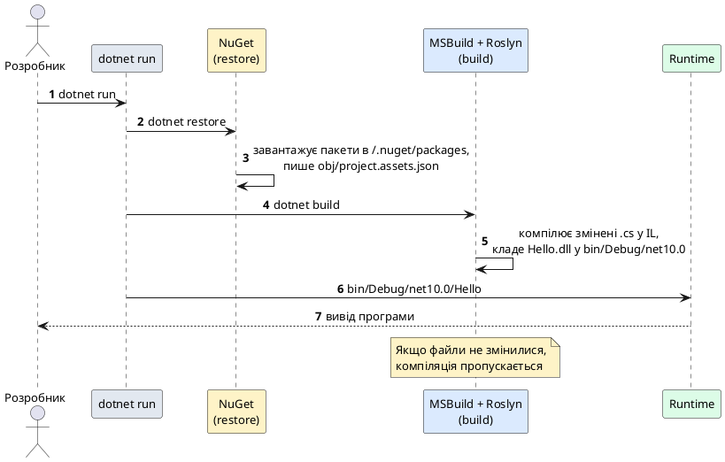

# Перша програма: SDK, CLI, IDE і дебагер

::card-group

::card{title="Навчальні цілі" icon="i-lucide-graduation-cap"}

- Встановити .NET 10 SDK, перевірити встановлені версії і зафіксувати версію SDK для папки.
- Запускати file-based програми командою `dotnet run app.cs` і передавати їм аргументи.
- Створювати класичний проєкт, читати `.csproj` і пояснювати кожен файл у `bin/` та `obj/`.
- Пояснити, у що компілятор перетворює top-level statements.
- Розрізняти конфігурації Debug і Release та пояснювати різницю у швидкості.
- Знаходити помилку дебагером: breakpoint, покрокове виконання, Locals, Watch.

::

::card{title="Технологічний стек" icon="i-lucide-cpu"}

- **Платформа:** .NET 10 (LTS), SDK 10.0.404, runtime 10.0.15
- **Мова:** C# 14
- **Інструменти:** `dotnet` CLI, Visual Studio 2026, JetBrains Rider, VS Code + C# Dev Kit
- **Приклади:** `samples/csharp/fundamentals/02-first-program/`

::

::card{title="Поглиблено" icon="i-lucide-telescope"}

Розділи поза програмою модуля. У тексті вони позначені фіолетовою рамкою.

- [Директиви #: і пакети в file-based програмах](#директиви-налаштування-без-csproj)
- [Від файлу до проєкту: dotnet project convert](#від-файлу-до-проєкту)
- [Чому Debug повільніший: атрибут Debuggable](#debug-і-release)
- [Єдиний стиль коду: .editorconfig і dotnet format](#єдиний-стиль-коду-editorconfig-і-dotnet-format)

::

::

---

## Що встановлюється разом із .NET

Попередня лекція описала платформу: CLR виконує assembly, BCL дає готові типи, компілятор перетворює C# на IL. На диску розробника всі ці частини лежать в одній папці — там, куди встановлено .NET. Якщо знати, що в ній лежить, легше зрозуміти, чому програма в одного студента збирається, а в іншого — ні.

### SDK і runtime

.NET постачається у двох варіантах:

- **.NET Runtime** — CLR і BCL. Його достатньо, щоб **запускати** готові програми.
- **.NET SDK** (*Software Development Kit*) — runtime плюс усе, що потрібно для **розробки**: компілятор C# (Roslyn), build-система MSBuild, менеджер пакетів NuGet, шаблони проєктів і команди `dotnet build`, `dotnet run`, `dotnet new`.

Ось що лежить у папці встановленого SDK 10.0.404 (виміряно командою `du -sh`):

{.diagram-img}

Файл `dotnet` (`dotnet.exe` на Windows) — це **muxer** (від *multiplexer*): одна точка входу для всіх команд. Сам по собі він нічого не компілює і не виконує. Якщо після `dotnet` стоїть команда (`build`, `run`, `new`), він передає її SDK. Якщо стоїть шлях до `.dll`, він запускає її в runtime.

### Встановлення .NET 10 SDK

::tabs

::tabs-item{label="Windows"}

```powershell
winget install Microsoft.DotNet.SDK.10
```

Visual Studio 2026 встановлює .NET 10 SDK разом із workload «.NET desktop development», тому окремо його ставити не потрібно.

::

::tabs-item{label="macOS"}

```bash
curl -sSL https://dot.net/v1/dotnet-install.sh | bash -s -- --channel 10.0
```

Скрипт ставить SDK у `~/.dotnet`. Додайте в `~/.zshrc` рядки `export DOTNET_ROOT=$HOME/.dotnet` і `export PATH=$PATH:$DOTNET_ROOT` та перезапустіть термінал. Інший варіант — інсталятор `.pkg` з dotnet.microsoft.com.

::

::tabs-item{label="Linux (Ubuntu)"}

```bash
sudo apt-get update && sudo apt-get install -y dotnet-sdk-10.0
```

::

::

### Перевірка встановлених версій

Три команди відповідають на питання «що в мене стоїть»:

::field-group

::field{name="dotnet --version" type="версія SDK"}
Версія SDK, яку буде використано **в поточній папці**. Якщо в папці або вище лежить `global.json`, відповідь може відрізнятися від найновішого встановленого SDK.
::

::field{name="dotnet --list-sdks" type="усі SDK"}
Список усіх встановлених SDK із шляхами.
::

::field{name="dotnet --list-runtimes" type="усі runtime"}
Список runtime: `Microsoft.NETCore.App` (консольні програми), `Microsoft.AspNetCore.App` (вебзастосунки), на Windows ще `Microsoft.WindowsDesktop.App` (WinForms, WPF).
::

::field{name="dotnet --info" type="повний звіт"}
Версія SDK, ОС, ідентифікатор платформи (RID), шлях до SDK, усі SDK і runtime. Цей вивід додають до звіту про помилку.
::

::

::terminal-preview{title="dotnet --info (фрагмент)"}
```text
.NET SDK:
 Version:           10.0.404
 Commit:            2ab2854867
 MSBuild version:   18.9.15+2ab285486

Runtime Environment:
 OS Name:     Mac OS X
 OS Platform: Darwin
 RID:         osx-arm64
 Base Path:   /Users/arakviel/.local/share/mise/installs/dotnet/10.0.404/sdk/10.0.404/

Host:
  Version:      10.0.15
  Architecture: arm64

.NET SDKs installed:
  10.0.404 [/Users/arakviel/.local/share/mise/installs/dotnet/10.0.404/sdk]

.NET runtimes installed:
  Microsoft.AspNetCore.App 10.0.15 [...]
  Microsoft.NETCore.App 10.0.15 [...]
```
::

Номер SDK і номер runtime різні: SDK 10.0.404 містить runtime 10.0.15. Третя цифра SDK складається з номера «гілки можливостей» (4xx) і номера патча (04). Runtime отримує лише виправлення, а SDK — ще й нові можливості інструментів, тому номери ростуть незалежно.

### Кілька SDK на одній машині і global.json

На одній машині можуть стояти кілька SDK, наприклад 10.0 і 11.0. За замовчуванням `dotnet` бере **найновіший**. Щоб папка проєкту завжди збиралася тим самим SDK, у ній кладуть файл `global.json`:

```json [global.json]
{
  "sdk": {
    "version": "10.0.404",
    "rollForward": "latestFeature"
  }
}
```

- `version` — мінімальна потрібна версія SDK.
- `rollForward: latestFeature` — дозволяє взяти новіший SDK тієї самої мажорної і мінорної версії (10.0.5xx, 10.0.6xx), але не 11.0.

SDK шукає `global.json` у поточній папці, потім у батьківській і так до кореня диска. Тому один файл у корені репозиторію діє на всі проєкти в ньому.

::::accordion

:::accordion-item{label="Спробуйте: зафіксуйте версію SDK для папки" icon="i-lucide-clipboard-list"}

1. Створіть порожню папку `sdk-test` і перейдіть у неї.
2. Дізнайтеся свою версію SDK: `dotnet --version`.
3. Створіть `global.json` командою (підставте свою версію): `dotnet new globaljson --sdk-version 10.0.404`.
4. Відкрийте `global.json` і замініть версію на `9.0.100`. Знову виконайте `dotnet --version`.
5. Видаліть `global.json` і переконайтеся, що `dotnet --version` знову працює.

Очікуваний вивід на кроці 4 (якщо SDK 9.0.100 не встановлено):

::terminal-preview{title="dotnet --version"}
```text
The command could not be loaded, possibly because:
  * You intended to execute a .NET application:
      The application '--version' does not exist or is not a managed .dll or .exe.
  * You intended to execute a .NET SDK command:
      A compatible .NET SDK was not found.

Requested SDK version: 9.0.100
global.json file: .../sdk-test/global.json
```
::

:::

:::accordion-item{label="Розв'язок" icon="i-lucide-check-circle"}

Без `rollForward` у `global.json` діє політика за замовчуванням `latestPatch`: підходить лише SDK 9.0.1xx. Новіший SDK 10 її не задовольняє, тому `dotnet` відмовляється працювати і пише, який `global.json` спричинив проблему. Команда завершується з ненульовим кодом виходу (на macOS — 155), тож build-скрипт теж зупиниться.

Головне — помилка вказує шлях до `global.json`. Якщо проєкт однокурсника «не збирається», перше, що варто перевірити, — чи немає в репозиторії `global.json` з версією, якої у вас немає.

:::

::::

---

## File-based програми: dotnet run app.cs

До .NET 10 навіть програма з одного рядка потребувала проєкту: файлу `.csproj` поруч із кодом. Починаючи з .NET 10, один файл `.cs` можна запустити напряму. Такі програми називаються **file-based apps** (програми на основі файлу).

```csharp [hello.cs]
#!/usr/bin/env dotnet

Console.WriteLine("Привіт, .NET 10!");
Console.WriteLine($"Аргументів: {args.Length}");
```

::terminal-preview{title="dotnet run hello.cs -- a b c"}
```text
Привіт, .NET 10!
Аргументів: 3
```
::

- Аргументи для самої програми пишуться після `--`. Все, що до `--`, належить команді `dotnet run`.
- `args` — масив рядків з аргументами командного рядка. Він доступний у top-level коді без оголошення.
- Перший рядок `#!/usr/bin/env dotnet` (*shebang*) на macOS і Linux дозволяє запускати файл як звичайну програму: `chmod +x hello.cs`, потім `./hello.cs`. На Windows цей рядок ігнорується. Shebang викликає той `dotnet`, що першим знайдеться в `PATH`, тому там має бути SDK 10 або новіший.

### Що відбувається при запуску файлу

Компілятору C# потрібен проєкт: список файлів, target framework, налаштування. Для file-based програми SDK створює **віртуальний проєкт** у пам'яті, збирає його і кладе результат у службову папку в профілі користувача (на macOS — `~/Library/Application Support/dotnet/runfile/hello-<хеш>/`). Там лежать ті самі `hello.dll`, `hello.runtimeconfig.json` і apphost, що й у звичайного проєкту.

Якщо файл не змінювався з минулого запуску, SDK пропускає build і одразу запускає готову `.dll`. Звідси наслідок, який збиває з пантелику: **попередження компілятора видно лише при першому запуску після зміни файлу**. Другий запуск того самого файлу їх уже не показує.

:::::deep-dive

### Директиви #: — налаштування без .csproj

Те, що в проєкті пишеться в `.csproj`, у file-based програмі пишеться директивами `#:` на початку файлу:

::field-group

::field{name="#:package Назва@версія" type="пакет NuGet"}
Підключає пакет з nuget.org. Аналог `<PackageReference>` у `.csproj`.
::

::field{name="#:property Ім'я=значення" type="властивість MSBuild"}
Задає властивість MSBuild. Наприклад, `#:property PublishAot=false` вимикає підготовку до Native AOT, а `#:property LangVersion=preview` вмикає мовні можливості в стадії preview.
::

::field{name="#:sdk Назва" type="SDK проєкту"}
Змінює SDK проєкту. Наприклад, `#:sdk Microsoft.NET.Sdk.Web` робить з одного файлу вебзастосунок.
::

::field{name="#:project шлях" type="посилання на проєкт"}
Підключає інший проєкт (наприклад, бібліотеку) за шляхом до його `.csproj`.
::

::

Пакет Humanizer перетворює числа, дати й ідентифікатори на текст для людини:

```csharp [package.cs]
#:package Humanizer@2.14.1

using Humanizer;

Console.WriteLine(TimeSpan.FromMinutes(90).Humanize(2));
Console.WriteLine("file_based_app".Humanize());
Console.WriteLine(1_234_567.ToWords());
```

::terminal-preview{title="dotnet run package.cs"}
```text
1 hour, 30 minutes
file based app
one million two hundred and thirty-four thousand five hundred and sixty-seven
```
::

При першому запуску SDK завантажує пакет з nuget.org у локальний кеш (`~/.nuget/packages`), далі бере його звідти. `Humanize` і `ToWords` — методи розширення (*extension methods*) з пакета: вони виглядають як методи `TimeSpan`, `string` та `int`, хоча визначені в Humanizer. Як це працює, розбирається в розділі про ООП.

::::accordion

:::accordion-item{label="Спробуйте: інші можливості Humanizer" icon="i-lucide-clipboard-list"}

1. Створіть файл `humanize.cs` і підключіть той самий пакет директивою `#:package`.
2. Виведіть три рядки:
   - рядок `"PascalCaseString"`, перетворений методом `Humanize()`;
   - число `5`, перетворене методом `ToOrdinalWords()` (порядковий числівник);
   - проміжок `TimeSpan.FromDays(16)`, перетворений методом `Humanize()`.
3. Запустіть файл.

Очікуваний вивід:

::terminal-preview{title="dotnet run humanize.cs"}
```text
Pascal case string
fifth
2 weeks
```
::

:::

:::accordion-item{label="Розв'язок" icon="i-lucide-check-circle"}

```csharp [humanize.cs]
#:package Humanizer@2.14.1

using Humanizer;

Console.WriteLine("PascalCaseString".Humanize());
Console.WriteLine(5.ToOrdinalWords());
Console.WriteLine(TimeSpan.FromDays(16).Humanize());
```

`Humanize()` для `TimeSpan` за замовчуванням залишає одну найбільшу одиницю: 16 днів — це 2 повні тижні, залишок у 2 дні відкидається. У першому прикладі лекції `Humanize(2)` просив дві одиниці, тому вийшло «1 hour, 30 minutes».

:::

::::

### Від файлу до проєкту

Коли програма виростає з одного файлу, її перетворюють на звичайний проєкт однією командою:

```bash
dotnet project convert package.cs
```

Команда створює папку `package/` з файлами `package.cs` і `package.csproj`. Директиви `#:` переходять у `.csproj`, а з `.cs` зникають:

```xml [package/package.csproj]
<Project Sdk="Microsoft.NET.Sdk">

  <PropertyGroup>
    <OutputType>Exe</OutputType>
    <TargetFramework>net10.0</TargetFramework>
    <ImplicitUsings>enable</ImplicitUsings>
    <Nullable>enable</Nullable>
    <PublishAot>true</PublishAot>
    <PackAsTool>true</PackAsTool>
    <UserSecretsId>package-2fe40792...</UserSecretsId>
  </PropertyGroup>

  <ItemGroup>
    <PackageReference Include="Humanizer" Version="2.14.1" />
  </ItemGroup>

</Project>
```

Рядки `PublishAot`, `PackAsTool` і `UserSecretsId` — значення за замовчуванням для file-based програм, які віртуальний проєкт мав неявно. Тепер вони видимі. Їх можна видалити, якщо Native AOT і публікація як інструмента `dotnet` не потрібні.

:::::

::callout{icon="i-lucide-lightbulb"}
**Коли файл, а коли проєкт**

- :icon{name="i-lucide-circle-check" class="inline-block text-green-500"} **Файл `.cs`** — навчальні приклади, міні-завдання цього курсу, скрипти автоматизації, перевірка ідеї за хвилину.
- :icon{name="i-lucide-circle-check" class="inline-block text-green-500"} **Проєкт `.csproj`** — програма з кількох файлів, бібліотека, тести, усе, що відкриватиметься в IDE і житиме довше за тиждень.
- :icon{name="i-lucide-circle-x" class="inline-block text-red-500"} **Не робіть з файлу** програму на тисячу рядків: IDE, дебагер і інструменти аналізу найкраще працюють з проєктом.

::

---

## Класичний проєкт

### dotnet new console

Проєкти створюються з шаблонів командою `dotnet new`. Список шаблонів дає `dotnet new list`:

::terminal-preview{title="dotnet new list (фрагмент)"}
```text
Template Name        Short Name   Language    Tags
Class Library        classlib     [C#],F#,VB  Common/Library
Console App          console      [C#],F#,VB  Common/Console
```
::

```bash
dotnet new console -o Hello
cd Hello
```

Опція `-o Hello` створює папку `Hello` і дає проєкту ім'я `Hello`. Шаблон кладе два файли:

```csharp [Program.cs]
Console.WriteLine("Hello, World!");
```

```xml [Hello.csproj]
<Project Sdk="Microsoft.NET.Sdk">

  <PropertyGroup>
    <OutputType>Exe</OutputType>
    <TargetFramework>net10.0</TargetFramework>
    <ImplicitUsings>enable</ImplicitUsings>
    <Nullable>enable</Nullable>
  </PropertyGroup>

</Project>
```

### Анатомія .csproj

Файл проєкту — XML для build-системи MSBuild. Усе, чого в ньому немає, береться зі значень за замовчуванням SDK. Наприклад, перелік файлів не потрібен: у проєкт автоматично потрапляють усі `*.cs` у папці та підпапках.

{.diagram-img}

Дві останні властивості змінюють поведінку компілятора, тож розберемо їх окремо.

### ImplicitUsings: неявні using

`Console` — це скорочене ім'я класу `System.Console`. У C++ для використання імен з простору `std` писали `using namespace std;` або `std::cout`. У C# аналог — директива `using System;`. Проте в `Program.cs` її немає, і програма компілюється.

Під час build SDK генерує файл `obj/Debug/net10.0/Hello.GlobalUsings.g.cs`:

```csharp [obj/Debug/net10.0/Hello.GlobalUsings.g.cs]
// <auto-generated/>
global using System;
global using System.Collections.Generic;
global using System.IO;
global using System.Linq;
global using System.Net.Http;
global using System.Threading;
global using System.Threading.Tasks;
```

`global using` діє на всі файли проєкту. Ці сім namespace покривають більшість щоденного коду: консоль, колекції, файли, LINQ, HTTP, потоки й асинхронність. `<ImplicitUsings>enable</ImplicitUsings>` вмикає генерацію цього файлу.

::::accordion

:::accordion-item{label="Спробуйте: вимкніть неявні using" icon="i-lucide-clipboard-list"}

1. У проєкті `Hello` замініть вміст `Program.cs` на дві команди: прочитати всі рядки файлу `Program.cs` методом `File.ReadAllLines` і вивести їхню кількість.
2. Запустіть `dotnet run` і переконайтеся, що програма друкує `2`.
3. У `Hello.csproj` змініть `enable` на `disable` у `<ImplicitUsings>` і виконайте `dotnet build`.
4. Виправте помилки, не повертаючи `enable`.

Очікуваний вивід на кроці 3:

::terminal-preview{title="dotnet build"}
```text
Program.cs(1,13): error CS0103: The name 'File' does not exist in the current context
Program.cs(2,1): error CS0103: The name 'Console' does not exist in the current context
    0 Warning(s)
    2 Error(s)
```
::

:::

:::accordion-item{label="Розв'язок" icon="i-lucide-check-circle"}

```csharp [Program.cs]
using System;
using System.IO;

var lines = File.ReadAllLines("Program.cs");
Console.WriteLine(lines.Length);
```

`Console` живе в namespace `System`, а `File` — у `System.IO`. Без неявних `using` компілятор не знає коротких імен і повідомляє `CS0103`. Директиви `using` мають стояти на початку файлу, до будь-якого коду. Після виправлення кількість рядків стала 5, бо файл подовшав.

:::

::::

### Nullable: попередження про null

У C++ вказівник може бути `nullptr`, і розіменування такого вказівника — невизначена поведінка. У C# змінна посилального типу (наприклад, `string`) теж може містити `null`, а звернення до її членів кидає `NullReferenceException`. `<Nullable>enable</Nullable>` вмикає аналіз, який шукає такі місця **під час компіляції**:

```csharp [Program.cs]
string name = Console.ReadLine();
Console.WriteLine($"Довжина: {name.Length}");
```

::terminal-preview{title="dotnet build"}
```text
Program.cs(1,15): warning CS8600: Converting null literal or possible null value to non-nullable type.
Program.cs(2,31): warning CS8602: Dereference of a possibly null reference.
```
::

- `Console.ReadLine()` повертає `string?` — рядок **або** `null`. `null` приходить, коли вхідний потік закінчився: користувач натиснув `Ctrl+Z` (Windows) чи `Ctrl+D` (macOS, Linux) або вхід перенаправлено з порожнього файлу.
- `string` без знака питання оголошує, що `null` тут бути не повинно. Компілятор попереджає про присвоєння (`CS8600`) і про звернення до `.Length` (`CS8602`).

Це попередження, а не помилка: програма збирається. Якщо запустити її з порожнім входом (`dotnet run < /dev/null`), вона впаде саме там, де попереджав компілятор:

::terminal-preview{title="dotnet run < /dev/null"}
```text
Unhandled exception. System.NullReferenceException: Object reference not set to an instance of an object.
   at Program.<Main>$(String[] args) in .../Program.cs:line 2
```
::

Детально `?`, `??`, `?.` і робота з `null` розбираються в лекції про значущі й посилальні типи.

::::accordion

:::accordion-item{label="Спробуйте: приберіть попередження про null" icon="i-lucide-clipboard-list"}

1. Візьміть дворядкову програму вище і зберіть її: має бути два попередження.
2. Виправте код так, щоб попереджень не було і програма не падала при порожньому вході. Використайте тип `string?` і перевірку `if (name != null)`. Якщо введення немає, виведіть «Введення закінчилося, ім'я не отримано.»
3. Перевірте обидва випадки: з ім'ям на вході і з порожнім входом.

::tabs

::tabs-item{label="PowerShell (Windows)"}

```powershell
"Олена" | dotnet run
cmd /c "dotnet run < NUL"
```

PowerShell не підтримує перенаправлення `<`, тому порожній вхід подається через `cmd`.

::

::tabs-item{label="bash / zsh (macOS, Linux)"}

```bash
echo "Олена" | dotnet run
dotnet run < /dev/null
```

::

::

Очікуваний вивід:

::terminal-preview{title="два запуски"}
```text
Ваше ім'я: Довжина: 5
Ваше ім'я: Введення закінчилося, ім'я не отримано.
```
::

:::

:::accordion-item{label="Розв'язок" icon="i-lucide-check-circle"}

```csharp [Program.cs]
Console.Write("Ваше ім'я: ");
string? name = Console.ReadLine();

if (name != null)
{
    Console.WriteLine($"Довжина: {name.Length}");
}
else
{
    Console.WriteLine("Введення закінчилося, ім'я не отримано.");
}
```

Усередині `if (name != null)` компілятор знає, що `name` не `null`, і не попереджає про `name.Length`. Такий аналіз називається аналізом потоку (*flow analysis*): компілятор відстежує, які перевірки вже пройдено на кожному шляху виконання.

`Console.Write` не переводить рядок, тому «Довжина: 5» друкується в тому ж рядку, що й «Ваше ім'я: »: ім'я, передане через `|`, у консоль не виводиться.

:::

::::

### Що лежить у bin і obj

```bash
dotnet build
```

Після build поруч із кодом з'являються дві папки:

- **`obj/`** — проміжні файли build: результат restore пакетів (`project.assets.json`), згенерований код (`GlobalUsings.g.cs`, `AssemblyInfo.cs`), кеші для швидкого повторного build.
- **`bin/`** — результат, який можна запускати.

{.diagram-img}

Шлях `bin/Debug/net10.0/` складається з конфігурації (`Debug`) і target framework (`net10.0`). Якщо проєкт збирається під кілька платформ, для кожної буде своя папка.

::warning
Папки `bin/` і `obj/` не додаються в git: їх відтворює `dotnet build` з вихідного коду. Шаблон `.gitignore` для .NET створює команда `dotnet new gitignore`.
::

### Що робить dotnet run

`dotnet run` — це три кроки, кожен з яких можна викликати окремо:

::plant-uml{alt="Послідовність кроків команди dotnet run: restore, build, запуск зібраної assembly"}



::

::field-group

::field{name="dotnet restore" type="restore пакетів"}
Читає `<PackageReference>` з `.csproj`, завантажує потрібні пакети і записує повний граф залежностей у `obj/project.assets.json`. Викликається автоматично перед `build`.
::

::field{name="dotnet build" type="build"}
Компілює проєкт у `bin/<Конфігурація>/<платформа>/`. Опція `-c Release` обирає конфігурацію Release.
::

::field{name="dotnet run" type="build і запуск"}
`restore` + `build` + запуск. Аргументи програми пишуться після `--`.
::

::field{name="dotnet clean" type="очищення"}
Видаляє результати build з `bin/` і `obj/` для поточної конфігурації.
::

::field{name="dotnet publish" type="публікація"}
Готує програму до передачі користувачу. За замовчуванням збирає Release у `bin/Release/net10.0/publish/`. Варіанти публікації розглянуто в попередній лекції.
::

::

---

## Найпростіша програма

### Top-level statements і класичний Main

У C++ виконання починається з функції `main`. У C# точка входу — статичний метод `Main` якогось класу. Шаблон `dotnet new console` до .NET 6 генерував саме такий код, і його досі можна отримати опцією `--use-program-main`:

```bash
dotnet new console -o Classic --use-program-main
```

```csharp [Classic/Program.cs]
namespace Classic;

class Program
{
    static void Main(string[] args)
    {
        Console.WriteLine("Hello, World!");
    }
}
```

| Елемент | Значення |
|---|---|
| `namespace Classic;` | namespace для всього файлу (*file-scoped namespace*), аналог `namespace Classic { ... }` |
| `class Program` | клас, у якому лежить точка входу; у C# немає функцій поза класами |
| `static` | метод належить класу, а не об'єкту: CLR викликає його без створення `Program` |
| `void` | метод нічого не повертає; варіант `int Main` повертає код виходу процесу |
| `string[] args` | аргументи командного рядка; параметр можна опустити |

Сучасний шаблон містить лише один рядок `Console.WriteLine("Hello, World!");`. Це **top-level statements** (оператори верхнього рівня): код, написаний прямо у файлі, без класу і методу. Компілятор сам обгортає його у клас `Program` і метод `<Main>$`:

{.diagram-img}

Ім'я `<Main>$` містить символи `<`, `>` і `$`, недопустимі в іменах C#. Компілятор обирає таке ім'я навмисно: його неможливо випадково повторити чи викликати з коду. Те саме ім'я ви бачили в IL у попередній лекції.

Правила top-level statements:

- такий файл у проєкті може бути **лише один**: точка входу одна;
- оператори пишуться **до** оголошень класів у тому самому файлі;
- змінна `args` доступна без оголошення;
- `return 1;` наприкінці робить код виходу процесу рівним 1.

Детальніше top-level statements і аргументи командного рядка розбираються в окремій лекції.

::::accordion

:::accordion-item{label="Спробуйте: знайдіть різницю в декомпіляторі" icon="i-lucide-clipboard-list"}

1. Створіть проєкт з класичним `Main`: `dotnet new console -o Classic --use-program-main`.
2. Зберіть його: `dotnet build Classic`.
3. Декомпілюйте assembly (інструмент `ilspycmd` встановлено в попередній лекції): `ilspycmd Classic/bin/Debug/net10.0/Classic.dll`.
4. Знайдіть у виводі клас `Program`. Чим він відрізняється від коду, який ви написали? Що компілятор додав сам?

:::

:::accordion-item{label="Розв'язок" icon="i-lucide-check-circle"}

::terminal-preview{title="ilspycmd Classic/bin/Debug/net10.0/Classic.dll (кінець виводу)"}
```text
namespace Classic;

internal class Program
{
	private static void Main(string[] args)
	{
		Console.WriteLine("Hello, World!");
	}
}
```
::

Компілятор явно дописав модифікатори доступу, які в коді не вказано: `internal` для класу і `private` для методу. Це значення за замовчуванням: клас без модифікатора видимий лише всередині своєї assembly, член класу без модифікатора — лише всередині класу. CLR може викликати `private` метод `Main`, бо точку входу записано в метаданих assembly, а перевірки доступу на неї не поширюються.

Вище класу декомпілятор показує атрибути assembly (`[assembly: AssemblyVersion("1.0.0.0")]` тощо): SDK генерує їх у `obj/Debug/net10.0/Classic.AssemblyInfo.cs` з властивостей проєкту.

:::

::::

### Коментарі

Синтаксис коментарів такий самий, як у C++, плюс один вид для документації:

```csharp
// однорядковий коментар

/* багаторядковий
   коментар */

/// <summary>
/// Повертає суму цілих чисел від 1 до n.
/// </summary>
/// <param name="n">Верхня межа, включно.</param>
static long SumTo(int n) => (long)n * (n + 1) / 2;
```

Коментар з трьох скісних рисок `///` містить **XML-документацію**. IDE показує текст з `<summary>` і `<param>` у підказці, коли курсор стоїть на виклику `SumTo`. Так само документовано весь BCL: підказка до `Console.WriteLine` — це XML-коментар з вихідного коду .NET.

---

## Debug і Release

Кожен проєкт має дві стандартні **конфігурації** build:

- **Debug** — за замовчуванням для `dotnet build` і `dotnet run`. Компілятор не оптимізує IL, а assembly позначається атрибутом, який забороняє JIT оптимізувати машинний код. Кожен рядок коду лишається окремим кроком, усі локальні змінні — в пам'яті. Це потрібно дебагеру.
- **Release** — за замовчуванням для `dotnet publish`. Компілятор і JIT оптимізують код: прибирають зайві змінні, вставляють тіла маленьких методів у місце виклику (*inline*), тримають значення в регістрах.

Наскільки це важливо, видно на простому циклі:

```csharp [debug-vs-release.cs]
using System.Diagnostics;

#if DEBUG
Console.WriteLine("Конфігурація: Debug");
#else
Console.WriteLine("Конфігурація: Release");
#endif

static long SumTo(int n)
{
    long sum = 0;
    for (int i = 1; i <= n; i++)
    {
        sum += i;
    }
    return sum;
}

SumTo(1_000); // перший виклик з JIT — не міряємо

var sw = Stopwatch.StartNew();
long result = SumTo(100_000_000);
sw.Stop();
Console.WriteLine($"Результат: {result}");
Console.WriteLine($"Час: {sw.ElapsedMilliseconds} мс");
```

`#if DEBUG` — директива препроцесора, як у C++. Символ `DEBUG` визначено лише в конфігурації Debug, тому в Release-build потрапляє лише гілка `#else`.

::code-group

```text [dotnet run debug-vs-release.cs]
Конфігурація: Debug
Результат: 5000000050000000
Час: 173 мс
```

```text [dotnet run debug-vs-release.cs -c Release]
Конфігурація: Release
Результат: 5000000050000000
Час: 27 мс
```

::

{.diagram-img}

:::::deep-dive

Різницю пояснює атрибут, який компілятор записує в assembly. Декомпілятор показує його в обох варіантах:

::code-group

```csharp [Debug]
[assembly: Debuggable(DebuggableAttribute.DebuggingModes.Default
    | DebuggableAttribute.DebuggingModes.DisableOptimizations
    | DebuggableAttribute.DebuggingModes.IgnoreSymbolStoreSequencePoints
    | DebuggableAttribute.DebuggingModes.EnableEditAndContinue)]
```

```csharp [Release]
[assembly: Debuggable(DebuggableAttribute.DebuggingModes.IgnoreSymbolStoreSequencePoints)]
```

::

Флаг `DisableOptimizations` CLR читає при завантаженні assembly і передає JIT: компілювати методи без оптимізацій.

:::::

::warning
Швидкість вимірюють **лише в Release**. Заміри в Debug нічого не кажуть про реальну програму: різниця в 7 разів на одному циклі — звичайна справа.
::

::::accordion

:::accordion-item{label="Спробуйте: власна позначка конфігурації" icon="i-lucide-clipboard-list"}

1. Створіть файл `config.cs`.
2. Використайте `#if DEBUG` / `#else` / `#endif`, щоб у Debug програма друкувала «Режим розробника: докладні повідомлення увімкнено», а в Release — «Готова версія».
3. Після блоку `#if` додайте рядок, який друкується завжди: «Програма завершила роботу.»
4. Запустіть файл у двох конфігураціях.

Очікуваний вивід:

::code-group

```text [dotnet run config.cs]
Режим розробника: докладні повідомлення увімкнено
Програма завершила роботу.
```

```text [dotnet run config.cs -c Release]
Готова версія
Програма завершила роботу.
```

::

:::

:::accordion-item{label="Розв'язок" icon="i-lucide-check-circle"}

```csharp [config.cs]
#if DEBUG
Console.WriteLine("Режим розробника: докладні повідомлення увімкнено");
#else
Console.WriteLine("Готова версія");
#endif

Console.WriteLine("Програма завершила роботу.");
```

Директиви `#if` обробляються **до** компіляції: гілка, що не підходить, в assembly не потрапляє зовсім. Це можна перевірити декомпілятором: у `.dll` з Release рядка «Режим розробника» немає.

:::

::::

---

## Робота в IDE

`dotnet` CLI — базова лінія: команди однакові на всіх ОС і використовуються на CI-сервері. IDE додає редактор з підказками, навігацію по коду і дебагер. Усі три IDE викликають той самий SDK, тому проєкт, створений в одній IDE, відкривається в іншій.

| | Visual Studio 2026 | JetBrains Rider | VS Code + C# Dev Kit |
|---|---|---|---|
| ОС | Windows | Windows, macOS, Linux | Windows, macOS, Linux |
| Ліцензія | Community — безкоштовна для навчання | безкоштовна для некомерційного використання | безкоштовна для навчання й індивідуальних розробників |
| Що встановити | workload «.NET desktop development» | Rider | VS Code + розширення C# Dev Kit + .NET 10 SDK |

### Створення і запуск проєкту

::tabs

::tabs-item{label="Visual Studio 2026"}

1. **Create a new project** → шаблон **Console App** (C#) → **Next**.
2. Ім'я проєкту і папка → **Next**.
3. **Framework:** .NET 10.0 (Long Term Support). Галочка **Do not use top-level statements** створює класичний `Main`.
4. Запуск: **Ctrl+F5** — без дебагера, **F5** — з дебагером.

::

::tabs-item{label="Rider"}

1. **New Solution** → **Console Application**.
2. **Target framework:** net10.0, мова C#.
3. **Create**.
4. Запуск: зелений трикутник біля конфігурації запуску вгорі або біля top-level коду. Поруч — кнопка з жуком для запуску з дебагером.

::

::tabs-item{label="VS Code"}

1. Встановіть розширення **C# Dev Kit** (воно підтягне розширення C#).
2. **Ctrl+Shift+P** (на macOS **Cmd+Shift+P**) → **.NET: New Project...** → **Console App**, ім'я і папка.
3. Відкрийте `Program.cs`. Запуск: **Ctrl+F5** — без дебагера, **F5** — з дебагером.

::

::

---

## Дебагер

Програма `average.cs` має порахувати середню оцінку. Очікується 4,5, а вона друкує 4:

```csharp [average.cs]
int[] grades = [5, 4, 3, 6];

int sum = 0;
for (int i = 0; i < grades.Length; i++)
{
    sum += grades[i];
}

double average = sum / grades.Length;
Console.WriteLine($"Сума: {sum}");
Console.WriteLine($"Середнє: {average}");
```

::terminal-preview{title="dotnet run average.cs"}
```text
Сума: 18
Середнє: 4
```
::

`int[] grades = [5, 4, 3, 6];` створює масив з чотирьох чисел. Масиви детально розбираються в окремій лекції, тут достатньо знати, що `grades.Length` — кількість елементів.

Знайти помилку можна, розставивши `Console.WriteLine` після кожного рядка. Дебагер (*debugger*) робить те саме без зміни коду: зупиняє програму на потрібному рядку і показує значення всіх змінних.

### Основні інструменти

::field-group

::field{name="Breakpoint" type="F9 у VS і VS Code"}
Позначка на рядку, де програма зупиниться **перед** його виконанням. Ставиться кліком на полі ліворуч від номера рядка або клавішею.
::

::field{name="Step Over" type="F10 у VS і VS Code"}
Виконати поточний рядок повністю, навіть якщо в ньому виклик методу, і зупинитися на наступному.
::

::field{name="Step Into" type="F11 у VS і VS Code"}
Якщо в рядку виклик вашого методу, зайти всередину і зупинитися на його першому рядку.
::

::field{name="Step Out" type="Shift+F11 у VS і VS Code"}
Виконати метод до кінця і зупинитися в місці, звідки його викликали.
::

::field{name="Continue" type="F5 у VS і VS Code"}
Виконувати програму до наступного breakpoint.
::

::field{name="Locals" type="вікно"}
Усі локальні змінні поточного методу і їхні значення. Змінене на останньому кроці значення підсвічується.
::

::field{name="Watch" type="вікно"}
Довільні вирази, які ви вписали самі. Обчислюються на кожній зупинці.
::

::field{name="Call Stack" type="вікно"}
Ланцюжок викликів: який метод викликав поточний, хто викликав його і так до `Main`.
::

::

| Дія | Visual Studio 2026 / VS Code | Rider (keymap IntelliJ) |
|---|---|---|
| Запуск з дебагером | F5 | Shift+F9 |
| Breakpoint | F9 | Ctrl+F8 |
| Step Over | F10 | F8 |
| Step Into | F11 | F7 |
| Step Out | Shift+F11 | Shift+F8 |
| Continue | F5 | F9 |
| Зупинити | Shift+F5 | Ctrl+F2 |

Rider при першому запуску пропонує вибрати keymap. З keymap «Visual Studio» клавіші такі самі, як у першій колонці. На macOS замість **Ctrl** зазвичай **Cmd**, а функціональні клавіші натискаються разом з **fn**.

### Покрокове виконання

Breakpoint на рядку `int sum = 0;`, далі Step Over по одному рядку:

<video controls autoplay loop muted playsinline poster="/videos/csharp/fundamentals/first-program-and-tooling/anim-01-debugger-steps.png" class="diagram-img rounded-xl shadow-lg w-full my-6">
  <source src="/videos/csharp/fundamentals/first-program-and-tooling/anim-01-debugger-steps.mp4" type="video/mp4">
  <source src="/videos/csharp/fundamentals/first-program-and-tooling/anim-01-debugger-steps.webm" type="video/webm">
</video>

- Жовта стрілка показує рядок, який виконається **наступним**. На ньому програма стоїть, але він ще не виконаний.
- Змінна `i` з'являється в Locals лише всередині циклу: вона оголошена в `for` і поза ним не існує.
- Після рядка з діленням `average` дорівнює 4. Обидва операнди `sum / grades.Length` мають тип `int`, тому ділення цілочисельне, а результат 4 перетворюється на `double` вже потім.
- Вираз `(double)sum / grades.Length` у вікні Watch дає 4.5: перетворення першого операнда на `double` робить ділення дробовим.

Виправлений рядок: `double average = (double)sum / grades.Length;`. Чому `18 / 4` дає 4 і як працюють перетворення типів, розбирається в лекції про числа.

::note
Вивід дробового числа залежить від мови системи: з англійськими регіональними налаштуваннями `Console.WriteLine` друкує `4.5`, з українськими — `4,5`. Тому у Watch дебагера і в консолі роздільник може відрізнятися.
::

### Умовний breakpoint

Якщо цикл виконується тисячу разів, а помилка з'являється на 700-й ітерації, натискати F10 сімсот разів не потрібно. **Умовний breakpoint** (*conditional breakpoint*) спрацьовує лише тоді, коли вираз істинний:

- **Visual Studio 2026:** правий клік на точці зупинки → **Conditions** → вираз, наприклад `i == 700`.
- **Rider:** правий клік на точці зупинки → поле **Condition**.
- **VS Code:** правий клік на полі ліворуч від рядка → **Add Conditional Breakpoint...** → **Expression**.

::::accordion

:::accordion-item{label="Спробуйте: зупиніться на третій ітерації" icon="i-lucide-clipboard-list"}

1. Створіть проєкт `Average` у своїй IDE і вставте в `Program.cs` код `average.cs`.
2. Поставте breakpoint на рядку `sum += grades[i];` з умовою `i == 2`.
3. Запустіть з дебагером. Запишіть значення `i`, `sum` і `grades[i]` з вікна Locals або Watch.
4. Зробіть Step Over один раз. Яким стало `sum`?
5. Виправте помилку в обчисленні середнього і переконайтеся, що програма друкує 4,5 (або 4.5).

Зробіть скріншот вікна Locals на кроці 3.

:::

:::accordion-item{label="Розв'язок" icon="i-lucide-check-circle"}

- На кроці 3: `i = 2`, `sum = 9` (5 + 4), `grades[i] = 3`. Рядок `sum += grades[i];` ще не виконано, тому `sum` поки не враховує третю оцінку.
- Після Step Over: `sum = 12`.
- Виправлення: `double average = (double)sum / grades.Length;`.

Програма жодного разу не зупинилася при `i = 0` і `i = 1`: умова перевірялася, але була хибною. Умова — звичайний вираз C#, тому можна писати й складніші: `sum > 10 && i % 2 == 0`.

:::

::::

<!-- VIDEO
id: first-program-02-debugger-session
file: /videos/csharp/fundamentals/first-program-and-tooling/debugger-session.mp4
poster: /images/csharp/fundamentals/first-program-and-tooling/debugger-session-poster.jpg
duration: 50-60s
one-thing: дебагер показує значення змінних на кожному кроці, тому помилку знаходять без Console.WriteLine
viewer: студент після C++, знає, що таке цикл і ділення, ще не користувався дебагером C#
example: average.cs з лекції: оцінки 5, 4, 3, 6, сума 18, програма друкує 4 замість 4,5
beats: hook (програма впевнено друкує неправильне 4) → tension (у коді немає жодної очевидної помилки) → reveal (breakpoint, F10, Locals: sum = 18, average = 4) → proof (Watch: (double)sum / grades.Length = 4.5) → payoff (одне виправлення — правильний результат) → claim (дивіться на значення, а не вгадуйте)
on-screen: "Очікували 4,5 — отримали 4", "F10: Step Over", "Locals", "sum / grades.Length → int / int", "(double)sum / grades.Length = 4.5"
vo: Програма рахує середню оцінку і впевнено друкує чотири, хоча має бути чотири з половиною. Ставимо breakpoint і йдемо по рядку. Сума правильна — вісімнадцять. А середнє вже чотири: ділимо ціле на ціле, і дробова частина зникає. Перевіряємо гіпотезу у вікні Watch — з приведенням до double виходить чотири з половиною. Помилку знайдено, не дописавши жодного рядка виводу.
look: світла палітра схем статті: білий фон, #1E293B, #DBEAFE, #DCFCE7, #FEF3C7; DejaVu Sans + DejaVu Sans Mono; вікно IDE схематично, без логотипів
depends-on: anim-01-debugger-steps.mp4
-->

---

:::::deep-dive

## Єдиний стиль коду: .editorconfig і dotnet format

Коли над проєктом працює кілька людей, кожна IDE за замовчуванням форматує код по-своєму: відступи у 2 чи 4 пробіли, фігурна дужка на тому ж рядку чи на наступному. Через це в історії git з'являються зміни, де змінилося лише форматування.

**`.editorconfig`** — текстовий файл у корені репозиторію з правилами стилю. Його читають Visual Studio, Rider, VS Code і компілятор C#:

```ini [.editorconfig]
root = true

[*.cs]
indent_style = space
indent_size = 4
csharp_prefer_braces = true:warning
```

- `root = true` — не шукати інших `.editorconfig` у батьківських папках.
- `[*.cs]` — правила нижче діють для файлів C#.
- `csharp_prefer_braces = true:warning` — вимагати фігурні дужки навіть навколо одного оператора в `if` і циклах; порушення — попередження.

**`dotnet format`** приводить код проєкту у відповідність до цих правил. З опцією `--verify-no-changes` команда нічого не змінює, а лише повідомляє про порушення і завершується з кодом 2. Так її використовують на CI-сервері, щоб не пропустити невідформатований код.

Файл до форматування:

```csharp [Program.cs]
int  x=5;
if(x>3){
Console.WriteLine( "більше" );
}
```

::terminal-preview{title="dotnet format --verify-no-changes (фрагмент)"}
```text
Program.cs(1,5): error WHITESPACE: Fix whitespace formatting. Delete 1 characters.
Program.cs(1,7): error WHITESPACE: Fix whitespace formatting. Insert '\s'.
Program.cs(2,3): error WHITESPACE: Fix whitespace formatting. Insert '\s'.
Program.cs(2,8): error WHITESPACE: Fix whitespace formatting. Insert '\n'.
Program.cs(3,1): error WHITESPACE: Fix whitespace formatting. Insert '\s\s\s\s'.
```
::

Після `dotnet format`:

```csharp [Program.cs]
int x = 5;
if (x > 3)
{
    Console.WriteLine("більше");
}
```

Правила стилю коду (як `csharp_prefer_braces`) за замовчуванням перевіряє лише IDE і `dotnet format`. Щоб `dotnet build` теж повідомляв про них, у `.csproj` додають `<EnforceCodeStyleInBuild>true</EnforceCodeStyleInBuild>`:

::terminal-preview{title="dotnet build -p:EnforceCodeStyleInBuild=true"}
```text
Program.cs(2,1): warning IDE0011: Add braces to 'if' statement.
```
::

### Попередження як помилки

Попередження легко ігнорувати: програма все одно збирається. У командних проєктах їх часто перетворюють на помилки властивістю `<TreatWarningsAsErrors>true</TreatWarningsAsErrors>`. Той самий код з `Console.ReadLine()` без перевірки на `null` перестає збиратися:

::terminal-preview{title="dotnet build -p:TreatWarningsAsErrors=true"}
```text
Program.cs(1,15): error CS8600: Converting null literal or possible null value to non-nullable type.
Program.cs(2,31): error CS8602: Dereference of a possibly null reference.
Build FAILED.
```
::

::callout{icon="i-lucide-lightbulb"}
**Які налаштування гігієни вмикати**

- :icon{name="i-lucide-circle-check" class="inline-block text-green-500"} **`.editorconfig` у корені репозиторію** — завжди, навіть для навчального проєкту одного студента: IDE форматуватиме код однаково.
- :icon{name="i-lucide-circle-check" class="inline-block text-green-500"} **`dotnet format --verify-no-changes`** — на CI-сервері в командному проєкті.
- :icon{name="i-lucide-circle-check" class="inline-block text-green-500"} **`TreatWarningsAsErrors`** — у новому проєкті з першого дня: попереджень ще немає, і нові не накопичуються.
- :icon{name="i-lucide-circle-x" class="inline-block text-red-500"} **Не вмикайте `TreatWarningsAsErrors`** в старому проєкті з сотнями попереджень одним комітом: build зламається у всієї команди. Спочатку виправте попередження.

::

::::accordion

:::accordion-item{label="Спробуйте: дужки за правилом" icon="i-lucide-clipboard-list"}

1. У будь-якому проєкті створіть `.editorconfig` з правилами з прикладу вище, але з відступом у **2** пробіли.
2. Замініть `Program.cs` таким кодом:

```csharp [Program.cs]
int x = 5;
if (x > 3)
    Console.WriteLine("більше");
for (int i = 0; i < 2; i++)
{
        Console.WriteLine(i);
}
```

3. Виконайте `dotnet format` і порівняйте файл до і після.

:::

:::accordion-item{label="Розв'язок" icon="i-lucide-check-circle"}

```csharp [Program.cs після dotnet format]
int x = 5;
if (x > 3)
{
  Console.WriteLine("більше");
}

for (int i = 0; i < 2; i++)
{
  Console.WriteLine(i);
}
```

`dotnet format` зробив три зміни: додав фігурні дужки навколо тіла `if` (правило `csharp_prefer_braces`), вирівняв відступи до двох пробілів (`indent_size = 2`) і вставив порожній рядок після блоку `if` перед `for` (вбудоване правило форматування: порожній рядок після блоку). Код не змінив поведінку, змінилося лише форматування.

:::

::::

:::::

---

## Питання для самоперевірки

::::accordion

:::accordion-item{label="Чим SDK відрізняється від runtime і що з них потрібно користувачу програми?" icon="i-lucide-help-circle"}

Runtime — це CLR і BCL, його достатньо для запуску зібраних програм. SDK містить runtime плюс компілятор, MSBuild, NuGet і шаблони — усе, що потрібно для розробки. Користувачу програми, опублікованої як framework-dependent, потрібен лише runtime потрібної версії.

:::

:::accordion-item{label="Чому в одній папці dotnet --version може показувати 10.0.404, а в іншій — помилку?" icon="i-lucide-help-circle"}

`dotnet --version` враховує `global.json` у поточній і батьківських папках. Якщо там вимагається SDK, якого немає на машині, команда завершується помилкою і показує шлях до цього `global.json`.

:::

:::accordion-item{label="Чому попередження компілятора для file-based програми видно лише при першому запуску?" icon="i-lucide-help-circle"}

SDK кешує результат build. Якщо файл не змінювався, повторний `dotnet run app.cs` пропускає компіляцію і запускає готову `.dll`, тому компілятор не запускається і нічого не повідомляє.

:::

:::accordion-item{label="Звідки береться using System, якщо в Program.cs його немає?" icon="i-lucide-help-circle"}

З властивості `<ImplicitUsings>enable</ImplicitUsings>`. SDK генерує файл `obj/Debug/net10.0/<Проєкт>.GlobalUsings.g.cs` з директивами `global using System;`, `global using System.IO;` та ще п'ятьма. `global using` діє на всі файли проєкту.

:::

:::accordion-item{label="У що компілятор перетворює top-level statements?" icon="i-lucide-help-circle"}

У внутрішній клас `Program` зі статичним методом `<Main>$(string[] args)`, у тіло якого переносяться всі оператори верхнього рівня. Ім'я `<Main>$` недопустиме в C#, тому його неможливо викликати чи повторити з коду.

:::

:::accordion-item{label="Чому той самий цикл у Debug виконується в кілька разів повільніше, ніж у Release?" icon="i-lucide-help-circle"}

У Debug компілятор і JIT не оптимізують код: кожна змінна зберігається в пам'яті, кожен рядок лишається окремим кроком. Це потрібно дебагеру, щоб зупинятися на будь-якому рядку й показувати будь-яку змінну, але коштує швидкості. Тому швидкість вимірюють лише в Release.

:::

:::accordion-item{label="Що означає жовта стрілка дебагера на рядку: рядок уже виконано чи ні?" icon="i-lucide-help-circle"}

Ні. Стрілка вказує на рядок, який виконається наступним. Щоб побачити результат цього рядка, треба зробити Step Over.

:::

:::accordion-item{label="Навіщо в bin поруч із Hello.dll лежать Hello.pdb і Hello.runtimeconfig.json?" icon="i-lucide-help-circle"}

`Hello.pdb` містить debug-символи: зв'язок інструкцій IL з рядками `Program.cs` та імена локальних змінних. Без нього дебагер не зможе зупинитися на рядку коду. `Hello.runtimeconfig.json` каже apphost і `dotnet`, який runtime потрібен (`Microsoft.NETCore.App` 10.0). Без нього програма вважається self-contained, і runtime не знаходиться.

:::

::::

## Шпаргалка

| Команда / елемент | Що робить |
|---|---|
| `dotnet --version` | версія SDK для поточної папки |
| `dotnet --list-sdks`, `--list-runtimes` | встановлені SDK і runtime |
| `dotnet new globaljson --sdk-version X` | фіксує версію SDK для папки |
| `dotnet run app.cs -- a b` | збирає і запускає один файл, `a b` — аргументи програми |
| `dotnet new console -o Name` | новий консольний проєкт |
| `--use-program-main` | шаблон з класичним `Main` замість top-level statements |
| `dotnet restore / build / run / clean` | пакети / build / build і запуск / очищення |
| `-c Release` | конфігурація Release |
| `<ImplicitUsings>` | неявні `global using` для 7 namespace |
| `<Nullable>` | попередження про можливий `null` |
| `#if DEBUG` | код лише для конфігурації Debug |
| F9 / F10 / F11 / Shift+F11 | breakpoint / Step Over / Step Into / Step Out (VS, VS Code) |

## Практичні завдання

Чотири завдання на закріплення, кожне на 10–15 хвилин. У кожному є письмова відповідь і скріншот: результат має бути отриманий на вашій машині.

::::accordion

:::accordion-item{label="Завдання 1. Debug і Release зсередини" icon="i-lucide-clipboard-list"}

1. Створіть консольний проєкт у своїй IDE (не через CLI).
2. Зберіть його двічі: у Debug і в Release (у CLI: `dotnet build` і `dotnet build -c Release`).
3. Заповніть таблицю розмірів файлів для обох папок `bin/Debug/net10.0/` і `bin/Release/net10.0/`:

| Файл | Debug, байт | Release, байт |
|---|---|---|
| `.dll` | | |
| `.pdb` | | |
| `.runtimeconfig.json` | | |
| apphost | | |

4. Один із JSON-файлів у Release довший. Відкрийте обидва варіанти, знайдіть різницю і поясніть її двома реченнями.

Додайте скріншот обох папок з розмірами файлів.

:::

:::accordion-item{label="Розв'язок завдання 1" icon="i-lucide-check-circle"}

На macOS Arm64 для проєкту з шаблону `.dll` (4608 байт), `.pdb` (10 896 байт) і apphost (124 712 байт) однакові в обох конфігураціях, а `runtimeconfig.json` у Release довший: 330 байт проти 259. У ньому з'являється рядок:

```json
"System.Reflection.Metadata.MetadataUpdater.IsSupported": false,
```

Це вимкнення **hot reload**: у Debug можна змінювати код програми, не перезапускаючи її, а в Release ця можливість вимкнена, бо вона потрібна лише під час розробки.

Розмір `.dll` не змінюється, бо в одному рядку `Console.WriteLine` нічого оптимізувати. Головна різниця Debug і Release — не в розмірі, а в атрибуті `Debuggable` і, як наслідок, у швидкості після JIT.

:::

:::accordion-item{label="Завдання 2. Три способи запустити ту саму програму" icon="i-lucide-clipboard-list"}

1. Створіть проєкт `dotnet new console -o Hello` і зберіть його: `dotnet build`.
2. Запустіть програму трьома способами і переконайтеся, що вивід однаковий:
   - `dotnet run`;
   - `dotnet bin/Debug/net10.0/Hello.dll`;
   - через apphost: `./bin/Debug/net10.0/Hello` (macOS, Linux) або `bin\Debug\net10.0\Hello.exe` (Windows).
3. Перейменуйте `Hello.runtimeconfig.json` у папці `bin/Debug/net10.0/` на `Hello.runtimeconfig.json.bak`. Повторіть другий і третій способи.
4. Поясніть письмово: що зламалося і чому? Яким словом .NET називає програму без цього файлу?
5. Поверніть файлу ім'я і виконайте `dotnet run`. Чи відновиться файл, якщо його видалити зовсім?

Додайте скріншот повідомлення про помилку з кроку 3.

:::

:::accordion-item{label="Розв'язок завдання 2" icon="i-lucide-check-circle"}

::terminal-preview{title="dotnet bin/Debug/net10.0/Hello.dll (без runtimeconfig.json)"}
```text
A fatal error was encountered. The library 'libhostpolicy.dylib' required to execute the application was not found in '.../bin/Debug/net10.0/'.
Failed to run as a self-contained app.
  - The application was run as a self-contained app because '.../Hello.runtimeconfig.json' was not found.
  - If this should be a framework-dependent app, add the '.../Hello.runtimeconfig.json' file and specify the appropriate framework.
```
::

- Без `runtimeconfig.json` хост не знає, який runtime потрібен, і вважає програму **self-contained**: шукає частини runtime поруч із `.dll` і не знаходить їх. На Windows замість `libhostpolicy.dylib` буде `hostpolicy.dll`, на Linux — `libhostpolicy.so`.
- Обидва способи падають однаково, бо і `dotnet Hello.dll`, і apphost `Hello` використовують ту саму логіку пошуку runtime.
- `dotnet run` відновлює файл: перед запуском відбувається `build`, а він бачить, що вихідного файлу бракує, і створює його знову.

:::

:::accordion-item{label="Завдання 3. Розслідування з дебагером" icon="i-lucide-clipboard-list"}

Програма має порахувати парні числа від 1 до 10 включно. Їх п'ять, а програма друкує 4:

```csharp [Program.cs]
int count = 0;
int last = 0;

for (int i = 1; i < 10; i++)
{
    if (i % 2 == 0)
    {
        count++;
        last = i;
    }
}

Console.WriteLine($"Парних чисел: {count}");
Console.WriteLine($"Останнє парне: {last}");
```

::terminal-preview{title="dotnet run"}
```text
Парних чисел: 4
Останнє парне: 8
```
::

1. Поставте breakpoint на рядку `if (i % 2 == 0)` з умовою `i >= 8`.
2. Пройдіть решту циклу кроками Step Over. Заповніть таблицю для кожної зупинки на цьому рядку: `i`, `count`, `last`.
3. Яке значення `i` програма так і не перевірила? Чому?
4. Виправте помилку, додавши рівно один символ.

Додайте скріншот вікна Locals на останній зупинці.

:::

:::accordion-item{label="Розв'язок завдання 3" icon="i-lucide-check-circle"}

| `i` | `count` | `last` |
|---|---|---|
| 8 | 3 | 6 |
| 9 | 4 | 8 |

На кожній зупинці рядок `if` ще не виконано, тому при `i = 8` лічильник ще 3.

Значення `i = 10` не перевіряється: після `i++` змінна стає 10, умова `i < 10` хибна, і цикл завершується. Виправлення — додати `=` в умову: `i <= 10`. Після виправлення програма друкує «Парних чисел: 5» і «Останнє парне: 10».

Ця помилка називається «помилка на одиницю» (*off-by-one error*) і є однією з найчастіших у циклах.

:::

:::accordion-item{label="Завдання 4. Код виходу з Main" icon="i-lucide-clipboard-list"}

Метод `Main` може повертати `int` — **код виходу** процесу. Його читає shell або скрипт, який запустив програму: 0 означає успіх, інше число — помилку чи результат.

1. Створіть проєкт з класичним `Main`: `dotnet new console -o ExitMain --use-program-main`.
2. Змініть `Main` так, щоб він повертав `int`: друкував «Отримано аргументів: N» і повертав кількість аргументів.
3. Запустіть `dotnet run -- a b c` і виведіть код виходу: `echo $?` (bash/zsh) або `echo $LASTEXITCODE` (PowerShell). Повторіть без аргументів.
4. Напишіть те саме в стилі top-level statements у файлі `exit-top.cs`. Підказка: `return` працює і в top-level коді.
5. Зберіть `exit-top.cs` і подивіться IL (`dotnet build exit-top.cs -o out`, `ilspycmd -il out/exit-top.dll`). Який тип повертає згенерований метод `<Main>$`?

Додайте скріншот виводу з кодами виходу.

:::

:::accordion-item{label="Розв'язок завдання 4" icon="i-lucide-check-circle"}

::code-group

```csharp [ExitMain/Program.cs]
namespace ExitMain;

class Program
{
    static int Main(string[] args)
    {
        Console.WriteLine($"Отримано аргументів: {args.Length}");
        return args.Length;
    }
}
```

```csharp [exit-top.cs]
Console.WriteLine($"Отримано аргументів: {args.Length}");
return args.Length;
```

::

::terminal-preview{title="bash / zsh"}
```text
$ dotnet run -- a b c
Отримано аргументів: 3
$ echo $?
3
$ dotnet run
Отримано аргументів: 0
$ echo $?
0
```
::

::terminal-preview{title="ilspycmd -il out/exit-top.dll (фрагмент)"}
```text
.method private hidebysig static
	int32 '<Main>$' (
		string[] args
	) cil managed
```
::

Без опції `-il` ilspycmd показує цей метод як `private static int Main(string[] args)`: ім'я `<Main>$` недопустиме в C#, тому декомпілятор замінює його на найближче допустиме.

Компілятор обирає сигнатуру `<Main>$` за вмістом top-level коду: якщо є `return` зі значенням, метод повертає `int`, якщо немає — `void`. `dotnet run` передає код виходу програми далі, тому `$?` показує саме його.

:::

::::
