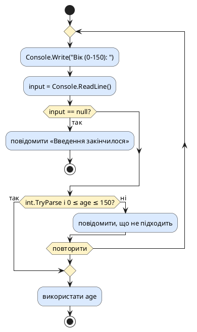

# Консольне введення та виведення

::card-group

::card{title="Навчальні цілі" icon="i-lucide-graduation-cap"}

- Виводити дані через `Write` і `WriteLine` і збирати рядок трьома способами: склеюванням, складеним форматуванням та інтерполяцією.
- Читати й записувати елемент форматування `{значення,ширина:формат}`, вирівнювати таблиці.
- Застосовувати стандартні й власні рядки формату для чисел і дат.
- Читати введення через `ReadLine`, `Read` і `ReadKey` і пояснювати, звідки вони беруть символи.
- Писати цикл введення, який не падає на неправильних даних.

::

::card{title="Технологічний стек" icon="i-lucide-cpu"}

- **Платформа:** .NET 10 (LTS), SDK 10.0.404, runtime 10.0.15
- **Мова:** C# 14
- **Приклади:** `samples/csharp/fundamentals/07-console-io/`
- **Культура у прикладах:** uk-UA, як на комп'ютері з українськими регіональними налаштуваннями (виводи отримано на macOS)

::

::card{title="Поглиблено" icon="i-lucide-telescope"}

Розділи поза програмою модуля. У тексті вони позначені фіолетовою рамкою.

- [Кольори, очищення і позиція курсора](#кольори-очищення-і-позиція-курсора)
- [Потоки виводу: stdout і stderr](#потоки-виводу-stdout-і-stderr)
- [Кодування і кирилиця в консолі](#кодування-і-кирилиця-в-консолі)
- [Дата і час: DateOnly, TimeOnly, TimeSpan](#дата-і-час-dateonly-timeonly-timespan)

::

::

---

## Виведення: Write і WriteLine

Клас `Console` з namespace `System` — це вхід і вихід програми, запущеної в терміналі. Для виведення в нього два методи:

- `Console.Write(x)` друкує значення і лишає курсор у тому самому рядку;
- `Console.WriteLine(x)` друкує значення і переходить на новий рядок. Без аргументу — лише перехід.

```csharp [write.cs]
Console.Write("Без переходу, ");
Console.Write("той самий рядок.");
Console.WriteLine();
Console.WriteLine("З переходом.");
Console.WriteLine(42);
Console.WriteLine(true);
Console.WriteLine('Ї');

int[] marks = [5, 4, 3];
Console.WriteLine(marks);                       // масив не знає, як себе надрукувати
Console.WriteLine(string.Join(", ", marks));    // елементи через кому
```

::terminal-preview{title="dotnet run write.cs"}
```text
Без переходу, той самий рядок.
З переходом.
42
True
Ї
System.Int32[]
5, 4, 3
```
::

- `WriteLine` має перевантаження (*overloads*) для всіх вбудованих типів: `int`, `double`, `bool`, `char`, `string` і `object`. Число перетворюється на текст методом `ToString()`.
- Для масиву окремого перевантаження немає, і спрацьовує `ToString()` з `object`, який друкує ім'я типу: `System.Int32[]`. Щоб надрукувати елементи, їх треба склеїти в рядок: `string.Join(", ", marks)`.
- `WriteLine` дописує в кінець `Environment.NewLine`: `\r\n` у Windows і `\n` у Linux і macOS. Тому `Console.WriteLine(x)` переносить рядок правильно на будь-якій ОС, а ручне `"\n"` — лише там, де консоль його розуміє (сучасні консолі розуміють і так).

::::accordion

:::accordion-item{label="Спробуйте: скільки рядків надрукується" icon="i-lucide-clipboard-list"}

1. Не запускаючи, намалюйте на папері, як виглядатиме вивід, включно з порожніми рядками:

```csharp [write-predict.cs]
Console.Write("А");
Console.Write("Б");
Console.WriteLine("В");
Console.WriteLine();
Console.Write("Г\n");
Console.Write("Ґ");
Console.WriteLine("Д");
```

2. Запустіть і порівняйте.

:::

:::accordion-item{label="Розв'язок" icon="i-lucide-check-circle"}

::terminal-preview{title="dotnet run write-predict.cs"}
```text
АБВ

Г
ҐД
```
::

`Write("А")` і `Write("Б")` лишають курсор у рядку, `WriteLine("В")` дописує «В» і переходить на новий. `WriteLine()` без аргументу дає порожній рядок. `Write("Г\n")` переходить на новий рядок через `\n` у самому рядку, і далі «Ґ» та «Д» друкуються разом.

:::

::::

---

## Три способи зібрати рядок

Вивести треба зазвичай не одне значення, а текст зі вставленими значеннями. Для цього є три способи:

```csharp [three-ways.cs]
using System.Globalization;

CultureInfo.CurrentCulture = CultureInfo.GetCultureInfo("uk-UA");   // вивід як на українській Windows

string name = "Олена";
int age = 19;
double average = 4.567;

Console.WriteLine("Студентка " + name + ", вік " + age + ", середній бал " + average);
Console.WriteLine("Студентка {0}, вік {1}, середній бал {2:F1}", name, age, average);
string text = string.Format("Студентка {0}, вік {1}", name, age);
Console.WriteLine(text);
Console.WriteLine($"Студентка {name}, вік {age}, середній бал {average:F1}");
```

::terminal-preview{title="dotnet run three-ways.cs"}
```text
Студентка Олена, вік 19, середній бал 4,567
Студентка Олена, вік 19, середній бал 4,6
Студентка Олена, вік 19
Студентка Олена, вік 19, середній бал 4,6
```
::

Числа й дати друкуються за правилами регіональних налаштувань: в українській культурі дробова частина відокремлюється комою. Щоб виводи в лекції збігалися з тим, що ви побачите на комп'ютері з українськими налаштуваннями, приклади першим рядком задають культуру uk-UA. У власних програмах цей рядок не потрібен: культура береться з налаштувань ОС.

::field-group

::field{name='"текст " + значення' type="склеювання (конкатенація)"}
Кожне значення перетворюється на рядок і склеюється з текстом. Формат задати не можна, а довгий вираз з багатьма `+` важко читати.
::

::field{name='"{0} … {1:F1}", a, b' type="складене форматування (composite formatting)"}
У тексті — місця `{0}`, `{1}` з номерами аргументів, після тексту — самі аргументи. Так працюють `Console.WriteLine(формат, аргументи)` і `string.Format`.
::

::field{name='$"{a} … {b:F1}"' type="інтерполяція (з C# 6)"}
Вирази пишуться прямо в місці вставлення. Компілятор перевіряє їх, як звичайний код.
::

::

Інтерполяція — найчитабельніший спосіб, і компілятор перетворює її на ефективний код без зайвих рядків (у лекції 03 декомпілятор показав `DefaultInterpolatedStringHandler`). Складене форматування лишається там, де шаблон рядка зберігається окремо від коду: у файлах ресурсів для перекладу, у бібліотеках журналювання.

Різниця видна на помилках. У складеному форматуванні номер, для якого немає аргументу, компілятор не помічає, і програма падає під час роботи:

```csharp [errors/format-missing.cs]
int count = 3;
Console.WriteLine("Знайдено {0} файлів, перший: {1}", count);
```

::terminal-preview{title="dotnet run errors/format-missing.cs"}
```text
Unhandled exception. System.FormatException: Index (zero based) must be greater than or equal to zero and less than the size of the argument list.
```
::

В інтерполяції номерів немає, а помилка у виразі — це помилка компіляції.

::callout{icon="i-lucide-lightbulb"}
**Коли який спосіб**

- :icon{name="i-lucide-circle-check" class="inline-block text-green-500"} **Інтерполяція `$"..."`** — за замовчуванням для будь-якого виводу.
- :icon{name="i-lucide-circle-check" class="inline-block text-green-500"} **Складене форматування** — коли шаблон приходить ззовні (переклади, налаштування) і невідомий під час компіляції.
- :icon{name="i-lucide-circle-check" class="inline-block text-green-500"} **Склеювання `+`** — для двох-трьох частин без форматування: `"Привіт, " + name`.
- :icon{name="i-lucide-circle-x" class="inline-block text-red-500"} **Не склеюйте рядок у циклі на тисячі ітерацій**: кожен `+` створює новий рядок (лекція 05). Для цього є `StringBuilder` (лекція 12).

::

### Фігурні дужки й умовний вираз в інтерполяції

Фігурна дужка в інтерполяції відкриває вираз. Щоб надрукувати саму дужку, її подвоюють: `{{` і `}}`. Умовний оператор `?:` всередині інтерполяції треба брати в дужки, бо двокрапка в ній означає початок формату:

```csharp [braces.cs]
int age = 17;
Console.WriteLine($"{{age}} = {age}");
Console.WriteLine($"Повнолітній: {(age >= 18 ? "так" : "ні")}");
Console.WriteLine("{0} у фігурних дужках: {{{0}}}", age);
```

::terminal-preview{title="dotnet run braces.cs"}
```text
{age} = 17
Повнолітній: ні
17 у фігурних дужках: {17}
```
::

Без дужок навколо `?:` компілятор сам підказує, що робити:

::terminal-preview{title="dotnet build errors/ternary.cs (фрагмент)"}
```text
ternary.cs(2,35): error CS8361: A conditional expression cannot be used directly in a string interpolation because the ':' ends the interpolation. Parenthesize the conditional expression.
```
::

::::accordion

:::accordion-item{label="Спробуйте: три способи для одного рядка" icon="i-lucide-clipboard-list"}

1. Оголосіть змінні: назва міста `"Житомир"`, населення `261624` (`int`), площа `65` (`double`, км²).
2. Виведіть рядок «Житомир: 261624 мешканців, 65 км², густота 4025,0 осіб/км²» трьома способами: склеюванням, складеним форматуванням та інтерполяцією. Густоту обчисліть діленням населення на площу і виведіть з одним знаком після коми (формат `F1`).
3. Який спосіб вийшов найкоротшим? У якому не вдалося задати формат густоти?

:::

:::accordion-item{label="Розв'язок" icon="i-lucide-check-circle"}

```csharp [city.cs]
using System.Globalization;

CultureInfo.CurrentCulture = CultureInfo.GetCultureInfo("uk-UA");
string city = "Житомир";
int population = 261624;
double area = 65;
double density = population / area;

Console.WriteLine(city + ": " + population + " мешканців, " + area + " км², густота " + density.ToString("F1") + " осіб/км²");
Console.WriteLine("{0}: {1} мешканців, {2} км², густота {3:F1} осіб/км²", city, population, area, density);
Console.WriteLine($"{city}: {population} мешканців, {area} км², густота {density:F1} осіб/км²");
```

Усі три рядки однакові: `Житомир: 261624 мешканців, 65 км², густота 4025,0 осіб/км²`. У склеюванні формат доводиться задавати викликом `ToString("F1")` — окремого місця для формату там немає. Найкоротша й найчитабельніша — інтерполяція.

:::

::::

---

## Елемент форматування: значення, ширина, формат

Кожне місце вставлення в інтерполяції і складеному форматуванні має однакову будову — до трьох частин у фігурних дужках:

{.diagram-img}

- **Значення** — обов'язкове: вираз в інтерполяції чи номер аргументу (`{0}`) у складеному форматуванні.
- **Ширина** після коми — необов'язкова. Додатна вирівнює текст праворуч і доповнює пробілами зліва, від'ємна — навпаки. Це **мінімальна** ширина: довше значення не обрізається.
- **Формат** після двокрапки — необов'язковий: як саме перетворити значення на текст.

### Формати чисел

```csharp [format-numbers.cs (фрагмент)]
double price = 1234.5678;
double share = 0.256;
int count = 42;
int color = 255;

Console.WriteLine($"{"N",-12} {price:N}");
Console.WriteLine($"{"F2",-12} {price:F2}");
// ... так само для кожного формату з таблиці нижче
```

::terminal-preview{title="dotnet run format-numbers.cs"}
```text
формат       результат
N            1 234,568
N0           1 235
F2           1234,57
F0           1235
C            1 234,57 ₴
E2           1,23E+003
P            25,600%
P1           25,6%
D5           00042
X            FF
X4           00FF
B8           11111111
0.00         1234,57
#,0.#        1 234,6
000.0        007,3

InvariantCulture, N2: 1,234.57
```
::

| Формат | Що робить | Для чого |
|---|---|---|
| `N`, `N2` | роздільник тисяч і задана кількість знаків після коми | великі числа для людини |
| `F`, `F2` | фіксована кількість знаків після коми, без роздільника тисяч | вимірювання, середні значення |
| `C` | грошовий формат культури, символ валюти | ціни |
| `P`, `P1` | множить на 100, додає `%` | частки: 0.256 → 25,6% |
| `E2` | експоненційний запис | дуже великі й дуже малі числа |
| `D5` | ціле, доповнене нулями до 5 цифр (лише для цілих) | номери: 00042 |
| `X`, `X4` | шістнадцятковий запис (лише для цілих) | коди, кольори, адреси |
| `B8` | двійковий запис (лише для цілих, з .NET 8) | біти й прапорці |
| `0.00`, `#,0.#`, `000.0` | власний шаблон: `0` — обов'язкова цифра, `#` — цифра, якщо вона є, `,` — роздільник тисяч | будь-який нестандартний вигляд |

Цифра після літери формату — точність: кількість знаків після коми для `N`, `F`, `C`, `P`, `E` і мінімальна кількість цифр для `D`, `X`, `B`. Без цифри кількість знаків бере культура: у виводі вище `N` і `P` дали три знаки.

Форматування округлює до найближчого, але точну половину — по-різному залежно від виду формату і типу:

::terminal-preview{title="dotnet run format-rounding.cs (фрагмент, InvariantCulture)"}
```text
   2.5  F0=2  0=3  F1=2.5  0.0=2.5  F2=2.50  0.00=2.50
  1.25  F0=1  0=1  F1=1.2  0.0=1.3  F2=1.25  0.00=1.25
 0.125  F0=0  0=0  F1=0.1  0.0=0.1  F2=0.12  0.00=0.13
   2.5m F0=3  0=3  F1=2.5  0.0=2.5  F2=2.50
  1.25m F0=1  0=1  F1=1.3  0.0=1.3  F2=1.25
```
::

Для `double` стандартні формати (`F`, `N`) округлюють половину до парного, як `Math.Round`, а власні (`0`, `0.0`) — від нуля. Для `decimal` обидва — від нуля. Тому там, де правило округлення має значення (гроші, оцінки), округлюйте явно — `Math.Round(x, 2, MidpointRounding.AwayFromZero)` — і лише потім форматуйте.

Роздільники, символ валюти і вигляд відсотків задає культура: те саме `N2` у InvariantCulture дає `1,234.57`. Символ валюти й точний вигляд грошового формату беруться з бібліотеки культур ОС, тому на Windows вивід `C` може трохи відрізнятися від показаного.

::::accordion

:::accordion-item{label="Спробуйте: передбачте формат" icon="i-lucide-clipboard-list"}

1. Не запускаючи, запишіть результат кожного рядка для культури uk-UA:

```csharp [format-predict.cs]
Console.WriteLine($"{0.075:P1}");
Console.WriteLine($"{1234567:N0}");
Console.WriteLine($"{255:X2}");
Console.WriteLine($"{3.14159:F3}");
Console.WriteLine($"{42:D4}");
Console.WriteLine($"{2.5:F0}");
Console.WriteLine($"{-7.25:0.0}");
```

2. Додайте на початок `using System.Globalization;` і `CultureInfo.CurrentCulture = CultureInfo.GetCultureInfo("uk-UA");`, запустіть і порівняйте.

:::

:::accordion-item{label="Розв'язок" icon="i-lucide-check-circle"}

::terminal-preview{title="dotnet run format-predict.cs"}
```text
7,5%
1 234 567
FF
3,142
0042
2
-7,3
```
::

- `P1` множить на 100: 0.075 → 7,5%.
- `F0` для 2.5 дає **2**: стандартний формат для `double` округлює половину до парного.
- `0.0` для −7.25 дає −7,3: власний формат округлює половину від нуля. Два схожі формати — два різні правила; звідси порада округлювати явно.

:::

::::

### Вирівнювання і таблиці

Ширина в елементі форматування дає змогу виводити таблиці без табуляції, проблеми якої видно в практичному завданні 3 лекції 04:

```csharp [alignment.cs]
string[] names = ["Бондар", "Ко", "Шевченко"];
double[] scores = [4.75, 5, 3.5];

Console.WriteLine($"{"Прізвище",-10}|{"Бал",6}|");
for (int i = 0; i < names.Length; i++)
{
    Console.WriteLine($"{names[i],-10}|{scores[i],6:F2}|");
}
Console.WriteLine();
Console.WriteLine($"[{"текст",8}] [{"текст",-8}] [{"довгий текст",8}]");
```

::terminal-preview{title="dotnet run alignment.cs"}
```text
Прізвище  |   Бал|
Бондар    |  4,75|
Ко        |  5,00|
Шевченко  |  3,50|

[   текст] [текст   ] [довгий текст]
```
::

{.diagram-img}

- Текст вирівнюють ліворуч (`-10`), числа — праворуч (`6`): так розряди чисел стоять один під одним.
- Ширина — мінімальна: `"довгий текст"` з 12 символів у полі шириною 8 просто виходить за межі, а таблиця «з'їжджає». Ширину колонки обирають за найдовшим значенням.
- Вирівнювання рахує символи, а не пікселі. У моноширинному шрифті терміналу це працює, а символи подвійної ширини (ієрогліфи, емодзі) займають дві клітинки і ламають колонки.

::::accordion

:::accordion-item{label="Спробуйте: таблиця покупок" icon="i-lucide-clipboard-list"}

1. Є три масиви: назви `["Хліб", "Молоко 2,5%", "Сир"]`, кількості `[2, 1, 3]` і ціни в `decimal` `[28.50m, 42.90m, 115m]`.
2. Виведіть таблицю з колонками «Товар» (ширина 14, ліворуч), «К-сть» (6), «Ціна» (10, два знаки після коми), «Сума» (10, два знаки).
3. Останнім рядком виведіть «Разом» і загальну суму так, щоб вона стояла під колонкою «Сума».

:::

:::accordion-item{label="Розв'язок" icon="i-lucide-check-circle"}

```csharp [receipt.cs (основна частина)]
Console.WriteLine($"{"Товар",-14}{"К-сть",6}{"Ціна",10}{"Сума",10}");
decimal total = 0;
for (int i = 0; i < items.Length; i++)
{
    decimal sum = quantities[i] * prices[i];
    total += sum;
    Console.WriteLine($"{items[i],-14}{quantities[i],6}{prices[i],10:F2}{sum,10:F2}");
}
Console.WriteLine($"{"Разом",-30}{total,10:F2}");
```

::terminal-preview{title="dotnet run receipt.cs"}
```text
Товар          К-сть      Ціна      Сума
Хліб               2     28,50     57,00
Молоко 2,5%        1     42,90     42,90
Сир                3    115,00    345,00
Разом                             444,90
```
::

Щоб сума стала під колонкою «Сума», ширина «Разом» дорівнює сумі ширин трьох попередніх колонок: 14 + 6 + 10 = 30. Ціни зберігаються в `decimal`: це гроші (лекція 06).

:::

::::

### Дати у форматуванні

Дата й час у .NET — значення типу `DateTime`. Його теж можна вставити в рядок з форматом. Щоб вивід не залежав від дня запуску, у прикладі момент задано явно: `new DateTime(рік, місяць, день, години, хвилини, секунди)`. Поточний момент дає `DateTime.Now`.

```csharp [dates.cs]
DateTime moment = new DateTime(2026, 11, 25, 14, 30, 5);

Console.WriteLine($"без формату        {moment}");
Console.WriteLine($"d                  {moment:d}");
Console.WriteLine($"D                  {moment:D}");
Console.WriteLine($"t                  {moment:t}");
Console.WriteLine($"g                  {moment:g}");
Console.WriteLine($"yyyy-MM-dd         {moment:yyyy-MM-dd}");
Console.WriteLine($"dd.MM.yyyy HH:mm   {moment:dd.MM.yyyy HH:mm}");
Console.WriteLine($"dddd, d MMMM       {moment:dddd, d MMMM}");
Console.WriteLine($"yyyy-mm-dd (помилка) {moment:yyyy-mm-dd}");
Console.WriteLine();
Console.WriteLine($"InvariantCulture, D: {moment.ToString("D", CultureInfo.InvariantCulture)}");
Console.WriteLine($"ISO 8601 (o):        {moment:o}");
```

::terminal-preview{title="dotnet run dates.cs"}
```text
без формату        25.11.2026 14:30:05
d                  25.11.2026
D                  середа, 25 листопада 2026 р.
t                  14:30
g                  25.11.2026 14:30
yyyy-MM-dd         2026-11-25
dd.MM.yyyy HH:mm   25.11.2026 14:30
dddd, d MMMM       середа, 25 листопада
yyyy-mm-dd (помилка) 2026-30-25

InvariantCulture, D: Wednesday, 25 November 2026
ISO 8601 (o):        2026-11-25T14:30:05.0000000
```
::

- **Стандартні формати** — одна літера: `d` — коротка дата, `D` — довга, `t` — час, `g` — дата і час. Їхній вигляд повністю задає культура: в українській — «25.11.2026», в американській — «11/25/2026».
- **Власний формат** складається зі специфікаторів: `dd` — день, `MM` — місяць, `yyyy` — рік, `HH` — години (0–23), `mm` — хвилини, `ss` — секунди, `dddd` — назва дня тижня, `MMMM` — назва місяця.
- **Формат `o`** (ISO 8601) однаковий у будь-якій культурі і без втрат читається назад — для файлів і обміну даними.

{.diagram-img}

::warning
Регістр у форматі дати має значення: `MM` — місяць, `mm` — хвилини, `HH` — години 0–23, `hh` — години 1–12. Формат `yyyy-mm-dd` компілюється і працює без помилок, але друкує хвилини замість місяця: «2026-30-25».
::

::::accordion

:::accordion-item{label="Спробуйте: знайдіть помилку в даті" icon="i-lucide-clipboard-list"}

1. Програма має надрукувати дедлайн 22 грудня 2026 року, 9:15:

```csharp [date-bug.cs]
DateTime deadline = new DateTime(2026, 12, 22, 9, 15, 0);
Console.WriteLine($"Здати до {deadline:dd.mm.yyyy hh:MM}");
```

2. Запустіть (з культурою uk-UA). Що надруковано і чому?
3. Виправте формат. Потім виведіть ту саму дату у вигляді «вівторок, 22 грудня 2026».

:::

:::accordion-item{label="Розв'язок" icon="i-lucide-check-circle"}

::terminal-preview{title="dotnet run date-bug.cs"}
```text
Здати до 22.15.2026 09:12
Здати до 22.12.2026 09:15
Здати до вівторок, 22 грудня 2026
```
::

У першому рядку переплутано регістр: `mm` на місці місяця дало хвилини (15), а `MM` на місці хвилин — місяць (12). `hh` — години в 12-годинному форматі; о 9 ранку результат той самий, але о 21:15 він показав би 09. Правильно: `dd.MM.yyyy HH:mm`. Довгий вигляд — `dddd, d MMMM yyyy`: `d` без пари — день без нуля попереду, `MMMM` — назва місяця у відмінку, який задає культура.

:::

::::

---

## Введення: ReadLine, Read, ReadKey

### ReadLine і буфер введення

`Console.ReadLine()` зупиняє програму, доки користувач не натисне Enter, і повертає набраний рядок без символу нового рядка. Тип результату — `string?`: коли введення закінчилося (Ctrl+Z і Enter у Windows, Ctrl+D у macOS і Linux, або вхід перенаправлено з файлу, що закінчився), повертається `null` (лекції 02 і 05).

Поки користувач набирає текст, програма його не бачить: термінал дає виправити рядок клавішею Backspace і віддає його програмі лише після Enter. Рядок разом із символом нового рядка потрапляє в **буфер введення**, звідки його забирають методи `Console`:

<video controls autoplay loop muted playsinline poster="/videos/csharp/fundamentals/console-io/anim-01-input-buffer.png" class="diagram-img rounded-xl shadow-lg w-full my-6">
  <source src="/videos/csharp/fundamentals/console-io/anim-01-input-buffer.mp4" type="video/mp4">
  <source src="/videos/csharp/fundamentals/console-io/anim-01-input-buffer.webm" type="video/webm">
</video>

### Read: один символ

`Console.Read()` забирає з буфера **один** символ і повертає його код типу `int`, а коли введення закінчилося, повертає −1. Як і `ReadLine`, він чекає Enter, якщо буфер порожній. Програма читає все введення посимвольно:

```csharp [read-codes.cs]
int code;
while ((code = Console.Read()) != -1)
{
    string shown = ((char)code).ToString();
    if (code == '\n')
    {
        shown = "\\n";
    }
    if (code == '\r')
    {
        shown = "\\r";
    }
    Console.WriteLine($"{code,5}  {shown}");
}
Console.WriteLine("   -1  кінець введення");
```

::terminal-preview{title="printf 'AB\nЇ\n' | dotnet run read-codes.cs"}
```text
   65  A
   66  B
   10  \n
 1031  Ї
   10  \n
   -1  кінець введення
```
::

Символ нового рядка теж потрапляє в буфер і повертається окремим викликом `Read` (код 10). У Windows Enter дає два символи, `\r` (13) і `\n` (10), тому програма надрукує ще й рядок з кодом 13. `Read` використовують рідко: для розбору введення посимвольно. Для звичайних задач — `ReadLine`.

Умова `(code = Console.Read()) != -1` спочатку присвоює результат, а потім порівнює: присвоєння в C# — вираз, що має значення. Цикли докладно розбирає лекція 10.

### ReadKey: клавіша без Enter

`Console.ReadKey()` повертає натиснуту клавішу одразу, без Enter і без буфера. Результат — `ConsoleKeyInfo` з трьома властивостями: `Key` — клавіша (`ConsoleKey.Y`, `ConsoleKey.Enter`, `ConsoleKey.F1`), `KeyChar` — символ (для клавіш без символу — `'\0'`) і `Modifiers` — затиснуті Shift, Ctrl, Alt. Аргумент `intercept: true` не показує натиснутий символ на екрані.

```csharp [readkey.cs]
Console.Write("Продовжити? (y/n) ");
ConsoleKeyInfo key = Console.ReadKey();
Console.WriteLine();
Console.WriteLine($"Key = {key.Key}, KeyChar = '{key.KeyChar}', Modifiers = {key.Modifiers}");

Console.Write("Пароль-цифра (не відображається): ");
ConsoleKeyInfo hidden = Console.ReadKey(intercept: true);
Console.WriteLine();
Console.WriteLine($"Ви натиснули {hidden.KeyChar}");
```

::terminal-preview{title="dotnet run readkey.cs (натиснуто y, потім 7)"}
```text
Продовжити? (y/n) y
Key = Y, KeyChar = 'y', Modifiers = None
Пароль-цифра (не відображається):
Ви натиснули 7
```
::

`ReadKey` працює лише з клавіатурою. Якщо введення перенаправлено (з файлу чи через `|`), клавіш немає, і метод кидає виняток:

::terminal-preview{title="printf 'y' | dotnet run readkey.cs"}
```text
Продовжити? (y/n) Unhandled exception. System.InvalidOperationException: Cannot read keys when either application does not have a console or when console input has been redirected. Try Console.Read.
```
::

::callout{icon="i-lucide-lightbulb"}
**Який метод введення обрати**

- :icon{name="i-lucide-circle-check" class="inline-block text-green-500"} **`ReadLine`** — числа, імена, команди: усе, що закінчується Enter. Працює і з перенаправленим введенням.
- :icon{name="i-lucide-circle-check" class="inline-block text-green-500"} **`ReadKey`** — меню, «натисніть будь-яку клавішу», ігри: реакція на одне натискання.
- :icon{name="i-lucide-circle-check" class="inline-block text-green-500"} **`Read`** — посимвольний розбір введення, коли рядок цілком не потрібен.
- :icon{name="i-lucide-circle-x" class="inline-block text-red-500"} **Не використовуйте `ReadKey` у програмах, які мають читати введення з файлу чи іншої програми**: там клавіатури немає.

::

### Цикл безпечного введення

Користувач може ввести що завгодно, і програма не повинна від цього падати. Типова схема: питати в циклі, доки введення не стане коректним:

::plant-uml{alt="Цикл введення: запит, читання рядка; якщо null — завершити; якщо TryParse успішний і число в діапазоні — вийти з циклу; інакше повідомити про помилку і запитати знову"}



::

```csharp [input-loop.cs]
int age;
while (true)
{
    Console.Write("Вік (0–150): ");
    string? input = Console.ReadLine();
    if (input is null)
    {
        Console.WriteLine();
        Console.WriteLine("Введення закінчилося.");
        return;
    }
    if (int.TryParse(input, out age) && age >= 0 && age <= 150)
    {
        break;
    }
    Console.WriteLine($"\"{input}\" — не підходить, спробуйте ще раз.");
}
Console.WriteLine($"Прийнято: {age}");
```

::terminal-preview{title="dotnet run input-loop.cs (введено abc, 200, «  25 »)"}
```text
Вік (0–150): abc
"abc" — не підходить, спробуйте ще раз.
Вік (0–150): 200
"200" — не підходить, спробуйте ще раз.
Вік (0–150):   25
Прийнято: 25
```
::

- `while (true)` повторює тіло без кінця, а вихід — через `break`, коли введення коректне. Цикли детально розбирає лекція 10.
- `return` у top-level програмі завершує її: без введення продовжувати немає сенсу.
- `int.TryParse(input, out age) && age >= 0 && age <= 150` перевіряє діапазон лише тоді, коли розбір вдався: оператор `&&` не обчислює праву частину, якщо ліва хибна (лекція 08).
- Компілятор не вимагає ініціалізувати `age`: з циклу можна вийти лише через `break`, а перед ним `TryParse` завжди записує значення в `out`-змінну (definite assignment, лекція 04).

::::accordion

:::accordion-item{label="Спробуйте: введення оцінки з комою" icon="i-lucide-clipboard-list"}

1. За зразком `input-loop.cs` напишіть `grade-loop.cs`, який просить дробову оцінку від 1 до 12 (`double.TryParse`) і друкує її з одним знаком після коми.
2. Задайте культуру uk-UA першими рядками програми, як у прикладах лекції.
3. Запустіть і введіть по черзі: `10.5`, `13`, `10,5`. Яке введення програма прийняла?

:::

:::accordion-item{label="Розв'язок" icon="i-lucide-check-circle"}

```csharp [grade-loop.cs]
using System.Globalization;

CultureInfo.CurrentCulture = CultureInfo.GetCultureInfo("uk-UA");

double grade;
while (true)
{
    Console.Write("Оцінка (1–12): ");
    string? input = Console.ReadLine();
    if (input is null)
    {
        return;
    }
    if (double.TryParse(input, out grade) && grade >= 1 && grade <= 12)
    {
        break;
    }
    Console.WriteLine($"\"{input}\" — не оцінка від 1 до 12");
}
Console.WriteLine($"Прийнято: {grade:F1}");
```

::terminal-preview{title="dotnet run grade-loop.cs"}
```text
Оцінка (1–12): 10.5
"10.5" — не оцінка від 1 до 12
Оцінка (1–12): 13
"13" — не оцінка від 1 до 12
Оцінка (1–12): 10,5
Прийнято: 10,5
```
::

В українській культурі роздільник дробової частини — кома, тому `10.5` не розбирається, а `10,5` — так. Це правильна поведінка для введення людиною: користувач пише число так, як звик. А от для даних з файлів потрібна `CultureInfo.InvariantCulture` (лекція 06).

:::

::::

<!-- VIDEO
id: console-io-07-input-loop
file: /videos/csharp/fundamentals/console-io/input-loop.mp4
poster: /images/csharp/fundamentals/console-io/input-loop-poster.jpg
duration: 45-55s
one-thing: введення користувача читають у циклі з TryParse, доки воно не стане коректним, і окремо обробляють кінець введення (null)
viewer: студент після C++, який читає числа через cin >> x і не перевіряє стан потоку
example: input-loop.cs з лекції: введення abc, 200, «  25 » → «Прийнято: 25»; ReadLine повертає null після Ctrl+D; grade-loop.cs: 10.5 відхилено, 10,5 прийнято в uk-UA
beats: hook (int.Parse("abc") — програма падає) → tension (користувач може ввести будь-що) → reveal (цикл: ReadLine → null? → TryParse && діапазон → break) → proof (abc і 200 відхилено, «  25 » прийнято; Ctrl+D — коректне завершення) → payoff (у uk-UA дробове число вводиться з комою) → claim (кожне введення користувача — через TryParse у циклі)
on-screen: "int.Parse(\"abc\") → FormatException", "ReadLine() → string?", "TryParse && 0..150", "break", "null → кінець", "10,5 — так, 10.5 — ні"
vo: Якщо розбирати введення через Parse, перше ж неправильне слово зупинить програму. Тому введення читають у циклі. ReadLine повертає рядок або null, коли введення закінчилося, — тоді програма завершується акуратно. TryParse разом з перевіркою діапазону вирішує, чи можна вийти з циклу. abc і двісті відхилено, двадцять п'ять з пробілами прийнято. І пам'ятайте про культуру: в українських налаштуваннях дробове число користувач вводить з комою.
look: світла палітра схем статті: білий фон, #1E293B, #DBEAFE, #DCFCE7, #FEF3C7; DejaVu Sans + DejaVu Sans Mono; вікна терміналу без логотипів
depends-on: anim-01-input-buffer.mp4
-->

:::::deep-dive

### Кольори, очищення і позиція курсора

Консоль уміє більше, ніж друкувати рядок за рядком. Колір тексту і фону задають властивості `Console.ForegroundColor` і `Console.BackgroundColor`, а `Console.ResetColor()` повертає стандартні кольори:

```csharp [colors.cs]
Console.ForegroundColor = ConsoleColor.Green;
Console.WriteLine("Успіх: файл збережено");
Console.ForegroundColor = ConsoleColor.Yellow;
Console.WriteLine("Увага: диск заповнено на 90%");
Console.ForegroundColor = ConsoleColor.White;
Console.BackgroundColor = ConsoleColor.Red;
Console.Write(" ПОМИЛКА ");
Console.ResetColor();
Console.WriteLine(" з'єднання розірвано");
Console.WriteLine("Звичайний текст після ResetColor");
```

::terminal-preview{title="dotnet run colors.cs"}

<div class="line"><span class="text-green-400">Успіх: файл збережено</span></div>
<div class="line"><span class="text-yellow-300">Увага: диск заповнено на 90%</span></div>
<div class="line"><span class="bg-red-500 text-white"> ПОМИЛКА </span> з'єднання розірвано</div>
<div class="line">Звичайний текст після ResetColor</div>
::

У терміналах Linux і macOS .NET перетворює ці властивості на ті самі керівні послідовності ANSI, що й `\e[32m` з лекції 04: запуск у псевдотерміналі показує `\e[92m` для зеленого і `\e[101m` для червоного фону. У Windows кольори задаються через API консолі. Якщо вивід перенаправлено у файл, кольори не записуються.

Інші можливості:

- `Console.Clear()` очищує вікно і ставить курсор у лівий верхній кут.
- `Console.SetCursorPosition(стовпчик, рядок)` переміщує курсор, `Console.GetCursorPosition()` повертає поточну позицію. Так оновлюють текст на місці — прогрес, таймер, таблицю в іграх:

```csharp [cursor.cs]
Console.Write("Завантаження: ");
(int left, int top) = Console.GetCursorPosition();
for (int percent = 0; percent <= 100; percent += 25)
{
    Console.SetCursorPosition(left, top);
    Console.Write($"{percent,3}%");
    Thread.Sleep(200);
}
Console.WriteLine();
Console.WriteLine("Готово");
```

У терміналі відсотки змінюються на тому самому місці, і в кінці видно один рядок `Завантаження: 100%`. Якщо вивід перенаправлено у файл, позиціонування не працює, і у файл потрапляють усі значення поспіль: `  0% 25% 50% 75%100%`. Запис `(int left, int top) = ...` розкладає кортеж на дві змінні (лекція 15).

- `Console.WindowWidth`, `Console.WindowHeight` — розмір вікна в символах, `Console.CursorVisible` — показати чи сховати курсор.

:::::

:::::deep-dive

### Потоки виводу: stdout і stderr

У кожної програми є три стандартні потоки: введення (*stdin*), вивід (*stdout*) і вивід помилок (*stderr*). `Console.WriteLine` пише в stdout, `Console.Error.WriteLine` — у stderr. На екрані обидва потоки виглядають однаково, але shell уміє розділити їх:

```csharp [streams.cs]
Console.WriteLine("рядок 1: звичайний вивід (stdout)");
Console.Error.WriteLine("рядок 2: повідомлення про помилку (stderr)");
Console.WriteLine($"рядок 3: stdout перенаправлено у файл? {Console.IsOutputRedirected}");
```

::terminal-preview{title="dotnet run streams.cs"}
```text
рядок 1: звичайний вивід (stdout)
рядок 2: повідомлення про помилку (stderr)
рядок 3: stdout перенаправлено у файл? False
```
::

::terminal-preview{title="dotnet run streams.cs > out.txt, потім вміст out.txt"}
```text
рядок 2: повідомлення про помилку (stderr)
--- out.txt:
рядок 1: звичайний вивід (stdout)
рядок 3: stdout перенаправлено у файл? True
```
::

Оператор `>` (однаково в PowerShell, bash і zsh) записує у файл лише stdout, а повідомлення з stderr лишається на екрані. `2> err.txt` перенаправляє stderr. Тому результати роботи програми пишуть у stdout, а помилки й діагностику — у stderr: користувач, який зберігає результат у файл, однаково побачить повідомлення про проблему, а у файл не потрапить зайве. `Console.IsOutputRedirected` і `Console.IsInputRedirected` дають змогу програмі дізнатися, чи її вивід іде у файл (наприклад, щоб не друкувати кольори і прогрес). Передачу даних між програмами через `|` розбирає лекція 13.

:::::

:::::deep-dive

### Кодування і кирилиця в консолі

Символи передаються в консоль і з неї як байти в певному кодуванні. Програма може дізнатися поточні кодування і задати їх явно:

```csharp [encoding.cs]
using System.Text;

Console.WriteLine($"OutputEncoding: {Console.OutputEncoding.WebName}");
Console.WriteLine($"InputEncoding:  {Console.InputEncoding.WebName}");
Console.OutputEncoding = Encoding.UTF8;
Console.InputEncoding = Encoding.UTF8;
Console.WriteLine("Ґанок, їжак, Євген — кирилиця в UTF-8");
```

::terminal-preview{title="dotnet run encoding.cs (macOS)"}
```text
OutputEncoding: utf-8
InputEncoding:  utf-8
Ґанок, їжак, Євген — кирилиця в UTF-8
```
::

У Linux і macOS термінали працюють в UTF-8, і кирилиця проблем не створює. У Windows консоль історично використовує кодові сторінки (866, 1251), і в старих конфігураціях замість кирилиці можна побачити знаки питання або «кракозябри» — особливо у введенні, у перенаправленому виводі чи у старому вікні `cmd.exe`. Перевірте на своїй машині. Якщо проблема є, два рядки `Console.OutputEncoding = Encoding.UTF8;` і `Console.InputEncoding = Encoding.UTF8;` на початку програми зазвичай її розв'язують, а Windows Terminal з UTF-8 за замовчуванням прибирає її зовсім. Поведінку Windows у цьому розділі на macOS не перевірено.

:::::

:::::deep-dive

### Дата і час: DateOnly, TimeOnly, TimeSpan

`DateTime` зберігає дату разом із часом. Для задач, де потрібна лише одна частина, є окремі типи (з .NET 6): `DateOnly` — дата без часу (день народження, дедлайн), `TimeOnly` — час без дати (початок пари). Різницю двох моментів зберігає `TimeSpan` — тривалість.

```csharp [datetime-more.cs]
DateOnly start = new DateOnly(2026, 9, 1);
DateOnly exam = new DateOnly(2026, 12, 22);
Console.WriteLine($"Початок семестру: {start:dd.MM.yyyy}, {start:dddd} (DayOfWeek: {start.DayOfWeek})");
Console.WriteLine($"Днів до іспиту:   {exam.DayNumber - start.DayNumber}");
Console.WriteLine($"Через 30 днів:    {start.AddDays(30):d}");

TimeOnly lesson = new TimeOnly(8, 30);
Console.WriteLine($"Пара о {lesson:HH:mm}, кінець о {lesson.AddMinutes(80):HH:mm}");

DateTime from = new DateTime(2026, 11, 25, 9, 0, 0);
DateTime to = new DateTime(2026, 11, 26, 17, 45, 30);
TimeSpan span = to - from;
Console.WriteLine($"Тривалість: {span}, годин усього: {span.TotalHours:F2}");
Console.WriteLine($"Формат: {span:d\\.hh\\:mm}");
Console.WriteLine($"DateTime.Now.Kind = {DateTime.Now.Kind}, DateTime.UtcNow.Kind = {DateTime.UtcNow.Kind}");
```

::terminal-preview{title="dotnet run datetime-more.cs"}
```text
Початок семестру: 01.09.2026, вівторок (DayOfWeek: Tuesday)
Днів до іспиту:   112
Через 30 днів:    01.10.2026
Пара о 08:30, кінець о 09:50
Тривалість: 1.08:45:30, годин усього: 32,76
Формат: 1.08:45
DateTime.Now.Kind = Local, DateTime.UtcNow.Kind = Utc
```
::

- **Назва дня тижня.** `DayOfWeek` — перелічення з англійськими іменами, тому друкує `Tuesday` в будь-якій культурі. Назву мовою культури дає формат `dddd`.
- **Арифметика.** `AddDays`, `AddMinutes`, `AddMonths` повертають нове значення: дати незмінні, як рядки. Різниця двох `DateTime` — `TimeSpan`; для `DateOnly` різницю в днях дає `DayNumber`.
- **Формат `TimeSpan`.** Власні формати тривалості вимагають екранувати роздільники: `d\.hh\:mm` (у звичайному рядку `\\`).
- **Час UTC.** `DateTime.Now` — місцевий час комп'ютера, `DateTime.UtcNow` — всесвітній. Для збереження і порівняння моментів (журнали, бази даних, сервери в різних часових поясах) використовують UTC, а місцевий час — лише для показу людині.

:::::

---

## Питання для самоперевірки

::::accordion

:::accordion-item{label="Чим Console.Write відрізняється від Console.WriteLine і що дописує WriteLine у кінець?" icon="i-lucide-help-circle"}

`Write` друкує значення і лишає курсор у тому самому рядку, `WriteLine` після значення переходить на новий рядок. Для переходу він дописує `Environment.NewLine` — `\r\n` у Windows і `\n` у Linux і macOS, тож перенос правильний на будь-якій ОС.

:::

:::accordion-item{label="Чому Console.WriteLine(масив) друкує System.Int32[] і як надрукувати елементи?" icon="i-lucide-help-circle"}

Для масиву немає окремого перевантаження `WriteLine`, і спрацьовує версія для `object`, яка викликає `ToString()`. Масив не перевизначає `ToString`, тому друкується ім'я типу. Елементи друкують, склеївши їх у рядок: `string.Join(", ", масив)`, або виводять у циклі.

:::

:::accordion-item{label="Чому інтерполяцію вважають надійнішою за складене форматування?" icon="i-lucide-help-circle"}

В інтерполяції вирази стоять прямо в рядку і перевіряються компілятором, як звичайний код. У складеному форматуванні місця позначено номерами `{0}`, `{1}`, а аргументи йдуть окремо, і компілятор не перевіряє відповідність. Номер без аргументу дає `FormatException` лише під час роботи програми.

:::

:::accordion-item{label="Що означають частини елемента {price,10:F2}?" icon="i-lucide-help-circle"}

`price` — значення, яке вставляється; `,10` — мінімальна ширина 10 символів з вирівнюванням праворуч (від'ємне число — ліворуч); `:F2` — формат, тут два знаки після коми. Ширина й формат необов'язкові. Довше значення ширина не обрізає.

:::

:::accordion-item{label="Чому формат yyyy-mm-dd дає неправильну дату, а компілятор мовчить?" icon="i-lucide-help-circle"}

Рядок формату — це звичайний текст, який розбирається під час роботи програми, а не код, тому компілятор його не перевіряє. У форматі дати регістр має значення: `mm` — хвилини, `MM` — місяць. `yyyy-mm-dd` друкує хвилини на місці місяця.

:::

:::accordion-item{label="Чому програма не бачить символи, поки користувач не натисне Enter?" icon="i-lucide-help-circle"}

Термінал тримає рядок, який набирають, у себе, щоб його можна було виправити Backspace. Лише після Enter весь рядок разом із символом нового рядка потрапляє в буфер введення програми. `ReadLine` і `Read` беруть символи з цього буфера. `ReadKey` працює інакше: отримує натискання клавіші одразу.

:::

:::accordion-item{label="Чому ReadKey не можна використати, якщо введення перенаправлено з файлу?" icon="i-lucide-help-circle"}

`ReadKey` читає натискання клавіш з клавіатури консолі. Коли введення перенаправлено з файлу чи іншої програми, клавіатури немає, є лише потік символів, і метод кидає `InvalidOperationException` з підказкою використати `Console.Read`.

:::

:::accordion-item{label="Як має бути побудований цикл введення числа і що робити з null?" icon="i-lucide-help-circle"}

У циклі: запит, `ReadLine`, перевірка на `null` (введення закінчилося — завершити роботу або взяти значення за замовчуванням), потім `TryParse` разом із перевіркою діапазону. Якщо все гаразд — вийти з циклу через `break`, інакше повідомити про помилку і запитати знову. `Parse` у такому циклі не використовують: він зупинив би програму на першому неправильному введенні.

:::

::::

## Шпаргалка

| Запис | Що робить | Приклад |
|---|---|---|
| `Console.Write(x)` | друкує без переходу на новий рядок | `Console.Write("Ім'я: ");` |
| `Console.WriteLine(x)` | друкує і переходить на новий рядок | `Console.WriteLine();` — порожній рядок |
| `string.Join(", ", масив)` | елементи масиву через роздільник | `5, 4, 3` |
| `$"{x}"` | інтерполяція | `$"Вік: {age}"` |
| `"{0}", x` | складене форматування | `Console.WriteLine("{0} років", age)` |
| `{x,10}` / `{x,-10}` | ширина 10, праворуч / ліворуч | таблиці |
| `{x:F2}`, `{x:N0}`, `{x:P1}`, `{x:C}` | формати чисел | `1234,57`, `1 235`, `25,6%`, `1 234,57 ₴` |
| `{x:D5}`, `{x:X}`, `{x:B8}` | формати цілих | `00042`, `FF`, `11111111` |
| `{x:0.00}`, `{x:#,0}` | власні формати чисел | `1234,57`, `1 235` |
| `{d:dd.MM.yyyy HH:mm}` | власний формат дати | `25.11.2026 14:30` |
| `{d:d}`, `{d:D}`, `{d:o}` | коротка, довга дата, ISO 8601 | `25.11.2026` |
| `{{`, `}}` | фігурні дужки як текст | `$"{{x}}"` |
| `{(умова ? a : b)}` | умовний вираз в інтерполяції — у дужках | `{(age >= 18 ? "так" : "ні")}` |
| `Console.ReadLine()` | рядок до Enter, `null` — кінець введення | `string? s = Console.ReadLine();` |
| `Console.Read()` | один символ з буфера, −1 — кінець | код `int` |
| `Console.ReadKey(intercept: true)` | клавіша без Enter, без показу | `key.Key == ConsoleKey.Q` |

## Практичні завдання

Чотири завдання на закріплення, кожне на 10–15 хвилин. У кожному є письмова відповідь і скріншот: результат має бути отриманий на вашій машині.

::::accordion

:::accordion-item{label="Завдання 1. Чек магазину" icon="i-lucide-clipboard-list"}

1. Напишіть програму, яка друкує чек:
   - назва магазину по центру над чеком (ширина чека — 40 символів);
   - дата і час покупки у форматі `dd.MM.yyyy HH:mm` (задайте момент явно);
   - лінія з 40 дефісів (`new string('-', 40)`);
   - для кожного з трьох товарів: назва (ліворуч), кількість, ціна і сума (праворуч, два знаки після коми);
   - ще одна лінія і рядок «До сплати» з сумою у грошовому форматі `C`, вирівняною по правому краю чека.
2. Запустіть і зробіть скріншот.
3. Письмово поясніть: як ви підібрали ширину кожної колонки, щоб рядки мали рівно 40 символів, і як вирівняли назву магазину по центру.

:::

:::accordion-item{label="Розв'язок завдання 1" icon="i-lucide-check-circle"}

```csharp [receipt-full.cs]
using System.Globalization;

CultureInfo.CurrentCulture = CultureInfo.GetCultureInfo("uk-UA");
DateTime when = new DateTime(2026, 11, 25, 18, 42, 0);

string[] items = ["Зошит 48 арк.", "Ручка", "Олівець HB"];
int[] quantities = [3, 2, 5];
decimal[] prices = [24.90m, 18.00m, 7.50m];

Console.WriteLine($"{"КАНЦТОВАРИ",25}");
Console.WriteLine($"Чек від {when:dd.MM.yyyy HH:mm}");
Console.WriteLine(new string('-', 40));
decimal total = 0;
for (int i = 0; i < items.Length; i++)
{
    decimal sum = quantities[i] * prices[i];
    total += sum;
    Console.WriteLine($"{items[i],-16}{quantities[i],3} x {prices[i],7:F2}{sum,11:F2}");
}
Console.WriteLine(new string('-', 40));
Console.WriteLine($"{"До сплати:",-29}{total,11:C}");
```

::terminal-preview{title="dotnet run receipt-full.cs"}
```text
               КАНЦТОВАРИ
Чек від 25.11.2026 18:42
----------------------------------------
Зошит 48 арк.     3 x   24,90      74,70
Ручка             2 x   18,00      36,00
Олівець HB        5 x    7,50      37,50
----------------------------------------
До сплати:                      148,20 ₴
```
::

- Рядок товару: 16 (назва) + 3 (кількість) + 3 (`" x "`) + 7 (ціна) + 11 (сума) = 40 символів.
- Назва магазину з 10 літер стоїть по центру, якщо зліва (40 − 10) / 2 = 15 пробілів, тобто ширина поля з вирівнюванням праворуч — 15 + 10 = 25.
- «До сплати»: 29 + 11 = 40. Формат `C` додає символ валюти, тому ширина поля суми більша, ніж потрібно самому числу.

:::

:::accordion-item{label="Завдання 2. Калькулятор з перевіркою введення" icon="i-lucide-clipboard-list"}

1. Напишіть калькулятор, який:
   - просить перше і друге число (`double`), повторюючи запит, доки введення не стане числом;
   - просить операцію `+`, `-`, `*` або `/` і друкує результат;
   - для ділення на нуль і невідомої операції друкує повідомлення, а не падає.
2. Цикл введення числа потрібен двічі: скопіюйте його або винесіть у локальну функцію (як у розв'язку; функції розбирає лекція 14).
3. Протестуйте і зробіть скріншоти: неправильне число (`x`), дробове число з комою і з крапкою, ділення на нуль, невідома операція.
4. Письмово: яке дробове введення прийняла програма на вашій машині — з комою чи з крапкою — і чому?

:::

:::accordion-item{label="Розв'язок завдання 2" icon="i-lucide-check-circle"}

Розв'язок — `practice/calculator.cs` у прикладах лекції. Ключова частина — цикл введення:

```csharp [calculator.cs (фрагмент)]
static double ReadNumber(string prompt)
{
    while (true)
    {
        Console.Write(prompt);
        string? input = Console.ReadLine();
        if (input is null)
        {
            Console.WriteLine();
            Console.WriteLine("Введення закінчилося, беру 0");
            return 0;
        }
        if (double.TryParse(input, out double value))
        {
            return value;
        }
        Console.WriteLine($"\"{input}\" — не число");
    }
}
```

::terminal-preview{title="dotnet run calculator.cs (культура uk-UA; після двокрапки — введення користувача)"}
```text
Перше число: x
"x" — не число
Перше число: 7,5
Друге число: 2
Операція (+ - * /): /
7,5 / 2 = 3,7500
```
::

`double.TryParse` використовує культуру системи. В українській культурі приймається `7,5`. Якщо на вашій машині стоять англійські регіональні налаштування, `7,5` розбереться як **75**: кома там — роздільник тисяч, і `TryParse` поверне `true` з неправильним числом (лекція 06). Саме це варто описати у відповіді, якщо ви це побачили.

:::

:::accordion-item{label="Завдання 3. Формати вашої системи" icon="i-lucide-clipboard-list"}

1. Напишіть програму **без** рядка, що задає культуру, яка друкує:
   - назву поточної культури: `CultureInfo.CurrentCulture.Name` і `DisplayName`;
   - число 1234567.891 у форматах `N2` і `C`;
   - дату 8 березня 2026, 7:05 у форматах `d`, `D` і без формату;
   - те саме число й дату `d` через `CultureInfo.InvariantCulture`.
2. Запустіть на своєму комп'ютері і, якщо можливо, на іншому (у комп'ютерному класі, у друга, на телефоні з .NET-середовищем). Зробіть скріншоти.
3. Письмово порівняйте: які рядки відрізняються між культурами, а які однакові всюди? Чому дату `d` в InvariantCulture не варто показувати користувачу з України?

:::

:::accordion-item{label="Розв'язок завдання 3" icon="i-lucide-check-circle"}

```csharp [my-culture.cs]
using System.Globalization;

double money = 1234567.891;
DateTime day = new DateTime(2026, 3, 8, 7, 5, 0);

Console.WriteLine($"Культура:          {CultureInfo.CurrentCulture.Name} ({CultureInfo.CurrentCulture.DisplayName})");
Console.WriteLine($"Число (N2):        {money:N2}");
Console.WriteLine($"Гроші (C):         {money:C}");
Console.WriteLine($"Дата (d):          {day:d}");
Console.WriteLine($"Дата (D):          {day:D}");
Console.WriteLine($"Без формату:       {day}");
Console.WriteLine($"Invariant (N2):    {money.ToString("N2", CultureInfo.InvariantCulture)}");
Console.WriteLine($"Invariant (d):     {day.ToString("d", CultureInfo.InvariantCulture)}");
```

Вивід на машині автора лекції (регіональні налаштування en-NZ):

::terminal-preview{title="dotnet run my-culture.cs (en-NZ)"}
```text
Культура:          en-NZ (English (New Zealand))
Число (N2):        1,234,567.89
Гроші (C):         $1,234,567.89
Дата (d):          08/03/2026
Дата (D):          Sunday, 8 March 2026
Без формату:       08/03/2026 7:05:00 AM
Invariant (N2):    1,234,567.89
Invariant (d):     03/08/2026
```
::

- Від культури залежать роздільники, символ валюти, порядок дня й місяця, назви днів і місяців, 12- чи 24-годинний час. Однакові всюди лише рядки з InvariantCulture.
- InvariantCulture друкує дату в американському порядку «місяць/день/рік»: `03/08/2026` — це 8 березня, але українець прочитає «3 серпня». Для людини — поточна культура, для файлів — InvariantCulture або ISO 8601 (`o`, `yyyy-MM-dd`).

:::

:::accordion-item{label="Завдання 4. Меню з ReadKey" icon="i-lucide-clipboard-list"}

1. Напишіть програму-лічильник з меню, яке реагує на одне натискання без Enter:
   - `+` — збільшити лічильник, `-` — зменшити, `0` — скинути;
   - `q` — вийти з програми;
   - будь-яка інша клавіша — повідомлення «Невідома клавіша: …» з назвою клавіші (`key.Key`).
2. Натиснута клавіша має відображатися після запрошення один раз (використайте `intercept: true` і надрукуйте `key.KeyChar` самостійно).
3. Зробіть скріншот сесії з кількома натисканнями, включно з невідомою клавішею і стрілкою (наприклад, ↑).
4. Письмово: що надрукувала програма для стрілки і чому `KeyChar` для неї не підходить? Що станеться, якщо запустити програму так: `echo + | dotnet run menu.cs`?

:::

:::accordion-item{label="Розв'язок завдання 4" icon="i-lucide-check-circle"}

```csharp [menu.cs]
int counter = 0;
while (true)
{
    Console.WriteLine($"Лічильник: {counter}");
    Console.Write("[+] додати  [-] відняти  [0] скинути  [q] вийти: ");
    ConsoleKeyInfo key = Console.ReadKey(intercept: true);
    Console.WriteLine(key.KeyChar);

    if (key.KeyChar == '+')
    {
        counter++;
    }
    else if (key.KeyChar == '-')
    {
        counter--;
    }
    else if (key.KeyChar == '0')
    {
        counter = 0;
    }
    else if (key.Key == ConsoleKey.Q)
    {
        break;
    }
    else
    {
        Console.WriteLine($"Невідома клавіша: {key.Key}");
    }
}
Console.WriteLine("Бувайте!");
```

::terminal-preview{title="dotnet run menu.cs (натиснуто + + x - q)"}
```text
Лічильник: 0
[+] додати  [-] відняти  [0] скинути  [q] вийти: +
Лічильник: 1
[+] додати  [-] відняти  [0] скинути  [q] вийти: +
Лічильник: 2
[+] додати  [-] відняти  [0] скинути  [q] вийти: x
Невідома клавіша: X
Лічильник: 2
[+] додати  [-] відняти  [0] скинути  [q] вийти: -
Лічильник: 1
[+] додати  [-] відняти  [0] скинути  [q] вийти: q
Бувайте!
```
::

- Для стрілки ↑ програма друкує `Невідома клавіша: UpArrow`. Стрілка не має символу, її `KeyChar` — `'\0'`, тому клавіші без символу розпізнають за `key.Key`. Для `q` теж краще `key.Key == ConsoleKey.Q`: спрацює і для `Q` з Shift.
- `echo + | dotnet run menu.cs` впаде з `InvalidOperationException`: введення перенаправлено, клавіатури немає, і `ReadKey` не працює.

:::

::::
