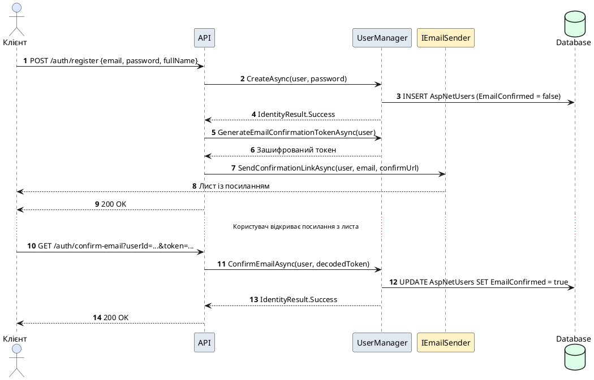
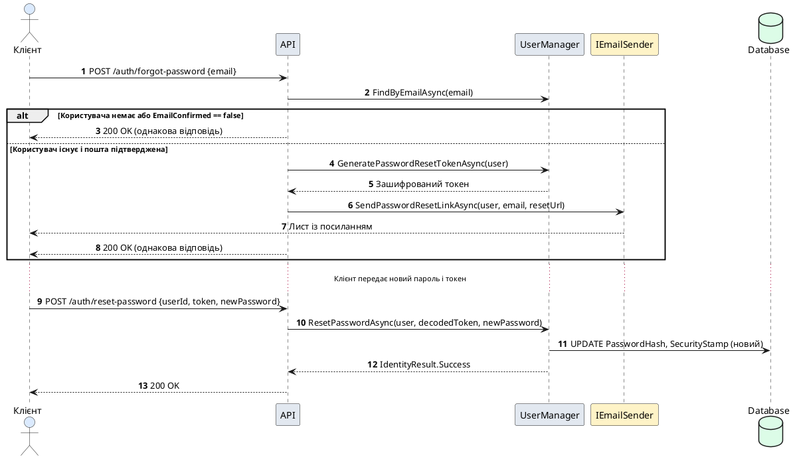

# Identity: підтвердження email, скидання пароля та зміна контактів

::card-group

::card{title="Навчальні цілі" icon="i-lucide-graduation-cap"}

- Налаштовувати вхід лише з підтвердженим email (`RequireConfirmedEmail`) та термін дії токенів у `Program.cs`.
- Реалізовувати повний цикл підтвердження пошти через `GenerateEmailConfirmationTokenAsync`, `WebEncoders.Base64UrlEncode` і `ConfirmEmailAsync`.
- Обирати між `IEmailSender` та `IEmailSender<TUser>` і налаштовувати безпечне повторне надсилання листів із Rate Limiting.
- Реалізовувати скидання пароля, зміну email та підтвердження номера телефону з коректним оновленням `SecurityStamp` і cookie-сесії.
- Пояснювати, чому ендпоінти відновлення доступу повертають однакову відповідь незалежно від існування акаунта.

::

::card{title="Технологічний стек" icon="i-lucide-cpu"}

- **Платформа:** .NET 10 (LTS), ASP.NET Core Minimal APIs
- **База даних:** Entity Framework Core (InMemory для демонстрації)
- **Пакети:** `Microsoft.AspNetCore.Identity.EntityFrameworkCore`
- **Приклади:** `samples/csharp/aspnet/auth/05-identity-email-confirmation/`

::

::card{title="Поглиблено" icon="i-lucide-telescope"}

Розділи поза програмою модуля. У тексті вони позначені фіолетовою рамкою.

- [Деталі зберігання токенів: DataProtection проти AspNetUserTokens](#деталі-зберігання-токенів-dataprotection-проти-aspnetusertokens)
- [Захист від атак за часом відповіді (Timing Attack Prevention)](#захист-від-атак-за-часом-відповіді-timing-attack-prevention)
- [Власний провайдер коротких кодів](#власний-провайдер-коротких-кодів)

::

::

---

## Навіщо підтверджувати email

Після налаштування базової реєстрації та входу через `UserManager<TUser>` і `SignInManager<TUser>` система вже вміє зберігати хеші паролів і видавати cookie. Проте без перевірки поштової скриньки поле `Email` залишається довільним рядком, який ввів користувач. Це створює три практичні ризики:

- **Опечатка при реєстрації:** адреса на кшталт `ivaan@gmial.com` збережеться в базі даних, і користувач ніколи не отримає жодного сповіщення чи посилання для відновлення доступу.
- **Використання чужої адреси:** зловмисник може зареєструвати чужу пошту, після чого стороння людина отримуватиме системні листи сервісу або не зможе зареєструватися сама.
- **Ненадійне скидання пароля:** якщо адреса не підтверджена, надсилання посилання на відновлення пароля стає способом захоплення або блокування чужої поштової скриньки.

Підтвердження email встановлює зв'язок між обліковим записом у базі даних і реальним доступом до поштової скриньки. Доки користувач не перейде за посиланням із листа, властивість `EmailConfirmed` у таблиці `AspNetUsers` має значення `false`.

---

## Налаштування Identity та терміну дії токенів

Щоб Identity блокував вхід користувачам із непідтвердженою поштою, у конфігурації сервісів задають прапорець `SignIn.RequireConfirmedEmail = true` і підключають стандартні провайдери токенів через `AddDefaultTokenProviders()`.

```csharp [Program.cs] {4,9,13,18} showLineNumbers
builder.Services
    .AddIdentity<AppUser, IdentityRole>(options =>
    {
        options.SignIn.RequireConfirmedEmail = true;
        options.SignIn.RequireConfirmedPhoneNumber = false;
        options.User.RequireUniqueEmail = true;
    })
    .AddEntityFrameworkStores<AppDbContext>()
    .AddDefaultTokenProviders();

builder.Services.Configure<DataProtectionTokenProviderOptions>(options =>
{
    options.TokenLifespan = TimeSpan.FromDays(3);
});

builder.Services.Configure<SecurityStampValidatorOptions>(options =>
{
    options.ValidationInterval = TimeSpan.FromMinutes(5);
});
```

::field-group

::field{name="options.SignIn.RequireConfirmedEmail" type="bool"}
Змушує `SignInManager.PasswordSignInAsync` перевіряти `EmailConfirmed` перед видачею cookie. Якщо пошта не підтверджена, метод повертає `SignInResult.NotAllowed` (`result.IsNotAllowed == true`).

::

::field{name="AddDefaultTokenProviders()" type="метод розширення"}
Реєструє чотири вбудовані провайдери токенів: `DataProtectionTokenProvider` (для email і скидання пароля), `PhoneNumberTokenProvider` (6-значні коди), `EmailTokenProvider` та `AuthenticatorTokenProvider` (TOTP).

::

::field{name="DataProtectionTokenProviderOptions.TokenLifespan" type="TimeSpan"}
Задає час життя токенів підтвердження email і скидання пароля. За замовчуванням це 1 доба; для листів, які можуть затриматися на вихідні, термін збільшують до 2–3 діб.

::

::field{name="SecurityStampValidatorOptions.ValidationInterval" type="TimeSpan"}
Інтервал, з яким cookie-middleware звіряє `SecurityStamp` користувача з базою даних (за замовчуванням 30 хвилин).

::

::

::note
`DataProtectionTokenProvider` не записує токен підтвердження email або скидання пароля в базу даних. Натомість він шифрує `userId`, призначення токена, поточний `SecurityStamp` та мітку часу за допомогою ASP.NET Core Data Protection API.

::

{.diagram-img}

### Що таке SecurityStamp і навіщо він потрібен

`SecurityStamp` — це випадковий рядок у колонці `AspNetUsers.SecurityStamp` (у стандартній реалізації Identity — 32-символьний Base32-рядок), який працює як «версія» стану безпеки користувача. Його завдання — дати серверу спосіб миттєво визнати недійсними всі старі cookie та токени без ведення окремих таблиць відкликання в базі даних.

Механізм працює у двох місцях одночасно:

::field-group

::field{name="Cookie-сесії" type="SecurityStampValidator"}
Під час входу Identity записує поточний `SecurityStamp` у claim усередині cookie. Раз на `ValidationInterval` (за замовчуванням 30 хвилин) `SecurityStampValidator` звіряє значення з базою даних; якщо воно змінилося, користувача автоматично розлогінює.

::

::field{name="Токени Data Protection" type="DataProtectionTokenProvider"}
Під час генерації токена підтвердження email чи скидання пароля `SecurityStamp` шифрується всередині токена. При перевірці `UserManager` порівнює штамп із токена зі штампом у БД — при розбіжності повертається `InvalidToken`.

::

::

Identity автоматично генерує новий `SecurityStamp` під час будь-якої критичної зміни облікового запису: скидання чи зміни пароля (`ResetPasswordAsync`, `ChangePasswordAsync`), зміни пошти або телефону (`ChangeEmailAsync`, `ChangePhoneNumberAsync`), а також прив'язки чи видалення зовнішніх логінів. За потреби ви можете примусово завершити всі сесії користувача вручну викликом `await userManager.UpdateSecurityStampAsync(user)`.

Навіть якщо термін `TokenLifespan` ще не сплив, будь-який токен, виданий до зміни `SecurityStamp`, одразу втрачає чинність:

<video controls autoplay loop muted playsinline poster="/videos/csharp/aspnet/auth/identity-email-confirmation/anim-01-token-lifecycle.png" class="diagram-img rounded-xl shadow-lg w-full my-6">
  <source src="/videos/csharp/aspnet/auth/identity-email-confirmation/anim-01-token-lifecycle.mp4" type="video/mp4">
  <source src="/videos/csharp/aspnet/auth/identity-email-confirmation/anim-01-token-lifecycle.webm" type="video/webm">
</video>

::::accordion

:::accordion-item{label="Спробуйте: перевірити поведінку RequireConfirmedEmail" icon="i-lucide-clipboard-list"}

1. Відкрийте проєкт `samples/csharp/aspnet/auth/05-identity-email-confirmation/` і запустіть його командою `dotnet run`.
2. Зареєструйте користувача запитом `POST /auth/register` із довільною поштою та паролем.
3. Одразу надішліть `POST /auth/login` із тими самими даними до переходу за посиланням підтвердження.
4. Перевірте статус відповіді та поле `code` у JSON.

:::

:::accordion-item{label="Розв'язок" icon="i-lucide-check-circle"}

Запит на вхід поверне статус `403 Forbidden` і тіло `{"error":"Email is not confirmed.","code":"EMAIL_NOT_CONFIRMED"}`. У `Program.cs` метод `PasswordSignInAsync` повернув `SignInResult.NotAllowed`, оскільки `EmailConfirmed` дорівнює `false`, а в налаштуваннях увімкнено `RequireConfirmedEmail = true`.

:::

::::

---

## Підтвердження email після реєстрації

Процес підтвердження складається з двох окремих HTTP-запитів: під час реєстрації сервер генерує токен і передає його поштовому сервісу, а під час переходу за посиланням — декодує токен і встановлює `EmailConfirmed = true`.

::plant-uml{alt="Діаграма послідовності підтвердження email"}



::

Звичайний Base64-рядок від `DataProtectionTokenProvider` містить символи `+`, `/` та `=`. Якщо підставити такий рядок безпосередньо в query-параметр URL, браузер або маршрутизатор може інтерпретувати `+` як пробіл, а `/` як роздільник сегментів. Тому перед формуванням посилання токен кодують через `WebEncoders.Base64UrlEncode`, а при прийомі декодують через `WebEncoders.Base64UrlDecode`.

```csharp [Program.cs — реєстрація та підтвердження] {22-25,48,55} showLineNumbers
app.MapPost("/auth/register", async (
    RegisterRequest req,
    UserManager<AppUser> userManager,
    IEmailSender<AppUser> emailSender,
    LinkGenerator linkGenerator,
    HttpContext ctx) =>
{
    var user = new AppUser
    {
        UserName = req.Email,
        Email = req.Email,
        FullName = req.FullName
    };

    var result = await userManager.CreateAsync(user, req.Password);
    if (!result.Succeeded)
    {
        return Results.ValidationProblem(
            result.Errors.ToDictionary(e => e.Code, e => new[] { e.Description }));
    }

    var token = await userManager.GenerateEmailConfirmationTokenAsync(user);
    var encodedToken = WebEncoders.Base64UrlEncode(Encoding.UTF8.GetBytes(token));
    var confirmUrl = linkGenerator.GetUriByName(
        ctx, "ConfirmEmail", new { userId = user.Id, token = encodedToken })!;

    await emailSender.SendConfirmationLinkAsync(user, user.Email!, confirmUrl);

    return Results.Ok(new
    {
        message = "Registration successful. Check your email to confirm.",
        userId = user.Id
    });
});

app.MapGet("/auth/confirm-email", async (
    string userId,
    string token,
    UserManager<AppUser> userManager) =>
{
    var user = await userManager.FindByIdAsync(userId);
    if (user is null)
        return Results.BadRequest(new { error = "Invalid confirmation link." });

    string decodedToken;
    try
    {
        decodedToken = Encoding.UTF8.GetString(WebEncoders.Base64UrlDecode(token));
    }
    catch
    {
        return Results.BadRequest(new { error = "Invalid confirmation link." });
    }

    var result = await userManager.ConfirmEmailAsync(user, decodedToken);
    if (!result.Succeeded)
        return Results.BadRequest(new { error = "Invalid confirmation link." });

    return Results.Ok(new { message = "Email confirmed successfully. You can now log in." });
}).WithName("ConfirmEmail");
```

::field-group

::field{name="GenerateEmailConfirmationTokenAsync(user)" type="UserManager"}
Створює зашифрований токен із `userId`, призначення `"EmailConfirmation"`, поточного `SecurityStamp` та часу створення.

::

::field{name="WebEncoders.Base64UrlEncode(...)" type="URL-кодування"}
Перетворює байти токена в рядок без символів `+`, `/` і `=`, які в query-рядку URL пошкоджуються. При прийомі використовують зворотний метод `WebEncoders.Base64UrlDecode`.

::

::field{name="linkGenerator.GetUriByName(...)" type="маршрутизація"}
Будує повний URL до ендпоінта з іменем `"ConfirmEmail"` і підставляє `userId` та `token` у query-параметри.

::

::field{name="ConfirmEmailAsync(user, decodedToken)" type="UserManager"}
Розшифровує токен, перевіряє термін дії та `SecurityStamp`, після чого встановлює `EmailConfirmed = true` у базі даних.

::

::

Під час реєстрації `DevEmailSender` виводить готове посилання в консоль сервера, а клієнт може перевірити вхід до і після переходу за ним:

::terminal-preview{title="Вивід DevEmailSender у консолі сервера"}
```text
warn: IdentityEmailDemo.Services.DevEmailSender[0]
      [DEV EMAIL] Confirmation -> olena@college.edu.ua
      Link: http://127.0.0.1:5198/auth/confirm-email?userId=3d463175-c8ea-4f07-ad58-ad8bdadf3b2a&token=Q2ZESjhEaDU5dVlOa2FCQWpsQ2kx...
```

::

::terminal-preview{title="Перевірка реєстрації, входу та підтвердження email"}
```text
=== 1. REGISTER ===
{"message":"Registration successful. Check your email to confirm.","userId":"b59e059f-787a-4ef2-9b6d-5be63663af49"}

=== 2. LOGIN BEFORE CONFIRM ===
HTTP/1.1 403 Forbidden
{"error":"Email is not confirmed.","code":"EMAIL_NOT_CONFIRMED"}

=== 3. CONFIRM EMAIL ===
{"message":"Email confirmed successfully. You can now log in."}

=== 4. LOGIN AFTER CONFIRM ===
{"message":"Logged in."}
```

::

::warning
Ендпоінт `/auth/confirm-email` повертає однакову помилку `400 Bad Request` і коли користувача не знайдено, і коли токен пошкоджено або прострочено. Різні статуси (`404` проти `400`) дозволили б перебирати чинні `userId` у базі даних.

::

::::accordion

:::accordion-item{label="Спробуйте: перевірити реакцію на зіпсований Base64Url-токен" icon="i-lucide-clipboard-list"}

1. Візьміть посилання підтвердження з консольного логу `DevEmailSender` після реєстрації нового користувача.
2. Замініть у query-параметрі `token` останній символ на `!` (символ, недійсний для Base64Url) і виконайте `GET /auth/confirm-email`.
3. Повторіть запит із правильним токеном, а потім — ще раз із тим самим правильним токеном після підтвердження або після скидання пароля.

:::

:::accordion-item{label="Розв'язок" icon="i-lucide-check-circle"}

У першому випадку `WebEncoders.Base64UrlDecode` викидає `FormatException`, блок `catch` повертає `400 Bad Request` із текстом `"Invalid confirmation link."`. У другому випадку email підтверджується (`200 OK`). Якщо ж після цього скинути пароль (оновиться `SecurityStamp`), повторне використання того самого токена поверне `400 Bad Request`.

:::

::::

---

## Інтерфейси надсилання листів: IEmailSender проти IEmailSender&lt;TUser&gt;

ASP.NET Core Identity має два інтерфейси для відправки пошти. Вибір залежить від того, чи пишете ви власні ендпоінти, чи підключаєте вбудований `MapIdentityApi<TUser>()`.

::code-group

```csharp [IEmailSender<TUser> (.NET 8+)] {3,10,17} showLineNumbers
public class DevEmailSender(ILogger<DevEmailSender> logger) : IEmailSender<AppUser>
{
    public Task SendConfirmationLinkAsync(AppUser user, string email, string confirmationLink)
    {
        logger.LogWarning("[DEV EMAIL] Confirmation -> {Email}\nLink: {Link}",
            email, confirmationLink);
        return Task.CompletedTask;
    }

    public Task SendPasswordResetLinkAsync(AppUser user, string email, string resetLink)
    {
        logger.LogWarning("[DEV EMAIL] Password Reset -> {Email}\nLink: {Link}",
            email, resetLink);
        return Task.CompletedTask;
    }

    public Task SendPasswordResetCodeAsync(AppUser user, string email, string resetCode)
    {
        logger.LogWarning("[DEV EMAIL] Password Reset Code -> {Email}\nCode: {Code}",
            email, resetCode);
        return Task.CompletedTask;
    }
}
```

```csharp [IEmailSender (універсальний)] {5} showLineNumbers
using Microsoft.AspNetCore.Identity.UI.Services;

public class ConsoleEmailSender(ILogger<ConsoleEmailSender> logger) : IEmailSender
{
    public Task SendEmailAsync(string email, string subject, string htmlMessage)
    {
        logger.LogWarning("[EMAIL] To: {Email} | Subject: {Subject}\n{Body}",
            email, subject, htmlMessage);
        return Task.CompletedTask;
    }
}
```

::

::callout{icon="i-lucide-lightbulb"}
**Коли який інтерфейс обирати**

- :icon{name="i-lucide-circle-check" class="inline-block text-green-500"} **`IEmailSender<TUser>`** — коли використовуєте `MapIdentityApi<TUser>()` або хочете розділити шаблони листів підтвердження та скидання пароля без формування HTML у коді ендпоінтів.
- :icon{name="i-lucide-circle-check" class="inline-block text-green-500"} **`IEmailSender`** — коли використовуєте Razor Pages / Identity UI або передаєте готовий заголовок і HTML-тіло з довільних сервісів.
- :icon{name="i-lucide-circle-x" class="inline-block text-red-500"} **Не використовуйте застарілий `System.Net.Mail.SmtpClient` у новому коді** — Microsoft рекомендує `MailKit` для SMTP або HTTP API поштових провайдерів (SendGrid, AWS SES, Postmark); для локального перехоплення листів зручно запускати Mailpit.

::

---

## Повторне надсилання листа та Rate Limiting

Якщо лист не дійшов або термін дії токена закінчився, користувач запитує нове посилання через `POST /auth/resend-confirmation`. Цей ендпоінт має два обов'язкові захисти:

1. **Запобігання перебору адрес (*enumeration attack*):** відповідь завжди однакова (`200 OK`), незалежно від того, чи існує адреса в базі та чи вже підтверджено акаунт.
2. **Обмеження частоти запитів (*Rate Limiting*):** без нього зловмисник може викликати ендпоінт тисячі разів і перетворити сервер на джерело спаму.

```csharp [Program.cs — Rate Limiting та Resend] {4-8,23-24,33} showLineNumbers
builder.Services.AddRateLimiter(options =>
{
    options.RejectionStatusCode = StatusCodes.Status429TooManyRequests;
    options.AddFixedWindowLimiter("email-policy", limiter =>
    {
        limiter.PermitLimit = 3;
        limiter.Window = TimeSpan.FromMinutes(15);
        limiter.QueueLimit = 0;
    });
});

app.MapPost("/auth/resend-confirmation", async (
    ResendEmailRequest req,
    UserManager<AppUser> userManager,
    IEmailSender<AppUser> emailSender,
    LinkGenerator linkGenerator,
    HttpContext ctx) =>
{
    const string responseMsg =
        "If this email exists and is not confirmed, a new confirmation link will be sent.";

    var user = await userManager.FindByEmailAsync(req.Email);
    if (user is null || user.EmailConfirmed)
        return Results.Ok(new { message = responseMsg });

    var token = await userManager.GenerateEmailConfirmationTokenAsync(user);
    var encodedToken = WebEncoders.Base64UrlEncode(Encoding.UTF8.GetBytes(token));
    var confirmUrl = linkGenerator.GetUriByName(
        ctx, "ConfirmEmail", new { userId = user.Id, token = encodedToken })!;

    await emailSender.SendConfirmationLinkAsync(user, user.Email!, confirmUrl);
    return Results.Ok(new { message = responseMsg });
}).RequireRateLimiting("email-policy");
```

Політика `"email-policy"` дозволяє 3 запити за 15-хвилинне вікно (`QueueLimit = 0` одразу відхиляє надлишкові запити без черги). У наведеному прикладі вона прив'язана і до `/auth/resend-confirmation`, і до `/auth/forgot-password`, тому четвертий сумарний запит повертає `429 Too Many Requests`:

::terminal-preview{title="Спрацювання Rate Limiting після 3 запитів"}
```text
Req 1: HTTP/1.1 200 OK
Req 2: HTTP/1.1 429 Too Many Requests
```

::

*(Тут два попередні запити вже було виконано на `/auth/forgot-password`, тому ліміт вичерпався після наступного звернення.)*

---

## Скидання пароля

Скидання пароля також складається з двох кроків: ініціювання запиту на пошту (`POST /auth/forgot-password`) та встановлення нового пароля за токеном (`POST /auth/reset-password`).

::plant-uml{alt="Діаграма послідовності скидання пароля"}



::

Критична перевірка в `/auth/forgot-password` — `!await userManager.IsEmailConfirmedAsync(user)`. Якщо дозволити скидання пароля для непідтвердженої пошти, будь-хто зможе зареєструвати чужу адресу та одразу скинути її пароль або обійти вимогу підтвердження.

```csharp [Program.cs — ForgotPassword та ResetPassword] {12-13,15,42} showLineNumbers
app.MapPost("/auth/forgot-password", async (
    ForgotPasswordRequest req,
    UserManager<AppUser> userManager,
    IEmailSender<AppUser> emailSender,
    LinkGenerator linkGenerator,
    HttpContext ctx) =>
{
    const string responseMsg =
        "If an account with this email exists and is confirmed, a password reset link will be sent.";

    var user = await userManager.FindByEmailAsync(req.Email);
    if (user is null || !await userManager.IsEmailConfirmedAsync(user))
        return Results.Ok(new { message = responseMsg });

    var token = await userManager.GeneratePasswordResetTokenAsync(user);
    var encodedToken = WebEncoders.Base64UrlEncode(Encoding.UTF8.GetBytes(token));
    var resetUrl = linkGenerator.GetUriByName(
        ctx, "ResetPassword", new { userId = user.Id, token = encodedToken })!;

    await emailSender.SendPasswordResetLinkAsync(user, user.Email!, resetUrl);
    return Results.Ok(new { message = responseMsg });
}).RequireRateLimiting("email-policy");

app.MapPost("/auth/reset-password", async (
    ResetPasswordRequest req,
    UserManager<AppUser> userManager) =>
{
    var user = await userManager.FindByIdAsync(req.UserId);
    if (user is null)
        return Results.BadRequest(new { error = "Invalid reset request." });

    string decodedToken;
    try
    {
        decodedToken = Encoding.UTF8.GetString(WebEncoders.Base64UrlDecode(req.Token));
    }
    catch
    {
        return Results.BadRequest(new { error = "Invalid reset request." });
    }

    var result = await userManager.ResetPasswordAsync(user, decodedToken, req.NewPassword);
    if (!result.Succeeded)
        return Results.BadRequest(new { errors = result.Errors.Select(e => e.Description) });

    return Results.Ok(new { message = "Password has been reset successfully." });
}).WithName("ResetPassword");
```

::field-group

::field{name="IsEmailConfirmedAsync(user)" type="обов'язкова перевірка"}
Блокує скидання пароля для непідтверджених адрес. Без неї будь-хто міг би зареєструвати чужу пошту й одразу скинути її пароль.

::

::field{name="GeneratePasswordResetTokenAsync(user)" type="UserManager"}
Генерує токен з призначенням `"ResetPassword"`, прив'язаний до поточного `SecurityStamp` та часу дії `TokenLifespan`.

::

::field{name="ResetPasswordAsync(user, decodedToken, newPassword)" type="UserManager"}
Перевіряє токен і вимоги до складності пароля, зберігає новий `PasswordHash` та оновлює `SecurityStamp`, що автоматично завершує всі старі сесії.

::

::

Спершу перевіримо, що `/auth/forgot-password` повертає однакову відповідь і для наявної, і для неіснуючої адреси, а потім — що токен скидання спрацьовує лише один раз:

::terminal-preview{title="Однакова відповідь /auth/forgot-password для наявної та неіснуючої адреси"}
```text
{"message":"If an account with this email exists and is confirmed, a password reset link will be sent."}
{"message":"If an account with this email exists and is confirmed, a password reset link will be sent."}
```

::

::terminal-preview{title="Скидання пароля та спроба повторного використання токена"}
```text
=== FORGOT & RESET PASSWORD ===
{"message":"Password has been reset successfully."}

=== REUSE RESET TOKEN ===
{"errors":["Invalid token."]}
```

::

::::accordion

:::accordion-item{label="Спробуйте: переконатися в інвалідації повторного використання reset-токена" icon="i-lucide-clipboard-list"}

1. Для підтвердженого користувача викличте `POST /auth/forgot-password` і скопіюйте `userId` та `token` із консолі.
2. Виконайте `POST /auth/reset-password` із новим паролем `NewStrongPass!2`.
3. Повторіть той самий запит `POST /auth/reset-password` із тим самим токеном і паролем `AnotherPass!3`.

:::

:::accordion-item{label="Розв'язок" icon="i-lucide-check-circle"}

Перший запит поверне `200 OK` і оновить `SecurityStamp` користувача в базі даних. Другий запит поверне `400 Bad Request` з помилкою `InvalidToken`, оскільки в токені зашифрований старий `SecurityStamp`, який більше не збігається з поточним значенням у БД.

:::

::::

---

## Зміна email з підтвердженням

Зміна email авторизованого користувача відрізняється від первинного підтвердження тим, що нова адреса ще не збережена в `AspNetUsers`, а стара має залишатися чинною до моменту кліку.

{.diagram-img}

Токен, який створює `GenerateChangeEmailTokenAsync(user, req.NewEmail)`, включає нову адресу в зашифроване навантаження. Якщо зловмисник перехопить посилання і спробує підставити інший `newEmail` у query-параметр, `ChangeEmailAsync` відхилить токен.

```csharp [Program.cs — зміна email] {11-13,15,46,50} showLineNumbers
app.MapPost("/account/change-email", async (
    ChangeEmailRequest req,
    HttpContext ctx,
    UserManager<AppUser> userManager,
    IEmailSender<AppUser> emailSender,
    LinkGenerator linkGenerator) =>
{
    var user = await userManager.GetUserAsync(ctx.User);
    if (user is null) return Results.Unauthorized();

    var existing = await userManager.FindByEmailAsync(req.NewEmail);
    if (existing is not null && existing.Id != user.Id)
        return Results.Conflict(new { error = "This email is already in use." });

    var token = await userManager.GenerateChangeEmailTokenAsync(user, req.NewEmail);
    var encodedToken = WebEncoders.Base64UrlEncode(Encoding.UTF8.GetBytes(token));
    var confirmUrl = linkGenerator.GetUriByName(
        ctx, "ConfirmEmailChange",
        new { userId = user.Id, newEmail = req.NewEmail, token = encodedToken })!;

    await emailSender.SendConfirmationLinkAsync(user, req.NewEmail, confirmUrl);
    return Results.Ok(new { message = $"Confirmation sent to {req.NewEmail}." });
}).RequireAuthorization();

app.MapGet("/account/confirm-email-change", async (
    string userId,
    string newEmail,
    string token,
    UserManager<AppUser> userManager,
    SignInManager<AppUser> signInManager) =>
{
    var user = await userManager.FindByIdAsync(userId);
    if (user is null)
        return Results.BadRequest(new { error = "Invalid confirmation link." });

    string decodedToken;
    try
    {
        decodedToken = Encoding.UTF8.GetString(WebEncoders.Base64UrlDecode(token));
    }
    catch
    {
        return Results.BadRequest(new { error = "Invalid confirmation link." });
    }

    var result = await userManager.ChangeEmailAsync(user, newEmail, decodedToken);
    if (!result.Succeeded)
        return Results.BadRequest(new { errors = result.Errors.Select(e => e.Description) });

    await signInManager.RefreshSignInAsync(user);
    return Results.Ok(new { message = "Email changed successfully.", newEmail });
}).WithName("ConfirmEmailChange");
```

Після успішного `ChangeEmailAsync` оновлюються `Email`, `NormalizedEmail` та `SecurityStamp`. Щоб користувач, який щойно підтвердив зміну пошти, не отримав `401 Unauthorized` на наступному запиті, викликають `signInManager.RefreshSignInAsync(user)` — це перевипускає cookie з актуальними claims і новим `SecurityStamp`.

::terminal-preview{title="Ініціювання та підтвердження зміни email"}
```text
=== CHANGE EMAIL ===
{"message":"Confirmation sent to olena.new@college.edu.ua."}
{"message":"Email changed successfully.","newEmail":"olena.new@college.edu.ua"}
```

::

---

## Зміна номера телефону

Для телефону замість довгого URL-токена використовують короткий числовий код (зазвичай 6 цифр), який зручно вводити вручну з SMS. Його генерує вбудований `PhoneNumberTokenProvider`, а прив'язка так само відбувається до `user.SecurityStamp` і нового номера.

```csharp [Program.cs — зміна номера телефону] {10,23} showLineNumbers
app.MapPost("/account/change-phone", async (
    ChangePhoneRequest req,
    HttpContext ctx,
    UserManager<AppUser> userManager,
    ISmsSender smsSender) =>
{
    var user = await userManager.GetUserAsync(ctx.User);
    if (user is null) return Results.Unauthorized();

    var token = await userManager.GenerateChangePhoneNumberTokenAsync(user, req.NewPhone);
    await smsSender.SendSmsAsync(req.NewPhone, $"Verification code: {token}");
    return Results.Ok(new { message = $"Verification code sent to {req.NewPhone}." });
}).RequireAuthorization();

app.MapPost("/account/confirm-phone", async (
    ConfirmPhoneRequest req,
    HttpContext ctx,
    UserManager<AppUser> userManager) =>
{
    var user = await userManager.GetUserAsync(ctx.User);
    if (user is null) return Results.Unauthorized();

    var result = await userManager.ChangePhoneNumberAsync(user, req.NewPhone, req.Code);
    if (!result.Succeeded)
        return Results.BadRequest(new { errors = result.Errors.Select(e => e.Description) });

    return Results.Ok(new { message = "Phone number updated." });
}).RequireAuthorization();
```

Нижче наведено вивід успішного оновлення телефону після входу користувача:

::terminal-preview{title="Генерація та підтвердження 6-значного SMS-коду"}
```text
=== CHANGE PHONE ===
{"message":"Verification code sent to +380671234567."}
SMS_CODE=944950
{"message":"Phone number updated."}
```

::

---

## Типові помилки та пастки

::::accordion

:::accordion-item{label="Помилка InvalidToken через відсутність Base64UrlDecode" icon="i-lucide-alert-triangle"}

Якщо під час генерації посилання токен закодовано через `WebEncoders.Base64UrlEncode`, а в ендпоінті підтвердження його передають у `ConfirmEmailAsync` без декодування або через `Uri.UnescapeDataString`, перевірка завжди повертатиме `InvalidToken`. Використовуйте симетричну пару `WebEncoders.Base64UrlEncode` / `WebEncoders.Base64UrlDecode`.

:::

:::accordion-item{label="Розбіжність ключів Data Protection при кількох інстансах API" icon="i-lucide-alert-triangle"}

`DataProtectionTokenProvider` шифрує токени локальним ключем Data Protection. Якщо розгорнути два екземпляри сервера без спільного сховища ключів (`PersistKeysToDbContext` або Redis), токен, згенерований першим екземпляром, не розшифрується на другому.

:::

:::accordion-item{label="Забутий RefreshSignInAsync після ChangeEmailAsync" icon="i-lucide-alert-triangle"}

`ChangeEmailAsync` оновлює `SecurityStamp` у базі даних. Якщо не викликати `await signInManager.RefreshSignInAsync(user)`, cookie-сесія користувача міститиме застарілий штамп і буде розірвана після закінчення `ValidationInterval`.

:::

::::

---

:::::deep-dive

### Деталі зберігання токенів: DataProtection проти AspNetUserTokens

У схемі бази даних Identity є таблиця `AspNetUserTokens`. Поширена помилка — вважати, що туди записуються токени підтвердження email або скидання пароля.

{.diagram-img}

Стандартний `DataProtectionTokenProvider` працює без запису в базу (*stateless*): уся інформація для перевірки лежить усередині зашифрованого токена, а відкликання відбувається через зміну `SecurityStamp` у `AspNetUsers`. Натомість таблиця `AspNetUserTokens` зберігає стан тих токенів, які не можна або незручно тримати лише в клієнта: ключ 2FA-автентифікатора, токени зовнішніх OAuth-провайдерів та коди власних провайдерів:

::field-group

::field{name="UserId" type="частина PK"}
Ідентифікатор користувача (зовнішній ключ до `AspNetUsers.Id`).

::

::field{name="LoginProvider" type="частина PK"}
Назва провайдера, який видав токен (наприклад, `"Google"` або `"ShortCodeProvider"`).

::

::field{name="Name" type="частина PK"}
Призначення токена (наприклад, `"AuthenticatorKey"` або `"CustomAction"`). Складений ключ `(UserId, LoginProvider, Name)` гарантує, що для однієї дії в користувача існує лише один активний запис.

::

::field{name="Value" type="рядок"}
Значення токена або секрету; під час повторного запису старе значення автоматично перезаписується новим.

::

::

### Захист від атак за часом відповіді (Timing Attack Prevention)

Навіть якщо `/auth/forgot-password` повертає однаковий JSON для наявної та неіснуючої адреси, сервер витрачає різний час на відповідь:

- для неіснуючої пошти пошук у БД завершується за 2–5 мс;
- для наявної пошти додаються генерація токена і мережевий запит до SMTP-сервера — це 150–400 мс.

Зловмисник може заміряти час відповіді й за затримкою визначити, які адреси зареєстровані в системі. Щоб закрити цей канал витоку:

- виносьте надсилання листів у фонову чергу (`Channel<T>` + `BackgroundService`), щоб HTTP-запит відповідав одразу без очікування SMTP;
- порівнюйте секрети та коди у сталому часі через `CryptographicOperations.FixedTimeEquals`, щоб унеможливити побайтове вгадування рядка.

### Власний провайдер коротких кодів

Якщо потрібно видавати одноразові 6-значні коди з коротким терміном дії (наприклад, 10 хвилин) та гарантованим видаленням після першого використання, можна реалізувати `IUserTwoFactorTokenProvider<TUser>` і зберігати код у `AspNetUserTokens`:

```csharp [Services/ShortCodeTokenProvider.cs] {13,19,27-31,33-38} showLineNumbers
public class ShortCodeTokenProvider<TUser> : IUserTwoFactorTokenProvider<TUser>
    where TUser : class
{
    private const string ProviderName = "ShortCodeProvider";

    public Task<bool> CanGenerateTwoFactorTokenAsync(UserManager<TUser> manager, TUser user)
        => Task.FromResult(true);

    public async Task<string> GenerateAsync(string purpose, UserManager<TUser> manager, TUser user)
    {
        var code = RandomNumberGenerator.GetInt32(100_000, 1_000_000).ToString();
        var expiresAt = DateTimeOffset.UtcNow.AddMinutes(10).ToUnixTimeSeconds();
        await manager.SetAuthenticationTokenAsync(user, ProviderName, purpose, $"{code}:{expiresAt}");
        return code;
    }

    public async Task<bool> ValidateAsync(string purpose, string token, UserManager<TUser> manager, TUser user)
    {
        var stored = await manager.GetAuthenticationTokenAsync(user, ProviderName, purpose);
        if (string.IsNullOrEmpty(stored))
            return false;

        var parts = stored.Split(':');
        if (parts.Length != 2 || !long.TryParse(parts[1], out var expiresAt))
            return false;

        if (DateTimeOffset.UtcNow.ToUnixTimeSeconds() > expiresAt)
        {
            await manager.RemoveAuthenticationTokenAsync(user, ProviderName, purpose);
            return false;
        }

        var isValid = CryptographicOperations.FixedTimeEquals(
            Encoding.UTF8.GetBytes(parts[0]),
            Encoding.UTF8.GetBytes(token));

        if (isValid)
            await manager.RemoveAuthenticationTokenAsync(user, ProviderName, purpose);

        return isValid;
    }
}
```

Провайдер реєструється ланцюжком після `AddDefaultTokenProviders()`: `.AddTokenProvider<ShortCodeTokenProvider<AppUser>>("ShortCode")`. Виклик `SetAuthenticationTokenAsync` автоматично перезаписує попередній код для того самого `(UserId, ProviderName, purpose)`, тому старий код миттєво втрачає силу.

::::accordion

:::accordion-item{label="Спробуйте: перевірити одноразовість ShortCodeTokenProvider" icon="i-lucide-clipboard-list"}

1. Додайте в `Program.cs` тестовий ендпоінт або виклик `userManager.GenerateUserTokenAsync(user, "ShortCode", "CustomAction")` і `userManager.VerifyUserTokenAsync(user, "ShortCode", "CustomAction", code)`.
2. Перевірте один і той самий код двічі поспіль.

:::

:::accordion-item{label="Розв'язок" icon="i-lucide-check-circle"}

Перший виклик `VerifyUserTokenAsync` поверне `true` і видалить запис із `AspNetUserTokens` через `RemoveAuthenticationTokenAsync`. Другий виклик поверне `false`, оскільки рядок у таблиці вже відсутній.

:::

::::

:::::

---

## Питання для самоперевірки

::::accordion

:::accordion-item{label="1. Чому токен від GenerateEmailConfirmationTokenAsync не можна підставляти в URL без Base64UrlEncode?" icon="i-lucide-help-circle"}

Стандартний вивід `DataProtectionTokenProvider` закодований у звичайному Base64 і містить символи `+`, `/` та `=`. У query-рядку URL `+` інтерпретується як пробіл, а `/` або `=` можуть спотворити розбір параметрів. `WebEncoders.Base64UrlEncode` замінює їх на `-` і `_` без символів заповнення.

:::

:::accordion-item{label="2. Що поверне PasswordSignInAsync, якщо RequireConfirmedEmail = true, а пошту не підтверджено?" icon="i-lucide-help-circle"}

Метод поверне `SignInResult.NotAllowed` (`result.IsNotAllowed == true`), навіть якщо пароль правильний. Це дає змогу відрізнити помилку непідтвердженої пошти від неправильного пароля та повернути клієнту зрозуміле повідомлення.

:::

:::accordion-item{label="3. Як Identity робить старі токени недійсними без таблиці відкликання в БД?" icon="i-lucide-help-circle"}

Усередині зашифрованого токена зберігається поточне значення `user.SecurityStamp`. Під час перевірки `UserManager` розшифровує токен і порівнює штамп із поточним записом у `AspNetUsers`. Після зміни чи скидання пароля `SecurityStamp` оновлюється, тому всі старі токени перестають проходити перевірку.

:::

:::accordion-item{label="4. Чому в /auth/forgot-password перевіряють IsEmailConfirmedAsync?" icon="i-lucide-help-circle"}

Якщо дозволити скидання пароля для непідтвердженої адреси, зловмисник або сторонній користувач може ініціювати скидання на неперевірену скриньку або обійти етап підтвердження пошти після реєстрації.

:::

:::accordion-item{label="5. Навіщо повертати однакову відповідь 200 OK у /auth/resend-confirmation і /auth/forgot-password?" icon="i-lucide-help-circle"}

Це захист від перебору адрес (*enumeration attack*). Якщо для неіснуючої пошти повертати `404 Not Found`, будь-хто зможе перевірити, які email-адреси зареєстровані в системі.

:::

:::accordion-item{label="6. Чому в токені зміни email шифрується нова адреса, а при підтвердженні викликається RefreshSignInAsync?" icon="i-lucide-help-circle"}

Включення `newEmail` у токен не дає підмінити адресу в query-параметрі чужого посилання. А `RefreshSignInAsync` потрібен тому, що `ChangeEmailAsync` змінює `SecurityStamp`, і без оновлення cookie поточна сесія користувача буде скинута при наступній перевірці штампа.

:::

::::

---

## Шпаргалка

| Елемент | Призначення | Де налаштовується або викликається |
|---|---|---|
| `SignIn.RequireConfirmedEmail` | Забороняє вхід без підтвердженої пошти | `AddIdentity<TUser, TRole>(options => ...)` |
| `DataProtectionTokenProviderOptions` | Задає термін дії токенів (`TokenLifespan`) | `builder.Services.Configure<...>()` |
| `WebEncoders.Base64UrlEncode` / `Decode` | Безпечне кодування токена для URL | Перед створенням посилання та в handler підтвердження |
| `IEmailSender<TUser>` | Надсилання листів для Identity API | Реєстрація в DI через `AddTransient` |
| `RateLimiter` (`email-policy`) | Обмеження кількості запитів на надсилання листів | `AddRateLimiter` + `.RequireRateLimiting(...)` |
| `SecurityStampValidatorOptions` | Інтервал перевірки `SecurityStamp` у cookie | `builder.Services.Configure<...>()` |
| `SignInManager.RefreshSignInAsync` | Оновлення cookie після зміни `SecurityStamp` | Одразу після `ChangeEmailAsync` |

---

## Практичні завдання

::::accordion

:::accordion-item{label="Завдання 1: Перевірка життєвого циклу токена та SecurityStamp" icon="i-lucide-clipboard-list"}

1. Запустіть проєкт `samples/csharp/aspnet/auth/05-identity-email-confirmation/`.
2. Зареєструйте користувача і збережіть посилання підтвердження з консолі.
3. Змініть час життя токенів у `Program.cs` на `TimeSpan.FromSeconds(15)`, перезапустіть сервер і повторіть тест: зачекайте 20 секунд перед переходом за посиланням.
4. Зафіксуйте відповідь сервера та поясніть, чому перевірка не пройшла.

:::

:::accordion-item{label="Розв'язок до завдання 1" icon="i-lucide-check-circle"}

Через 20 секунд `ConfirmEmailAsync` поверне `InvalidToken` (HTTP `400 Bad Request`), оскільки в зашифрованому токені міститься час створення, і `DataProtectionTokenProvider` перевіряє різницю з поточним UTC-часом проти `TokenLifespan`.

:::

:::accordion-item{label="Завдання 2: Захист від перебору адрес і Rate Limiting" icon="i-lucide-clipboard-list"}

1. Надішліть запит `POST /auth/forgot-password` для підтвердженого email і для вигаданого `nobody@example.com`. Порівняйте HTTP-статус і тіло відповіді.
2. Надішліть 4 запити поспіль на `POST /auth/resend-confirmation`.
3. Поясніть, чому четвертий запит повертає `429`, а не `200`, і чому обидва ендпоінти використовують спільну політику `"email-policy"`.

:::

:::accordion-item{label="Розв'язок до завдання 2" icon="i-lucide-check-circle"}

Для обох адрес сервер повертає однаковий статус `200 OK` і однаковий JSON, щоб не розкривати наявність акаунта. Спільна політика `"email-policy"` обмежує сумарне навантаження на поштовий сервіс із однієї клієнтської адреси (не більше 3 запитів за 15 хвилин), повертаючи `429 Too Many Requests` на четвертий виклик.

:::

:::accordion-item{label="Завдання 3: Зміна email без оновлення cookie" icon="i-lucide-clipboard-list"}

1. Увійдіть як підтверджений користувач (збережіть cookie у файл `cookies.txt` через `curl -c`).
2. Викличте `POST /account/change-email`, потім перейдіть за посиланням `GET /account/confirm-email-change`.
3. Тимчасово закоментуйте рядок `await signInManager.RefreshSignInAsync(user);`, зменшіть `ValidationInterval` до `TimeSpan.FromSeconds(5)` і перевірте, що станеться із запитом до `POST /account/change-phone` через 6 секунд після зміни email.

:::

:::accordion-item{label="Розв'язок до завдання 3" icon="i-lucide-check-circle"}

Через 6 секунд `SecurityStampValidator` виявить, що штамп у cookie більше не збігається зі штампом у базі даних (оновленим усередині `ChangeEmailAsync`), і відхилить запит зі статусом `401 Unauthorized`.

:::

::::

---

## Домашнє завдання

### Правила

- **Стартовий код:** скопіюйте проєкт із `samples/csharp/aspnet/auth/05-identity-email-confirmation/` в окрему робочу папку, наприклад `hw-identity-email-<прізвище>`.
- **Рівні:** виконайте або рівні 1 і 2 разом, або лише рівень 3 (він замінює перші два).
- **Скріншоти:** на кожному має бути видно команду запиту та відповідь сервера (або рядок консолі). Називайте файли за рівнем і кроком: `1-2-login-403.png`, `2-3-rate-limit.png`.
- **Письмові відповіді:** 2–4 речення своїми словами з посиланням на зафіксовані статуси й відповіді.
- **Здача:** посилання на Git-репозиторій або архів `.zip` зі структурою:
  - `README.md` — заповнені таблиці та відповіді на питання;
  - код модифікованого проєкту (без `bin/` та `obj/`, додайте `.gitignore` командою `dotnet new gitignore`);
  - `screenshots/` — усі скріншоти.

### Рівень 1. Підтвердження пошти та термін дії токена

1. Запустіть проєкт командою `dotnet run`. Зареєструйте користувача через `POST /auth/register`.
2. Спробуйте увійти через `POST /auth/login` до переходу за посиланням підтвердження. Зафіксуйте HTTP-статус і JSON-відповідь.
3. Перейдіть за посиланням `GET /auth/confirm-email` із консолі сервера, а потім повторіть `POST /auth/login`.
4. Змініть у `Program.cs` значення `DataProtectionTokenProviderOptions.TokenLifespan` на `TimeSpan.FromSeconds(15)`, перезапустіть сервер і зареєструйте нового користувача. Зачекайте 20 секунд і перейдіть за посиланням підтвердження.
5. Заповніть таблицю в `README.md`:

| Сценарій | Отриманий HTTP-статус | Повідомлення або код помилки |
|---|---|---|
| Вхід до підтвердження пошти | | |
| Перехід за валідним посиланням | | |
| Вхід після підтвердження | | |
| Перехід за простроченим токеном (через 20 с) | | |

6. **Письмово:** чому вхід до підтвердження повертає `403`, а прострочений токен відхиляється без запису в таблиці `AspNetUserTokens`?

**Скріншоти:** лог `DevEmailSender` із посиланням, відповідь `403` при вході, відповідь при використанні простроченого токена.

### Рівень 2. Скидання пароля, SecurityStamp і Rate Limiting

1. У `Program.cs` зменште `SecurityStampValidatorOptions.ValidationInterval` до `TimeSpan.FromSeconds(5)`.
2. Підтвердіть пошту користувача та виконайте вхід зі збереженням cookie (`curl -c cookies.txt ...`). Перевірте, що авторизований запит `POST /account/change-phone` із цими cookie працює (або повертає `200 OK`).
3. Викличте `POST /auth/forgot-password` двічі: для підтвердженого користувача і для вигаданої адреси `nobody@example.com`. Порівняйте відповіді.
4. Виконайте `POST /auth/reset-password` із новим паролем, використовуючи токен із консолі.
5. Після скидання пароля перевірте дві речі:
   - повторіть `POST /auth/reset-password` із тим самим токеном;
   - зачекайте 6 секунд і виконайте авторизований запит `POST /account/change-phone` зі старими `cookies.txt`.
6. Викличте `POST /auth/resend-confirmation` 4 рази поспіль і зафіксуйте, на якому запиті спрацює `429 Too Many Requests`.
7. **Письмово:**
   - чому скидання пароля анулювало як повторне використання токена, так і старі `cookies.txt`;
   - навіщо `/auth/forgot-password` повертає однаковий результат для наявної та неіснуючої адреси?

**Скріншоти:** однакові відповіді `/auth/forgot-password`, помилка `401` зі старими `cookies.txt`, статус `429 Too Many Requests`.

### Рівень 3. Локальний SMTP через Mailpit і фонова черга

1. Запустіть локальний SMTP-перехоплювач Mailpit у Docker (SMTP на порту `1025`, вебінтерфейс на `8025`):

```bash
docker run -d --name mailpit -p 1025:1025 -p 8025:8025 axllent/mailpit
```

2. Встановіть пакет `MailKit` (`dotnet add package MailKit`).
3. Реалізуйте фонову чергу надсилання листів:
   - зареєструйте `Channel<EmailMessage>` як singleton;
   - змініть реалізацію `IEmailSender<AppUser>`, щоб вона лише клала повідомлення в `ChannelWriter` (без блокування HTTP-запиту);
   - створіть `BackgroundService`, який читає повідомлення з `ChannelReader` і надсилає їх через `MailKit.Net.Smtp.SmtpClient` на `localhost:1025`.
4. Додайте в `Program.cs` короткий інтервал `ValidationInterval = TimeSpan.FromSeconds(5)` і перевірте повний цикл через реальні листи в Mailpit (`http://localhost:8025`):
   - реєстрація → відкриття посилання підтвердження з листа → вхід;
   - ініціювання зміни email (`POST /account/change-email`) → підтвердження з листа у Mailpit;
   - запит скидання пароля (`POST /auth/forgot-password`) → скидання через `POST /auth/reset-password` → перевірка, що старий токен і старі cookie недійсні.
5. **Письмово:**
   - як винесення відправки листів у `Channel<T>` захищає `/auth/forgot-password` від атак за часом відповіді;
   - що станеться з поточною сесією після `ChangeEmailAsync`, якщо прибрати `RefreshSignInAsync`?

**Скріншоти:** вебінтерфейс Mailpit з отриманими листами (підтвердження, зміна email, скидання пароля), термінал із успішним проходженням усіх етапів та інвалідацією старих cookie після скидання пароля.
