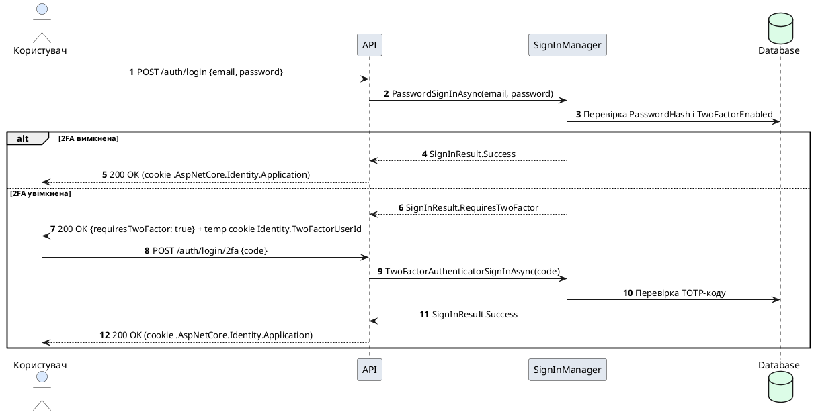

# Identity: двофакторна автентифікація (2FA) та Passkeys

::card-group

::card{title="Навчальні цілі" icon="i-lucide-graduation-cap"}

- Пояснювати різницю між трьома категоріями факторів автентифікації та принцип роботи 2FA.
- Налаштовувати двокроковий cookie-вхід в ASP.NET Core Identity через `PasswordSignInAsync` і `TwoFactorAuthenticatorSignInAsync`.
- Реалізовувати підключення TOTP-автентифікатора, одноразових резервних кодів, Email/SMS-кодів та функції «запам'ятати пристрій».
- Описувати принцип роботи Passkeys (WebAuthn) і підключати нативний API Passkeys в Identity (.NET 10).
- Обирати відповідний метод другого фактора або безпарольного входу під вимоги безпеки й зручності.

::

::card{title="Технологічний стек" icon="i-lucide-cpu"}

- **Платформа:** .NET 10 (LTS), ASP.NET Core Minimal APIs
- **База даних:** Entity Framework Core (`IdentitySchemaVersions.Version3`)
- **Пакети:** `Microsoft.AspNetCore.Identity.EntityFrameworkCore`
- **Приклади:** `samples/csharp/aspnet/auth/06-identity-two-factor/`

::

::card{title="Поглиблено" icon="i-lucide-telescope"}

Розділи поза програмою модуля. У тексті вони позначені фіолетовою рамкою.

- [Як з HMAC-SHA1 виходить 6-значний TOTP-код](#як-з-hmac-sha1-виходить-6-значний-totp-код)
- [Де зберігаються резервні коди та як блокується повтор TOTP](#де-зберігаються-резервні-коди-та-як-блокується-повтор-totp)
- [Що відбувається всередині Passkeys: Challenge, Attestation та Assertion](#що-відбувається-всередині-passkeys-challenge-attestation-та-assertion)
- [Двофакторний вхід для API без cookie (через JWT)](#двофакторний-вхід-для-api-без-cookie-через-jwt)

::

::

---

## Чому одного пароля замало

Коли користувач уже підтвердив email, система знає, що пошта справжня. Але сам вхід усе ще тримається на одному секреті — паролі. Якщо людина використала той самий пароль на іншому сайті, ввела його на фішинговій сторінці або база паролів витекла, одного пароля достатньо для повного доступу до акаунта.

{.diagram-img}

Щоб закрити цю вразливість, до входу додають ще один незалежний доказ особи. Усі такі докази поділяють на три категорії:

{.diagram-img}

**Двофакторна автентифікація (*Two-Factor Authentication, 2FA*)** означає, що для входу потрібно підтвердити особу факторами з **двох різних категорій**. Наприклад, пароль (що ви знаєте) плюс код із телефона (що ви маєте). Два паролі поспіль — це не 2FA, бо обидва належать до першої категорії.

---

## Як влаштований двокроковий вхід у Identity

У стандартній cookie-автентифікації ASP.NET Core Identity вхід із 2FA завжди розбитий на два окремі запити:

1. На першому запиті сервер перевіряє пароль. Якщо в користувача увімкнена 2FA, сервер **не видає** основну cookie авторизації, а ставить коротку тимчасову cookie `Identity.TwoFactorUserId` і просить другий фактор.
2. На другому запиті браузер надсилає 2FA-код разом із цією тимчасовою cookie. Лише після успішної перевірки коду сервер видає повноцінну cookie `.AspNetCore.Identity.Application`.

::plant-uml{alt="Діаграма послідовності двокрокового входу в Identity"}



::

У `SignInManager<TUser>` за цей процес відповідають такі методи:

::field-group

::field{name="PasswordSignInAsync(...)" type="SignInResult"}
Перевіряє пароль. Якщо `TwoFactorEnabled == true` (і пристрій не запам'ятований), повертає `SignInResult.RequiresTwoFactor` і записує тимчасову cookie з ідентифікатором користувача.

::

::field{name="GetTwoFactorAuthenticationUserAsync()" type="Task<TUser?>"}
Читає тимчасову cookie `Identity.TwoFactorUserId` на другому кроці входу та повертає користувача, який проходить перевірку.

::

::field{name="TwoFactorAuthenticatorSignInAsync(...)" type="SignInResult"}
Перевіряє 6-значний код із додатка-автентифікатора (TOTP) і при успіху замінює тимчасову cookie на повноцінну cookie входу.

::

::field{name="TwoFactorSignInAsync(provider, code, ...)" type="SignInResult"}
Універсальний метод для будь-якого іншого провайдера другого фактора, наприклад `"Email"` або `"Phone"`.

::

::field{name="TwoFactorRecoveryCodeSignInAsync(code)" type="SignInResult"}
Вхід за допомогою одноразового резервного коду, якщо користувач втратив доступ до телефона.

::

::

---

## TOTP: одноразові коди в додатку на телефоні

**TOTP (*Time-based One-Time Password*)** — це ті самі 6 цифр у Google Authenticator, Microsoft Authenticator або Apple Passwords, які оновлюються кожні 30 секунд. Головна перевага TOTP у тому, що телефон генерує коди **без інтернету й мобільного зв'язку**.

Це працює завдяки одній простій ідеї: під час сканування QR-коду сервер і телефон отримують однаковий секретний ключ. Далі обидві сторони підставляють у ту саму математичну формулу цей ключ і поточний час, округлений до 30 секунд. Оскільки ключ і час однакові, телефон і сервер отримують однакове 6-значне число.

{.diagram-img}

### Налаштування та ввімкнення TOTP

Підключення автентифікатора завжди складається з трьох кроків: спочатку користувач отримує секрет (у вигляді QR-посилання і текстового ключа), потім вводить перший код для перевірки, і лише після цього сервер вмикає `TwoFactorEnabled = true`.

{.diagram-img}

```csharp [Program.cs — налаштування і ввімкнення TOTP] {8,11,16,34-37,42-43} showLineNumbers
app.MapGet("/account/2fa/setup", async (
    HttpContext ctx,
    UserManager<AppUser> userManager) =>
{
    var user = await userManager.GetUserAsync(ctx.User);
    if (user is null) return Results.Unauthorized();

    var unformattedKey = await userManager.GetAuthenticatorKeyAsync(user);
    if (string.IsNullOrEmpty(unformattedKey))
    {
        await userManager.ResetAuthenticatorKeyAsync(user);
        unformattedKey = await userManager.GetAuthenticatorKeyAsync(user);
    }

    var email = await userManager.GetEmailAsync(user);
    var authenticatorUri = GenerateQrCodeUri("KostylDemo", email!, unformattedKey!);

    return Results.Ok(new
    {
        sharedKey = FormatKey(unformattedKey!),
        authenticatorUri
    });
}).RequireAuthorization();

app.MapPost("/account/2fa/enable", async (
    Enable2FaRequest req,
    HttpContext ctx,
    UserManager<AppUser> userManager) =>
{
    var user = await userManager.GetUserAsync(ctx.User);
    if (user is null) return Results.Unauthorized();

    var verificationCode = req.Code.Replace(" ", "").Replace("-", "");
    var isValid = await userManager.VerifyTwoFactorTokenAsync(
        user,
        userManager.Options.Tokens.AuthenticatorTokenProvider,
        verificationCode);

    if (!isValid)
        return Results.BadRequest(new { error = "Invalid verification code." });

    await userManager.SetTwoFactorEnabledAsync(user, true);
    var recoveryCodes = await userManager.GenerateNewTwoFactorRecoveryCodesAsync(user, 10);

    return Results.Ok(new
    {
        message = "Two-factor authentication enabled.",
        recoveryCodes
    });
}).RequireAuthorization();
```

Розберемо, що робить кожен ключовий виклик у цьому сценарії:

::field-group

::field{name="GetAuthenticatorKeyAsync(user)" type="UserManager"}
Читає секретний ключ користувача з таблиці `AspNetUserTokens`. Якщо ключа ще немає, `ResetAuthenticatorKeyAsync` створює новий випадковий 160-бітний ключ.

::

::field{name="otpauth://totp/..." type="формат QR-коду"}
Стандартне посилання, яке розуміє будь-який додаток-автентифікатор: у ньому передається назва сервісу (`issuer`), пошта користувача та `secret` у кодуванні Base32.

::

::field{name="VerifyTwoFactorTokenAsync(...)" type="перевірка перед ввімкненням"}
Перевіряє, що користувач справді відсканував QR-код і його додаток генерує правильні цифри. Без цієї перевірки користувач міг би увімкнути 2FA з неправильним ключем і втратити доступ до акаунта.

::

::field{name="SetTwoFactorEnabledAsync(user, true)" type="UserManager"}
Встановлює прапорець `TwoFactorEnabled = true` в `AspNetUsers`, після чого кожен вхід вимагатиме другий фактор.

::

::

Нижче показано реальний вивід налаштування та ввімкнення TOTP на демонстраційному сервері (фронтенд перетворює `authenticatorUri` на QR-код, а `sharedKey` показує для ручного введення):

::terminal-preview{title="Налаштування та ввімкнення TOTP"}
```text
=== TOTP SETUP ===
200 {"sharedKey":"SMYX 2J7U 3PSA CNN2 XLNH GFGG WNIU Q5CZ","authenticatorUri":"otpauth://totp/KostylDemo:taras%40college.edu.ua?secret=SMYX2J7U3PSACNN2XLNHGFGGWNIUQ5CZ&issuer=KostylDemo&digits=6"}

=== TOTP ENABLE ===
200 {"message":"Two-factor authentication enabled.","recoveryCodes":["XWF4B-966KW","CPX9P-KHBYD","2H25Q-N94BB","NH9CP-Y5KRF","YRXT4-BXX5N","KGFC9-84XMW","JBXRG-GW269","X3K38-W2HQM","WR77M-4NY7X","D3R66-MHCYR"]}
```

::

### Дворівневий вхід і вимкнення TOTP

Коли TOTP увімкнено, вхід проходить через пару ендпоінтів `/auth/login` і `/auth/login/2fa`. А для вимкнення 2FA обов'язково перевіряють поточний пароль і скидають ключ автентифікатора, щоб при повторному увімкненні користувач отримав новий QR-код.

```csharp [Program.cs — вхід із TOTP та вимкнення 2FA] {5-6,11-18,31-32,58-59} showLineNumbers
app.MapPost("/auth/login", async (
    LoginRequest req,
    SignInManager<AppUser> signInManager) =>
{
    var result = await signInManager.PasswordSignInAsync(
        req.Email, req.Password, isPersistent: false, lockoutOnFailure: true);

    if (result.IsLockedOut)
        return Results.Json(new { error = "Account locked." }, statusCode: StatusCodes.Status423Locked);

    if (result.RequiresTwoFactor)
    {
        return Results.Ok(new
        {
            requiresTwoFactor = true,
            message = "Enter your 2FA code to complete login."
        });
    }

    if (!result.Succeeded)
        return Results.Unauthorized();

    return Results.Ok(new { message = "Logged in without 2FA." });
});

app.MapPost("/auth/login/2fa", async (
    TwoFaLoginRequest req,
    SignInManager<AppUser> signInManager) =>
{
    var code = req.Code.Replace(" ", "").Replace("-", "");
    var result = await signInManager.TwoFactorAuthenticatorSignInAsync(
        code, isPersistent: false, rememberClient: req.RememberMachine);

    if (result.IsLockedOut)
        return Results.Json(new { error = "Account locked." }, statusCode: StatusCodes.Status423Locked);

    if (!result.Succeeded)
        return Results.Json(new { error = "Invalid 2FA code." }, statusCode: StatusCodes.Status401Unauthorized);

    return Results.Ok(new
    {
        message = "Logged in with 2FA.",
        rememberedMachine = req.RememberMachine
    });
});

app.MapPost("/account/2fa/disable", async (
    Disable2FaRequest req,
    HttpContext ctx,
    UserManager<AppUser> userManager) =>
{
    var user = await userManager.GetUserAsync(ctx.User);
    if (user is null) return Results.Unauthorized();

    if (!await userManager.CheckPasswordAsync(user, req.Password))
        return Results.BadRequest(new { error = "Invalid password." });

    await userManager.SetTwoFactorEnabledAsync(user, false);
    await userManager.ResetAuthenticatorKeyAsync(user);

    return Results.Ok(new { message = "Two-factor authentication disabled." });
}).RequireAuthorization();
```

Зверніть увагу на `lockoutOnFailure: true` у `PasswordSignInAsync`: Identity так само обмежує кількість невдалих спроб під час перевірки 2FA-коду через `TwoFactorAuthenticatorSignInAsync`. Якщо зловмисник спробує підібрати 6-значний код перебором, після `MaxFailedAccessAttempts` спроб (у прикладі — 5) акаунт тимчасово заблокується і метод поверне `result.IsLockedOut == true`.

::::accordion

:::accordion-item{label="Спробуйте: активувати TOTP і перевірити двокроковий вхід" icon="i-lucide-clipboard-list"}

1. Запустіть проєкт `samples/csharp/aspnet/auth/06-identity-two-factor/` командою `dotnet run`.
2. Зареєструйте користувача (`POST /auth/register`), увійдіть (`POST /auth/login`) і викличте `GET /account/2fa/setup`.
3. Додайте отриманий `sharedKey` або `authenticatorUri` у додаток-автентифікатор (або скористайтеся локальним генератором TOTP) та активуйте 2FA через `POST /account/2fa/enable`.
4. Очистіть cookie і повторіть `POST /auth/login` — переконайтеся, що сервер повертає `requiresTwoFactor: true` і не пускає на захищений маршрут `GET /account/me` до введення коду.

:::

:::accordion-item{label="Розв'язок" icon="i-lucide-check-circle"}

Після першого кроку `POST /auth/login` сервер встановлює лише проміжну cookie `Identity.TwoFactorUserId`. Запит до `GET /account/me` із цією cookie поверне `401 Unauthorized`, бо користувач ще не пройшов другий фактор. Після виклику `POST /auth/login/2fa` із правильним 6-значним кодом сервер видає `.AspNetCore.Identity.Application`, і `GET /account/me` повертає `200 OK`.

:::

::::

---

## Резервні коди: страховка при втраті телефона

Якщо користувач загубив телефон або видалив додаток-автентифікатор, без запасного способу він назавжди втратить доступ до акаунта. Для цього при увімкненні TOTP генерують набір **одноразових резервних кодів (*Recovery Codes*)** формату `XXXXX-XXXXX`.

Кожен резервний код спрацьовує лише один раз і одразу видаляється зі списку. При повторній генерації (`GenerateNewTwoFactorRecoveryCodesAsync`) усі старі коди миттєво анулюються.

{.diagram-img}

```csharp [Program.cs — вхід та керування резервними кодами] {10-11,16,32,46} showLineNumbers
app.MapPost("/auth/login/2fa/recovery-code", async (
    RecoveryCodeLoginRequest req,
    SignInManager<AppUser> signInManager,
    UserManager<AppUser> userManager) =>
{
    var user = await signInManager.GetTwoFactorAuthenticationUserAsync();
    if (user is null)
        return Results.Json(new { error = "Two-factor session expired." }, statusCode: StatusCodes.Status401Unauthorized);

    var code = req.RecoveryCode.Trim();
    var result = await signInManager.TwoFactorRecoveryCodeSignInAsync(code);

    if (!result.Succeeded)
        return Results.Json(new { error = "Invalid recovery code." }, statusCode: StatusCodes.Status401Unauthorized);

    var remaining = await userManager.CountRecoveryCodesAsync(user);

    return Results.Ok(new
    {
        message = "Logged in with recovery code.",
        remainingRecoveryCodes = remaining
    });
});

app.MapGet("/account/2fa/recovery-codes/count", async (
    HttpContext ctx,
    UserManager<AppUser> userManager) =>
{
    var user = await userManager.GetUserAsync(ctx.User);
    if (user is null) return Results.Unauthorized();

    var remaining = await userManager.CountRecoveryCodesAsync(user);
    return Results.Ok(new { remaining });
}).RequireAuthorization();

app.MapPost("/account/2fa/recovery-codes/generate", async (
    HttpContext ctx,
    UserManager<AppUser> userManager) =>
{
    var user = await userManager.GetUserAsync(ctx.User);
    if (user is null) return Results.Unauthorized();

    if (!await userManager.GetTwoFactorEnabledAsync(user))
        return Results.BadRequest(new { error = "Enable 2FA first." });

    var recoveryCodes = await userManager.GenerateNewTwoFactorRecoveryCodesAsync(user, 10);
    return Results.Ok(new { recoveryCodes });
}).RequireAuthorization();
```

::warning
Для TOTP-коду пробіли та дефіси прибирають (`"123 456"` → `"123456"`), але з резервного коду виду `R9B7W-W9DKD` **не можна** видаляти дефіс. У таблиці `AspNetUserTokens` дефіс є частиною рядка, з якого обчислюється хеш, тому видалення дефіса зробить правильний код недійсним.

::

Ось реальний вивід входу через резервний код — лічильник зменшується з 10 до 9 одразу після успішної перевірки:

::terminal-preview{title="Вхід із резервним кодом"}
```text
=== STEP 1: LOGIN ===
{"requiresTwoFactor":true,"message":"Enter your 2FA code to complete login."}

=== STEP 2: RECOVERY CODE ===
{"message":"Logged in with recovery code.","remainingRecoveryCodes":9}
```

::

---

## Запасні канали: Email 2FA та SMS 2FA

Якщо користувачеві незручно встановлювати окремий додаток на телефон, Identity дозволяє надсилати одноразові 6-значні коди на підтверджену пошту (`EmailTokenProvider`) або в SMS (`PhoneNumberTokenProvider`).

::code-group

```csharp [Email 2FA] {10,19-23} showLineNumbers
app.MapPost("/auth/login/2fa/email/send", async (
    SignInManager<AppUser> signInManager,
    UserManager<AppUser> userManager,
    IEmailSender<AppUser> emailSender) =>
{
    var user = await signInManager.GetTwoFactorAuthenticationUserAsync();
    if (user is null)
        return Results.Json(new { error = "Two-factor session expired." }, statusCode: 401);

    var code = await userManager.GenerateTwoFactorTokenAsync(user, TokenOptions.DefaultEmailProvider);
    await emailSender.SendPasswordResetCodeAsync(user, user.Email!, code);
    return Results.Ok(new { message = "2FA code sent to email." });
});

app.MapPost("/auth/login/2fa/email", async (
    EmailTwoFaLoginRequest req,
    SignInManager<AppUser> signInManager) =>
{
    var result = await signInManager.TwoFactorSignInAsync(
        TokenOptions.DefaultEmailProvider,
        req.Code,
        isPersistent: false,
        rememberClient: req.RememberMachine);

    if (!result.Succeeded)
        return Results.Json(new { error = "Invalid or expired email code." }, statusCode: 401);

    return Results.Ok(new { message = "Logged in with Email 2FA." });
});
```

```csharp [SMS 2FA] {13,18-22} showLineNumbers
app.MapPost("/auth/login/2fa/sms", async (
    SmsTwoFaLoginRequest req,
    SignInManager<AppUser> signInManager,
    UserManager<AppUser> userManager,
    ISmsSender smsSender) =>
{
    var user = await signInManager.GetTwoFactorAuthenticationUserAsync();
    if (user is null)
        return Results.Json(new { error = "Two-factor session expired." }, statusCode: 401);

    if (req.SendCode)
    {
        var code = await userManager.GenerateTwoFactorTokenAsync(user, TokenOptions.DefaultPhoneProvider);
        await smsSender.SendSmsAsync(user.PhoneNumber!, $"Login code: {code}");
        return Results.Ok(new { message = "SMS code sent." });
    }

    var result = await signInManager.TwoFactorSignInAsync(
        TokenOptions.DefaultPhoneProvider,
        req.Code ?? "",
        isPersistent: false,
        rememberClient: req.RememberMachine);

    if (!result.Succeeded)
        return Results.Json(new { error = "Invalid SMS code." }, statusCode: 401);

    return Results.Ok(new { message = "Logged in with SMS 2FA." });
});
```

::

У демонстраційному проєкті для SMS використовується інтерфейс `ISmsSender` із консольною реалізацією `DevSmsSender`, а в production туди підставляють клієнт обраного SMS-шлюзу (наприклад, Twilio чи локального оператора). Перед тим як покладатися на SMS, номер телефону обов'язково верифікують через `ChangePhoneNumberAsync`.

::callout{icon="i-lucide-lightbulb"}
**Коли який канал другого фактора обирати**

- :icon{name="i-lucide-circle-check" class="inline-block text-green-500"} **TOTP (додаток-автентифікатор)** — основний вибір для 2FA: не залежить від мережі, не коштує грошей за кожне SMS і не схильний до перехоплення номера.
- :icon{name="i-lucide-circle-check" class="inline-block text-green-500"} **Email OTP** — зручний запасний варіант, якщо пошта підтверджена і захищена надійним паролем.
- :icon{name="i-lucide-circle-x" class="inline-block text-red-500"} **Не покладайтеся лише на SMS OTP у фінансових і критичних системах** — зловмисники можуть перевипустити SIM-карту через оператора (*SIM-swapping*) або перехопити SMS у мобільній мережі.

::

---

## Remember Machine: не питати код на довіреному пристрої

Вводити 6-значний код щодня на власному ноутбуці незручно. Для цього в `TwoFactorAuthenticatorSignInAsync` і `TwoFactorSignInAsync` є параметр `rememberClient`.

Коли користувач вмикає прапорець «Запам'ятати цей пристрій», сервер записує в браузер окрему cookie `Identity.TwoFactorRememberMe`. Наступного разу `PasswordSignInAsync` бачить цей маркер, перевіряє його підпис і одразу завершує вхід без другого кроку.

<video controls autoplay loop muted playsinline poster="/videos/csharp/aspnet/auth/identity-two-factor/anim-01-two-factor-flow.png" class="diagram-img rounded-xl shadow-lg w-full my-6">
  <source src="/videos/csharp/aspnet/auth/identity-two-factor/anim-01-two-factor-flow.mp4" type="video/mp4">
  <source src="/videos/csharp/aspnet/auth/identity-two-factor/anim-01-two-factor-flow.webm" type="video/webm">
</video>

Щоб скинути довіру до поточного браузера (наприклад, якщо користувач зайшов із чужого комп'ютера й забув зняти галочку), викликають `ForgetTwoFactorClientAsync()`:

```csharp [Program.cs — скидання довіреного пристрою] {4} showLineNumbers
app.MapPost("/account/2fa/forget-machine", async (
    SignInManager<AppUser> signInManager) =>
{
    await signInManager.ForgetTwoFactorClientAsync();
    return Results.Ok(new { message = "This device is no longer remembered." });
}).RequireAuthorization();
```

Нижче наведено реальний вивід перевірки на демонстраційному сервері: після входу з `rememberMachine: true` браузер отримує дві cookie, і повторний виклик `/auth/login` пропускає етап 2FA:

::terminal-preview{title="Перевірка cookie Remember Machine"}
```text
=== FRESH LOGIN WITH REMEMBER ===
(200, '{"requiresTwoFactor":true,"message":"Enter your 2FA code to complete login."}')
(200, '{"message":"Logged in with 2FA.","rememberedMachine":true}')
Cookies after remember: ['Identity.TwoFactorRememberMe', '.AspNetCore.Identity.Application']

=== LOGIN AGAIN ON REMEMBERED DEVICE ===
(200, '{"message":"Logged in without 2FA."}')
```

::

---

## Passkeys (WebAuthn): вхід без пароля і захист від фішингу

Навіть TOTP не рятує від продуманого фішингу. Якщо зловмисник зробить точну копію сайту на домені `my-bank-login.xyz`, неуважний користувач сам введе туди пароль і свіжий 6-значний код, а скрипт зловмисника миттєво передасть їх на справжній сайт.

**Passkey (*ключ доступу*)** на базі стандарту **WebAuthn / FIDO2** вирішує цю проблему на рівні браузера та операційної системи. Замість спільного секрету (пароля), який ви надсилаєте серверу, ваш телефон або ноутбук створює пару криптографічних ключів:

- **Публічний ключ** зберігається на сервері в базі даних.
- **Приватний ключ** ніколи не залишає ваш пристрій (або синхронізується через зашифровану зв'язку ключів iCloud / Google Password Manager / 1Password) і розблоковується через Face ID, відбиток пальця або PIN-код пристрою.

{.diagram-img}

{.diagram-img}

Коли ви натискаєте «Увійти через Passkey», браузер сам перевіряє домен в адресному рядку. Ключ, створений для `my-bank.com`, фізично не можна застосувати на `my-bank-login.xyz` — браузер просто не запропонує його користувачеві.

### Налаштування Passkeys в ASP.NET Core Identity (.NET 10)

У .NET 10 підтримка Passkeys вбудована безпосередньо в ASP.NET Core Identity. Щоб у базі даних з'явилася таблиця `AspNetUserPasskeys`, потрібно вказати третю версію схеми сховища (`IdentitySchemaVersions.Version3`) і задати домен сервера в `IdentityPasskeyOptions`.

```csharp [Program.cs — увімкнення Passkeys у .NET 10] {4,10-14} showLineNumbers
builder.Services
    .AddIdentity<AppUser, IdentityRole>(options =>
    {
        options.Stores.SchemaVersion = IdentitySchemaVersions.Version3;
        options.User.RequireUniqueEmail = true;
    })
    .AddEntityFrameworkStores<AppDbContext>()
    .AddDefaultTokenProviders();

builder.Services.Configure<IdentityPasskeyOptions>(options =>
{
    options.ServerDomain = "localhost";
    options.AuthenticatorTimeout = TimeSpan.FromMinutes(2);
});
```

### Реєстрація та вхід через Passkey

Робота з Passkey також проходить у два короткі кроки — спочатку сервер видає параметри з одноразовим випадковим числом (*challenge*), а потім перевіряє підписану відповідь від браузера (`navigator.credentials.create` при реєстрації або `navigator.credentials.get` при вході).

::code-group

```csharp [Реєстрація нового Passkey] {9-14,28,36} showLineNumbers
app.MapPost("/account/passkey/creation-options", async (
    HttpContext ctx,
    UserManager<AppUser> userManager,
    SignInManager<AppUser> signInManager) =>
{
    var user = await userManager.GetUserAsync(ctx.User);
    if (user is null) return Results.Unauthorized();

    var optionsJson = await signInManager.MakePasskeyCreationOptionsAsync(new PasskeyUserEntity
    {
        Id = user.Id,
        Name = user.Email!,
        DisplayName = user.FullName
    });

    return Results.Content(optionsJson, "application/json");
}).RequireAuthorization();

app.MapPost("/account/passkey/register", async (
    PasskeyRegisterRequest req,
    HttpContext ctx,
    UserManager<AppUser> userManager,
    SignInManager<AppUser> signInManager) =>
{
    var user = await userManager.GetUserAsync(ctx.User);
    if (user is null) return Results.Unauthorized();

    var attestation = await signInManager.PerformPasskeyAttestationAsync(req.CredentialJson);
    if (!attestation.Succeeded)
        return Results.BadRequest(new { error = attestation.Failure?.Message ?? "Attestation failed." });

    attestation.Passkey.Name = string.IsNullOrWhiteSpace(req.FriendlyName)
        ? "My Passkey"
        : req.FriendlyName;

    var result = await userManager.AddOrUpdatePasskeyAsync(user, attestation.Passkey);
    if (!result.Succeeded)
        return Results.BadRequest(new { errors = result.Errors.Select(e => e.Description) });

    return Results.Ok(new { message = "Passkey registered.", name = attestation.Passkey.Name });
}).RequireAuthorization();
```

```csharp [Вхід через Passkey без пароля] {4,12} showLineNumbers
app.MapPost("/auth/passkey/request-options", async (
    SignInManager<AppUser> signInManager) =>
{
    var optionsJson = await signInManager.MakePasskeyRequestOptionsAsync(user: null);
    return Results.Content(optionsJson, "application/json");
});

app.MapPost("/auth/passkey/login", async (
    PasskeyLoginRequest req,
    SignInManager<AppUser> signInManager) =>
{
    var result = await signInManager.PasskeySignInAsync(req.CredentialJson);
    if (!result.Succeeded)
        return Results.Unauthorized();

    return Results.Ok(new { message = "Logged in with Passkey." });
});
```

::

Увесь криптографічний обмін — генерація `challenge`, тимчасове збереження стану в захищеній cookie та перевірка підпису публічним ключем — виконується всередині `SignInManager`. На реальному запуску `MakePasskeyCreationOptionsAsync` і `MakePasskeyRequestOptionsAsync` повертають готові JSON-об'єкти стандарту WebAuthn:

::terminal-preview{title="JSON-параметри, які .NET 10 генерує для браузера"}
```text
=== POST /account/passkey/creation-options ===
{"rp":{"name":"localhost","id":"localhost"},"user":{"id":"N2M3NGIzMWIt...","name":"taras@college.edu.ua","displayName":"Тарас Шевчук"},"challenge":"hCK4cH6Gvnwo25CliZT7xKDtXPb482JxZuqLrU7JG38","timeout":120000,"authenticatorSelection":{"residentKey":"preferred","userVerification":"required"}}

=== POST /auth/passkey/request-options ===
{"challenge":"BIrbSWkMuL_Qq9bgSBKLvWnqqNe3YWrlqKQUyysOw_0","timeout":120000,"rpId":"localhost","allowCredentials":[],"userVerification":"required"}
```

::

::::accordion

:::accordion-item{label="Спробуйте: дослідити параметри Passkey Creation Options" icon="i-lucide-clipboard-list"}

1. Запустіть проєкт `samples/csharp/aspnet/auth/06-identity-two-factor/`, увійдіть під тестовим користувачем і викличте `POST /account/passkey/creation-options`.
2. Перегляньте поля `rp.id`, `challenge` та `authenticatorSelection.userVerification` у відповіді JSON.
3. Поясніть своїми словами, чому в `IdentityPasskeyOptions` потрібно задавати `ServerDomain = "localhost"` (або ваш продакшн-домен).

:::

:::accordion-item{label="Розв'язок" icon="i-lucide-check-circle"}

Поле `rp.id` (*Relying Party ID*) у відповіді має значення `"localhost"`. Саме з цим доменом браузер порівнює поточну адресу сторінки перед створенням або використанням ключа. Якщо `ServerDomain` не збігається з доменом сайту в браузері, WebAuthn відхилить операцію — це і є основа захисту від фішингу.

:::

::::

---

## Порівняння методів 2FA та Passkeys

Вибір конкретного механізму залежить від балансу між захищеністю від атак і тим, наскільки легко користувачеві проходити перевірку щодня:

{.diagram-img}

У більшості сучасних систем поєднують **Passkeys** як найзручніший і фішинг-стійкий спосіб входу разом із **TOTP + резервними кодами** як надійним запасним механізмом для 2FA.

---

## Типові помилки та пастки

::::accordion

:::accordion-item{label="Видалення дефіса з резервного коду перед перевіркою" icon="i-lucide-alert-triangle"}

Якщо нормалізувати резервний код так само, як TOTP (`code.Replace("-", "")`), `TwoFactorRecoveryCodeSignInAsync` завжди повертатиме помилку. Дефіс у форматі `XWF4B-966KW` є частиною коду, хеш якого зберігається в БД — достатньо виконати лише `.Trim()`.

:::

:::accordion-item{label="Забута SchemaVersion = IdentitySchemaVersions.Version3 для Passkeys" icon="i-lucide-alert-triangle"}

За замовчуванням у деяких проєктах може використовуватися старіша версія схеми Identity, де в моделі бази даних немає таблиці `AspNetUserPasskeys`. Якщо при виклику `AddOrUpdatePasskeyAsync` або `PasskeySignInAsync` виникає виняток про відсутність сховища passkey, перевірте наявність `options.Stores.SchemaVersion = IdentitySchemaVersions.Version3;`.

:::

:::accordion-item{label="Розсинхронізація годинника на сервері або телефоні" icon="i-lucide-alert-triangle"}

TOTP базується на поточному часі UTC. Якщо на сервері в контейнері або на телефоні користувача час збився більш ніж на 1–2 хвилини, генеровані коди не збігатимуться з вікном перевірки. На серверах завжди має працювати синхронізація часу (NTP).

:::

::::

---

:::::deep-dive

### Як з HMAC-SHA1 виходить 6-значний TOTP-код

Під час генерації TOTP-коду алгоритм стандарту RFC 6238 виконує чотири кроки:

1. Ділить поточний Unix-час у секундах на `30` (цілочисельно) — отримує лічильник поточного 30-секундного інтервалу.
2. Обчислює 20-байтовий хеш `HMAC-SHA1(secretKey, counter)`.
3. Бере останні 4 біти останнього байта хешу як зсув `offset` (число від 0 до 15) і читає 4 байти починаючи з позиції `offset`, обнуляючи старший знаковий біт.
4. Бере залишок від ділення отриманого числа на `1_000_000` (`% 10^6`) — так утворюється 6-значний код із провідними нулями.

Оскільки годинник на телефоні й сервері може трохи розходитися або користувач вводить код у момент перемикання 30-секундного вікна, Identity перевіряє не лише поточний інтервал, а й сусідні (±1 крок, тобто загальне вікно близько 90 секунд).

### Де зберігаються резервні коди та як блокується повтор TOTP

Резервні коди записуються в таблицю `AspNetUserTokens` під ключем:

- `LoginProvider`: `"[AspNetUserStore]"`
- `Name`: `"RecoveryCodes"`
- `Value`: захешовані значення кодів, розділені крапкою з комою (`hash1;hash2;...`)

Коли `RedeemTwoFactorRecoveryCodeAsync` знаходить збіг, він видаляє цей хеш із рядка і перезаписує запис у БД. Для TOTP-кодів у новітніх реалізаціях варто також пам'ятати: один і той самий 6-значний код математично дійсний протягом усього 30-секундного вікна, тому для критичних систем останній використаний часовий крок кешують на час дії вікна, щоб перехоплений код не можна було використати вдруге протягом тих самих 30 секунд.

### Що відбувається всередині Passkeys: Challenge, Attestation та Assertion

Протокол WebAuthn спирається на два терміни, які ви вже бачили в методах `SignInManager`:

::field-group

::field{name="Challenge (виклик)" type="одноразові випадкові байти"}
Випадковий масив байтів, який сервер генерує перед кожною операцією (`MakePasskeyCreationOptionsAsync` / `MakePasskeyRequestOptionsAsync`) і зберігає у тимчасовій захищеній cookie. Це гарантує, що відповідь браузера свіжа і не може бути відтворена повторно (*replay attack*).

::

::field{name="Attestation (реєстрація ключа)" type="PerformPasskeyAttestationAsync"}
Браузер створює нову пару ключів і повертає публічний ключ разом із підписаним `clientDataJSON` (де зафіксовані `challenge` і `origin` сайту). Сервер перевіряє підпис і додає запис у таблицю `AspNetUserPasskeys`.

::

::field{name="Assertion (вхід за ключем)" type="PasskeySignInAsync"}
При вході пристрій підписує новий `challenge` приватним ключем. Сервер знаходить публічний ключ за `CredentialId`, перевіряє підпис, лічильник підписів (`SignCount` — допомагає виявити клонування апаратного ключа) і видає cookie авторизації.

::

::

### Двофакторний вхід для API без cookie (через JWT)

Якщо ваш клієнт — мобільний застосунок або SPA, які працюють виключно з JWT без cookie, `PasswordSignInAsync` і `Identity.TwoFactorUserId` не підійдуть. У такому разі використовують `CheckPasswordSignInAsync` (який не ставить cookie) та `VerifyTwoFactorTokenAsync`:

```csharp [API-варіант входу 2FA без cookie (JWT)] {10-11,15,33-36,40} showLineNumbers
app.MapPost("/api/auth/login", async (
    LoginRequest req,
    SignInManager<AppUser> signInManager,
    UserManager<AppUser> userManager,
    ITokenService tokenService) =>
{
    var user = await userManager.FindByEmailAsync(req.Email);
    if (user is null) return Results.Unauthorized();

    var result = await signInManager.CheckPasswordSignInAsync(
        user, req.Password, lockoutOnFailure: true);

    if (result.RequiresTwoFactor)
    {
        var tempToken = tokenService.GenerateShortTwoFactorToken(user.Id);
        return Results.Ok(new { requiresTwoFactor = true, twoFactorToken = tempToken });
    }

    if (!result.Succeeded) return Results.Unauthorized();

    return Results.Ok(new { accessToken = tokenService.GenerateAccessToken(user) });
});

app.MapPost("/api/auth/login/2fa", async (
    JwtTwoFaRequest req,
    UserManager<AppUser> userManager,
    ITokenService tokenService) =>
{
    var userId = tokenService.ValidateShortTwoFactorToken(req.TwoFactorToken);
    var user = userId is null ? null : await userManager.FindByIdAsync(userId);
    if (user is null) return Results.Unauthorized();

    var isValid = await userManager.VerifyTwoFactorTokenAsync(
        user,
        userManager.Options.Tokens.AuthenticatorTokenProvider,
        req.Code.Replace(" ", "").Replace("-", ""));

    if (!isValid)
    {
        await userManager.AccessFailedAsync(user);
        return Results.Unauthorized();
    }

    await userManager.ResetAccessFailedCountAsync(user);
    return Results.Ok(new { accessToken = tokenService.GenerateAccessToken(user) });
});
```

Зверніть увагу на важливу деталь: у ручному API-варіанті ви самі повинні викликати `AccessFailedAsync(user)` при невірному 2FA-коді та `ResetAccessFailedCountAsync(user)` при успішному, бо `VerifyTwoFactorTokenAsync` не оновлює лічильник блокування автоматично (на відміну від `TwoFactorAuthenticatorSignInAsync`).

::::accordion

:::accordion-item{label="Спробуйте: порівняти обробку невдалих спроб у cookie та JWT варіантах" icon="i-lucide-clipboard-list"}

1. Порівняйте методи `SignInManager.TwoFactorAuthenticatorSignInAsync` і `UserManager.VerifyTwoFactorTokenAsync`.
2. Поясніть, що станеться з захистом від підбору 6-значного коду в JWT-ендпоінті, якщо забути викликати `await userManager.AccessFailedAsync(user);`.

:::

:::accordion-item{label="Розв'язок" icon="i-lucide-check-circle"}

У cookie-методі `TwoFactorAuthenticatorSignInAsync` підрахунок невдалих спроб і блокування акаунта вбудовані всередині `SignInManager`. Метод `VerifyTwoFactorTokenAsync` — це низькорівнева перевірка токена, яка лише повертає `bool`. Якщо не викликати `AccessFailedAsync`, зловмисник зможе нескінченно перебирати 1 000 000 комбінацій 6-значного коду без блокування акаунта.

:::

::::

:::::

---

## Питання для самоперевірки

::::accordion

:::accordion-item{label="1. Чому комбінація пароля та секретного питання не вважається двофакторною автентифікацією?" icon="i-lucide-help-circle"}

І пароль, і секретне питання належать до однієї категорії факторів — «щось, що ви знаєте». Повноцінна 2FA вимагає поєднання факторів із двох різних категорій, наприклад «знання» (пароль) та «володіння» (телефон або ключ).

:::

:::accordion-item{label="2. Як додаток Authenticator на телефоні без інтернету генерує той самий 6-значний код, що й сервер?" icon="i-lucide-help-circle"}

Під час початкового налаштування сервер і телефон обмінюються спільним секретним ключем через QR-код. Далі обидві сторони незалежно обчислюють HMAC-SHA1 від цього ключа та поточного часу UTC, округленого до 30-секундного інтервалу.

:::

:::accordion-item{label="3. Що зберігається у браузері між першим і другим кроком cookie-входу з 2FA?" icon="i-lucide-help-circle"}

На першому кроці `PasswordSignInAsync` не видає основну cookie авторизації, а записує лише тимчасову cookie `Identity.TwoFactorUserId`. За нею другий ендпоінт визначає, який саме користувач зараз підтверджує другий фактор.

:::

:::accordion-item{label="4. Чому в прикладі для TOTP дефіси з коду видаляють, а для резервного коду — залишають?" icon="i-lucide-help-circle"}

TOTP-код — це 6 цифр (`"123456"`), і пробіли чи дефіси додають лише для зручності читання. Натомість резервний код генерується у форматі `XXXXX-XXXXX`, і його хеш у таблиці `AspNetUserTokens` обчислюється саме з урахуванням дефіса.

:::

:::accordion-item{label="5. Чим Passkey захищає від фішингу краще, ніж пароль разом із TOTP?" icon="i-lucide-help-circle"}

Код TOTP користувач вводить вручну і може випадково віддати його підробленому сайту. Passkey прив'язаний до точного домену (`rpId`) на рівні браузера та операційної системи: на фішинговому домені браузер просто не підпише виклик приватним ключем.

:::

:::accordion-item{label="6. Навіщо в налаштуваннях Identity для Passkeys вказують IdentitySchemaVersions.Version3?" icon="i-lucide-help-circle"}

Третя версія схеми Identity додає до моделі Entity Framework Core сутність та таблицю `AspNetUserPasskeys` для зберігання публічних ключів, `CredentialId` і метаданих Passkey користувачів.

:::

::::

---

## Шпаргалка

| Елемент | Призначення | Де використовується |
|---|---|---|
| `PasswordSignInAsync` | Перший крок cookie-входу; повертає `RequiresTwoFactor` | `POST /auth/login` |
| `GetAuthenticatorKeyAsync` | Отримання секретного ключа для QR-коду TOTP | `GET /account/2fa/setup` |
| `VerifyTwoFactorTokenAsync` | Перевірка 6-значного коду перед увімкненням 2FA або в API | `POST /account/2fa/enable` |
| `TwoFactorAuthenticatorSignInAsync` | Другий крок cookie-входу за TOTP-кодом | `POST /auth/login/2fa` |
| `TwoFactorRecoveryCodeSignInAsync` | Вхід за одноразовим резервним кодом | `POST /auth/login/2fa/recovery-code` |
| `RememberTwoFactorClientAsync` / `ForgetTwoFactorClientAsync` | Керування cookie довіреного пристрою | Параметр `rememberClient` / `forget-machine` |
| `IdentitySchemaVersions.Version3` | Вмикає таблицю `AspNetUserPasskeys` в EF Core | `AddIdentity(..., options => ...)` |
| `MakePasskeyCreationOptionsAsync` / `PerformPasskeyAttestationAsync` | Генерація опцій реєстрації Passkey і перевірка відповіді | Реєстрація Passkey |
| `MakePasskeyRequestOptionsAsync` / `PasskeySignInAsync` | Генерація опцій входу й автентифікація через Passkey | Вхід без пароля |

---

## Практичні завдання

::::accordion

:::accordion-item{label="Завдання 1: Перевірка Remember Machine та Forget Machine" icon="i-lucide-clipboard-list"}

1. Запустіть проєкт `samples/csharp/aspnet/auth/06-identity-two-factor/` і увімкніть TOTP-автентифікацію для користувача.
2. Виконайте вхід на новому клієнті (`curl -c cookies.txt`) і на другому кроці передайте `"rememberMachine": true`.
3. Виконайте `POST /auth/login` ще раз із тим самим файлом `cookies.txt` і зафіксуйте, що сервер одразу пускає без запиту коду.
4. Викличте `POST /account/2fa/forget-machine`, після чого повторіть `POST /auth/login` і поясніть різницю.

:::

:::accordion-item{label="Розв'язок до завдання 1" icon="i-lucide-check-circle"}

При `rememberMachine: true` сервер встановлює cookie `Identity.TwoFactorRememberMe`, тому наступний `PasswordSignInAsync` бачить довірений пристрій і одразу повертає `SignInResult.Success`. Виклик `ForgetTwoFactorClientAsync()` видаляє цю cookie, і при наступному вході знову повертається `requiresTwoFactor: true`.

:::

:::accordion-item{label="Завдання 2: Поведінка одноразових резервних кодів" icon="i-lucide-clipboard-list"}

1. Після увімкнення 2FA збережіть перший зі згенерованих резервних кодів (наприклад, `R9B7W-W9DKD`).
2. Увійдіть за допомогою цього коду через `POST /auth/login/2fa/recovery-code` і перевірте значення `remainingRecoveryCodes` у відповіді.
3. Створіть нову сесію (`POST /auth/login`) і спробуйте використати той самий резервний код удруге.
4. Поясніть, що відбулося з записом у `AspNetUserTokens` після першого входу.

:::

:::accordion-item{label="Розв'язок до завдання 2" icon="i-lucide-check-circle"}

Під час першого використання `remainingRecoveryCodes` зменшується на одиницю (до 9), оскільки `TwoFactorRecoveryCodeSignInAsync` видаляє використаний хеш із рядка `RecoveryCodes` у таблиці `AspNetUserTokens`. Друга спроба входу з тим самим кодом повертає `401 Unauthorized` (`Invalid recovery code`).

:::

:::accordion-item{label="Завдання 3: Порівняння Passkey-опцій із налаштуваннями домену" icon="i-lucide-clipboard-list"}

1. У `Program.cs` змініть `options.ServerDomain = "localhost"` у блоці `Configure<IdentityPasskeyOptions>` на `"auth.example.com"`.
2. Перезапустіть сервер і виконайте запит `POST /auth/passkey/request-options`.
3. Поясніть, як змінилося поле `rpId` у JSON-відповіді та як браузер відреагує на такий JSON, якщо сторінка відкрита на `http://localhost`.

:::

:::accordion-item{label="Розв'язок до завдання 3" icon="i-lucide-check-circle"}

У відповіді JSON значення `rpId` зміниться з `"localhost"` на `"auth.example.com"`. Якщо сторінка відкрита на `localhost`, браузер негайно відхилить виклик `navigator.credentials.get(...)` із помилкою безпеки (`SecurityError`), оскільки поточний домен не є субдоменом або точним збігом для `rpId`.

:::

::::
