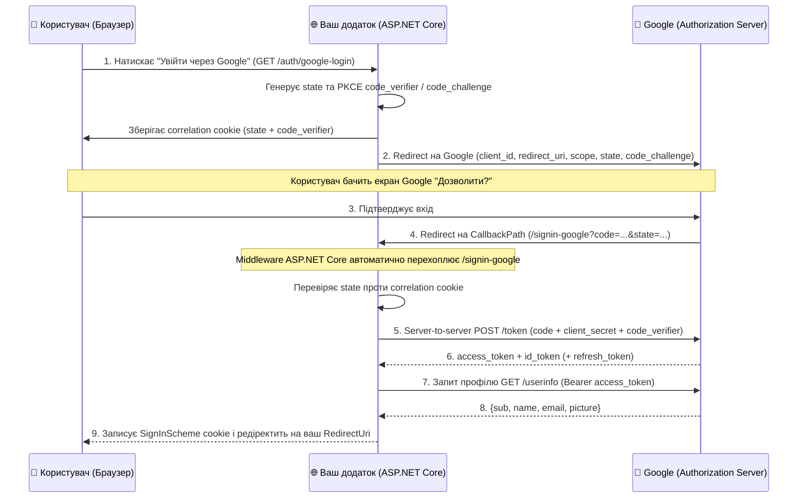

# OAuth 2.0 та зовнішні провайдери

::note
Кнопка **«Увійти через Google»** працює на основі чітко визначених стандартів **OAuth 2.0** та **OpenID Connect (OIDC)**. Базова інфраструктура для них вбудована в ASP.NET Core, але конкретні провайдери (Google, GitHub, Microsoft, Discord тощо) підключаються окремими NuGet-бібліотеками. У цій статті ми розберемо, що відбувається на рівні протоколу, які пакети потрібно встановити, як підключити Google, GitHub та довільний провайдер, як зв'язати зовнішній акаунт із локальною базою даних і безпечно інтегрувати це з SPA або мобільним додатком.

::

---

## 1. Навіщо зовнішні провайдери?

::card-group

::card{title="Для користувачів" icon="i-lucide-user-check"}
Не потрібно вигадувати й запам'ятовувати ще один пароль. Один клік — і вони в системі. Конверсія реєстрації зростає на 20–40%.

::

::card{title="Для розробників" icon="i-lucide-shield"}
Не потрібно зберігати чужі паролі чи будувати всю інфраструктуру відновлення доступу з нуля. Google або GitHub беруть на себе перевірку паролів, 2FA та захист від brute-force.

::

::card{title="Для бізнесу" icon="i-lucide-trending-up"}
Менше покинутих форм реєстрації, достовірні email-адреси (підтверджені провайдером), менше витрат на підтримку звернень «забув пароль».

::

::

---

## 2. OAuth 2.0 — як це працює?

### Ключові поняття

| Термін                   | Хто це                      | Аналогія                |
| :----------------------- | :-------------------------- | :---------------------- |
| **Resource Owner**       | Користувач (Іван)           | Господар квартири       |
| **Client**               | Ваш додаток (MyApi)         | Друг, який просить ключ |
| **Authorization Server** | Google / GitHub             | Консьєрж будинку        |
| **Resource Server**      | Google API (profile, email) | Квартира з даними       |

### Authorization Code Flow з PKCE

Для серверних додатків ASP.NET Core використовується **Authorization Code Flow** із розширенням **PKCE** (_Proof Key for Code Exchange_) та параметром **`state`**. Це найбезпечніший варіант, оскільки `client_secret` ніколи не потрапляє у браузер користувача.

::mermaid



::

::steps

### Користувач натискає «Увійти через Google»

Ваш додаток формує криптографічно випадкові значення `state` (для захисту від CSRF-атак) та `code_verifier` → `code_challenge` (PKCE — для захисту від перехоплення коду авторизації). Обидва значення шифруються через ASP.NET Core Data Protection і тимчасово записуються в короткочасну correlation cookie. Далі браузер перенаправляється на Google:

```
https://accounts.google.com/o/oauth2/v2/auth?
  client_id=YOUR_CLIENT_ID
  &redirect_uri=https://localhost:5001/signin-google
  &response_type=code
  &scope=openid email profile
  &state=CfDJ8...
  &code_challenge=...
  &code_challenge_method=S256
```

### Google показує екран дозволу (Consent Screen)

Користувач бачить: «Додаток MyApi хоче отримати доступ до вашого email та профілю. Дозволити?»

### Після дозволу — повернення на `CallbackPath`

Google перенаправляє браузер на вказаний `redirect_uri` із одноразовим **authorization code** та тим самим **`state`**:

```
https://localhost:5001/signin-google?code=4/0AXxyz...&state=CfDJ8...
```

### Middleware обмінює `code` на токени (Server-to-Server)

Вбудований обробник Google у ASP.NET Core перехоплює `/signin-google`, звіряє `state` з correlation cookie і робить **фоновий HTTP-запит** напряму до серверів Google. Ні `client_secret`, ні `access_token` не проходять через браузер:

```
POST https://oauth2.googleapis.com/token
  code=4/0AXxyz...
  &client_id=YOUR_CLIENT_ID
  &client_secret=YOUR_SECRET
  &redirect_uri=https://localhost:5001/signin-google
  &code_verifier=...
  &grant_type=authorization_code
```

### Отримання профілю та створення ClaimsPrincipal

Google повертає `access_token` та `id_token`. Middleware отримує дані користувача (`email`, `name`, `picture`, `sub`), формує `ClaimsPrincipal`, записує його у схему `SignInScheme` (тимчасову або основну cookie) і лише після цього перенаправляє браузер на ваш ендпоінт `RedirectUri` (наприклад, `/auth/google-callback`).

::

::warning
**Дві різні адреси зворотного виклику — не плутайте їх!**

- **`/signin-google`** (властивість `options.CallbackPath`) — системний маршрут, який **автоматично** перехоплює middleware ASP.NET Core для обміну `code` на токен. **Вам не потрібно** писати `app.MapGet("/signin-google", ...)` вручну, але саме цей URL необхідно вказати в Google Cloud Console як _Authorized redirect URI_.
- **`/auth/google-callback`** (властивість `AuthenticationProperties.RedirectUri`) — ваш власний ендпоінт, куди middleware перенаправляє користувача **вже після** успішної аутентифікації для збереження в БД чи видачі власної сесії/JWT.

::

### OAuth 2.0 vs OpenID Connect

|                 | OAuth 2.0                                           | OpenID Connect (OIDC)                   |
| :-------------- | :-------------------------------------------------- | :-------------------------------------- |
| **Мета**        | **Авторизація** — дозвіл на дії                     | **Аутентифікація** — хто користувач     |
| **Що повертає** | `access_token` (доступ до ресурсів)                 | `id_token` (інформація про користувача) |
| **Юзкейс**      | «Дозволити MyApi читати ваші файли на Google Drive» | «Увійти через Google»                   |

**OpenID Connect = OAuth 2.0 + шар ідентичності (Identity Layer).** Коли ми реалізуємо «Увійти через Google», протокол використовує scopes `openid`, `profile`, `email`.

---

## 3. Які бібліотеки (NuGet-пакети) потрібні в ASP.NET Core?

Поширена помилка початківців — спроба викликати `.AddGoogle()` у свіжому проєкті без встановлення пакетів. Сама інфраструктура OAuth 2.0 (`Microsoft.AspNetCore.Authentication.OAuth`, Cookie-схема, базовий `AddOAuth()`) входить до складу стандартного метапакета `Microsoft.AspNetCore.App`, але **кожен конкретний провайдер встановлюється окремим NuGet-пакетом**.

### Офіційні пакети від Microsoft

| Провайдер | NuGet-пакет | Метод розширення | Протокол |
| :--- | :--- | :--- | :--- |
| **Google** | `Microsoft.AspNetCore.Authentication.Google` | `.AddGoogle()` | OAuth 2.0 |
| **Microsoft Account** (особисті акаунти) | `Microsoft.AspNetCore.Authentication.MicrosoftAccount` | `.AddMicrosoftAccount()` | OAuth 2.0 |
| **Facebook** | `Microsoft.AspNetCore.Authentication.Facebook` | `.AddFacebook()` | OAuth 2.0 |
| **Twitter / X** (legacy OAuth 1.0a) | `Microsoft.AspNetCore.Authentication.Twitter` | `.AddTwitter()` | OAuth 1.0a |
| **Будь-який OIDC-провайдер** (Entra ID, Keycloak, Auth0, Okta, Google OIDC) | `Microsoft.AspNetCore.Authentication.OpenIdConnect` | `.AddOpenIdConnect()` | OpenID Connect |
| **Кастомний OAuth 2.0 провайдер** | _Вбудовано в `Microsoft.AspNetCore.App`_ | `.AddOAuth()` | OAuth 2.0 |

### Провайдери від спільноти (`AspNet.Security.OAuth.Providers`)

Для всіх інших сервісів (GitHub, Discord, Apple, LinkedIn, Spotify, Telegram, Slack тощо) індустріальним стандартом у .NET є відкрита колекція пакетів **AspNet.Security.OAuth.Providers** (понад 100 готових провайдерів від `aspnet-contrib`).

| Провайдер | NuGet-пакет | Метод розширення |
| :--- | :--- | :--- |
| **GitHub** | `AspNet.Security.OAuth.GitHub` | `.AddGitHub()` |
| **Discord** | `AspNet.Security.OAuth.Discord` | `.AddDiscord()` |
| **Apple** (Sign in with Apple) | `AspNet.Security.OAuth.Apple` | `.AddApple()` |
| **LinkedIn** | `AspNet.Security.OAuth.LinkedIn` | `.AddLinkedIn()` |
| **Spotify** | `AspNet.Security.OAuth.Spotify` | `.AddSpotify()` |
| **Twitch** | `AspNet.Security.OAuth.Twitch` | `.AddTwitch()` |

::warning
**Версія пакета має збігатися з версією .NET!**

Якщо ваш проєкт використовує `.NET 8`, встановлюйте офіційні пакети Microsoft версії `8.x` (наприклад, `--version 8.*`), якщо `.NET 9` — `9.x`, для `.NET 10` — `10.x`. Команда `dotnet add package` без `--version` за замовчуванням тягне останній реліз, який може вимагати новіший SDK.

```bash
# Наприклад, для проєкту на .NET 8:
dotnet add package Microsoft.AspNetCore.Authentication.Google --version 8.*
```

::

---

## 4. Підключення Google Auth

### Крок 1: Створення OAuth Client у Google Cloud Console

::steps

### Відкрийте Google Cloud Console

Перейдіть у [console.cloud.google.com](https://console.cloud.google.com/) → створіть проєкт (або оберіть існуючий) → **APIs & Services → OAuth consent screen**.

### Налаштуйте OAuth Consent Screen

Оберіть **External**, заповніть назву додатку та email підтримки. Додайте scopes `userinfo.email` та `userinfo.profile`.

::tip
Поки додаток має статус **Testing** (до публікації на перевірку Google), входити зможуть **лише** ті акаунти, які ви явно додали у список **Test users** на сторінці OAuth consent screen.

::

### Створіть OAuth 2.0 Client ID

Перейдіть у **Credentials → Create Credentials → OAuth client ID**:

- Application type: **Web application**
- Authorized JavaScript origins: `https://localhost:5001`
- Authorized redirect URIs: `https://localhost:5001/signin-google`

### Збережіть Client ID та Client Secret

Скопіюйте видані `Client ID` та `Client Secret` у безпечне локальне сховище `dotnet user-secrets`.

::

### Крок 2: Встановлення пакета та налаштування в ASP.NET Core

```bash
# 1. Встановлюємо бібліотеку для Google OAuth 2.0
dotnet add package Microsoft.AspNetCore.Authentication.Google

# 2. Зберігаємо секрети поза appsettings.json та Git
dotnet user-secrets init
dotnet user-secrets set "Authentication:Google:ClientId" "YOUR_CLIENT_ID"
dotnet user-secrets set "Authentication:Google:ClientSecret" "YOUR_CLIENT_SECRET"
```

Тепер налаштуємо аутентифікацію в `Program.cs`. Зверніть увагу на обов'язкове підключення `AddCookie` (OAuth-провайдеру потрібна cookie-схема для збереження результату входу) та порядок middleware `UseAuthentication()` / `UseAuthorization()`.

```csharp [Program.cs — Google Auth]
using System.Security.Claims;
using Microsoft.AspNetCore.Authentication;
using Microsoft.AspNetCore.Authentication.Cookies;
using Microsoft.AspNetCore.Authentication.Google;

var builder = WebApplication.CreateBuilder(args);

builder.Services
    .AddAuthentication(options =>
    {
        // Схема за замовчуванням для перевірки сесії та запису результату входу
        options.DefaultScheme = CookieAuthenticationDefaults.AuthenticationScheme;
    })
    .AddCookie(options =>
    {
        options.Cookie.HttpOnly = true;
        // SameSite=Lax обов'язково для OAuth-редіректів (Strict заблокує cookie при поверненні з Google!)
        options.Cookie.SameSite = SameSiteMode.Lax;
        options.Cookie.SecurePolicy = CookieSecurePolicy.Always;
    })
    .AddGoogle(options =>
    {
        options.ClientId = builder.Configuration["Authentication:Google:ClientId"]
            ?? throw new InvalidOperationException("Google ClientId is missing");
        options.ClientSecret = builder.Configuration["Authentication:Google:ClientSecret"]
            ?? throw new InvalidOperationException("Google ClientSecret is missing");

        // За замовчуванням AddGoogle вже додає scopes: openid, profile, email
        // Ви можете додати додаткові scopes, наприклад:
        // options.Scope.Add("https://www.googleapis.com/auth/calendar.readonly");

        // Мапінг додаткового JSON-поля "picture" з Google UserInfo у Claim
        options.ClaimActions.MapJsonKey("picture", "picture");

        // Зберігати access_token / id_token у властивостях аутентифікації (якщо плануєте викликати Google API)
        options.SaveTokens = true;
    });

builder.Services.AddAuthorization();

var app = builder.Build();

app.UseHttpsRedirection();
app.UseAuthentication();
app.UseAuthorization();
```

::warning
**Чому `SameSite = SameSiteMode.Lax`, а не `Strict`?**

Під час повернення користувача з `accounts.google.com` на `/signin-google` браузер виконує **cross-site** навігацію. Якщо поставити `SameSite = Strict` для cookie аутентифікації або correlation cookie, браузер не передасть їх після редіректу з Google. Для OAuth-потоку використовуйте `SameSiteMode.Lax` (ASP.NET Core робить це за замовчуванням для correlation cookie).

::

### Крок 3: Ендпоінти входу та callback

```csharp [Ендпоінти Google Auth]
// 1. Ініціювати логін через Google
app.MapGet("/auth/google-login", () =>
    Results.Challenge(
        new AuthenticationProperties
        {
            RedirectUri = "/auth/google-callback"
        },
        [GoogleDefaults.AuthenticationScheme])) // "Google"
    .AllowAnonymous();

// 2. Ваш callback — спрацьовує ПІСЛЯ того, як /signin-google обміняв code і записав Cookie
app.MapGet("/auth/google-callback", async (HttpContext ctx) =>
{
    var user = ctx.User;

    var email = user.FindFirst(ClaimTypes.Email)?.Value;
    var name = user.FindFirst(ClaimTypes.Name)?.Value;
    var picture = user.FindFirst("picture")?.Value;
    var googleId = user.FindFirst(ClaimTypes.NameIdentifier)?.Value;

    // Якщо увімкнено options.SaveTokens = true, можна дістати токен Google:
    var googleAccessToken = await ctx.GetTokenAsync("access_token");

    return Results.Ok(new
    {
        message = "Logged in via Google!",
        googleId,
        email,
        name,
        picture,
        hasGoogleToken = googleAccessToken is not null
    });
}).RequireAuthorization();

// 3. Вихід із системи
app.MapPost("/auth/logout", async (HttpContext ctx) =>
{
    await ctx.SignOutAsync(CookieAuthenticationDefaults.AuthenticationScheme);
    return Results.Ok(new { message = "Signed out" });
});

app.Run();
```

::tip
**Як отримати `refresh_token` від Google для фонового доступу до API?**

За замовчуванням Google повертає лише `access_token` та `id_token`. Якщо вашому серверу потрібен Google `refresh_token` (наприклад, для роботи з Google Calendar чи Drive у фоні), додайте:

```csharp
options.AccessType = "offline";
options.SaveTokens = true;
```

Якщо користувач вже надавав дозвіл раніше, Google може не видати `refresh_token` повторно — у такому разі передайте `prompt=consent` через `OnRedirectToAuthorizationEndpoint`.

::

---

## 5. Підключення GitHub, Discord та кастомних OAuth 2.0 провайдерів

### Підключення GitHub Auth

::steps

### Створіть OAuth App у GitHub

Відкрийте **GitHub → Settings → Developer settings → OAuth Apps → New OAuth App**:

- **Application name:** MyApi
- **Homepage URL:** `https://localhost:5001`
- **Authorization callback URL:** `https://localhost:5001/signin-github`

### Встановіть пакет і збережіть секрети

```bash
dotnet add package AspNet.Security.OAuth.GitHub

dotnet user-secrets set "Authentication:GitHub:ClientId" "YOUR_CLIENT_ID"
dotnet user-secrets set "Authentication:GitHub:ClientSecret" "YOUR_CLIENT_SECRET"
```

::

```csharp [Program.cs — додаємо GitHub поряд з Google]
using AspNet.Security.OAuth.GitHub;

builder.Services
    .AddAuthentication(options =>
    {
        options.DefaultScheme = CookieAuthenticationDefaults.AuthenticationScheme;
    })
    .AddCookie()
    .AddGoogle(options =>
    {
        options.ClientId = builder.Configuration["Authentication:Google:ClientId"]!;
        options.ClientSecret = builder.Configuration["Authentication:Google:ClientSecret"]!;
    })
    .AddGitHub(options =>
    {
        options.ClientId = builder.Configuration["Authentication:GitHub:ClientId"]!;
        options.ClientSecret = builder.Configuration["Authentication:GitHub:ClientSecret"]!;

        // Обов'язково, якщо потрібен email користувача (особливо коли email прихований у профілі)
        options.Scope.Add("user:email");
    });
```

Тепер зручно об'єднати вхід у єдиний динамічний ендпоінт із перевіркою дозволених провайдерів:

```csharp [Універсальний Challenge-ендпоінт]
string[] allowedProviders = ["Google", "GitHub"];

app.MapGet("/auth/login/{provider}", (string provider) =>
{
    if (!allowedProviders.Contains(provider, StringComparer.OrdinalIgnoreCase))
        return Results.BadRequest(new { error = "Unsupported provider" });

    // Знаходимо точну назву схеми (регістр має значення)
    var scheme = allowedProviders.First(p =>
        p.Equals(provider, StringComparison.OrdinalIgnoreCase));

    return Results.Challenge(
        new AuthenticationProperties { RedirectUri = "/auth/callback" },
        [scheme]);
}).AllowAnonymous();
```

::note
**Особливість GitHub з приватним email:** на GitHub користувач може увімкнути опцію _Keep my email addresses private_. Якщо не додати `options.Scope.Add("user:email")`, поле `email` у відповіді `/user` буде `null`. Пакет `AspNet.Security.OAuth.GitHub` за наявності scope `user:email` сам робить додатковий запит на `/user/emails` і витягує основну підтверджену адресу.

::

### Як підключити будь-який інший OAuth 2.0 провайдер без готової бібліотеки?

Якщо потрібного провайдера немає ні серед пакетів Microsoft, ні в `AspNet.Security.OAuth.Providers` (наприклад, корпоративний OAuth-сервер, локальний сервіс чи новий API), використовуйте вбудований метод **`.AddOAuth()`** (окремий NuGet-пакет встановлювати не потрібно):

```csharp [Кастомний OAuth 2.0 провайдер через AddOAuth]
using System.Net.Http.Headers;
using System.Text.Json;
using Microsoft.AspNetCore.Authentication;
using Microsoft.AspNetCore.Authentication.OAuth;

builder.Services
    .AddAuthentication()
    .AddOAuth("CustomProvider", options =>
    {
        options.ClientId = builder.Configuration["Authentication:Custom:ClientId"]!;
        options.ClientSecret = builder.Configuration["Authentication:Custom:ClientSecret"]!;
        options.CallbackPath = "/signin-custom";

        options.AuthorizationEndpoint = "https://provider.example.com/oauth/authorize";
        options.TokenEndpoint = "https://provider.example.com/oauth/token";
        options.UserInformationEndpoint = "https://provider.example.com/api/me";

        options.Scope.Add("read:user");
        options.Scope.Add("user:email");

        // Мапимо поля JSON з UserInformationEndpoint у Claims
        options.ClaimActions.MapJsonKey(ClaimTypes.NameIdentifier, "id");
        options.ClaimActions.MapJsonKey(ClaimTypes.Name, "display_name");
        options.ClaimActions.MapJsonKey(ClaimTypes.Email, "email");

        // Вручну запитуємо профіль користувача після отримання access_token
        options.Events = new OAuthEvents
        {
            OnCreatingTicket = async context =>
            {
                using var request = new HttpRequestMessage(
                    HttpMethod.Get,
                    context.Options.UserInformationEndpoint);

                request.Headers.Accept.Add(new MediaTypeWithQualityHeaderValue("application/json"));
                request.Headers.Authorization = new AuthenticationHeaderValue("Bearer", context.AccessToken);

                using var response = await context.Backchannel.SendAsync(
                    request,
                    HttpCompletionOption.ResponseHeadersRead,
                    context.HttpContext.RequestAborted);

                response.EnsureSuccessStatusCode();

                using var user = JsonDocument.Parse(
                    await response.Content.ReadAsStringAsync(context.HttpContext.RequestAborted));

                // Запускає ClaimActions і заповнює context.Identity
                context.RunClaimActions(user.RootElement);
            }
        };
    });
```

---

## 6. Зв'язка з локальною БД (ASP.NET Core Identity)

### Проблема

Google і GitHub повертають лише базовий профіль (`sub`/ID, `email`, `name`, `picture`). Але ваш додаток має **власну** базу користувачів із ролями, підписками, замовленнями та налаштуваннями. Потрібно надійно **зв'язати** зовнішній акаунт із локальним користувачем у БД.

### Важливий нюанс налаштування схеми при використанні Identity

Коли ви підключаєте **ASP.NET Core Identity** (`AddIdentity<AppUser, IdentityRole>()`), Identity автоматично реєструє спеціальну тимчасову схему **`IdentityConstants.ExternalScheme`** (`"Identity.External"`). Зовнішні провайдери (`AddGoogle`, `AddGitHub`) автоматично пишуть результат входу саме туди, а `SignInManager.GetExternalLoginInfoAsync()` читає його звідти.

::caution
**Класична помилка, через яку `GetExternalLoginInfoAsync()` повертає `null`!**

Якщо ви використовуєте `SignInManager<AppUser>`, у точці запуску Challenge **не можна** передавати просто `new AuthenticationProperties { RedirectUri = ... }`. Необхідно викликати **`signInManager.ConfigureExternalAuthenticationProperties(provider, redirectUrl)`**, який додає у властивості службовий маркер `LoginProvider` для захисту від підміни сесії.

::

### Стратегія: Find by Login → Find by Email → Create

Правильний алгоритм пошуку користувача у базі даних складається з трьох кроків:

1. **Пошук за зовнішнім логіном** (`FindByLoginAsync(provider, providerKey)`). Це найнадійніший ключ: навіть якщо користувач змінить email у Google чи приховає його на GitHub, `ProviderKey` (унікальний ID користувача у провайдера) залишається незмінним.
2. **Пошук за підтвердженим email** (`FindByEmailAsync(email)`). Якщо такого зовнішнього логіну ще немає, шукаємо локального користувача з таким самим email і прив'язуємо новий провайдер до його профілю (`AddLoginAsync`).
3. **Створення нового користувача** (`CreateAsync(user)` + `AddLoginAsync(user, info)`).

```csharp [Повна інтеграція Google + GitHub з ASP.NET Core Identity]
using System.Security.Claims;
using Microsoft.AspNetCore.Authentication.Google;
using Microsoft.AspNetCore.Identity;
using Microsoft.EntityFrameworkCore;

var builder = WebApplication.CreateBuilder(args);

builder.Services.AddDbContext<AppDbContext>(opt =>
    opt.UseSqlite("Data Source=app.db"));

builder.Services
    .AddIdentity<AppUser, IdentityRole>()
    .AddEntityFrameworkStores<AppDbContext>()
    .AddDefaultTokenProviders();

builder.Services
    .AddAuthentication()
    .AddGoogle(options =>
    {
        options.ClientId = builder.Configuration["Authentication:Google:ClientId"]!;
        options.ClientSecret = builder.Configuration["Authentication:Google:ClientSecret"]!;
    })
    .AddGitHub(options =>
    {
        options.ClientId = builder.Configuration["Authentication:GitHub:ClientId"]!;
        options.ClientSecret = builder.Configuration["Authentication:GitHub:ClientSecret"]!;
        options.Scope.Add("user:email");
    });

var app = builder.Build();
app.UseAuthentication();
app.UseAuthorization();

// 1. Запуск зовнішнього входу з правильними властивостями для SignInManager
app.MapGet("/auth/external-login/{provider}", (
    string provider,
    SignInManager<AppUser> signInManager) =>
{
    var properties = signInManager.ConfigureExternalAuthenticationProperties(
        provider,
        redirectUrl: "/auth/external-callback");

    return Results.Challenge(properties, [provider]);
}).AllowAnonymous();

// 2. Callback з прив'язкою до AspNetUsers та AspNetUserLogins
app.MapGet("/auth/external-callback", async (
    SignInManager<AppUser> signInManager,
    UserManager<AppUser> userManager,
    ITokenService tokenService) =>
{
    var info = await signInManager.GetExternalLoginInfoAsync();
    if (info is null)
        return Results.Json(new { error = "External login failed" }, statusCode: 401);

    // Спроба 1: шукаємо за (LoginProvider, ProviderKey) в таблиці AspNetUserLogins
    var user = await userManager.FindByLoginAsync(info.LoginProvider, info.ProviderKey);
    var isNewUser = false;

    if (user is null)
    {
        var email = info.Principal.FindFirstValue(ClaimTypes.Email);
        if (string.IsNullOrWhiteSpace(email))
            return Results.BadRequest(new { error = "Provider did not return an email address" });

        // Спроба 2: шукаємо за email
        user = await userManager.FindByEmailAsync(email);

        if (user is null)
        {
            // Спроба 3: створюємо нового локального користувача без пароля
            isNewUser = true;
            user = new AppUser
            {
                UserName = email,
                Email = email,
                FullName = info.Principal.FindFirstValue(ClaimTypes.Name) ?? email,
                EmailConfirmed = true // Провайдер підтвердив email
            };

            var createResult = await userManager.CreateAsync(user);
            if (!createResult.Succeeded)
                return Results.BadRequest(createResult.Errors);

            await userManager.AddToRoleAsync(user, "User");
        }

        // Прив'язуємо зовнішній логін у таблицю AspNetUserLogins
        var addLoginResult = await userManager.AddLoginAsync(user, info);
        if (!addLoginResult.Succeeded)
            return Results.BadRequest(addLoginResult.Errors);
    }

    // Очищуємо тимчасову external cookie, щоб вона не висіла у браузері
    await signInManager.SignOutAsync();

    // Варіант А: логін через локальну Identity Cookie (для SSR / BFF)
    // await signInManager.SignInAsync(user, isPersistent: true);

    // Варіант Б: генерація власного JWT Access Token (для API)
    var roles = await userManager.GetRolesAsync(user);
    var token = tokenService.GenerateAccessToken(user.Id, user.FullName, user.Email!, roles);

    return Results.Ok(new
    {
        access_token = token,
        provider = info.LoginProvider,
        is_new_user = isNewUser
    });
}).AllowAnonymous();
```

::warning
**Ризик захоплення акаунта (Account Takeover) через непідтверджений email!**

Перш ніж автоматично прив'язувати зовнішній логін до існуючого користувача через `FindByEmailAsync(email)`, переконайтесь, що обраний провайдер **перевіряє право власності на email**. Google та GitHub (з прапорцем verified) це гарантують, але деякі кастомні чи корпоративні провайдери дозволяють користувачу вписати будь-який email без підтвердження. Якщо зловмисник зареєструє там `victim@company.com`, автоматичне зв'язування дасть йому доступ до акаунта жертви.

::

---

## 7. OAuth для SPA та мобільних додатків

У попередньому прикладі `/auth/external-callback` повертає `Results.Ok(new { access_token })`. Але в реальному житті це створює проблему: оскільки OAuth працює через **редірект браузера**, після повернення з Google користувач побачить у браузері просто сторінку з сирим JSON, а ваш React/Vue-додаток не отримає ці дані у `fetch()`.

Як правильно передати сесію у сучасних архітектурах? Існує три перевірені патерни:

::tabs

::tabs-item{label="1. HttpOnly Cookie / BFF (Рекомендовано для Web SPA)" icon="i-lucide-shield-check"}

Найбезпечніший варіант для веб-додатків (React, Angular, Vue):

1. Фронтенд перенаправляє браузер на `https://api.myapp.com/auth/external-login/Google`.
2. Бекенд завершує OAuth-обмін, створює JWT або сесію, записує її в **`HttpOnly; Secure; SameSite=Lax`** cookie і робить **302 Redirect** назад на фронтенд: `https://myapp.com/dashboard`.
3. Наступні `fetch` / `axios` запити з фронтенду використовують `credentials: 'include'`, а токен взагалі недоступний для JavaScript (захист від XSS).

```csharp
// Замість Results.Ok(...) у callback:
ctx.Response.Cookies.Append("refresh_token", refreshToken, new CookieOptions
{
    HttpOnly = true,
    Secure = true,
    SameSite = SameSiteMode.Lax,
    Expires = DateTimeOffset.UtcNow.AddDays(7)
});

return Results.Redirect("https://myapp.com/auth-success");
```

::

::tabs-item{label="2. Одноразовий код обміну (для чистого JWT API)" icon="i-lucide-key-round"}

Якщо фронтенд і API на зовсім різних доменах без спільних cookie, **ніколи не передавайте JWT у URL** (`?token=eyJ...`), бо URL осідає в історії браузера, логах проксі та заголовку `Referer`.

Замість цього бекенд:
1. Генерує випадковий одноразовий код (`exchangeCode`) і кладе під нього пару токенів (або `userId`) у `IMemoryCache` / Redis на **30 секунд**.
2. Робить `Results.Redirect($"https://myapp.com/oauth-callback?code={exchangeCode}")`.
3. SPA зчитує `code` і викликає `POST /auth/exchange { code }`, отримуючи JWT у тілі JSON-відповіді (а бекенд одразу видаляє код з кешу).

```csharp
var exchangeCode = Convert.ToHexString(RandomNumberGenerator.GetBytes(32));
cache.Set($"oauth_code:{exchangeCode}", user.Id, TimeSpan.FromSeconds(30));

return Results.Redirect($"http://localhost:5173/oauth-callback?code={exchangeCode}");
```

::

::tabs-item{label="3. Нативний SDK + перевірка id_token (Mobile / Google One Tap)" icon="i-lucide-smartphone"}

Для мобільних додатків (iOS / Android / MAUI) або Google One Tap на фронтенді часто зручніше отримати `id_token` напряму через нативний SDK на клієнті, а потім відправити його на ваш API `POST /auth/google-token`.

На бекенді встановлюється офіційний пакет від Google для валідації підпису `id_token`:

```bash
dotnet add package Google.Apis.Auth
```

```csharp
using Google.Apis.Auth;

app.MapPost("/auth/google-token", async (
    GoogleTokenRequest req,
    IConfiguration config) =>
{
    var settings = new GoogleJsonWebSignature.ValidationSettings
    {
        Audience = [config["Authentication:Google:ClientId"]!]
    };

    // Перевіряє підпис за публічними ключами Google, aud, iss та exp
    var payload = await GoogleJsonWebSignature.ValidateAsync(req.IdToken, settings);

    // Тепер payload.Email, payload.Subject (Google ID), payload.Name гарантовано автентичні
    return Results.Ok(new { payload.Email, payload.Name });
});
```

::

::

---

## 8. Claims Transformation та обробка подій (`OAuthEvents`)

### Claims Transformation (`IClaimsTransformation`)

Інтерфейс `IClaimsTransformation` дозволяє збагатити `ClaimsPrincipal` додатковими даними з вашої БД (ролі, ID користувача, підписка).

```csharp [Claims Transformation]
builder.Services.AddTransient<IClaimsTransformation, AppClaimsTransformation>();

public class AppClaimsTransformation : IClaimsTransformation
{
    private readonly UserManager<AppUser> _userManager;

    public AppClaimsTransformation(UserManager<AppUser> userManager)
    {
        _userManager = userManager;
    }

    public async Task<ClaimsPrincipal> TransformAsync(ClaimsPrincipal principal)
    {
        // Якщо користувач не аутентифікований або вже трансформований — виходимо!
        if (principal.Identity is not ClaimsIdentity identity || !identity.IsAuthenticated)
            return principal;

        if (principal.HasClaim(c => c.Type == "app_transformed"))
            return principal;

        var email = principal.FindFirstValue(ClaimTypes.Email);
        if (email is null)
            return principal;

        var user = await _userManager.FindByEmailAsync(email);
        if (user is null)
            return principal;

        // Клонуємо або додаємо claims (перевірка app_transformed вище захищає від дублів)
        var roles = await _userManager.GetRolesAsync(user);
        foreach (var role in roles)
        {
            if (!principal.IsInRole(role))
                identity.AddClaim(new Claim(ClaimTypes.Role, role));
        }

        identity.AddClaim(new Claim("user_id", user.Id));
        identity.AddClaim(new Claim("full_name", user.FullName));
        identity.AddClaim(new Claim("app_transformed", "true"));

        return principal;
    }
}
```

::warning
**Дві критичні пастки `IClaimsTransformation`:**

1. **Повторні виклики в межах одного запиту:** ASP.NET Core може викликати `TransformAsync` кілька разів за один HTTP-запит (наприклад, під час перевірки різних політик). Тому перевірка `if (principal.HasClaim(c => c.Type == "app_transformed"))` є обов'язковою — без неї claims дублюватимуться.
2. **Навантаження на БД:** `TransformAsync` запускається **на кожному аутентифікованому запиті**, а не лише при вході. У високонавантажених API кешуйте ролі в `IMemoryCache`/Redis або додавайте потрібні claims один раз під час створення cookie/JWT (або у події `OAuthEvents.OnTicketReceived`).

::

### Обробка відмови користувача (`OnRemoteFailure`)

Що станеться, якщо користувач відкриє вікно входу Google, передумає і натисне **«Скасувати»**? Google перенаправить його на `/signin-google?error=access_denied`, і за замовчуванням ASP.NET Core викине виняток `AuthenticationFailureException` (`500 Internal Server Error`).

Щоб обробляти це коректно, перехопіть подію `OnRemoteFailure`:

```csharp [Обробка скасування або помилки входу]
.AddGoogle(options =>
{
    options.ClientId = builder.Configuration["Authentication:Google:ClientId"]!;
    options.ClientSecret = builder.Configuration["Authentication:Google:ClientSecret"]!;

    options.Events.OnRemoteFailure = context =>
    {
        // Наприклад, error=access_denied, коли користувач натиснув "Cancel"
        var reason = Uri.EscapeDataString(context.Failure?.Message ?? "access_denied");
        context.Response.Redirect($"/login-failed?reason={reason}");
        context.HandleResponse(); // Зупиняє стандартне викидання винятку
        return Task.CompletedTask;
    };
});
```

---

## 9. Типові проблеми та налаштування в Production

::::accordion

:::accordion-item{label="Помилка: Correlation failed або Unable to unprotect the message.State" icon="i-lucide-alert-triangle"}

Найчастіші причини цієї помилки на практиці:

1. **Запуск за Reverse Proxy (Nginx, Traefik, Cloudflare, Azure App Service):** проксі приймає HTTPS, але передає трафік у ваш контейнер через HTTP. Через це ASP.NET Core формує `redirect_uri` з `http://` замість `https://` і виставляє `Secure` cookie на не-HTTPS з'єднання. **Рішення:** додайте `app.UseForwardedHeaders()` на самому початку конвеєра middleware з увімкненими `ForwardedHeaders.XForwardedFor | ForwardedHeaders.XForwardedProto`.
2. **Кілька реплік додатку без спільного Data Protection:** `state` шифрується ключами Data Protection. Якщо запит `/auth/login` обробив сервер #1, а `/signin-google` потрапив на сервер #2 — розшифрування впаде. **Рішення:** зберігайте ключі Data Protection у спільному сховищі (Redis або БД через `PersistKeysToStackExchangeRedis` / `PersistKeysToDbContext`).
3. **Увімкнено `SameSite=Strict`** для cookie — браузер не прикріплює correlation cookie після повернення із зовнішнього сайту. Використовуйте `SameSiteMode.Lax`.

:::

:::accordion-item{label="Помилка: redirect_uri_mismatch від Google або GitHub" icon="i-lucide-link-2-off"}

Провайдер вимагає **побайтового збігу** (протокол, домен, порт, регістр, відсутність зайвого `/` наприкінці) між `redirect_uri`, який надіслав ваш додаток, і тим, що вказаний у налаштуваннях консолі провайдера.

Перевірте:
- Чи збігається порт (`https://localhost:5001/signin-google` vs `https://localhost:7123/signin-google`)
- Чи використовується `https://` замість `http://`
- Чи налаштований `UseForwardedHeaders()`, якщо сайт працює за Nginx/Docker

:::

:::accordion-item{label="Розмір Cookie та SaveTokens = true" icon="i-lucide-database"}

Якщо ви вмикаєте `options.SaveTokens = true` і використовуєте стандартну cookie-аутентифікацію, `access_token`, `id_token` та `refresh_token` зберігаються **безпосередньо всередині cookie** (розбиваючись на чанки, якщо перевищують 4 КБ). Для великих токенів від провайдерів (особливо Entra ID або Keycloak із великою кількістю груп) це призводить до помилки `400 Bad Request — Request Header Too Long`. Якщо токени провайдера вам не потрібні для викликів сторонніх API — залишайте `SaveTokens = false`.

:::

:::accordion-item{label="Як передавати секрети у Docker / Production?" icon="i-lucide-container"}

У розробці використовуйте `dotnet user-secrets`. У production/контейнерах передавайте секрети через змінні середовища — у ASP.NET Core двокрапка `:` замінюється подвійним підкресленням `__`:

```bash
Authentication__Google__ClientId=your-prod-client-id
Authentication__Google__ClientSecret=your-prod-client-secret
Authentication__GitHub__ClientId=your-github-client-id
Authentication__GitHub__ClientSecret=your-github-client-secret
```

:::

::::

---

## 10. Практичні завдання

### Рівень 1: Базовий

::::accordion

:::accordion-item{label="Завдання 8.1: Google Auth з NuGet-пакетом" icon="i-lucide-circle-help"}
Підключіть Google Authentication у Minimal API:

1. Встановіть пакет `Microsoft.AspNetCore.Authentication.Google` (відповідної до вашого SDK версії)
2. Створіть OAuth Client у Google Cloud Console та додайте свій Google-акаунт у _Test users_
3. Збережіть Client ID та Secret через `dotnet user-secrets`
4. Налаштуйте `.AddCookie()` + `.AddGoogle()` та додайте `UseAuthentication()` / `UseAuthorization()`
5. Створіть ендпоінт `/auth/google-login` з `Results.Challenge()` і `/auth/google-callback`
6. Перейдіть у браузері та виведіть `email`, `name`, `picture` (через `ClaimActions.MapJsonKey`) і Google ID

:::

::::

### Рівень 2: Проєктування

::::accordion

:::accordion-item{label="Завдання 8.2: Find by Login або Create" icon="i-lucide-circle-help"}
Реалізуйте надійну зв'язку зовнішнього провайдера з локальною БД Identity:

1. Використовуйте `signInManager.ConfigureExternalAuthenticationProperties` перед викликом `Results.Challenge`
2. У callback спочатку шукайте користувача через `FindByLoginAsync`, потім за `FindByEmailAsync`
3. При першому вході — створіть `AppUser` в БД і прив'яжіть логін через `AddLoginAsync`
4. Очищуйте `IdentityConstants.ExternalScheme` після обробки і повертайте JWT з ролями з локальної БД
5. Перевірте: перший вхід → `is_new_user: true`, повторний вхід → `is_new_user: false`

:::

:::accordion-item{label="Завдання 8.3: Два провайдери та обробка відмови" icon="i-lucide-circle-help"}
Підключіть Google та GitHub одночасно:

1. Додайте пакет `AspNet.Security.OAuth.GitHub` зі scope `user:email`
2. Реалізуйте динамічний маршрут `GET /auth/external-login/{provider}` із валідацією білого списку провайдерів
3. Якщо email збігається — зв'яжіть обидва зовнішні логіни з одним `AppUser` у таблиці `AspNetUserLogins`
4. Додайте обробник `OnRemoteFailure`, щоб при натисканні «Скасувати» користувач перенаправлявся на `/login-failed` замість `500` помилки
5. Реалізуйте `GET /me`, який показує список підключених до акаунта провайдерів (`userManager.GetLoginsAsync`)

:::

::::

### Рівень 3: Архітектура

::::accordion

:::accordion-item{label="Завдання 8.4: SPA-потік з одноразовим кодом та Claims Transformation" icon="i-lucide-circle-help"}
Створіть систему, готову до інтеграції з окремим фронтендом (React/Vue):

1. Після успішного `/auth/external-callback` зберігайте згенерований одноразовий `exchangeCode` у `IMemoryCache` на 30 секунд і перенаправляйте на сторінку клієнта з `?code=...`
2. Реалізуйте `POST /auth/exchange`, який обмінює одноразовий код на JWT Access Token + HttpOnly Refresh Token (і видаляє код після першого використання)
3. Додайте `IClaimsTransformation` із захистом від повторної трансформації (`app_transformed`), який підтягує актуальні ролі з БД
4. Протестуйте сценарій підвищення ролі до `Admin` через `POST /admin/users/{id}/promote` і переконайтесь, що доступ до `/admin` з'являється без повторного входу в Google

:::

::::

---

## 11. Резюме

::card-group

::card{title="Пакети встановлюються окремо" icon="i-lucide-package"}
`Microsoft.AspNetCore.Authentication.Google` (та `Facebook`, `MicrosoftAccount`, `OpenIdConnect`) — для офіційних провайдерів; `AspNet.Security.OAuth.GitHub` (та інші з `aspnet-contrib`) — для GitHub/Discord/Apple; `.AddOAuth()` — для кастомних.

::

::card{title="Authorization Code + PKCE + state" icon="i-lucide-key-round"}
Middleware ASP.NET Core на `/signin-google` самостійно перевіряє `state`, виконує PKCE та обмінює `code` на токени напряму з сервером провайдера. `ClientSecret` ніколи не потрапляє в браузер.

::

::card{title="Зв'язка з БД та Identity" icon="i-lucide-user-plus"}
Використовуйте `ConfigureExternalAuthenticationProperties`, шукайте спершу за `(LoginProvider, ProviderKey)` через `FindByLoginAsync`, потім за підтвердженим email. `AspNetUserLogins` дозволяє прив'язати кілька провайдерів до одного акаунта.

::

::card{title="SPA, безпека та типові пастки" icon="i-lucide-shield-alert"}
Не повертайте JWT у URL: використовуйте HttpOnly cookies або одноразовий код обміну. Не забувайте про `SameSite=Lax`, `UseForwardedHeaders()` за проксі та захист від дублювання claims у `IClaimsTransformation`.

::

::

**Далі:** у наступній статті модуля ми зберемо все разом і розглянемо **безпеку на практиці** — CORS, HTTPS, CSRF, brute-force захист, заголовки безпеки та production чеклист.
