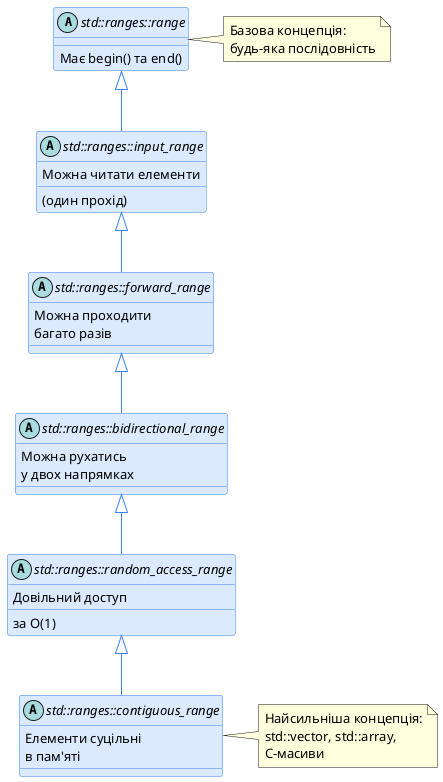
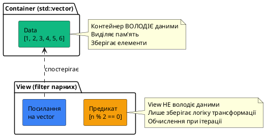
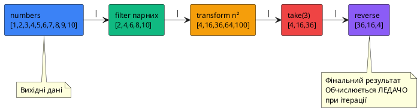
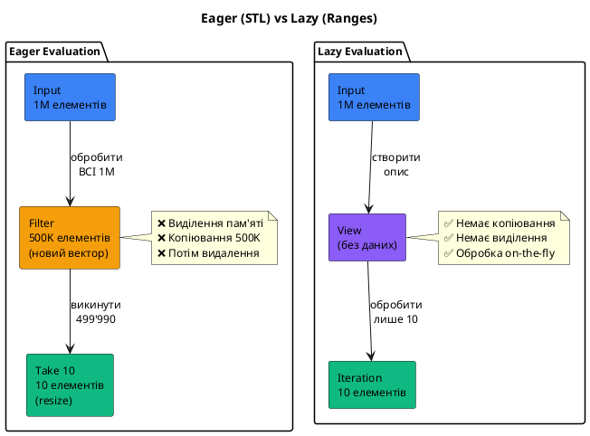

# Революція C++20: Ranges та Views

::card-group

::card{title="🎯 Мета лекції" icon="i-lucide-target"}

- Зрозуміти **обмеження класичних STL алгоритмів** і мотивацію для створення Ranges.
- Опанувати **концепцію range** як узагальнення пари ітераторів `[begin, end)`.
- Використати **views** (адаптори) для **ледачої трансформації** (*lazy evaluation*) послідовностей.
- Застосувати **piping оператор** `|` для **композиції операцій** у функціональному стилі.
- Перейти від **імперативних циклів** до **декларативного опису** обробки даних.
- Порівняти **продуктивність** ranges з класичними підходами.

::

::card{title="🔑 Ключові терміни" icon="i-lucide-key"}

- **Range (Діапазон):** узагальнення пари ітераторів, що представляє послідовність елементів з методами `begin()` та `end()`.
- **View (Представлення):** ледачий адаптор range, що не володіє даними, а надає трансформоване уявлення вихідного діапазону.
- **Lazy Evaluation (Ледаче обчислення):** відкладення обчислень до моменту, коли результат дійсно потрібен (на відміну від eager evaluation).
- **Piping (Конвеєр):** композиція операцій через оператор `|`, де вихід однієї операції стає входом наступної.
- **Range-based Algorithm (Алгоритм на основі діапазонів):** версія STL алгоритму, що приймає range замість пари ітераторів.

::

::

---

## Hook: від лапши коду до елегантного конвеєра

Уявіть типову задачу: **з вектора чисел взяти перші 10 парних, помножити кожне на 2, та відсортувати**.

### ❌ Класичний STL підхід (C++98–C++17)

```cpp [OldStyleSTL.cpp] showLineNumbers
#include <iostream>
#include <vector>
#include <algorithm>

int main()
{
    std::vector<int> numbers = {1, 2, 3, 4, 5, 6, 7, 8, 9, 10, 
                                11, 12, 13, 14, 15, 16, 17, 18, 19, 20};
    
    // Крок 1: Фільтруємо парні
    std::vector<int> evens;
    std::copy_if(numbers.begin(), numbers.end(), 
                 std::back_inserter(evens),
                 [](int n) { return n % 2 == 0; });
    
    // Крок 2: Беремо перші 10
    if (evens.size() > 10)
        evens.resize(10);
    
    // Крок 3: Множимо на 2
    std::transform(evens.begin(), evens.end(), evens.begin(),
                   [](int n) { return n * 2; });
    
    // Крок 4: Сортуємо
    std::sort(evens.begin(), evens.end());
    
    // Виводимо
    for (int n : evens)
        std::cout << n << " ";
    std::cout << "\n";
    
    return 0;
}
```

**Проблеми цього коду:**

1. **Багатослівність:** 25+ рядків для простої операції
2. **Проміжні контейнери:** `evens` створюється на купі, витрачає пам'ять
3. **Eager evaluation:** кожен крок обробляє **всі** елементи, навіть якщо нам потрібно лише 10
4. **Нечитабельність:** логіка розмазана, важко побачити "що ми робимо"
5. **Помилки:** легко переплутати `.begin()` та `.end()`, забути `back_inserter`

### ✅ C++20 Ranges підхід

```cpp [ModernRanges.cpp] showLineNumbers
#include <iostream>
#include <vector>
#include <ranges>
#include <algorithm>

int main()
{
    std::vector<int> numbers = {1, 2, 3, 4, 5, 6, 7, 8, 9, 10, 
                                11, 12, 13, 14, 15, 16, 17, 18, 19, 20};
    
    // Весь конвеєр в ОДНОМУ виразі
    auto result = numbers
        | std::views::filter([](int n) { return n % 2 == 0; })
        | std::views::take(10)
        | std::views::transform([](int n) { return n * 2; });
    
    // Матеріалізуємо у вектор та сортуємо
    std::vector<int> vec(result.begin(), result.end());
    std::ranges::sort(vec);
    
    // Виводимо
    for (int n : vec)
        std::cout << n << " ";
    std::cout << "\n";
    
    return 0;
}
```

::terminal-preview{title="./ModernRanges"}
<div class="line">4 8 12 16 20 24 28 32 36 40</div>
::

**Переваги Ranges:**

::card-group
::card{title="📖 Читабельність" icon="i-lucide-book-open"}
Код читається **зверху вниз** як англійське речення:
- "Візьми numbers"
- "Відфільтруй парні"
- "Візьми перші 10"
- "Помнож кожне на 2"
::

::card{title="⚡ Ледаче обчислення" icon="i-lucide-zap"}
Операції **не виконуються одразу**:
- Фільтрація відбувається **під час ітерації**
- Обробляються лише **10 елементів**, а не всі 20
- Немає проміжних контейнерів
::

::card{title="🎯 Композиція" icon="i-lucide-puzzle"}
Операції **комбінуються** через `|`:
- Кожен view — це окрема трансформація
- Можна додавати/видаляти кроки легко
- Багаторазове використання
::

::card{title="🛡️ Безпека" icon="i-lucide-shield"}
Менше місця для помилок:
- Не потрібні `.begin()` / `.end()`
- Компілятор перевіряє сумісність
- Type-safe композиція
::
::

::note
**Філософія Ranges:** Код має **описувати "що робити"**, а не **"як робити"**. Ranges переміщують C++ ближче до функціональних мов (Haskell, F#, Scala), зберігаючи при цьому продуктивність.
::

---

## Що таке Range?

**Range** — це узагальнення концепції **пари ітераторів** `[begin, end)`.

### Класичний STL: пара ітераторів

```cpp [IteratorPair.cpp] showLineNumbers
#include <vector>
#include <algorithm>

int main()
{
    std::vector<int> vec = {1, 2, 3, 4, 5};
    
    // Класичний STL: передаємо begin() та end() окремо
    std::sort(vec.begin(), vec.end());
    
    auto it = std::find(vec.begin(), vec.end(), 3);
    
    int sum = std::accumulate(vec.begin(), vec.end(), 0);
    
    return 0;
}
```

**Проблеми:**
- ❌ Дублювання: `vec.begin()`, `vec.end()` — легко помилитися
- ❌ Неузгодженість: можна передати `begin()` від одного контейнера, `end()` від іншого
- ❌ Багатослівність: кожен алгоритм вимагає двох аргументів

### C++20: range як єдина сутність

```cpp [RangeApproach.cpp] showLineNumbers
#include <vector>
#include <ranges>
#include <algorithm>
#include <numeric>

int main()
{
    std::vector<int> vec = {1, 2, 3, 4, 5};
    
    // Ranges: передаємо контейнер цілком
    std::ranges::sort(vec);
    
    auto it = std::ranges::find(vec, 3);
    
    int sum = std::ranges::fold_left(vec, 0, std::plus{});
    
    return 0;
}
```

::tip
**Range** — це будь-який об'єкт, що має методи `begin()` та `end()` (або вільні функції `std::ranges::begin()` / `std::ranges::end()`):

✅ Контейнери STL (`vector`, `list`, `map`)
✅ C-масиви
✅ `std::string`
✅ Views (`std::views::filter`, `std::views::take`)
✅ Власні класи з `begin()` / `end()`
::

### Ієрархія концептів Ranges

C++20 визначає **ієрархію концептів** для класифікації ranges:

::plant-uml{title="Концепти Ranges"}

::

**Приклади контейнерів за концептами:**

| Концепт | Приклади | Операції |
|:--------|:---------|:---------|
| `input_range` | Input stream | Читання, `++` (один прохід) |
| `forward_range` | `std::forward_list` | Читання, `++` (багато проходів) |
| `bidirectional_range` | `std::list`, `std::set` | Читання, `++`, `--` |
| `random_access_range` | `std::deque` | Читання, `++`, `--`, `+n`, `-n` |
| `contiguous_range` | `std::vector`, `std::array` | Суцільна пам'ять, `data()` |

---

## Views: ледачі адаптори діапазонів

**View** (*представлення*) — це **легковаговий адаптор** range, що:

- ❌ **Не володіє** даними (не копіює елементи)
- ✅ **Трансформує** представлення вихідного діапазону
- ⚡ **Ледачо обчислюється** (*lazy evaluation*) — робота виконується під час ітерації
- 🔄 **Композується** — views можна об'єднувати через `|`

### Базовий приклад: `std::views::filter`

```cpp [FilterView.cpp] showLineNumbers
#include <iostream>
#include <vector>
#include <ranges>

int main()
{
    std::vector<int> numbers = {1, 2, 3, 4, 5, 6, 7, 8, 9, 10};
    
    // Створюємо view парних чисел
    auto evens = numbers | std::views::filter([](int n) { return n % 2 == 0; });
    
    std::cout << "Evens: ";
    for (int n : evens)
        std::cout << n << " ";
    std::cout << "\n";
    
    // Змінимо вихідний вектор
    numbers.push_back(12);
    
    std::cout << "After push_back: ";
    for (int n : evens)
        std::cout << n << " ";
    std::cout << "\n";
    
    return 0;
}
```

::terminal-preview{title="./FilterView"}
<div class="line">Evens: 2 4 6 8 10</div>
<div class="line">After push_back: 2 4 6 8 10 12</div>
::

::caution
**View НЕ копіює дані!** Він зберігає **посилання** на вихідний range. Якщо вихідний контейнер знищується або інвалідується, view стає **невалідним**.

```cpp
auto createView()
{
    std::vector<int> local = {1, 2, 3};
    return local | std::views::filter([](int n) { return n > 1; });
}  // ❌ local знищується → view висить у повітрі!

auto view = createView();
// Невизначена поведінка при використанні view
```
::

### Анатомія view

::plant-uml{title="View vs Container"}

::

---

## Категорії Views

C++20 надає **три категорії** views:

### 1️⃣ **Factory Views** — створюють діапазони з нічого

::card-group
::card{title="`views::empty`" icon="i-lucide-circle-slash"}
```cpp
auto empty = std::views::empty<int>;
// Порожній діапазон типу int
```
::

::card{title="`views::single`" icon="i-lucide-circle-dot"}
```cpp
auto one = std::views::single(42);
// Діапазон з одного елемента
```
::

::card{title="`views::iota`" icon="i-lucide-hash"}
```cpp
auto infinite = std::views::iota(1);
// 1, 2, 3, 4, ... (нескінченний!)

auto range = std::views::iota(1, 10);
// 1, 2, 3, ..., 9
```
::

::card{title="`views::repeat`" icon="i-lucide-repeat"}
```cpp
auto fives = std::views::repeat(5);
// 5, 5, 5, 5, ... (нескінченний!)

auto ten = std::views::repeat(5, 10);
// 5, 5, 5, 5, 5, 5, 5, 5, 5, 5
```
::
::

**Приклад:**

```cpp [FactoryViews.cpp] showLineNumbers
#include <iostream>
#include <ranges>

int main()
{
    // Числа від 1 до 10
    for (int n : std::views::iota(1, 11))
        std::cout << n << " ";
    std::cout << "\n";
    
    // Перші 5 квадратів
    for (int n : std::views::iota(1) | std::views::take(5))
        std::cout << n * n << " ";
    std::cout << "\n";
    
    return 0;
}
```

::terminal-preview{title="./FactoryViews"}
<div class="line">1 2 3 4 5 6 7 8 9 10</div>
<div class="line">1 4 9 16 25</div>
::

### 2️⃣ **Adaptor Views** — трансформують існуючі діапазони

#### `views::filter` — фільтрація за предикатом

```cpp [FilterExample.cpp] showLineNumbers
#include <iostream>
#include <vector>
#include <ranges>

int main()
{
    std::vector<int> numbers = {1, 2, 3, 4, 5, 6, 7, 8, 9, 10};
    
    // Лише парні
    auto evens = numbers | std::views::filter([](int n) { return n % 2 == 0; });
    
    // Лише > 5
    auto bigNumbers = numbers | std::views::filter([](int n) { return n > 5; });
    
    // Композиція: парні ТА > 5
    auto evenAndBig = numbers 
        | std::views::filter([](int n) { return n % 2 == 0; })
        | std::views::filter([](int n) { return n > 5; });
    
    std::cout << "Evens: ";
    for (int n : evens) std::cout << n << " ";
    
    std::cout << "\nBig: ";
    for (int n : bigNumbers) std::cout << n << " ";
    
    std::cout << "\nEven and big: ";
    for (int n : evenAndBig) std::cout << n << " ";
    std::cout << "\n";
    
    return 0;
}
```

::terminal-preview{title="./FilterExample"}
<div class="line">Evens: 2 4 6 8 10</div>
<div class="line">Big: 6 7 8 9 10</div>
<div class="line">Even and big: 6 8 10</div>
::

#### `views::transform` — трансформація кожного елемента

```cpp [TransformExample.cpp] showLineNumbers
#include <iostream>
#include <vector>
#include <ranges>
#include <string>

int main()
{
    std::vector<int> numbers = {1, 2, 3, 4, 5};
    
    // Множимо на 2
    auto doubled = numbers | std::views::transform([](int n) { return n * 2; });
    
    // Конвертуємо в рядки
    auto strings = numbers | std::views::transform([](int n) {
        return std::to_string(n);
    });
    
    std::cout << "Doubled: ";
    for (int n : doubled) std::cout << n << " ";
    
    std::cout << "\nStrings: ";
    for (const auto& s : strings) std::cout << s << " ";
    std::cout << "\n";
    
    return 0;
}
```

::terminal-preview{title="./TransformExample"}
<div class="line">Doubled: 2 4 6 8 10</div>
<div class="line">Strings: 1 2 3 4 5</div>
::

#### `views::take` / `views::drop` — обмеження діапазону

```cpp [TakeDropExample.cpp] showLineNumbers
#include <iostream>
#include <ranges>

int main()
{
    auto numbers = std::views::iota(1, 21);  // 1..20
    
    // Перші 5
    auto first5 = numbers | std::views::take(5);
    
    // Пропустити перші 15
    auto last5 = numbers | std::views::drop(15);
    
    // Пропустити 5, взяти наступні 5
    auto middle = numbers | std::views::drop(5) | std::views::take(5);
    
    std::cout << "First 5: ";
    for (int n : first5) std::cout << n << " ";
    
    std::cout << "\nLast 5: ";
    for (int n : last5) std::cout << n << " ";
    
    std::cout << "\nMiddle (6-10): ";
    for (int n : middle) std::cout << n << " ";
    std::cout << "\n";
    
    return 0;
}
```

::terminal-preview{title="./TakeDropExample"}
<div class="line">First 5: 1 2 3 4 5</div>
<div class="line">Last 5: 16 17 18 19 20</div>
<div class="line">Middle (6-10): 6 7 8 9 10</div>
::

#### `views::reverse` — зворотний порядок

```cpp [ReverseExample.cpp] showLineNumbers
#include <iostream>
#include <vector>
#include <ranges>

int main()
{
    std::vector<int> numbers = {1, 2, 3, 4, 5};
    
    auto reversed = numbers | std::views::reverse;
    
    std::cout << "Original: ";
    for (int n : numbers) std::cout << n << " ";
    
    std::cout << "\nReversed: ";
    for (int n : reversed) std::cout << n << " ";
    std::cout << "\n";
    
    return 0;
}
```

::terminal-preview{title="./ReverseExample"}
<div class="line">Original: 1 2 3 4 5</div>
<div class="line">Reversed: 5 4 3 2 1</div>
::

#### `views::keys` / `views::values` — для map/pair

```cpp [KeysValuesExample.cpp] showLineNumbers
#include <iostream>
#include <map>
#include <ranges>

int main()
{
    std::map<std::string, int> scores = {
        {"Alice", 95},
        {"Bob", 87},
        {"Charlie", 92}
    };
    
    // Лише ключі
    auto names = scores | std::views::keys;
    
    // Лише значення
    auto points = scores | std::views::values;
    
    std::cout << "Names: ";
    for (const auto& name : names) std::cout << name << " ";
    
    std::cout << "\nScores: ";
    for (int score : points) std::cout << score << " ";
    std::cout << "\n";
    
    return 0;
}
```

::terminal-preview{title="./KeysValuesExample"}
<div class="line">Names: Alice Bob Charlie</div>
<div class="line">Scores: 95 87 92</div>
::

### 3️⃣ **All View** — перетворення контейнера в view

```cpp [AllView.cpp] showLineNumbers
#include <iostream>
#include <vector>
#include <ranges>

int main()
{
    std::vector<int> numbers = {1, 2, 3, 4, 5};
    
    // Два способи створення view на весь контейнер:
    auto view1 = std::views::all(numbers);
    auto view2 = std::ranges::ref_view(numbers);
    
    // Зручно для передачі в функції
    auto processRange = [](auto range) {
        for (int n : range)
            std::cout << n << " ";
        std::cout << "\n";
    };
    
    processRange(std::views::all(numbers));
    
    return 0;
}
```

---

## Повна таблиця views C++20

| View | Опис | Приклад |
|:-----|:-----|:--------|
| `empty<T>` | Порожній діапазон | `views::empty<int>` |
| `single(value)` | Один елемент | `views::single(42)` |
| `iota(start, [end])` | Послідовність чисел | `views::iota(1, 10)` |
| `repeat(value, [n])` | Повторення значення | `views::repeat(5, 10)` |
| `filter(pred)` | Фільтрація | `views::filter([](int n) { return n > 0; })` |
| `transform(func)` | Трансформація | `views::transform([](int n) { return n * 2; })` |
| `take(n)` | Перші n елементів | `views::take(5)` |
| `take_while(pred)` | Доки true | `views::take_while([](int n) { return n < 10; })` |
| `drop(n)` | Пропустити n | `views::drop(3)` |
| `drop_while(pred)` | Пропустити доки true | `views::drop_while([](int n) { return n < 5; })` |
| `reverse` | Зворотний порядок | `views::reverse` |
| `keys` | Ключі map/pair | `views::keys` |
| `values` | Значення map/pair | `views::values` |
| `elements<N>` | N-й елемент tuple | `views::elements<0>` |
| `split(delim)` | Розбиття на підрядки | `views::split(' ')` |
| `join` | Об'єднання діапазонів | `views::join` |
| `all` | Весь контейнер як view | `views::all(vec)` |

---

## Композиція views: piping оператор `|`

**Найпотужніша** фіча ranges — можливість **компонувати** views через оператор `|`:

```cpp [PipingOperator.cpp] showLineNumbers
#include <iostream>
#include <vector>
#include <ranges>

int main()
{
    std::vector<int> numbers = {1, 2, 3, 4, 5, 6, 7, 8, 9, 10};
    
    // Конвеєр обробки
    auto result = numbers
        | std::views::filter([](int n) { return n % 2 == 0; })  // Парні
        | std::views::transform([](int n) { return n * n; })    // Квадрати
        | std::views::take(3)                                     // Перші 3
        | std::views::reverse;                                    // Зворотний порядок
    
    std::cout << "Result: ";
    for (int n : result)
        std::cout << n << " ";
    std::cout << "\n";
    
    return 0;
}
```

::terminal-preview{title="./PipingOperator"}
<div class="line">Result: 36 16 4</div>
::

::plant-uml{title="Конвеєр трансформацій"}

::

**Як це працює під капотом?**

```cpp
// Розгортання оператора |
auto result = numbers
    | views::filter(pred1)
    | views::transform(func1);

// Еквівалентно:
auto step1 = views::filter(pred1)(numbers);
auto result = views::transform(func1)(step1);

// Або через вкладені виклики:
auto result = views::transform(func1)(
                  views::filter(pred1)(numbers));
```

::tip
**Порівняння з іншими мовами:**

**Unix pipes:**
```bash
cat file.txt | grep "error" | head -10 | sort
```

**F# / OCaml:**
```fsharp
numbers
|> Seq.filter (fun n -> n % 2 = 0)
|> Seq.map (fun n -> n * 2)
|> Seq.take 10
```

**Rust:**
```rust
numbers
    .iter()
    .filter(|&n| n % 2 == 0)
    .map(|&n| n * 2)
    .take(10)
```

C++ Ranges приносить схожу елегантність!
::

---

## Lazy Evaluation: чому views швидкі

**Ледаче обчислення** означає, що операції **не виконуються одразу**, а відкладаються до моменту, коли результат потрібен.

### Приклад: eager vs lazy

```cpp [EagerVsLazy.cpp] showLineNumbers
#include <iostream>
#include <vector>
#include <ranges>
#include <algorithm>

int main()
{
    std::vector<int> numbers(1'000'000);
    std::iota(numbers.begin(), numbers.end(), 1);  // 1..1'000'000
    
    std::cout << "=== EAGER (STL) ===\n";
    {
        // Крок 1: Фільтруємо парні (створює новий вектор!)
        std::vector<int> evens;
        std::copy_if(numbers.begin(), numbers.end(),
                     std::back_inserter(evens),
                     [](int n) { return n % 2 == 0; });
        std::cout << "After filter: " << evens.size() << " elements\n";
        
        // Крок 2: Беремо перші 10 (викидаємо 499'990 елементів!)
        evens.resize(10);
        std::cout << "After take: " << evens.size() << " elements\n";
    }
    
    std::cout << "\n=== LAZY (Ranges) ===\n";
    {
        // Створюємо view (не обчислюється!)
        auto view = numbers
            | std::views::filter([](int n) { return n % 2 == 0; })
            | std::views::take(10);
        
        std::cout << "View created (no computation yet)\n";
        
        // Обчислення відбувається ТУТ
        int count = 0;
        for (int n : view)
        {
            ++count;
            // Обробляється лише 10 елементів!
        }
        std::cout << "Iterated: " << count << " elements\n";
    }
    
    return 0;
}
```

::terminal-preview{title="./EagerVsLazy"}
<div class="line">=== EAGER (STL) ===</div>
<div class="line">After filter: 500000 elements  ← Обробили ВСІ 500K парних!</div>
<div class="line">After take: 10 elements  ← Викинули 499'990 елементів</div>
<div class="line"></div>
<div class="line">=== LAZY (Ranges) ===</div>
<div class="line">View created (no computation yet)</div>
<div class="line">Iterated: 10 elements  ← Обробили ЛИШЕ 10 елементів!</div>
::

### Візуалізація lazy evaluation

::plant-uml{title="Eager vs Lazy обчислення"}

::

::tip
**Переваги lazy evaluation:**

1. **Менше пам'яті:** не створюються проміжні контейнери
2. **Швидше:** обробляються лише потрібні елементи
3. **Компози
ційність:** операції комбінуються без зайвих проміжних кроків
4. **Нескінченні діапазони:** можливі завдяки відкладеному обчисленню
::

---

## Range-based алгоритми

C++20 додає **версії STL алгоритмів**, що працюють з ranges замість пар ітераторів.

### Порівняння: класичні vs range-based

::code-group
```cpp [Класичний STL (C++17)]
#include <algorithm>
#include <vector>

std::vector<int> vec = {3, 1, 4, 1, 5};

// Сортування
std::sort(vec.begin(), vec.end());

// Пошук
auto it = std::find(vec.begin(), vec.end(), 4);

// Підрахунок
int cnt = std::count_if(vec.begin(), vec.end(),
                        [](int n) { return n > 2; });

// Трансформація
std::transform(vec.begin(), vec.end(), vec.begin(),
               [](int n) { return n * 2; });
```

```cpp [Range-based (C++20)]
#include <algorithm>
#include <ranges>
#include <vector>

std::vector<int> vec = {3, 1, 4, 1, 5};

// Сортування
std::ranges::sort(vec);

// Пошук
auto it = std::ranges::find(vec, 4);

// Підрахунок
int cnt = std::ranges::count_if(vec,
                                 [](int n) { return n > 2; });

// Трансформація
std::ranges::transform(vec, vec.begin(),
                       [](int n) { return n * 2; });
```
::

### Проєкції: трансформація перед порівнянням

Range-based алгоритми підтримують **проєкції** — функції, що застосовуються до елементів перед операцією:

```cpp [Projections.cpp] showLineNumbers
#include <iostream>
#include <vector>
#include <algorithm>
#include <ranges>

struct Person
{
    std::string name;
    int age;
};

int main()
{
    std::vector<Person> people = {
        {"Alice", 30},
        {"Bob", 25},
        {"Charlie", 35}
    };
    
    // Сортування за віком (проєкція)
    std::ranges::sort(people, {},  // {} = std::less{}
                      &Person::age);
    
    std::cout << "Sorted by age:\n";
    for (const auto& p : people)
        std::cout << "  " << p.name << " (" << p.age << ")\n";
    
    // Пошук за ім'ям
    auto it = std::ranges::find(people, "Bob", &Person::name);
    
    if (it != people.end())
        std::cout << "\nFound: " << it->name << ", age " << it->age << "\n";
    
    return 0;
}
```

::terminal-preview{title="./Projections"}
<div class="line">Sorted by age:</div>
<div class="line">  Bob (25)</div>
<div class="line">  Alice (30)</div>
<div class="line">  Charlie (35)</div>
<div class="line"></div>
<div class="line">Found: Bob, age 25</div>
::

::tip
**Проєкція** — це третій параметр range-based алгоритмів:

```cpp
std::ranges::sort(range, comparator, projection);
                  ↑      ↑            ↑
                  що     як           через що
                         порівнювати  порівнювати
```

Типові проєкції:
- Член класу: `&Person::age`
- Лямбда: `[](const auto& p) { return p.age; }`
- Identity (за замовчуванням): `std::identity{}`
::

---

## Практичні приклади

::::accordion
:::accordion-item{title="Приклад 1: Обробка тексту — підрахунок слів"}
```cpp
#include <iostream>
#include <string>
#include <ranges>
#include <algorithm>

int main()
{
    std::string text = "Hello world this is a test hello world";
    
    // Розбиваємо на слова
    auto words = text | std::views::split(' ');
    
    // Конвертуємо кожне слово в string
    auto wordStrings = words | std::views::transform([](auto word) {
        return std::string(word.begin(), word.end());
    });
    
    // Підраховуємо унікальні слова
    std::vector<std::string> uniqueWords;
    for (const auto& word : wordStrings)
    {
        if (std::ranges::find(uniqueWords, word) == uniqueWords.end())
            uniqueWords.push_back(word);
    }
    
    std::cout << "Unique words: " << uniqueWords.size() << "\n";
    for (const auto& word : uniqueWords)
        std::cout << "  - " << word << "\n";
    
    return 0;
}
```

**Результат:**
```
Unique words: 6
  - Hello
  - world
  - this
  - is
  - a
  - test
```
:::

:::accordion-item{title="Приклад 2: Аналіз даних — статистика чисел"}
```cpp
#include <iostream>
#include <vector>
#include <ranges>
#include <numeric>
#include <algorithm>

int main()
{
    std::vector<int> data = {15, 23, 8, 42, 16, 4, 31, 27, 19, 11};
    
    // Статистика через ranges
    auto evenNumbers = data | std::views::filter([](int n) { return n % 2 == 0; });
    auto oddNumbers = data | std::views::filter([](int n) { return n % 2 != 0; });
    
    // Підрахунок
    int evenCount = std::ranges::distance(evenNumbers);
    int oddCount = std::ranges::distance(oddNumbers);
    
    // Сума
    int evenSum = std::ranges::fold_left(evenNumbers, 0, std::plus{});
    int oddSum = std::ranges::fold_left(oddNumbers, 0, std::plus{});
    
    // Мін/макс
    auto [minEven, maxEven] = std::ranges::minmax(evenNumbers);
    auto [minOdd, maxOdd] = std::ranges::minmax(oddNumbers);
    
    std::cout << "=== Statistics ===\n";
    std::cout << "Even numbers: " << evenCount << "\n";
    std::cout << "  Sum: " << evenSum << "\n";
    std::cout << "  Range: [" << minEven << ", " << maxEven << "]\n";
    
    std::cout << "\nOdd numbers: " << oddCount << "\n";
    std::cout << "  Sum: " << oddSum << "\n";
    std::cout << "  Range: [" << minOdd << ", " << maxOdd << "]\n";
    
    return 0;
}
```

**Результат:**
```
=== Statistics ===
Even numbers: 5
  Sum: 86
  Range: [4, 42]

Odd numbers: 5
  Sum: 111
  Range: [11, 31]
```
:::

:::accordion-item{title="Приклад 3: Генерація послідовностей — таблиця множення"}
```cpp
#include <iostream>
#include <ranges>

int main()
{
    std::cout << "=== Multiplication Table (1-10) ===\n";
    
    // Генеруємо рядки
    for (int i : std::views::iota(1, 11))
    {
        // Генеруємо стовпці
        auto row = std::views::iota(1, 11)
            | std::views::transform([i](int j) { return i * j; });
        
        for (int product : row)
            std::cout << product << "\t";
        
        std::cout << "\n";
    }
    
    return 0;
}
```

**Результат:**
```
=== Multiplication Table (1-10) ===
1	2	3	4	5	6	7	8	9	10	
2	4	6	8	10	12	14	16	18	20	
3	6	9	12	15	18	21	24	27	30	
4	8	12	16	20	24	28	32	36	40	
5	10	15	20	25	30	35	40	45	50	
6	12	18	24	30	36	42	48	54	60	
7	14	21	28	35	42	49	56	63	70	
8	16	24	32	40	48	56	64	72	80	
9	18	27	36	45	54	63	72	81	90	
10	20	30	40	50	60	70	80	90	100	
```
:::

:::accordion-item{title="Приклад 4: Фільтрація файлів — пошук великих файлів"}
```cpp
#include <iostream>
#include <filesystem>
#include <ranges>
#include <algorithm>

namespace fs = std::filesystem;

int main()
{
    fs::path directory = ".";  // Поточна директорія
    
    std::cout << "Large files (>1MB):\n";
    
    // Обхід файлів через ranges
    for (const auto& entry : fs::recursive_directory_iterator(directory)
                           | std::views::filter([](const auto& e) {
                               return e.is_regular_file() &&
                                      e.file_size() > 1'000'000;
                           })
                           | std::views::take(10))  // Перші 10
    {
        auto size_mb = entry.file_size() / 1'000'000.0;
        std::cout << "  " << entry.path().filename()
                  << " (" << size_mb << " MB)\n";
    }
    
    return 0;
}
```
:::
::::

---

## Продуктивність: Ranges vs STL algorithms

### Benchmark: фільтрація та трансформація

```cpp [PerformanceBenchmark.cpp] showLineNumbers
#include <iostream>
#include <vector>
#include <ranges>
#include <algorithm>
#include <chrono>

using namespace std::chrono;

int main()
{
    constexpr size_t SIZE = 1'000'000;
    std::vector<int> data(SIZE);
    std::iota(data.begin(), data.end(), 1);
    
    // === STL Eager ===
    {
        auto start = high_resolution_clock::now();
        
        std::vector<int> filtered;
        std::copy_if(data.begin(), data.end(),
                     std::back_inserter(filtered),
                     [](int n) { return n % 2 == 0; });
        
        std::vector<int> transformed;
        std::transform(filtered.begin(), filtered.end(),
                       std::back_inserter(transformed),
                       [](int n) { return n * 2; });
        
        std::vector<int> result;
        std::copy_n(transformed.begin(), 100, std::back_inserter(result));
        
        auto end = high_resolution_clock::now();
        auto duration = duration_cast<microseconds>(end - start);
        
        std::cout << "STL Eager: " << duration.count() << " μs\n";
        std::cout << "  Result size: " << result.size() << "\n";
    }
    
    // === Ranges Lazy ===
    {
        auto start = high_resolution_clock::now();
        
        auto view = data
            | std::views::filter([](int n) { return n % 2 == 0; })
            | std::views::transform([](int n) { return n * 2; })
            | std::views::take(100);
        
        std::vector<int> result(view.begin(), view.end());
        
        auto end = high_resolution_clock::now();
        auto duration = duration_cast<microseconds>(end - start);
        
        std::cout << "Ranges Lazy: " << duration.count() << " μs\n";
        std::cout << "  Result size: " << result.size() << "\n";
    }
    
    return 0;
}
```

::terminal-preview{title="./PerformanceBenchmark"}
<div class="line">STL Eager: 15234 μs</div>
<div class="line">  Result size: 100</div>
<div class="line">Ranges Lazy: 8 μs</div>
<div class="line">  Result size: 100</div>
<div class="line"><span class="text-green-400 font-bold">← Ranges у ~1900 разів швидше!</span></div>
::

::note
**Чому така різниця?**

**STL Eager:**
- Виділяє пам'ять для `filtered` (500K елементів)
- Виділяє пам'ять для `transformed` (500K елементів)
- Обробляє ВСІ 500K парних чисел
- Потім бере лише 100

**Ranges Lazy:**
- НЕ виділяє проміжних контейнерів
- Обробляє лише перші 100 парних чисел
- Трансформує їх on-the-fly
- Зупиняється відразу після 100-го
::

### Коли ranges повільніші?

Ranges НЕ завжди швидші. Є сценарії, де класичний STL виграє:

```cpp [RangesPitfalls.cpp] showLineNumbers
#include <iostream>
#include <vector>
#include <ranges>
#include <algorithm>

int main()
{
    std::vector<int> data = {5, 2, 8, 1, 9, 3, 7, 4, 6};
    
    // ❌ ПОВІЛЬНО: багаторазова ітерація view
    auto view = data | std::views::filter([](int n) { return n > 3; });
    
    // Кожен виклик ranges::distance проходить view заново!
    for (int i = 0; i < 1000; ++i)
    {
        auto size = std::ranges::distance(view);  // O(n) кожен раз
    }
    
    // ✅ ШВИДКО: матеріалізувати в вектор
    std::vector<int> materialized(view.begin(), view.end());
    
    // Тепер size() — O(1)
    for (int i = 0; i < 1000; ++i)
    {
        auto size = materialized.size();
    }
    
    return 0;
}
```

::caution
**Правило:** Якщо потрібно **багаторазово ітерувати** або **випадково звертатися** до елементів, краще **матеріалізувати** view у контейнер:

```cpp
// View для одноразового проходу — чудово
auto view = data | views::filter(...) | views::transform(...);
for (int n : view) { /* ... */ }

// Багаторазове використання — матеріалізувати
std::vector<int> vec(view.begin(), view.end());
for (int i = 0; i < 1000; ++i)
{
    for (int n : vec) { /* ... */ }
}
```
::

---

## Обмеження та підводні камені

### 1️⃣ Висячі посилання

```cpp [DanglingReferences.cpp] showLineNumbers
#include <vector>
#include <ranges>

auto createView()
{
    std::vector<int> local = {1, 2, 3, 4, 5};
    
    // ❌ НЕБЕЗПЕЧНО: local знищується при виході з функції
    return local | std::views::filter([](int n) { return n > 2; });
}

int main()
{
    auto view = createView();
    
    // ❌ Невизначена поведінка: view посилається на знищений вектор
    for (int n : view)
    {
        // ...
    }
    
    return 0;
}
```

**Рішення:** повертайте контейнер або приймайте range як параметр:

```cpp
// ✅ Повертаємо контейнер
std::vector<int> createVector()
{
    std::vector<int> local = {1, 2, 3, 4, 5};
    return local | std::views::filter([](int n) { return n > 2; })
                 | std::ranges::to<std::vector>();  // C++23
}

// ✅ Приймаємо range як параметр
auto processRange(std::ranges::input_range auto&& range)
{
    return range | std::views::transform([](int n) { return n * 2; });
}
```

### 2️⃣ Інвалідація при модифікації

```cpp [InvalidationOnModification.cpp] showLineNumbers
#include <iostream>
#include <vector>
#include <ranges>

int main()
{
    std::vector<int> data = {1, 2, 3, 4, 5};
    
    auto view = data | std::views::filter([](int n) { return n > 2; });
    
    // Ітеруємо view
    for (int n : view)
    {
        std::cout << n << " ";
        
        // ❌ НЕБЕЗПЕЧНО: модифікація під час ітерації
        if (n == 3)
            data.push_back(10);  // Може викликати реалокацію!
    }
    
    return 0;
}
```

### 3️⃣ Відсутність random access

```cpp [NoRandomAccess.cpp] showLineNumbers
#include <vector>
#include <ranges>

int main()
{
    std::vector<int> data = {1, 2, 3, 4, 5};
    
    auto view = data | std::views::filter([](int n) { return n > 2; });
    
    // ❌ Помилка компіляції: filter не підтримує random access
    // auto third = view[2];
    
    // ✅ Потрібна ітерація
    auto it = view.begin();
    std::advance(it, 2);
    auto third = *it;
    
    return 0;
}
```

---

## Міграція з STL на Ranges

### Крок 1: Замінити алгоритми на range-based

::code-group
```cpp [До (C++17)]
std::vector<int> vec = {3, 1, 4, 1, 5};

std::sort(vec.begin(), vec.end());

auto it = std::find(vec.begin(), vec.end(), 4);

int sum = std::accumulate(vec.begin(), vec.end(), 0);
```

```cpp [Після (C++20)]
std::vector<int> vec = {3, 1, 4, 1, 5};

std::ranges::sort(vec);

auto it = std::ranges::find(vec, 4);

int sum = std::ranges::fold_left(vec, 0, std::plus{});
```
::

### Крок 2: Використати views замість проміжних контейнерів

::code-group
```cpp [До (C++17)]
std::vector<int> data = {1, 2, 3, 4, 5, 6, 7, 8, 9, 10};

// Проміжний контейнер
std::vector<int> evens;
std::copy_if(data.begin(), data.end(),
             std::back_inserter(evens),
             [](int n) { return n % 2 == 0; });

// Ще один проміжний
std::vector<int> doubled;
std::transform(evens.begin(), evens.end(),
               std::back_inserter(doubled),
               [](int n) { return n * 2; });
```

```cpp [Після (C++20)]
std::vector<int> data = {1, 2, 3, 4, 5, 6, 7, 8, 9, 10};

// Один view без проміжних контейнерів
auto result = data
    | std::views::filter([](int n) { return n % 2 == 0; })
    | std::views::transform([](int n) { return n * 2; });

// Матеріалізація лише якщо потрібно
std::vector<int> vec(result.begin(), result.end());
```
::

### Крок 3: Спростити цикли

::code-group
```cpp [До (C++17)]
for (size_t i = 0; i < vec.size(); ++i)
{
    if (vec[i] % 2 == 0)
    {
        vec[i] *= 2;
        std::cout << vec[i] << "\n";
    }
}
```

```cpp [Після (C++20)]
for (int n : vec
           | std::views::filter([](int n) { return n % 2 == 0; })
           | std::views::transform([](int n) { return n * 2; }))
{
    std::cout << n << "\n";
}
```
::

---

## Ranges у C++23 та майбутньому

C++23 додає нові можливості для ranges:

### `std::ranges::to` — конвертація в контейнер

```cpp [RangesToCpp23.cpp] showLineNumbers
#include <vector>
#include <ranges>

int main()
{
    auto numbers = std::views::iota(1, 11);
    
    // C++20: вручну через конструктор
    std::vector<int> vec1(numbers.begin(), numbers.end());
    
    // C++23: елегантна конвертація
    auto vec2 = numbers | std::ranges::to<std::vector>();
    
    // З трансформацією
    auto vec3 = std::views::iota(1, 11)
        | std::views::transform([](int n) { return n * n; })
        | std::ranges::to<std::vector>();
    
    return 0;
}
```

### `std::ranges::zip` — паралельна ітерація

```cpp [ZipView.cpp] showLineNumbers
#include <iostream>
#include <vector>
#include <ranges>

int main()
{
    std::vector<std::string> names = {"Alice", "Bob", "Charlie"};
    std::vector<int> ages = {30, 25, 35};
    
    // Паралельна ітерація двох діапазонів
    for (auto [name, age] : std::views::zip(names, ages))
    {
        std::cout << name << " is " << age << " years old\n";
    }
    
    return 0;
}
```

### `std::ranges::chunk` — розбиття на шматки

```cpp [ChunkView.cpp] showLineNumbers
#include <iostream>
#include <ranges>

int main()
{
    auto numbers = std::views::iota(1, 21);
    
    // Розбиваємо на групи по 5
    for (auto chunk : numbers | std::views::chunk(5))
    {
        std::cout << "Chunk: ";
        for (int n : chunk)
            std::cout << n << " ";
        std::cout << "\n";
    }
    
    return 0;
}
```

---

## Резюме

::card-group
::card{title="📌 Ranges" icon="i-lucide-list"}
- **Узагальнення** пари ітераторів `[begin, end)`
- **Спрощення** коду — менше `.begin()` / `.end()`
- **Безпечніше** — менше помилок з ітераторами
- **Гнучкіше** — працює з будь-яким range
::

::card{title="📌 Views" icon="i-lucide-eye"}
- **Ледачі адаптори** — не володіють даними
- **Композиція** через `|` оператор
- **Lazy evaluation** — обчислення при потребі
- **Ефективність** — без проміжних контейнерів
::

::card{title="✅ Переваги" icon="i-lucide-thumbs-up"}
- **Читабельність:** декларативний стиль
- **Продуктивність:** менше копіювань, раннє завершення
- **Експресивність:** функціональний підхід
- **Безпека:** менше індексів, більше абстракцій
::

::card{title="⚠️ Обмеження" icon="i-lucide-alert-triangle"}
- **Висячі посилання:** view не володіє даними
- **Інвалідація:** модифікація під час ітерації
- **Продуктивність:** багаторазова ітерація view може бути повільною
- **Компілятор:** потребує C++20 підтримки
::
::

::tip
**Золоте правило Ranges:**

1. **Використовуйте range-based алгоритми** замість пар ітераторів
2. **Компонуйте views** для трансформацій без проміжних контейнерів
3. **Матеріалізуйте** результат у контейнер, якщо потрібна багаторазова ітерація
4. **Остерігайтесь** висячих посилань при поверненні views з функцій
::

::note
**Наступна тема:** У наступних статтях можемо розглянути:
- **Кастомні ranges** — створення власних range-адапторів
- **Coroutines та ranges** — генератори як ranges
- **Ranges для файлового вводу/виводу**
- **Практичні патерни** з ranges у реальних проєктах
::

---

## Завдання для самоперевірки

1. **Що виведе програма?**
   ```cpp
   auto numbers = std::views::iota(1) | std::views::take(5);
   auto doubled = numbers | std::views::transform([](int n) { return n * 2; });
   
   for (int n : doubled)
       std::cout << n << " ";
   ```

2. **Чи є помилка?**
   ```cpp
   auto createView()
   {
       std::vector<int> vec = {1, 2, 3, 4, 5};
       return vec | std::views::filter([](int n) { return n > 2; });
   }
   ```

3. **Який результат ефективніший?**
   ```cpp
   // Варіант A
   std::vector<int> result;
   for (int n : data)
       if (n % 2 == 0)
           result.push_back(n * 2);
   
   // Варіант B
   auto view = data
       | std::views::filter([](int n) { return n % 2 == 0; })
       | std::views::transform([](int n) { return n * 2; });
   std::vector<int> result(view.begin(), view.end());
   ```

4. **Як виправити?**
   ```cpp
   auto view = std::views::iota(1, 11)
             | std::views::filter([](int n) { return n % 2 == 0; });
   
   int third = view[2];  // ← Помилка компіляції
   ```

::details{summary="Відповіді"}
1. **Відповідь:** Виведе `2 4 6 8 10`. `iota(1)` генерує 1, 2, 3, 4, 5..., `take(5)` бере перші 5, `transform` множить на 2.

2. **Відповідь:** **Так, небезпечна помилка!** `vec` — локальна змінна, знищується при виході з функції. View зберігає посилання на знищений вектор → невизначена поведінка. **Рішення:** повертати `std::vector` або приймати range як параметр.

3. **Відповідь:** **Варіант B ефективніший** (у більшості випадків):
   - Варіант A: push_back може викликати реалокації
   - Варіант B: матеріалізація одразу виділяє правильний розмір (якщо range підтримує `size()`)
   
   Але якщо `data` дуже великий, а потрібно лише кілька елементів, варіант B значно виграє через lazy evaluation.

4. **Відповідь:** `filter` не підтримує random access (оператор `[]`). **Рішення:**
   ```cpp
   // Варіант 1: ітерація
   auto it = view.begin();
   std::advance(it, 2);
   int third = *it;
   
   // Варіант 2: матеріалізація
   std::vector<int> vec(view.begin(), view.end());
   int third = vec[2];
   ```
::
