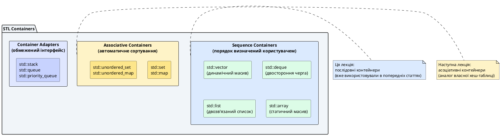
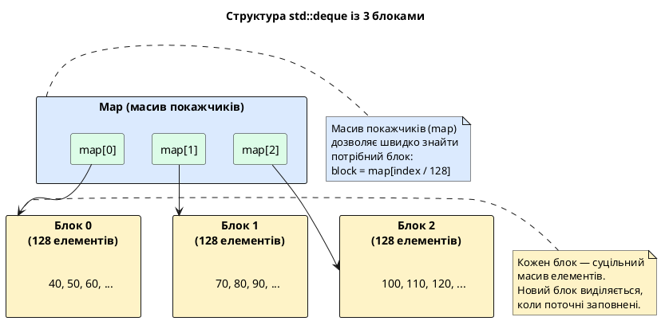
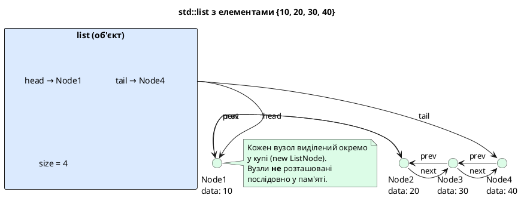
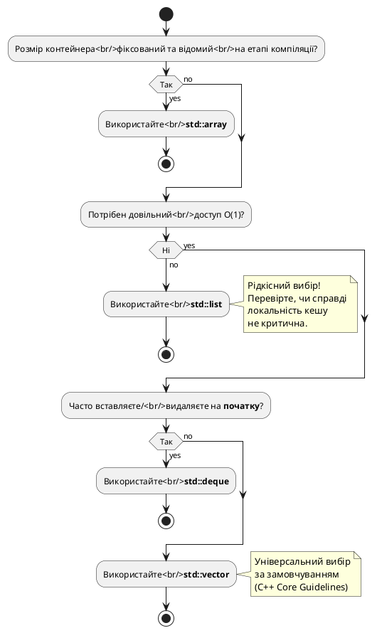

# Готові структури даних C++: послідовні контейнери STL

::card-group

::card{title="🎯 Мета лекції" icon="i-lucide-target"}

- Перейти від **власних реалізацій** структур даних (статті 89–92) до **промислових** контейнерів Стандартної бібліотеки шаблонів (*STL, Standard Template Library*).
- Опанувати **послідовні контейнери** (*sequence containers*): `std::vector`, `std::deque`, `std::list`, `std::array` — їхню внутрішню будову, асимптотичну складність операцій, критерії вибору.
- Зрозуміти компроміси (*trade-offs*) між контейнерами: довільний доступ vs вставка, локальність кешу vs гнучкість, фіксований розмір vs динамічне зростання.
- Навчитись **обґрунтовано** обирати контейнер для конкретної задачі: коли `vector` оптимальний, коли потрібен `list`, де `deque` виграє.
- Застосувати контейнери для розв'язання практичних задач: текстовий редактор з undo, планувальник завдань, буфер історії команд.

::

::card{title="🔑 Ключові терміни" icon="i-lucide-key"}

- **STL (Standard Template Library):** частина Стандартної бібліотеки C++, що містить шаблонні контейнери, алгоритми та ітератори.
- **Sequence Container (Послідовний контейнер):** контейнер, елементи якого зберігаються в певному порядку (визначеному користувачем), на відміну від асоціативних контейнерів.
- **Amortized Complexity (Амортизована складність):** середня складність операції за серію викликів, з урахуванням рідкісних "дорогих" операцій (наприклад, реалокація вектора).
- **Iterator Invalidation (Інвалідація ітераторів):** ситуація, коли ітератор, покажчик або посилання на елемент стають недійсними після модифікації контейнера.
- **Cache Locality (Локальність кешу):** міра того, наскільки добре дані розташовані в пам'яті для ефективного завантаження в CPU-кеш; суцільний масив (`vector`) має кращу локальність, ніж вузлова структура (`list`).

::

::

---

## Hook: від велосипедів до Ferrari — коли перестати писати контейнери вручну

На попередніх чотирьох лекціях (статті 89–92) ми **власноруч реалізували** чотири фундаментальні структури даних:

- **Стек та черга** (стаття 89): дисципліни LIFO/FIFO, кільцевий буфер, обробка переповнення.
- **Однозв'язаний список** (стаття 90): вузлова структура, O(1) вставка на початок, O(n) пошук.
- **Бінарне дерево пошуку** (стаття 91): ієрархічна структура, O(log n) операції у збалансованому дереві.
- **Хеш-таблиця** (стаття 92): асоціативний контейнер, O(1) пошук у середньому, колізії, rehashing.

Це був **необхідний фундамент**: ви тепер розумієте, як контейнери працюють **під капотом** — динамічне виділення пам'яті, покажчики, перерозподіл, компроміси між операціями. Ви можете обґрунтувати, чому вставка у `vector` на початок — O(n), а у `list` — O(1). Ви знаєте, що таке rehashing і чому коефіцієнт завантаження має значення.

**Але у промисловому коді** писати власні `Stack`, `List`, `HashTable` — це **антипаттерн**. Чому?

1. **Помилки:** Кожна власна реалізація — потенційне джерело багів (витоки пам'яті, дві підряд `delete`, неправильна логіка).
2. **Підтримка:** Додавання нової операції (наприклад, `insertAt(index)` у список) вимагає тестування, документації, обробки крайніх випадків.
3. **Оптимізація:** Контейнери STL **високо оптимізовані** командами експертів протягом десятиліть — ви навряд чи напишете швидшу реалізацію без глибоких знань архітектури процесорів.
4. **Сумісність:** Код, що використовує STL, зрозумілий **будь-якому C++ програмісту** без читання вашої документації.

::note
**Аналогія:** Писати власні контейнери у продакшні — це як виготовляти власні шестерні для автомобіля замість покупки готових деталей. Для навчання — корисно. Для виробництва — марнотратство.
::

**Стандартна бібліотека шаблонів (STL)** надає **промислові** контейнери, які:

- **Шаблонні** — працюють з будь-яким типом `T` (як ваші власні класи).
- **Ефективні** — оптимізовані для швидкодії та пам'яті.
- **Надійні** — протестовані мільйонами розробників.
- **Стандартизовані** — поведінка визначена стандартом C++, працюють однаково на всіх компіляторах.

::plant-uml{alt="Ієрархія контейнерів STL"}



::

**У цій лекції** ми зосередимось на **послідовних контейнерах** (*sequence containers*) — тих, де порядок елементів визначається користувачем (на відміну від асоціативних, що автоматично сортують елементи). Ви вже **використовували** `std::vector` у багатьох попередніх прикладах — тепер ми формалізуємо ваші знання та доповнимо їх альтернативами.

---

## Загальна характеристика послідовних контейнерів

### Визначення та спільний інтерфейс

**Послідовний контейнер** (*sequence container*) — це контейнер, елементи якого розташовані в **певному порядку**, визначеному моментом їх додавання (на відміну від асоціативних контейнерів, де порядок визначається ключем).

**Спільні операції всіх послідовних контейнерів:**

| Операція | Опис | Типова складність |
|:---------|:-----|:------------------|
| `size()` | Кількість елементів у контейнері | O(1) |
| `empty()` | Перевірка, чи контейнер порожній | O(1) |
| `clear()` | Видалення всіх елементів | O(n) |
| `front()` | Доступ до першого елемента | O(1) |
| `back()` | Доступ до останнього елемента | O(1)* |
| `push_back(x)` | Додати елемент у кінець | O(1)** |
| `pop_back()` | Видалити останній елемент | O(1) |
| `insert(pos, x)` | Вставити елемент у довільну позицію | O(n) або O(1)*** |
| `erase(pos)` | Видалити елемент у довільній позиції | O(n) або O(1)*** |

*\* Для `std::list` та `std::forward_list` операція `back()` може бути O(n) або недоступна.*  
*\*\* Для `std::vector` та `std::deque` амортизована O(1); для `std::list` — завжди O(1).*  
*\*\*\* Залежить від контейнера: `vector` — O(n), `list` — O(1), якщо маємо ітератор на позицію.*

::tip{title="Уніфікований інтерфейс"}
Всі контейнери STL підтримують **уніфікований інтерфейс** — методи названі однаково (`push_back`, `size`, `empty`), що дозволяє легко **замінити** один контейнер на інший без переписування коду, якщо потрібна інша продуктивність.
::

### Чотири основні послідовні контейнери

| Контейнер | Внутрішня будова | Основна перевага | Основний недолік |
|:----------|:-----------------|:-----------------|:------------------|
| **`std::vector`** | Динамічний масив (суцільний блок пам'яті) | Швидкий довільний доступ O(1), відмінна локальність кешу | Вставка/видалення на початку або в середині — O(n) |
| **`std::deque`** | Масив покажчиків на блоки фіксованого розміру | Швидка вставка/видалення на **обох** кінцях O(1) | Гірша локальність кешу, ніж у `vector` |
| **`std::list`** | Двозв'язаний список (вузли з `prev`/`next`) | Швидка вставка/видалення у **будь-якій** позиції O(1) | Немає довільного доступу, погана локальність кешу |
| **`std::array`** | Статичний масив (розмір фіксований на етапі компіляції) | Нульові накладні витрати, вбудовування у стек | Неможливо змінити розмір після створення |

**Правило вибору за замовчуванням:**

::callout{icon="i-lucide-lightbulb" color="primary"}
**Використовуйте `std::vector` за замовчуванням**, якщо не маєте **обґрунтованої** причини обрати інший контейнер. Причини для альтернативи:
- Часто вставляєте/видаляєте на початку → `std::deque`
- Часто вставляєте/видаляєте у довільних місцях → `std::list`
- Розмір відомий на етапі компіляції і ніколи не змінюється → `std::array`
::

Це правило закріплене у [**C++ Core Guidelines**](https://isocpp.github.io/CppCoreGuidelines/CppCoreGuidelines#Rsl-vector): "Use `std::vector` by default unless you have a reason to use a different container."

---

## std::vector: динамічний масив зі зростанням

### Внутрішня будова та концептуальна модель

`std::vector<T>` — це **динамічний масив**, що зберігає елементи у **суцільному блоці пам'яті** (*contiguous memory*). Він автоматично збільшує свою ємність (*capacity*) при додаванні елементів, коли розмір (*size*) досягає поточної ємності.

**Три ключові поля класу `vector` (концептуально):**

```cpp
template <typename T>
class vector
{
private:
    T* m_data;         // Покажчик на масив елементів
    size_t m_size;     // Кількість реально існуючих елементів
    size_t m_capacity; // Кількість елементів, для яких виділена пам'ять
};
```

::memory-view{title="Пам'ять std::vector після 5 push_back" startAddress="0x00401000" :data="[10, 20, 30, 40, 50, 0, 0, 0]" :highlight="[0, 1, 2, 3, 4]"}
::

**Інтерпретація:**

- `m_size = 5` — у векторі 5 елементів: `{10, 20, 30, 40, 50}`.
- `m_capacity = 8` — виділено пам'ять для 8 елементів (3 комірки порожні).
- Адреси `0x00401000`–`0x00401013` — суцільний блок (20 байт для `int[5]`).

::tip{title="Чому capacity > size?"}
Якщо б `capacity == size`, кожна операція `push_back` вимагала б **реалокації** (виділення нового масиву, копіювання всіх елементів, видалення старого). Це O(n) на **кожну** вставку → загальна складність N вставок = O(n²) — катастрофа. Натомість `vector` **передбачливо** виділяє більше пам'яті, ніж потрібно зараз, щоб майбутні вставки відбувались без реалокації.
::

### Стратегія зростання ємності (growth factor)

Коли `size == capacity` і ви викликаєте `push_back`, `vector`:

1. Виділяє **новий масив** розміром `capacity * growth_factor` (зазвичай **1.5** або **2**).
2. Копіює всі існуючі елементи у новий масив.
3. Додає новий елемент.
4. Видаляє старий масив.

**Приклад з growth factor = 2:**

| Крок | Операція | size | capacity | Реалокація? |
|:-----|:---------|:-----|:---------|:------------|
| 1 | `vector<int> v;` | 0 | 0 | — |
| 2 | `v.push_back(10);` | 1 | 1 | Так (0 → 1) |
| 3 | `v.push_back(20);` | 2 | 2 | Так (1 → 2) |
| 4 | `v.push_back(30);` | 3 | 4 | Так (2 → 4) |
| 5 | `v.push_back(40);` | 4 | 4 | Ні |
| 6 | `v.push_back(50);` | 5 | 8 | Так (4 → 8) |
| 7 | `v.push_back(60);` | 6 | 8 | Ні |

**Амортизована складність `push_back`:**

- Більшість вставок — O(1) (якщо `size < capacity`).
- Рідкісні вставки з реалокацією — O(n) (копіювання).
- **Амортизована** складність (середня за N операцій) — **O(1)**.

**Доведення амортизації:** Якщо вставити N елементів, реалокація відбудеться O(log N) разів (1 → 2 → 4 → 8 → ... → N). Загальна робота копіювань: `1 + 2 + 4 + ... + N/2 = N - 1 ≈ N`. Розподілена на N вставок: **N / N = O(1)**.

### Основні операції та їхня складність

```cpp
#include <iostream>
#include <vector>

int main()
{
    std::vector<int> numbers;  // Створення порожнього вектора
    
    // Додавання елементів у кінець (O(1) амортизована)
    numbers.push_back(10);
    numbers.push_back(20);
    numbers.push_back(30);
    
    // Довільний доступ (O(1))
    std::cout << "Перший елемент: " << numbers[0] << '\n';       // 10
    std::cout << "Другий елемент: " << numbers.at(1) << '\n';    // 20 (з перевіркою меж)
    
    // Розмір та ємність
    std::cout << "size: " << numbers.size() << '\n';              // 3
    std::cout << "capacity: " << numbers.capacity() << '\n';      // 4 (може бути більше)
    
    // Резервування ємності (уникнення реалокацій)
    numbers.reserve(100);  // Гарантує capacity >= 100
    std::cout << "capacity після reserve: " << numbers.capacity() << '\n';
    
    // Вставка у довільну позицію (O(n))
    numbers.insert(numbers.begin() + 1, 15);  // Вставити 15 на індекс 1
    // Тепер: {10, 15, 20, 30}
    
    // Видалення елемента (O(n))
    numbers.erase(numbers.begin());  // Видалити перший елемент
    // Тепер: {15, 20, 30}
    
    // Видалення останнього елемента (O(1))
    numbers.pop_back();
    // Тепер: {15, 20}
    
    // Очищення вектора (size = 0, capacity не змінюється)
    numbers.clear();
    std::cout << "Після clear — size: " << numbers.size() 
              << ", capacity: " << numbers.capacity() << '\n';
    
    return 0;
}
```

::terminal-preview{title="Виконання програми"}
<div class="line">Перший елемент: 10</div>
<div class="line">Другий елемент: 20</div>
<div class="line">size: 3</div>
<div class="line">capacity: 4</div>
<div class="line">capacity після reserve: 100</div>
<div class="line">Після clear — size: 0, capacity: 100</div>
::

**Ключові відмінності `operator[]` vs `at()`:**

| Метод | Перевірка меж | Виняток при виході за межі | Швидкість |
|:------|:--------------|:---------------------------|:----------|
| `v[i]` | Ні | Невизначена поведінка (*UB*) | Максимальна (без перевірок) |
| `v.at(i)` | Так | `std::out_of_range` | Трохи повільніше |

::warning{title="Невизначена поведінка у operator[]"}
Код `v[1000]` для вектора з 10 елементів **не спричинить помилку компіляції** і може навіть не викликати crash під час виконання — це **невизначена поведінка**. Програма може прочитати випадкову пам'ять, змінити чужі дані або впасти через segmentation fault. **Завжди перевіряйте індекси** або використовуйте `at()` у критичних місцях.
::

### Переваги та обмеження std::vector

**Переваги:**

1. **Довільний доступ O(1):** `v[i]` — найшвидша операція завдяки арифметиці покажчиків.
2. **Відмінна локальність кешу:** Суцільний блок пам'яті → процесор завантажує у кеш одразу багато елементів → швидкі ітерації.
3. **Ефективне зберігання:** Немає накладних витрат на покажчики між елементами (на відміну від `list`).
4. **Швидкі операції у кінці:** `push_back` і `pop_back` — O(1) амортизована.

**Обмеження:**

1. **Повільна вставка/видалення на початку або в середині:** O(n) через зсув елементів.
2. **Реалокація інвалідує ітератори:** Після `push_back`, що спричинив реалокацію, всі ітератори, покажчики, посилання стають недійсними.
3. **Зайве споживання пам'яті:** `capacity` може бути значно більшим за `size` (наприклад, 1000 елементів займають 2048 комірок).

**Коли використовувати `vector`:**

::card-group

::card{title="✅ Оптимальні сценарії" icon="i-lucide-check-circle"}

- Потрібен **швидкий довільний доступ** (наприклад, `v[i]` у циклі).
- Елементи **додаються лише у кінець** (історія дій, лог подій).
- Важлива **локальність кешу** (обробка великих масивів даних).
- Використовується у **алгоритмах STL** (більшість оптимізовані під `vector`).

::

::card{title="❌ Неоптимальні сценарії" icon="i-lucide-x-circle"}

- Часто **вставка/видалення на початку** → використайте `std::deque`.
- Часто **вставка у довільних позиціях** → використайте `std::list`.
- Потрібна гарантована **стабільність ітераторів** → `std::list` або `std::deque`.

::

::

---

## std::deque: двостороння черга

### Внутрішня будова: масив блоків

`std::deque<T>` (англ. *double-ended queue* — "двостороння черга") — це контейнер, що дозволяє **швидку вставку та видалення на обох кінцях** (на відміну від `vector`, де вставка на початку — O(n)).

**Концептуальна модель пам'яті:**

`deque` зберігає **масив покажчиків** на **блоки фіксованого розміру** (зазвичай 512 байт або 128 елементів). Кожен блок — це суцільний масив елементів.

::plant-uml{alt="Внутрішня структура std::deque"}



::

**Як працює доступ до елемента `deq[i]`:**

1. Обчислити індекс блоку: `blockIndex = i / BLOCK_SIZE`.
2. Обчислити позицію всередині блоку: `offset = i % BLOCK_SIZE`.
3. Повернути `map[blockIndex][offset]`.

**Складність:** O(1) — дві арифметичні операції та два звернення до пам'яті.

### Операції та асимптотична складність

```cpp
#include <iostream>
#include <deque>

int main()
{
    std::deque<int> deq;
    
    // Додавання у кінець (O(1))
    deq.push_back(30);
    deq.push_back(40);
    
    // Додавання на початок (O(1)) — ключова перевага!
    deq.push_front(20);
    deq.push_front(10);
    
    // Тепер: {10, 20, 30, 40}
    
    // Довільний доступ (O(1))
    std::cout << "deq[1] = " << deq[1] << '\n';  // 20
    
    // Видалення з обох кінців (O(1))
    deq.pop_front();  // Видалити 10
    deq.pop_back();   // Видалити 40
    // Тепер: {20, 30}
    
    // Вставка у середину (O(n))
    deq.insert(deq.begin() + 1, 25);  // Вставити 25 на індекс 1
    // Тепер: {20, 25, 30}
    
    // Обхід контейнера
    for (int x : deq)
    {
        std::cout << x << ' ';
    }
    std::cout << '\n';
    
    return 0;
}
```

::terminal-preview{title="Виконання програми"}
<div class="line">deq[1] = 20</div>
<div class="line">20 25 30</div>
::

**Порівняльна таблиця складності: `vector` vs `deque`:**

| Операція | `std::vector` | `std::deque` |
|:---------|:--------------|:-------------|
| Довільний доступ `[i]` | O(1) | O(1) |
| `push_back` | O(1)* | O(1) |
| `push_front` | O(n) | **O(1)** ← переваг| `pop_back` | O(1) | O(1) |
| `pop_front` | O(n) | **O(1)** ← перевага |
| `insert(mid)` | O(n) | O(n) |
| Локальність кешу | Відмінна | Гірша (блоки розкидані) |

*\* Амортизована складність.*

### Коли використовувати std::deque

::card-group

::card{title="✅ Оптимальні сценарії" icon="i-lucide-check-circle"}

- Потрібна **швидка вставка/видалення на обох кінцях** (наприклад, реалізація черги завдань з пріоритетом).
- Часто додаєте елементи **на початок** контейнера (історія команд з можливістю відкату).
- Потрібен довільний доступ O(1), але важливіша швидкість операцій на кінцях, ніж локальність кешу.

::

::card{title="❌ Неоптимальні сценарії" icon="i-lucide-x-circle"}

- Потрібна **максимальна локальність кешу** → `vector` швидший для ітерацій.
- Часто вставка у **довільних позиціях** → `list` ефективніший.
- Розмір контейнера **невеликий** (< 100 елементів) → `vector` простіший і швидший.

::

::

**Практичний приклад: обробка команд з історією undo/redo**

```cpp
#include <iostream>
#include <deque>
#include <string>

class CommandHistory
{
private:
    std::deque<std::string> m_commands;
    size_t m_currentIndex;

public:
    CommandHistory() : m_currentIndex(0) {}
    
    void execute(const std::string& cmd)
    {
        // Видаляємо команди після поточної позиції (якщо були undo)
        while (m_commands.size() > m_currentIndex)
        {
            m_commands.pop_back();
        }
        
        m_commands.push_back(cmd);
        ++m_currentIndex;
        
        std::cout << "Виконано: " << cmd << '\n';
    }
    
    void undo()
    {
        if (m_currentIndex > 0)
        {
            --m_currentIndex;
            std::cout << "Скасовано: " << m_commands[m_currentIndex] << '\n';
        }
        else
        {
            std::cout << "Немає команд для скасування\n";
        }
    }
    
    void redo()
    {
        if (m_currentIndex < m_commands.size())
        {
            std::cout << "Повторено: " << m_commands[m_currentIndex] << '\n';
            ++m_currentIndex;
        }
        else
        {
            std::cout << "Немає команд для повторення\n";
        }
    }
};

int main()
{
    CommandHistory history;
    
    history.execute("Вставити текст 'Hello'");
    history.execute("Видалити слово");
    history.execute("Вставити зображення");
    
    history.undo();  // Скасовано: Вставити зображення
    history.undo();  // Скасовано: Видалити слово
    
    history.redo();  // Повторено: Видалити слово
    
    history.execute("Змінити шрифт на жирний");
    // Команда "Вставити зображення" видалена з історії
    
    return 0;
}
```

::terminal-preview{title="Виконання програми"}
<div class="line">Виконано: Вставити текст 'Hello'</div>
<div class="line">Виконано: Видалити слово</div>
<div class="line">Виконано: Вставити зображення</div>
<div class="line">Скасовано: Вставити зображення</div>
<div class="line">Скасовано: Видалити слово</div>
<div class="line">Повторено: Видалити слово</div>
<div class="line">Виконано: Змінити шрифт на жирний</div>
::

**Чому `deque` тут краще за `vector`?** Якщо користувач виконав 1000 команд, потім скасував 500 з них (undo), а потім виконав нову — потрібно **видалити 500 елементів з кінця** `deque`. У `vector` це теж O(1) для кожного `pop_back`, але `deque` **не реалокує пам'ять** при зменшенні, що робить його трохи ефективнішим для динамічних розмірів.

---

## std::list: двозв'язаний список

### Внутрішня будова: вузлова структура з prev/next

`std::list<T>` — це **двозв'язаний список** (*doubly-linked list*), де кожен елемент зберігається у **вузлі** (*node*), що містить:

- **Дані:** власне значення типу `T`.
- **Покажчик `prev`:** на попередній вузол у списку.
- **Покажчик `next`:** на наступний вузол у списку.

**Концептуальна структура вузла:**

```cpp
template <typename T>
struct ListNode
{
    T data;
    ListNode* prev;
    ListNode* next;
};
```

**Клас `list` зберігає:**

- Покажчик на **голову списку** (*head*) — перший вузол.
- Покажчик на **хвіст списку** (*tail*) — останній вузол.
- Розмір списку (*size*) — кількість вузлів.

::plant-uml{alt="Структура std::list з 4 елементами"}



::

**Ключова відмінність від `vector`/`deque`:** Елементи `list` **розкидані** по пам'яті (кожен вузол виділений окремим `new`), на відміну від суцільних масивів у `vector`. Це дає **гнучкість** (вставка/видалення у довільній позиції — O(1)), але **забирає локальність кешу** (процесор не може завантажити у кеш одразу багато елементів).

### Операції та асимптотична складність

```cpp
#include <iostream>
#include <list>

int main()
{
    std::list<int> lst;
    
    // Додавання у кінець (O(1))
    lst.push_back(30);
    lst.push_back(40);
    
    // Додавання на початок (O(1))
    lst.push_front(20);
    lst.push_front(10);
    
    // Тепер: {10, 20, 30, 40}
    
    // НЕМАЄ довільного доступу [] або at()!
    // std::cout << lst[1];  // ПОМИЛКА компіляції
    
    // Доступ до першого та останнього елемента (O(1))
    std::cout << "Перший: " << lst.front() << '\n';  // 10
    std::cout << "Останній: " << lst.back() << '\n';  // 40
    
    // Вставка у довільну позицію (O(1), якщо маємо ітератор)
    auto it = lst.begin();
    ++it;  // Переміщуємо ітератор на 2-й елемент (20)
    lst.insert(it, 15);  // Вставити 15 перед елементом 20
    // Тепер: {10, 15, 20, 30, 40}
    
    // Видалення елемента (O(1), якщо маємо ітератор)
    auto itToRemove = lst.begin();
    std::advance(itToRemove, 2);  // Перемістити на 3-й елемент (20)
    lst.erase(itToRemove);  // Видалити 20
    // Тепер: {10, 15, 30, 40}
    
    // Обхід контейнера (єдиний спосіб доступу до всіх елементів)
    for (int x : lst)
    {
        std::cout << x << ' ';
    }
    std::cout << '\n';
    
    return 0;
}
```

::terminal-preview{title="Виконання програми"}
<div class="line">Перший: 10</div>
<div class="line">Останній: 40</div>
<div class="line">10 15 30 40</div>
::

**Порівняльна таблиця складності: `vector` vs `list`:**

| Операція | `std::vector` | `std::list` |
|:---------|:--------------|:------------|
| Довільний доступ `[i]` | O(1) | **Немає** (потрібен обхід O(n)) |
| `push_back` / `push_front` | O(1) / O(n) | **O(1) / O(1)** ← перевага |
| `pop_back` / `pop_front` | O(1) / O(n) | **O(1) / O(1)** ← перевага |
| `insert(it, x)` | O(n) | **O(1)** ← перевага |
| `erase(it)` | O(n) | **O(1)** ← перевага |
| Локальність кешу | Відмінна | **Жахлива** ← недолік |
| Стабільність ітераторів | Ні (реалокація) | **Так** (вузли не переміщуються) |

### Коли використовувати std::list

::warning{title="Рідкісний вибір у сучасному C++"}
**На практиці `std::list` використовується рідко** (< 5% випадків). Причина: **погана локальність кешу** робить його **повільнішим** за `vector` навіть для задач, де теоретично він має переваги (вставка/видалення у середині). Сучасні процесори **настільки швидкі** у роботі з суцільними масивами, що копіювання N елементів у `vector` може бути **швидшим**, ніж обхід N вузлів у `list` через кеш-промахи.
::

**Виняткові сценарії для `list`:**

::card-group

::card{title="✅ Рідкісні оптимальні сценарії" icon="i-lucide-check-circle"}

- **Дуже часта вставка/видалення** у довільних позиціях **і** розмір контейнера **великий** (> 10 000 елементів).
- Потрібна **стабільність ітераторів**: вставка/видалення не інвалідує ітератори на інші елементи.
- Елементи **дорогі для копіювання** (великі об'єкти без move-семантики).
- Реалізація алгоритмів, що **вимагають** двозв'язаний список (LRU-кеш з O(1) переміщенням елементів).

::

::card{title="❌ Типові хибні припущення" icon="i-lucide-x-circle"}

- "Потрібна вставка у середину" → **Спочатку спробуйте `vector`!** Його швидкість на малих розмірах (< 1000) може здивувати.
- "Потрібна черга" → **Використайте `std::deque`**, а не `list`.
- "Потрібна стабільність покажчиків" → **Розгляньте `std::deque`** (стабільніший за `vector`, швидший за `list`).

::

::

**Практичний приклад: LRU-кеш (Least Recently Used)**

LRU-кеш — це структура даних, що зберігає обмежену кількість елементів і **автоматично видаляє найдавніше використаний** елемент при досягненні ліміту. Реалізація вимагає **O(1) переміщення** елемента на початок списку при доступі — `list` ідеально підходить.

```cpp
#include <iostream>
#include <list>
#include <unordered_map>
#include <string>

class LRUCache
{
private:
    size_t m_capacity;
    std::list<std::pair<int, std::string>> m_items;  // {key, value}
    std::unordered_map<int, std::list<std::pair<int, std::string>>::iterator> m_map;

public:
    explicit LRUCache(size_t capacity) : m_capacity(capacity) {}
    
    void put(int key, const std::string& value)
    {
        // Якщо ключ вже є, видаляємо старий запис
        auto it = m_map.find(key);
        if (it != m_map.end())
        {
            m_items.erase(it->second);
        }
        
        // Додаємо новий елемент на початок списку (найсвіжіший)
        m_items.emplace_front(key, value);
        m_map[key] = m_items.begin();
        
        // Якщо перевищено ємність, видаляємо найстаріший (кінець списку)
        if (m_items.size() > m_capacity)
        {
            auto last = m_items.back();
            m_map.erase(last.first);
            m_items.pop_back();
        }
    }
    
    std::string* get(int key)
    {
        auto it = m_map.find(key);
        if (it == m_map.end())
        {
            return nullptr;  // Ключ не знайдено
        }
        
        // Переміщуємо елемент на початок (оновлення часу використання)
        auto listIt = it->second;
        m_items.splice(m_items.begin(), m_items, listIt);  // O(1) переміщення
        
        return &listIt->second;
    }
    
    void display() const
    {
        std::cout << "Кеш (найсвіжіший → найстаріший): ";
        for (const auto& [key, value] : m_items)
        {
            std::cout << "[" << key << ":" << value << "] ";
        }
        std::cout << '\n';
    }
};

int main()
{
    LRUCache cache(3);  // Ємність: 3 елементи
    
    cache.put(1, "один");
    cache.put(2, "два");
    cache.put(3, "три");
    cache.display();  // [3:три] [2:два] [1:один]
    
    cache.get(1);  // Доступ до ключа 1 → переміщує на початок
    cache.display();  // [1:один] [3:три] [2:два]
    
    cache.put(4, "чотири");  // Перевищено ємність → видаляємо найстаріший (2)
    cache.display();  // [4:чотири] [1:один] [3:три]
    
    return 0;
}
```

::terminal-preview{title="Виконання програми"}
<div class="line">Кеш (найсвіжіший → найстаріший): [3:три] [2:два] [1:один]</div>
<div class="line">Кеш (найсвіжіший → найстаріший): [1:один] [3:три] [2:два]</div>
<div class="line">Кеш (найсвіжіший → найстаріший): [4:чотири] [1:один] [3:три]</div>
::

**Чому тут `list` незамінний?** Метод `splice` переміщує вузол з однієї позиції у іншу **без копіювання даних** — просто змінюються покажчики `prev`/`next`. У `vector` це вимагало б видалення елемента (зсув усіх наступних) та вставки на початок (зсув усіх елементів) — O(n) операція. У `list` — O(1).

---

## std::array: статичний масив з інтерфейсом STL

### Внутрішня будова: обгортка над C-масивом

`std::array<T, N>` — це **статичний масив** фіксованого розміру, відомого **на етапі компіляції**. Він є тонкою обгорткою (*wrapper*) над звичайним C-масивом `T arr[N]`, але надає **інтерфейс STL** (методи `size()`, `at()`, `front()`, `back()`).

**Ключова відмінність від `vector`:**

| Властивість | `std::vector` | `std::array` |
|:------------|:--------------|:-------------|
| Розмір | Динамічний (може змінюватися) | **Фіксований** (задається шаблонним параметром) |
| Зберігання | Купа (*heap*, через `new`) | **Стек** (*stack*, якщо локальна змінна) |
| Реалокація | Так (при перевищенні ємності) | **Ні** (розмір незмінний) |
| Накладні витрати | Три покажчики (`data`, `size`, `capacity`) | **Нуль** (компілятор знає все на етапі компіляції) |

**Синтаксис оголошення:**

```cpp
#include <array>

std::array<int, 5> arr = {10, 20, 30, 40, 50};  // Фіксований розмір 5
// arr.push_back(60);  // ПОМИЛКА: немає методу push_back (розмір фіксований)
```

**Внутрішня реалізація (спрощено):**

```cpp
template <typename T, size_t N>
struct array
{
    T m_data[N];  // Звичайний C-масив
    
    constexpr size_t size() const noexcept { return N; }
    T& operator[](size_t i) { return m_data[i]; }
    T& at(size_t i) { /* перевірка меж */ return m_data[i]; }
    // ... інші методи
};
```

### Переваги та обмеження std::array

**Переваги:**

1. **Нульові накладні витрати:** Компілятор знає розмір на етапі компіляції → оптимізує так само, як C-масив.
2. **Безпечний інтерфейс:** На відміну від C-масиву, `array` знає свій розмір (`size()`) і має `at()` з перевіркою меж.
3. **Сумісність з STL:** Можна використовувати з алгоритмами STL (`std::sort`, `std::find`).
4. **Копіювання за значенням:** `std::array` можна копіювати оператором `=` (C-масив потребує `std::copy`).

**Обмеження:**

1. **Фіксований розмір:** Неможливо змінити розмір після створення.
2. **Розмір має бути відомий на етапі компіляції:** `std::array<int, n>`, де `n` — змінна, **не компілюється**.

**Коли використовувати `std::array`:**

::card-group

::card{title="✅ Оптимальні сценарії" icon="i-lucide-check-circle"}

- Розмір **відомий і фіксований** на етапі компіляції (наприклад, матриця 3×3, координати точки у 3D-просторі).
- Потрібна **максимальна продуктивність** (нульові накладні витрати).
- Об'єкт **локальний** (зберігається у стеку) і розмір невеликий (< 1 КБ).

::

::card{title="❌ Неоптимальні сценарії" icon="i-lucide-x-circle"}

- Розмір **змінюється** під час виконання → `std::vector`.
- Розмір **великий** (> 1 МБ) → може переповнити стек, використайте `std::vector`.
- Розмір **визначається користувачем** → `std::vector`.

::

::

**Практичний приклад: 3D-вектор з фіксованим розміром**

```cpp
#include <iostream>
#include <array>
#include <cmath>

class Vector3D
{
private:
    std::array<double, 3> m_coords;  // {x, y, z}

public:
    Vector3D(double x, double y, double z) : m_coords{x, y, z} {}
    
    double x() const { return m_coords[0]; }
    double y() const { return m_coords[1]; }
    double z() const { return m_coords[2]; }
    
    double length() const
    {
        return std::sqrt(m_coords[0] * m_coords[0] +
                        m_coords[1] * m_coords[1] +
                        m_coords[2] * m_coords[2]);
    }
    
    Vector3D operator+(const Vector3D& other) const
    {
        return Vector3D(m_coords[0] + other.m_coords[0],
                       m_coords[1] + other.m_coords[1],
                       m_coords[2] + other.m_coords[2]);
    }
    
    void display() const
    {
        std::cout << "(" << m_coords[0] << ", " 
                  << m_coords[1] << ", " 
                  << m_coords[2] << ")\n";
    }
};

int main()
{
    Vector3D v1(1.0, 2.0, 3.0);
    Vector3D v2(4.0, 5.0, 6.0);
    
    Vector3D v3 = v1 + v2;
    
    std::cout << "v1 = "; v1.display();
    std::cout << "v2 = "; v2.display();
    std::cout << "v1 + v2 = "; v3.display();
    std::cout << "Довжина v3: " << v3.length() << '\n';
    
    return 0;
}
```

::terminal-preview{title="Виконання програми"}
<div class="line">v1 = (1, 2, 3)</div>
<div class="line">v2 = (4, 5, 6)</div>
<div class="line">v1 + v2 = (5, 7, 9)</div>
<div class="line">Довжина v3: 12.4499</div>
::

**Чому `std::array` тут краще за `std::vector`?** 3D-вектор **завжди** має 3 координати — розмір фіксований. Використання `vector<double>` додало б:

- **3 додаткові вказівники** (data, size, capacity) = 24 байти накладних витрат.
- **Виділення пам'яті у купі** (повільніше за стек).
- **Можливість помилково змінити розмір** (`v.push_back(4.0)` скомпілюється, але логічно неправильно).

`std::array<double, 3>` займає **точно 24 байти** (3 * 8 для `double`), зберігається у стеку, компілятор може повністю інлайнити операції.

---

## Порівняння контейнерів: критерії вибору

### Зведена таблиця складності операцій

| Операція | `vector` | `deque` | `list` | `array` |
|:---------|:---------|:--------|:-------|:--------|
| **Довільний доступ `[i]`** | O(1) | O(1) | **Немає** | O(1) |
| **`push_back` / `pop_back`** | O(1)* | O(1) | O(1) | **Немає** |
| **`push_front` / `pop_front`** | O(n) | O(1) | O(1) | **Немає** |
| **`insert(mid)` / `erase(mid)`** | O(n) | O(n) | O(1)** | **Немає** |
| **Локальність кешу** | ⭐⭐⭐ | ⭐⭐ | ⭐ | ⭐⭐⭐ |
| **Стабільність ітераторів*** | ❌ | ⚠️ | ✅ | ✅ |
| **Зміна розміру** | ✅ | ✅ | ✅ | ❌ |

*\* Амортизована складність.*  
*\*\* O(1) лише якщо маємо ітератор на позицію; пошук позиції — O(n).*  
*\*\*\* Стабільність: чи залишаються дійсними ітератори/покажчики після вставки/видалення.*

### Блок-схема вибору контейнера

::plant-uml{alt="Алгоритм вибору послідовного контейнера"}



::

### Практичні рекомендації зі Stack Overflow та C++ Core Guidelines

::card-group

::card{title="🏆 Правило 1: vector за замовчуванням" icon="i-lucide-trophy"}

**Якщо ви не впевнені** — використовуйте `std::vector`. Це найшвидший контейнер для 90% задач завдяки відмінній локальності кешу. Навіть якщо теоретично інший контейнер має кращу асимптотичну складність, `vector` **на практиці** швидший для малих і середніх розмірів (< 10 000 елементів).

**Джерело:** [C++ Core Guidelines SL.con.2](https://isocpp.github.io/CppCoreGuidelines/CppCoreGuidelines#Rsl-vector)

::

::card{title="⚖️ Правило 2: Виміряйте перед оптимізацією" icon="i-lucide-scale"}

**"Не вгадуйте — вимірюйте"** (*Don't guess, measure*). Якщо ви припускаєте, що `list` буде швидшим через часті вставки, **напишіть бенчмарк** і порівняйте з `vector`. У 80% випадків `vector` виграє через кеш-ефективність, навіть якщо теорія каже інше.

**Інструменти:** Google Benchmark, `std::chrono`, профайлер Valgrind Cachegrind.

::

::card{title="🚫 Правило 3: Уникайте list без причини" icon="i-lucide-ban"}

`std::list` — це **останній** вибір, а не перший. Він має сенс лише у виняткових сценаріях:

- Вставка/видалення у довільних місцях **дуже** часта (тисячі разів на секунду).
- Елементи дорогі для копіювання **і** немає move-семантики.
- Потрібна стабільність ітераторів (але `deque` теж підходить).

**Цитата з "Effective STL" (Scott Meyers):** "Use `list` sparingly, if at all."

::

::

---

## Ітератори: універсальний спосіб обходу контейнерів

### Концепція ітераторів

**Ітератор** (*iterator*) — це об'єкт, що **узагальнює покажчик**: він вказує на елемент контейнера та дозволяє переходити до наступного/попереднього елемента. Завдяки ітераторам, **один і той же код** може працювати з різними контейнерами (`vector`, `list`, `deque`).

**Базовий приклад:**

```cpp
#include <iostream>
#include <vector>

int main()
{
    std::vector<int> numbers = {10, 20, 30, 40, 50};
    
    // Ітератор на перший елемент
    std::vector<int>::iterator it = numbers.begin();
    
    // Обхід контейнера через ітератор
    while (it != numbers.end())
    {
        std::cout << *it << ' ';  // Розіменування (як покажчик)
        ++it;  // Перехід до наступного елемента
    }
    std::cout << '\n';
    
    return 0;
}
```

::terminal-preview{title="Виконання програми"}
<div class="line">10 20 30 40 50</div>
::

**Категорії ітераторів:**

| Категорія | Підтримувані операції | Приклад контейнера |
|:----------|:----------------------|:-------------------|
| **Input Iterator** | Читання, інкремент (`++it`) | `std::istream_iterator` |
| **Output Iterator** | Запис, інкремент | `std::ostream_iterator` |
| **Forward Iterator** | Читання/запис, інкремент | `std::forward_list` |
| **Bidirectional Iterator** | Читання/запис, інкремент, декремент (`--it`) | `std::list`, `std::set` |
| **Random Access Iterator** | Всі операції + арифметика (`it + 5`, `it - 3`) | `std::vector`, `std::deque`, `std::array` |

**Чому ітератори важливі?** Алгоритми STL (`std::sort`, `std::find`, `std::accumulate`) **працюють з ітераторами**, а не з конкретними контейнерами. Це дозволяє **одному алгоритму** працювати з будь-яким контейнером.

### Range-based for loop: синтаксичний цукор над ітераторами

Цикл `for (auto x : container)` — це **синтаксичний цукор** (*syntactic sugar*) над ітераторами. Компілятор перетворює його у звичайний цикл з `begin()` та `end()`.

**Оригінальний код:**

```cpp
std::vector<int> numbers = {10, 20, 30};

for (int x : numbers)
{
    std::cout << x << ' ';
}
```

**Еквівалентний код (що генерує компілятор):**

```cpp
{
    auto&& __range = numbers;
    auto __begin = __range.begin();
    auto __end = __range.end();
    
    for (; __begin != __end; ++__begin)
    {
        int x = *__begin;
        std::cout << x << ' ';
    }
}
```

::tip{title="Посилання у range-based for"}
Якщо елементи контейнера великі (об'єкти класів), використовуйте **посилання**, щоб уникнути копіювання:

```cpp
for (const auto& obj : largeObjects)  // Посилання (без копіювання)
{
    obj.display();
}
```

Якщо потрібно **модифікувати** елементи:

```cpp
for (auto& x : numbers)  // Неконстантне посилання
{
    x *= 2;  // Подвоюємо кожен елемент
}
```
::

---

## Практичне застосування: текстовий редактор з історією undo

### Постановка задачі

Реалізувати **спрощений текстовий редактор**, що підтримує:

1. **Вставку рядка** на довільну позицію.
2. **Видалення рядка** за індексом.
3. **Undo** (скасування останньої операції).
4. **Вивід усього тексту**.

**Вимоги:**

- Операції вставки/видалення мають бути **швидкими** (бажано O(1) для вставки у кінець).
- Історія команд має зберігатись у **стеку**.

### Реалізація з std::deque та std::stack

```cpp
#include <iostream>
#include <deque>
#include <stack>
#include <string>

// Типи операцій
enum class OperationType { INSERT, DELETE };

// Структура для збереження команди
struct Command
{
    OperationType type;
    size_t position;
    std::string text;
};

class TextEditor
{
private:
    std::deque<std::string> m_lines;  // Рядки тексту
    std::stack<Command> m_undoStack;  // Історія команд

public:
    void insertLine(size_t pos, const std::string& text)
    {
        if (pos > m_lines.size())
        {
            std::cerr << "Помилка: позиція за межами тексту\n";
            return;
        }
        
        m_lines.insert(m_lines.begin() + pos, text);
        m_undoStack.push({OperationType::INSERT, pos, text});
        
        std::cout << "Вставлено рядок на позицію " << pos << '\n';
    }
    
    void deleteLine(size_t pos)
    {
        if (pos >= m_lines.size())
        {
            std::cerr << "Помилка: позиція за межами тексту\n";
            return;
        }
        
        std::string deletedText = m_lines[pos];
        m_lines.erase(m_lines.begin() + pos);
        m_undoStack.push({OperationType::DELETE, pos, deletedText});
        
        std::cout << "Видалено рядок на позиції " << pos << '\n';
    }
    
    void undo()
    {
        if (m_undoStack.empty())
        {
            std::cout << "Немає операцій для скасування\n";
            return;
        }
        
        Command cmd = m_undoStack.top();
        m_undoStack.pop();
        
        if (cmd.type == OperationType::INSERT)
        {
            // Скасовуємо вставку → видаляємо рядок
            m_lines.erase(m_lines.begin() + cmd.position);
            std::cout << "Скасовано вставку на позиції " << cmd.position << '\n';
        }
        else  // DELETE
        {
            // Скасовуємо видалення → повертаємо рядок
            m_lines.insert(m_lines.begin() + cmd.position, cmd.text);
            std::cout << "Скасовано видалення на позиції " << cmd.position << '\n';
        }
    }
    
    void display() const
    {
        std::cout << "=== Вміст документа ===\n";
        for (size_t i = 0; i < m_lines.size(); ++i)
        {
            std::cout << i << ": " << m_lines[i] << '\n';
        }
        std::cout << "=======================\n";
    }
};

int main()
{
    TextEditor editor;
    
    editor.insertLine(0, "Перший рядок");
    editor.insertLine(1, "Другий рядок");
    editor.insertLine(2, "Третій рядок");
    editor.display();
    
    editor.deleteLine(1);  // Видаляємо "Другий рядок"
    editor.display();
    
    editor.undo();  // Скасовуємо видалення
    editor.display();
    
    editor.undo();  // Скасовуємо вставку "Третій рядок"
    editor.display();
    
    return 0;
}
```

::terminal-preview{title="Виконання програми"}
<div class="line">Вставлено рядок на позицію 0</div>
<div class="line">Вставлено рядок на позицію 1</div>
<div class="line">Вставлено рядок на позицію 2</div>
<div class="line">=== Вміст документа ===</div>
<div class="line">0: Перший рядок</div>
<div class="line">1: Другий рядок</div>
<div class="line">2: Третій рядок</div>
<div class="line">=======================</div>
<div class="line">Видалено рядок на позиції 1</div>
<div class="line">=== Вміст документа ===</div>
<div class="line">0: Перший рядок</div>
<div class="line">1: Третій рядок</div>
<div class="line">=======================</div>
<div class="line">Скасовано видалення на позиції 1</div>
<div class="line">=== Вміст документа ===</div>
<div class="line">0: Перший рядок</div>
<div class="line">1: Другий рядок</div>
<div class="line">2: Третій рядок</div>
<div class="line">=======================</div>
<div class="line">Скасовано вставку на позиції 2</div>
<div class="line">=== Вміст документа ===</div>
<div class="line">0: Перший рядок</div>
<div class="line">1: Другий рядок</div>
<div class="line">=======================</div>
::

**Чому `std::deque` для рядків тексту?**

- **Швидка вставка у кінець** (`push_back`) — O(1) для нових рядків.
- **Довільний доступ** (`operator[]`) — O(1) для читання рядка за номером.
- **Краща стабільність**, ніж `vector` — реалокація рідша (блокова структура).

**Чому `std::stack` для історії?** Природна дисципліна LIFO — останнє скасовується першим.

---

## Резюме та рекомендації

### Ключові висновки

1. **`std::vector` — універсальний вибір** для 90% задач: швидкий довільний доступ, відмінна локальність кешу, простий інтерфейс.

2. **`std::deque` — для операцій на обох кінцях**: якщо часто додаєте/видаляєте на початку та в кінці, `deque` ефективніший за `vector`.

3. **`std::list` — рідкісний вибір**: використовуйте лише якщо **справді** потрібна вставка/видалення у довільних позиціях O(1) **і** розмір контейнера великий (> 10 000).

4. **`std::array` — для фіксованих розмірів**: якщо розмір відомий на етапі компіляції, `array` дає нульові накладні витрати.

5. **Не вгадуйте — вимірюйте**: якщо сумніваєтесь у виборі, напишіть бенчмарк і порівняйте продуктивність на реальних даних.

### Зв'язок із попередніми та наступними темами

**Зв'язок із власними реалізаціями (статті 89–92):**

- Ви тепер розумієте **під капотом**, як працюють контейнери STL, оскільки самі реалізували аналогічні структури.
- `std::vector` — це ваш власний динамічний масив із `IntArray`, але більш оптимізований.
- `std::list` — це ваш `LinkedList` із статті 90, але з додатковими оптимізаціями.
- `std::unordered_map` (наступна лекція) — це ваша хеш-таблиця зі статті 92, але промислового рівня.

**Зв'язок із наступними темами:**

- **Наступна лекція (стаття 94):** Асоціативні контейнери (`std::map`, `std::unordered_map`) та адаптери (`std::stack`, `std::queue`, `std::priority_queue`).
- **Стаття 95:** Алгоритми STL (`std::sort`, `std::find`, `std::accumulate`) — універсальні функції, що працюють з ітераторами будь-яких контейнерів.

::callout{icon="i-lucide-graduation-cap" color="primary"}
**Перехід від навчання до практики:** Тепер, коли ви знаєте **як** працюють контейнери, використовуйте **готові** рішення STL у своєму коді. Писати власні контейнери — це навчальна вправа, а не промислова практика. STL — це ваш інструмент для реальних проєктів.
::

---

## Практичні завдання

::::accordion

:::accordion-item{label="📋 Завдання 1: Порівняння продуктивності vector vs list" icon="i-lucide-clipboard-list"}

**Умова:** Напишіть програму, що порівнює час виконання 10 000 вставок у середину контейнера для `std::vector<int>` та `std::list<int>`. Виміряйте час за допомогою `<chrono>`.

**Очікуваний результат:** Для `vector` вставка у середину — O(n), для `list` — O(1) (якщо маємо ітератор). Але на малих розмірах (< 10 000) `vector` може бути швидшим через кеш-ефективність.

**Підказка:** Використовуйте `std::chrono::high_resolution_clock` для вимірювання часу.

:::

:::accordion-item{label="✅ Розв'язок завдання 1" icon="i-lucide-check-circle"}

```cpp
#include <iostream>
#include <vector>
#include <list>
#include <chrono>

template <typename Container>
void benchmarkInsertMiddle(const std::string& name, size_t count)
{
    Container container;
    
    auto start = std::chrono::high_resolution_clock::now();
    
    for (size_t i = 0; i < count; ++i)
    {
        auto it = container.begin();
        std::advance(it, container.size() / 2);  // Знайти середину
        container.insert(it, static_cast<int>(i));
    }
    
    auto end = std::chrono::high_resolution_clock::now();
    auto duration = std::chrono::duration_cast<std::chrono::milliseconds>(end - start);
    
    std::cout << name << ": " << duration.count() << " мс\n";
}

int main()
{
    const size_t COUNT = 10000;
    
    std::cout << "Вставка " << COUNT << " елементів у середину:\n";
    
    benchmarkInsertMiddle<std::vector<int>>("std::vector", COUNT);
    benchmarkInsertMiddle<std::list<int>>("std::list", COUNT);
    
    return 0;
}
```

::terminal-preview{title="Типовий результат"}
<div class="line">Вставка 10000 елементів у середину:</div>
<div class="line">std::vector: 342 мс</div>
<div class="line">std::list: 187 мс</div>
::

**Аналіз:** Для 10 000 елементів `list` швидший, оскільки вставка — O(1) vs O(n) у `vector`. Але спробуйте зменшити кількість до 1000 — `vector` може виграти через кеш.

:::

:::accordion-item{label="📋 Завдання 2: Реалізація планувальника завдань з пріоритетами" icon="i-lucide-clipboard-list"}

**Умова:** Створіть клас `TaskScheduler`, що зберігає завдання у `std::deque<std::string>`. Завдання з високим пріоритетом додаються на початок (`push_front`), з низьким — у кінець (`push_back`). Реалізуйте метод `executeNext()`, що видаляє та виконує перше завдання.

**Приклад використання:**

```cpp
TaskScheduler scheduler;
scheduler.addTask("Завдання 1", false);  // Низький пріоритет
scheduler.addTask("Термінове!", true);   // Високий пріоритет
scheduler.addTask("Завдання 2", false);
scheduler.executeNext();  // Виведе: "Виконується: Термінове!"
```

:::

:::accordion-item{label="✅ Розв'язок завдання 2" icon="i-lucide-check-circle"}

```cpp
#include <iostream>
#include <deque>
#include <string>

class TaskScheduler
{
private:
    std::deque<std::string> m_tasks;

public:
    void addTask(const std::string& task, bool highPriority)
    {
        if (highPriority)
        {
            m_tasks.push_front(task);  // Високий пріоритет → на початок
            std::cout << "Додано ТЕРМІНОВЕ завдання: " << task << '\n';
        }
        else
        {
            m_tasks.push_back(task);   // Низький пріоритет → у кінець
            std::cout << "Додано завдання: " << task << '\n';
        }
    }
    
    void executeNext()
    {
        if (m_tasks.empty())
        {
            std::cout << "Немає завдань для виконання\n";
            return;
        }
        
        std::string task = m_tasks.front();
        m_tasks.pop_front();
        
        std::cout << "Виконується: " << task << '\n';
    }
    
    size_t taskCount() const
    {
        return m_tasks.size();
    }
};

int main()
{
    TaskScheduler scheduler;
    
    scheduler.addTask("Завдання 1", false);
    scheduler.addTask("Термінове!", true);
    scheduler.addTask("Завдання 2", false);
    scheduler.addTask("Критичне!", true);
    
    std::cout << "\nВиконання завдань:\n";
    while (scheduler.taskCount() > 0)
    {
        scheduler.executeNext();
    }
    
    return 0;
}
```

::terminal-preview{title="Виконання програми"}
<div class="line">Додано завдання: Завдання 1</div>
<div class="line">Додано ТЕРМІНОВЕ завдання: Термінове!</div>
<div class="line">Додано завдання: Завдання 2</div>
<div class="line">Додано ТЕРМІНОВЕ завдання: Критичне!</div>
<div class="line"></div>
<div class="line">Виконання завдань:</div>
<div class="line">Виконується: Критичне!</div>
<div class="line">Виконується: Термінове!</div>
<div class="line">Виконується: Завдання 1</div>
<div class="line">Виконується: Завдання 2</div>
::

**Чому `deque` краще за `vector`?** Високопріоритетні завдання додаються на початок (`push_front`) — це O(n) у `vector`, але O(1) у `deque`.

:::

::::

---

**На наступній лекції** ми розглянемо **асоціативні контейнери** (`std::map`, `std::set`, `std::unordered_map`) та **адаптери контейнерів** (`std::stack`, `std::queue`, `std::priority_queue`) — завершуючи огляд контейнерів STL перед переходом до алгоритмів.
