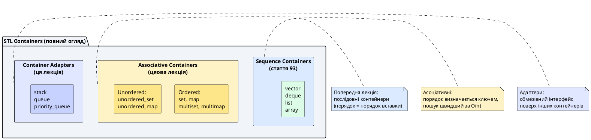
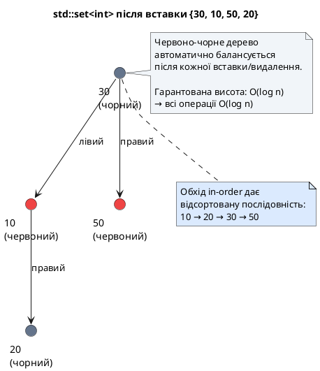
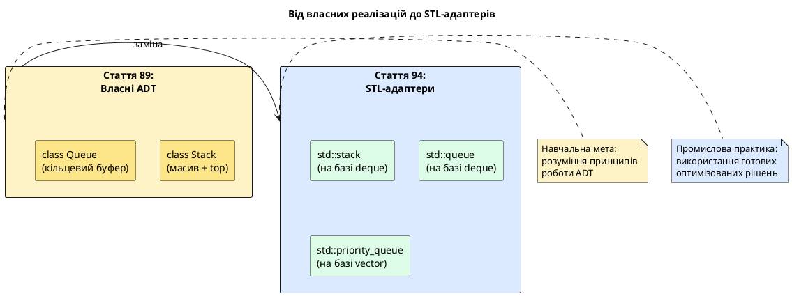
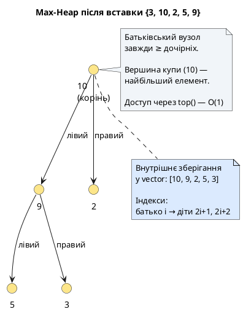
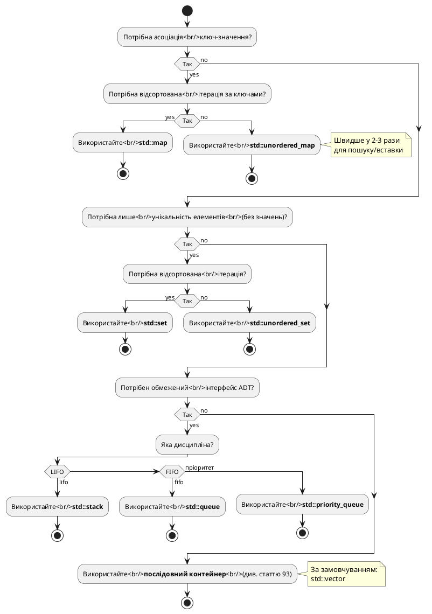

# Готові структури даних C++: асоціативні контейнери та адаптери

::card-group

::card{title="🎯 Мета лекції" icon="i-lucide-target"}

- Опанувати **асоціативні контейнери** (*associative containers*): `std::set`, `std::map`, `std::unordered_set`, `std::unordered_map` — автоматичне сортування vs хешування.
- Розібрати **адаптери контейнерів** (*container adapters*): `std::stack`, `std::queue`, `std::priority_queue` — обмежений інтерфейс поверх послідовних контейнерів.
- Зрозуміти різницю між **впорядкованими** (червоно-чорне дерево) та **хешованими** (хеш-таблиця) асоціативними контейнерами.
- Навчитись **обґрунтовано** обирати контейнер: коли потрібен `map`, коли `unordered_map`, коли достатньо `set`.
- Застосувати контейнери для розв'язання практичних задач: підрахунок частоти слів, пошук дублікатів, топ-K елементів.

::

::card{title="🔑 Ключові терміни" icon="i-lucide-key"}

- **Associative Container (Асоціативний контейнер):** контейнер, що зберігає елементи у впорядкованому вигляді (за ключем), дозволяючи швидкий пошук O(log n) або O(1).
- **Ordered Containers (Впорядковані контейнери):** `set`, `map` — базуються на червоно-чорному дереві, елементи автоматично відсортовані.
- **Unordered Containers (Хешовані контейнери):** `unordered_set`, `unordered_map` — базуються на хеш-таблиці, пошук O(1) у середньому, порядок не гарантований.
- **Container Adapter (Адаптер контейнера):** клас-обгортка, що надає **обмежений інтерфейс** поверх іншого контейнера (наприклад, `stack` дозволяє лише `push`/`pop`).
- **Red-Black Tree (Червоно-чорне дерево):** самобалансуюче бінарне дерево пошуку, що гарантує O(log n) операції навіть у гіршому випадку.

::

::

---

## Hook: від власної хеш-таблиці до std::unordered_map — коли зупинитись писати велосипеди

У **статті 92** ви реалізували **власну хеш-таблицю** з нуля: хеш-функцію, розв'язання колізій методом ланцюгів, динамічне збільшення розміру (rehashing). Ви витратили ~300 рядків коду, провели години відлагодження, оптимізували коефіцієнт завантаження... І тепер запитання: **навіщо?**

::note
**Педагогічна мета:** Власна реалізація дозволила вам **зрозуміти**, як працює хешування під капотом. Тепер ви можете **обґрунтовано** обирати між `std::map` та `std::unordered_map`, розуміючи компроміси.
::

**Промислова реальність:** У реальному проєкті код із статті 92 замінюється **одним рядком**:

```cpp
#include <unordered_map>

std::unordered_map<std::string, std::string> dictionary;
```

**Що ви отримуєте безкоштовно:**

- ✅ Оптимізована хеш-функція для всіх стандартних типів (`std::hash<T>`).
- ✅ Автоматичне збільшення розміру з налаштовуваним коефіцієнтом завантаження.
- ✅ Стабільність ітераторів (краща, ніж у вашій реалізації).
- ✅ Підтримка custom типів через спеціалізацію `std::hash`.
- ✅ Десятиліття оптимізацій та тестування.

**Аналогія:** Тепер ви **механік**, що розуміє, як працює двигун автомобіля (власна реалізація). Але для поїздки використовуйте **готовий автомобіль** (STL), а не збирайте його з деталей щоразу.

**У цій лекції** ми завершуємо огляд контейнерів STL, розглядаючи:

1. **Асоціативні контейнери** — зв'язок ключ-значення для швидкого пошуку.
2. **Адаптери** — спрощені інтерфейси поверх існуючих контейнерів (ваша власна черга зі статті 89 → `std::queue`).

::plant-uml{alt="Ієрархія всіх контейнерів STL"}



::

---

## Асоціативні контейнери: від лінійного пошуку до O(log n) та O(1)

### Проблема послідовних контейнерів

У **послідовних контейнерах** (`vector`, `list`, `deque`) пошук елемента за **значенням** вимагає **лінійного сканування** — O(n):

```cpp
std::vector<int> numbers = {10, 50, 30, 70, 20};

// Знайти елемент 30
auto it = std::find(numbers.begin(), numbers.end(), 30);  // O(n)
```

Для вектора з **1 мільйоном** елементів це **до 1 мільйона порівнянь** у гіршому випадку. Якщо пошук — **найчастіша операція** у вашій програмі (наприклад, словник, база даних), це неприйнятно.

**Асоціативні контейнери** розв'язують цю проблему, **автоматично підтримуючи внутрішню структуру**, що дозволяє **швидкий пошук**:

- **Впорядковані** (`set`, `map`): червоно-чорне дерево → пошук **O(log n)**.
- **Хешовані** (`unordered_set`, `unordered_map`): хеш-таблиця → пошук **O(1) у середньому**.

### Дві категорії асоціативних контейнерів

| Властивість | Ordered (`set`, `map`) | Unordered (`unordered_set`, `unordered_map`) |
|:------------|:-----------------------|:---------------------------------------------|
| **Внутрішня структура** | Червоно-чорне дерево (RB-tree) | Хеш-таблиця з ланцюгами |
| **Пошук** | O(log n) | O(1) у середньому, O(n) у гіршому |
| **Вставка/видалення** | O(log n) | O(1) у середньому |
| **Порядок елементів** | Відсортовані (за `<` або custom компаратором) | **Не гарантований** (залежить від хеш-функції) |
| **Вимоги до типу** | Потрібен `operator<` або компаратор | Потрібна хеш-функція та `operator==` |
| **Ітерація** | Впорядкована (від найменшого до найбільшого) | Невпорядкована (у довільному порядку) |

**Правило вибору:**

::callout{icon="i-lucide-lightbulb" color="primary"}
**Використовуйте `unordered_*` за замовчуванням**, якщо не потрібна **відсортована ітерація** або **діапазонний пошук** (`lower_bound`, `upper_bound`). Хеш-таблиця швидша у більшості випадків.
::

---

## std::set та std::unordered_set: унікальні елементи

### std::set — відсортована множина

`std::set<T>` — це контейнер, що зберігає **унікальні** елементи у **відсортованому** порядку. Базується на **червоно-чорному дереві** (самобалансуюче BST).

**Основні операції:**

```cpp
#include <iostream>
#include <set>

int main()
{
    std::set<int> numbers;
    
    // Вставка елементів (O(log n))
    numbers.insert(30);
    numbers.insert(10);
    numbers.insert(50);
    numbers.insert(20);
    numbers.insert(30);  // Дублікат — ігнорується
    
    // Розмір множини: 4 (дублікат не додався)
    std::cout << "Розмір: " << numbers.size() << '\n';
    
    // Ітерація — завжди відсортована!
    std::cout << "Елементи: ";
    for (int x : numbers)  // Виведе: 10 20 30 50 (відсортовано)
    {
        std::cout << x << ' ';
    }
    std::cout << '\n';
    
    // Пошук елемента (O(log n))
    if (numbers.find(20) != numbers.end())
    {
        std::cout << "20 знайдено\n";
    }
    
    // Видалення елемента (O(log n))
    numbers.erase(30);
    
    // Перевірка наявності (C++20: contains)
    if (numbers.contains(30))  // C++20
    {
        std::cout << "30 є у множині\n";
    }
    else
    {
        std::cout << "30 відсутній\n";
    }
    
    return 0;
}
```

::terminal-preview{title="Виконання програми"}
<div class="line">Розмір: 4</div>
<div class="line">Елементи: 10 20 30 50</div>
<div class="line">20 знайдено</div>
<div class="line">30 відсутній</div>
::

**Ключова властивість:** Елементи **завжди відсортовані**, навіть якщо вставлялись у довільному порядку. Це гарантується внутрішньою структурою дерева.

::plant-uml{alt="Внутрішня структура std::set"}



::

### std::unordered_set — хешована множина

`std::unordered_set<T>` — це контейнер унікальних елементів, що базується на **хеш-таблиці** (аналог вашої реалізації зі статті 92). Елементи **не відсортовані**.

```cpp
#include <iostream>
#include <unordered_set>

int main()
{
    std::unordered_set<int> numbers;
    
    // Вставка елементів (O(1) у середньому)
    numbers.insert(30);
    numbers.insert(10);
    numbers.insert(50);
    numbers.insert(20);
    numbers.insert(30);  // Дублікат — ігнорується
    
    // Розмір: 4
    std::cout << "Розмір: " << numbers.size() << '\n';
    
    // Ітерація — порядок НЕ гарантований!
    std::cout << "Елементи: ";
    for (int x : numbers)  // Може вивести: 20 50 10 30 (довільний порядок)
    {
        std::cout << x << ' ';
    }
    std::cout << '\n';
    
    // Пошук (O(1) у середньому)
    if (numbers.find(20) != numbers.end())
    {
        std::cout << "20 знайдено\n";
    }
    
    // Видалення (O(1) у середньому)
    numbers.erase(30);
    
    return 0;
}
```

::terminal-preview{title="Виконання програми (порядок може відрізнятись!)"}
<div class="line">Розмір: 4</div>
<div class="line">Елементи: 20 50 10 30</div>
<div class="line">20 знайдено</div>
::

**Порівняння `set` vs `unordered_set`:**

| Операція | `std::set` | `std::unordered_set` |
|:---------|:-----------|:---------------------|
| Вставка | O(log n) | **O(1)** у середньому ← швидше |
| Пошук | O(log n) | **O(1)** у середньому ← швидше |
| Видалення | O(log n) | **O(1)** у середньому ← швидше |
| Ітерація | **Відсортована** ← перевага | Невпорядкована |
| Пам'ять | ~24 байти на елемент (вузол дерева) | ~12 байти + бакети |

::warning{title="Коли unordered_set повільніший за set"}
Якщо хеш-функція **погана** (багато колізій), `unordered_set` деградує до **O(n)** для всіх операцій. Для стандартних типів (`int`, `string`) це рідкість, але для custom типів потрібна **добра хеш-функція**.
::

### Практичне застосування: пошук дублікатів

**Задача:** Дано масив чисел, знайти всі дублікати за O(n).

```cpp
#include <iostream>
#include <vector>
#include <unordered_set>

std::vector<int> findDuplicates(const std::vector<int>& numbers)
{
    std::unordered_set<int> seen;
    std::unordered_set<int> duplicates;
    
    for (int num : numbers)
    {
        if (seen.contains(num))  // C++20
        {
            duplicates.insert(num);
        }
        else
        {
            seen.insert(num);
        }
    }
    
    return std::vector<int>(duplicates.begin(), duplicates.end());
}

int main()
{
    std::vector<int> numbers = {1, 2, 3, 2, 4, 5, 3, 6, 7, 3};
    
    auto dups = findDuplicates(numbers);
    
    std::cout << "Дублікати: ";
    for (int x : dups)
    {
        std::cout << x << ' ';
    }
    std::cout << '\n';
    
    return 0;
}
```

::terminal-preview{title="Виконання програми"}
<div class="line">Дублікати: 2 3</div>
::

**Складність:** O(n) — один прохід по масиву, кожна операція з `unordered_set` — O(1) у середньому. Альтернатива з `vector` потребувала б O(n²) (вкладені цикли для пошуку).

---

## std::map та std::unordered_map: зв'язок ключ-значення

### std::map — відсортований асоціативний масив

`std::map<K, V>` — це контейнер пар (ключ, значення), де **ключі унікальні** та **відсортовані**. Базується на червоно-чорному дереві.

**Основні операції:**

```cpp
#include <iostream>
#include <map>
#include <string>

int main()
{
    std::map<std::string, int> ages;
    
    // Вставка пар (O(log n))
    ages["Олександр"] = 25;
    ages["Марія"] = 30;
    ages["Дмитро"] = 22;
    ages.insert({"Анна", 28});
    
    // Доступ до значення за ключем (O(log n))
    std::cout << "Вік Марії: " << ages["Марія"] << '\n';
    
    // Якщо ключа немає, operator[] створює його зі значенням за замовчуванням!
    std::cout << "Вік Петра: " << ages["Петро"] << '\n';  // Створить {"Петро", 0}
    std::cout << "Розмір після доступу: " << ages.size() << '\n';  // 5 (додався Петро)
    
    // Безпечний доступ через at() (викидає виняток, якщо ключа немає)
    try
    {
        std::cout << ages.at("Іван") << '\n';  // std::out_of_range
    }
    catch (const std::out_of_range& e)
    {
        std::cout << "Ключ 'Іван' не знайдено\n";
    }
    
    // Ітерація — відсортована за ключами (алфавітний порядок для string)
    std::cout << "Всі записи:\n";
    for (const auto& [name, age] : ages)  // C++17 structured bindings
    {
        std::cout << "  " << name << ": " << age << '\n';
    }
    
    // Пошук ключа
    if (ages.find("Марія") != ages.end())
    {
        std::cout << "Марія є у мапі\n";
    }
    
    // Видалення
    ages.erase("Петро");
    
    return 0;
}
```

::terminal-preview{title="Виконання програми"}
<div class="line">Вік Марії: 30</div>
<div class="line">Вік Петра: 0</div>
<div class="line">Розмір після доступу: 5</div>
<div class="line">Ключ 'Іван' не знайдено</div>
<div class="line">Всі записи:</div>
<div class="line">  Анна: 28</div>
<div class="line">  Дмитро: 22</div>
<div class="line">  Марія: 30</div>
<div class="line">  Олександр: 25</div>
<div class="line">  Петро: 0</div>
<div class="line">Марія є у мапі</div>
::

::warning{title="Підступність operator[]"}
`map[key]` **створює** елемент, якщо ключа не існує. Це зручно для ініціалізації, але може призвести до **непередбачуваних вставок**. Для перевірки наявності використовуйте `find()` або `contains()` (C++20).
::

### std::unordered_map — хешований асоціативний масив

`std::unordered_map<K, V>` — це ваша хеш-таблиця зі статті 92, але промислового рівня. Пошук/вставка — O(1) у середньому.

```cpp
#include <iostream>
#include <unordered_map>
#include <string>

int main()
{
    std::unordered_map<std::string, int> wordCount;
    
    std::string text = "hello world hello C++ world hello";
    std::istringstream stream(text);
    std::string word;
    
    // Підрахунок частоти слів (O(n) для n слів)
    while (stream >> word)
    {
        ++wordCount[word];  // Якщо ключа немає, створюється зі значенням 0
    }
    
    // Виведення результатів (порядок НЕ гарантований)
    std::cout << "Частота слів:\n";
    for (const auto& [word, count] : wordCount)
    {
        std::cout << "  " << word << ": " << count << '\n';
    }
    
    return 0;
}
```

::terminal-preview{title="Виконання програми (порядок може відрізнятись)"}
<div class="line">Частота слів:</div>
<div class="line">  C++: 1</div>
<div class="line">  world: 2</div>
<div class="line">  hello: 3</div>
::

**Порівняння `map` vs `unordered_map`:**

| Операція | `std::map` | `std::unordered_map` |
|:---------|:-----------|:---------------------|
| Вставка | O(log n) | **O(1)** у середньому |
| Доступ `[key]` | O(log n) | **O(1)** у середньому |
| Пошук `find()` | O(log n) | **O(1)** у середньому |
| Ітерація | **Відсортована за ключами** | Невпорядкована |
| Діапазонний пошук (`lower_bound`) | **Так** ← перевага | Ні |

### Коли використовувати map vs unordered_map

::card-group

::card{title="✅ Використовуйте std::map" icon="i-lucide-check-circle"}

- Потрібна **відсортована ітерація** за ключами (наприклад, виведення у алфавітному порядку).
- Потрібен **діапазонний пошук**: знайти всі ключі між `a` та `z` (`lower_bound`, `upper_bound`).
- Ключі — custom тип **без хеш-функції**, але з `operator<`.
- Гарантована складність O(log n) навіть у **гіршому** випадку (для критичних систем).

::

::card{title="✅ Використовуйте std::unordered_map" icon="i-lucide-check-circle"}

- Порядок ключів **не важливий** (найчастіший випадок).
- Потрібна **максимальна швидкість** пошуку/вставки (O(1) у середньому).
- Ключі — стандартні типи (`int`, `string`) зі стандартною хеш-функцією.
- Ітерація **рідка**, основна робота — пошук та вставка.

::

::

---

## Практичне застосування: топ-K найчастіших елементів

### Постановка задачі

**Задача:** Дано текстовий файл з мільйонами слів. Знайти **топ-10 найчастіших слів** за O(n log k), де k = 10.

**Алгоритм:**

1. Підрахувати частоту кожного слова через `unordered_map<string, int>` — O(n).
2. Використати `priority_queue` (купа максимуму розміру k) для знаходження топ-K — O(n log k).

```cpp
#include <iostream>
#include <unordered_map>
#include <vector>
#include <queue>
#include <string>
#include <sstream>

// Допоміжна структура для порівняння пар (слово, частота)
struct WordFreq
{
    std::string word;
    int count;
    
    // Оператор для priority_queue (мінімальна купа)
    bool operator<(const WordFreq& other) const
    {
        return count > other.count;  // Інвертуємо для min-heap
    }
};

std::vector<WordFreq> topKFrequent(const std::string& text, int k)
{
    // Крок 1: Підрахунок частоти (O(n))
    std::unordered_map<std::string, int> wordCount;
    std::istringstream stream(text);
    std::string word;
    
    while (stream >> word)
    {
        ++wordCount[word];
    }
    
    // Крок 2: Знаходження топ-K через мінімальну купу (O(n log k))
    std::priority_queue<WordFreq> minHeap;
    
    for (const auto& [word, count] : wordCount)
    {
        minHeap.push({word, count});
        
        if (minHeap.size() > static_cast<size_t>(k))
        {
            minHeap.pop();  // Видаляємо найменший елемент
        }
    }
    
    // Крок 3: Витягуємо результат
    std::vector<WordFreq> result;
    while (!minHeap.empty())
    {
        result.push_back(minHeap.top());
        minHeap.pop();
    }
    
    // Реверсуємо, щоб найчастіші були на початку
    std::reverse(result.begin(), result.end());
    
    return result;
}

int main()
{
    std::string text = "hello world hello C++ world hello programming "
                      "C++ programming hello world C++ hello";
    
    auto top3 = topKFrequent(text, 3);
    
    std::cout << "Топ-3 найчастіших слів:\n";
    for (const auto& [word, count] : top3)
    {
        std::cout << "  " << word << ": " << count << " разів\n";
    }
    
    return 0;
}
```

::terminal-preview{title="Виконання програми"}
<div class="line">Топ-3 найчастіших слів:</div>
<div class="line">  hello: 5 разів</div>
<div class="line">  world: 3 рази</div>
<div class="line">  C++: 3 рази</div>
::

**Чому це ефективно?**

- `unordered_map` — O(1) для кожної вставки → O(n) загалом.
- `priority_queue` розміру k — кожна вставка O(log k), n вставок → O(n log k).
- Загальна складність: **O(n log k)** замість O(n log n) при повному сортуванні.

---

## Адаптери контейнерів: обмежений інтерфейс для специфічних задач

### Концепція адаптерів

**Адаптер контейнера** (*container adapter*) — це клас-обгортка, що надає **обмежений інтерфейс** поверх існуючого контейнера. Він **приховує** методи базового контейнера, залишаючи лише ті, що відповідають певній абстракції.

**Три стандартні адаптери STL:**

1. **`std::stack`** — дисципліна LIFO (останній прийшов, першим пішов).
2. **`std::queue`** — дисципліна FIFO (перший прийшов, першим пішов).
3. **`std::priority_queue`** — черга з пріоритетом (найбільший елемент завжди на початку).

**Ключова ідея:** Ви вже реалізували власні `Stack` та `Queue` у **статті 89**. Тепер використовуйте готові з STL.

### Зв'язок із власними реалізаціями

::plant-uml{alt="Еволюція від власних ADT до адаптерів STL"}



::

---

## std::stack — стек на базі deque

### Інтерфейс та використання

`std::stack<T>` — це адаптер, що за замовчуванням використовує `std::deque<T>` як базовий контейнер (але можна вказати `vector` або `list`).

**Доступні операції:**

| Метод | Опис | Складність |
|:------|:-----|:-----------|
| `push(x)` | Додати елемент у вершину стеку | O(1) |
| `pop()` | Видалити елемент з вершини (не повертає значення!) | O(1) |
| `top()` | Доступ до елемента на вершині | O(1) |
| `empty()` | Перевірка, чи стек порожній | O(1) |
| `size()` | Кількість елементів | O(1) |

**Приклад використання:**

```cpp
#include <iostream>
#include <stack>
#include <string>

// Перевірка балансу дужок у виразі
bool isBalanced(const std::string& expression)
{
    std::stack<char> brackets;
    
    for (char ch : expression)
    {
        if (ch == '(' || ch == '{' || ch == '[')
        {
            brackets.push(ch);
        }
        else if (ch == ')' || ch == '}' || ch == ']')
        {
            if (brackets.empty())
            {
                return false;  // Закриваюча дужка без відкриваючої
            }
            
            char opening = brackets.top();
            brackets.pop();
            
            // Перевірка відповідності типів дужок
            if ((ch == ')' && opening != '(') ||
                (ch == '}' && opening != '{') ||
                (ch == ']' && opening != '['))
            {
                return false;
            }
        }
    }
    
    return brackets.empty();  // Всі дужки мають бути закриті
}

int main()
{
    std::cout << std::boolalpha;
    std::cout << "((3+5)*2): " << isBalanced("((3+5)*2)") << '\n';      // true
    std::cout << "((3+5)*2: " << isBalanced("((3+5)*2") << '\n';        // false
    std::cout << "{[()()]}: " << isBalanced("{[()()]}") << '\n';        // true
    std::cout << "{[(])}: " << isBalanced("{[(])}") << '\n';            // false
    
    return 0;
}
```

::terminal-preview{title="Виконання програми"}
<div class="line">((3+5)*2): true</div>
<div class="line">((3+5)*2: false</div>
<div class="line">{[()()]}: true</div>
<div class="line">{[(])}: false</div>
::

**Зв'язок із статтею 89:** Це той самий алгоритм балансування дужок, що ви реалізували з власним `Stack`. Тепер код простіший і надійніший.

### Вибір базового контейнера

За замовчуванням `std::stack` використовує `deque`, але можна вказати інший:

```cpp
std::stack<int, std::vector<int>> stackOnVector;  // Стек на базі vector
std::stack<int, std::list<int>> stackOnList;      // Стек на базі list
```

**Коли змінювати базовий контейнер?**

- **`vector`**: Якщо потрібна мінімальна пам'ять (немає накладних витрат `deque`).
- **`list`**: Якщо потрібна стабільність ітераторів (рідкісний випадок для стеку).
- **`deque` (за замовчуванням)**: Універсальний вибір — швидший за `list`, не має реалокації як `vector`.

---

## std::queue — черга на базі deque

### Інтерфейс та використання

`std::queue<T>` — це адаптер для черги FIFO (перший прийшов, першим пішов).

**Доступні операції:**

| Метод | Опис | Складність |
|:------|:-----|:-----------|
| `push(x)` | Додати елемент у кінець черги | O(1) |
| `pop()` | Видалити елемент з початку черги | O(1) |
| `front()` | Доступ до елемента на початку | O(1) |
| `back()` | Доступ до елемента в кінці | O(1) |
| `empty()` | Перевірка, чи черга порожня | O(1) |
| `size()` | Кількість елементів | O(1) |

**Приклад: Симуляція черги друку**

```cpp
#include <iostream>
#include <queue>
#include <string>

struct PrintJob
{
    std::string documentName;
    int pages;
};

class PrintQueue
{
private:
    std::queue<PrintJob> m_jobs;

public:
    void addJob(const std::string& name, int pages)
    {
        m_jobs.push({name, pages});
        std::cout << "Додано до черги: " << name << " (" << pages << " стор.)\n";
    }
    
    void processNext()
    {
        if (m_jobs.empty())
        {
            std::cout << "Черга порожня\n";
            return;
        }
        
        PrintJob job = m_jobs.front();
        m_jobs.pop();
        
        std::cout << "Друкується: " << job.documentName 
                  << " (" << job.pages << " стор.)\n";
    }
    
    void showQueue() const
    {
        if (m_jobs.empty())
        {
            std::cout << "Черга порожня\n";
            return;
        }
        
        std::cout << "У черзі " << m_jobs.size() << " завдань:\n";
        std::queue<PrintJob> temp = m_jobs;  // Копіюємо для обходу
        
        while (!temp.empty())
        {
            std::cout << "  - " << temp.front().documentName << '\n';
            temp.pop();
        }
    }
};

int main()
{
    PrintQueue printer;
    
    printer.addJob("Звіт.pdf", 5);
    printer.addJob("Презентація.pptx", 12);
    printer.addJob("Договір.docx", 3);
    
    printer.showQueue();
    
    std::cout << "\nОбробка черги:\n";
    printer.processNext();
    printer.processNext();
    
    printer.showQueue();
    
    return 0;
}
```

::terminal-preview{title="Виконання програми"}
<div class="line">Додано до черги: Звіт.pdf (5 стор.)</div>
<div class="line">Додано до черги: Презентація.pptx (12 стор.)</div>
<div class="line">Додано до черги: Договір.docx (3 стор.)</div>
<div class="line">У черзі 3 завдань:</div>
<div class="line">  - Звіт.pdf</div>
<div class="line">  - Презентація.pptx</div>
<div class="line">  - Договір.docx</div>
<div class="line"></div>
<div class="line">Обробка черги:</div>
<div class="line">Друкується: Звіт.pdf (5 стор.)</div>
<div class="line">Друкується: Презентація.pptx (12 стор.)</div>
<div class="line">У черзі 1 завдань:</div>
<div class="line">  - Договір.docx</div>
::

**Зв'язок із статтею 89:** Це аналог вашої власної черги з кільцевим буфером, але з автоматичним керуванням пам'яттю.

---

## std::priority_queue — черга з пріоритетом

### Концепція та внутрішня будова

`std::priority_queue<T>` — це адаптер, що базується на **купі** (*heap*) — бінарному дереві, де батьківський вузол завжди більший (або менший) за дочірні.

**Ключова властивість:** Найбільший елемент (або найменший, якщо використати custom компаратор) **завжди на вершині** купи → доступ за O(1).

**Операції:**

| Метод | Опис | Складність |
|:------|:-----|:-----------|
| `push(x)` | Додати елемент (автоматична реорганізація купи) | O(log n) |
| `pop()` | Видалити елемент з вершини | O(log n) |
| `top()` | Доступ до елемента з найвищим пріоритетом | O(1) |
| `empty()` | Перевірка, чи черга порожня | O(1) |
| `size()` | Кількість елементів | O(1) |

**Приклад: Система пріоритетів завдань**

```cpp
#include <iostream>
#include <queue>
#include <string>

struct Task
{
    std::string name;
    int priority;  // Більше число = вищий пріоритет
    
    // Оператор для priority_queue (максимальна купа за замовчуванням)
    bool operator<(const Task& other) const
    {
        return priority < other.priority;  // Інвертуємо для max-heap
    }
};

int main()
{
    std::priority_queue<Task> tasks;
    
    // Додаємо завдання з різними пріоритетами
    tasks.push({"Написати код", 3});
    tasks.push({"Виправити критичний баг", 10});
    tasks.push({"Оновити документацію", 2});
    tasks.push({"Ревю коду", 5});
    tasks.push({"Терміновий виправлення", 9});
    
    std::cout << "Виконання завдань за пріоритетом:\n";
    while (!tasks.empty())
    {
        Task current = tasks.top();
        tasks.pop();
        
        std::cout << "  [Пріоритет " << current.priority << "] " 
                  << current.name << '\n';
    }
    
    return 0;
}
```

::terminal-preview{title="Виконання програми"}
<div class="line">Виконання завдань за пріоритетом:</div>
<div class="line">  [Пріоритет 10] Виправити критичний баг</div>
<div class="line">  [Пріоритет 9] Терміновий виправлення</div>
<div class="line">  [Пріоритет 5] Ревю коду</div>
<div class="line">  [Пріоритет 3] Написати код</div>
<div class="line">  [Пріоритет 2] Оновити документацію</div>
::

**Внутрішня структура:** `priority_queue` використовує `vector` за замовчуванням і підтримує інваріант **max-heap** (батько ≥ діти) через алгоритми `std::make_heap`, `std::push_heap`, `std::pop_heap`.

::plant-uml{alt="Структура max-heap всередині priority_queue"}



::

### Мінімальна купа (min-heap)

За замовчуванням `priority_queue` — це **max-heap** (найбільший елемент на вершині). Для **min-heap** (найменший на вершині) використайте custom компаратор:

```cpp
// Мінімальна купа для int
std::priority_queue<int, std::vector<int>, std::greater<int>> minHeap;

minHeap.push(5);
minHeap.push(2);
minHeap.push(8);

std::cout << minHeap.top();  // Виведе: 2 (найменший елемент)
```

---

## Порівняння адаптерів із власними реалізаціями

| Властивість | Власний Stack (ст. 89) | `std::stack` | Переваги STL |
|:------------|:-----------------------|:-------------|:-------------|
| Розмір коду | ~100 рядків | 0 рядків (підключити `<stack>`) | ✅ Менше коду |
| Тестування | Потребує власних тестів | Протестовано мільйонами розробників | ✅ Надійність |
| Оптимізація | Базова | Високо оптимізована | ✅ Продуктивність |
| Гнучкість | Фіксований контейнер | Вибір базового (`vector`, `deque`, `list`) | ✅ Конфігурабельність |
| Навчання | ✅ Розуміння принципів | ❌ "Чорна скринька" | ✅ Педагогічна цінність власної реалізації |

::callout{icon="i-lucide-graduation-cap" color="primary"}
**Висновок:** Власні реалізації (статті 89–92) були необхідні для **розуміння** внутрішньої будови контейнерів. Тепер використовуйте **готові** рішення STL у реальних проєктах — вони швидші, надійніші та стандартизовані.
::

---

## Зведена таблиця вибору контейнера

### Блок-схема вибору для всіх контейнерів STL

::plant-uml{alt="Повний алгоритм вибору контейнера STL"}



::

### Таблиця складності операцій (всі контейнери)

| Операція / Контейнер | `vector` | `deque` | `list` | `set` | `unordered_set` | `map` | `unordered_map` |
|:---------------------|:---------|:--------|:-------|:------|:----------------|:------|:----------------|
| **Довільний доступ `[i]`** | O(1) | O(1) | ❌ | ❌ | ❌ | O(log n) | O(1)* |
| **Вставка на початок** | O(n) | O(1) | O(1) | — | — | — | — |
| **Вставка в кінець** | O(1)** | O(1) | O(1) | — | — | — | — |
| **Вставка довільно** | O(n) | O(n) | O(1)*** | O(log n) | O(1)* | O(log n) | O(1)* |
| **Пошук елемента** | O(n) | O(n) | O(n) | O(log n) | **O(1)*** | O(log n) | **O(1)*** |
| **Видалення** | O(n) | O(n) | O(1)*** | O(log n) | O(1)* | O(log n) | O(1)* |
| **Ітерація** | Порядок вставки | Порядок вставки | Порядок вставки | **Відсортована** | Невпорядкована | **Відсортована** | Невпорядкована |

*\* Середня складність; гірший випадок — O(n) при багатьох колізіях.*  
*\*\* Амортизована складність.*  
*\*\*\* Лише якщо маємо ітератор на позицію.*

---

## Резюме та практичні рекомендації

### Ключові висновки

1. **Асоціативні контейнери розв'язують проблему повільного пошуку** у послідовних контейнерах: O(log n) для `map`/`set`, O(1) у середньому для `unordered_map`/`unordered_set`.

2. **Використовуйте `unordered_*` за замовчуванням**, якщо не потрібна відсортована ітерація або діапазонний пошук. Хеш-таблиці швидші у більшості випадків.

3. **Адаптери спрощують код** для типових ADT (стек, черга, черга з пріоритетом) — використовуйте їх замість власних реалізацій.

4. **`priority_queue` — потужний інструмент** для задач з пріоритетами: топ-K елементів, алгоритм Дейкстри, симуляція подій.

5. **Ваші власні реалізації (статті 89–92) були необхідні** для розуміння внутрішньої будови, але у продакшні завжди використовуйте STL.

### Правила вибору контейнера (зведення)

::card-group

::card{title="🗺️ Потрібна асоціація ключ-значення" icon="i-lucide-map"}

- **Порядок не важливий** → `std::unordered_map` (швидше)
- **Потрібна відсортована ітерація** → `std::map`
- **Діапазонний пошук** (`lower_bound`) → `std::map`

**Приклад:** Словник, кеш, індекс бази даних.

::

::card{title="🔢 Потрібна лише унікальність" icon="i-lucide-check-circle"}

- **Порядок не важливий** → `std::unordered_set` (швидше)
- **Потрібна відсортована ітерація** → `std::set`

**Приклад:** Список унікальних ID, фільтр дублікатів.

::

::card{title="📚 Потрібен обмежений ADT-інтерфейс" icon="i-lucide-layers"}

- **LIFO** (останній прийшов, першим пішов) → `std::stack`
- **FIFO** (перший прийшов, першим пішов) → `std::queue`
- **Пріоритет** (найбільший/найменший завжди перший) → `std::priority_queue`

**Приклад:** Балансування дужок (стек), черга завдань (queue), топ-K елементів (priority_queue).

::

::card{title="📋 Послідовність без асоціації" icon="i-lucide-list"}

- За замовчуванням → `std::vector` (стаття 93)
- Вставка на обох кінцях → `std::deque`
- Часта вставка в середині → `std::list` (рідко)

**Приклад:** Історія дій, лог подій, список елементів UI.

::

::

### Зв'язок із наступними темами

**Наступна лекція (стаття 95):** Алгоритми STL (`std::sort`, `std::find`, `std::accumulate`, `std::transform`) — універсальні функції, що працюють з **будь-якими** контейнерами через ітератори. Ви навчитесь:

- Сортувати `vector` за O(n log n) одним викликом `std::sort`.
- Знаходити елементи через `std::find` та `std::binary_search`.
- Трансформувати контейнери через `std::transform` та лямбди.
- Використовувати предикати для фільтрації (`std::copy_if`).
- Застосовувати ідіому **Erase-Remove** для ефективного видалення.

::note
**Асоціативні контейнери + алгоритми STL** = потужна комбінація для розв'язання складних задач за мінімальним кодом. Наприклад, підрахунок частоти слів у тексті — 5 рядків коду замість 50 рядків власної реалізації.
::

---

## Практичні завдання

::::accordion

:::accordion-item{label="📋 Завдання 1: Пошук перетину двох масивів" icon="i-lucide-clipboard-list"}

**Умова:** Дано два масиви чисел. Знайти **перетин** (елементи, що є в обох масивах) за O(n + m).

**Вхідні дані:**

```cpp
std::vector<int> arr1 = {1, 2, 2, 3, 4, 5};
std::vector<int> arr2 = {2, 3, 3, 5, 6, 7};
```

**Очікуваний результат:** `{2, 3, 5}` (унікальні елементи перетину).

**Підказка:** Використайте `std::unordered_set` для зберігання елементів першого масиву, потім перевірте елементи другого масиву.

:::

:::accordion-item{label="✅ Розв'язок завдання 1" icon="i-lucide-check-circle"}

```cpp
#include <iostream>
#include <vector>
#include <unordered_set>

std::vector<int> findIntersection(const std::vector<int>& arr1, 
                                   const std::vector<int>& arr2)
{
    // Крок 1: Зберегти всі елементи arr1 у unordered_set (O(n))
    std::unordered_set<int> set1(arr1.begin(), arr1.end());
    
    // Крок 2: Знайти спільні елементи (O(m))
    std::unordered_set<int> intersection;
    
    for (int num : arr2)
    {
        if (set1.contains(num))  // C++20
        {
            intersection.insert(num);
        }
    }
    
    // Крок 3: Повернути результат як вектор
    return std::vector<int>(intersection.begin(), intersection.end());
}

int main()
{
    std::vector<int> arr1 = {1, 2, 2, 3, 4, 5};
    std::vector<int> arr2 = {2, 3, 3, 5, 6, 7};
    
    auto result = findIntersection(arr1, arr2);
    
    std::cout << "Перетин: ";
    for (int x : result)
    {
        std::cout << x << ' ';
    }
    std::cout << '\n';
    
    return 0;
}
```

::terminal-preview{title="Виконання програми (порядок може відрізнятись)"}
<div class="line">Перетин: 2 3 5</div>
::

**Складність:** O(n + m), де n і m — розміри масивів. Альтернатива з вкладеними циклами мала б O(n × m).

:::

:::accordion-item{label="📋 Завдання 2: Групування анаграм" icon="i-lucide-clipboard-list"}

**Умова:** Дано список слів. Згрупувати **анаграми** (слова з однаковим набором літер).

**Вхідні дані:**

```cpp
std::vector<std::string> words = {"eat", "tea", "tan", "ate", "nat", "bat"};
```

**Очікуваний результат:**

```
Група 1: eat tea ate
Група 2: tan nat
Група 3: bat
```

**Підказка:** Використайте `std::unordered_map<string, vector<string>>`, де ключ — відсортовані літери слова.

:::

:::accordion-item{label="✅ Розв'язок завдання 2" icon="i-lucide-check-circle"}

```cpp
#include <iostream>
#include <vector>
#include <unordered_map>
#include <string>
#include <algorithm>

std::vector<std::vector<std::string>> groupAnagrams(
    const std::vector<std::string>& words)
{
    std::unordered_map<std::string, std::vector<std::string>> groups;
    
    for (const std::string& word : words)
    {
        // Створюємо ключ: відсортовані літери слова
        std::string key = word;
        std::sort(key.begin(), key.end());
        
        // Додаємо слово до відповідної групи
        groups[key].push_back(word);
    }
    
    // Перетворюємо map у вектор груп
    std::vector<std::vector<std::string>> result;
    for (const auto& [key, group] : groups)
    {
        result.push_back(group);
    }
    
    return result;
}

int main()
{
    std::vector<std::string> words = {"eat", "tea", "tan", "ate", "nat", "bat"};
    
    auto groups = groupAnagrams(words);
    
    std::cout << "Групи анаграм:\n";
    for (size_t i = 0; i < groups.size(); ++i)
    {
        std::cout << "Група " << (i + 1) << ": ";
        for (const std::string& word : groups[i])
        {
            std::cout << word << ' ';
        }
        std::cout << '\n';
    }
    
    return 0;
}
```

::terminal-preview{title="Виконання програми"}
<div class="line">Групи анаграм:</div>
<div class="line">Група 1: eat tea ate</div>
<div class="line">Група 2: tan nat</div>
<div class="line">Група 3: bat</div>
::

**Складність:** O(n × k log k), де n — кількість слів, k — середня довжина слова (сортування кожного слова — O(k log k)).

:::

:::accordion-item{label="📋 Завдання 3: Симуляція багатопріоритетної черги завдань" icon="i-lucide-clipboard-list"}

**Умова:** Реалізувати планувальник завдань, що підтримує:

1. Додавання завдання з пріоритетом (1–10).
2. Виконання найпріоритетнішого завдання.
3. Додавання "термінового" завдання, що обходить усі інші (пріоритет 11).

**Використайте:** `std::priority_queue` для зберігання завдань.

:::

:::accordion-item{label="✅ Розв'язок завдання 3" icon="i-lucide-check-circle"}

```cpp
#include <iostream>
#include <queue>
#include <string>

struct Task
{
    std::string name;
    int priority;
    
    bool operator<(const Task& other) const
    {
        return priority < other.priority;  // Max-heap
    }
};

class TaskScheduler
{
private:
    std::priority_queue<Task> m_tasks;

public:
    void addTask(const std::string& name, int priority)
    {
        m_tasks.push({name, priority});
        std::cout << "Додано: " << name << " (пріоритет " << priority << ")\n";
    }
    
    void addUrgentTask(const std::string& name)
    {
        m_tasks.push({name, 11});  // Найвищий пріоритет
        std::cout << "Додано ТЕРМІНОВЕ: " << name << "\n";
    }
    
    void executeNext()
    {
        if (m_tasks.empty())
        {
            std::cout << "Немає завдань\n";
            return;
        }
        
        Task task = m_tasks.top();
        m_tasks.pop();
        
        std::cout << "Виконується: " << task.name 
                  << " (пріоритет " << task.priority << ")\n";
    }
    
    size_t size() const
    {
        return m_tasks.size();
    }
};

int main()
{
    TaskScheduler scheduler;
    
    scheduler.addTask("Написати звіт", 5);
    scheduler.addTask("Відповісти на email", 3);
    scheduler.addTask("Виправити баг", 8);
    scheduler.addUrgentTask("Критична помилка в production!");
    scheduler.addTask("Оновити документацію", 2);
    
    std::cout << "\nВиконання завдань:\n";
    while (scheduler.size() > 0)
    {
        scheduler.executeNext();
    }
    
    return 0;
}
```

::terminal-preview{title="Виконання програми"}
<div class="line">Додано: Написати звіт (пріоритет 5)</div>
<div class="line">Додано: Відповісти на email (пріоритет 3)</div>
<div class="line">Додано: Виправити баг (пріоритет 8)</div>
<div class="line">Додано ТЕРМІНОВЕ: Критична помилка в production!</div>
<div class="line">Додано: Оновити документацію (пріоритет 2)</div>
<div class="line"></div>
<div class="line">Виконання завдань:</div>
<div class="line">Виконується: Критична помилка в production! (пріоритет 11)</div>
<div class="line">Виконується: Виправити баг (пріоритет 8)</div>
<div class="line">Виконується: Написати звіт (пріоритет 5)</div>
<div class="line">Виконується: Відповісти на email (пріоритет 3)</div>
<div class="line">Виконується: Оновити документацію (пріоритет 2)</div>
::

**Ключовий момент:** `priority_queue` автоматично підтримує порядок — найпріоритетніше завдання завжди на вершині.

:::

::::

---

**На наступній лекції (стаття 95)** ми завершимо огляд STL алгоритмами: `std::sort`, `std::find`, `std::transform`, `std::accumulate`, лямбди як предикати, та ідіомою Erase-Remove. Ви навчитесь писати **функціональний код** з мінімумом циклів та максимумом виразності.

::callout{icon="i-lucide-rocket" color="primary"}
**Проміжний підсумок курсу ООП:** Ви пройшли шлях від базових класів (статті 49–66) через власні структури даних (89–92) до промислових контейнерів STL (93–94). Тепер ви **розумієте**, як працюють контейнери під капотом, і можете **ефективно використовувати** готові рішення. Залишилась остання частина — алгоритми STL — і ви опануєте **повний арсенал** сучасного C++!
::
