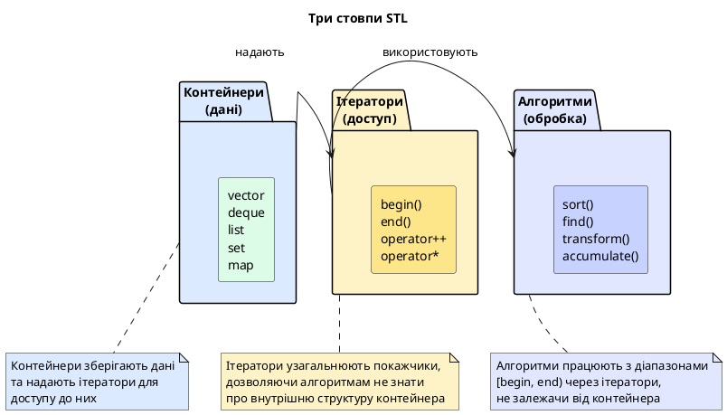
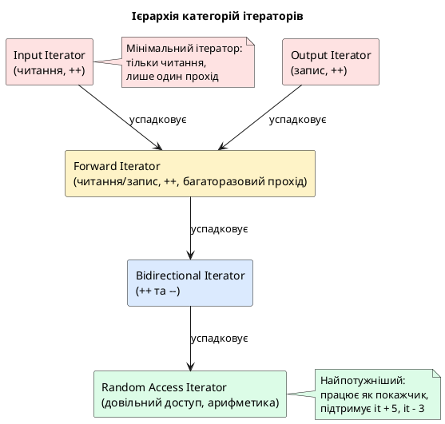
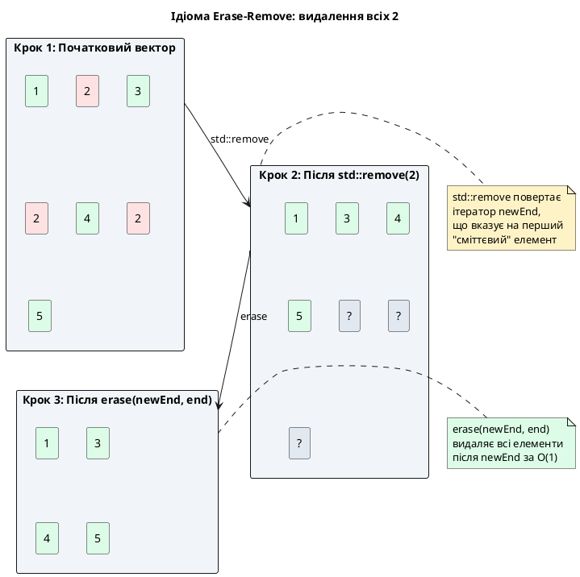

# Готові структури даних C++: ітератори та алгоритми STL

::card-group

::card{title="🎯 Мета лекції" icon="i-lucide-target"}

- Опанувати **ітератори** як універсальний механізм обходу контейнерів, що узагальнює покажчики.
- Розібрати **п'ять категорій ітераторів**: Input, Output, Forward, Bidirectional, Random Access — їхні можливості та обмеження.
- Застосувати **алгоритми STL** (`std::sort`, `std::find`, `std::transform`, `std::accumulate`) для обробки контейнерів без написання циклів.
- Використати **лямбда-функції** як предикати для фільтрації, сортування та трансформації даних.
- Опанувати **ідіому Erase-Remove** для ефективного видалення елементів із контейнерів.
- Перейти від **імперативного** до **функціонального** стилю програмування у C++.

::

::card{title="🔑 Ключові терміни" icon="i-lucide-key"}

- **Iterator (Ітератор):** об'єкт, що узагальнює покажчик, дозволяючи обходити елементи контейнера без знання його внутрішньої структури.
- **Iterator Category (Категорія ітератора):** класифікація ітераторів за підтримуваними операціями (інкремент, декремент, арифметика, довільний доступ).
- **Algorithm (Алгоритм):** шаблонна функція, що працює з діапазонами елементів через ітератори, незалежно від типу контейнера.
- **Predicate (Предикат):** функція або функціональний об'єкт, що повертає `bool` та використовується для фільтрації/пошуку елементів.
- **Erase-Remove Idiom (Ідіома Erase-Remove):** патерн ефективного видалення елементів із контейнера через `std::remove` + `erase`.

::

::

---

## Hook: один алгоритм для всіх контейнерів — сила абстракції

Уявіть, що вам потрібно **відсортувати** елементи у трьох різних контейнерах:

```cpp
std::vector<int> vec = {5, 2, 8, 1, 9};
std::deque<int> deq = {5, 2, 8, 1, 9};
std::list<int> lst = {5, 2, 8, 1, 9};
```

**Без STL** ви б писали **три окремі реалізації**:

- Для `vector` — швидке сортування (QuickSort) з довільним доступом.
- Для `deque` — модифікований QuickSort для блокової структури.
- Для `list` — сортування злиттям (MergeSort), оскільки немає довільного доступу.

Це **сотні рядків коду**, тестування, відлагодження...

**З STL** усе зводиться до **одного рядка** для кожного контейнера:

```cpp
std::sort(vec.begin(), vec.end());    // O(n log n)
std::sort(deq.begin(), deq.end());    // O(n log n)
lst.sort();                           // O(n log n), власний метод list
```

**Чому це працює?** Завдяки **ітераторам** — універсальному інтерфейсу, що дозволяє алгоритмам працювати з **будь-яким** контейнером, не знаючи його внутрішньої будови.

::note
**Філософія STL:** Розділення **даних** (контейнери), **доступу до даних** (ітератори) та **обробки даних** (алгоритми). Це дозволяє **комбінувати** будь-який контейнер з будь-яким алгоритмом, якщо їхні вимоги збігаються.
::

::plant-uml{alt="Архітектура STL: три компоненти"}



::

**У цій лекції** ми розглянемо **другий** (ітератори) та **третій** (алгоритми) стовпи STL, завершуючи повний огляд бібліотеки шаблонів C++.

---

## Ітератори: узагальнення покажчиків

### Концепція ітератора

**Ітератор** — це об'єкт, що **поводиться як покажчик**, але може працювати з **будь-яким** контейнером (не лише з масивами). Він надає уніфікований спосіб обходу елементів без знання деталей реалізації контейнера.

**Базові операції ітератора:**

| Операція | Опис | Аналог для покажчика |
|:---------|:-----|:---------------------|
| `*it` | Розіменування (доступ до елемента) | `*ptr` |
| `++it` | Перехід до наступного елемента | `++ptr` |
| `it1 == it2` | Порівняння ітераторів | `ptr1 == ptr2` |
| `it1 != it2` | Перевірка нерівності | `ptr1 != ptr2` |

**Приклад: обхід вектора через ітератор**

```cpp
#include <iostream>
#include <vector>

int main()
{
    std::vector<int> numbers = {10, 20, 30, 40, 50};
    
    // Явний ітератор
    std::vector<int>::iterator it = numbers.begin();
    
    while (it != numbers.end())
    {
        std::cout << *it << ' ';  // Розіменування
        ++it;                      // Інкремент
    }
    std::cout << '\n';
    
    return 0;
}
```

::terminal-preview{title="Виконання програми"}
<div class="line">10 20 30 40 50</div>
::

**Range-based for loop як синтаксичний цукор:**

```cpp
for (int x : numbers)  // Компілятор розгортає у цикл з ітераторами
{
    std::cout << x << ' ';
}
```

**Еквівалентний код (що генерує компілятор):**

```cpp
{
    auto&& __range = numbers;
    auto __begin = __range.begin();
    auto __end = __range.end();
    
    for (; __begin != __end; ++__begin)
    {
        int x = *__begin;
        std::cout << x << ' ';
    }
}
```

### Основні методи контейнерів для роботи з ітераторами

Усі контейнери STL надають наступні методи:

| Метод | Опис | Повертає |
|:------|:-----|:---------|
| `begin()` | Ітератор на **перший** елемент | `iterator` |
| `end()` | Ітератор на позицію **після останнього** елемента | `iterator` |
| `cbegin()` | Константний ітератор на перший елемент | `const_iterator` |
| `cend()` | Константний ітератор на позицію після останнього | `const_iterator` |
| `rbegin()` | Зворотний ітератор на останній елемент | `reverse_iterator` |
| `rend()` | Зворотний ітератор на позицію перед першим | `reverse_iterator` |

::warning{title="end() вказує НЕ на останній елемент!"}
`end()` повертає ітератор на **позицію після останнього елемента** (past-the-end iterator). Це спрощує написання циклів: `while (it != end())` автоматично зупиняється після останнього елемента. **Розіменовувати `end()` заборонено** — це невизначена поведінка.
::

**Зворотний обхід контейнера:**

```cpp
std::vector<int> numbers = {10, 20, 30, 40, 50};

// Обхід у зворотному порядку
for (auto it = numbers.rbegin(); it != numbers.rend(); ++it)
{
    std::cout << *it << ' ';  // Виведе: 50 40 30 20 10
}
```

### Константні ітератори: захист від модифікації

**`const_iterator`** — це ітератор, що дозволяє **читати** елементи, але **забороняє** їх змінювати.

```cpp
std::vector<int> numbers = {10, 20, 30};

// Константний ітератор
std::vector<int>::const_iterator it = numbers.cbegin();

std::cout << *it << '\n';  // ✅ Читання дозволене: 10

// *it = 100;  // ❌ ПОМИЛКА компіляції: присвоєння через const_iterator
```

**Коли використовувати `const_iterator`:**

- У функціях, що **не змінюють** контейнер (read-only операції).
- Для запобігання випадкової модифікації даних.
- У константних методах класів (`void print() const`).

::tip{title="Правило: завжди використовуйте cbegin/cend за замовчуванням"}
Якщо вам не потрібно **змінювати** елементи, використовуйте `cbegin()` та `cend()` замість `begin()` та `end()`. Це запобігає випадковим модифікаціям та робить код більш виразним.
::

---

## П'ять категорій ітераторів

### Ієрархія категорій

Ітератори STL поділяються на **п'ять категорій** за рівнем функціональності. Кожна наступна категорія **успадковує** можливості попередньої та додає нові.

::plant-uml{alt="Ієрархія категорій ітераторів"}



::

### Таблиця категорій та їхніх можливостей

| Категорія | Операції | Приклад контейнера | Використання |
|:----------|:---------|:-------------------|:-------------|
| **Input Iterator** | `*it` (read), `++it`, `==`, `!=` | `std::istream_iterator` | Читання з потоку вводу |
| **Output Iterator** | `*it` (write), `++it` | `std::ostream_iterator` | Запис у потік виводу |
| **Forward Iterator** | Input + багаторазовий прохід | `std::forward_list` | Однозв'язаний список |
| **Bidirectional Iterator** | Forward + `--it` | `std::list`, `std::set`, `std::map` | Двозв'язаний список, дерева |
| **Random Access Iterator** | Bidirectional + `it + n`, `it - n`, `it[n]`, `<`, `>` | `std::vector`, `std::deque`, `std::array` | Масиви, динамічні масиви |

**Ключовий принцип:** Алгоритм, що вимагає Random Access Iterator (наприклад, `std::sort`), **не працюватиме** з Forward Iterator (`std::forward_list`). Але алгоритм, що вимагає лише Forward Iterator (`std::find`), **працюватиме** з будь-яким контейнером.

### Random Access Iterator: найпотужніша категорія

**Random Access Iterator** підтримує **всі** операції покажчиків, включаючи арифметику:

```cpp
std::vector<int> numbers = {10, 20, 30, 40, 50};

auto it = numbers.begin();

// Арифметика ітераторів
it = it + 2;         // Переміщення на 2 позиції вперед → вказує на 30
std::cout << *it << '\n';  // 30

it += 3;             // Переміщення ще на 3 позиції → вказує на 50 (останній)
std::cout << *it << '\n';  // 50

// Доступ за індексом
std::cout << it[-2] << '\n';  // Доступ на 2 позиції назад → 30

// Різниця ітераторів
auto distance = numbers.end() - numbers.begin();
std::cout << "Розмір: " << distance << '\n';  // 5

// Порівняння ітераторів
if (it > numbers.begin())
{
    std::cout << "it вказує на елемент після початку\n";
}
```

::terminal-preview{title="Виконання програми"}
<div class="line">30</div>
<div class="line">50</div>
<div class="line">30</div>
<div class="line">Розмір: 5</div>
<div class="line">it вказує на елемент після початку</div>
::

### Bidirectional Iterator: рух у обох напрямках

**Bidirectional Iterator** підтримує `++` (вперед) та `--` (назад), але **не підтримує** арифметику (`it + 5`).

```cpp
std::list<int> numbers = {10, 20, 30, 40, 50};

auto it = numbers.begin();

++it;  // Переміщення до 20
++it;  // Переміщення до 30

std::cout << *it << '\n';  // 30

--it;  // Переміщення назад до 20
std::cout << *it << '\n';  // 20

// it = it + 2;  // ❌ ПОМИЛКА: list не підтримує арифметику
```

**Для переміщення на N позицій** у `list` використовуйте `std::advance`:

```cpp
auto it = numbers.begin();
std::advance(it, 3);  // Переміститься на 3 позиції (викличе ++it тричі)
std::cout << *it << '\n';  // 40
```

::note
`std::advance(it, n)` — універсальна функція, що працює з **будь-яким** ітератором. Для Random Access Iterator вона виконує `it += n` (O(1)), для інших — викликає `++it` n разів (O(n)).
::

---

## Алгоритми STL: обробка діапазонів

### Загальна структура алгоритмів

**Алгоритм STL** — це шаблонна функція, що приймає **діапазон елементів** через пару ітераторів `[begin, end)` та виконує над ними операцію (пошук, сортування, трансформація).

**Загальна сигнатура:**

```cpp
template <typename Iterator>
ReturnType algorithm(Iterator begin, Iterator end);
```

**Ключова перевага:** Алгоритм **не залежить** від типу контейнера — він працює з **будь-яким** контейнером, що надає відповідні ітератори.

### Основні категорії алгоритмів

| Категорія | Алгоритми | Призначення |
|:----------|:----------|:------------|
| **Немодифікуючі** | `find`, `count`, `equal`, `search` | Пошук, підрахунок, порівняння |
| **Модифікуючі** | `copy`, `fill`, `replace`, `remove` | Копіювання, заповнення, заміна, видалення |
| **Сортування** | `sort`, `partial_sort`, `stable_sort` | Впорядкування елементів |
| **Операції над множинами** | `merge`, `set_union`, `set_intersection` | Об'єднання, перетин |
| **Числові** | `accumulate`, `inner_product`, `partial_sum` | Обчислення сум, добутків |

**Усі алгоритми знаходяться у заголовку `<algorithm>` (крім числових — вони у `<numeric>`).**

---

## Немодифікуючі алгоритми: пошук та підрахунок

### std::find — пошук елемента

**Сигнатура:**

```cpp
template <typename Iterator, typename T>
Iterator find(Iterator begin, Iterator end, const T& value);
```

**Повертає:** Ітератор на **перший** знайдений елемент або `end`, якщо елемент не знайдено.

**Приклад:**

```cpp
#include <iostream>
#include <vector>
#include <algorithm>

int main()
{
    std::vector<int> numbers = {10, 20, 30, 40, 50};
    
    auto it = std::find(numbers.begin(), numbers.end(), 30);
    
    if (it != numbers.end())
    {
        std::cout << "Знайдено: " << *it << '\n';
        std::cout << "Індекс: " << std::distance(numbers.begin(), it) << '\n';
    }
    else
    {
        std::cout << "Не знайдено\n";
    }
    
    return 0;
}
```

::terminal-preview{title="Виконання програми"}
<div class="line">Знайдено: 30</div>
<div class="line">Індекс: 2</div>
::

**`std::distance(begin, it)`** — функція, що обчислює кількість елементів між двома ітераторами. Для Random Access Iterator — O(1), для інших — O(n).

### std::find_if — пошук за предикатом

**Предикат** (*predicate*) — це функція або функціональний об'єкт, що повертає `bool`.

```cpp
#include <iostream>
#include <vector>
#include <algorithm>

// Предикат: чи число парне?
bool isEven(int n)
{
    return n % 2 == 0;
}

int main()
{
    std::vector<int> numbers = {11, 13, 20, 25, 30};
    
    // Знайти перше парне число
    auto it = std::find_if(numbers.begin(), numbers.end(), isEven);
    
    if (it != numbers.end())
    {
        std::cout << "Перше парне: " << *it << '\n';  // 20
    }
    
    return 0;
}
```

**З лямбда-функцією (сучасний стиль):**

```cpp
auto it = std::find_if(numbers.begin(), numbers.end(), 
                       [](int n) { return n % 2 == 0; });
```

::tip{title="Лямбди замість окремих функцій"}
У сучасному C++ (C++11+) **лямбда-функції** є стандартним способом передачі предикатів у алгоритми. Вони компактніші та дозволяють захоплювати локальні змінні.
::

### std::count та std::count_if — підрахунок елементів

```cpp
std::vector<int> numbers = {1, 2, 3, 2, 4, 2, 5};

// Підрахунок кількості елементів зі значенням 2
int count = std::count(numbers.begin(), numbers.end(), 2);
std::cout << "Кількість двійок: " << count << '\n';  // 3

// Підрахунок парних чисел
int evenCount = std::count_if(numbers.begin(), numbers.end(),
                               [](int n) { return n % 2 == 0; });
std::cout << "Парних чисел: " << evenCount << '\n';  // 4
```

---

_(Кінець частини 1. Продовжую частину 2...)_

## Модифікуючі алгоритми: трансформація та заміна

### std::transform — застосування функції до кожного елемента

**Сигнатура:**

```cpp
template <typename InputIt, typename OutputIt, typename UnaryOp>
OutputIt transform(InputIt begin, InputIt end, OutputIt dest, UnaryOp op);
```

**Призначення:** Застосовує функцію `op` до кожного елемента діапазону `[begin, end)` та записує результат у `dest`.

**Приклад: подвоєння кожного елемента**

```cpp
#include <iostream>
#include <vector>
#include <algorithm>

int main()
{
    std::vector<int> numbers = {1, 2, 3, 4, 5};
    std::vector<int> doubled(numbers.size());  // Резервуємо місце для результату
    
    // Подвоїти кожен елемент
    std::transform(numbers.begin(), numbers.end(), 
                   doubled.begin(),
                   [](int n) { return n * 2; });
    
    std::cout << "Подвоєні: ";
    for (int x : doubled)
    {
        std::cout << x << ' ';  // 2 4 6 8 10
    }
    std::cout << '\n';
    
    return 0;
}
```

**Модифікація на місці (in-place):**

```cpp
// Подвоїти елементи у тому ж векторі
std::transform(numbers.begin(), numbers.end(),
               numbers.begin(),  // Записуємо результат у той же контейнер
               [](int n) { return n * 2; });
```

**Приклад: перетворення рядків у верхній регістр**

```cpp
std::vector<std::string> words = {"hello", "world", "cpp"};

std::transform(words.begin(), words.end(), words.begin(),
               [](std::string s) {
                   std::transform(s.begin(), s.end(), s.begin(), ::toupper);
                   return s;
               });

// Результат: {"HELLO", "WORLD", "CPP"}
```

### std::for_each — застосування дії до кожного елемента

На відміну від `transform`, `std::for_each` **не повертає** новий діапазон — він просто **виконує дію** для кожного елемента.

```cpp
std::vector<int> numbers = {1, 2, 3, 4, 5};

// Вивести кожен елемент
std::for_each(numbers.begin(), numbers.end(),
              [](int n) { std::cout << n << ' '; });
```

**Коли використовувати `for_each` vs range-based for:**

- **Range-based for** — простіший синтаксис для типових операцій.
- **`std::for_each`** — коли потрібно передати функцію як параметр або захопити контекст у лямбді.

::note
У C++20 з'явились **ranges** (`std::ranges::transform`, `std::ranges::for_each`), які роблять код ще більш виразним, але у цій лекції ми зосереджуємось на класичних алгоритмах STL.
::

### std::replace та std::replace_if — заміна елементів

```cpp
std::vector<int> numbers = {1, 2, 3, 2, 4, 2, 5};

// Замінити всі 2 на 99
std::replace(numbers.begin(), numbers.end(), 2, 99);
// Результат: {1, 99, 3, 99, 4, 99, 5}

// Замінити всі парні числа на 0
std::replace_if(numbers.begin(), numbers.end(),
                [](int n) { return n % 2 == 0; },
                0);
// Результат: {1, 0, 3, 0, 0, 0, 5}
```

---

## Ідіома Erase-Remove: ефективне видалення елементів

### Проблема: наївне видалення у циклі

**Типова помилка початківців:**

```cpp
std::vector<int> numbers = {1, 2, 3, 2, 4, 2, 5};

// ❌ НЕПРАВИЛЬНО: видалення під час ітерації
for (auto it = numbers.begin(); it != numbers.end(); ++it)
{
    if (*it == 2)
    {
        numbers.erase(it);  // ❌ Інвалідує ітератор!
    }
}
```

**Проблеми:**

1. `erase()` **інвалідує** ітератор `it` → наступний `++it` працює з недійсним ітератором.
2. Кожен `erase()` зсуває всі наступні елементи → O(n²) для N видалень.

**Правильний спосіб (C++11):**

```cpp
for (auto it = numbers.begin(); it != numbers.end(); )
{
    if (*it == 2)
    {
        it = numbers.erase(it);  // erase() повертає новий дійсний ітератор
    }
    else
    {
        ++it;
    }
}
```

Але це **все одно O(n²)** через зсув елементів при кожному `erase()`.

### Ідіома Erase-Remove: O(n) видалення

**Ідіома Erase-Remove** — це патерн **двофазового видалення**:

1. **Фаза 1:** `std::remove` переміщує всі елементи, що **не** видаляються, на початок контейнера, залишаючи "сміття" в кінці. Складність: **O(n)**.
2. **Фаза 2:** `erase()` видаляє "сміття" одним викликом. Складність: **O(1)** (для видалення діапазону в кінці).

**Схема роботи `std::remove`:**

```
Початковий вектор:   [1, 2, 3, 2, 4, 2, 5]
                           ↓
Після std::remove(2): [1, 3, 4, 5, ?, ?, ?]  ← повертає ітератор на ?
                                    ↑
                                 newEnd
```

**Код:**

```cpp
std::vector<int> numbers = {1, 2, 3, 2, 4, 2, 5};

// Фаза 1: std::remove переміщує елементи
auto newEnd = std::remove(numbers.begin(), numbers.end(), 2);

// Фаза 2: erase видаляє "хвіст"
numbers.erase(newEnd, numbers.end());

// Результат: {1, 3, 4, 5}
```

**Одним рядком:**

```cpp
numbers.erase(std::remove(numbers.begin(), numbers.end(), 2), 
              numbers.end());
```

**З предикатом (`std::remove_if`):**

```cpp
// Видалити всі парні числа
numbers.erase(std::remove_if(numbers.begin(), numbers.end(),
                              [](int n) { return n % 2 == 0; }),
              numbers.end());
```

::plant-uml{alt="Візуалізація роботи std::remove"}



::

::tip{title="Чому це швидко?"}
`std::remove` виконує **один прохід** по контейнеру, переміщуючи елементи, що не видаляються, на початок. Немає зсувів при кожному видаленні. Фінальний `erase()` видаляє діапазон за O(1), оскільки це кінець вектора.
::

---

## Сортування: std::sort та його варіації

### std::sort — швидке сортування

**Сигнатура:**

```cpp
template <typename RandomIt>
void sort(RandomIt begin, RandomIt end);
```

**Вимоги:** Random Access Iterator (працює з `vector`, `deque`, `array`, але **не** з `list`).

**Складність:** O(n log n) у середньому (зазвичай реалізовано як IntroSort — гібрид QuickSort, HeapSort, InsertionSort).

**Приклад:**

```cpp
std::vector<int> numbers = {5, 2, 8, 1, 9, 3};

std::sort(numbers.begin(), numbers.end());
// Результат: {1, 2, 3, 5, 8, 9}
```

**Сортування за спаданням:**

```cpp
std::sort(numbers.begin(), numbers.end(), std::greater<int>());
// Результат: {9, 8, 5, 3, 2, 1}
```

**Сортування з custom компаратором:**

```cpp
struct Person
{
    std::string name;
    int age;
};

std::vector<Person> people = {
    {"Олександр", 25},
    {"Марія", 30},
    {"Дмитро", 22}
};

// Сортувати за віком
std::sort(people.begin(), people.end(),
          [](const Person& a, const Person& b) {
              return a.age < b.age;
          });

// Результат: Дмитро(22), Олександр(25), Марія(30)
```

### std::stable_sort — сортування зі збереженням порядку

**Відмінність від `std::sort`:** Якщо два елементи **еквівалентні** (компаратор повертає `false` для обох напрямків), `stable_sort` **гарантує**, що їхній **відносний порядок** збережеться.

**Приклад:**

```cpp
struct Student
{
    std::string name;
    int grade;
};

std::vector<Student> students = {
    {"Анна", 85},
    {"Борис", 90},
    {"Віктор", 85},
    {"Галина", 90}
};

// Сортувати за оцінкою (stable — зберігає порядок для однакових оцінок)
std::stable_sort(students.begin(), students.end(),
                 [](const Student& a, const Student& b) {
                     return a.grade > b.grade;
                 });

// Результат: Борис(90), Галина(90), Анна(85), Віктор(85)
// Порядок всередині груп (90 та 85) збережено!
```

**Коли використовувати `stable_sort`:**

- Коли потрібна **гарантія стабільності** (наприклад, сортування таблиці за кількома стовпцями).
- Коли порядок еквівалентних елементів **має значення** для бізнес-логіки.

**Ціна:** `stable_sort` **повільніший** за `sort` (O(n log² n) у гіршому випадку) та потребує додаткової пам'яті.

### std::partial_sort — часткове сортування

**Призначення:** Відсортувати лише **топ-N** елементів, залишаючи решту несортованими.

```cpp
std::vector<int> numbers = {5, 2, 8, 1, 9, 3, 7, 4, 6};

// Відсортувати лише перші 3 елементи
std::partial_sort(numbers.begin(), numbers.begin() + 3, numbers.end());

// Результат: {1, 2, 3, ...решта в довільному порядку}
```

**Складність:** O(n log k), де k — кількість елементів, що сортуються. **Швидше** за `std::sort` + обрізання, якщо k << n.

**Коли використовувати:** Знаходження топ-K елементів (альтернатива `priority_queue` для великих N).

---

## Числові алгоритми: accumulate та inner_product

### std::accumulate — обчислення суми (редукція)

**Сигнатура:**

```cpp
template <typename InputIt, typename T>
T accumulate(InputIt begin, InputIt end, T init);
```

**Призначення:** Обчислює **суму** всіх елементів діапазону, починаючи з початкового значення `init`.

**Приклад:**

```cpp
#include <iostream>
#include <vector>
#include <numeric>  // accumulate знаходиться тут!

int main()
{
    std::vector<int> numbers = {1, 2, 3, 4, 5};
    
    int sum = std::accumulate(numbers.begin(), numbers.end(), 0);
    std::cout << "Сума: " << sum << '\n';  // 15
    
    // Добуток (через custom операцію)
    int product = std::accumulate(numbers.begin(), numbers.end(), 1,
                                   [](int acc, int x) { return acc * x; });
    std::cout << "Добуток: " << product << '\n';  // 120
    
    return 0;
}
```

**Custom операція (функціональне програмування):**

```cpp
// Обчислити суму квадратів
int sumOfSquares = std::accumulate(numbers.begin(), numbers.end(), 0,
                                    [](int acc, int x) {
                                        return acc + x * x;
                                    });
// Результат: 1 + 4 + 9 + 16 + 25 = 55
```

**Об'єднання рядків:**

```cpp
std::vector<std::string> words = {"Hello", " ", "World", "!"};

std::string sentence = std::accumulate(words.begin(), words.end(), std::string(""));
std::cout << sentence << '\n';  // "Hello World!"
```

::warning{title="Тип початкового значення має значення!"}
Якщо ви обчислюєте середнє значення `double`, початкове значення має бути `0.0`, а не `0`:

```cpp
std::vector<double> values = {1.5, 2.5, 3.5};

double sum = std::accumulate(values.begin(), values.end(), 0.0);  // ✅ Правильно
// double sum = std::accumulate(values.begin(), values.end(), 0);  // ❌ Поверне int!

double average = sum / values.size();
```
::

### std::inner_product — скалярний добуток векторів

```cpp
std::vector<int> a = {1, 2, 3};
std::vector<int> b = {4, 5, 6};

// Скалярний добуток: 1*4 + 2*5 + 3*6 = 32
int dotProduct = std::inner_product(a.begin(), a.end(), b.begin(), 0);
std::cout << "Скалярний добуток: " << dotProduct << '\n';  // 32
```

---

## Лямбда-функції як предикати: сила функціонального програмування

### Синтаксис лямбда-функцій (повторення)

```cpp
[захоплення](параметри) -> тип_повернення { тіло }
```

**Приклади:**

```cpp
// Без параметрів
auto greet = []() { std::cout << "Hello!\n"; };
greet();

// З параметрами
auto add = [](int a, int b) { return a + b; };
std::cout << add(3, 5) << '\n';  // 8

// Автоматичне виведення типу повернення
auto multiply = [](int a, int b) { return a * b; };  // Тип повернення: int

// Явне вказання типу повернення
auto divide = [](int a, int b) -> double { return static_cast<double>(a) / b; };
```

### Захоплення змінних у лямбдах

**Захоплення** (*capture*) дозволяє лямбді **використовувати** змінні з зовнішньої області видимості.

| Синтаксис | Опис |
|:----------|:-----|
| `[]` | Не захоплює нічого |
| `[=]` | Захоплює всі змінні **за значенням** (копіювання) |
| `[&]` | Захоплює всі змінні **за посиланням** |
| `[x]` | Захоплює лише `x` за значенням |
| `[&x]` | Захоплює лише `x` за посиланням |
| `[x, &y]` | Захоплює `x` за значенням, `y` за посиланням |

**Приклад:**

```cpp
int threshold = 10;

std::vector<int> numbers = {5, 15, 8, 20, 3};

// Підрахувати кількість чисел більших за threshold
int count = std::count_if(numbers.begin(), numbers.end(),
                           [threshold](int n) { return n > threshold; });

std::cout << "Чисел > " << threshold << ": " << count << '\n';  // 2
```

**Зміна змінної через посилання:**

```cpp
int sum = 0;

std::for_each(numbers.begin(), numbers.end(),
              [&sum](int n) { sum += n; });

std::cout << "Сума: " << sum << '\n';  // 51
```

::tip{title="Коли використовувати [=] vs [&]"}
- **`[=]` (за значенням):** Для read-only доступу до зовнішніх змінних (безпечніше, немає ризику висячих посилань).
- **`[&]` (за посиланням):** Коли потрібно **модифікувати** зовнішні змінні або уникнути копіювання великих об'єктів.
::

---

_(Кінець частини 2. Продовжую частину 3 — остання...)_

## Практичне застосування: обробка тексту функціональним стилем

### Задача: аналіз тексту

**Умова:** Дано текстовий файл. Необхідно:

1. Розбити текст на слова.
2. Видалити слова коротші за 3 символи.
3. Перетворити всі слова у нижній регістр.
4. Знайти 5 найчастіших слів.

**Рішення функціональним стилем:**

```cpp
#include <iostream>
#include <vector>
#include <string>
#include <unordered_map>
#include <algorithm>
#include <sstream>
#include <cctype>

std::vector<std::string> tokenize(const std::string& text)
{
    std::vector<std::string> words;
    std::istringstream stream(text);
    std::string word;
    
    while (stream >> word)
    {
        words.push_back(word);
    }
    
    return words;
}

std::string toLower(std::string s)
{
    std::transform(s.begin(), s.end(), s.begin(),
                   [](unsigned char c) { return std::tolower(c); });
    return s;
}

int main()
{
    std::string text = "Hello world hello programming world hello "
                      "C++ programming world hello C++ STL algorithms";
    
    // Крок 1: Розбити на слова
    std::vector<std::string> words = tokenize(text);
    
    // Крок 2: Видалити короткі слова (< 3 символи)
    words.erase(std::remove_if(words.begin(), words.end(),
                                [](const std::string& w) { return w.length() < 3; }),
                words.end());
    
    // Крок 3: Перетворити у нижній регістр
    std::transform(words.begin(), words.end(), words.begin(), toLower);
    
    // Крок 4: Підрахувати частоту
    std::unordered_map<std::string, int> freq;
    for (const auto& word : words)
    {
        ++freq[word];
    }
    
    // Крок 5: Знайти топ-5 найчастіших
    std::vector<std::pair<std::string, int>> sorted(freq.begin(), freq.end());
    
    std::partial_sort(sorted.begin(), sorted.begin() + 5, sorted.end(),
                      [](const auto& a, const auto& b) {
                          return a.second > b.second;
                      });
    
    std::cout << "Топ-5 найчастіших слів:\n";
    for (size_t i = 0; i < std::min(size_t(5), sorted.size()); ++i)
    {
        std::cout << "  " << sorted[i].first << ": " << sorted[i].second << '\n';
    }
    
    return 0;
}
```

::terminal-preview{title="Виконання програми"}
<div class="line">Топ-5 найчастіших слів:</div>
<div class="line">  hello: 4</div>
<div class="line">  world: 3</div>
<div class="line">  c++: 2</div>
<div class="line">  programming: 2</div>
<div class="line">  stl: 1</div>
::

**Ключові патерни:**

- **Ідіома Erase-Remove** для видалення коротких слів.
- **`std::transform`** для перетворення у нижній регістр.
- **`std::partial_sort`** для знаходження топ-K (ефективніше за повне сортування).
- **Лямбди** для передачі предикатів та компараторів.

---

## Зведена таблиця найпопулярніших алгоритмів STL

### Немодифікуючі алгоритми

| Алгоритм | Складність | Призначення | Приклад |
|:---------|:-----------|:------------|:--------|
| `std::find` | O(n) | Знайти перший елемент зі значенням | `find(v.begin(), v.end(), 42)` |
| `std::find_if` | O(n) | Знайти перший елемент за предикатом | `find_if(v.begin(), v.end(), isEven)` |
| `std::count` | O(n) | Підрахувати кількість елементів | `count(v.begin(), v.end(), 42)` |
| `std::count_if` | O(n) | Підрахувати за предикатом | `count_if(v.begin(), v.end(), isEven)` |
| `std::all_of` | O(n) | Перевірити, чи всі елементи задовольняють предикат | `all_of(v.begin(), v.end(), isPositive)` |
| `std::any_of` | O(n) | Перевірити, чи хоча б один елемент задовольняє предикат | `any_of(v.begin(), v.end(), isNegative)` |
| `std::none_of` | O(n) | Перевірити, чи жоден елемент не задовольняє предикат | `none_of(v.begin(), v.end(), isZero)` |

### Модифікуючі алгоритми

| Алгоритм | Складність | Призначення | Приклад |
|:---------|:-----------|:------------|:--------|
| `std::transform` | O(n) | Застосувати функцію до кожного елемента | `transform(v.begin(), v.end(), v.begin(), negate)` |
| `std::for_each` | O(n) | Виконати дію для кожного елемента | `for_each(v.begin(), v.end(), print)` |
| `std::replace` | O(n) | Замінити всі входження значення | `replace(v.begin(), v.end(), 2, 99)` |
| `std::replace_if` | O(n) | Замінити елементи за предикатом | `replace_if(v.begin(), v.end(), isEven, 0)` |
| `std::remove` | O(n) | Перемістити елементи для видалення в кінець | `remove(v.begin(), v.end(), 42)` |
| `std::remove_if` | O(n) | Перемістити елементи за предикатом | `remove_if(v.begin(), v.end(), isEven)` |
| `std::unique` | O(n) | Видалити послідовні дублікати | `unique(v.begin(), v.end())` |

### Сортування та операції над відсортованими діапазонами

| Алгоритм | Складність | Призначення | Приклад |
|:---------|:-----------|:------------|:--------|
| `std::sort` | O(n log n) | Відсортувати діапазон | `sort(v.begin(), v.end())` |
| `std::stable_sort` | O(n log² n) | Відсортувати зі збереженням порядку | `stable_sort(v.begin(), v.end())` |
| `std::partial_sort` | O(n log k) | Відсортувати лише перші k елементів | `partial_sort(v.begin(), v.begin()+3, v.end())` |
| `std::binary_search` | O(log n) | Перевірити наявність елемента у відсортованому діапазоні | `binary_search(v.begin(), v.end(), 42)` |
| `std::lower_bound` | O(log n) | Знайти перший елемент ≥ значення | `lower_bound(v.begin(), v.end(), 42)` |
| `std::upper_bound` | O(log n) | Знайти перший елемент > значення | `upper_bound(v.begin(), v.end(), 42)` |

### Числові алгоритми (`<numeric>`)

| Алгоритм | Складність | Призначення | Приклад |
|:---------|:-----------|:------------|:--------|
| `std::accumulate` | O(n) | Обчислити суму (редукція) | `accumulate(v.begin(), v.end(), 0)` |
| `std::inner_product` | O(n) | Скалярний добуток векторів | `inner_product(a.begin(), a.end(), b.begin(), 0)` |
| `std::partial_sum` | O(n) | Обчислити часткові суми | `partial_sum(v.begin(), v.end(), out.begin())` |

---

## Порівняння імперативного та функціонального стилів

### Імперативний стиль (цикли)

```cpp
// Задача: подвоїти всі парні числа та обчислити їхню суму

std::vector<int> numbers = {1, 2, 3, 4, 5, 6, 7, 8, 9, 10};

int sum = 0;
for (size_t i = 0; i < numbers.size(); ++i)
{
    if (numbers[i] % 2 == 0)
    {
        numbers[i] *= 2;
        sum += numbers[i];
    }
}

std::cout << "Сума подвоєних парних: " << sum << '\n';
```

**Характеристики:**

- ❌ Багато деталей реалізації (індекс `i`, умова циклу, інкремент).
- ❌ Змішана логіка (подвоєння та підрахунок у одному циклі).
- ❌ Важко паралелізувати.

### Функціональний стиль (алгоритми STL)

```cpp
std::vector<int> numbers = {1, 2, 3, 4, 5, 6, 7, 8, 9, 10};

// Крок 1: Подвоїти парні числа
std::transform(numbers.begin(), numbers.end(), numbers.begin(),
               [](int n) { return (n % 2 == 0) ? n * 2 : n; });

// Крок 2: Обчислити суму парних (вже подвоєних)
int sum = std::accumulate(numbers.begin(), numbers.end(), 0,
                          [](int acc, int n) {
                              return (n % 2 == 0) ? acc + n : acc;
                          });

std::cout << "Сума подвоєних парних: " << sum << '\n';
```

**Характеристики:**

- ✅ Декларативний стиль: **що** робимо, а не **як**.
- ✅ Розділена логіка: трансформація та редукція — окремі кроки.
- ✅ Легко читати та підтримувати.
- ✅ Можливість паралелізації (C++17: `std::execution::par`).

**Ще більш функціональний підхід (C++20 ranges):**

```cpp
// C++20 (поза рамками цієї лекції, але для ознайомлення)
auto evenDoubled = numbers 
    | std::views::filter([](int n) { return n % 2 == 0; })
    | std::views::transform([](int n) { return n * 2; });

int sum = std::accumulate(evenDoubled.begin(), evenDoubled.end(), 0);
```

---

## Резюме та практичні рекомендації

### Ключові висновки

1. **Ітератори — це узагальнені покажчики**, що дозволяють алгоритмам працювати з будь-яким контейнером без знання його внутрішньої структури.

2. **П'ять категорій ітераторів** визначають можливості операцій: від мінімального Input Iterator до потужного Random Access Iterator.

3. **Алгоритми STL замінюють ручні цикли** на виразні однорядкові виклики: `std::sort`, `std::find`, `std::transform`, `std::accumulate`.

4. **Лямбда-функції роблять код компактним** та виразним, дозволяючи передавати предикати та операції безпосередньо у виклик алгоритму.

5. **Ідіома Erase-Remove — стандартний патерн** для ефективного видалення елементів із контейнерів (O(n) замість O(n²)).

6. **Функціональний стиль кращий за імперативний** для більшості задач: читабельніший, безпечніший, легший для паралелізації.

### Правила використання алгоритмів STL

::card-group

::card{title="✅ Завжди використовуйте алгоритми STL" icon="i-lucide-check-circle"}

**Замість циклу:**

```cpp
// ❌ Погано
for (size_t i = 0; i < v.size(); ++i) {
    if (v[i] == 42) return true;
}
return false;
```

**Використайте алгоритм:**

```cpp
// ✅ Добре
return std::find(v.begin(), v.end(), 42) != v.end();
```

**Переваги:** Виразність, стандартизація, оптимізація компілятора.

::

::card{title="🔍 Вибирайте правильний алгоритм" icon="i-lucide-search"}

- **Пошук:** `std::find`, `std::find_if`, `std::binary_search` (для відсортованих).
- **Сортування:** `std::sort` (універсальний), `std::partial_sort` (топ-K), `std::stable_sort` (стабільний).
- **Трансформація:** `std::transform` (нові дані), `std::for_each` (побічні ефекти).
- **Редукція:** `std::accumulate` (сума, добуток, об'єднання).
- **Видалення:** **Ідіома Erase-Remove** (`remove` + `erase`).

::

::card{title="🎯 Використовуйте лямбди для предикатів" icon="i-lucide-target"}

**Замість окремих функцій:**

```cpp
bool isEven(int n) { return n % 2 == 0; }
std::count_if(v.begin(), v.end(), isEven);
```

**Використайте inline лямбду:**

```cpp
std::count_if(v.begin(), v.end(), [](int n) { return n % 2 == 0; });
```

**Переваги:** Локальність коду, захоплення зовнішніх змінних, менше глобальних функцій.

::

::card{title="⚠️ Пам'ятайте про категорії ітераторів" icon="i-lucide-alert-triangle"}

- **`std::sort`** вимагає Random Access Iterator → працює з `vector`, `deque`, але **не** з `list`.
- **`std::list::sort()`** — спеціалізований метод для `list`.
- **`std::advance(it, n)`** — універсальна функція для переміщення ітератора (O(1) для Random Access, O(n) для інших).

::

::

### Зв'язок із попередніми темами

**Завершення огляду STL (статті 93–95):**

- **Стаття 93:** Послідовні контейнери (`vector`, `deque`, `list`, `array`) — зберігання даних.
- **Стаття 94:** Асоціативні контейнери (`map`, `set`, `unordered_*`) та адаптери (`stack`, `queue`, `priority_queue`) — спеціалізовані структури.
- **Стаття 95 (ця лекція):** Ітератори та алгоритми — **універсальні** інструменти обробки даних для **всіх** контейнерів.

::callout{icon="i-lucide-graduation-cap" color="primary"}
**Тепер ви володієте повним арсеналом STL!** Ви можете обирати правильний контейнер, обходити його через ітератори та обробляти дані алгоритмами без написання циклів. Це **сучасний C++** — виразний, безпечний, ефективний.
::

---

## Практичні завдання

::::accordion

:::accordion-item{label="📋 Завдання 1: Фільтрація та трансформація" icon="i-lucide-clipboard-list"}

**Умова:** Дано вектор чисел. Написати функцію, що:

1. Видаляє всі від'ємні числа.
2. Піднесе кожне число до квадрата.
3. Відсортує результат.

**Вхідні дані:**

```cpp
std::vector<int> numbers = {5, -2, 8, -3, 1, -7, 4};
```

**Очікуваний результат:** `{1, 16, 25, 64}`

**Вимоги:** Використайте `std::remove_if`, `std::transform`, `std::sort`.

:::

:::accordion-item{label="✅ Розв'язок завдання 1" icon="i-lucide-check-circle"}

```cpp
#include <iostream>
#include <vector>
#include <algorithm>

std::vector<int> processNumbers(std::vector<int> numbers)
{
    // Крок 1: Видалити від'ємні числа
    numbers.erase(std::remove_if(numbers.begin(), numbers.end(),
                                  [](int n) { return n < 0; }),
                  numbers.end());
    
    // Крок 2: Піднести до квадрата
    std::transform(numbers.begin(), numbers.end(), numbers.begin(),
                   [](int n) { return n * n; });
    
    // Крок 3: Відсортувати
    std::sort(numbers.begin(), numbers.end());
    
    return numbers;
}

int main()
{
    std::vector<int> numbers = {5, -2, 8, -3, 1, -7, 4};
    
    auto result = processNumbers(numbers);
    
    std::cout << "Результат: ";
    for (int x : result)
    {
        std::cout << x << ' ';
    }
    std::cout << '\n';
    
    return 0;
}
```

::terminal-preview{title="Виконання програми"}
<div class="line">Результат: 1 16 25 64</div>
::

**Ключові патерни:** Ідіома Erase-Remove, `transform` на місці, `sort`.

:::

:::accordion-item{label="📋 Завдання 2: Знаходження перетину відсортованих масивів" icon="i-lucide-clipboard-list"}

**Умова:** Дано два **відсортовані** масиви. Знайти їхній перетин (спільні елементи) за O(n + m).

**Вхідні дані:**

```cpp
std::vector<int> arr1 = {1, 2, 3, 4, 5};
std::vector<int> arr2 = {3, 4, 5, 6, 7};
```

**Очікуваний результат:** `{3, 4, 5}`

**Підказка:** Використайте `std::set_intersection`.

:::

:::accordion-item{label="✅ Розв'язок завдання 2" icon="i-lucide-check-circle"}

```cpp
#include <iostream>
#include <vector>
#include <algorithm>

int main()
{
    std::vector<int> arr1 = {1, 2, 3, 4, 5};
    std::vector<int> arr2 = {3, 4, 5, 6, 7};
    
    std::vector<int> intersection;
    
    // set_intersection вимагає відсортовані діапазони
    std::set_intersection(arr1.begin(), arr1.end(),
                          arr2.begin(), arr2.end(),
                          std::back_inserter(intersection));
    
    std::cout << "Перетин: ";
    for (int x : intersection)
    {
        std::cout << x << ' ';
    }
    std::cout << '\n';
    
    return 0;
}
```

::terminal-preview{title="Виконання програми"}
<div class="line">Перетин: 3 4 5</div>
::

**Складність:** O(n + m) — одночасний прохід по обох масивах.

**`std::back_inserter`** — ітератор-адаптер, що автоматично викликає `push_back` для кожного елемента.

:::

:::accordion-item{label="📋 Завдання 3: Обчислення середнього за предикатом" icon="i-lucide-clipboard-list"}

**Умова:** Написати функцію, що обчислює **середнє значення** елементів, які задовольняють предикат.

**Приклад:**

```cpp
std::vector<int> numbers = {1, 2, 3, 4, 5, 6, 7, 8, 9, 10};

// Середнє парних чисел: (2 + 4 + 6 + 8 + 10) / 5 = 6.0
double avg = averageIf(numbers, [](int n) { return n % 2 == 0; });
```

**Вимоги:** Використайте `std::accumulate` та `std::count_if`.

:::

:::accordion-item{label="✅ Розв'язок завдання 3" icon="i-lucide-check-circle"}

```cpp
#include <iostream>
#include <vector>
#include <algorithm>
#include <numeric>

template <typename Container, typename Predicate>
double averageIf(const Container& container, Predicate pred)
{
    // Обчислити суму елементів, що задовольняють предикат
    double sum = std::accumulate(container.begin(), container.end(), 0.0,
                                  [pred](double acc, const auto& x) {
                                      return pred(x) ? acc + x : acc;
                                  });
    
    // Підрахувати кількість елементів
    int count = std::count_if(container.begin(), container.end(), pred);
    
    return (count > 0) ? sum / count : 0.0;
}

int main()
{
    std::vector<int> numbers = {1, 2, 3, 4, 5, 6, 7, 8, 9, 10};
    
    double avgEven = averageIf(numbers, [](int n) { return n % 2 == 0; });
    std::cout << "Середнє парних: " << avgEven << '\n';  // 6.0
    
    double avgOdd = averageIf(numbers, [](int n) { return n % 2 != 0; });
    std::cout << "Середнє непарних: " << avgOdd << '\n';  // 5.0
    
    return 0;
}
```

::terminal-preview{title="Виконання програми"}
<div class="line">Середнє парних: 6</div>
<div class="line">Середнє непарних: 5</div>
::

**Ключові моменти:**

- Шаблонна функція працює з будь-яким контейнером.
- Захоплення предиката `pred` у лямбді через `[pred]`.
- Перевірка на нуль перед діленням.

:::

::::

---

**Наступний етап (статті 96–99):** Move-семантика та розумні покажчики — останній рубіж сучасного C++. Ви навчитесь **оптимізувати** код через rvalue references, опануєте `std::unique_ptr`, `std::shared_ptr`, `std::weak_ptr`, та зрозумієте Правило п'яти vs Правило нуля.

::callout{icon="i-lucide-rocket" color="primary"}
**Вітаємо! Ви завершили фундаментальний блок STL!** Тепер ви можете писати **виразний**, **безпечний** та **ефективний** C++ код, використовуючи контейнери, ітератори та алгоритми професійного рівня. Залишилась остання частина курсу ООП — move-семантика — і ви станете експертом у сучасному C++!
::
