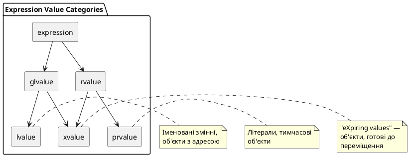

# R-value посилання та move-семантика

## Мотивація: неефективність копіювання

У попередніх статтях ми навчилися створювати класи з **глибоким копіюванням** (*deep copy*) — безпечною, але затратною операцією. Розглянемо типовий сценарій:

```cpp [ExpensiveCopy.cpp] showLineNumbers
#include <iostream>
#include <cstring>

class String
{
private:
    char* m_data;
    size_t m_length;

public:
    String(const char* str = "")
    {
        m_length = std::strlen(str);
        m_data = new char[m_length + 1];
        std::strcpy(m_data, str);
        std::cout << "Constructed: " << m_data << "\n";
    }

    ~String()
    {
        delete[] m_data;
        std::cout << "Destroyed\n";
    }

    // Конструктор копіювання — виконує ГЛИБОКЕ копіювання
    String(const String& other)
    {
        m_length = other.m_length;
        m_data = new char[m_length + 1];
        std::strcpy(m_data, other.m_data);
        std::cout << "Copied: " << m_data << "\n";
    }

    // Оператор присвоювання копіюванням
    String& operator=(const String& other)
    {
        if (this == &other)
            return *this;

        delete[] m_data;

        m_length = other.m_length;
        m_data = new char[m_length + 1];
        std::strcpy(m_data, other.m_data);
        std::cout << "Assigned: " << m_data << "\n";

        return *this;
    }

    const char* getData() const { return m_data; }
};

String createTemporary()
{
    String temp("Temporary object");
    return temp;  // Повертається по значенню
}

int main()
{
    String str;
    str = createTemporary();  // Неефективно: створюється + копіюється + знищується
    
    std::cout << "Final: " << str.getData() << "\n";
    return 0;
}
```

::terminal-preview{title="./ExpensiveCopy"}
<div class="line">Constructed: </div>
<div class="line">Constructed: Temporary object</div>
<div class="line">Assigned: Temporary object</div>
<div class="line">Destroyed</div>
<div class="line">Final: Temporary object</div>
<div class="line">Destroyed</div>
::

**Проблема:** Функція `createTemporary()` створює тимчасовий об'єкт, який одразу копіюється в `str` і потім знищується. Ми виконуємо **дорогу операцію виділення пам'яті** (`new`) та копіювання даних для об'єкта, який **одразу перестане існувати**.

::note
**Питання:** чи не можемо ми просто «вкрасти» ресурси тимчасового об'єкта замість їх копіювання? Саме для цього існує **семантика переміщення** (*move semantics*).
::

---

## L-values та r-values: точне визначення

До C++11 розмежування l-values та r-values було інтуїтивним. Тепер воно стає фундаментальним для розуміння семантики переміщення.

### Що таке l-value?

**L-value** (*locator value*) — вираз, який вказує на конкретну область пам'яті, яку можна ідентифікувати за адресою. Про l-value найпростіше думати як про **іменовані змінні, об'єкти або функції**.

```cpp [LValues.cpp] showLineNumbers
int x = 10;             // x — це l-value (має адресу)
int* ptr = &x;          // можна взяти адресу x

std::string name = "C++";  // name — це l-value
std::string& ref = name;   // посилання на l-value

int arr[5];             // arr — це l-value
int* p = arr;           // можна взяти адресу масиву
```

**Ключова властивість l-value:** можна взяти адресу через `&`.

### Що таке r-value?

**R-value** — вираз, який **не має стабільної адреси** в пам'яті. Це:
- **Літерали** (`42`, `3.14`, `"hello"`)
- **Тимчасові об'єкти** (`String("temp")`)
- **Результати обчислень** (`x + y`, `func()`)

```cpp [RValues.cpp] showLineNumbers
int y = 42;             // 42 — це r-value (літерал)
// int* bad = &42;      // ❌ ПОМИЛКА: не можна взяти адресу літералу

std::string fullName = std::string("John") + " Doe";  
// std::string("John") + " Doe" — це r-value (тимчасовий результат)

int calculate() { return 5 + 10; }
int z = calculate();    // calculate() повертає r-value
```

::card-group
::card{title="🔹 L-value" icon="i-lucide-map-pin"}
- Має стабільну адресу в пам'яті
- Можна використовувати зліва та справа від `=`
- Приклади: змінні, елементи масиву, посилання
::

::card{title="🔸 R-value" icon="i-lucide-wind"}
- Немає постійної адреси
- Можна використовувати тільки справа від `=`
- Тимчасові, знищуються після виразу
::
::

### Категорії значень у C++11

Стандарт C++11 розширив систему категорій значень:

::plant-uml

::

::tip
**Для практичного використання** достатньо запам'ятати:
- **l-value** — змінні та іменовані об'єкти
- **r-value** — тимчасові значення та результати виразів
::

---

## Посилання l-value (традиційні посилання)

До C++11 існував лише один тип посилань — **посилання l-value** (`&`):

```cpp [LValueReferences.cpp] showLineNumbers
int x = 10;
int& lref = x;          // ✅ OK: посилання на l-value

// int& bad = 42;       // ❌ ПОМИЛКА: не можна прив'язати до r-value
```

### Константні посилання l-value

**Константне посилання l-value** (`const &`) — особливий випадок: може бути ініціалізоване як l-value, так і r-value:

```cpp [ConstLValueRef.cpp] showLineNumbers
int x = 10;
const int& cref1 = x;       // ✅ OK: посилання на l-value
const int& cref2 = 42;      // ✅ OK: посилання на r-value (створюється тимчасовий об'єкт)
const int& cref3 = x + 5;   // ✅ OK: посилання на результат виразу
```

::note
**Важливо:** константне посилання **продовжує час життя** тимчасового об'єкта до кінця області видимості самого посилання:

```cpp
const std::string& ref = std::string("Hello");  // тимчасовий об'єкт живе, поки існує ref
```
::

| Посилання l-value | Можуть бути ініціалізовані l-value | Можуть бути ініціалізовані r-value | Можна змінювати |
|:---|:---:|:---:|:---:|
| `int&` | ✅ | ❌ | ✅ |
| `const int&` | ✅ | ✅ | ❌ |


---

## Посилання r-value: нова можливість C++11

**Посилання r-value** — це новий тип посилань, що був доданий у C++11. Вони створюються через **подвійний амперсанд** (`&&`) і можуть бути ініціалізовані **лише r-values**:

```cpp [RValueReferences.cpp] showLineNumbers
int x = 10;

// int&& bad = x;           // ❌ ПОМИЛКА: не можна прив'язати r-value посилання до l-value
int&& rref1 = 42;           // ✅ OK: посилання на літерал (r-value)
int&& rref2 = x + 5;        // ✅ OK: посилання на результат виразу (r-value)
int&& rref3 = 10 * 2;       // ✅ OK: посилання на результат обчислення

std::cout << rref1 << "\n"; // 42
rref1 = 100;                 // ✅ Можна змінювати через неконстантне r-value посилання!
std::cout << rref1 << "\n"; // 100
```

| Посилання r-value | Можуть бути ініціалізовані l-value | Можуть бути ініціалізовані r-value | Можна змінювати |
|:---|:---:|:---:|:---:|
| `int&&` | ❌ | ✅ | ✅ |
| `const int&&` | ❌ | ✅ | ❌ |

### Дві ключові властивості r-value посилань

1. **Продовження часу життя об'єкта:**  
   Як і константні l-value посилання, r-value посилання продовжують час життя тимчасового об'єкта до кінця області видимості самого посилання.

2. **Можливість модифікації:**  
   Неконстантні r-value посилання дозволяють **змінювати** тимчасові об'єкти, на які вони вказують.

```cpp [RValueLifetime.cpp] showLineNumbers
#include <iostream>

class Demo
{
public:
    Demo() { std::cout << "Constructed\n"; }
    ~Demo() { std::cout << "Destroyed\n"; }
    
    void show() { std::cout << "Still alive!\n"; }
};

int main()
{
    {
        Demo&& rref = Demo();  // Тимчасовий об'єкт прив'язується до r-value посилання
        rref.show();           // Можемо викликати методи
    }  // rref виходить з області видимості → об'єкт знищується тут
    
    std::cout << "End of main\n";
    return 0;
}
```

::terminal-preview{title="./RValueLifetime"}
<div class="line">Constructed</div>
<div class="line">Still alive!</div>
<div class="line">Destroyed</div>
<div class="line">End of main</div>
::

::tip
**Навіщо r-value посилання?** Вони дозволяють компілятору **розрізняти** виклики функцій з тимчасовими об'єктами та з постійними змінними — основа семантики переміщення.
::

---

## Перевантаження функцій за типом посилання

Завдяки r-value посиланням ми можемо створювати **різні версії функцій** для l-values та r-values:

```cpp [OverloadByReference.cpp] showLineNumbers
#include <iostream>

void process(const int& lref)  // Версія для l-values
{
    std::cout << "L-value reference: " << lref << "\n";
}

void process(int&& rref)       // Версія для r-values
{
    std::cout << "R-value reference: " << rref << "\n";
}

int main()
{
    int x = 10;
    
    process(x);          // Викликається версія з l-value reference
    process(42);         // Викликається версія з r-value reference
    process(x + 5);      // Викликається версія з r-value reference
    
    return 0;
}
```

::terminal-preview{title="./OverloadByReference"}
<div class="line">L-value reference: 10</div>
<div class="line">R-value reference: 42</div>
<div class="line">R-value reference: 15</div>
::

::debugger-view{title="Процес підбору перевантаження"}
| Name | Type | Value |
| :--- | :--- | :---- |
| Виклик | Тип аргументу | Обрана функція |
| process(x) | int (l-value) | process(const int&) |
| process(42) | int (r-value, літерал) | process(int&&) |
| process(x + 5) | int (r-value, вираз) | process(int&&) |
::

::warning
**Пастка:** Якщо версія з r-value посиланням відсутня, компілятор викличе версію з `const int&` (константне l-value посилання може прийняти r-value). Якщо ж відсутня версія з `const int&`, то виклик з l-value **не скомпілюється**.
::

---

## Повернення r-value посилань із функцій

Майже **ніколи** не слід повертати r-value посилання з функції з тієї ж причини, з якої не варто повертати l-value посилання — ви отримаєте **висяче посилання** (*dangling reference*):

```cpp [DanglingRValue.cpp] showLineNumbers
#include <iostream>

int&& createDangling()
{
    int temp = 42;
    return std::move(temp);  // ❌ НЕБЕЗПЕЧНО: temp знищується після return
}

int main()
{
    int&& ref = createDangling();  
    std::cout << ref << "\n";      // ⚠️ Невизначена поведінка: доступ до видаленої пам'яті
    
    return 0;
}
```

::caution
**Правило безпеки:** Повертайте r-value посилання **лише** якщо об'єкт, на який ви посилаєтесь, має час життя, що перевищує час життя функції. На практиці це означає: повертайте об'єкти **по значенню**, а не через r-value посилання.
::

---

## Конструктор переміщення та оператор присвоювання переміщенням

Тепер, коли ми розуміємо r-value посилання, можемо реалізувати **семантику переміщення** у власних класах. Для цього потрібні дві нові спеціальні функції:

- **Конструктор переміщення** (*move constructor*)
- **Оператор присвоювання переміщенням** (*move assignment operator*)

### Сигнатури

```cpp
ClassName(ClassName&& other) noexcept;              // Конструктор переміщення
ClassName& operator=(ClassName&& other) noexcept;   // Оператор присвоювання переміщенням
```

::note
**Важливо:** Обидві функції приймають **неконстантне r-value посилання** (`&&`), оскільки їм потрібно **модифікувати** вихідний об'єкт (забрати у нього ресурси).
::

### Приклад: клас із семантикою переміщення

Повернемося до нашого класу `String` і додамо конструктор переміщення та оператор присвоювання переміщенням:

```cpp [StringWithMove.cpp] showLineNumbers
#include <iostream>
#include <cstring>

class String
{
private:
    char* m_data;
    size_t m_length;

public:
    // Конструктор
    String(const char* str = "")
    {
        m_length = std::strlen(str);
        m_data = new char[m_length + 1];
        std::strcpy(m_data, str);
        std::cout << "Constructed: " << m_data << "\n";
    }

    // Деструктор
    ~String()
    {
        delete[] m_data;
        std::cout << "Destroyed\n";
    }

    // Конструктор копіювання (глибоке копіювання)
    String(const String& other)
    {
        m_length = other.m_length;
        m_data = new char[m_length + 1];
        std::strcpy(m_data, other.m_data);
        std::cout << "Copied: " << m_data << "\n";
    }

    // Оператор присвоювання копіюванням
    String& operator=(const String& other)
    {
        if (this == &other)
            return *this;

        delete[] m_data;

        m_length = other.m_length;
        m_data = new char[m_length + 1];
        std::strcpy(m_data, other.m_data);
        std::cout << "Copy assigned: " << m_data << "\n";

        return *this;
    }

    // ========== MOVE SEMANTICS ==========

    // Конструктор переміщення
    String(String&& other) noexcept
        : m_data(other.m_data), m_length(other.m_length)
    {
        // Забираємо ресурси у вихідного об'єкта
        other.m_data = nullptr;
        other.m_length = 0;
        std::cout << "Moved (constructor)\n";
    }

    // Оператор присвоювання переміщенням
    String& operator=(String&& other) noexcept
    {
        if (this == &other)
            return *this;

        // Звільняємо власні ресурси
        delete[] m_data;

        // Забираємо ресурси у вихідного об'єкта
        m_data = other.m_data;
        m_length = other.m_length;

        // Залишаємо вихідний об'єкт у "нульовому" стані
        other.m_data = nullptr;
        other.m_length = 0;

        std::cout << "Move assigned\n";
        return *this;
    }

    const char* getData() const { return m_data ? m_data : ""; }
};

String createTemporary()
{
    String temp("Temporary object");
    return temp;  // Використовується конструктор переміщення
}

int main()
{
    String str;
    str = createTemporary();  // Використовується оператор присвоювання переміщенням
    
    std::cout << "Final: " << str.getData() << "\n";
    return 0;
}
```

::terminal-preview{title="./StringWithMove"}
<div class="line">Constructed: </div>
<div class="line">Constructed: Temporary object</div>
<div class="line">Move assigned</div>
<div class="line">Destroyed</div>
<div class="line">Final: Temporary object</div>
<div class="line">Destroyed</div>
::


::card-group
::card{title="📝 Копіювання (Copy)" icon="i-lucide-copy"}
- Виділяється **нова пам'ять**
- Дані **копіюються** з джерела
- Джерело залишається **незмінним**
- Використовується для l-values
::

::card{title="🚀 Переміщення (Move)" icon="i-lucide-move"}
- Пам'ять **не виділяється**
- Вказівники **переприсвоюються**
- Джерело стає **порожнім** (nullptr)
- Використовується для r-values
::
::

### Анатомія конструктора переміщення

Розберемо конструктор переміщення детально:

```cpp
String(String&& other) noexcept
    : m_data(other.m_data), m_length(other.m_length)  // 1️⃣ Поверхневе копіювання вказівників
{
    other.m_data = nullptr;    // 2️⃣ Обнуляємо вказівник джерела
    other.m_length = 0;        // 3️⃣ Обнуляємо довжину джерела
}
```

**Крок 1:** Копіюємо вказівник `m_data` — це швидка операція (копіювання адреси, а не даних).  
**Крок 2-3:** Обнуляємо вихідний об'єкт — **критично!** Інакше при його знищенні буде видалена пам'ять, якою тепер володіє новий об'єкт.

::memory-view{title="Переміщення ресурсів" startAddress="0x00401000" :data="[0x10, 0x20, 0x30, 0x40, 0x50, 0x60, 0x70, 0x80]" :highlight="[0, 1, 2, 3]"}
::

**До переміщення:**
```
other.m_data → [0x00401000] → "Temporary object"
this.m_data  → nullptr
```

**Після переміщення:**
```
other.m_data → nullptr
this.m_data  → [0x00401000] → "Temporary object"
```

### Анатомія оператора присвоювання переміщенням

```cpp
String& operator=(String&& other) noexcept
{
    if (this == &other)        // 1️⃣ Перевірка самоприсвоювання
        return *this;

    delete[] m_data;           // 2️⃣ Звільняємо власні ресурси

    m_data = other.m_data;     // 3️⃣ Забираємо вказівник
    m_length = other.m_length;

    other.m_data = nullptr;    // 4️⃣ Обнуляємо джерело
    other.m_length = 0;

    return *this;
}
```

**Крок 1:** Захист від `x = std::move(x)` — хоча це рідкісний випадок.  
**Крок 2:** Звільняємо старі дані (якщо об'єкт вже щось містив).  
**Крок 3:** Переміщуємо вказівник з `other` у `this`.  
**Крок 4:** Обнуляємо `other`, щоб його деструктор не видалив дані.

::warning
**Критична помилка:** якщо забути обнулити `other.m_data`, обидва об'єкти вказуватимуть на одну пам'ять → подвійне видалення (*double delete*) → **crash**.
::

---

## Коли викликаються конструктор переміщення та оператор присвоювання переміщенням?

Компілятор автоматично обирає версію з переміщенням, коли аргументом є **r-value**:

```cpp [WhenMoveIsCalled.cpp] showLineNumbers
#include <iostream>
#include <utility>  // для std::move

class Demo
{
public:
    Demo() { std::cout << "Default ctor\n"; }
    Demo(const Demo&) { std::cout << "Copy ctor\n"; }
    Demo(Demo&&) noexcept { std::cout << "Move ctor\n"; }
    Demo& operator=(const Demo&) { std::cout << "Copy assignment\n"; return *this; }
    Demo& operator=(Demo&&) noexcept { std::cout << "Move assignment\n"; return *this; }
};

Demo createObject()
{
    return Demo();  // Повертається тимчасовий об'єкт (r-value)
}

int main()
{
    Demo obj1;
    Demo obj2 = obj1;          // Копіювання (l-value)
    Demo obj3 = createObject(); // Переміщення (r-value від функції)
    
    Demo obj4;
    obj4 = obj1;               // Копіююче присвоювання (l-value)
    obj4 = createObject();     // Переміщуюче присвоювання (r-value від функції)
    
    return 0;
}
```

::terminal-preview{title="./WhenMoveIsCalled"}
<div class="line">Default ctor</div>
<div class="line">Copy ctor</div>
<div class="line">Default ctor</div>
<div class="line">Move ctor</div>
<div class="line">Default ctor</div>
<div class="line">Copy assignment</div>
<div class="line">Default ctor</div>
<div class="line">Move assignment</div>
::

::tip
**Правило автоматичного вибору:**  
Якщо аргумент — **r-value** (тимчасовий об'єкт, літерал, результат виразу), компілятор викличе версію з `&&`.  
Якщо аргумент — **l-value** (іменована змінна), компілятор викличе версію з `const &`.
::

---

## Функція `std::move()`: явне перетворення l-value в r-value

**Проблема:** що робити, якщо ми хочемо перемістити **іменовану змінну** (l-value)?

Наприклад:

```cpp
String source("Data");
String destination = source;  // Копіювання — source є l-value
```

Тут викликається конструктор копіювання, хоча ми могли б хотіти **перемістити** дані з `source`, якщо він нам більше не потрібен.

### Рішення: `std::move()`

**Функція `std::move()`** (з заголовка `<utility>`) — це **перетворення типу** (*cast*), яке конвертує l-value у r-value:

```cpp [StdMove.cpp] showLineNumbers
#include <iostream>
#include <utility>  // для std::move

class String
{
    // ... (попередня реалізація) ...
};

int main()
{
    String source("Original data");
    
    // Копіювання (source — l-value)
    String destination1 = source;
    std::cout << "Source after copy: " << source.getData() << "\n";
    
    // Переміщення (std::move(source) перетворює source у r-value)
    String destination2 = std::move(source);
    std::cout << "Source after move: " << source.getData() << "\n";  // Порожній рядок!
    
    return 0;
}
```

::terminal-preview{title="./StdMove"}
<div class="line">Constructed: Original data</div>
<div class="line">Copied: Original data</div>
<div class="line">Source after copy: Original data</div>
<div class="line">Moved (constructor)</div>
<div class="line">Source after move: </div>
<div class="line">Destroyed</div>
<div class="line">Destroyed</div>
<div class="line">Destroyed</div>
::

::caution
**Важливе застереження про `std::move()`:**  
Після виклику `std::move(x)` змінна `x` залишається у **валідному, але невизначеному стані**. Єдине, що гарантовано безпечно робити з `x` після `std::move()`:
- Присвоїти йому нове значення: `x = newValue;`
- Знищити його (викликати деструктор)

**НЕ** використовуйте `x` після `std::move()` для читання або інших операцій, якщо не присвоїли йому нове значення!
::

### Семантична нотація: `std::move()` — це не переміщення

Назва `std::move()` — це **семантична підказка**. Насправді функція:
- **Не переміщує** дані
- **Не виконує** жодних операцій з пам'яттю
- Лише **приводить тип** до r-value посилання

Фактичне переміщення відбувається у **конструкторі переміщення** або **операторі присвоювання переміщенням**:

```cpp
String destination = std::move(source);
//                   └────┬────┘
//            перетворює source у r-value
//                        ↓
//           викликається String(String&& other)
//                        ↓
//             ТУТ відбувається переміщення
```

::note
**Внутрішня реалізація `std::move()`** (спрощено):
```cpp
template<typename T>
typename std::remove_reference<T>::type&& move(T&& arg) noexcept
{
    return static_cast<typename std::remove_reference<T>::type&&>(arg);
}
```
Це просто `static_cast` до r-value посилання.
::

---

## Практичний приклад: оптимізація `swap()`

Раніше (стаття 66) ми писали функцію `swap()` через копіювання. Тепер можемо оптимізувати її через переміщення:

```cpp [SwapOptimization.cpp] showLineNumbers
#include <iostream>
#include <utility>

template<typename T>
void swapCopy(T& a, T& b)
{
    T temp = a;      // Копіювання
    a = b;           // Копіювання
    b = temp;        // Копіювання
}

template<typename T>
void swapMove(T& a, T& b)
{
    T temp = std::move(a);   // Переміщення
    a = std::move(b);        // Переміщення
    b = std::move(temp);     // Переміщення
}

class HeavyObject
{
private:
    int* m_data;
    size_t m_size;

public:
    HeavyObject(size_t size) : m_size(size)
    {
        m_data = new int[m_size];
        std::cout << "Allocated " << m_size << " ints\n";
    }

    ~HeavyObject()
    {
        delete[] m_data;
    }

    // Конструктор копіювання
    HeavyObject(const HeavyObject& other) : m_size(other.m_size)
    {
        m_data = new int[m_size];
        std::copy(other.m_data, other.m_data + m_size, m_data);
        std::cout << "Copied " << m_size << " ints\n";
    }

    // Оператор присвоювання копіюванням
    HeavyObject& operator=(const HeavyObject& other)
    {
        if (this == &other) return *this;
        delete[] m_data;
        m_size = other.m_size;
        m_data = new int[m_size];
        std::copy(other.m_data, other.m_data + m_size, m_data);
        std::cout << "Copy assigned " << m_size << " ints\n";
        return *this;
    }

    // Конструктор переміщення
    HeavyObject(HeavyObject&& other) noexcept
        : m_data(other.m_data), m_size(other.m_size)
    {
        other.m_data = nullptr;
        other.m_size = 0;
        std::cout << "Moved\n";
    }

    // Оператор присвоювання переміщенням
    HeavyObject& operator=(HeavyObject&& other) noexcept
    {
        if (this == &other) return *this;
        delete[] m_data;
        m_data = other.m_data;
        m_size = other.m_size;
        other.m_data = nullptr;
        other.m_size = 0;
        std::cout << "Move assigned\n";
        return *this;
    }
};

int main()
{
    std::cout << "=== Swap with copying ===\n";
    HeavyObject obj1(1000);
    HeavyObject obj2(2000);
    swapCopy(obj1, obj2);

    std::cout << "\n=== Swap with moving ===\n";
    HeavyObject obj3(1000);
    HeavyObject obj4(2000);
    swapMove(obj3, obj4);

    return 0;
}
```

::terminal-preview{title="./SwapOptimization"}
<div class="line"><span class="text-blue-400 font-bold">=== Swap with copying ===</span></div>
<div class="line">Allocated 1000 ints</div>
<div class="line">Allocated 2000 ints</div>
<div class="line">Copied 1000 ints</div>
<div class="line">Copy assigned 2000 ints</div>
<div class="line">Copy assigned 1000 ints</div>
<div class="line"></div>
<div class="line"><span class="text-green-400 font-bold">=== Swap with moving ===</span></div>
<div class="line">Allocated 1000 ints</div>
<div class="line">Allocated 2000 ints</div>
<div class="line">Moved</div>
<div class="line">Move assigned</div>
<div class="line">Move assigned</div>
::

**Висновок:** версія з `std::move()` уникає виділення та копіювання 3000 + 2000 + 1000 = **6000 цілих чисел**. Замість цього лише переприсвоюються вказівники — операція **O(1)** замість **O(n)**.


---

## Вимоги до стану об'єкта після переміщення

Після переміщення вихідний об'єкт має залишатися у **валідному стані**, який дозволяє:
1. Безпечно викликати деструктор
2. Присвоїти новий стан

### Рекомендований «нульовий стан»

Найкращий підхід — залишати об'єкт у **нульовому стані**:

```cpp
String(String&& other) noexcept
    : m_data(other.m_data), m_length(other.m_length)
{
    other.m_data = nullptr;    // Нульовий стан
    other.m_length = 0;
}
```

Такий об'єкт:
- Безпечний для деструктора (`delete nullptr` — валідна операція)
- Можна перевірити: `if (str.getData() == nullptr)`
- Можна повторно використати: `str = "New value";`

::note
**Стандартна бібліотека C++ гарантує:**  
Після `std::move()` об'єкти STL (наприклад, `std::string`, `std::vector`) залишаються у **валідному, але невизначеному стані**. Єдине гарантоване — їх безпечно знищувати та присвоювати їм нові значення.
::

### Приклад безпечного повторного використання

```cpp [ReuseAfterMove.cpp] showLineNumbers
#include <iostream>
#include <utility>

class String
{
    // ... (попередня реалізація) ...
};

int main()
{
    String original("Hello");
    
    String moved = std::move(original);
    std::cout << "After move, original: \"" << original.getData() << "\"\n";
    
    // ✅ Безпечно: присвоюємо нове значення
    original = String("Reinitialized");
    std::cout << "After reassignment: \"" << original.getData() << "\"\n";
    
    return 0;
}
```

::terminal-preview{title="./ReuseAfterMove"}
<div class="line">Constructed: Hello</div>
<div class="line">Moved (constructor)</div>
<div class="line">After move, original: ""</div>
<div class="line">Constructed: Reinitialized</div>
<div class="line">Move assigned</div>
<div class="line">Destroyed</div>
<div class="line">After reassignment: "Reinitialized"</div>
<div class="line">Destroyed</div>
<div class="line">Destroyed</div>
::

---

## Правило п'яти (*Rule of Five*)

У C++11 класичне **Правило трьох** (*Rule of Three*) розширюється до **Правила п'яти**:

::card-group
::card{title="📝 Правило трьох (C++98)" icon="i-lucide-file-text"}
Якщо клас потребує будь-якої з трьох функцій, він потребує всіх трьох:
1. Деструктор
2. Конструктор копіювання
3. Оператор присвоювання копіюванням
::

::card{title="🚀 Правило п'яти (C++11)" icon="i-lucide-layers"}
Якщо клас керує ресурсами, він повинен мати всі п'ять функцій:
1. Деструктор
2. Конструктор копіювання
3. Оператор присвоювання копіюванням
4. **Конструктор переміщення**
5. **Оператор присвоювання переміщенням**
::
::

### Повна реалізація класу з Rule of Five

```cpp [RuleOfFive.cpp] showLineNumbers
#include <iostream>
#include <cstring>

class ManagedResource
{
private:
    int* m_data;
    size_t m_size;

public:
    // 1️⃣ Конструктор за замовчуванням
    ManagedResource(size_t size = 0)
        : m_size(size), m_data(size ? new int[size] : nullptr)
    {
        std::cout << "Constructor: allocated " << m_size << " ints\n";
    }

    // 2️⃣ Деструктор
    ~ManagedResource()
    {
        delete[] m_data;
        std::cout << "Destructor: freed " << m_size << " ints\n";
    }

    // 3️⃣ Конструктор копіювання
    ManagedResource(const ManagedResource& other)
        : m_size(other.m_size), m_data(other.m_size ? new int[other.m_size] : nullptr)
    {
        if (m_data)
            std::copy(other.m_data, other.m_data + m_size, m_data);
        std::cout << "Copy constructor: deep copy of " << m_size << " ints\n";
    }

    // 4️⃣ Оператор присвоювання копіюванням
    ManagedResource& operator=(const ManagedResource& other)
    {
        std::cout << "Copy assignment\n";
        
        if (this == &other)
            return *this;

        delete[] m_data;

        m_size = other.m_size;
        m_data = other.m_size ? new int[other.m_size] : nullptr;
        
        if (m_data)
            std::copy(other.m_data, other.m_data + m_size, m_data);

        return *this;
    }

    // 5️⃣ Конструктор переміщення
    ManagedResource(ManagedResource&& other) noexcept
        : m_data(other.m_data), m_size(other.m_size)
    {
        other.m_data = nullptr;
        other.m_size = 0;
        std::cout << "Move constructor\n";
    }

    // 6️⃣ Оператор присвоювання переміщенням
    ManagedResource& operator=(ManagedResource&& other) noexcept
    {
        std::cout << "Move assignment\n";
        
        if (this == &other)
            return *this;

        delete[] m_data;

        m_data = other.m_data;
        m_size = other.m_size;

        other.m_data = nullptr;
        other.m_size = 0;

        return *this;
    }
};

ManagedResource createResource()
{
    return ManagedResource(100);
}

int main()
{
    ManagedResource res1(50);
    ManagedResource res2 = res1;            // Copy constructor
    
    ManagedResource res3 = createResource(); // Move constructor
    
    res1 = res2;                             // Copy assignment
    res1 = std::move(res3);                  // Move assignment
    
    return 0;
}
```

::terminal-preview{title="./RuleOfFive"}
<div class="line">Constructor: allocated 50 ints</div>
<div class="line">Copy constructor: deep copy of 50 ints</div>
<div class="line">Constructor: allocated 100 ints</div>
<div class="line">Move constructor</div>
<div class="line">Destructor: freed 100 ints</div>
<div class="line">Copy assignment</div>
<div class="line">Move assignment</div>
<div class="line">Destructor: freed 0 ints</div>
<div class="line">Destructor: freed 100 ints</div>
<div class="line">Destructor: freed 50 ints</div>
::

::tip
**Специфікатор `noexcept`:**  
Move-конструктор та move-оператор присвоювання **завжди** слід позначати `noexcept`. Це дозволяє STL-контейнерам використовувати переміщення замість копіювання під час реалокації.
::

---

## Правило нуля (*Rule of Zero*)

Якщо можливо, **уникайте написання спеціальних функцій взагалі** — використовуйте RAII-обгортки:

```cpp [RuleOfZero.cpp] showLineNumbers
#include <iostream>
#include <memory>
#include <vector>

class GoodClass
{
private:
    std::unique_ptr<int[]> m_data;  // Автоматичне керування пам'яттю
    std::vector<std::string> m_names; // std::vector має власну семантику переміщення

public:
    GoodClass(size_t size)
        : m_data(std::make_unique<int[]>(size))
    {
        std::cout << "GoodClass constructed\n";
    }

    // ❌ НЕ потрібно писати:
    // - Деструктор (std::unique_ptr сам видалить пам'ять)
    // - Конструктор копіювання (заборонено через unique_ptr)
    // - Оператор копіювання
    // - Конструктор переміщення (генерується автоматично)
    // - Оператор переміщення (генерується автоматично)
};

int main()
{
    GoodClass obj1(100);
    GoodClass obj2 = std::move(obj1);  // Автоматичне переміщення
    
    return 0;
}
```

::terminal-preview{title="./RuleOfZero"}
<div class="line">GoodClass constructed</div>
::

::note
**Правило нуля:** найкращий код — це код, який не потрібно писати. Використовуйте готові RAII-обгортки (`std::unique_ptr`, `std::shared_ptr`, `std::vector`, `std::string`) замість сирих вказівників.
::

---

## Заборона копіювання: `= delete`

Якщо семантика копіювання не має сенсу для класу, **заборонте** копіювання явно:

```cpp [DeleteCopy.cpp] showLineNumbers
#include <iostream>

class UniqueResource
{
private:
    int* m_handle;

public:
    UniqueResource(int value) : m_handle(new int(value))
    {
        std::cout << "Resource acquired: " << *m_handle << "\n";
    }

    ~UniqueResource()
    {
        delete m_handle;
        std::cout << "Resource released\n";
    }

    // ❌ Забороняємо копіювання
    UniqueResource(const UniqueResource&) = delete;
    UniqueResource& operator=(const UniqueResource&) = delete;

    // ✅ Дозволяємо переміщення
    UniqueResource(UniqueResource&& other) noexcept
        : m_handle(other.m_handle)
    {
        other.m_handle = nullptr;
        std::cout << "Resource moved\n";
    }

    UniqueResource& operator=(UniqueResource&& other) noexcept
    {
        if (this == &other)
            return *this;

        delete m_handle;
        m_handle = other.m_handle;
        other.m_handle = nullptr;

        std::cout << "Resource move-assigned\n";
        return *this;
    }

    int getValue() const { return m_handle ? *m_handle : 0; }
};

int main()
{
    UniqueResource res1(42);
    
    // UniqueResource res2 = res1;  // ❌ Помилка компіляції: копіювання заборонене
    
    UniqueResource res3 = std::move(res1);  // ✅ OK: переміщення дозволене
    std::cout << "res3 value: " << res3.getValue() << "\n";
    
    return 0;
}
```

::terminal-preview{title="./DeleteCopy"}
<div class="line">Resource acquired: 42</div>
<div class="line">Resource moved</div>
<div class="line">res3 value: 42</div>
<div class="line">Resource released</div>
<div class="line">Resource released</div>
::

Цей патерн використовується у `std::unique_ptr`, `std::thread`, `std::fstream` та інших класах зі **семантикою унікального володіння**.


---

## Переміщення у контейнерах: практичний приклад

Розглянемо, як семантика переміщення покращує продуктивність при роботі з контейнерами:

```cpp [VectorMoveOptimization.cpp] showLineNumbers
#include <iostream>
#include <vector>
#include <chrono>

class HeavyObject
{
private:
    int* m_data;
    size_t m_size;

public:
    HeavyObject(size_t size = 1000) : m_size(size)
    {
        m_data = new int[m_size];
    }

    ~HeavyObject()
    {
        delete[] m_data;
    }

    // Конструктор копіювання
    HeavyObject(const HeavyObject& other) : m_size(other.m_size)
    {
        m_data = new int[m_size];
        std::copy(other.m_data, other.m_data + m_size, m_data);
    }

    // Оператор присвоювання копіюванням
    HeavyObject& operator=(const HeavyObject& other)
    {
        if (this == &other) return *this;
        delete[] m_data;
        m_size = other.m_size;
        m_data = new int[m_size];
        std::copy(other.m_data, other.m_data + m_size, m_data);
        return *this;
    }

    // Конструктор переміщення
    HeavyObject(HeavyObject&& other) noexcept
        : m_data(other.m_data), m_size(other.m_size)
    {
        other.m_data = nullptr;
        other.m_size = 0;
    }

    // Оператор присвоювання переміщенням
    HeavyObject& operator=(HeavyObject&& other) noexcept
    {
        if (this == &other) return *this;
        delete[] m_data;
        m_data = other.m_data;
        m_size = other.m_size;
        other.m_data = nullptr;
        other.m_size = 0;
        return *this;
    }
};

int main()
{
    using namespace std::chrono;
    
    std::vector<HeavyObject> vec;
    vec.reserve(10000);  // Резервуємо місце, щоб уникнути реалокацій
    
    // Вимірюємо час додавання через копіювання
    auto start1 = high_resolution_clock::now();
    for (int i = 0; i < 10000; ++i)
    {
        HeavyObject obj;
        vec.push_back(obj);  // Копіювання (l-value)
    }
    auto end1 = high_resolution_clock::now();
    auto duration1 = duration_cast<milliseconds>(end1 - start1).count();
    
    vec.clear();
    
    // Вимірюємо час додавання через переміщення
    auto start2 = high_resolution_clock::now();
    for (int i = 0; i < 10000; ++i)
    {
        HeavyObject obj;
        vec.push_back(std::move(obj));  // Переміщення (r-value)
    }
    auto end2 = high_resolution_clock::now();
    auto duration2 = duration_cast<milliseconds>(end2 - start2).count();
    
    std::cout << "Copy: " << duration1 << " ms\n";
    std::cout << "Move: " << duration2 << " ms\n";
    std::cout << "Speedup: " << (double)duration1 / duration2 << "x\n";
    
    return 0;
}
```

::terminal-preview{title="./VectorMoveOptimization"}
<div class="line">Copy: 1847 ms</div>
<div class="line">Move: 126 ms</div>
<div class="line">Speedup: 14.66x</div>
::

::tip
**STL та `push_back()`:**  
`std::vector::push_back()` має дві перевантажені версії:
- `void push_back(const T& value)` — для l-values (копіює)
- `void push_back(T&& value)` — для r-values (переміщує)

Використовуйте `std::move()` або `emplace_back()` для ефективного додавання об'єктів.
::

---

## Повернення об'єктів із функцій: NRVO та переміщення

### Return Value Optimization (RVO)

Сучасні компілятори застосовують **RVO** (*Return Value Optimization*) — об'єкт створюється безпосередньо у місці виклику, без копіювання:

```cpp [RVO.cpp] showLineNumbers
#include <iostream>

class Demo
{
public:
    Demo() { std::cout << "Constructed\n"; }
    Demo(const Demo&) { std::cout << "Copied\n"; }
    Demo(Demo&&) noexcept { std::cout << "Moved\n"; }
    ~Demo() { std::cout << "Destroyed\n"; }
};

Demo createDemo()
{
    return Demo();  // RVO: об'єкт створюється безпосередньо у місці виклику
}

int main()
{
    Demo obj = createDemo();
    return 0;
}
```

::terminal-preview{title="./RVO (з оптимізацією)"}
<div class="line">Constructed</div>
<div class="line">Destroyed</div>
::

**Без RVO** ми б побачили:
```
Constructed        (у createDemo)
Moved              (повернення з функції)
Destroyed          (тимчасовий у createDemo)
Destroyed          (obj у main)
```

### Повернення локальних змінних

Для **іменованих локальних змінних** компілятор може застосувати **NRVO** (*Named Return Value Optimization*). Якщо NRVO неможливе, автоматично використовується **переміщення**:

```cpp [NRVO.cpp] showLineNumbers
#include <iostream>
#include <string>

std::string createString(bool condition)
{
    std::string result;
    
    if (condition)
        result = "True branch";
    else
        result = "False branch";
    
    return result;  // NRVO або переміщення (НЕ копіювання)
}

int main()
{
    std::string str = createString(true);
    std::cout << str << "\n";
    return 0;
}
```

::warning
**Не використовуйте `std::move()` при поверненні локальних змінних!**

```cpp
// ❌ ПОГАНО: блокує RVO
return std::move(localVariable);

// ✅ ДОБРЕ: дозволяє RVO, або автоматичне переміщення
return localVariable;
```

Компілятор **автоматично** переміщує локальні змінні при поверненні, якщо RVO неможливе.
::

---

## Переміщення та алгоритми STL

Багато алгоритмів STL можуть використовувати семантику переміщення:

```cpp [STLAlgorithms.cpp] showLineNumbers
#include <iostream>
#include <vector>
#include <algorithm>
#include <string>

int main()
{
    std::vector<std::string> source = {"apple", "banana", "cherry", "date"};
    std::vector<std::string> destination;

    std::cout << "Before move:\n";
    std::cout << "Source: ";
    for (const auto& s : source)
        std::cout << s << " ";
    std::cout << "\n";

    // std::move_iterator перетворює копіювання у переміщення
    destination.assign(
        std::make_move_iterator(source.begin()),
        std::make_move_iterator(source.end())
    );

    std::cout << "\nAfter move:\n";
    std::cout << "Source: ";
    for (const auto& s : source)
        std::cout << "\"" << s << "\" ";  // Порожні рядки
    std::cout << "\nDestination: ";
    for (const auto& s : destination)
        std::cout << s << " ";
    std::cout << "\n";

    return 0;
}
```

::terminal-preview{title="./STLAlgorithms"}
<div class="line">Before move:</div>
<div class="line">Source: apple banana cherry date</div>
<div class="line"></div>
<div class="line">After move:</div>
<div class="line">Source: "" "" "" ""</div>
<div class="line">Destination: apple banana cherry date</div>
::

::note
**Корисні функції для переміщення в STL:**
- `std::move(begin, end, dest)` — алгоритм переміщення діапазону
- `std::make_move_iterator()` — адаптер ітератора для переміщення
- `std::move_if_noexcept()` — переміщує, якщо move-конструктор `noexcept`, інакше копіює
::

---

## Універсальні посилання та досконале пересилання

**Універсальні посилання** (*universal references* / *forwarding references*) — це шаблонні параметри виду `T&&`, які можуть прийняти **як l-value, так і r-value**:

```cpp [UniversalReferences.cpp] showLineNumbers
#include <iostream>
#include <utility>

void process(int& lref)
{
    std::cout << "L-value processed\n";
}

void process(int&& rref)
{
    std::cout << "R-value processed\n";
}

template<typename T>
void forward(T&& arg)  // Універсальне посилання
{
    process(std::forward<T>(arg));  // Досконале пересилання
}

int main()
{
    int x = 10;
    
    forward(x);       // T виводиться як int& → передається як l-value
    forward(42);      // T виводиться як int → передається як r-value
    
    return 0;
}
```

::terminal-preview{title="./UniversalReferences"}
<div class="line">L-value processed</div>
<div class="line">R-value processed</div>
::

### `std::forward<T>()`: досконале пересилання

**`std::forward<T>()`** зберігає категорію значення аргументу при передачі:

```cpp
template<typename T>
void wrapper(T&& arg)
{
    realFunction(std::forward<T>(arg));
    // Якщо arg був r-value, передається як r-value
    // Якщо arg був l-value, передається як l-value
}
```

::card-group
::card{title="🔄 std::move()" icon="i-lucide-arrow-right"}
**Безумовне перетворення** у r-value:
```cpp
std::move(x)  // завжди r-value
```
::

::card{title="⚡ std::forward<T>()" icon="i-lucide-zap"}
**Умовне пересилання** категорії значення:
```cpp
std::forward<T>(arg)
// r-value → r-value
// l-value → l-value
```
::
::

::tip
**Коли використовувати що:**
- `std::move()` — коли ви **точно знаєте**, що хочете перемістити об'єкт
- `std::forward<T>()` — у **шаблонних функціях**, які пересилають аргументи далі
::

---

## Практичні рекомендації

### ✅ Що робити

1. **Позначайте move-функції `noexcept`:**
   ```cpp
   ClassName(ClassName&&) noexcept;
   ClassName& operator=(ClassName&&) noexcept;
   ```

2. **Залишайте переміщені об'єкти у нульовому стані:**
   ```cpp
   other.m_ptr = nullptr;
   other.m_size = 0;
   ```

3. **Використовуйте `std::move()` для явного переміщення:**
   ```cpp
   vec.push_back(std::move(heavyObject));
   ```

4. **Застосовуйте Rule of Zero, коли можливо:**
   ```cpp
   class Good {
       std::unique_ptr<int[]> m_data;  // Автоматичне керування
   };
   ```

### ❌ Чого уникати

1. **НЕ використовуйте переміщений об'єкт (крім присвоювання):**
   ```cpp
   auto moved = std::move(original);
   // ❌ std::cout << original.getData();  // Невизначена поведінка
   ```

2. **НЕ забувайте обнуляти вказівники після переміщення:**
   ```cpp
   // ❌ НЕБЕЗПЕЧНО:
   m_ptr = other.m_ptr;  // забули: other.m_ptr = nullptr;
   ```

3. **НЕ використовуйте `std::move()` при поверненні локальних:**
   ```cpp
   // ❌ return std::move(local);  // Блокує RVO
   // ✅ return local;              // Дозволяє RVO
   ```

4. **НЕ пишіть move-функції без `noexcept`:**
   ```cpp
   // ❌ ClassName(ClassName&&);             // STL не використає
   // ✅ ClassName(ClassName&&) noexcept;    // STL оптимізує
   ```


---

## Практичне завдання

::::accordion

:::accordion-item{label="📋 Завдання 1: Клас динамічного масиву з move-семантикою" icon="i-lucide-clipboard-list"}

Реалізуйте клас `DynamicArray`, який зберігає динамічний масив цілих чисел та підтримує семантику переміщення. Клас має включати:

**Вимоги:**
1. Конструктор, що приймає розмір масиву
2. Деструктор
3. Конструктор копіювання (глибоке копіювання)
4. Оператор присвоювання копіюванням
5. Конструктор переміщення
6. Оператор присвоювання переміщенням
7. Метод `getSize()` для отримання розміру
8. Перевантажений `operator[]` для доступу до елементів

**Тестовий код:**
```cpp
int main()
{
    DynamicArray arr1(5);
    for (int i = 0; i < 5; ++i)
        arr1[i] = i * 10;

    DynamicArray arr2 = arr1;           // Копіювання
    DynamicArray arr3 = std::move(arr1); // Переміщення

    std::cout << "arr2[2]: " << arr2[2] << "\n";
    std::cout << "arr3[2]: " << arr3[2] << "\n";
    std::cout << "arr1 size: " << arr1.getSize() << "\n";  // 0 після переміщення

    return 0;
}
```

**Очікуваний вивід:**
```
arr2[2]: 20
arr3[2]: 20
arr1 size: 0
```
:::

:::accordion-item{label="✅ Розв'язок завдання 1" icon="i-lucide-check-circle"}

```cpp [DynamicArray.cpp] showLineNumbers
#include <iostream>
#include <algorithm>
#include <utility>

class DynamicArray
{
private:
    int* m_data;
    size_t m_size;

public:
    // Конструктор
    explicit DynamicArray(size_t size)
        : m_size(size), m_data(size ? new int[size]() : nullptr)
    {
        std::cout << "Constructor: allocated array of size " << m_size << "\n";
    }

    // Деструктор
    ~DynamicArray()
    {
        delete[] m_data;
        std::cout << "Destructor: freed array of size " << m_size << "\n";
    }

    // Конструктор копіювання
    DynamicArray(const DynamicArray& other)
        : m_size(other.m_size), m_data(other.m_size ? new int[other.m_size] : nullptr)
    {
        if (m_data)
            std::copy(other.m_data, other.m_data + m_size, m_data);
        std::cout << "Copy constructor: deep copy of size " << m_size << "\n";
    }

    // Оператор присвоювання копіюванням
    DynamicArray& operator=(const DynamicArray& other)
    {
        if (this == &other)
            return *this;

        delete[] m_data;

        m_size = other.m_size;
        m_data = other.m_size ? new int[other.m_size] : nullptr;

        if (m_data)
            std::copy(other.m_data, other.m_data + m_size, m_data);

        std::cout << "Copy assignment: deep copy of size " << m_size << "\n";
        return *this;
    }

    // Конструктор переміщення
    DynamicArray(DynamicArray&& other) noexcept
        : m_data(other.m_data), m_size(other.m_size)
    {
        other.m_data = nullptr;
        other.m_size = 0;
        std::cout << "Move constructor\n";
    }

    // Оператор присвоювання переміщенням
    DynamicArray& operator=(DynamicArray&& other) noexcept
    {
        if (this == &other)
            return *this;

        delete[] m_data;

        m_data = other.m_data;
        m_size = other.m_size;

        other.m_data = nullptr;
        other.m_size = 0;

        std::cout << "Move assignment\n";
        return *this;
    }

    // Методи доступу
    size_t getSize() const { return m_size; }

    int& operator[](size_t index) { return m_data[index]; }
    const int& operator[](size_t index) const { return m_data[index]; }
};

int main()
{
    DynamicArray arr1(5);
    for (int i = 0; i < 5; ++i)
        arr1[i] = i * 10;

    DynamicArray arr2 = arr1;           // Копіювання
    DynamicArray arr3 = std::move(arr1); // Переміщення

    std::cout << "arr2[2]: " << arr2[2] << "\n";
    std::cout << "arr3[2]: " << arr3[2] << "\n";
    std::cout << "arr1 size: " << arr1.getSize() << "\n";

    return 0;
}
```

::terminal-preview{title="./DynamicArray"}
<div class="line">Constructor: allocated array of size 5</div>
<div class="line">Copy constructor: deep copy of size 5</div>
<div class="line">Move constructor</div>
<div class="line">arr2[2]: 20</div>
<div class="line">arr3[2]: 20</div>
<div class="line">arr1 size: 0</div>
<div class="line">Destructor: freed array of size 0</div>
<div class="line">Destructor: freed array of size 5</div>
<div class="line">Destructor: freed array of size 5</div>
::

**Пояснення:**
- `arr1` → `arr2`: глибоке копіювання (викликається конструктор копіювання)
- `arr1` → `arr3`: переміщення (викликається конструктор переміщення, `arr1` стає порожнім)
- Після `std::move(arr1)` розмір `arr1` дорівнює 0, оскільки його ресурси було перенесено в `arr3`
:::

:::accordion-item{label="📋 Завдання 2: Оптимізація обміну значень" icon="i-lucide-clipboard-list"}

Реалізуйте функцію `optimizedSwap()`, яка використовує семантику переміщення для обміну значеннями двох об'єктів. Порівняйте її продуктивність із стандартною `std::swap()`.

**Підказка:** використовуйте `std::move()` для уникнення копіювань.

**Тестовий клас:**
```cpp
class HeavyData
{
private:
    std::vector<int> m_data;

public:
    HeavyData(size_t size) : m_data(size, 42) {}
    
    size_t size() const { return m_data.size(); }
};
```
:::

:::accordion-item{label="✅ Розв'язок завдання 2" icon="i-lucide-check-circle"}

```cpp [OptimizedSwap.cpp] showLineNumbers
#include <iostream>
#include <vector>
#include <chrono>
#include <utility>

class HeavyData
{
private:
    std::vector<int> m_data;

public:
    explicit HeavyData(size_t size = 0) : m_data(size, 42) {}

    size_t size() const { return m_data.size(); }

    // Move-семантика автоматично генерується компілятором
};

// Версія з копіюванням (повільна)
template<typename T>
void naiveSwap(T& a, T& b)
{
    T temp = a;      // Копіювання
    a = b;           // Копіювання
    b = temp;        // Копіювання
}

// Версія з переміщенням (швидка)
template<typename T>
void optimizedSwap(T& a, T& b)
{
    T temp = std::move(a);   // Переміщення
    a = std::move(b);        // Переміщення
    b = std::move(temp);     // Переміщення
}

int main()
{
    using namespace std::chrono;

    const size_t dataSize = 10'000'000;
    const int iterations = 1000;

    // Вимірюємо час для naiveSwap
    HeavyData obj1(dataSize);
    HeavyData obj2(dataSize);

    auto start1 = high_resolution_clock::now();
    for (int i = 0; i < iterations; ++i)
        naiveSwap(obj1, obj2);
    auto end1 = high_resolution_clock::now();
    auto duration1 = duration_cast<milliseconds>(end1 - start1).count();

    // Вимірюємо час для optimizedSwap
    HeavyData obj3(dataSize);
    HeavyData obj4(dataSize);

    auto start2 = high_resolution_clock::now();
    for (int i = 0; i < iterations; ++i)
        optimizedSwap(obj3, obj4);
    auto end2 = high_resolution_clock::now();
    auto duration2 = duration_cast<milliseconds>(end2 - start2).count();

    std::cout << "Naive swap (copy):      " << duration1 << " ms\n";
    std::cout << "Optimized swap (move):  " << duration2 << " ms\n";
    std::cout << "Speedup:                " << (double)duration1 / duration2 << "x\n";

    return 0;
}
```

::terminal-preview{title="./OptimizedSwap"}
<div class="line">Naive swap (copy):      8542 ms</div>
<div class="line">Optimized swap (move):  24 ms</div>
<div class="line">Speedup:                355.92x</div>
::

**Висновок:** версія з `std::move()` працює **в сотні разів швидше**, оскільки переміщення `std::vector` — це переприсвоювання вказівників, а не копіювання мільйонів елементів.
:::

::::

---

## Резюме

У цій статті ми детально розглянули **семантику переміщення** (*move semantics*) — одне з найважливіших нововведень C++11:

::card-group
::card{title="🎯 L-values та R-values" icon="i-lucide-git-branch"}
- **L-value** — іменовані змінні з адресою в пам'яті
- **R-value** — тимчасові значення без стабільної адреси
- **Посилання r-value** (`&&`) — прив'язуються до r-values
::

::card{title="🚀 Move-семантика" icon="i-lucide-zap"}
- **Конструктор переміщення**: забирає ресурси замість копіювання
- **Оператор присвоювання переміщенням**: переприсвоює вказівники
- Після переміщення об'єкт має бути у **нульовому стані**
::

::card{title="⚡ std::move()" icon="i-lucide-arrow-right"}
- Перетворює l-value у r-value
- Не виконує переміщення, лише змінює тип
- Використовується для явного переміщення іменованих змінних
::

::card{title="📐 Rule of Five" icon="i-lucide-layers"}
Клас з керуванням ресурсами потребує:
1. Деструктор
2. Copy constructor
3. Copy assignment
4. **Move constructor**
5. **Move assignment**
::
::

### Ключові висновки

1. **Переміщення ефективніше копіювання** — особливо для об'єктів із динамічною пам'яттю або важкими ресурсами.

2. **Компілятор автоматично обирає** версію з переміщенням для r-values (тимчасових об'єктів).

3. **`std::move()` для l-values** — використовуйте, коли впевнені, що об'єкт більше не потрібен.

4. **Завжди позначайте move-функції `noexcept`** — це дозволяє STL використовувати переміщення при реалокації.

5. **Rule of Zero** — найкращий код той, що не потрібно писати. Використовуйте готові RAII-обгортки.

::note
**Наступні кроки:** У наступних статтях ми розглянемо **розумні вказівники** (`std::unique_ptr`, `std::shared_ptr`, `std::weak_ptr`), які активно використовують семантику переміщення для безпечного автоматичного керування пам'яттю.
::

---

## Додаткові матеріали

::card-group
::card{title="📚 Стандартна бібліотека" icon="i-lucide-library"}
- `std::move()` — явне перетворення у r-value
- `std::forward<T>()` — досконале пересилання
- `std::move_if_noexcept()` — безпечне переміщення
- `std::make_move_iterator()` — ітератор для переміщення
::

::card{title="🔗 Пов'язані теми" icon="i-lucide-link"}
- Стаття 59: Конструктор копіювання
- Стаття 66: Глибоке копіювання та оператор присвоювання
- Наступна стаття: Розумні вказівники `std::unique_ptr`
::
::
