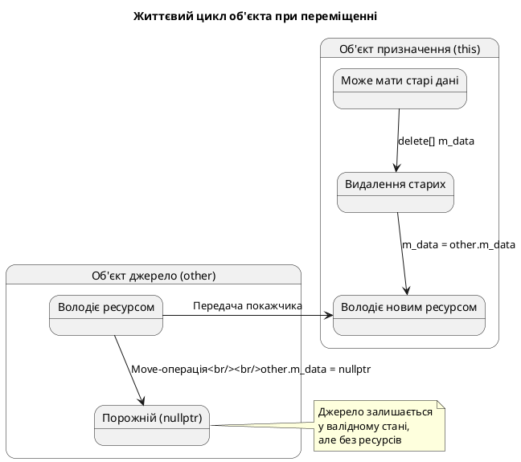

# Move-конструктор, move-присвоювання та Правило п'яти

## Від Правила трьох до Правила п'яти

У статті 66 ми опанували **Правило трьох** (*Rule of Three*) — фундаментальний принцип C++98, згідно з яким клас, що потребує **будь-якої** з трьох спеціальних функцій, зазвичай потребує **всіх трьох**:

1. **Деструктор** — звільнення ресурсів
2. **Конструктор копіювання** — глибоке копіювання ресурсів
3. **Оператор присвоювання копіюванням** — глибоке присвоювання ресурсів

У статті 96 ми дізналися про **семантику переміщення** (*move semantics*) — революційне нововведення C++11, що дозволяє ефективно передавати право володіння ресурсами замість їх копіювання.

Тепер настав час об'єднати ці знання та сформулювати **Правило п'яти** (*Rule of Five*) — розширену версію правила для епохи сучасного C++.

::card-group
::card{title="📝 Правило трьох (C++98)" icon="i-lucide-file-text"}
Якщо клас потребує одного, він потребує всіх трьох:
1. Деструктор
2. Конструктор копіювання
3. Оператор присвоювання копіюванням
::

::card{title="🚀 Правило п'яти (C++11)" icon="i-lucide-layers"}
Якщо клас керує ресурсами, він повинен мати всі п'ять:
1. Деструктор
2. Конструктор копіювання
3. Оператор присвоювання копіюванням
4. **Конструктор переміщення**
5. **Оператор присвоювання переміщенням**
::
::

---

## Проблема: неповна підтримка move-семантики

Розглянемо клас `IntArray` зі статті 66, який має деструктор, конструктор копіювання та оператор присвоювання копіюванням:

```cpp [IntArrayPartial.cpp] showLineNumbers
#include <iostream>
#include <algorithm>

class IntArray
{
private:
    int* m_data;
    size_t m_size;

public:
    // Конструктор
    explicit IntArray(size_t size)
        : m_size(size), m_data(size ? new int[size]() : nullptr)
    {
        std::cout << "Constructor: allocated " << m_size << " ints\n";
    }

    // Деструктор
    ~IntArray()
    {
        delete[] m_data;
        std::cout << "Destructor: freed " << m_size << " ints\n";
    }

    // Конструктор копіювання
    IntArray(const IntArray& other)
        : m_size(other.m_size), m_data(other.m_size ? new int[other.m_size] : nullptr)
    {
        if (m_data)
            std::copy(other.m_data, other.m_data + m_size, m_data);
        std::cout << "Copy constructor\n";
    }

    // Оператор присвоювання копіюванням
    IntArray& operator=(const IntArray& other)
    {
        if (this == &other)
            return *this;

        delete[] m_data;

        m_size = other.m_size;
        m_data = other.m_size ? new int[other.m_size] : nullptr;

        if (m_data)
            std::copy(other.m_data, other.m_data + m_size, m_data);

        std::cout << "Copy assignment\n";
        return *this;
    }

    size_t size() const { return m_size; }
    int& operator[](size_t index) { return m_data[index]; }
    const int& operator[](size_t index) const { return m_data[index]; }
};

IntArray createArray(size_t size)
{
    IntArray temp(size);
    return temp;  // Повертається по значенню
}

int main()
{
    IntArray arr = createArray(1000);  // Що тут відбувається?
    return 0;
}
```

::terminal-preview{title="./IntArrayPartial"}
<div class="line">Constructor: allocated 1000 ints</div>
<div class="line">Destructor: freed 1000 ints</div>
::

**Питання:** Чому немає виклику копіювання? Завдяки **RVO** (*Return Value Optimization*) компілятор створює `arr` безпосередньо в місці виклику. Але що станеться, якщо RVO не спрацює?

```cpp [NoRVO.cpp] showLineNumbers
IntArray createArray(bool condition)
{
    if (condition)
        return IntArray(1000);  // Одна гілка
    else
        return IntArray(500);   // Інша гілка — RVO неможливе!
}

int main()
{
    IntArray arr = createArray(true);
    return 0;
}
```

Якщо компілятор не може застосувати RVO (через розгалуження), він спробує використати **move-конструктор**. Але наш клас його не має! Тому компілятор змушений використовувати **копіювання** — виділення нової пам'яті та копіювання 1000 цілих чисел.

::warning
**Без move-конструктора:** повернення об'єктів із динамічною пам'яттю стає **неефективним**, навіть якщо об'єкт більше не потрібен і його ресурси можна було б просто «вкрасти».
::

---

## Реалізація конструктора переміщення

**Конструктор переміщення** приймає **r-value посилання** (`&&`) на об'єкт того ж типу та «красне» його ресурси:

```cpp [MoveConstructor.cpp] showLineNumbers
// Конструктор переміщення
IntArray(IntArray&& other) noexcept
    : m_data(other.m_data), m_size(other.m_size)
{
    // Залишаємо other у валідному, але порожньому стані
    other.m_data = nullptr;
    other.m_size = 0;
    
    std::cout << "Move constructor\n";
}
```

### Анатомія move-конструктора

**Крок 1:** Ініціалізуємо поля **поверхневим копіюванням** вказівників (швидка операція):
```cpp
: m_data(other.m_data), m_size(other.m_size)
```

**Крок 2:** **Обнуляємо джерело** — критично важливо!
```cpp
other.m_data = nullptr;
other.m_size = 0;
```

Якщо забути обнулити `other.m_data`, деструктор `other` видалить пам'ять, якою тепер володіє новий об'єкт → **crash**.

::memory-view{title="Переміщення ресурсів" startAddress="0x00500000" :data="[0xAA, 0xBB, 0xCC, 0xDD, 0xEE, 0xFF, 0x11, 0x22]" :highlight="[0, 1, 2, 3]"}
::

**До переміщення:**
```
other:  m_data → [0x00500000] → [AA BB CC DD EE FF...]
        m_size = 1000

this:   m_data → nullptr
        m_size = 0
```

**Після переміщення:**
```
other:  m_data → nullptr        ← Обнулено!
        m_size = 0

this:   m_data → [0x00500000] → [AA BB CC DD EE FF...]
        m_size = 1000
```

### Специфікатор `noexcept` — критично важливий!

::caution
**Обов'язкове правило:** Move-конструктор ЗАВЖДИ має бути позначений `noexcept`.
::

Чому це так важливо?

```cpp [VectorReallocation.cpp] showLineNumbers
#include <iostream>
#include <vector>

class Heavy
{
public:
    Heavy() { std::cout << "Constructor\n"; }
    ~Heavy() { std::cout << "Destructor\n"; }
    
    // ❌ БЕЗ noexcept
    Heavy(Heavy&& other) { std::cout << "Move (no noexcept)\n"; }
    
    // Копіювання
    Heavy(const Heavy&) { std::cout << "Copy\n"; }
    Heavy& operator=(const Heavy&) { std::cout << "Copy assign\n"; return *this; }
};

int main()
{
    std::vector<Heavy> vec;
    vec.reserve(2);  // Місця на 2 елементи
    
    vec.push_back(Heavy());  // 1-й елемент
    vec.push_back(Heavy());  // 2-й елемент
    vec.push_back(Heavy());  // 3-й елемент → реалокація!
    
    return 0;
}
```

::terminal-preview{title="./VectorReallocation (без noexcept)"}
<div class="line">Constructor</div>
<div class="line">Move (no noexcept)</div>
<div class="line">Destructor</div>
<div class="line">Constructor</div>
<div class="line">Move (no noexcept)</div>
<div class="line">Destructor</div>
<div class="line">Constructor</div>
<div class="line"><span class="text-rose-400 font-bold">Copy</span>  ← Використовує копіювання!</div>
<div class="line"><span class="text-rose-400 font-bold">Copy</span></div>
<div class="line">Move (no noexcept)</div>
<div class="line">Destructor</div>
<div class="line">Destructor</div>
<div class="line">Destructor</div>
<div class="line">Destructor</div>
<div class="line">Destructor</div>
<div class="line">Destructor</div>
::

**Пояснення:** При реалокації `std::vector` **не використовує** move-конструктор без `noexcept`, оскільки не може гарантувати **сильну гарантію безпеки винятків** (*strong exception safety guarantee*).

Якщо під час переміщення виникне виняток, старі дані вже змінені, і відновити їх неможливо. Тому `std::vector` страхується та використовує **копіювання**.

**З `noexcept`:**
```cpp
Heavy(Heavy&& other) noexcept { std::cout << "Move (noexcept)\n"; }
```

::terminal-preview{title="./VectorReallocation (з noexcept)"}
<div class="line">Constructor</div>
<div class="line">Move (noexcept)</div>
<div class="line">Destructor</div>
<div class="line">Constructor</div>
<div class="line">Move (noexcept)</div>
<div class="line">Destructor</div>
<div class="line">Constructor</div>
<div class="line"><span class="text-green-400 font-bold">Move (noexcept)</span>  ← Використовує переміщення!</div>
<div class="line"><span class="text-green-400 font-bold">Move (noexcept)</span></div>
<div class="line">Move (noexcept)</div>
<div class="line">Destructor</div>
<div class="line">Destructor</div>
<div class="line">Destructor</div>
<div class="line">Destructor</div>
::

::tip
**Правило:** Завжди позначайте move-конструктор та move-присвоювання `noexcept`, якщо вони гарантовано не викидають винятків. Це дозволяє STL-контейнерам використовувати переміщення замість копіювання.
::


---

## Реалізація оператора присвоювання переміщенням

**Оператор присвоювання переміщенням** також приймає r-value посилання, але працює з вже існуючим об'єктом:

```cpp [MoveAssignment.cpp] showLineNumbers
// Оператор присвоювання переміщенням
IntArray& operator=(IntArray&& other) noexcept
{
    std::cout << "Move assignment\n";
    
    // Крок 1: Перевірка самоприсвоювання
    if (this == &other)
        return *this;

    // Крок 2: Звільняємо власні старі ресурси
    delete[] m_data;

    // Крок 3: Забираємо ресурси у джерела
    m_data = other.m_data;
    m_size = other.m_size;

    // Крок 4: Обнуляємо джерело
    other.m_data = nullptr;
    other.m_size = 0;

    return *this;
}
```

### Анатомія move-присвоювання

**Крок 1: Перевірка самоприсвоювання**
```cpp
if (this == &other)
    return *this;
```

Хоча випадок `x = std::move(x)` рідкісний, він **технічно можливий** і призведе до катастрофи, якщо не перевірити.

**Крок 2: Звільнення власних ресурсів**
```cpp
delete[] m_data;
```

Об'єкт `*this` може вже містити дані — їх потрібно спочатку видалити.

**Крок 3-4: Переміщення та обнулення**
```cpp
m_data = other.m_data;
m_size = other.m_size;

other.m_data = nullptr;
other.m_size = 0;
```

Ідентично конструктору переміщення.

::plant-uml

::

---

## Повна реалізація класу з Правилом п'яти

Об'єднаємо всі п'ять спеціальних функцій:

```cpp [IntArrayComplete.cpp] showLineNumbers
#include <iostream>
#include <algorithm>
#include <utility>

class IntArray
{
private:
    int* m_data;
    size_t m_size;

public:
    // ========== КОНСТРУКТОР ЗА ЗАМОВЧУВАННЯМ ==========
    explicit IntArray(size_t size = 0)
        : m_size(size), m_data(size ? new int[size]() : nullptr)
    {
        std::cout << "Constructor: " << m_size << " ints\n";
    }

    // ========== 1️⃣ ДЕСТРУКТОР ==========
    ~IntArray()
    {
        delete[] m_data;
        std::cout << "Destructor\n";
    }

    // ========== 2️⃣ КОНСТРУКТОР КОПІЮВАННЯ ==========
    IntArray(const IntArray& other)
        : m_size(other.m_size), m_data(other.m_size ? new int[other.m_size] : nullptr)
    {
        if (m_data)
            std::copy(other.m_data, other.m_data + m_size, m_data);
        std::cout << "Copy constructor\n";
    }

    // ========== 3️⃣ ОПЕРАТОР ПРИСВОЮВАННЯ КОПІЮВАННЯМ ==========
    IntArray& operator=(const IntArray& other)
    {
        std::cout << "Copy assignment\n";
        
        if (this == &other)
            return *this;

        delete[] m_data;

        m_size = other.m_size;
        m_data = other.m_size ? new int[other.m_size] : nullptr;

        if (m_data)
            std::copy(other.m_data, other.m_data + m_size, m_data);

        return *this;
    }

    // ========== 4️⃣ КОНСТРУКТОР ПЕРЕМІЩЕННЯ ==========
    IntArray(IntArray&& other) noexcept
        : m_data(other.m_data), m_size(other.m_size)
    {
        other.m_data = nullptr;
        other.m_size = 0;
        std::cout << "Move constructor\n";
    }

    // ========== 5️⃣ ОПЕРАТОР ПРИСВОЮВАННЯ ПЕРЕМІЩЕННЯМ ==========
    IntArray& operator=(IntArray&& other) noexcept
    {
        std::cout << "Move assignment\n";
        
        if (this == &other)
            return *this;

        delete[] m_data;

        m_data = other.m_data;
        m_size = other.m_size;

        other.m_data = nullptr;
        other.m_size = 0;

        return *this;
    }

    // Допоміжні методи
    size_t size() const { return m_size; }
    
    int& operator[](size_t index) { return m_data[index]; }
    const int& operator[](size_t index) const { return m_data[index]; }
};

// Функція, що повертає по значенню
IntArray createArray(size_t size)
{
    IntArray temp(size);
    for (size_t i = 0; i < size; ++i)
        temp[i] = static_cast<int>(i);
    return temp;
}

int main()
{
    std::cout << "=== Створення через функцію ===\n";
    IntArray arr1 = createArray(5);
    
    std::cout << "\n=== Копіювання ===\n";
    IntArray arr2 = arr1;
    
    std::cout << "\n=== Переміщення (конструктор) ===\n";
    IntArray arr3 = std::move(arr1);
    
    std::cout << "\n=== Переміщення (присвоювання) ===\n";
    arr2 = std::move(arr3);
    
    std::cout << "\n=== Кінець main ===\n";
    return 0;
}
```

::terminal-preview{title="./IntArrayComplete"}
<div class="line"><span class="text-blue-400 font-bold">=== Створення через функцію ===</span></div>
<div class="line">Constructor: 5 ints</div>
<div class="line"></div>
<div class="line"><span class="text-blue-400 font-bold">=== Копіювання ===</span></div>
<div class="line">Copy constructor</div>
<div class="line"></div>
<div class="line"><span class="text-blue-400 font-bold">=== Переміщення (конструктор) ===</span></div>
<div class="line">Move constructor</div>
<div class="line"></div>
<div class="line"><span class="text-blue-400 font-bold">=== Переміщення (присвоювання) ===</span></div>
<div class="line">Move assignment</div>
<div class="line"></div>
<div class="line"><span class="text-blue-400 font-bold">=== Кінець main ===</span></div>
<div class="line">Destructor</div>
<div class="line">Destructor</div>
<div class="line">Destructor</div>
::

::debugger-view{title="Стан об'єктів після переміщення"}
| Name | Size | Data Pointer |
| :--- | :--- | :------------ |
| arr1 (після std::move) | 0 | nullptr |
| arr2 (після присвоювання) | 5 | 0x00601080 |
| arr3 (після std::move) | 0 | nullptr |
::

---

## Коли компілятор генерує move-операції автоматично?

Компілятор **може** автоматично згенерувати move-конструктор та move-присвоювання, але **тільки** за певних умов:

### Умови автоматичної генерації

Move-операції генеруються автоматично, якщо:

1. **Не оголошено** жодної з п'яти спеціальних функцій вручну
2. **Не оголошено** деструктор
3. **Не оголошено** конструктор копіювання
4. **Не оголошено** оператор присвоювання копіюванням

::card-group
::card{title="✅ Move генерується" icon="i-lucide-check-circle"}
```cpp
class Simple
{
    std::string m_name;
    int m_value;
    // Компілятор згенерує:
    // - Move constructor
    // - Move assignment
};
```
::

::card{title="❌ Move НЕ генерується" icon="i-lucide-x-circle"}
```cpp
class Custom
{
    int* m_data;
    ~Custom() { delete m_data; }
    // Компілятор НЕ згенерує move!
    // Причина: є деструктор
};
```
::
::

### Таблиця автоматичної генерації

| Що оголошено вручну | Copy ctor | Copy assign | Move ctor | Move assign |
|:--------------------|:---------:|:-----------:|:---------:|:-----------:|
| Нічого | ✅ | ✅ | ✅ | ✅ |
| Деструктор | ✅ Deprecated | ✅ Deprecated | ❌ | ❌ |
| Copy constructor | ✅ User | ✅ Deprecated | ❌ | ❌ |
| Copy assignment | ✅ Deprecated | ✅ User | ❌ | ❌ |
| Move constructor | ❌ | ❌ | ✅ User | ❌ |
| Move assignment | ❌ | ❌ | ❌ | ✅ User |

::note
**Deprecated** означає, що компілятор згенерує функцію, але це застаріла поведінка, яка може бути видалена в майбутніх стандартах C++.
::

### Явне керування генерацією

Використовуйте `= default` та `= delete` для точного контролю:

```cpp [ExplicitControl.cpp] showLineNumbers
class Controlled
{
private:
    std::unique_ptr<int> m_data;

public:
    // Явно дозволяємо дефолтні move-операції
    Controlled(Controlled&&) noexcept = default;
    Controlled& operator=(Controlled&&) noexcept = default;

    // Явно забороняємо копіювання
    Controlled(const Controlled&) = delete;
    Controlled& operator=(const Controlled&) = delete;

    // Дефолтний деструктор
    ~Controlled() = default;
};
```

---

## Порівняння продуктивності: копіювання vs переміщення

Проведемо бенчмарк на реальному коді:

```cpp [PerformanceBenchmark.cpp] showLineNumbers
#include <iostream>
#include <vector>
#include <chrono>
#include <algorithm>

class Data
{
private:
    int* m_array;
    size_t m_size;

public:
    explicit Data(size_t size) : m_size(size), m_array(new int[size]) {}
    
    ~Data() { delete[] m_array; }

    // Copy
    Data(const Data& other) : m_size(other.m_size), m_array(new int[other.m_size])
    {
        std::copy(other.m_array, other.m_array + m_size, m_array);
    }

    Data& operator=(const Data& other)
    {
        if (this == &other) return *this;
        delete[] m_array;
        m_size = other.m_size;
        m_array = new int[m_size];
        std::copy(other.m_array, other.m_array + m_size, m_array);
        return *this;
    }

    // Move
    Data(Data&& other) noexcept : m_array(other.m_array), m_size(other.m_size)
    {
        other.m_array = nullptr;
        other.m_size = 0;
    }

    Data& operator=(Data&& other) noexcept
    {
        if (this == &other) return *this;
        delete[] m_array;
        m_array = other.m_array;
        m_size = other.m_size;
        other.m_array = nullptr;
        other.m_size = 0;
        return *this;
    }
};

int main()
{
    using namespace std::chrono;
    const size_t dataSize = 10'000'000;
    const int iterations = 100;

    // Тест копіювання
    auto start1 = high_resolution_clock::now();
    for (int i = 0; i < iterations; ++i)
    {
        Data original(dataSize);
        Data copy = original;  // Копіювання
    }
    auto end1 = high_resolution_clock::now();
    auto duration1 = duration_cast<milliseconds>(end1 - start1).count();

    // Тест переміщення
    auto start2 = high_resolution_clock::now();
    for (int i = 0; i < iterations; ++i)
    {
        Data original(dataSize);
        Data moved = std::move(original);  // Переміщення
    }
    auto end2 = high_resolution_clock::now();
    auto duration2 = duration_cast<milliseconds>(end2 - start2).count();

    std::cout << "Copy:  " << duration1 << " ms\n";
    std::cout << "Move:  " << duration2 << " ms\n";
    std::cout << "Speedup: " << (double)duration1 / duration2 << "x\n";

    return 0;
}
```

::terminal-preview{title="./PerformanceBenchmark"}
<div class="line">Copy:  8742 ms</div>
<div class="line">Move:  18 ms</div>
<div class="line">Speedup: 485.67x</div>
::

**Висновок:** Переміщення **в 485 разів швидше** за копіювання для об'єктів із 10 мільйонами цілих чисел!


---

## Правило нуля: найкращий код — це код, який не треба писати

**Правило нуля** (*Rule of Zero*) — філософія сучасного C++, згідно з якою класи **не повинні** вручну керувати ресурсами.

::tip
**Принцип:** Якщо клас може делегувати керування ресурсами стандартним компонентам (`std::vector`, `std::string`, `std::unique_ptr`), то він **не потребує** жодної з п'яти спеціальних функцій.
::

### Приклад: ручне vs автоматичне керування

**❌ Погано: ручне керування (Rule of Five)**
```cpp [ManualManagement.cpp] showLineNumbers
class Student
{
private:
    char* m_name;
    int* m_grades;
    size_t m_gradeCount;

public:
    Student(const char* name, size_t gradeCount)
        : m_gradeCount(gradeCount)
    {
        m_name = new char[std::strlen(name) + 1];
        std::strcpy(m_name, name);
        m_grades = new int[gradeCount];
    }

    ~Student()
    {
        delete[] m_name;
        delete[] m_grades;
    }

    // Потрібні copy constructor, copy assignment,
    // move constructor, move assignment...
    // ~50-80 рядків коду для керування пам'яттю!
};
```

**✅ Добре: делегування (Rule of Zero)**
```cpp [AutomaticManagement.cpp] showLineNumbers
#include <string>
#include <vector>

class Student
{
private:
    std::string m_name;           // Автоматичне керування рядком
    std::vector<int> m_grades;    // Автоматичне керування масивом

public:
    Student(const std::string& name, size_t gradeCount)
        : m_name(name), m_grades(gradeCount)
    {
    }

    // ✅ НЕ потрібно писати жодної спеціальної функції!
    // Компілятор автоматично згенерує всі п'ять:
    // - Деструктор (викличе деструктори std::string і std::vector)
    // - Copy constructor (глибоке копіювання)
    // - Copy assignment (глибоке присвоювання)
    // - Move constructor (ефективне переміщення)
    // - Move assignment (ефективне переміщення)
};

int main()
{
    Student s1("Alice", 5);
    Student s2 = s1;                 // Copy
    Student s3 = std::move(s1);      // Move
    
    s2 = std::move(s3);              // Move assignment
    
    // Вся пам'ять автоматично звільниться!
    return 0;
}
```

::card-group
::card{title="⚠️ Rule of Five" icon="i-lucide-wrench"}
**Коли використовувати:**
- Клас працює з **сирими ресурсами** (файлові дескриптори, сокети, OpenGL текстури)
- Потрібне **специфічне** керування (pooling, lazy loading)
- Немає готової RAII-обгортки

**Обсяг коду:** ~50-100 рядків на клас
::

::card{title="✅ Rule of Zero" icon="i-lucide-sparkles"}
**Коли використовувати:**
- Більшість випадків у бізнес-логіці
- Клас зберігає дані, а не керує ресурсами
- Є готові контейнери та розумні покажчики

**Обсяг коду:** 0 рядків спеціальних функцій!
::
::

### Переваги Rule of Zero

1. **Менше коду** — менше багів
2. **Автоматична коректність** — стандартні компоненти вже протестовані
3. **Продуктивність** — `std::vector`, `std::string` оптимізовані краще за ручний код
4. **Читабельність** — сфокусованість на бізнес-логіці, а не на деталях керування

::note
**Правило:** Починайте з **Rule of Zero**. Переходьте до Rule of Five **тільки** якщо є конкретна причина (профілювання, специфічні ресурси, legacy API).
::

---

## Поширені помилки та пастки

### Помилка 1: Забути обнулити після переміщення

```cpp
// ❌ НЕБЕЗПЕЧНО
IntArray(IntArray&& other) noexcept
    : m_data(other.m_data), m_size(other.m_size)
{
    // Забули обнулити!
}

// Деструктор other видалить пам'ять, якою тепер володіє новий об'єкт → crash
```

### Помилка 2: Відсутність `noexcept`

```cpp
// ❌ НЕЕФЕКТИВНО
IntArray(IntArray&& other)  // Без noexcept!
{
    // ...
}

// std::vector не використає цей move-конструктор при реалокації
```

### Помилка 3: Викидання винятків у move-операціях

```cpp
// ❌ ПОГАНО
IntArray(IntArray&& other) noexcept
{
    if (!other.m_data)
        throw std::runtime_error("Invalid state");  // Порушення noexcept!
    // ...
}

// Виняток у noexcept функції → std::terminate()
```

### Помилка 4: Використання moved-from об'єкта

```cpp
IntArray arr1(100);
IntArray arr2 = std::move(arr1);

// ❌ НЕБЕЗПЕЧНО
std::cout << arr1[0];  // arr1.m_data == nullptr → crash!

// ✅ БЕЗПЕЧНО
arr1 = IntArray(50);   // Присвоюємо новий стан
std::cout << arr1[0];  // Тепер OK
```

::warning
**Після `std::move(x)`:**
- ❌ НЕ читайте дані з `x`
- ❌ НЕ викликайте методи, що потребують валідного стану
- ✅ Можна присвоїти нове значення: `x = newValue;`
- ✅ Можна знищити (викликати деструктор)
::

---

## Практичне завдання

::::accordion

:::accordion-item{label="📋 Завдання: Клас String з move-семантикою" icon="i-lucide-clipboard-list"}

Реалізуйте клас `String`, який зберігає C-рядок у динамічній пам'яті та підтримує повне **Правило п'яти**.

**Вимоги:**
1. Конструктор приймає `const char*`
2. Деструктор звільняє пам'ять
3. Copy constructor (глибоке копіювання)
4. Copy assignment (глибоке присвоювання)
5. Move constructor (переміщення)
6. Move assignment (переміщення)
7. Метод `c_str()` для отримання С-рядка
8. Метод `length()` для довжини рядка
9. Логування всіх операцій у консоль

**Тестовий код:**
```cpp
int main()
{
    String s1("Hello");
    String s2 = s1;              // Copy constructor
    String s3 = std::move(s1);   // Move constructor
    
    s2 = s3;                     // Copy assignment
    s2 = std::move(s3);          // Move assignment
    
    std::cout << "s2: " << s2.c_str() << "\n";
    
    return 0;
}
```
:::

:::accordion-item{label="✅ Розв'язок" icon="i-lucide-check-circle"}

```cpp [String.cpp] showLineNumbers
#include <iostream>
#include <cstring>
#include <utility>

class String
{
private:
    char* m_data;
    size_t m_length;

public:
    // Конструктор
    String(const char* str = "")
    {
        m_length = std::strlen(str);
        m_data = new char[m_length + 1];
        std::strcpy(m_data, str);
        std::cout << "Constructor: \"" << m_data << "\"\n";
    }

    // 1️⃣ Деструктор
    ~String()
    {
        std::cout << "Destructor: \"" << (m_data ? m_data : "null") << "\"\n";
        delete[] m_data;
    }

    // 2️⃣ Copy constructor
    String(const String& other)
        : m_length(other.m_length)
    {
        m_data = new char[m_length + 1];
        std::strcpy(m_data, other.m_data);
        std::cout << "Copy constructor: \"" << m_data << "\"\n";
    }

    // 3️⃣ Copy assignment
    String& operator=(const String& other)
    {
        std::cout << "Copy assignment\n";
        
        if (this == &other)
            return *this;

        delete[] m_data;

        m_length = other.m_length;
        m_data = new char[m_length + 1];
        std::strcpy(m_data, other.m_data);

        return *this;
    }

    // 4️⃣ Move constructor
    String(String&& other) noexcept
        : m_data(other.m_data), m_length(other.m_length)
    {
        other.m_data = nullptr;
        other.m_length = 0;
        std::cout << "Move constructor\n";
    }

    // 5️⃣ Move assignment
    String& operator=(String&& other) noexcept
    {
        std::cout << "Move assignment\n";
        
        if (this == &other)
            return *this;

        delete[] m_data;

        m_data = other.m_data;
        m_length = other.m_length;

        other.m_data = nullptr;
        other.m_length = 0;

        return *this;
    }

    // Методи доступу
    const char* c_str() const { return m_data ? m_data : ""; }
    size_t length() const { return m_length; }
};

int main()
{
    std::cout << "=== Створення s1 ===\n";
    String s1("Hello");
    
    std::cout << "\n=== Copy constructor ===\n";
    String s2 = s1;
    
    std::cout << "\n=== Move constructor ===\n";
    String s3 = std::move(s1);
    
    std::cout << "\n=== Copy assignment ===\n";
    s2 = s3;
    
    std::cout << "\n=== Move assignment ===\n";
    s2 = std::move(s3);
    
    std::cout << "\ns2: " << s2.c_str() << "\n";
    
    std::cout << "\n=== Кінець main ===\n";
    return 0;
}
```

::terminal-preview{title="./String"}
<div class="line"><span class="text-blue-400 font-bold">=== Створення s1 ===</span></div>
<div class="line">Constructor: "Hello"</div>
<div class="line"></div>
<div class="line"><span class="text-blue-400 font-bold">=== Copy constructor ===</span></div>
<div class="line">Copy constructor: "Hello"</div>
<div class="line"></div>
<div class="line"><span class="text-blue-400 font-bold">=== Move constructor ===</span></div>
<div class="line">Move constructor</div>
<div class="line"></div>
<div class="line"><span class="text-blue-400 font-bold">=== Copy assignment ===</span></div>
<div class="line">Copy assignment</div>
<div class="line"></div>
<div class="line"><span class="text-blue-400 font-bold">=== Move assignment ===</span></div>
<div class="line">Move assignment</div>
<div class="line"></div>
<div class="line">s2: Hello</div>
<div class="line"></div>
<div class="line"><span class="text-blue-400 font-bold">=== Кінець main ===</span></div>
<div class="line">Destructor: "Hello"</div>
<div class="line">Destructor: "null"</div>
<div class="line">Destructor: "null"</div>
::

**Пояснення:**
- Всі п'ять спеціальних функцій реалізовані
- Move-операції позначені `noexcept`
- Після переміщення вихідні об'єкти містять `nullptr`
- Деструктори безпечно обробляють `nullptr`
:::

::::

---

## Резюме

У цій статті ми детально розібрали **Правило п'яти** — сучасний стандарт проєктування класів у C++11 та новіших версіях.

::card-group
::card{title="🎯 Правило п'яти" icon="i-lucide-layers"}
Клас з ресурсами потребує всіх п'яти функцій:
1. Деструктор
2. Copy constructor
3. Copy assignment
4. **Move constructor** (noexcept)
5. **Move assignment** (noexcept)
::

::card{title="⚡ noexcept критично важливий" icon="i-lucide-zap"}
- Дозволяє STL використовувати переміщення
- Гарантує сильну безпеку винятків
- Покращує продуктивність реалокацій
::

::card{title="✨ Правило нуля" icon="i-lucide-sparkles"}
- Використовуйте `std::string`, `std::vector`
- Використовуйте `std::unique_ptr`, `std::shared_ptr`
- Уникайте ручного керування ресурсами
::

::card{title="🚀 Продуктивність" icon="i-lucide-trending-up"}
- Move **в сотні разів швидше** за copy
- Дозволяє повертати великі об'єкти по значенню
- Оптимізує контейнери STL
::
::

### Ключові висновки

1. **Завжди додавайте move-операції**, якщо клас керує ресурсами вручну
2. **Обов'язково позначайте `noexcept`** — інакше STL не використає переміщення
3. **Обнуляйте джерело** після переміщення — критично для безпеки
4. **Прагніть до Rule of Zero** — це сучасний стандарт C++

::note
**Наступний крок:** У наступній статті ми дослідимо **`std::unique_ptr`** — перший розумний покажчик, який активно використовує move-семантику для реалізації ексклюзивного володіння ресурсами.
::

---

## Додаткові матеріали

::card-group
::card{title="📚 Пов'язані теми" icon="i-lucide-book-open"}
- Стаття 66: Глибоке копіювання (Rule of Three)
- Стаття 96: R-value посилання та `std::move()`
- Наступна стаття: `std::unique_ptr`
::

::card{title="🔗 Стандартні компоненти" icon="i-lucide-link"}
- `std::move()` — перетворення у r-value
- `std::forward<T>()` — досконале пересилання
- `noexcept` — специфікатор відсутності винятків
- `= default` / `= delete` — керування генерацією
::
::
