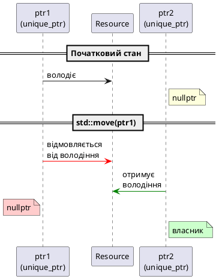

# Розумний покажчик `std::unique_ptr`

## Проблема: витоки пам'яті та винятки

Розглянемо класичну проблему керування динамічною пам'яттю:

```cpp [LeakProblem.cpp] showLineNumbers
#include <iostream>

class Resource
{
public:
    Resource() { std::cout << "Resource acquired\n"; }
    ~Resource() { std::cout << "Resource destroyed\n"; }
    
    void doWork() { std::cout << "Working...\n"; }
};

void processData(bool throwException)
{
    Resource* resource = new Resource();
    
    resource->doWork();
    
    if (throwException)
        throw std::runtime_error("Error!");  // ❌ resource не видалено!
    
    delete resource;  // ← Ніколи не досягається при винятку
}

int main()
{
    try
    {
        processData(true);
    }
    catch (const std::exception& e)
    {
        std::cout << "Caught: " << e.what() << "\n";
    }
    
    std::cout << "Program continues...\n";
    return 0;
}
```

::terminal-preview{title="./LeakProblem"}
<div class="line">Resource acquired</div>
<div class="line">Working...</div>
<div class="line">Caught: Error!</div>
<div class="line">Program continues...</div>
<div class="line"><span class="text-rose-400 font-bold">← Resource destroyed НІКОЛИ не викликається!</span></div>
::

**Проблеми:**
1. При винятку `delete` не виконується → **витік пам'яті**
2. При ранньому `return` — та сама проблема
3. Забути `delete` — легко, особливо у складних функціях
4. Подвійне `delete` — катастрофічна помилка

::caution
**Фундаментальна проблема:** Сирі вказівники **не мають вбудованого механізму** автоматичного видалення при виході зі scope.
::

---

## Концепція розумних покажчиків

**Розумний покажчик** (*smart pointer*) — це клас-обгортка над сирим вказівником, що використовує **ідіому RAII** для автоматичного керування ресурсами.

::tip
**RAII** (*Resource Acquisition Is Initialization*):
- **Ресурс захоплюється** в конструкторі
- **Ресурс звільняється** в деструкторі
- **Гарантія:** деструктор викликається завжди при виході з області видимості
::

### Еволюція розумних покажчиків у C++

| Версія C++ | Розумний покажчик | Статус |
|:-----------|:------------------|:-------|
| C++98 | `std::auto_ptr` | ❌ Deprecated (видалено в C++17) |
| C++11 | `std::unique_ptr` | ✅ Основний інструмент |
| C++11 | `std::shared_ptr` | ✅ Для спільного володіння |
| C++11 | `std::weak_ptr` | ✅ Для розривання циклів |

::note
У C++ існує **чотири типи** розумних покажчиків, але `std::unique_ptr` — найбільш важливий і найчастіше використовується (~80% випадків).
::

---

## `std::unique_ptr`: семантика виключного володіння

**`std::unique_ptr<T>`** — розумний покажчик з **семантикою виключного володіння** (*exclusive ownership*):

- Рівно **один** `std::unique_ptr` володіє ресурсом у будь-який момент часу
- **Копіювання заборонене** (copy constructor та copy assignment видалені)
- **Переміщення дозволене** (move constructor та move assignment реалізовані)
- **Нульові накладні витрати** (*zero overhead*): `sizeof(unique_ptr) == sizeof(void*)`

```cpp [UniqueOwnership.cpp] showLineNumbers
#include <iostream>
#include <memory>  // для std::unique_ptr

class Resource
{
public:
    Resource() { std::cout << "Resource acquired\n"; }
    ~Resource() { std::cout << "Resource destroyed\n"; }
    
    void doWork() { std::cout << "Working...\n"; }
};

void processData(bool throwException)
{
    std::unique_ptr<Resource> resource(new Resource());
    
    resource->doWork();
    
    if (throwException)
        throw std::runtime_error("Error!");
    
    // delete НЕ потрібен — resource автоматично знищиться!
}

int main()
{
    try
    {
        processData(true);
    }
    catch (const std::exception& e)
    {
        std::cout << "Caught: " << e.what() << "\n";
    }
    
    std::cout << "Program continues...\n";
    return 0;
}
```

::terminal-preview{title="./UniqueOwnership"}
<div class="line">Resource acquired</div>
<div class="line">Working...</div>
<div class="line"><span class="text-green-400 font-bold">Resource destroyed</span>  ← Автоматично викликається!</div>
<div class="line">Caught: Error!</div>
<div class="line">Program continues...</div>
::

::card-group
::card{title="✅ Переваги" icon="i-lucide-check-circle"}
- Автоматичне видалення при виході зі scope
- Безпека при винятках
- Неможливо забути `delete`
- Неможливо подвійне `delete`
::

::card{title="🎯 Семантика" icon="i-lucide-shield"}
- **Один власник** — завжди
- Копіювання = `delete`
- Переміщення = передача володіння
- Нульові накладні витрати
::
::

---

## Фабрична функція `std::make_unique`

**`std::make_unique<T>()`** (C++14) — рекомендований спосіб створення `std::unique_ptr`:

```cpp [MakeUnique.cpp] showLineNumbers
#include <iostream>
#include <memory>

class Widget
{
private:
    int m_id;
    std::string m_name;

public:
    Widget(int id, const std::string& name)
        : m_id(id), m_name(name)
    {
        std::cout << "Widget " << m_id << " created\n";
    }

    ~Widget()
    {
        std::cout << "Widget " << m_id << " destroyed\n";
    }

    void display() const
    {
        std::cout << "Widget #" << m_id << ": " << m_name << "\n";
    }
};

int main()
{
    // ❌ Старий спосіб (C++11)
    std::unique_ptr<Widget> widget1(new Widget(1, "Old style"));
    
    // ✅ Рекомендований спосіб (C++14+)
    auto widget2 = std::make_unique<Widget>(2, "Modern style");
    
    widget1->display();
    widget2->display();
    
    return 0;
}
```

::terminal-preview{title="./MakeUnique"}
<div class="line">Widget 1 created</div>
<div class="line">Widget 2 created</div>
<div class="line">Widget #1: Old style</div>
<div class="line">Widget #2: Modern style</div>
<div class="line">Widget 2 destroyed</div>
<div class="line">Widget 1 destroyed</div>
::

### Переваги `std::make_unique`

::card-group
::card{title="1️⃣ Безпека винятків" icon="i-lucide-shield-alert"}
```cpp
// ❌ НЕБЕЗПЕЧНО
processWidgets(
    std::unique_ptr<Widget>(new Widget(1)),
    mayThrow()
);
// Якщо mayThrow() викине виняток
// після new, але до створення unique_ptr
// → витік пам'яті!

// ✅ БЕЗПЕЧНО
processWidgets(
    std::make_unique<Widget>(1),
    mayThrow()
);
// make_unique атомарна —
// або обидві операції успішні, або жодна
```
::

::card{title="2️⃣ Відсутність дублювання" icon="i-lucide-copy-x"}
```cpp
// ❌ Дублювання типу
std::unique_ptr<VeryLongClassName> ptr(
    new VeryLongClassName(args)
);

// ✅ Без дублювання
auto ptr = std::make_unique<
    VeryLongClassName
>(args);
```
::

::card{title="3️⃣ Читабельність" icon="i-lucide-eye"}
```cpp
// ❌ Видно raw pointer
new Widget(1)

// ✅ Видно інтенцію
std::make_unique<Widget>(1)
// "Створюю унікальний ресурс"
```
::

::card{title="4️⃣ Узгодженість" icon="i-lucide-align-center"}
Однакова форма для всіх розумних покажчиків:
- `std::make_unique<T>()`
- `std::make_shared<T>()`
::
::

::tip
**Правило:** Завжди використовуйте `std::make_unique<T>()` замість `new` при створенні `std::unique_ptr`.
::

---

## Інтерфейс `std::unique_ptr`

### Оператори доступу: `*` та `->`

```cpp [AccessOperators.cpp] showLineNumbers
#include <iostream>
#include <memory>

struct Point
{
    int x, y;
    
    void print() const
    {
        std::cout << "(" << x << ", " << y << ")\n";
    }
};

int main()
{
    auto ptr = std::make_unique<Point>();
    ptr->x = 10;  // Оператор ->
    ptr->y = 20;
    
    ptr->print();
    
    // Оператор * (розіменування)
    Point& ref = *ptr;
    ref.x = 30;
    ref.y = 40;
    
    ptr->print();
    
    return 0;
}
```

::terminal-preview{title="./AccessOperators"}
<div class="line">(10, 20)</div>
<div class="line">(30, 40)</div>
::

### Метод `get()`: отримання сирого вказівника

```cpp [GetMethod.cpp] showLineNumbers
#include <iostream>
#include <memory>

void legacyFunction(int* rawPtr)
{
    if (rawPtr)
        std::cout << "Value: " << *rawPtr << "\n";
}

int main()
{
    auto ptr = std::make_unique<int>(42);
    
    // Передаємо в legacy-функцію, що потребує raw pointer
    legacyFunction(ptr.get());
    
    // ptr все ще володіє ресурсом
    std::cout << "Still owned: " << *ptr << "\n";
    
    return 0;
}
```

::warning
**Небезпечно:** НЕ зберігайте результат `get()` для подальшого використання:

```cpp
int* raw = ptr.get();
ptr.reset();  // ресурс видалено
*raw;         // ❌ Невизначена поведінка!
```
::

### Метод `reset()`: заміна ресурсу

```cpp [ResetMethod.cpp] showLineNumbers
auto ptr = std::make_unique<int>(10);
std::cout << *ptr << "\n";  // 10

ptr.reset(new int(20));  // Видаляє 10, зберігає 20
std::cout << *ptr << "\n";  // 20

ptr.reset();  // Видаляє 20, ptr стає nullptr
```

### Метод `release()`: передача володіння

```cpp [ReleaseMethod.cpp] showLineNumbers
auto ptr = std::make_unique<int>(100);

int* raw = ptr.release();  // ptr більше НЕ володіє ресурсом
// Тепер МИ відповідаємо за видалення!

std::cout << *raw << "\n";
delete raw;  // Обов'язково!
```

::caution
`release()` **не видаляє** ресурс, а лише **передає відповідальність**. Використовуйте рідко — зазвичай для взаємодії з C-API.
::

### Перевірка на `nullptr`

```cpp [NullptrCheck.cpp] showLineNumbers
std::unique_ptr<int> ptr;  // nullptr за замовчуванням

if (ptr)  // Неявна конвертація в bool
    std::cout << *ptr;
else
    std::cout << "ptr is null\n";

ptr = std::make_unique<int>(42);

if (ptr)
    std::cout << "Value: " << *ptr << "\n";
```

---

## Заборона копіювання, підтримка переміщення

`std::unique_ptr` реалізує **Правило п'яти** з видаленим копіюванням:

```cpp [MoveOnly.cpp] showLineNumbers
#include <iostream>
#include <memory>
#include <utility>

int main()
{
    auto ptr1 = std::make_unique<int>(100);
    
    // ❌ Копіювання заборонене
    // auto ptr2 = ptr1;  // Помилка компіляції
    
    // ✅ Переміщення дозволене
    auto ptr2 = std::move(ptr1);
    
    std::cout << "ptr1 is " << (ptr1 ? "not null" : "null") << "\n";
    std::cout << "ptr2 is " << (ptr2 ? "not null" : "null") << "\n";
    std::cout << "Value: " << *ptr2 << "\n";
    
    return 0;
}
```

::terminal-preview{title="./MoveOnly"}
<div class="line">ptr1 is null</div>
<div class="line">ptr2 is not null</div>
<div class="line">Value: 100</div>
::

::debugger-view{title="Стан після std::move"}
| Name | Owns Resource | Value |
| :--- | :------------ | :---- |
| ptr1 | ❌ (nullptr) | — |
| ptr2 | ✅ | 100 |
::


::plant-uml{title="Передача володіння через std::move"}

::

---

## Повернення `std::unique_ptr` з функції

Розумний вказівник `std::unique_ptr` можна **безпечно повертати з функції по значенню**:

```cpp [ReturnUniquePtr.cpp] showLineNumbers
#include <iostream>
#include <memory>

class Resource
{
private:
    int m_id;

public:
    Resource(int id) : m_id(id)
    {
        std::cout << "Resource " << m_id << " acquired\n";
    }

    ~Resource()
    {
        std::cout << "Resource " << m_id << " destroyed\n";
    }

    int getId() const { return m_id; }
};

// Фабрична функція: повертає unique_ptr по значенню
std::unique_ptr<Resource> createResource(int id)
{
    return std::make_unique<Resource>(id);
}

int main()
{
    // Семантика переміщення автоматично застосовується
    auto resource = createResource(42);
    
    std::cout << "Using resource " << resource->getId() << "\n";
    
    return 0;
}
```

::terminal-preview{title="./ReturnUniquePtr"}
<div class="line">Resource 42 acquired</div>
<div class="line">Using resource 42</div>
<div class="line">Resource 42 destroyed</div>
::

::tip
**Важливо:** При поверненні `std::unique_ptr` по значенню компілятор автоматично використовує **семантику переміщення** (не потрібен `std::move()`):

```cpp
return std::make_unique<T>();  // ✅ Автоматичне переміщення
return std::move(ptr);          // ❌ Зайве — компілятор оптимізує
```
::

### Фабричний патерн з `std::unique_ptr`

```cpp [FactoryPattern.cpp] showLineNumbers
#include <iostream>
#include <memory>
#include <string>

class Shape
{
public:
    virtual ~Shape() = default;
    virtual void draw() const = 0;
};

class Circle : public Shape
{
public:
    void draw() const override
    {
        std::cout << "Drawing Circle\n";
    }
};

class Rectangle : public Shape
{
public:
    void draw() const override
    {
        std::cout << "Drawing Rectangle\n";
    }
};

// Фабрична функція: створює різні типи Shape
std::unique_ptr<Shape> createShape(const std::string& type)
{
    if (type == "circle")
        return std::make_unique<Circle>();
    else if (type == "rectangle")
        return std::make_unique<Rectangle>();
    else
        return nullptr;  // Невідомий тип
}

int main()
{
    auto shape1 = createShape("circle");
    if (shape1)
        shape1->draw();
    
    auto shape2 = createShape("rectangle");
    if (shape2)
        shape2->draw();
    
    auto shape3 = createShape("triangle");
    if (!shape3)
        std::cout << "Unknown shape type\n";
    
    return 0;
}
```

::terminal-preview{title="./FactoryPattern"}
<div class="line">Drawing Circle</div>
<div class="line">Drawing Rectangle</div>
<div class="line">Unknown shape type</div>
::

::card-group
::card{title="✅ Переваги фабрик" icon="i-lucide-factory"}
- **Безпечне повернення:** ресурс не може "загубитися"
- **Інкапсуляція:** логіка створення відокремлена
- **Поліморфізм:** повертаємо базовий клас
- **Чистота:** не потрібен `delete`
::

::card{title="🎯 Патерни" icon="i-lucide-shapes"}
- Фабричний метод
- Абстрактна фабрика
- Будівельник (Builder)
- Прототип
::
::

---

## Передача `std::unique_ptr` у функцію

Існує **чотири способи** передачі `std::unique_ptr` у функцію, кожен з різною семантикою:

### 1️⃣ Передача по значенню: **передача володіння**

```cpp [PassByValue.cpp] showLineNumbers
#include <iostream>
#include <memory>

class Widget
{
private:
    int m_id;

public:
    Widget(int id) : m_id(id)
    {
        std::cout << "Widget " << m_id << " created\n";
    }

    ~Widget()
    {
        std::cout << "Widget " << m_id << " destroyed\n";
    }

    int getId() const { return m_id; }
};

// Функція ПРИЙМАЄ володіння — Widget знищиться в кінці функції
void takeOwnership(std::unique_ptr<Widget> widget)
{
    std::cout << "Function owns Widget " << widget->getId() << "\n";
}  // ← Widget знищується ТУТ

int main()
{
    auto widget = std::make_unique<Widget>(1);
    
    // ПОТРІБЕН std::move() — копіювання заборонене
    takeOwnership(std::move(widget));
    
    std::cout << "widget is " << (widget ? "not null" : "null") << "\n";
    std::cout << "End of main\n";
    
    return 0;
}
```

::terminal-preview{title="./PassByValue"}
<div class="line">Widget 1 created</div>
<div class="line">Function owns Widget 1</div>
<div class="line"><span class="text-rose-400 font-bold">Widget 1 destroyed</span>  ← Знищується в takeOwnership()</div>
<div class="line">widget is null</div>
<div class="line">End of main</div>
::

::caution
Після `std::move(widget)` змінна `widget` стає **`nullptr`**. Використовувати її надалі **небезпечно**!
::

### 2️⃣ Передача по посиланню: **тимчасове використання з можливістю змінити**

```cpp [PassByReference.cpp] showLineNumbers
// Функція може ЗМІНИТИ unique_ptr (наприклад, reset())
void useAndModify(std::unique_ptr<Widget>& widget)
{
    if (widget)
        std::cout << "Using Widget " << widget->getId() << "\n";
    
    // Можна змінити сам покажчик
    widget.reset();  // Видаляємо Widget, встановлюємо nullptr
    std::cout << "Widget was destroyed\n";
}

int main()
{
    auto widget = std::make_unique<Widget>(2);
    
    useAndModify(widget);  // Передаємо по посиланню
    
    std::cout << "widget is " << (widget ? "not null" : "null") << "\n";
    
    return 0;
}
```

::terminal-preview{title="./PassByReference"}
<div class="line">Widget 2 created</div>
<div class="line">Using Widget 2</div>
<div class="line">Widget 2 destroyed</div>
<div class="line">Widget was destroyed</div>
<div class="line">widget is null</div>
::

### 3️⃣ Передача сирого вказівника через `get()`: **тільки читання/використання**

```cpp [PassRawPointer.cpp] showLineNumbers
// Функція ВИКОРИСТОВУЄ Widget, але НЕ змінює володіння
void useWidget(const Widget* widget)
{
    if (widget)
        std::cout << "Using Widget " << widget->getId() << "\n";
}

int main()
{
    auto widget = std::make_unique<Widget>(3);
    
    // Передаємо raw pointer — володіння залишається в main()
    useWidget(widget.get());
    
    std::cout << "widget is still " << (widget ? "not null" : "null") << "\n";
    
    return 0;
}  // ← Widget знищується ТУТ
```

::terminal-preview{title="./PassRawPointer"}
<div class="line">Widget 3 created</div>
<div class="line">Using Widget 3</div>
<div class="line">widget is still not null</div>
<div class="line">Widget 3 destroyed</div>
::

### 4️⃣ Передача по посиланню на об'єкт: **використання без overhead**

```cpp [PassObjectReference.cpp] showLineNumbers
// Функція працює з САМИМ об'єктом (не з unique_ptr)
void processWidget(Widget& widget)
{
    std::cout << "Processing Widget " << widget.getId() << "\n";
}

int main()
{
    auto widget = std::make_unique<Widget>(4);
    
    // Розіменовуємо unique_ptr і передаємо посилання
    processWidget(*widget);
    
    return 0;
}
```

::tip
**Рекомендації:**
- **По значенню** (`std::unique_ptr<T>`) → якщо функція має ВОЛОДІТИ ресурсом
- **По сирому вказівнику** (`T*`) → якщо функція ВИКОРИСТОВУЄ ресурс (може бути `nullptr`)
- **По посиланню** (`T&`) → якщо функція ВИКОРИСТОВУЄ ресурс (не може бути `nullptr`)
- **По посиланню на `unique_ptr`** (`std::unique_ptr<T>&`) → якщо функція ЗМІНЮЄ сам покажчик
::

### Таблиця вибору способу передачі

| Інтенція | Спосіб передачі | Володіння | `nullptr` можливий? |
|:---------|:----------------|:----------|:--------------------|
| Функція стає власником | `std::unique_ptr<T>` (move) | Передається | — |
| Функція змінює покажчик | `std::unique_ptr<T>&` | Залишається в caller | ✅ |
| Функція використовує об'єкт | `T*` (через `get()`) | Залишається в caller | ✅ |
| Функція використовує об'єкт | `T&` (через `*ptr`) | Залишається в caller | ❌ |

---

## `std::unique_ptr` і масиви: `std::unique_ptr<T[]>`

`std::unique_ptr` має **спеціалізацію для масивів** — `std::unique_ptr<T[]>`:

```cpp [UniquePtrArray.cpp] showLineNumbers
#include <iostream>
#include <memory>

int main()
{
    // ❌ Старий спосіб (C-масив)
    int* arr1 = new int[5];
    // ... використання ...
    delete[] arr1;  // Легко забути!
    
    // ✅ Розумний вказівник для масиву
    auto arr2 = std::make_unique<int[]>(5);
    
    // Ініціалізація
    for (int i = 0; i < 5; ++i)
        arr2[i] = i * 10;
    
    // Доступ через оператор []
    for (int i = 0; i < 5; ++i)
        std::cout << arr2[i] << " ";
    std::cout << "\n";
    
    return 0;
}  // delete[] викликається автоматично!
```

::terminal-preview{title="./UniquePtrArray"}
<div class="line">0 10 20 30 40</div>
::

::warning
**Важливо:** `std::unique_ptr<T[]>` використовує **`delete[]`**, а не `delete`:

```cpp
std::unique_ptr<int[]> arr(new int[10]);  // ✅ Правильно
// ~unique_ptr() викличе delete[]
```

Не плутайте з одиночним об'єктом:
```cpp
std::unique_ptr<int> ptr(new int);  // delete
std::unique_ptr<int[]> arr(new int[10]);  // delete[]
```
::

### Порівняння: `std::unique_ptr<T[]>` vs `std::vector`

```cpp [VectorVsUniquePtr.cpp] showLineNumbers
#include <iostream>
#include <memory>
#include <vector>

int main()
{
    // std::unique_ptr<int[]>
    auto arr = std::make_unique<int[]>(5);
    // ❌ Не знаємо розмір!
    // ❌ Не можна змінити розмір
    // ❌ Немає методів (size(), push_back())
    
    // std::vector
    std::vector<int> vec(5);
    // ✅ Знаємо розмір: vec.size()
    // ✅ Можна змінити: vec.resize(), vec.push_back()
    // ✅ Багато методів STL
    
    return 0;
}
```

::tip
**Правило:** Майже завжди використовуйте **`std::vector<T>`** замість `std::unique_ptr<T[]>`:

```cpp
// ❌ Старий стиль
auto arr = std::make_unique<int[]>(100);

// ✅ Сучасний стиль
std::vector<int> vec(100);
```

Виняток: взаємодія з C-API, що вимагає сирий масив.
::

---

## Кастомні делетери

`std::unique_ptr` підтримує **кастомні делетери** (*custom deleters*) для ресурсів, що потребують спеціальної логіки звільнення:

### Базовий приклад: функція-делетер

```cpp [CustomDeleter.cpp] showLineNumbers
#include <iostream>
#include <memory>

class File
{
private:
    std::string m_filename;

public:
    File(const std::string& filename) : m_filename(filename)
    {
        std::cout << "Opening file: " << m_filename << "\n";
    }

    ~File()
    {
        std::cout << "Closing file: " << m_filename << "\n";
    }

    void write(const std::string& data)
    {
        std::cout << "Writing to " << m_filename << ": " << data << "\n";
    }
};

// Кастомний делетер
void customFileDeleter(File* file)
{
    std::cout << "Custom deleter called!\n";
    delete file;
}

int main()
{
    // Синтаксис: std::unique_ptr<T, DeleterType>
    std::unique_ptr<File, decltype(&customFileDeleter)> file(
        new File("data.txt"),
        customFileDeleter
    );
    
    file->write("Hello, World!");
    
    return 0;
}
```

::terminal-preview{title="./CustomDeleter"}
<div class="line">Opening file: data.txt</div>
<div class="line">Writing to data.txt: Hello, World!</div>
<div class="line">Custom deleter called!</div>
<div class="line">Closing file: data.txt</div>
::

### Лямбда як делетер

```cpp [LambdaDeleter.cpp] showLineNumbers
#include <iostream>
#include <memory>

int main()
{
    // Лямбда-делетер
    auto deleter = [](int* ptr) {
        std::cout << "Deleting int with value: " << *ptr << "\n";
        delete ptr;
    };
    
    std::unique_ptr<int, decltype(deleter)> ptr(
        new int(42),
        deleter
    );
    
    std::cout << "Value: " << *ptr << "\n";
    
    return 0;
}
```

::terminal-preview{title="./LambdaDeleter"}
<div class="line">Value: 42</div>
<div class="line">Deleting int with value: 42</div>
::

### Практичний приклад: RAII для C-API

```cpp [CApiWrapper.cpp] showLineNumbers
#include <iostream>
#include <memory>
#include <cstdio>  // для FILE*

// Делетер для FILE*
struct FileDeleter
{
    void operator()(FILE* file) const
    {
        if (file)
        {
            std::cout << "Closing file with fclose()\n";
            fclose(file);
        }
    }
};

// Алісе для зручності
using FilePtr = std::unique_ptr<FILE, FileDeleter>;

int main()
{
    // RAII для FILE* (C-API)
    FilePtr file(fopen("test.txt", "w"));
    
    if (!file)
    {
        std::cerr << "Failed to open file\n";
        return 1;
    }
    
    fprintf(file.get(), "Hello from C API!\n");
    
    return 0;
}  // fclose() викликається автоматично через FileDeleter
```

::card-group
::card{title="🎯 Застосування" icon="i-lucide-wrench"}
- **C-API:** `FILE*`, `sqlite3*`, сокети
- **Системні ресурси:** файлові дескриптори, м'ютекси
- **Зовнішні бібліотеки:** OpenGL текстури, CUDA пам'ять
- **Логування:** додавання логів при видаленні
::

::card{title="⚠️ Обмеження" icon="i-lucide-alert-triangle"}
```cpp
// Тип делетера стає ЧАСТИНОЮ типу
std::unique_ptr<int, MyDeleter1> p1;
std::unique_ptr<int, MyDeleter2> p2;
// p1 і p2 — РІЗНІ типи!

// Це НЕ скомпілюється:
// p1 = std::move(p2);  // ❌ Різні типи
```
::
::

---

## `std::unique_ptr` і поліморфізм

`std::unique_ptr` чудово працює з **поліморфізмом** через вказівники на базовий клас:

```cpp [Polymorphism.cpp] showLineNumbers
#include <iostream>
#include <memory>
#include <vector>

class Animal
{
public:
    virtual ~Animal() = default;  // ← КРИТИЧНО важливо!
    
    virtual void makeSound() const = 0;
};

class Dog : public Animal
{
public:
    void makeSound() const override
    {
        std::cout << "Woof!\n";
    }
    
    ~Dog()
    {
        std::cout << "Dog destroyed\n";
    }
};

class Cat : public Animal
{
public:
    void makeSound() const override
    {
        std::cout << "Meow!\n";
    }
    
    ~Cat()
    {
        std::cout << "Cat destroyed\n";
    }
};

int main()
{
    // Вектор розумних вказівників на базовий клас
    std::vector<std::unique_ptr<Animal>> animals;
    
    animals.push_back(std::make_unique<Dog>());
    animals.push_back(std::make_unique<Cat>());
    animals.push_back(std::make_unique<Dog>());
    
    // Поліморфні виклики
    for (const auto& animal : animals)
        animal->makeSound();
    
    return 0;
}  // Всі тварини коректно знищуються (викликаються віртуальні деструктори)
```

::terminal-preview{title="./Polymorphism"}
<div class="line">Woof!</div>
<div class="line">Meow!</div>
<div class="line">Woof!</div>
<div class="line">Dog destroyed</div>
<div class="line">Cat destroyed</div>
<div class="line">Dog destroyed</div>
::

::warning
**Критично:** Базовий клас **ЗАВЖДИ** повинен мати **віртуальний деструктор**:

```cpp
class Base
{
public:
    virtual ~Base() = default;  // ✅ Віртуальний деструктор
    virtual void foo() = 0;
};

// ❌ БЕЗ віртуального деструктора:
std::unique_ptr<Base> ptr = std::make_unique<Derived>();
// ~ptr викличе ~Base(), а НЕ ~Derived() → витік ресурсів!

// ✅ З віртуальним деструктором:
// ~ptr правильно викличе ~Derived(), потім ~Base()
```
::

### Приклад: система команд (*Command pattern*)

```cpp [CommandPattern.cpp] showLineNumbers
#include <iostream>
#include <memory>
#include <vector>

// Абстрактна команда
class Command
{
public:
    virtual ~Command() = default;
    virtual void execute() const = 0;
};

// Конкретні команди
class PrintCommand : public Command
{
private:
    std::string m_message;

public:
    PrintCommand(const std::string& message) : m_message(message) {}
    
    void execute() const override
    {
        std::cout << "Print: " << m_message << "\n";
    }
};

class CalculateCommand : public Command
{
private:
    int m_a, m_b;

public:
    CalculateCommand(int a, int b) : m_a(a), m_b(b) {}
    
    void execute() const override
    {
        std::cout << "Calculate: " << m_a << " + " << m_b
                  << " = " << (m_a + m_b) << "\n";
    }
};

// Інвокер
class CommandExecutor
{
private:
    std::vector<std::unique_ptr<Command>> m_commands;

public:
    void addCommand(std::unique_ptr<Command> command)
    {
        m_commands.push_back(std::move(command));
    }
    
    void executeAll()
    {
        for (const auto& cmd : m_commands)
            cmd->execute();
    }
};

int main()
{
    CommandExecutor executor;
    
    executor.addCommand(std::make_unique<PrintCommand>("Hello"));
    executor.addCommand(std::make_unique<CalculateCommand>(5, 7));
    executor.addCommand(std::make_unique<PrintCommand>("World"));
    
    executor.executeAll();
    
    return 0;
}
```

::terminal-preview{title="./CommandPattern"}
<div class="line">Print: Hello</div>
<div class="line">Calculate: 5 + 7 = 12</div>
<div class="line">Print: World</div>
::

---

## `std::unique_ptr` як член класу

`std::unique_ptr` часто використовується як **член класу** для реалізації ідіоми **PIMPL** (*Pointer to Implementation*):

```cpp [PimplIdiom.cpp] showLineNumbers
// Widget.h
#include <memory>

class Widget
{
private:
    // Forward declaration
    class WidgetImpl;
    
    // Розумний вказівник на реалізацію
    std::unique_ptr<WidgetImpl> m_impl;

public:
    Widget();
    ~Widget();  // ← Потрібен в .cpp (де WidgetImpl визначений)
    
    // Заборона копіювання (unique_ptr не копіюється)
    Widget(const Widget&) = delete;
    Widget& operator=(const Widget&) = delete;
    
    // Переміщення дозволене
    Widget(Widget&&) noexcept;
    Widget& operator=(Widget&&) noexcept;
    
    void doSomething();
};

// Widget.cpp
#include "Widget.h"
#include <iostream>

// Повне визначення реалізації (приховано від клієнтів)
class Widget::WidgetImpl
{
public:
    void doSomethingInternal()
    {
        std::cout << "Widget implementation working...\n";
    }
};

Widget::Widget()
    : m_impl(std::make_unique<WidgetImpl>())
{
}

// Деструктор ПОВИНЕН бути в .cpp (де WidgetImpl визначений)
Widget::~Widget() = default;

Widget::Widget(Widget&&) noexcept = default;
Widget& Widget::operator=(Widget&&) noexcept = default;

void Widget::doSomething()
{
    m_impl->doSomethingInternal();
}
```

::card-group
::card{title="✅ Переваги PIMPL" icon="i-lucide-shield-check"}
- **Приховування реалізації:** клієнти не бачать приватних членів
- **Швидка компіляція:** зміни реалізації не перекомпілюють клієнтів
- **ABI стабільність:** розмір класу не змінюється
- **Відсутність залежностей:** заголовки реалізації приховані
::

::card{title="⚠️ Важливо" icon="i-lucide-info"}
```cpp
class Widget
{
    std::unique_ptr<Impl> m_impl;
public:
    // ❌ Деструктор в .h:
    ~Widget() = default;
    // Помилка: sizeof(Impl) невідомий!

    // ✅ Деструктор в .cpp:
    ~Widget();  // оголошення
};

// Widget.cpp
Widget::~Widget() = default;  // визначення
```
::
::

---

## Поширені помилки з `std::unique_ptr`

### ❌ Помилка 1: Подвійне володіння

```cpp [DoubleOwnership.cpp] showLineNumbers
Widget* rawWidget = new Widget();

std::unique_ptr<Widget> ptr1(rawWidget);
std::unique_ptr<Widget> ptr2(rawWidget);  // ❌ НЕБЕЗПЕЧНО!

// При виході з scope обидва ptr1 і ptr2 спробують delete rawWidget
// → подвійне видалення → невизначена поведінка!
```

::caution
**Проблема:** Два `unique_ptr` володіють **одним** ресурсом.

**Рішення:** Завжди використовуйте `std::make_unique()`:
```cpp
auto ptr = std::make_unique<Widget>();  // ✅ Безпечно
```
::

### ❌ Помилка 2: Ручне видалення під `unique_ptr`

```cpp [ManualDelete.cpp] showLineNumbers
Widget* rawWidget = new Widget();
std::unique_ptr<Widget> ptr(rawWidget);

delete rawWidget;  // ❌ Видаляємо вручну

// ptr все ще вважає, що володіє ресурсом
// При виході з scope спробує delete — невизначена поведінка!
```

### ❌ Помилка 3: Зберігання результату `get()`

```cpp [StalePointer.cpp] showLineNumbers
auto ptr = std::make_unique<int>(42);
int* raw = ptr.get();  // Отримали сирий вказівник

ptr.reset();  // Видалили ресурс

std::cout << *raw;  // ❌ Невизначена поведінка — вказівник "мертвий"!
```

::warning
**Правило:** `get()` повертає **неволодіючий** вказівник. НЕ зберігайте його для подальшого використання після того, як `unique_ptr` може змінитися або знищитися.
::

### ❌ Помилка 4: Відсутній віртуальний деструктор

```cpp [NonVirtualDestructor.cpp] showLineNumbers
class Base
{
public:
    // ❌ Немає virtual ~Base()
};

class Derived : public Base
{
private:
    int* m_data;

public:
    Derived() : m_data(new int[100]) {}
    ~Derived() { delete[] m_data; }
};

std::unique_ptr<Base> ptr = std::make_unique<Derived>();
// При знищенні ptr:
// викликається ~Base(), а НЕ ~Derived()
// → m_data не видаляється → витік пам'яті!
```

**Рішення:**
```cpp
class Base
{
public:
    virtual ~Base() = default;  // ✅ Віртуальний деструктор
};
```

### ❌ Помилка 5: Копіювання замість переміщення

```cpp [CopyInsteadOfMove.cpp] showLineNumbers
void takeOwnership(std::unique_ptr<Widget> widget)
{
    // Функція володіє widget
}

auto ptr = std::make_unique<Widget>();
takeOwnership(ptr);  // ❌ Помилка компіляції — копіювання заборонене!

// ✅ Правильно:
takeOwnership(std::move(ptr));
```

---

## Практичні приклади

::::accordion
:::accordion-item{title="Приклад 1: Менеджер ресурсів"}
```cpp
#include <iostream>
#include <memory>
#include <unordered_map>
#include <string>

class Texture
{
private:
    std::string m_name;

public:
    Texture(const std::string& name) : m_name(name)
    {
        std::cout << "Texture loaded: " << m_name << "\n";
    }

    ~Texture()
    {
        std::cout << "Texture unloaded: " << m_name << "\n";
    }

    const std::string& getName() const { return m_name; }
};

class ResourceManager
{
private:
    std::unordered_map<std::string, std::unique_ptr<Texture>> m_textures;

public:
    // Завантаження текстури (повертаємо неволодіючий вказівник)
    Texture* loadTexture(const std::string& name)
    {
        // Перевіряємо, чи вже завантажена
        auto it = m_textures.find(name);
        if (it != m_textures.end())
        {
            std::cout << "Texture already loaded: " << name << "\n";
            return it->second.get();
        }

        // Завантажуємо нову
        auto texture = std::make_unique<Texture>(name);
        Texture* rawPtr = texture.get();
        m_textures[name] = std::move(texture);
        
        return rawPtr;
    }

    // Вивантаження текстури
    void unloadTexture(const std::string& name)
    {
        m_textures.erase(name);
    }

    // Вивантаження всіх
    void unloadAll()
    {
        m_textures.clear();
    }
};

int main()
{
    ResourceManager manager;
    
    Texture* tex1 = manager.loadTexture("player.png");
    Texture* tex2 = manager.loadTexture("enemy.png");
    Texture* tex3 = manager.loadTexture("player.png");  // Вже завантажена
    
    std::cout << "\nUsing textures...\n\n";
    
    manager.unloadTexture("enemy.png");
    
    std::cout << "\nExiting...\n";
    
    return 0;
}  // Всі залишені текстури автоматично вивантажуються
```

**Результат виконання:**
```
Texture loaded: player.png
Texture loaded: enemy.png
Texture already loaded: player.png

Using textures...

Texture unloaded: enemy.png

Exiting...
Texture unloaded: player.png
```
:::

:::accordion-item{title="Приклад 2: Граф об'єктів зі сценою"}
```cpp
#include <iostream>
#include <memory>
#include <vector>
#include <string>

class SceneNode
{
private:
    std::string m_name;
    std::vector<std::unique_ptr<SceneNode>> m_children;
    SceneNode* m_parent;  // Неволодіючий вказівник

public:
    SceneNode(const std::string& name)
        : m_name(name), m_parent(nullptr)
    {
        std::cout << "SceneNode created: " << m_name << "\n";
    }

    ~SceneNode()
    {
        std::cout << "SceneNode destroyed: " << m_name << "\n";
    }

    void addChild(std::unique_ptr<SceneNode> child)
    {
        child->m_parent = this;
        m_children.push_back(std::move(child));
    }

    void print(int depth = 0) const
    {
        for (int i = 0; i < depth; ++i)
            std::cout << "  ";
        std::cout << "- " << m_name << "\n";

        for (const auto& child : m_children)
            child->print(depth + 1);
    }

    const std::string& getName() const { return m_name; }
};

int main()
{
    auto root = std::make_unique<SceneNode>("Root");
    
    auto child1 = std::make_unique<SceneNode>("Child1");
    child1->addChild(std::make_unique<SceneNode>("Grandchild1"));
    child1->addChild(std::make_unique<SceneNode>("Grandchild2"));
    
    root->addChild(std::move(child1));
    root->addChild(std::make_unique<SceneNode>("Child2"));
    
    std::cout << "\nScene hierarchy:\n";
    root->print();
    
    std::cout << "\nDestroying scene...\n";
    
    return 0;
}  // Каскадне знищення: root → children → grandchildren
```

**Результат виконання:**
```
SceneNode created: Root
SceneNode created: Child1
SceneNode created: Grandchild1
SceneNode created: Grandchild2
SceneNode created: Child2

Scene hierarchy:
- Root
  - Child1
    - Grandchild1
    - Grandchild2
  - Child2

Destroying scene...
SceneNode destroyed: Root
SceneNode destroyed: Child1
SceneNode destroyed: Grandchild1
SceneNode destroyed: Grandchild2
SceneNode destroyed: Child2
```
:::

:::accordion-item{title="Приклад 3: Фабрика з реєстрацією"}
```cpp
#include <iostream>
#include <memory>
#include <unordered_map>
#include <functional>
#include <string>

// Базовий клас продукту
class Product
{
public:
    virtual ~Product() = default;
    virtual void use() const = 0;
};

// Конкретні продукти
class ProductA : public Product
{
public:
    void use() const override
    {
        std::cout << "Using Product A\n";
    }
};

class ProductB : public Product
{
public:
    void use() const override
    {
        std::cout << "Using Product B\n";
    }
};

// Фабрика з динамічною реєстрацією
class ProductFactory
{
private:
    using Creator = std::function<std::unique_ptr<Product>()>;
    std::unordered_map<std::string, Creator> m_creators;

public:
    // Реєстрація типу продукту
    void registerProduct(const std::string& name, Creator creator)
    {
        m_creators[name] = creator;
    }

    // Створення продукту
    std::unique_ptr<Product> createProduct(const std::string& name) const
    {
        auto it = m_creators.find(name);
        if (it != m_creators.end())
            return it->second();
        
        std::cerr << "Unknown product: " << name << "\n";
        return nullptr;
    }
};

int main()
{
    ProductFactory factory;
    
    // Реєстрація типів
    factory.registerProduct("A", []() { return std::make_unique<ProductA>(); });
    factory.registerProduct("B", []() { return std::make_unique<ProductB>(); });
    
    // Створення продуктів
    auto product1 = factory.createProduct("A");
    if (product1)
        product1->use();
    
    auto product2 = factory.createProduct("B");
    if (product2)
        product2->use();
    
    auto product3 = factory.createProduct("C");
    
    return 0;
}
```

**Результат виконання:**
```
Using Product A
Using Product B
Unknown product: C
```
:::
::::

---

## Резюме

::card-group
::card{title="🎯 Ключові принципи" icon="i-lucide-target"}
- **Виключне володіння:** рівно один власник
- **Move-only:** копіювання заборонене
- **RAII:** автоматичне видалення при виході з scope
- **Zero overhead:** розмір як у сирого вказівника
::

::card{title="✅ Коли використовувати" icon="i-lucide-check-circle"}
- Динамічне виділення об'єктів
- Фабричні функції (повернення по значенню)
- Члени класу (PIMPL ідіома)
- Контейнери поліморфних об'єктів
::

::card{title="📋 Правила" icon="i-lucide-book-open"}
1. Завжди `std::make_unique<T>()`
2. Віртуальний деструктор для базових класів
3. `get()` тільки для тимчасового доступу
4. Передача: по значенню = передача володіння
::

::card{title="🔍 Альтернативи" icon="i-lucide-git-branch"}
- **`std::shared_ptr`** → спільне володіння
- **`std::weak_ptr`** → спостереження без володіння
- **`std::vector<T>`** → замість `unique_ptr<T[]>`
- **Звичайні значення** → якщо не потрібна динаміка
::
::

::note
**Наступна тема:** У статті 99 розглянемо `std::shared_ptr` — розумний вказівник з **семантикою спільного володіння** (*shared ownership*) та підрахунком посилань (*reference counting*).
::

---

## Завдання для самоперевірки

1. **Що станеться?**
   ```cpp
   auto ptr = std::make_unique<int>(10);
   auto ptr2 = ptr;
   ```

2. **Як виправити?**
   ```cpp
   void process(std::unique_ptr<Widget> widget);
   
   auto w = std::make_unique<Widget>();
   process(w);  // ← Помилка компіляції
   ```

3. **Чи коректний код?**
   ```cpp
   std::unique_ptr<Base> createDerived()
   {
       return std::make_unique<Derived>();
   }
   ```

4. **Який делетер викличеться?**
   ```cpp
   std::unique_ptr<int[]> arr = std::make_unique<int[]>(10);
   ```

::details{summary="Відповіді"}
1. **Помилка компіляції:** `unique_ptr` не може копіюватися. Потрібен `std::move(ptr)`.

2. **Виправлення:** `process(std::move(w));` — передача володіння через переміщення.

3. **Так, коректний:** Повернення по значенню автоматично використовує move-семантику. Коваріантність типів дозволяє повертати `Derived*` як `Base*`.

4. **`delete[]`:** Спеціалізація `unique_ptr<T[]>` автоматично використовує `delete[]` замість `delete`.
::
