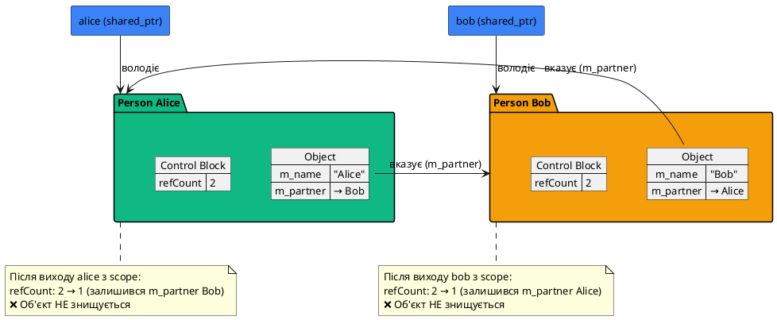
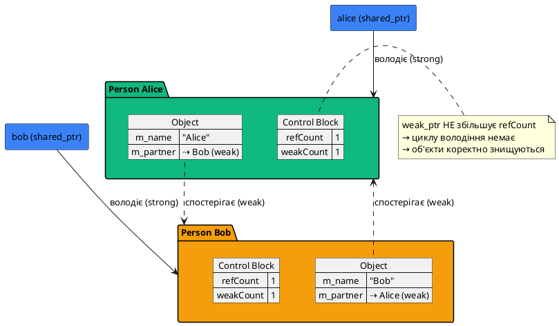
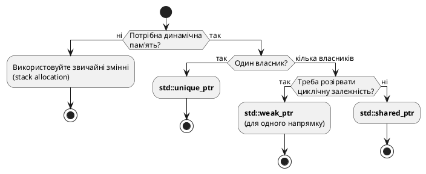

# Спільне володіння: `std::shared_ptr` та `std::weak_ptr`

## Обмеження виключного володіння

У попередній статті ми розглянули `std::unique_ptr` — розумний покажчик з **виключним володінням**. Однак у реальних програмах часто виникають ситуації, коли **кілька частин програми мають спільно володіти одним ресурсом**:

```cpp [SharedOwnershipProblem.cpp] showLineNumbers
#include <iostream>
#include <memory>
#include <string>

class Document
{
private:
    std::string m_name;

public:
    Document(const std::string& name) : m_name(name)
    {
        std::cout << "Document '" << m_name << "' opened\n";
    }

    ~Document()
    {
        std::cout << "Document '" << m_name << "' closed\n";
    }

    void display() const
    {
        std::cout << "Displaying: " << m_name << "\n";
    }
};

class Editor
{
private:
    std::unique_ptr<Document> m_document;

public:
    void openDocument(std::unique_ptr<Document> doc)
    {
        m_document = std::move(doc);
    }

    void display() const
    {
        if (m_document)
            m_document->display();
    }
};

class Viewer
{
private:
    std::unique_ptr<Document> m_document;

public:
    void setDocument(std::unique_ptr<Document> doc)
    {
        m_document = std::move(doc);
    }

    void display() const
    {
        if (m_document)
            m_document->display();
    }
};

int main()
{
    auto doc = std::make_unique<Document>("Report.txt");
    
    Editor editor;
    Viewer viewer;
    
    editor.openDocument(std::move(doc));
    // ❌ Проблема: doc тепер nullptr, не можемо передати viewer!
    // viewer.setDocument(std::move(doc));  // Помилка: doc вже порожній
    
    return 0;
}
```

::terminal-preview{title="./SharedOwnershipProblem"}
<div class="line">Document 'Report.txt' opened</div>
<div class="line">Document 'Report.txt' closed</div>
::

::caution
**Проблема виключного володіння:** `std::unique_ptr` не може бути **спільно використаний** — після `std::move()` початковий вказівник стає `nullptr`. 

Для спільного володіння потрібен інший механізм — **`std::shared_ptr`**.
::

---

## `std::shared_ptr`: семантика спільного володіння

**`std::shared_ptr<T>`** — розумний покажчик з **семантикою спільного володіння** (*shared ownership*):

- **Кілька** `std::shared_ptr` можуть володіти одним ресурсом одночасно
- **Підрахунок посилань** (*reference counting*): відстежує кількість власників
- **Автоматичне видалення:** ресурс знищується, коли останній `shared_ptr` виходить з scope
- **Копіювання дозволене:** створення копії збільшує лічильник посилань

```cpp [SharedPtrBasics.cpp] showLineNumbers
#include <iostream>
#include <memory>

class Resource
{
private:
    int m_id;

public:
    Resource(int id) : m_id(id)
    {
        std::cout << "Resource " << m_id << " acquired\n";
    }

    ~Resource()
    {
        std::cout << "Resource " << m_id << " destroyed\n";
    }

    int getId() const { return m_id; }
};

int main()
{
    std::shared_ptr<Resource> ptr1;
    
    {
        // Створюємо перший shared_ptr
        ptr1 = std::make_shared<Resource>(1);
        std::cout << "Reference count: " << ptr1.use_count() << "\n";
        
        {
            // Створюємо другий shared_ptr через копіювання
            std::shared_ptr<Resource> ptr2 = ptr1;
            std::cout << "Reference count: " << ptr1.use_count() << "\n";
            
            {
                // Створюємо третій shared_ptr
                std::shared_ptr<Resource> ptr3 = ptr2;
                std::cout << "Reference count: " << ptr1.use_count() << "\n";
                
                std::cout << "Exiting inner scope...\n";
            }  // ptr3 знищується, лічильник: 3 → 2
            
            std::cout << "Reference count: " << ptr1.use_count() << "\n";
            std::cout << "Exiting middle scope...\n";
        }  // ptr2 знищується, лічильник: 2 → 1
        
        std::cout << "Reference count: " << ptr1.use_count() << "\n";
        std::cout << "Exiting outer scope...\n";
    }  // ptr1 знищується, лічильник: 1 → 0, ресурс видаляється
    
    std::cout << "Program ends\n";
    
    return 0;
}
```

::terminal-preview{title="./SharedPtrBasics"}
<div class="line">Resource 1 acquired</div>
<div class="line">Reference count: 1</div>
<div class="line">Reference count: 2</div>
<div class="line">Reference count: 3</div>
<div class="line">Exiting inner scope...</div>
<div class="line">Reference count: 2</div>
<div class="line">Exiting middle scope...</div>
<div class="line">Reference count: 1</div>
<div class="line">Exiting outer scope...</div>
<div class="line"><span class="text-green-400 font-bold">Resource 1 destroyed</span>  ← Видаляється лише коли лічильник = 0</div>
<div class="line">Program ends</div>
::

::plant-uml{title="Механізм підрахунку посилань"}
```plantuml
@startuml
skinparam backgroundColor transparent
skinparam defaultFontName "JetBrains Mono"
skinparam defaultFontSize 13

!define SHARED_COLOR #10b981
!define CONTROL_COLOR #f59e0b

rectangle "Control Block" as CB #f59e0b {
    map "Блок управління" as Control {
        Лічильник посилань => 3
        Слабких посилань => 0
        Вказівник на об'єкт => 0x1A2B3C
        Делетер => default_delete
    }
}

rectangle "Resource" as R #3b82f6 {
    class "Resource(id=1)" as Res {
        m_id = 1
    }
}

actor "shared_ptr ptr1" as P1 #10b981
actor "shared_ptr ptr2" as P2 #10b981
actor "shared_ptr ptr3" as P3 #10b981

P1 -right-> CB : володіє
P2 -right-> CB : володіє
P3 -right-> CB : володіє

CB -down-> R : керує

note right of CB
  Коли лічильник = 0:
  → викликає делетер
  → знищує Resource
end note

@enduml
```
::

---

## Фабрична функція `std::make_shared`

Як і з `unique_ptr`, для створення `shared_ptr` рекомендується використовувати **`std::make_shared<T>()`**:

```cpp [MakeShared.cpp] showLineNumbers
#include <iostream>
#include <memory>

class Widget
{
private:
    int m_value;

public:
    Widget(int value) : m_value(value)
    {
        std::cout << "Widget(" << m_value << ") created\n";
    }

    ~Widget()
    {
        std::cout << "Widget(" << m_value << ") destroyed\n";
    }

    int getValue() const { return m_value; }
};

int main()
{
    // ❌ Старий спосіб (не рекомендується)
    std::shared_ptr<Widget> widget1(new Widget(10));
    
    // ✅ Сучасний спосіб (рекомендується)
    auto widget2 = std::make_shared<Widget>(20);
    
    std::cout << "widget1: " << widget1->getValue() << "\n";
    std::cout << "widget2: " << widget2->getValue() << "\n";
    
    return 0;
}
```

::terminal-preview{title="./MakeShared"}
<div class="line">Widget(10) created</div>
<div class="line">Widget(20) created</div>
<div class="line">widget1: 10</div>
<div class="line">widget2: 20</div>
<div class="line">Widget(20) destroyed</div>
<div class="line">Widget(10) destroyed</div>
::

### Переваги `std::make_shared`

::card-group
::card{title="1️⃣ Продуктивність" icon="i-lucide-zap"}
```cpp
// ❌ Дві алокації:
shared_ptr<Widget> p(new Widget(10));
// 1. new Widget(10) — виділення для об'єкта
// 2. Control Block — виділення для лічильника

// ✅ Одна алокація:
auto p = make_shared<Widget>(10);
// Одне виділення для об'єкта + Control Block разом
```
::

::card{title="2️⃣ Безпека винятків" icon="i-lucide-shield"}
```cpp
// ❌ Небезпечно:
processWidgets(
    shared_ptr<Widget>(new Widget(1)),
    mayThrow()
);
// Якщо mayThrow() викине виняток після new,
// але до створення shared_ptr → витік!

// ✅ Безпечно:
processWidgets(
    make_shared<Widget>(1),
    mayThrow()
);
```
::

::card{title="3️⃣ Лаконічність" icon="i-lucide-code"}
```cpp
// ❌ Багатослівно
std::shared_ptr<VeryLongClassName> p(
    new VeryLongClassName(args)
);

// ✅ Компактно з auto
auto p = std::make_shared<
    VeryLongClassName
>(args);
```
::

::card{title="4️⃣ Узгодженість" icon="i-lucide-check-check"}
Однакова форма створення:
- `make_unique<T>()`
- `make_shared<T>()`
- Легко перейти між ними
::
::

::tip
**Правило:** Завжди використовуйте `std::make_shared<T>()` замість `new` при створенні `std::shared_ptr`.
::

---

## Інтерфейс `std::shared_ptr`

`std::shared_ptr` має схожий інтерфейс з `std::unique_ptr`, але з додатковими методами для роботи з лічильником:

```cpp [SharedPtrInterface.cpp] showLineNumbers
#include <iostream>
#include <memory>

class Data
{
private:
    int m_value;

public:
    Data(int value) : m_value(value)
    {
        std::cout << "Data(" << m_value << ") created\n";
    }

    ~Data()
    {
        std::cout << "Data(" << m_value << ") destroyed\n";
    }

    void setValue(int value) { m_value = value; }
    int getValue() const { return m_value; }
};

int main()
{
    // Створення
    auto ptr1 = std::make_shared<Data>(42);
    
    // Оператори * та ->
    std::cout << "Value: " << ptr1->getValue() << "\n";
    (*ptr1).setValue(100);
    std::cout << "New value: " << ptr1->getValue() << "\n";
    
    // use_count() — кількість власників
    std::cout << "Owners: " << ptr1.use_count() << "\n";
    
    // Копіювання збільшує лічильник
    auto ptr2 = ptr1;
    std::cout << "Owners after copy: " << ptr1.use_count() << "\n";
    
    // get() — сирий вказівник
    Data* raw = ptr1.get();
    std::cout << "Raw pointer value: " << raw->getValue() << "\n";
    
    // reset() — замінює ресурс (зменшує лічильник)
    ptr2.reset();
    std::cout << "Owners after reset: " << ptr1.use_count() << "\n";
    
    // unique() — чи є єдиним власником?
    std::cout << "Is unique: " << std::boolalpha << ptr1.unique() << "\n";
    
    // Перевірка на nullptr
    if (ptr1)
        std::cout << "ptr1 is not null\n";
    
    if (!ptr2)
        std::cout << "ptr2 is null\n";
    
    return 0;
}
```

::terminal-preview{title="./SharedPtrInterface"}
<div class="line">Data(42) created</div>
<div class="line">Value: 42</div>
<div class="line">New value: 100</div>
<div class="line">Owners: 1</div>
<div class="line">Owners after copy: 2</div>
<div class="line">Raw pointer value: 100</div>
<div class="line">Owners after reset: 1</div>
<div class="line">Is unique: true</div>
<div class="line">ptr1 is not null</div>
<div class="line">ptr2 is null</div>
<div class="line">Data(100) destroyed</div>
::

### Основні методи `std::shared_ptr`

| Метод | Опис | Приклад |
|:------|:-----|:--------|
| `use_count()` | Повертає кількість власників | `ptr.use_count() == 3` |
| `unique()` | Чи є єдиним власником? | `ptr.unique() == true` |
| `get()` | Повертає сирий вказівник | `Data* raw = ptr.get();` |
| `reset()` | Замінює ресурс або робить `nullptr` | `ptr.reset(new Data(5));` |
| `operator*` | Розіменування | `(*ptr).setValue(10);` |
| `operator->` | Доступ до членів | `ptr->setValue(10);` |
| `operator bool` | Перевірка на `nullptr` | `if (ptr) { ... }` |

---

## Блок управління (*Control Block*)

`std::shared_ptr` зберігає **два вказівники** всередині:

1. **Вказівник на об'єкт** — керований ресурс
2. **Вказівник на блок управління** — метадані для підрахунку посилань

### Структура блоку управління

```cpp [ControlBlockStructure.cpp] showLineNumbers
// Спрощена схема блоку управління (псевдокод)
struct ControlBlock
{
    size_t refCount;        // Кількість shared_ptr
    size_t weakCount;       // Кількість weak_ptr
    void* resourcePtr;      // Вказівник на ресурс
    Deleter deleter;        // Функція видалення
    Allocator allocator;    // Алокатор
};
```

::plant-uml{title="Архітектура std::shared_ptr"}
```plantuml
@startuml
skinparam backgroundColor transparent
skinparam defaultFontName "JetBrains Mono"
skinparam defaultFontSize 12

package "shared_ptr (16 bytes)" {
    rectangle "ptr_to_object" as PO #3b82f6
    rectangle "ptr_to_control" as PC #f59e0b
}

package "Control Block" {
    map "Блок управління" as CB {
        refCount => 2
        weakCount => 1
        resourcePtr => 0x...
        deleter => ...
    }
}

package "Heap Memory" {
    rectangle "Managed Object" as MO #10b981 {
        class Widget {
            m_value
        }
    }
}

PO -down-> MO : вказує на
PC -down-> CB : вказує на
CB -down-> MO : керує

note right of CB
  Коли refCount = 0:
  → викликає deleter(resourcePtr)
  
  Коли weakCount = 0:
  → знищує Control Block
end note

@enduml
```
::

::note
**Важливо:** `sizeof(shared_ptr<T>)` = **16 байт** (на 64-бітних системах):
- 8 байт — вказівник на об'єкт
- 8 байт — вказівник на блок управління

Це **вдвічі більше** за `unique_ptr` (8 байт), але все одно компактно.
::

---

## Копіювання та переміщення `std::shared_ptr`

На відміну від `unique_ptr`, `std::shared_ptr` **підтримує копіювання**:

```cpp [SharedPtrCopyMove.cpp] showLineNumbers
#include <iostream>
#include <memory>
#include <utility>

class Resource
{
private:
    int m_id;

public:
    Resource(int id) : m_id(id)
    {
        std::cout << "Resource " << m_id << " created\n";
    }

    ~Resource()
    {
        std::cout << "Resource " << m_id << " destroyed\n";
    }

    int getId() const { return m_id; }
};

int main()
{
    auto ptr1 = std::make_shared<Resource>(1);
    std::cout << "ptr1 count: " << ptr1.use_count() << "\n";
    
    // ✅ Копіювання — збільшує лічильник
    auto ptr2 = ptr1;
    std::cout << "After copy:\n";
    std::cout << "  ptr1 count: " << ptr1.use_count() << "\n";
    std::cout << "  ptr2 count: " << ptr2.use_count() << "\n";
    
    // ✅ Переміщення — НЕ збільшує лічильник
    auto ptr3 = std::move(ptr1);
    std::cout << "After move:\n";
    std::cout << "  ptr1 is " << (ptr1 ? "not null" : "null") << "\n";
    std::cout << "  ptr3 count: " << ptr3.use_count() << "\n";
    
    return 0;
}
```

::terminal-preview{title="./SharedPtrCopyMove"}
<div class="line">Resource 1 created</div>
<div class="line">ptr1 count: 1</div>
<div class="line">After copy:</div>
<div class="line">  ptr1 count: 2</div>
<div class="line">  ptr2 count: 2</div>
<div class="line">After move:</div>
<div class="line">  ptr1 is null</div>
<div class="line">  ptr3 count: 2</div>
<div class="line">Resource 1 destroyed</div>
::

::debugger-view{title="Копіювання vs Переміщення"}
| Операція | Лічильник | ptr1 | ptr2 | ptr3 |
| :------- | :-------- | :--- | :--- | :--- |
| Початок | 1 | ✅ (володіє) | — | — |
| Після copy | **2** ↑ | ✅ (володіє) | ✅ (володіє) | — |
| Після move | 2 (без змін) | ❌ (`nullptr`) | ✅ (володіє) | ✅ (володіє) |
::

::tip
**Копіювання shared_ptr:**
- Збільшує `refCount`
- Обидва вказівники залишаються валідними
- Атомарна операція (безпечна для багатопоточності)

**Переміщення shared_ptr:**
- НЕ змінює `refCount`
- Вихідний вказівник стає `nullptr`
- Швидше за копіювання (не потрібно змінювати лічильник)
::

---

## Розв'язання проблеми спільного володіння

Тепер можемо переписати приклад з початку статті, використовуючи `std::shared_ptr`:

```cpp [SharedOwnershipSolution.cpp] showLineNumbers
#include <iostream>
#include <memory>
#include <string>

class Document
{
private:
    std::string m_name;

public:
    Document(const std::string& name) : m_name(name)
    {
        std::cout << "Document '" << m_name << "' opened\n";
    }

    ~Document()
    {
        std::cout << "Document '" << m_name << "' closed\n";
    }

    void display() const
    {
        std::cout << "Displaying: " << m_name << "\n";
    }
};

class Editor
{
private:
    std::shared_ptr<Document> m_document;

public:
    void openDocument(std::shared_ptr<Document> doc)
    {
        m_document = doc;  // ✅ Копіювання дозволене
    }

    void display() const
    {
        if (m_document)
            m_document->display();
    }
};

class Viewer
{
private:
    std::shared_ptr<Document> m_document;

public:
    void setDocument(std::shared_ptr<Document> doc)
    {
        m_document = doc;  // ✅ Копіювання дозволене
    }

    void display() const
    {
        if (m_document)
            m_document->display();
    }
};

int main()
{
    auto doc = std::make_shared<Document>("Report.txt");
    std::cout << "Reference count: " << doc.use_count() << "\n\n";
    
    Editor editor;
    Viewer viewer;
    
    editor.openDocument(doc);  // ✅ Працює! Лічильник: 1 → 2
    std::cout << "After editor: " << doc.use_count() << "\n";
    
    viewer.setDocument(doc);   // ✅ Працює! Лічильник: 2 → 3
    std::cout << "After viewer: " << doc.use_count() << "\n\n";
    
    editor.display();
    viewer.display();
    
    std::cout << "\nProgram ends...\n";
    
    return 0;
}  // Document знищується, коли останній shared_ptr виходить з scope
```

::terminal-preview{title="./SharedOwnershipSolution"}
<div class="line">Document 'Report.txt' opened</div>
<div class="line">Reference count: 1</div>
<div class="line"></div>
<div class="line">After editor: 2</div>
<div class="line">After viewer: 3</div>
<div class="line"></div>
<div class="line">Displaying: Report.txt</div>
<div class="line">Displaying: Report.txt</div>
<div class="line"></div>
<div class="line">Program ends...</div>
<div class="line"><span class="text-green-400 font-bold">Document 'Report.txt' closed</span>  ← Коректно знищується</div>
::

---

## Небезпека циклічних залежностей

`std::shared_ptr` має фундаментальну проблему — **циклічні залежності** (*circular references*), що призводять до **витоків пам'яті**:

```cpp [CircularDependency.cpp] showLineNumbers
#include <iostream>
#include <memory>
#include <string>

class Person;

class Person
{
private:
    std::string m_name;
    std::shared_ptr<Person> m_partner;  // ← Проблема!

public:
    Person(const std::string& name) : m_name(name)
    {
        std::cout << m_name << " created\n";
    }

    ~Person()
    {
        std::cout << m_name << " destroyed\n";
    }

    void setPartner(std::shared_ptr<Person> partner)
    {
        m_partner = partner;
    }

    const std::string& getName() const { return m_name; }
};

int main()
{
    {
        auto alice = std::make_shared<Person>("Alice");
        auto bob = std::make_shared<Person>("Bob");
        
        // Створюємо циклічну залежність
        alice->setPartner(bob);   // alice → bob (refCount bob: 1 → 2)
        bob->setPartner(alice);   // bob → alice (refCount alice: 1 → 2)
        
        std::cout << "\nExiting scope...\n";
    }  // alice і bob виходять з scope
    
    std::cout << "Program ends\n";
    
    return 0;
}
```

::terminal-preview{title="./CircularDependency"}
<div class="line">Alice created</div>
<div class="line">Bob created</div>
<div class="line"></div>
<div class="line">Exiting scope...</div>
<div class="line">Program ends</div>
<div class="line"><span class="text-rose-400 font-bold">← Alice і Bob НІКОЛИ не знищуються!</span></div>
::

::plant-uml{title="Циклічна залежність: витік пам'яті"}

::

::caution
**Циклічна залежність:**

При виході `alice` і `bob` з scope:
1. `alice` виходить → `refCount` Alice: 2 → 1 (залишився `m_partner` Bob) → **не знищується**
2. `bob` виходить → `refCount` Bob: 2 → 1 (залишився `m_partner` Alice) → **не знищується**

Результат: Alice не може знищити Bob, Bob не може знищити Alice → **витік пам'яті**!
::

---

## `std::weak_ptr`: розв'язання циклічних залежностей

**`std::weak_ptr<T>`** — розумний покажчик-**спостерігач** (*observer*):

- **НЕ володіє** ресурсом (не збільшує `refCount`)
- **Спостерігає** за ресурсом, яким володіє `shared_ptr`
- **Безпечний:** автоматично стає `nullptr`, якщо ресурс знищено
- **Конвертується** в `shared_ptr` через метод `lock()`

```cpp [WeakPtrBasics.cpp] showLineNumbers
#include <iostream>
#include <memory>

class Resource
{
private:
    int m_id;

public:
    Resource(int id) : m_id(id)
    {
        std::cout << "Resource " << m_id << " created\n";
    }

    ~Resource()
    {
        std::cout << "Resource " << m_id << " destroyed\n";
    }

    int getId() const { return m_id; }
};

int main()
{
    std::weak_ptr<Resource> weak;
    
    {
        auto shared = std::make_shared<Resource>(42);
        std::cout << "shared refCount: " << shared.use_count() << "\n";
        
        // Створюємо weak_ptr з shared_ptr
        weak = shared;
        std::cout << "After weak = shared:\n";
        std::cout << "  shared refCount: " << shared.use_count() << "\n";
        std::cout << "  weak expired: " << std::boolalpha << weak.expired() << "\n";
        
        // Використання weak_ptr: lock() → shared_ptr
        if (auto locked = weak.lock())
        {
            std::cout << "Locked! Resource ID: " << locked->getId() << "\n";
            std::cout << "  Temporary refCount: " << locked.use_count() << "\n";
        }
        
        std::cout << "\nExiting scope...\n";
    }  // shared знищується → Resource знищується
    
    std::cout << "\nAfter scope:\n";
    std::cout << "weak expired: " << weak.expired() << "\n";
    
    if (auto locked = weak.lock())
    {
        std::cout << "Resource still exists\n";
    }
    else
    {
        std::cout << "Resource was destroyed\n";
    }
    
    return 0;
}
```

::terminal-preview{title="./WeakPtrBasics"}
<div class="line">Resource 42 created</div>
<div class="line">shared refCount: 1</div>
<div class="line">After weak = shared:</div>
<div class="line">  shared refCount: 1  ← НЕ збільшився!</div>
<div class="line">  weak expired: false</div>
<div class="line">Locked! Resource ID: 42</div>
<div class="line">  Temporary refCount: 2  ← Тимчасово збільшився через lock()</div>
<div class="line"></div>
<div class="line">Exiting scope...</div>
<div class="line"><span class="text-rose-400 font-bold">Resource 42 destroyed</span></div>
<div class="line"></div>
<div class="line">After scope:</div>
<div class="line">weak expired: true</div>
<div class="line">Resource was destroyed</div>
::

### Основні методи `std::weak_ptr`

| Метод | Опис | Повертає |
|:------|:-----|:---------|
| `expired()` | Чи знищений ресурс? | `bool` |
| `lock()` | Створити `shared_ptr` (або `nullptr`) | `shared_ptr<T>` |
| `use_count()` | Кількість `shared_ptr` власників | `size_t` |
| `reset()` | Перестати спостерігати | `void` |

::tip
**Використання `weak_ptr`:**
```cpp
std::weak_ptr<Widget> weak = shared;

// ❌ Напряму НЕ можна використовувати:
// weak->doSomething();  // Помилка компіляції!

// ✅ Потрібна конвертація через lock():
if (auto temp = weak.lock())
{
    temp->doSomething();  // Працює!
}  // temp автоматично знищується
```
::

---

## Розв'язання циклічної залежності з `weak_ptr`

Тепер виправимо приклад з циклічною залежністю:

```cpp [CircularFixed.cpp] showLineNumbers
#include <iostream>
#include <memory>
#include <string>

class Person
{
private:
    std::string m_name;
    std::weak_ptr<Person> m_partner;  // ✅ Використовуємо weak_ptr!

public:
    Person(const std::string& name) : m_name(name)
    {
        std::cout << m_name << " created\n";
    }

    ~Person()
    {
        std::cout << m_name << " destroyed\n";
    }

    void setPartner(std::shared_ptr<Person> partner)
    {
        m_partner = partner;
    }

    void displayPartner() const
    {
        // Конвертуємо weak_ptr → shared_ptr для використання
        if (auto partner = m_partner.lock())
        {
            std::cout << m_name << "'s partner is " << partner->getName() << "\n";
        }
        else
        {
            std::cout << m_name << " has no partner\n";
        }
    }

    const std::string& getName() const { return m_name; }
};

int main()
{
    {
        auto alice = std::make_shared<Person>("Alice");
        auto bob = std::make_shared<Person>("Bob");
        
        std::cout << "alice refCount: " << alice.use_count() << "\n";
        std::cout << "bob refCount: " << bob.use_count() << "\n\n";
        
        // Встановлюємо партнерів (weak_ptr НЕ збільшує refCount)
        alice->setPartner(bob);   // alice → bob (refCount bob залишається 1)
        bob->setPartner(alice);   // bob → alice (refCount alice залишається 1)
        
        std::cout << "After setPartner:\n";
        std::cout << "alice refCount: " << alice.use_count() << "\n";
        std::cout << "bob refCount: " << bob.use_count() << "\n\n";
        
        alice->displayPartner();
        bob->displayPartner();
        
        std::cout << "\nExiting scope...\n";
    }  // alice і bob коректно знищуються!
    
    std::cout << "Program ends\n";
    
    return 0;
}
```

::terminal-preview{title="./CircularFixed"}
<div class="line">Alice created</div>
<div class="line">Bob created</div>
<div class="line">alice refCount: 1</div>
<div class="line">bob refCount: 1</div>
<div class="line"></div>
<div class="line">After setPartner:</div>
<div class="line">alice refCount: 1  ← НЕ змінився!</div>
<div class="line">bob refCount: 1  ← НЕ змінився!</div>
<div class="line"></div>
<div class="line">Alice's partner is Bob</div>
<div class="line">Bob's partner is Alice</div>
<div class="line"></div>
<div class="line">Exiting scope...</div>
<div class="line"><span class="text-green-400 font-bold">Bob destroyed</span></div>
<div class="line"><span class="text-green-400 font-bold">Alice destroyed</span></div>
<div class="line">Program ends</div>
::

::plant-uml{title="Розв'язання циклу через weak_ptr"}

::

---

## Практичні приклади

::::accordion
:::accordion-item{title="Приклад 1: Кеш з автоматичним видаленням"}
```cpp
#include <iostream>
#include <memory>
#include <unordered_map>
#include <string>

class Texture
{
private:
    std::string m_filename;

public:
    Texture(const std::string& filename) : m_filename(filename)
    {
        std::cout << "Texture '" << m_filename << "' loaded\n";
    }

    ~Texture()
    {
        std::cout << "Texture '" << m_filename << "' unloaded\n";
    }

    const std::string& getFilename() const { return m_filename; }
};

class TextureCache
{
private:
    // Зберігаємо weak_ptr — не утримуємо текстури примусово
    std::unordered_map<std::string, std::weak_ptr<Texture>> m_cache;

public:
    std::shared_ptr<Texture> loadTexture(const std::string& filename)
    {
        // Перевіряємо кеш
        auto it = m_cache.find(filename);
        if (it != m_cache.end())
        {
            // Спробуємо отримати shared_ptr з weak_ptr
            if (auto texture = it->second.lock())
            {
                std::cout << "Cache hit: " << filename << "\n";
                return texture;
            }
            else
            {
                // Текстура була знищена — видаляємо з кешу
                std::cout << "Cache expired: " << filename << "\n";
                m_cache.erase(it);
            }
        }

        // Завантажуємо нову текстуру
        std::cout << "Cache miss: loading " << filename << "\n";
        auto texture = std::make_shared<Texture>(filename);
        m_cache[filename] = texture;  // Зберігаємо weak_ptr
        
        return texture;
    }

    void printCacheStatus()
    {
        std::cout << "\n=== Cache Status ===\n";
        for (const auto& [filename, weak] : m_cache)
        {
            if (weak.expired())
                std::cout << "  " << filename << ": EXPIRED\n";
            else
                std::cout << "  " << filename << ": active (refCount=" 
                          << weak.use_count() << ")\n";
        }
        std::cout << "====================\n\n";
    }
};

int main()
{
    TextureCache cache;
    
    // Завантажуємо текстури
    {
        auto tex1 = cache.loadTexture("player.png");
        auto tex2 = cache.loadTexture("enemy.png");
        
        cache.printCacheStatus();
        
        // Повторне завантаження — з кешу
        auto tex3 = cache.loadTexture("player.png");
        
        cache.printCacheStatus();
        
        std::cout << "Exiting scope...\n";
    }  // Текстури знищуються (refCount → 0)
    
    std::cout << "\nAfter scope:\n";
    cache.printCacheStatus();
    
    // Спроба завантажити знову — кеш протух
    auto tex4 = cache.loadTexture("player.png");
    
    return 0;
}
```

**Результат:**
```
Cache miss: loading player.png
Texture 'player.png' loaded
Cache miss: loading enemy.png
Texture 'enemy.png' loaded

=== Cache Status ===
  player.png: active (refCount=1)
  enemy.png: active (refCount=1)
====================

Cache hit: player.png

=== Cache Status ===
  player.png: active (refCount=2)
  enemy.png: active (refCount=1)
====================

Exiting scope...
Texture 'enemy.png' unloaded
Texture 'player.png' unloaded

After scope:

=== Cache Status ===
  player.png: EXPIRED
  enemy.png: EXPIRED
====================

Cache expired: player.png
Cache miss: loading player.png
Texture 'player.png' loaded
Texture 'player.png' unloaded
```
:::

:::accordion-item{title="Приклад 2: Дерево зі зворотними посиланнями"}
```cpp
#include <iostream>
#include <memory>
#include <vector>
#include <string>

class TreeNode
{
private:
    std::string m_name;
    std::weak_ptr<TreeNode> m_parent;  // ✅ weak_ptr — уникаємо циклу
    std::vector<std::shared_ptr<TreeNode>> m_children;  // ✅ shared_ptr — володіємо дітьми

public:
    TreeNode(const std::string& name) : m_name(name)
    {
        std::cout << "Node '" << m_name << "' created\n";
    }

    ~TreeNode()
    {
        std::cout << "Node '" << m_name << "' destroyed\n";
    }

    void addChild(std::shared_ptr<TreeNode> child)
    {
        child->m_parent = shared_from_this();  // Встановлюємо weak_ptr на батька
        m_children.push_back(child);
    }

    void printPath() const
    {
        std::cout << m_name;
        
        if (auto parent = m_parent.lock())
        {
            std::cout << " → parent: ";
            parent->printPath();
        }
        else
        {
            std::cout << " (root)";
        }
        
        std::cout << "\n";
    }

    void printTree(int depth = 0) const
    {
        for (int i = 0; i < depth; ++i)
            std::cout << "  ";
        std::cout << "- " << m_name << "\n";

        for (const auto& child : m_children)
            child->printTree(depth + 1);
    }

    static std::shared_ptr<TreeNode> create(const std::string& name)
    {
        return std::make_shared<TreeNode>(name);
    }
};

// Потрібно успадкуватися від enable_shared_from_this для shared_from_this()
class TreeNodeFixed : public std::enable_shared_from_this<TreeNodeFixed>
{
private:
    std::string m_name;
    std::weak_ptr<TreeNodeFixed> m_parent;
    std::vector<std::shared_ptr<TreeNodeFixed>> m_children;

public:
    TreeNodeFixed(const std::string& name) : m_name(name)
    {
        std::cout << "Node '" << m_name << "' created\n";
    }

    ~TreeNodeFixed()
    {
        std::cout << "Node '" << m_name << "' destroyed\n";
    }

    void addChild(std::shared_ptr<TreeNodeFixed> child)
    {
        child->m_parent = shared_from_this();
        m_children.push_back(child);
    }

    void printPath() const
    {
        std::cout << m_name;
        
        if (auto parent = m_parent.lock())
        {
            std::cout << " → parent: ";
            parent->printPath();
        }
        else
        {
            std::cout << " (root)";
        }
        
        std::cout << "\n";
    }

    void printTree(int depth = 0) const
    {
        for (int i = 0; i < depth; ++i)
            std::cout << "  ";
        std::cout << "- " << m_name << "\n";

        for (const auto& child : m_children)
            child->printTree(depth + 1);
    }
};

int main()
{
    // Створюємо дерево
    auto root = std::make_shared<TreeNodeFixed>("Root");
    
    auto child1 = std::make_shared<TreeNodeFixed>("Child1");
    auto child2 = std::make_shared<TreeNodeFixed>("Child2");
    
    root->addChild(child1);
    root->addChild(child2);
    
    auto grandchild1 = std::make_shared<TreeNodeFixed>("Grandchild1");
    auto grandchild2 = std::make_shared<TreeNodeFixed>("Grandchild2");
    
    child1->addChild(grandchild1);
    child1->addChild(grandchild2);
    
    std::cout << "\n=== Tree Structure ===\n";
    root->printTree();
    
    std::cout << "\n=== Paths ===\n";
    grandchild1->printPath();
    grandchild2->printPath();
    child2->printPath();
    
    std::cout << "\nDestroying tree...\n";
    
    return 0;
}  // Каскадне знищення: root → children → grandchildren
```

**Результат:**
```
Node 'Root' created
Node 'Child1' created
Node 'Child2' created
Node 'Grandchild1' created
Node 'Grandchild2' created

=== Tree Structure ===
- Root
  - Child1
    - Grandchild1
    - Grandchild2
  - Child2

=== Paths ===
Grandchild1 → parent: Child1 → parent: Root (root)
Grandchild2 → parent: Child1 → parent: Root (root)
Child2 → parent: Root (root)

Destroying tree...
Node 'Root' destroyed
Node 'Child1' destroyed
Node 'Grandchild1' destroyed
Node 'Grandchild2' destroyed
Node 'Child2' destroyed
```
:::

:::accordion-item{title="Приклад 3: Система подій з підписниками"}
```cpp
#include <iostream>
#include <memory>
#include <vector>
#include <string>
#include <algorithm>

class Subscriber;

class Event
{
private:
    std::string m_name;

public:
    Event(const std::string& name) : m_name(name) {}
    
    const std::string& getName() const { return m_name; }
};

class Subscriber
{
private:
    std::string m_name;

public:
    Subscriber(const std::string& name) : m_name(name)
    {
        std::cout << "Subscriber '" << m_name << "' created\n";
    }

    ~Subscriber()
    {
        std::cout << "Subscriber '" << m_name << "' destroyed\n";
    }

    void onEvent(const Event& event)
    {
        std::cout << "[" << m_name << "] received event: " 
                  << event.getName() << "\n";
    }

    const std::string& getName() const { return m_name; }
};

class EventBus
{
private:
    // weak_ptr дозволяє підписникам знищуватися незалежно
    std::vector<std::weak_ptr<Subscriber>> m_subscribers;

public:
    void subscribe(std::shared_ptr<Subscriber> subscriber)
    {
        m_subscribers.push_back(subscriber);
        std::cout << "Subscribed: " << subscriber->getName() << "\n";
    }

    void publish(const Event& event)
    {
        std::cout << "\n=== Publishing event: " << event.getName() << " ===\n";
        
        // Видаляємо протухлі підписки
        m_subscribers.erase(
            std::remove_if(m_subscribers.begin(), m_subscribers.end(),
                [](const std::weak_ptr<Subscriber>& weak) {
                    return weak.expired();
                }),
            m_subscribers.end()
        );
        
        // Сповіщаємо активних підписників
        for (const auto& weak : m_subscribers)
        {
            if (auto subscriber = weak.lock())
            {
                subscriber->onEvent(event);
            }
        }
        
        std::cout << "Active subscribers: " << m_subscribers.size() << "\n";
    }
};

int main()
{
    EventBus bus;
    
    auto sub1 = std::make_shared<Subscriber>("Sub1");
    auto sub2 = std::make_shared<Subscriber>("Sub2");
    auto sub3 = std::make_shared<Subscriber>("Sub3");
    
    bus.subscribe(sub1);
    bus.subscribe(sub2);
    bus.subscribe(sub3);
    
    bus.publish(Event("UserLogin"));
    
    std::cout << "\nDestroying Sub2...\n";
    sub2.reset();  // Видаляємо підписника
    
    bus.publish(Event("DataUpdated"));
    
    return 0;
}
```

**Результат:**
```
Subscriber 'Sub1' created
Subscriber 'Sub2' created
Subscriber 'Sub3' created
Subscribed: Sub1
Subscribed: Sub2
Subscribed: Sub3

=== Publishing event: UserLogin ===
[Sub1] received event: UserLogin
[Sub2] received event: UserLogin
[Sub3] received event: UserLogin
Active subscribers: 3

Destroying Sub2...
Subscriber 'Sub2' destroyed

=== Publishing event: DataUpdated ===
[Sub1] received event: DataUpdated
[Sub3] received event: DataUpdated
Active subscribers: 2
Subscriber 'Sub3' destroyed
Subscriber 'Sub1' destroyed
```
:::
::::


---

## Конвертація між розумними покажчиками

### `std::unique_ptr` → `std::shared_ptr`

`std::unique_ptr` можна **перемістити** в `std::shared_ptr`:

```cpp [UniqueTo Shared.cpp] showLineNumbers
#include <iostream>
#include <memory>

class Widget
{
private:
    int m_id;

public:
    Widget(int id) : m_id(id)
    {
        std::cout << "Widget " << m_id << " created\n";
    }

    ~Widget()
    {
        std::cout << "Widget " << m_id << " destroyed\n";
    }

    int getId() const { return m_id; }
};

// Фабрика повертає unique_ptr
std::unique_ptr<Widget> createWidget(int id)
{
    return std::make_unique<Widget>(id);
}

int main()
{
    // Отримуємо unique_ptr
    auto uniqueWidget = createWidget(1);
    
    // ✅ Конвертуємо в shared_ptr через переміщення
    std::shared_ptr<Widget> sharedWidget = std::move(uniqueWidget);
    
    std::cout << "uniqueWidget is " << (uniqueWidget ? "not null" : "null") << "\n";
    std::cout << "sharedWidget refCount: " << sharedWidget.use_count() << "\n";
    
    // Тепер можемо створювати копії
    auto sharedWidget2 = sharedWidget;
    std::cout << "After copy: refCount = " << sharedWidget.use_count() << "\n";
    
    return 0;
}
```

::terminal-preview{title="./UniqueToShared"}
<div class="line">Widget 1 created</div>
<div class="line">uniqueWidget is null</div>
<div class="line">sharedWidget refCount: 1</div>
<div class="line">After copy: refCount = 2</div>
<div class="line">Widget 1 destroyed</div>
::

::tip
**Патерн повернення:**
```cpp
// ✅ Повертайте unique_ptr з фабрик
std::unique_ptr<Widget> createWidget();

// Виклик може обрати:
auto u = createWidget();              // Виключне володіння
std::shared_ptr<Widget> s = createWidget();  // Спільне володіння (auto-конвертація)
```
::

### ❌ `std::shared_ptr` → `std::unique_ptr` неможливо

```cpp [SharedToUnique.cpp] showLineNumbers
std::shared_ptr<Widget> shared = std::make_shared<Widget>(1);

// ❌ Помилка компіляції:
// std::unique_ptr<Widget> unique = shared;
// std::unique_ptr<Widget> unique = std::move(shared);

// Чому? shared_ptr може мати кілька власників,
// unique_ptr вимагає ВИКЛЮЧНОГО володіння
```

---

## `std::enable_shared_from_this`

Іноді об'єкт всередині свого методу повинен **повернути `shared_ptr` на себе**. Для цього використовується патерн `std::enable_shared_from_this`:

```cpp [EnableSharedFromThis.cpp] showLineNumbers
#include <iostream>
#include <memory>
#include <vector>

class Node : public std::enable_shared_from_this<Node>
{
private:
    int m_value;

public:
    Node(int value) : m_value(value)
    {
        std::cout << "Node(" << m_value << ") created\n";
    }

    ~Node()
    {
        std::cout << "Node(" << m_value << ") destroyed\n";
    }

    // Метод, що повертає shared_ptr на себе
    std::shared_ptr<Node> getPtr()
    {
        return shared_from_this();
    }

    int getValue() const { return m_value; }
};

class NodeManager
{
private:
    std::vector<std::shared_ptr<Node>> m_nodes;

public:
    void addNode(std::shared_ptr<Node> node)
    {
        m_nodes.push_back(node);
        std::cout << "Node added to manager\n";
    }

    void printNodes() const
    {
        std::cout << "Nodes: ";
        for (const auto& node : m_nodes)
            std::cout << node->getValue() << " ";
        std::cout << "\n";
    }
};

int main()
{
    NodeManager manager;
    
    auto node = std::make_shared<Node>(42);
    std::cout << "Initial refCount: " << node.use_count() << "\n";
    
    // Об'єкт може зареєструвати себе в менеджері
    manager.addNode(node->getPtr());
    std::cout << "After registration: " << node.use_count() << "\n";
    
    manager.printNodes();
    
    return 0;
}
```

::terminal-preview{title="./EnableSharedFromThis"}
<div class="line">Node(42) created</div>
<div class="line">Initial refCount: 1</div>
<div class="line">Node added to manager</div>
<div class="line">After registration: 2</div>
<div class="line">Nodes: 42</div>
<div class="line">Node(42) destroyed</div>
::

::warning
**Обмеження `shared_from_this()`:**

1. **Клас ПОВИНЕН успадковуватися** від `enable_shared_from_this<T>`
2. **Об'єкт ПОВИНЕН керуватися** `shared_ptr` (не stack, не `unique_ptr`)
3. **НЕ викликайте** `shared_from_this()` в конструкторі!

```cpp
class Widget : public std::enable_shared_from_this<Widget>
{
public:
    Widget()
    {
        // ❌ НЕБЕЗПЕЧНО — об'єкт ще не керується shared_ptr!
        // auto self = shared_from_this();
    }

    void init()
    {
        // ✅ Безпечно — викликається після створення shared_ptr
        auto self = shared_from_this();
    }
};

int main()
{
    auto w = std::make_shared<Widget>();
    w->init();  // ✅ Працює
}
```
::

---

## Багатопоточність та `std::shared_ptr`

`std::shared_ptr` має **обмежену підтримку** багатопоточності:

::card-group
::card{title="✅ Потокобезпечні операції" icon="i-lucide-shield-check"}
- **Підрахунок посилань:** атомарний (через `std::atomic`)
- **Копіювання/переміщення** різних `shared_ptr` → безпечно
- **Одночасне читання** з різних потоків → безпечно
::

::card{title="❌ НЕ потокобезпечні операції" icon="i-lucide-shield-alert"}
- **Зміна одного `shared_ptr`** з кількох потоків → гонка даних
- **Зміна об'єкта**, на який вказує `shared_ptr` → потребує синхронізації
- **`reset()` / `operator=`** одного `shared_ptr` → не атомарні
::
::

```cpp [ThreadSafety.cpp] showLineNumbers
#include <iostream>
#include <memory>
#include <thread>
#include <vector>

class Counter
{
private:
    int m_value = 0;

public:
    void increment()
    {
        ++m_value;  // ❌ Гонка даних!
    }

    int getValue() const { return m_value; }
};

int main()
{
    auto counter = std::make_shared<Counter>();
    
    std::vector<std::thread> threads;
    
    // ✅ Копіювання shared_ptr у кожен потік — безпечно
    for (int i = 0; i < 10; ++i)
    {
        threads.emplace_back([counter]() {  // Копія shared_ptr
            for (int j = 0; j < 1000; ++j)
                counter->increment();  // ❌ Але increment() не потокобезпечний!
        });
    }
    
    for (auto& t : threads)
        t.join();
    
    // Результат недетермінований через гонку даних
    std::cout << "Final value: " << counter->getValue() 
              << " (expected: 10000)\n";
    
    return 0;
}
```

::caution
**Правило:** `std::shared_ptr` гарантує потокобезпечність **лічильника посилань**, але **не гарантує** потокобезпечність **самого об'єкта**.

Для синхронізації об'єкта використовуйте:
- `std::mutex` / `std::lock_guard`
- Атомарні операції (`std::atomic<T>`)
- Незмінні об'єкти (`const` методи)
::

---

## Продуктивність: накладні витрати

### Порівняння розмірів

| Тип покажчика | Розмір (64-біт) | Heap алокації |
|:--------------|:----------------|:--------------|
| Сирий вказівник `T*` | 8 байт | 0 (керується вручну) |
| `std::unique_ptr<T>` | 8 байт | 1 (об'єкт) |
| `std::shared_ptr<T>` | 16 байт | 2 (об'єкт + Control Block) |
| `std::weak_ptr<T>` | 16 байт | 0 (спостерігає Control Block) |

### Операції та їх вартість

::card-group
::card{title="`unique_ptr`" icon="i-lucide-zap"}
- **Створення:** O(1) — виділення об'єкта
- **Копіювання:** ❌ Заборонено
- **Переміщення:** O(1) — переприсвоєння вказівника
- **Знищення:** O(1) — виклик `delete`
::

::card{title="`shared_ptr`" icon="i-lucide-gauge"}
- **Створення:** O(1) — об'єкт + Control Block
- **Копіювання:** O(1) — атомарний increment refCount
- **Переміщення:** O(1) — переприсвоєння вказівників
- **Знищення:** O(1) — атомарний decrement refCount
::

::card{title="`weak_ptr`" icon="i-lucide-eye"}
- **Створення:** O(1) — копія вказівника на Control Block
- **Копіювання:** O(1) — атомарний increment weakCount
- **`lock()`:** O(1) — атомарна перевірка + створення `shared_ptr`
- **Знищення:** O(1) — атомарний decrement weakCount
::
::

::tip
**Рекомендації з продуктивності:**

1. **Використовуйте `unique_ptr` за замовчуванням** — найменші накладні витрати
2. **`shared_ptr` для спільного володіння** — коли дійсно потрібне
3. **Уникайте зайвого копіювання** `shared_ptr` — передавайте `const shared_ptr&` або `T*`
4. **`make_shared` швидше за `shared_ptr(new T)`** — одна алокація замість двох
::

---

## Вибір правильного розумного покажчика

::plant-uml{title="Дерево рішень: який покажчик обрати?"}

::

### Таблиця вибору

| Ситуація | Рішення | Обґрунтування |
|:---------|:--------|:--------------|
| Фабрична функція | `unique_ptr` | Caller обирає семантику володіння |
| Контейнер поліморфних об'єктів | `unique_ptr` або `shared_ptr` | Залежить від потреби копіювання |
| Кеш | `weak_ptr` | Не утримує об'єкти примусово |
| Граф з циклами | `shared_ptr` + `weak_ptr` | Розриває цикли |
| Дерево батько-діти | Батько: `shared_ptr`, Діти: `weak_ptr` | Уникає циклу |
| Спостерігач (Observer) | `weak_ptr` | Підписники можуть зникнути |
| PIMPL ідіома | `unique_ptr` | Виключне володіння impl |
| Член класу (ексклюзивний) | `unique_ptr` | Простіше та швидше |
| Член класу (спільний) | `shared_ptr` | Коли потрібне спільне володіння |

---

## Поширені помилки

### ❌ Помилка 1: Створення `shared_ptr` з одного raw pointer двічі

```cpp [DoubleSharedPtr.cpp] showLineNumbers
Widget* raw = new Widget(1);

std::shared_ptr<Widget> ptr1(raw);
std::shared_ptr<Widget> ptr2(raw);  // ❌ КАТАСТРОФА!

// ptr1 і ptr2 мають РІЗНІ Control Blocks
// → подвійне delete при знищенні!
```

**Рішення:** Завжди використовуйте `make_shared` або копіюйте існуючий `shared_ptr`.

### ❌ Помилка 2: Висячий `weak_ptr` без перевірки

```cpp [DanglingWeakPtr.cpp] showLineNumbers
std::weak_ptr<Widget> weak;

{
    auto shared = std::make_shared<Widget>(1);
    weak = shared;
}  // shared знищується

// ❌ Помилка: не перевірили expired()
auto widget = weak.lock();
widget->doSomething();  // ← widget == nullptr!
```

**Рішення:** Завжди перевіряйте `expired()` або перевіряйте результат `lock()`.

### ❌ Помилка 3: `shared_from_this()` на stack-об'єкті

```cpp [SharedFromThisOnStack.cpp] showLineNumbers
class Widget : public std::enable_shared_from_this<Widget>
{
public:
    std::shared_ptr<Widget> getPtr()
    {
        return shared_from_this();
    }
};

int main()
{
    Widget widget;  // ❌ Stack-об'єкт
    auto ptr = widget.getPtr();  // ← std::bad_weak_ptr виняток!
}
```

**Рішення:** `enable_shared_from_this` працює ЛИШЕ з об'єктами, керованими `shared_ptr`.

### ❌ Помилка 4: Зайве копіювання `shared_ptr`

```cpp [ExcessiveCopying.cpp] showLineNumbers
// ❌ Погано: копіює shared_ptr
void process(std::shared_ptr<Widget> widget)
{
    widget->doSomething();
}

// ✅ Краще: приймає посилання (якщо не зберігає)
void process(const std::shared_ptr<Widget>& widget)
{
    widget->doSomething();
}

// ✅ Найкраще: приймає raw pointer (якщо не володіє)
void process(Widget* widget)
{
    if (widget)
        widget->doSomething();
}

int main()
{
    auto widget = std::make_shared<Widget>();
    
    process(widget);         // Копіювання
    process(widget);         // Посилання (no-copy)
    process(widget.get());   // Raw pointer (no-copy)
}
```

---

## Резюме

::card-group
::card{title="📌 `std::shared_ptr`" icon="i-lucide-users"}
- **Спільне володіння:** кілька власників одного ресурсу
- **Підрахунок посилань:** автоматичне відстеження
- **Копіювання дозволене:** збільшує `refCount`
- **Знищення:** коли останній `shared_ptr` виходить з scope
- **Розмір:** 16 байт (2 вказівники)
::

::card{title="📌 `std::weak_ptr`" icon="i-lucide-eye"}
- **Спостерігач:** не володіє ресурсом
- **Розриває цикли:** вирішує циклічні залежності
- **Безпечний:** автоматично стає `nullptr`
- **Використання:** через `lock()` → `shared_ptr`
- **Розмір:** 16 байт (як `shared_ptr`)
::

::card{title="✅ Коли використовувати" icon="i-lucide-check-circle"}
**`shared_ptr`:**
- Спільне володіння ресурсом
- Контейнери з копіюванням
- Графи об'єктів
- Багатопоточність (розподілений доступ)

**`weak_ptr`:**
- Кеші (не утримує примусово)
- Розрив циклів у графах
- Паттерн Observer
- Зворотні посилання (батько ← дитина)
::

::card{title="⚠️ Небезпеки" icon="i-lucide-alert-triangle"}
- Циклічні залежності → витоки
- Подвійний Control Block → crash
- Зайве копіювання → overhead
- Багатопоточність → потребує синхронізації об'єкта
::
::

::note
**Наступна тема:** У статті 100 розглянемо **контейнери STL** — `std::vector`, `std::list`, `std::map` та алгоритми стандартної бібліотеки для ефективної роботи з колекціями.
::

---

## Завдання для самоперевірки

1. **Що виведе програма?**
   ```cpp
   auto ptr1 = std::make_shared<int>(10);
   std::weak_ptr<int> weak = ptr1;
   ptr1.reset();
   
   if (auto ptr2 = weak.lock())
       std::cout << *ptr2;
   else
       std::cout << "nullptr";
   ```

2. **Чи є витік пам'яті?**
   ```cpp
   struct Node {
       std::shared_ptr<Node> next;
   };
   
   auto n1 = std::make_shared<Node>();
   auto n2 = std::make_shared<Node>();
   n1->next = n2;
   n2->next = n1;
   ```

3. **Як виправити?**
   ```cpp
   class Widget : public std::enable_shared_from_this<Widget> {
   public:
       Widget() {
           auto self = shared_from_this();  // ← Що не так?
       }
   };
   ```

4. **Коли обрати `unique_ptr` vs `shared_ptr`?**

::details{summary="Відповіді"}
1. **Відповідь:** Виведе `nullptr`. Після `ptr1.reset()` ресурс знищується (refCount = 0), тому `weak.lock()` повертає `nullptr`.

2. **Відповідь:** **Так, витік пам'яті!** Циклічна залежність: `n1` → `n2` → `n1`. Обидва вузли мають `refCount = 2`, тому не знищуються. **Рішення:** замінити одне з полів `next` на `std::weak_ptr<Node>`.

3. **Відповідь:** `shared_from_this()` НЕ можна викликати в конструкторі — об'єкт ще не керується `shared_ptr`. **Рішення:** створити метод `init()` і викликати його після створення `shared_ptr`.

4. **Відповідь:** 
   - **`unique_ptr`:** виключне володіння, один власник, легший overhead, не можна копіювати
   - **`shared_ptr`:** спільне володіння, кілька власників, більший overhead, можна копіювати
   
   **Правило:** використовуйте `unique_ptr` за замовчуванням, переходьте на `shared_ptr` лише якщо дійсно потрібне спільне володіння.
::
