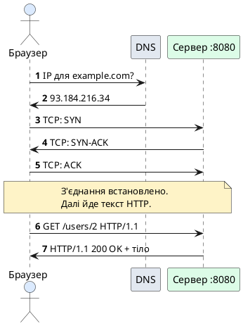

# Веб, клієнт-сервер і HTTP: що відбувається між браузером і сервером

::card-group

::card{title="🎯 Мета лекції" icon="i-lucide-target"}

- Пояснити клієнт-серверну модель і розподіл ролей між frontend та backend.
- Розбирати HTTP-запит і відповідь за частинами: стартовий рядок, заголовки, тіло.
- Розрізняти методи та сімейства статус-кодів і знати, для чого кожен.
- Надсилати запити за допомогою `curl` і читати відповіді разом із заголовками.
- Побачити, що HTTP-сервер — це програма, яка читає й пише текст у TCP-з'єднанні.

::

::card{title="🔑 Ключові терміни" icon="i-lucide-key"}

- **Клієнт (*client*):** програма, яка надсилає запит (браузер, `curl`, мобільний застосунок).
- **Сервер (*server*):** програма, яка слухає порт і відповідає на запити.
- **HTTP:** текстовий протокол прикладного рівня «запит → відповідь».
- **Ресурс (*resource*):** те, до чого звертається запит і що ідентифікується URL.
- **Без збереження стану (*stateless*):** сервер не пам'ятає попередніх запитів клієнта.

::

::

## Клієнт, сервер і розподіл ролей

Сторінка в браузері складається з двох частин. Одна виконується в браузері користувача: це розмітка, стилі й скрипти, тобто *frontend*. Друга виконується на машині розробника чи в хмарі: це обробка запитів, перевірка прав, робота з даними, тобто *backend*. Ця серія лекцій присвячена другій частині, яку пишемо мовою C++ із фреймворком Crow.

Взаємодія завжди має однаковий вигляд: клієнт надсилає запит, сервер повертає відповідь. Ініціатор — клієнт. Сервер не може сам «написати» клієнту, поки той не звернувся.

{.diagram-img}

Клієнтом буває не лише браузер. Мобільний застосунок, скрипт на Python чи інший сервер звертаються до того самого API за тими ж правилами. Тому логіку, яка має працювати для всіх клієнтів, розміщують на сервері: перевірку пароля, підрахунок суми замовлення, запис у базу.

::note
Frontend і backend не обов'язково пишуться однією мовою. Їх поєднує лише протокол обміну, у нашому випадку HTTP із даними у форматі JSON.
::

## Що відбувається, коли вводиш адресу

Адреса `http://localhost:8080/users/2` має чітко визначені частини, і кожну обробляє окремий механізм.

{.diagram-img}

- **Схема** (`http`) визначає протокол. `https` — той самий HTTP, обгорнутий у шифрування TLS.
- **Хост** (`localhost`) — ім'я машини. Для `localhost` це ваш власний комп'ютер, IP-адреса `127.0.0.1`. Для зовнішніх сайтів ім'я перетворює на IP-адресу служба DNS.
- **Порт** (`8080`) — номер «дверей» на машині. Якщо його не вказати, `http` використовує 80, `https` — 443.
- **Шлях** (`/users/2`) вказує ресурс на сервері.
- **Рядок запиту** (*query string*) після `?` передає додаткові параметри у вигляді пар `ключ=значення`.

Браузер виконує послідовність кроків: визначає IP, відкриває TCP-з'єднання, надсилає HTTP-текст, отримує відповідь і закриває з'єднання (або залишає відкритим для наступних запитів).

::plant-uml{alt="Послідовність: DNS, TCP-з'єднання, HTTP-запит і відповідь"}



::

Для `localhost` кроки DNS не потрібні: ім'я відоме системі заздалегідь.

## Структура HTTP-повідомлення

HTTP — текстовий протокол. Запит і відповідь мають однакову будову з чотирьох частин: стартовий рядок, заголовки, порожній рядок і тіло.

{.diagram-img}

Стартовий рядок запиту містить метод, шлях і версію протоколу. Заголовки — це пари `Ім'я: значення`, по одній на рядок. Порожній рядок (`\r\n\r\n`) відокремлює заголовки від тіла. Тіло є не завжди: у `GET`-запиті його зазвичай немає.

Заголовок `Content-Length` повідомляє, скільки байтів містить тіло. Без нього отримувач не знає, де повідомлення закінчується, адже TCP передає лише потік байтів без меж повідомлень.

### Методи

Метод описує намір клієнта щодо ресурсу.

| Метод | Призначення | Є тіло запиту | Безпечний (не змінює дані) |
| ----- | ----------- | ------------- | -------------------------- |
| `GET` | отримати ресурс | ні | так |
| `POST` | створити ресурс або виконати дію | так | ні |
| `PUT` | замінити ресурс повністю | так | ні |
| `PATCH` | змінити частину ресурсу | так | ні |
| `DELETE` | видалити ресурс | зазвичай ні | ні |

Кожен метод докладно розглядається в лекції про CRUD. Тут важливо запам'ятати одне правило: `GET` ніколи не змінює дані на сервері. Пошукові роботи й браузери довільно завантажують `GET`-адреси, і якщо видалення зроблено через `GET`, роботи видалять усе.

### Статус-коди

Перша цифра коду відповіді показує категорію результату.

| Код | Назва | Коли застосовується |
| --- | ----- | ------------------- |
| 200 | OK | запит виконано |
| 201 | Created | ресурс створено |
| 204 | No Content | виконано, відповідь без тіла |
| 301 / 302 | Moved / Found | ресурс за іншою адресою |
| 400 | Bad Request | клієнт надіслав некоректний запит |
| 401 | Unauthorized | потрібна автентифікація |
| 403 | Forbidden | автентифікований, але прав немає |
| 404 | Not Found | ресурсу немає |
| 500 | Internal Server Error | помилка в коді сервера |

### Заголовки

Найчастіше трапляються такі заголовки.

| Заголовок | Напрямок | Значення |
| --------- | -------- | -------- |
| `Host` | запит | ім'я хоста; обов'язковий в HTTP/1.1 |
| `User-Agent` | запит | програма-клієнт |
| `Accept` | запит | які формати відповіді клієнт приймає |
| `Content-Type` | обидва | формат тіла: `text/html`, `application/json` |
| `Content-Length` | обидва | розмір тіла в байтах |
| `Authorization` | запит | облікові дані клієнта |
| `Set-Cookie` / `Cookie` | відповідь / запит | збереження стану між запитами |
| `Location` | відповідь | адреса для перенаправлення |

## Перегляд трафіку через curl

Утиліта `curl` надсилає запит і показує відповідь без браузера. Прапорець `-i` додає до виводу заголовки відповіді, `-v` показує ще й надісланий запит.

```bash
curl -i http://localhost:8080/
```

Прапорець `-X` задає метод, `-H` додає заголовок, `-d` передає тіло.

```bash
curl -X POST -H "Content-Type: application/json" -d '{"name":"Іван"}' http://localhost:8080/users
```

::tip
У PowerShell на Windows `curl` — псевдонім іншої команди. Використовуйте `curl.exe` або запускайте команди з Git Bash чи WSL.
::

## Сервер на сирих сокетах

Щоб побачити, що саме приймає сервер, написано програму без фреймворку: `labs/crow-demos/01-http-basics`. Вона відкриває TCP-сокет, читає текст запиту й повертає відповідь, зібрану вручну.

```cpp
std::string response = build_response(200, "OK", "text/html; charset=utf-8",
                                      "<h1>Привіт з сирого HTTP-сервера</h1>");
send(client, response.data(), static_cast<int>(response.size()), 0);
```

Функція `build_response` складає рядок за правилами протоколу: стартовий рядок, `Content-Type`, `Content-Length`, порожній рядок і тіло.

```cpp
std::ostringstream out;
out << "HTTP/1.1 " << status << ' ' << reason << "\r\n"
    << "Content-Type: " << content_type << "\r\n"
    << "Content-Length: " << body.size() << "\r\n"
    << "Connection: close\r\n"
    << "\r\n"
    << body;
```

Кожен рядок закінчується парою символів `\r\n`, а не лише `\n`. Порожній рядок — це друга така пара поспіль.

Основний цикл сервера складається з чотирьох системних викликів: `socket` створює сокет, `bind` прив'язує його до порту, `listen` переводить у режим очікування, `accept` блокується до приходу клієнта й повертає новий сокет для розмови з ним.

Запуск і перевірка:

```bash
cmake -S . -B build -DCMAKE_TOOLCHAIN_FILE=$VCPKG_ROOT/scripts/buildsystems/vcpkg.cmake
cmake --build build
./build/01-http-basics/http_basics 8081
```

::terminal-preview{title="curl -i http://localhost:8081/"}

<div class="line"><span class="opacity-40">$</span> <strong class="font-bold">curl -i http://localhost:8081/</strong></div>
<div class="line">HTTP/1.1 200 OK</div>
<div class="line">Content-Type: text/html; charset=utf-8</div>
<div class="line">Content-Length: 57</div>
<div class="line">Connection: close</div>
<div class="line"></div>
<div class="line">&lt;h1&gt;Привіт з сирого HTTP-сервера&lt;/h1&gt;</div>
::

Маршрут `/echo` повертає клієнту його ж запит. Так видно, що надсилає `curl`:

::terminal-preview{title="curl http://localhost:8081/echo"}

<div class="line"><span class="opacity-40">$</span> <strong class="font-bold">curl http://localhost:8081/echo</strong></div>
<div class="line">GET /echo HTTP/1.1</div>
<div class="line">Host: localhost:8081</div>
<div class="line">User-Agent: curl/8.7.1</div>
<div class="line">Accept: */*</div>
::

Невідомий шлях і непідтримуваний метод отримують коди 404 і 405:

::terminal-preview{title="curl -i -X POST http://localhost:8081/"}

<div class="line"><span class="opacity-40">$</span> <strong class="font-bold">curl -i -X POST http://localhost:8081/</strong></div>
<div class="line">HTTP/1.1 405 Method Not Allowed</div>
<div class="line">Content-Type: text/plain; charset=utf-8</div>
<div class="line">Content-Length: 47</div>
<div class="line">Connection: close</div>
<div class="line"></div>
<div class="line">Метод POST не підтримується</div>
::

Число 47 в `Content-Length` — кількість байтів, а не символів: кожна українська літера в UTF-8 займає два байти. Для рядка `Метод POST не підтримується` (27 символів) це дає 47 байтів.

### Що сервер на сокетах робить неправильно

Ця програма навчальна, і вона має обмеження, через які фреймворки існують.

- **Один клієнт за раз.** Поки сервер обробляє одне з'єднання, інші чекають. Реальному серверу потрібен пул потоків або асинхронне введення-виведення.
- **Один виклик `recv` для всього запиту.** Запит більший за буфер або розбитий мережею на кілька пакетів буде прочитано частково.
- **Немає розбору заголовків і тіла.** Код знає лише метод і шлях.
- **Немає захисту від некоректних запитів.** Клієнт, який надсилає сміття чи нескінченний потік байтів, вивести сервер з ладу може легко.

Саме ці задачі бере на себе Crow, і наступна лекція показує той самий сервер у десяти рядках.

## Версії HTTP і стан

Версія HTTP/1.1, яку ми читали, відкриває нове з'єднання на запит або тримає одне для послідовності запитів (`Connection: keep-alive`). Версії HTTP/2 і HTTP/3 передають ті самі методи, заголовки й коди в бінарному вигляді та мультиплексують кілька запитів в одному з'єднанні. Для прикладного коду різниці майже немає: Crow працює з HTTP/1.1.

Протокол HTTP **не зберігає стан**: кожен запит розглядається окремо, сервер не пам'ятає, що цей клієнт робив раніше. Щоб сервер впізнав користувача між запитами, застосовують cookies і сесії. Їм присвячено окрему лекцію.

## Запитання

::::accordion

:::accordion-item{label="❓ Чому клієнт не може отримати дані від сервера, не надіславши запит?" icon="i-lucide-help-circle"}

HTTP побудований за схемою «запит → відповідь». Сервер відповідає тому, хто з'єднався. Для передачі даних з ініціативи сервера існують окремі механізми: WebSocket, Server-Sent Events, періодичне опитування.

:::

:::accordion-item{label="❓ Що станеться, якщо в Content-Length вказати більше байтів, ніж є в тілі?" icon="i-lucide-help-circle"}

Клієнт чекатиме решту байтів і «зависне» до тайм-ауту. Якщо вказати менше, клієнт прочитає лише частину тіла, а решта буде сприйнята як початок наступної відповіді.

:::

:::accordion-item{label="❓ Чим 401 відрізняється від 403?" icon="i-lucide-help-circle"}

Код 401 означає, що сервер не знає, хто звертається: потрібно увійти. Код 403 означає, що користувача розпізнано, але його прав недостатньо. Докладно це розглядається в лекції про авторизацію.

:::

:::accordion-item{label="❓ Чому порт 8080, а не 80?" icon="i-lucide-help-circle"}

Порти нижче 1024 на Linux і macOS потребують прав адміністратора. Для розробки зазвичай беруть 8080, 3000 або 5000.

:::

::::

## Практика

::::accordion

:::accordion-item{label="📋 Завдання 1: розібрати запит" icon="i-lucide-clipboard-list"}

Запустіть демо `01-http-basics`, відкрийте `http://localhost:8081/echo` у браузері й порівняйте заголовки з тими, що надсилає `curl`. Які заголовки є лише в браузера?

:::

:::accordion-item{label="📋 Завдання 2: новий маршрут" icon="i-lucide-clipboard-list"}

Додайте до демо маршрут `GET /time`, який повертає поточний час у форматі `text/plain`. Перевірте відповідь через `curl -i`.

:::

:::accordion-item{label="✅ Розв'язок завдання 2" icon="i-lucide-check-circle"}

Перед блоком `else if (method == "GET")` додайте гілку:

```cpp
} else if (method == "GET" && target == "/time") {
    std::time_t now = std::time(nullptr);
    std::string text = std::ctime(&now);
    response = build_response(200, "OK", "text/plain; charset=utf-8", text);
}
```

Потрібно підключити `<ctime>`.

:::

:::accordion-item{label="📋 Завдання 3: помилка 400" icon="i-lucide-clipboard-list"}

Надішліть серверу сміття через `printf 'hello\r\n\r\n' | nc localhost 8081`. Що він відповідає? Яку відповідь мав би повернути коректний сервер і як це реалізувати?

:::

::::

## Підсумок

- HTTP — текстовий протокол у TCP-з'єднанні: стартовий рядок, заголовки, порожній рядок, тіло.
- Клієнт завжди ініціює запит. Сервер лише відповідає.
- Метод описує намір, код відповіді повідомляє результат, заголовки несуть метадані.
- Сервер на сокетах працює, але не вміє обробляти кілька клієнтів, розбирати запити й захищатися від сміття. Ці задачі виконує веб-фреймворк.

Демо: `labs/crow-demos/01-http-basics`.
