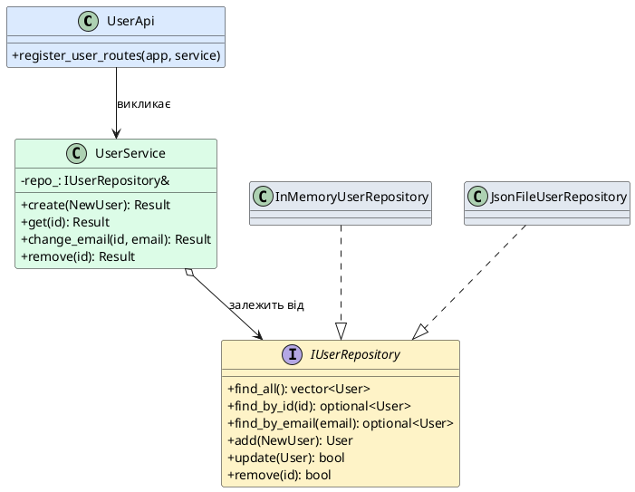
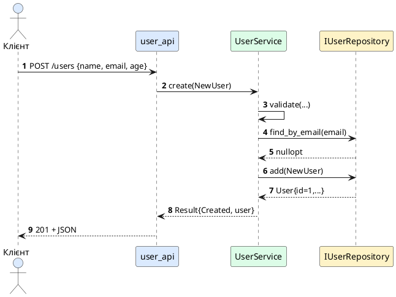

# Repository, впровадження залежностей і тестування

::card-group

::card{title="🎯 Мета лекції" icon="i-lucide-target"}

- Описати репозиторій як інтерфейс «колекції» мовою домену.
- Написати дві реалізації одного інтерфейсу: пам'ять і JSON-файл.
- Впровадити залежність через конструктор і розмістити вибір реалізації в одному місці.
- Розділити код на шари: HTTP, сервіс, репозиторій.
- Написати модульні тести сервісу й контрактні тести реалізацій на doctest і запускати їх через ctest.

::

::card{title="🔑 Ключові терміни" icon="i-lucide-key"}

- **Repository:** абстракція колекції об'єктів домену; приховує спосіб зберігання.
- **Впровадження залежності (*dependency injection*, DI):** об'єкт отримує свої залежності ззовні, а не створює їх сам.
- **Composition root:** єдине місце (зазвичай `main`), де збираються конкретні реалізації.
- **Підроблена реалізація (*fake / spy*):** проста реалізація інтерфейсу для тестів.
- **Контрактний тест:** набір перевірок, який мусить проходити кожна реалізація інтерфейсу.

::

::

Лекція 13 завершилась DAO: клас, що ховає файл. Але сервіс, який його викликає, усе ще залежить від конкретного класу `UserDao`. Щоб замінити файл на пам'ять у тесті чи на базу в продакшені, сервіс довелося б міняти. Repository розв'язує це інтерфейсом.

## Інтерфейс репозиторію

Репозиторій виглядає для бізнес-логіки як колекція користувачів: можна додати, знайти, змінити, видалити. Про таблиці, файли й мову SQL інтерфейс нічого не знає.

```cpp
class IUserRepository {
public:
    virtual ~IUserRepository() = default;

    virtual std::vector<User> find_all() const = 0;
    virtual std::optional<User> find_by_id(int id) const = 0;
    virtual std::optional<User> find_by_email(const std::string& email) const = 0;

    // Зберігає нового користувача і повертає його з присвоєним id.
    virtual User add(const NewUser& user) = 0;
    // Повертає false, якщо користувача з таким id немає.
    virtual bool update(const User& user) = 0;
    virtual bool remove(int id) = 0;
};
```

Кілька проєктних рішень, які варто помітити:

- **`std::optional` для «може не бути».** `find_by_id` повертає `optional<User>`, а не `nullptr` чи виняток: відсутність запису — звичайна ситуація, а не помилка.
- **Метод `find_by_email` названий мовою домену.** Бізнес-правило «email унікальний» використовує його напряму, без SQL-подібних назв.
- **Два типи для користувача.** `NewUser` (без `id`) приймає `add`, а `User` (з `id`) повертає. Це унеможливлює створення запису з довільним `id`.
- **Віртуальний деструктор** обов'язковий для базового класу, який видаляють через вказівник на нього.

{.diagram-img}

::plant-uml{alt="Діаграма класів: сервіс, інтерфейс репозиторію та його реалізації"}



::

## Дві реалізації

Реалізація в пам'яті зберігає користувачів у `std::vector` під мютексом і видає зростаючі `id`:

```cpp
class InMemoryUserRepository : public IUserRepository {
public:
    User add(const NewUser& input) override {
        std::lock_guard<std::mutex> lock(mutex_);
        User u{next_id_++, input.name, input.email, input.age};
        users_.push_back(u);
        return u;
    }
    // ... інші методи
private:
    mutable std::mutex mutex_;
    std::vector<User> users_;
    int next_id_ = 1;
};
```

Реалізація в JSON-файлі має ті самі методи, але після кожної зміни записує файл, а при створенні читає його й відновлює лічильник `id`:

```cpp
class JsonFileUserRepository : public IUserRepository {
public:
    explicit JsonFileUserRepository(std::string path) : path_(std::move(path)) { load(); }

    User add(const NewUser& input) override {
        std::lock_guard<std::mutex> lock(mutex_);
        User u{next_id_++, input.name, input.email, input.age};
        users_.push_back(u);
        save();
        return u;
    }
    // ...
private:
    void load() {
        std::ifstream in(path_);
        if (!in) return;
        auto j = nlohmann::json::parse(in, nullptr, false);
        if (j.is_discarded()) return;
        users_ = j.get<std::vector<User>>();
        for (const auto& u : users_) next_id_ = std::max(next_id_, u.id + 1);
    }
    // ...
};
```

Мютекс стоїть у кожній реалізації, бо запити обробляються в різних потоках. Для файлової реалізації він захищає і дані в пам'яті, і сам файл.

## Сервіс: бізнес-правила

Бізнес-логіка живе в `UserService`. Він приймає **посилання на інтерфейс** у конструкторі й не знає, що за ним стоїть.

```cpp
class UserService {
public:
    explicit UserService(IUserRepository& repository) : repo_(repository) {}

    Result create(const NewUser& input) {
        const std::string problems = validate(input);
        if (!problems.empty()) return {Status::Invalid, std::nullopt, problems};

        std::lock_guard<std::mutex> lock(mutex_);
        if (repo_.find_by_email(input.email))
            return {Status::Conflict, std::nullopt, "Користувач із таким email уже існує"};
        return {Status::Created, repo_.add(input), ""};
    }
    // get, change_email, remove ...
private:
    IUserRepository& repo_;
    std::mutex mutex_;
};
```

Сервіс повертає `Result` зі статусом бізнес-логіки (`Created`, `Conflict`, `NotFound`, `Invalid`), а не HTTP-кодами. Зіставлення статусів з кодами відповіді належить HTTP-шару:

```cpp
inline int http_code(Status s) {
    switch (s) {
        case Status::Ok: return 200;
        case Status::Created: return 201;
        case Status::NotFound: return 404;
        case Status::Conflict: return 409;
        case Status::Invalid: return 400;
    }
    return 500;
}
```

Завдяки цьому сервіс можна викликати не лише з HTTP, а й із консольної програми чи тесту. Також він не залежить від Crow.

Перевірка унікальності й додавання виконуються під мютексом сервісу: інакше два одночасні запити з однаковим email обидва пройшли б перевірку й створили дублікат (аналогічне «перегони», як у лекції 06).

::plant-uml{alt="Послідовність створення користувача: HTTP, сервіс, репозиторій"}



::

## Composition root

Хто створює конкретну реалізацію? Одне місце: `main`. Решта коду отримує готовий об'єкт.

```cpp
std::unique_ptr<IUserRepository> repository;
if (kind == "json") {
    repository = std::make_unique<JsonFileUserRepository>(path);
} else {
    repository = std::make_unique<InMemoryUserRepository>();
}

UserService service(*repository);

crow::SimpleApp app;
api::register_user_routes(app, service);
app.port(port).multithreaded().run();
```

Це і є **впровадження залежності**: `UserService` не пише `new JsonFileUserRepository`, а отримує репозиторій ззовні. Замінити сховище означає змінити два рядки в `main`. Весь HTTP-шар і всі правила залишаються недоторканими.

Один код — різні сховища, перевірено на практиці:

::terminal-preview{title="repository_api: JSON-сховище"}

<div class="line"><span class="opacity-40">$</span> <strong class="font-bold">./repository_api 8114 json users.json</strong></div>
<div class="line">Сховище: JSON-файл users.json</div>
<div class="line"><span class="opacity-40">$</span> <strong class="font-bold">curl -s -w ' [%{http_code}]\n' -X POST -d '{"name":"Іван","email":"ivan@x.com","age":25}' localhost:8114/users</strong></div>
<div class="line">{"age":25,"email":"ivan@x.com","id":1,"name":"Іван"} [201]</div>
<div class="line"><span class="opacity-40">$</span> <strong class="font-bold">curl -s -w ' [%{http_code}]\n' -X POST -d '{"name":"Іван2","email":"ivan@x.com","age":30}' localhost:8114/users</strong></div>
<div class="line">{"error":"Користувач із таким email уже існує"} [409]</div>
<div class="line"><span class="opacity-40">$</span> <strong class="font-bold">curl -s -w ' [%{http_code}]\n' -X POST -d '{"name":"І","email":"bad","age":200}' localhost:8114/users</strong></div>
<div class="line">{"error":"name: довжина від 2 до 50 символів; email: некоректний формат; age: значення від 0 до 150"} [400]</div>
<div class="line"><span class="opacity-40">$</span> <strong class="font-bold">curl -s -w ' [%{http_code}]\n' -X PUT -d '{"email":"new@x.com"}' localhost:8114/users/1/email</strong></div>
<div class="line">{"age":25,"email":"new@x.com","id":1,"name":"Іван"} [200]</div>
<div class="line"><span class="opacity-40">$</span> <strong class="font-bold">curl -s -w ' [%{http_code}]\n' -X DELETE localhost:8114/users/1</strong></div>
<div class="line"> [204]</div>
::

## Тестування

Головна практична вигода Repository — тести, які не залежать від файлів і сервера. Для тестів використовується бібліотека **doctest**: легка, один заголовок, підключається через vcpkg.

### Модульні тести сервісу

Сервісу передають підроблену реалізацію. Для цього достатньо успадкувати `InMemoryUserRepository` і перерахувати виклики: це **шпигун** (*spy*).

```cpp
class SpyRepository : public InMemoryUserRepository {
public:
    User add(const NewUser& u) override {
        ++add_calls;
        return InMemoryUserRepository::add(u);
    }
    int add_calls = 0;
};

TEST_CASE("створення користувача") {
    SpyRepository repo;
    UserService service(repo);

    SUBCASE("коректні дані зберігаються й отримують id") {
        auto r = service.create({"Іван", "ivan@example.com", 25});
        CHECK(r.status == Status::Created);
        REQUIRE(r.user.has_value());
        CHECK(r.user->id == 1);
        CHECK(repo.add_calls == 1);
    }

    SUBCASE("некоректні дані не доходять до сховища") {
        auto r = service.create({"І", "bad", 200});
        CHECK(r.status == Status::Invalid);
        CHECK(repo.add_calls == 0);
    }
}
```

Перевірка `add_calls == 0` доводить те, що неможливо побачити за відповіддю: невалідний запит не торкнувся сховища. `SUBCASE` запускає тіло `TEST_CASE` окремо для кожної гілки зі свіжим `repo`, тому підтести не впливають один на одного.

Різниця між `CHECK` і `REQUIRE`: `CHECK` при невдачі продовжує тест, а `REQUIRE` зупиняє. Перед розіменуванням `r.user` ставлять `REQUIRE`, щоб не звернутися до порожнього `optional`.

### Контрактні тести

Щоб кожна реалізація поводилась однаково, їх перевіряє один набір тестів. `TEST_CASE_TEMPLATE` виконує його для кількох типів.

```cpp
TEST_CASE_TEMPLATE("контракт IUserRepository", Repo, InMemoryUserRepository, JsonFileUserRepository) {
    auto repo = Factory<Repo>::make();

    SUBCASE("add присвоює зростаючі id") {
        auto a = repo->add({"Анна", "anna@example.com", 20});
        auto b = repo->add({"Борис", "boris@example.com", 22});
        CHECK(a.id == 1);
        CHECK(b.id == 2);
    }

    SUBCASE("remove видаляє запис і не повторює id") {
        auto a = repo->add({"Анна", "anna@example.com", 20});
        CHECK(repo->remove(a.id));
        CHECK_FALSE(repo->remove(a.id));
        auto b = repo->add({"Борис", "boris@example.com", 22});
        CHECK(b.id != a.id);
    }
}
```

`Factory<Repo>::make()` створює порожню реалізацію: для файлової вона обирає тимчасовий шлях і видаляє старий файл. Контракт залишається незмінним, коли з'являється третя реалізація (лекція 15): достатньо додати її до списку типів.

### Запуск через ctest

CMake реєструє тест, а `ctest` запускає всі зареєстровані:

```cmake
add_executable(repository_unit_tests
    tests/test_main.cpp
    tests/test_user_service.cpp
    tests/test_repository_contract.cpp)
target_link_libraries(repository_unit_tests PRIVATE repo_core doctest::doctest)

add_test(NAME repository_unit_tests COMMAND repository_unit_tests)
```

Для роботи `ctest` у кореневому `CMakeLists.txt` потрібен виклик `enable_testing()`.

::terminal-preview{title="Запуск тестів"}

<div class="line"><span class="opacity-40">$</span> <strong class="font-bold">./build/14-repository-tests/repository_unit_tests</strong></div>
<div class="line">[doctest] doctest version is "2.5.3"</div>
<div class="line">===============================================================================</div>
<div class="line">[doctest] test cases:  6 |  6 passed | 0 failed | 0 skipped</div>
<div class="line">[doctest] assertions: 56 | 56 passed | 0 failed |</div>
<div class="line">[doctest] Status: SUCCESS!</div>
<div class="line"><span class="opacity-40">$</span> <strong class="font-bold">cd build &amp;&amp; ctest</strong></div>
<div class="line">1/1 Test #1: repository_unit_tests ............   Passed    0.00 sec</div>
<div class="line">100% tests passed out of 1</div>
::

Усі шість тестів виконуються за соту частку секунди, бо не потребують мережі й сервера. Швидкі тести запускають при кожній зміні, і це змінює спосіб роботи.

::tip
Файл `test_main.cpp` містить лише `#define DOCTEST_CONFIG_IMPLEMENT_WITH_MAIN` та підключення doctest. Макрос генерує `main` тільки в одному файлі. Якби він стояв у кількох, лінкер повідомив би про дубльовані символи.
::

## Типові помилки

::::accordion

:::accordion-item{label="⚠️ Репозиторій повертає типи конкретного сховища" icon="i-lucide-alert-triangle"}

Якщо інтерфейс повертає `sqlite3_stmt*` чи `nlohmann::json`, клієнтський код прив'язується до сховища, і сенс інтерфейсу втрачено. Повертайте доменні типи (`User`, `std::vector<User>`, `std::optional<User>`).

:::

:::accordion-item{label="⚠️ Бізнес-правила всередині репозиторію" icon="i-lucide-alert-triangle"}

Перевірка унікальності email у `add` «ховає» правило у сховищі, і кожна нова реалізація мусить його повторити. Правила належать сервісу, а репозиторій лише зберігає й знаходить. (Виняток: обмеження цілісності, які гарантує сама база, як `UNIQUE`. Вони є страховкою, а не заміною перевірці в сервісі: лекція 15.)

:::

:::accordion-item{label="⚠️ Інтерфейс «на всі випадки»" icon="i-lucide-alert-triangle"}

Узагальнений `find_by(columns, values)` повертає нас до SQL у вигляді рядків. Додавайте методи під конкретні потреби: `find_by_email`, `find_active_since(date)`.

:::

::::

## Запитання

::::accordion

:::accordion-item{label="❓ Чому сервіс отримує посилання, а не unique_ptr?" icon="i-lucide-help-circle"}

Сервіс не володіє репозиторієм, а лише користується ним. Власник — `main` (`unique_ptr`). Посилання виражає «залежність без володіння» й нагадує, що час життя репозиторію має перевищувати час життя сервісу.

:::

:::accordion-item{label="❓ Чи потрібні фреймворки DI на кшталт Spring?" icon="i-lucide-help-circle"}

У C++ звичайно вистачає ручного складання в `main`: це кілька рядків. Контейнери залежностей мають сенс у великих застосунках з десятками компонентів.

:::

:::accordion-item{label="❓ Чим шпигун відрізняється від підробки (fake)?" icon="i-lucide-help-circle"}

Підробка (`InMemoryUserRepository`) має робочу, спрощену логіку. Шпигун додає запис викликів, щоб перевірити *як* до неї зверталися. Інші види тестових двійників — заглушка (*stub*, повертає фіксовані відповіді) та мок (*mock*, сам перевіряє очікувані виклики).

:::

:::accordion-item{label="❓ Чому тести сервісу не запускають HTTP-сервер?" icon="i-lucide-help-circle"}

Бізнес-логіка перевіряється викликом методів. Сервер, порт і мережа додають повільність і непередбачувані збої. Окремо виконується малий набір наскрізних перевірок через HTTP, а правил там не перевіряють.

:::

::::

## Практика

::::accordion

:::accordion-item{label="📋 Завдання 1: метод find_by_age_range" icon="i-lucide-clipboard-list"}

Додайте до інтерфейсу `find_by_age_range(int from, int to)`, реалізуйте в обох класах, додайте до контрактних тестів і до HTTP-шару (`GET /users?min_age=&max_age=`).

:::

:::accordion-item{label="📋 Завдання 2: FailingRepository" icon="i-lucide-clipboard-list"}

Напишіть реалізацію, яка кидає виняток у `add`. Що відбудеться з відповіддю `POST /users`? Додайте в HTTP-шар обробку винятків із відповіддю 500 і тест.

:::

:::accordion-item{label="📋 Завдання 3: ще один ресурс" icon="i-lucide-clipboard-list"}

Створіть `IProductRepository`, `InMemoryProductRepository`, `ProductService` і HTTP-маршрути. Контрактні тести напишіть так, щоб вони готові були прийняти SQLite-реалізацію.

:::

:::accordion-item{label="📋 Завдання 4: зламати тест" icon="i-lucide-clipboard-list"}

Тимчасово видаліть у `InMemoryUserRepository::remove` рядок `users_.erase(...)`. Які тести впали? Чи впала контрактна перевірка для JSON-реалізації?

:::

::::

## Домашнє завдання

Перепишіть ресурс із домашнього завдання лекції 13 на повну схему: `IRepository` → дві реалізації (пам'ять, JSON) → `Service` → HTTP-шар → `main` як composition root.

Вимоги: щонайменше 8 тестів doctest (3 для сервісу зі шпигуном, 5 контрактних для обох реалізацій), `ctest` проходить, у коді обробників немає `ifstream`, бізнес-правила (мінімум два) у сервісі.

## Підсумок

- Repository — інтерфейс «колекції» мовою домену; реалізацій може бути кілька, а клієнтський код їх не розрізняє.
- Сервіс отримує репозиторій через конструктор (DI); конкретну реалізацію обирає лише `main`.
- Шари: HTTP (статуси → коди), сервіс (правила), репозиторій (зберігання). Кожен можна змінювати окремо.
- Тести сервісу використовують підроблену реалізацію, контрактні тести перевіряють усі реалізації однаково; швидкі тести запускаються через `ctest`.

Демо: `labs/crow-demos/14-repository-tests`.
