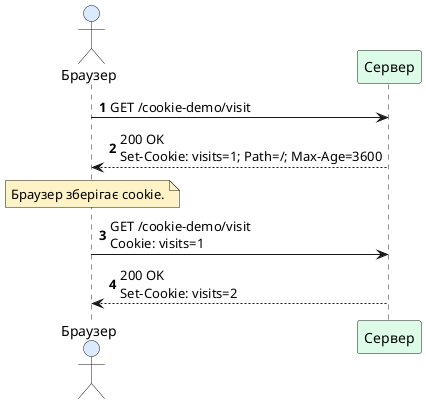
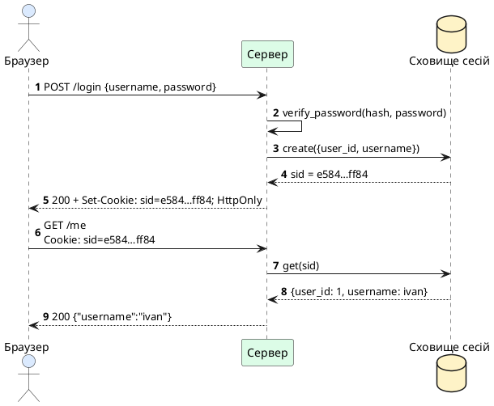

# Cookies і сесії: реєстрація, вхід і вихід

::card-group

::card{title="🎯 Мета лекції" icon="i-lucide-target"}

- Пояснити, чому HTTP потребує механізму збереження стану, і як його забезпечують cookies.
- Читати заголовок `Cookie` і формувати `Set-Cookie` з атрибутами `HttpOnly`, `SameSite`, `Max-Age`, `Secure`.
- Показати, чому дані користувача не можна зберігати в cookie, і реалізувати серверні сесії.
- Зберігати паролі як хеші argon2id із сіллю та перевіряти їх.
- Реалізувати реєстрацію, вхід, захищений ресурс і вихід.

::

::card{title="🔑 Ключові терміни" icon="i-lucide-key"}

- **Cookie:** пара «ім'я=значення», яку сервер просить браузер зберегти й повертати з кожним запитом.
- **Сесія (*session*):** дані користувача на сервері, які знаходять за випадковим ідентифікатором.
- **Хеш пароля (*password hash*):** результат необоротного перетворення пароля.
- **Сіль (*salt*):** випадкові дані, додані до пароля перед хешуванням.
- **Автентифікація (*authentication*):** перевірка, хто звертається.

::

::

У лекції 01 зазначалося: HTTP не зберігає стан. Сервер отримує запит `GET /me` і не знає, хто його надіслав і чи цей клієнт щойно входив. Без додаткового механізму довелося б надсилати логін і пароль із кожним запитом. Цей механізм — cookies.

## Cookies

**Cookie** — невеликий фрагмент даних. Сервер у відповіді просить браузер його зберегти заголовком `Set-Cookie`. Відтоді браузер додає цей cookie до кожного запиту до того ж сайту в заголовку `Cookie`.

::plant-uml{alt="Обмін cookie між браузером і сервером"}



::

Cookie складається з імені, значення й атрибутів, які керують його поведінкою.

{.diagram-img}

| Атрибут | Дія |
| ------- | --- |
| `Path=/` | cookie надсилається для всіх шляхів сайту |
| `Max-Age=3600` | час життя в секундах; без нього cookie зникає при закритті браузера; `0` видаляє cookie |
| `HttpOnly` | скрипти на сторінці (`document.cookie`) не бачать cookie, що захищає від крадіжки через XSS |
| `Secure` | cookie передається лише через HTTPS |
| `SameSite` | `Strict` — лише на запити зі свого сайту, `Lax` — ще й при переході за посиланням, `None` — завжди (потребує `Secure`) |

Демо `16-sessions-login` розбирає й формує cookie двома допоміжними функціями (`auth/cookies.hpp`):

```cpp
// "a=1; b=2" -> {a: 1, b: 2}
inline std::map<std::string, std::string> parse_cookies(const std::string& header);

struct CookieOptions {
    int max_age = -1;               // -1 = сесійний cookie
    bool http_only = true;
    bool secure = false;
    std::string same_site = "Lax";
    std::string path = "/";
};
inline std::string make_set_cookie(const std::string& name, const std::string& value,
                                   const CookieOptions& o = {});
```

Безпечні значення стоять за замовчуванням: `HttpOnly` і `SameSite=Lax`. Забути їх складніше, ніж увімкнути.

::note
Crow має власні `crow::CookieParser` і `crow::SessionMiddleware`. У лекції cookies і сесії написані вручну, щоб було видно, як усе працює: це кілька десятків рядків. У виробничих проєктах, як правило, користуються готовими рішеннями.
::

### Cookie належить клієнту

Лічильник візитів у cookie працює:

```cpp
CROW_ROUTE(app, "/cookie-demo/visit")([](const crow::request& req) {
    auto cookies = auth::parse_cookies(req.get_header_value("Cookie"));
    int visits = 0;
    if (auto it = cookies.find("visits"); it != cookies.end()) visits = std::atoi(it->second.c_str());
    ++visits;

    crow::response res(200, "Візитів: " + std::to_string(visits) + "\n");
    auth::CookieOptions opt;
    opt.max_age = 3600;
    res.add_header("Set-Cookie", auth::make_set_cookie("visits", std::to_string(visits), opt));
    return res;
});
```

::terminal-preview{title="Лічильник у cookie і його підміна"}

<div class="line"><span class="opacity-40">$</span> <strong class="font-bold">curl -si -c jar.txt localhost:8116/cookie-demo/visit</strong></div>
<div class="line">HTTP/1.1 200 OK</div>
<div class="line">Set-Cookie: visits=1; Path=/; Max-Age=3600; HttpOnly; SameSite=Lax</div>
<div class="line">Візитів: 1</div>
<div class="line"><span class="opacity-40">$</span> <strong class="font-bold">curl -s -b jar.txt -c jar.txt localhost:8116/cookie-demo/visit</strong></div>
<div class="line">Візитів: 2</div>
<div class="line"><span class="opacity-40">$</span> <strong class="font-bold">curl -s -b "visits=999" localhost:8116/cookie-demo/visit</strong></div>
<div class="line">Візитів: 1000</div>
::

Клієнт одним прапорцем `-b` надіслав довільне значення, і сервер повірив. Для лічильника візитів це байдуже, а якщо замість `visits` лежить `role=admin` чи `user_id=1`, будь-хто стане адміністратором. Звідси головне правило: **дані в cookie вважаються недовіреними**, бо їх контролює клієнт.

## Серверні сесії

Рішення — тримати дані на сервері, а в cookie передавати тільки випадковий ключ. Таку схему називають **сесією**.

{.diagram-img}

Сховище сесій зіставляє ключ із даними користувача:

```cpp
class SessionStore {
public:
    std::string create(SessionData data) {
        std::lock_guard<std::mutex> lock(mutex_);
        std::string token = random_token();
        sessions_[token] = Entry{std::move(data), Clock::now()};
        return token;
    }

    // Повертає дані сесії й продовжує її життя; прострочену сесію видаляє.
    std::optional<SessionData> get(const std::string& token);
    void destroy(const std::string& token);
    // ...
};
```

Ідентифікатор має бути **непередбачуваним**. `random_token` бере 32 випадкові байти (256 біт) з системного джерела випадковості й записує їх у hex: це рядок із 64 символів. Вгадати його перебором неможливо. Тому `rand()` або лічильник як ідентифікатор сесії категорично не годяться: їх можна передбачити.

```cpp
inline std::string random_token(size_t bytes = 32) {
    static const char* hex = "0123456789abcdef";
    std::random_device rd;
    std::string token;
    for (size_t i = 0; i < bytes; ++i) {
        unsigned char b = static_cast<unsigned char>(rd());
        token += hex[b >> 4];
        token += hex[b & 0x0F];
    }
    return token;
}
```

Сесія також прострочується: якщо клієнт не звертався довше 30 хвилин, `get` видаляє її. Це обмежує вікно, у якому вкрадена сесія корисна зловмиснику.

::warning
Сховище сесій у пам'яті зникає при перезапуску сервера, і всі користувачі виходять із системи. У застосунках із кількома екземплярами сервера сесії зберігають у спільному сховищі (база даних, Redis), інакше запит може потрапити на сервер, який цю сесію не знає.
::

### Middleware для завантаження сесії

Читання cookie й пошук сесії потрібні в кожному запиті, тому їх виносять у middleware (лекція 09). Він кладе знайдену сесію в контекст, а обробники читають її звідти.

```cpp
struct SessionLoader {
    struct context {
        std::optional<auth::SessionData> user;
        std::string token;
    };
    void before_handle(crow::request& req, crow::response&, context& ctx) {
        auto cookies = auth::parse_cookies(req.get_header_value("Cookie"));
        auto it = cookies.find("sid");
        if (it == cookies.end()) return;
        ctx.token = it->second;
        ctx.user = g_sessions.get(it->second);
    }
    void after_handle(crow::request&, crow::response&, context&) {}
};
```

Застосунок оголошується з цим middleware: `crow::App<SessionLoader> app;`.

## Паролі

Пароль **ніколи** не зберігають у відкритому вигляді: якщо база витече, зловмисник отримає паролі всіх користувачів (а люди повторюють паролі на різних сайтах). Зберігають результат необоротної функції: хеш.

Звичайні швидкі хеші (SHA-256, MD5) для паролів не підходять: сучасна відеокарта перебирає мільярди варіантів за секунду. Потрібні **навмисно повільні** алгоритми з параметром складності: bcrypt, scrypt, **argon2id**. Останній є сучасною рекомендацією й вимагає не лише часу, а й пам'яті, що ускладнює атаку на спеціалізованому обладнанні.

Другий елемент — **сіль**: випадкові 16 байтів, унікальні для кожного користувача, які хешуються разом із паролем. Через сіль однакові паролі дають різні хеші, і зловмисник не може скористатися заздалегідь підготовленими таблицями.

```cpp
constexpr uint32_t kTimeCost = 2;
constexpr uint32_t kMemoryKiB = 19456;   // 19 МіБ
constexpr uint32_t kParallelism = 1;

inline std::string hash_password(const std::string& password) {
    // ... випадкова сіль із 16 байтів
    int rc = argon2id_hash_encoded(kTimeCost, kMemoryKiB, kParallelism, password.data(), password.size(),
                                   salt.data(), salt.size(), kHashBytes, encoded.data(), encoded.size());
    // ...
    return std::string(encoded.data());
}

inline bool verify_password(const std::string& encoded, const std::string& password) {
    return argon2id_verify(encoded.c_str(), password.data(), password.size()) == ARGON2_OK;
}
```

Результат має вигляд `$argon2id$v=19$m=19456,t=2,p=1$<сіль>$<хеш>`: параметри й сіль зберігаються разом із хешем, тому перевірка не потребує додаткових даних, а параметри можна підвищувати з часом.

Підключення бібліотеки (порт `argon2` у `vcpkg.json`):

```cmake
find_package(unofficial-argon2 CONFIG REQUIRED)
target_link_libraries(sessions_login PRIVATE unofficial::argon2::libargon2)
```

Хешування триває близько 0,1 с на запит (вимірено: реєстрація й вхід займають 0,10–0,11 с). Для користувача це непомітно, а для зловмисника, що перебирає мільйони варіантів, це стіна.

::tip
Не пишіть власних криптографічних алгоритмів і не змінюйте параметри «для швидкості». Використовуйте перевірену бібліотеку з рекомендованими параметрами.
::

## Реєстрація

Реєстрація перевіряє вхідні дані (лекція 06), хешує пароль і зберігає користувача:

```cpp
CROW_ROUTE(app, "/register").methods(crow::HTTPMethod::POST)([](const crow::request& req) {
    // ... розбір JSON
    static const std::regex name_re("^[A-Za-z0-9_]{3,32}$");
    if (!std::regex_match(username, name_re))
        return json_response(400, {{"error", "username: 3-32 символи, літери латиниці, цифри, _"}});
    if (password.size() < 8) return json_response(400, {{"error", "password: щонайменше 8 символів"}});

    std::string hash = auth::hash_password(password);
    std::lock_guard<std::mutex> lock(g_users_mutex);
    if (g_users.count(username)) return json_response(409, {{"error", "Користувач уже існує"}});
    g_users[username] = StoredUser{g_next_user_id++, hash};
    return json_response(201, {{"username", username}});
});
```

Хешування виконується до взяття блокування: повільна операція не повинна тримати мютекс. У відповіді немає ні пароля, ні хеша.

::terminal-preview{title="Реєстрація"}

<div class="line"><span class="opacity-40">$</span> <strong class="font-bold">curl -s -w ' [%{http_code}]\n' -X POST -d '{"username":"ivan","password":"short"}' localhost:8116/register</strong></div>
<div class="line">{"error":"password: щонайменше 8 символів"} [400]</div>
<div class="line"><span class="opacity-40">$</span> <strong class="font-bold">curl -s -w ' [%{http_code}]\n' -X POST -d '{"username":"ivan","password":"correct horse"}' localhost:8116/register</strong></div>
<div class="line">{"username":"ivan"} [201]</div>
<div class="line"><span class="opacity-40">$</span> <strong class="font-bold">curl -s -w ' [%{http_code}]\n' -X POST -d '{"username":"ivan","password":"correct horse"}' localhost:8116/register</strong></div>
<div class="line">{"error":"Користувач уже існує"} [409]</div>
::

## Вхід

Вхід перевіряє пароль, створює сесію й ставить cookie.

::plant-uml{alt="Послідовність входу й доступу до захищеного ресурсу"}



::

```cpp
CROW_ROUTE(app, "/login").methods(crow::HTTPMethod::POST)([&](const crow::request& req) {
    // ... розбір JSON

    std::optional<StoredUser> user;
    {
        std::lock_guard<std::mutex> lock(g_users_mutex);
        if (auto it = g_users.find(username); it != g_users.end()) user = it->second;
    }

    // Перевірка виконується завжди; для невідомого логіна — проти фіктивного хешу.
    const bool ok = auth::verify_password(user ? user->password_hash : dummy_hash, password) && user;
    if (!ok) return json_response(401, {{"error", "Невірний логін або пароль"}});

    std::string token = g_sessions.create({user->id, username});

    crow::response res = json_response(200, {{"username", username}});
    auth::CookieOptions opt;
    opt.max_age = kSessionSeconds;
    res.add_header("Set-Cookie", auth::make_set_cookie("sid", token, opt));
    return res;
});
```

Дві деталі тут не випадкові.

**Однакове повідомлення про помилку.** Для неіснуючого логіна й неправильного пароля відповідь однакова: «Невірний логін або пароль». Якби повідомлення відрізнялись, зловмисник за відповідями визначав би, які логіни зареєстровані (*user enumeration*).

**Однаковий час відповіді.** Якщо для неіснуючого користувача хеш не перевіряти, відповідь приходить на 0,1 с швидше, і за часом теж видно, чи є такий логін. Тому для відсутнього користувача перевірка виконується проти фіктивного хеша. Вимірювання на демо: невірний пароль для `ivan` займає 0,10–0,11 с, невідомий логін `ghost` — 0,11 с.

::terminal-preview{title="Вхід, захищений ресурс і підроблений sid"}

<div class="line"><span class="opacity-40">$</span> <strong class="font-bold">curl -s -w ' [%{http_code}]\n' localhost:8116/me</strong></div>
<div class="line">{"error":"Потрібен вхід"} [401]</div>
<div class="line"><span class="opacity-40">$</span> <strong class="font-bold">curl -si -c jar.txt -X POST -d '{"username":"ivan","password":"correct horse"}' localhost:8116/login</strong></div>
<div class="line">HTTP/1.1 200 OK</div>
<div class="line">Set-Cookie: sid=e584a1eedc32427daa43b7c2afa1f4f0fdf776939c30c62986e7bbe4411eff84; Path=/; Max-Age=3600; HttpOnly; SameSite=Lax</div>
<div class="line">{"username":"ivan"}</div>
<div class="line"><span class="opacity-40">$</span> <strong class="font-bold">curl -s -w ' [%{http_code}]\n' -b jar.txt localhost:8116/me</strong></div>
<div class="line">{"id":1,"username":"ivan"} [200]</div>
<div class="line"><span class="opacity-40">$</span> <strong class="font-bold">curl -s -w ' [%{http_code}]\n' -b "sid=deadbeef" localhost:8116/me</strong></div>
<div class="line">{"error":"Потрібен вхід"} [401]</div>
::

## Захищений ресурс і вихід

Обробник захищеного ресурсу перевіряє, чи є користувач у контексті, і якщо ні — повертає 401:

```cpp
CROW_ROUTE(app, "/me")([&app](const crow::request& req) {
    auto& ctx = app.get_context<SessionLoader>(req);
    if (!ctx.user) return json_response(401, {{"error", "Потрібен вхід"}});
    return json_response(200, {{"id", ctx.user->user_id}, {"username", ctx.user->username}});
});
```

Вихід має дві частини. Сервер **знищує сесію** у сховищі, а клієнту надсилає `Set-Cookie` з `Max-Age=0`, щоб браузер видалив cookie. Лише друга частина недостатня: вкрадений ідентифікатор лишився б дійсним.

```cpp
CROW_ROUTE(app, "/logout").methods(crow::HTTPMethod::POST)([&app](const crow::request& req) {
    auto& ctx = app.get_context<SessionLoader>(req);
    if (!ctx.token.empty()) g_sessions.destroy(ctx.token);

    crow::response res = json_response(200, {{"status", "logged out"}});
    auth::CookieOptions opt;
    opt.max_age = 0;
    res.add_header("Set-Cookie", auth::make_set_cookie("sid", "", opt));
    return res;
});
```

Перевірка: після виходу той самий `sid`, надісланий вручну, більше не діє.

::terminal-preview{title="Повторне використання sid після виходу"}

<div class="line"><span class="opacity-40">$</span> <strong class="font-bold">curl -s -w ' [%{http_code}]\n' -H "Cookie: sid=$SID" localhost:8116/me</strong></div>
<div class="line">{"id":1,"username":"ivan"} [200]</div>
<div class="line"><span class="opacity-40">$</span> <strong class="font-bold">curl -s -o /dev/null -X POST -H "Cookie: sid=$SID" localhost:8116/logout</strong></div>
<div class="line"><span class="opacity-40">$</span> <strong class="font-bold">curl -s -w ' [%{http_code}]\n' -H "Cookie: sid=$SID" localhost:8116/me</strong></div>
<div class="line">{"error":"Потрібен вхід"} [401]</div>
::

Вихід реалізовано методом `POST`, а не `GET` (лекція 05): `GET`-запит міг би викликати будь-яка сторінка, наприклад зображення ``, і вилучити користувача з системи без його відома.

## Запитання

::::accordion

:::accordion-item{label="❓ Чому не можна зберігати в cookie зашифровані дані користувача?" icon="i-lucide-help-circle"}

Це можливо (підписані чи зашифровані cookie існують), але потрібне правильне шифрування з перевіркою цілісності, а відкликати такий cookie до закінчення терміну неможливо: сервер не зберігає про нього жодних відомостей. Серверна сесія простіша й дозволяє завершити сесію в будь-який момент.

:::

:::accordion-item{label="❓ Чи захищає HttpOnly від усіх крадіжок cookie?" icon="i-lucide-help-circle"}

Лише від читання скриптом. Cookie можна перехопити в мережі без HTTPS (для цього є `Secure`) чи вкрасти з комп'ютера. Скрипт із XSS, хоч і не бачить cookie, може виконувати запити від імені користувача: тому XSS усе одно небезпечний.

:::

:::accordion-item{label="❓ Скільки має жити сесія?" icon="i-lucide-help-circle"}

Залежить від ризику. Банки завершують сесію за 5–15 хвилин бездіяльності, звичайні сайти — на години чи дні («запам'ятати мене»). Часто комбінують таймаут бездіяльності й абсолютний термін (лекція 17).

:::

:::accordion-item{label="❓ Що буде, якщо два користувачі отримають однаковий sid?" icon="i-lucide-help-circle"}

Вони потрапили б в одну сесію й побачили б чужі дані. Імовірність для 256-бітних випадкових значень мізерна (вона нижча, ніж імовірність апаратного збою), а `rand()` чи лічильник такої гарантії не дають.

:::

::::

## Практика

::::accordion

:::accordion-item{label="📋 Завдання 1: оновлення пароля" icon="i-lucide-clipboard-list"}

Додайте `POST /me/password` із полями `old_password` і `new_password`. Старий пароль перевіряється, новий хешується заново. Що робити з іншими сесіями користувача?

:::

:::accordion-item{label="📋 Завдання 2: «запам'ятати мене»" icon="i-lucide-clipboard-list"}

Додайте до `/login` поле `remember` (bool). Для `true` ставте `Max-Age=2592000` (30 днів), для `false` — cookie без `Max-Age` (зникає при закритті браузера).

:::

:::accordion-item{label="📋 Завдання 3: кілька пристроїв" icon="i-lucide-clipboard-list"}

Збережіть у сесії `User-Agent` і IP, створіть `GET /me/sessions` зі списком активних сесій користувача й `DELETE /me/sessions/<id>` для завершення чужої сесії. Токен не повертайте: використовуйте окремий короткий ідентифікатор.

:::

:::accordion-item{label="📋 Завдання 4: збереження користувачів" icon="i-lucide-clipboard-list"}

Замініть `std::map` користувачів на репозиторій із лекцій 14–15 (SQLite). У таблиці зберігайте `password_hash`, не пароль.

:::

::::

## Домашнє завдання

Оберіть одне.

::::accordion

:::accordion-item{label="📋 Повна система автентифікації" icon="i-lucide-clipboard-list"}

Реєстрація, вхід, вихід, `GET /me`, зміна пароля. Користувачі у SQLite, паролі argon2id, сесії з таймаутом бездіяльності. Тести (doctest) для `SessionStore` і `parse_cookies`.

:::

:::accordion-item{label="📋 Захист від перехоплення сесії" icon="i-lucide-clipboard-list"}

Зв'яжіть сесію з `User-Agent` клієнта: якщо він змінився, сесію знищують і вимагають новий вхід. Опишіть у README, чому це не повна гарантія.

:::

:::accordion-item{label="📋 Сесії на кількох пристроях" icon="i-lucide-clipboard-list"}

Реалізуйте ліміт: не більше трьох активних сесій на користувача (найстаріша знищується). Додайте «вийти скрізь» (`POST /logout-all`).

:::

::::

## Підсумок

- Cookie — механізм збереження стану поверх HTTP: сервер ставить `Set-Cookie`, браузер повертає `Cookie`. Атрибути `HttpOnly`, `SameSite`, `Secure`, `Max-Age` керують безпекою.
- Дані в cookie контролює клієнт, тому в них зберігають лише випадковий ідентифікатор сесії, а дані тримають на сервері.
- Паролі зберігають як хеші повільним алгоритмом із сіллю (argon2id). Помилка входу й час відповіді не розкривають, чи існує логін.
- Вихід знищує сесію на сервері й видаляє cookie. Змінювальні дії виконують методом `POST`, а не `GET`.

Демо: `labs/crow-demos/16-sessions-login`.
