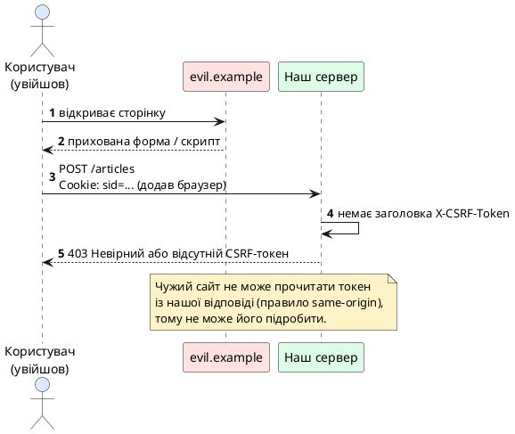

# Авторизація (RBAC) і захист вебзастосунку

::card-group

::card{title="🎯 Мета лекції" icon="i-lucide-target"}

- Розрізняти автентифікацію (хто це) і авторизацію (що йому можна) та відповідні коди 401 і 403.
- Реалізувати контроль доступу за ролями (RBAC) через таблицю політики в middleware.
- Застосовувати принцип «заборонено за замовчуванням» (*deny by default*).
- Захищатися від CSRF, фіксації сесії, перебору паролів та IDOR.
- Додавати заголовки безпеки й обмежувати життя сесії.

::

::card{title="🔑 Ключові терміни" icon="i-lucide-key"}

- **RBAC (*Role-Based Access Control*):** права видаються ролям, ролі призначаються користувачам.
- **CSRF (*Cross-Site Request Forgery*):** атака, за якої чужий сайт примушує браузер надіслати запит від імені користувача.
- **Session fixation:** підміна ідентифікатора сесії, який зловмисник знає наперед.
- **IDOR (*Insecure Direct Object Reference*):** доступ до чужого об'єкта за зміною ідентифікатора в запиті.
- **Принцип найменших привілеїв:** кожен отримує лише ті права, які потрібні для роботи.

::

::

Лекція 16 відповіла на запитання «хто це». Тепер питання інше: що йому дозволено. Окрім цього, вхід у систему дає зловмисникам нові цілі: сесію можна вкрасти, підмінити, використати від імені жертви. Лекція показує набір захисних механізмів у демо `17-rbac-security`.

## Автентифікація й авторизація

Це два різні кроки, які легко сплутати.

- **Автентифікація:** з'ясувати, хто звертається (пароль, ключ, токен). Невдача — **401 Unauthorized**.
- **Авторизація:** перевірити, чи має цей користувач право на дію. Невдача — **403 Forbidden**.

Назва коду 401 вводить в оману («Unauthorized» — «неавторизований»), хоча він означає «не автентифікований». Практичне правило: 401 — «увійдіть», 403 — «ви увійшли, але вам не можна».

## Ролі й політика доступу

У моделі RBAC користувач має роль, а права прив'язані до ролі. Демо має три ролі з вкладеними правами:

| Роль | Може |
| ---- | ---- |
| `user` | читати статті, керувати своїми нотатками |
| `editor` | усе, що `user`, і створювати та видаляти статті |
| `admin` | усе, що `editor`, і переглядати та видаляти користувачів |

Ролі впорядковані числами, тому порівняння «чи вистачає прав» зводиться до порівняння:

```cpp
enum class Role { User = 1, Editor = 2, Admin = 3 };
```

Правила доступу не розкидані по обробниках, а зібрані в одній таблиці: «метод + початок шляху → мінімальна роль». Відсутність ролі означає, що ресурс публічний.

```cpp
struct Rule {
    crow::HTTPMethod method;
    std::string prefix;            // шлях збігається, якщо починається з prefix
    std::optional<Role> min_role;  // порожнє значення = публічний ресурс
};

static const std::vector<Rule> kPolicy = {
    {crow::HTTPMethod::GET, "/public", std::nullopt},
    {crow::HTTPMethod::POST, "/login", std::nullopt},
    {crow::HTTPMethod::POST, "/register", std::nullopt},
    {crow::HTTPMethod::POST, "/articles", Role::Editor},
    {crow::HTTPMethod::DELETE, "/articles", Role::Editor},
    {crow::HTTPMethod::GET, "/admin", Role::Admin},
    {crow::HTTPMethod::DELETE, "/admin", Role::Admin},
    // Усе інше: потрібен вхід
};
```

Така таблиця має переваги: політику видно цілком в одному місці, її можна переглянути на безпеку й покрити тестом. Додавання нового маршруту `/admin/...` автоматично захищає його.

### Заборонено за замовчуванням

Що робити з маршрутом, для якого правила немає? Є два підходи: дозволяти (*allow by default*) чи забороняти. Забудькуватий розробник, який додав маршрут і не вніс правило, у першому випадку відкриває його всім. Тому в демо дія за замовчуванням: **потрібен вхід**. Саме тому запит до неіснуючого шляху від анонімного користувача отримує 401, а не 404. Це неприємна дрібниця заради безпечної поведінки.

### Авторизація як middleware

Перевірка виконується в middleware `Authorizer` перед обробником. Обробники отримують лише запити, які вже пройшли політику.

{.diagram-img}

```cpp
struct Authorizer {
    struct context {};

    template <typename AllContext>
    void before_handle(crow::request& req, crow::response& res, context&, AllContext& all_ctx) {
        auto& session = all_ctx.template get<SessionLoader>();

        // 1. Яке правило діє для цього запиту
        std::optional<Role> required = Role::User;  // deny by default
        for (const auto& rule : kPolicy) {
            if (rule.method == req.method && req.url.rfind(rule.prefix, 0) == 0) {
                required = rule.min_role;
                break;
            }
        }
        if (!required) return;  // публічний ресурс

        // 2. Автентифікація: чи відомо, хто це
        if (!session.user) return deny(req, res, 401, "Потрібен вхід", "-");

        // 3. Авторизація: чи вистачає ролі
        if (static_cast<int>(session.user->role) < static_cast<int>(*required))
            return deny(req, res, 403, "Недостатньо прав", session.user->username);

        // 4. CSRF: змінювальні методи мають передати токен сесії
        // ... (далі в розділі про CSRF)
    }
    // ...
};
```

Версія `before_handle` із четвертим параметром `AllContext` дає middleware доступ до контекстів інших middleware: тут він читає сесію, яку завантажив `SessionLoader`. Порядок в оголошенні застосунку має значення: `crow::App<SessionLoader, SecurityHeaders, Authorizer>`, щоб сесія була готова до перевірки.

Кожне рішення пишеться в журнал, зокрема відмови: за ним помітно спроби звернутися до чужих ресурсів.

::terminal-preview{title="Ролі в дії"}

<div class="line"><span class="opacity-40">$</span> <strong class="font-bold">curl -s -w ' [%{http_code}]\n' localhost:8117/me</strong></div>
<div class="line">{"error":"Потрібен вхід"} [401]</div>
<div class="line">carol (user) POST /articles: {"error":"Недостатньо прав"} [403]</div>
<div class="line">bob (editor) POST /articles: {"title":"Про Crow"} [201]</div>
<div class="line">carol (user) GET /articles: ["Про Crow"] [200]</div>
<div class="line">bob (editor) GET /admin/users: {"error":"Недостатньо прав"} [403]</div>
<div class="line">alice (admin) GET /admin/users: [{"role":"admin","username":"alice"},{"role":"editor","username":"bob"},{"role":"user","username":"carol"}] [200]</div>
::

Журнал сервера для цього сценарію:

::terminal-preview{title="Журнал [AUTHZ]"}

<div class="line">[AUTHZ] GET /me user=- -&gt; deny 401</div>
<div class="line">[AUTHZ] GET /nonexistent user=- -&gt; deny 401</div>
<div class="line">[AUTHZ] POST /articles user=carol -&gt; deny 403</div>
<div class="line">[AUTHZ] POST /articles user=bob role=editor -&gt; allow</div>
<div class="line">[AUTHZ] GET /admin/users user=bob -&gt; deny 403</div>
<div class="line">[AUTHZ] GET /admin/users user=alice role=admin -&gt; allow</div>
::

Роль користувача призначає сервер. При реєстрації клієнт може надіслати `"role": "admin"`, але обробник ігнорує це поле й завжди ставить `user` (масове присвоєння, лекція 08):

::terminal-preview{title="Спроба стати адміністратором"}

<div class="line"><span class="opacity-40">$</span> <strong class="font-bold">curl -s -X POST -d '{"username":"mallory","password":"password123","role":"admin"}' localhost:8117/register</strong></div>
<div class="line">{"role":"user","username":"mallory"}</div>
::

## IDOR: доступ до чужих даних

Перевірка ролі не захищає від найпоширенішої помилки авторизації. Нотатка належить користувачеві, і `GET /notes/1` має віддавати її лише власнику. Якщо обробник перевіряє тільки вхід, будь-який користувач прочитає чужу нотатку, перебравши `id`: це **IDOR**.

Демо містить обидві версії поруч:

```cpp
// НЕБЕЗПЕЧНО: перевіряє лише вхід, але не власника (IDOR)
CROW_ROUTE(app, "/notes-insecure/<int>")([](int id) {
    std::lock_guard<std::mutex> lock(g_mutex);
    for (const auto& n : g_notes)
        if (n.id == id) return json_response(200, {{"id", n.id}, {"owner", n.owner}, {"text", n.text}});
    return json_response(404, {{"error", "Нотатку не знайдено"}});
});

// ПРАВИЛЬНО: власник або admin; чужу нотатку не відрізняємо від неіснуючої (404, не 403)
CROW_ROUTE(app, "/notes/<int>")([&app](const crow::request& req, int id) {
    auto& u = *app.get_context<SessionLoader>(req).user;
    std::lock_guard<std::mutex> lock(g_mutex);
    for (const auto& n : g_notes) {
        if (n.id != id) continue;
        if (n.owner != u.username && u.role != Role::Admin)
            return json_response(404, {{"error", "Нотатку не знайдено"}});
        return json_response(200, {{"id", n.id}, {"owner", n.owner}, {"text", n.text}});
    }
    return json_response(404, {{"error", "Нотатку не знайдено"}});
});
```

::terminal-preview{title="Нотатка Керол, яку читає Боб"}

<div class="line">bob insecure #1: {"id":1,"owner":"carol","text":"таємниця Керол"} [200]</div>
<div class="line">bob secure   #1: {"error":"Нотатку не знайдено"} [404]</div>
<div class="line">carol secure #1: {"id":1,"owner":"carol","text":"таємниця Керол"} [200]</div>
<div class="line">alice (admin) #1: {"id":1,"owner":"carol","text":"таємниця Керол"} [200]</div>
::

Для чужої нотатки повертається 404, а не 403: так сервер не підтверджує, що ресурс із таким номером існує. Правило для всіх ресурсів користувача: **кожен запит до об'єкта перевіряє, що поточний користувач має право на цей об'єкт**, а не лише що він увійшов.

## CSRF

Cookie браузер додає до запитів автоматично, зокрема й тих, які ініціює чужий сайт. Користувач увійшов у ваш застосунок, відкрив у сусідній вкладці `evil.example`, і той одним скриптом надсилає `POST /admin/users/alice/delete` на ваш домен. Браузер приклеїть cookie із сесією, і сервер сприйме запит як справжній. Це **CSRF**.

::plant-uml{alt="Атака CSRF і захист токеном"}



::

Захист складається з двох частин.

1. **`SameSite=Lax`** (лекція 16) у cookie: браузер не додає cookie до змінювальних запитів, ініційованих з іншого сайту.
2. **CSRF-токен**: випадкове значення, яке сервер зберігає в сесії й віддає легітимному клієнту (`GET /csrf`). Для кожного змінювального запиту (`POST`, `PUT`, `PATCH`, `DELETE`) клієнт повертає токен у заголовку `X-CSRF-Token`. Чужий сайт токена не знає, бо браузер забороняє йому читати відповіді з нашого домену.

```cpp
const bool mutating = req.method == crow::HTTPMethod::POST || req.method == crow::HTTPMethod::PUT ||
                      req.method == crow::HTTPMethod::PATCH || req.method == crow::HTTPMethod::DELETE;
if (mutating && !constant_time_equals(req.get_header_value("X-CSRF-Token"), session.user->csrf_token))
    return deny(req, res, 403, "Невірний або відсутній CSRF-токен", session.user->username);
```

Порівняння виконується функцією сталого часу: тривалість звичайного `==` залежить від кількості збігних символів, і за цим можна було б відгадувати значення посимвольно (*timing attack*).

```cpp
static bool constant_time_equals(const std::string& a, const std::string& b) {
    unsigned char diff = static_cast<unsigned char>(a.size() ^ b.size());
    for (size_t i = 0; i < a.size() && i < b.size(); ++i) diff |= static_cast<unsigned char>(a[i] ^ b[i]);
    return diff == 0;
}
```

::terminal-preview{title="CSRF-перевірка"}

<div class="line">bob POST без токена: {"error":"Невірний або відсутній CSRF-токен"} [403]</div>
<div class="line">bob POST чужий токен (алісин): {"error":"Невірний або відсутній CSRF-токен"} [403]</div>
<div class="line">bob POST зі своїм токеном: {"title":"Про Crow"} [201]</div>
::

Токен у кожної сесії свій: токен Аліси для сесії Боба не підходить.

## Session fixation

Атака: зловмисник отримує (чи вигадує) ідентифікатор сесії й змушує жертву використовувати його, наприклад через посилання або cookie з піддомену. Якщо сервер після входу жертви **залишає той самий ідентифікатор**, зловмисник теж стає автентифікованим із тим самим `sid`.

Захист: **при кожному вході видавати новий ідентифікатор**, а старий знищувати.

```cpp
auto& ctx = app.get_context<SessionLoader>(req);
if (!ctx.token.empty()) g_sessions.destroy(ctx.token);
std::string token = g_sessions.create({user->id, username, user->role, ""});
```

::terminal-preview{title="Вхід із чужим sid"}

<div class="line"><span class="opacity-40">$</span> <strong class="font-bold">curl -si -X POST -H "Cookie: sid=attackersid" -d '{"username":"carol","password":"carol-password"}' localhost:8117/login | grep -i set-cookie</strong></div>
<div class="line">Set-Cookie: sid=7ed2945b7112272d1d7268cb36e849048d6e0fb38413…</div>
<div class="line"><span class="opacity-40">$</span> <strong class="font-bold">curl -s -w ' [%{http_code}]\n' -H "Cookie: sid=attackersid" localhost:8117/me</strong></div>
<div class="line">{"error":"Потрібен вхід"} [401]</div>
::

Те саме правило застосовують при підвищенні привілеїв і зміні пароля: нова сесія для нового рівня довіри.

## Перебір паролів

Без обмежень зловмисник може автоматично пробувати тисячі паролів на секунду. Захист складається з кількох рівнів: повільне хешування (лекція 16) і **обмеження спроб** для пари «логін + IP». Після п'яти невдач вхід блокується на 60 секунд.

```cpp
class LoginThrottle {
public:
    LoginThrottle(int max_failures, std::chrono::seconds lock_time);
    int seconds_locked(const std::string& key);   // скільки ще діє блокування
    void record_failure(const std::string& key);
    void record_success(const std::string& key);
    // ...
};
```

Перевірку блокування виконують **до** хешування пароля: заблокований клієнт не змушує сервер тратити 0,1 с процесорного часу на кожну спробу.

```cpp
const std::string throttle_key = username + "|" + req.remote_ip_address;
if (int wait = g_throttle.seconds_locked(throttle_key)) {
    crow::response res = json_response(429, {{"error", "Забагато невдалих спроб"}});
    res.set_header("Retry-After", std::to_string(wait));
    return res;
}
```

::terminal-preview{title="Шість спроб входу з неправильним паролем"}

<div class="line">1: 401</div>
<div class="line">2: 401</div>
<div class="line">3: 401</div>
<div class="line">4: 401</div>
<div class="line">5: 401</div>
<div class="line">6: 429</div>
<div class="line"><span class="opacity-40">$</span> <strong class="font-bold">curl -si -X POST -d '{"username":"bob","password":"bob-password"}' localhost:8117/login | grep -E "HTTP|Retry-After"</strong></div>
<div class="line">HTTP/1.1 429 Too Many Requests</div>
<div class="line">Retry-After: 60</div>
<div class="line">Вхід alice з тим самим IP: 200</div>
::

Навіть правильний пароль у період блокування отримує 429, інакше зловмисник усе одно міг би підбирати його. Інший логін із того самого IP не заблоковано.

::warning
У такого захисту є зворотний бік: зловмисник може навмисно «заблокувати» чужий акаунт, роблячи помилкові спроби. Тому в ключ включено IP: атакуючий блокує лише пару «логін + його адреса», а не логін для всіх. У великих системах додають CAPTCHA, двофакторну автентифікацію й моніторинг аномалій.
::

## Заголовки безпеки

Деякі захисні механізми вмикаються заголовками відповіді, які керують браузером. Middleware `SecurityHeaders` ставить їх на кожну відповідь у `after_handle` (щоб вони не губились, див. лекцію 09).

```cpp
struct SecurityHeaders {
    struct context {};
    void before_handle(crow::request&, crow::response&, context&) {}
    void after_handle(crow::request&, crow::response& res, context&) {
        res.set_header("X-Content-Type-Options", "nosniff");
        res.set_header("X-Frame-Options", "DENY");
        res.set_header("Content-Security-Policy", "default-src 'none'; frame-ancestors 'none'");
        res.set_header("Referrer-Policy", "no-referrer");
        res.set_header("Cache-Control", "no-store");
    }
};
```

| Заголовок | Що забороняє |
| --------- | ------------ |
| `X-Content-Type-Options: nosniff` | браузеру вгадувати тип вмісту (скрипт під виглядом картинки) |
| `X-Frame-Options: DENY` | показувати сторінку у фреймі чужого сайту (*clickjacking*) |
| `Content-Security-Policy` | завантаження скриптів і ресурсів із непередбачених джерел |
| `Referrer-Policy: no-referrer` | передавати адресу сторінки чужим сайтам |
| `Cache-Control: no-store` | кешувати відповіді з приватними даними |

Для сайту з HTML і статикою політика CSP складніша: `default-src 'none'` підходить лише чистому JSON-API.

## Таймаути й завершення сесій

Сесія в демо має два обмеження.

- **Бездіяльність:** 30 хвилин без запитів, і сесія видаляється.
- **Абсолютний термін:** 8 годин від створення, незалежно від активності. Він обмежує життя вкраденої сесії, яку зловмисник підтримує живою.

Також завершують усі сесії користувача, коли змінюється його стан: пароль, права, видалення акаунта. Адміністратор видаляє користувача, і той одразу втрачає доступ:

```cpp
CROW_ROUTE(app, "/admin/users/<string>").methods(crow::HTTPMethod::DELETE)([](const std::string& name) {
    {
        std::lock_guard<std::mutex> lock(g_mutex);
        if (!g_users.erase(name)) return json_response(404, {{"error", "Користувача не знайдено"}});
    }
    g_sessions.destroy_all_for(name);  // видалений користувач одразу втрачає всі сесії
    return json_response(200, {{"deleted", name}});
});
```

::terminal-preview{title="Видалення користувача завершує його сесії"}

<div class="line">carol /me до: {"role":"user","username":"carol"} [200]</div>
<div class="line">DELETE /admin/users/carol (admin + CSRF): {"deleted":"carol"} [200]</div>
<div class="line">carol /me після: {"error":"Потрібен вхід"} [401]</div>
::

Без `destroy_all_for` видалена користувачка залишалася б автентифікованою до закінчення терміну сесії.

## Підсумок захисту

{.diagram-img}

### Чеклист безпеки

| Область | Перевірка |
| ------- | --------- |
| Паролі | зберігаються як argon2id із сіллю; мінімальна довжина |
| Сесії | ідентифікатор 256 біт; новий при вході; знищується при виході; є таймаути |
| Cookie | `HttpOnly`, `SameSite=Lax`/`Strict`, `Secure` за HTTPS |
| Доступ | таблиця політики; заборонено за замовчуванням; перевірка власника об'єкта |
| Змінювальні запити | не `GET`; CSRF-токен |
| Вхід | однакова відповідь і час для невідомого логіна; обмеження спроб |
| Відповіді | заголовки безпеки; помилки без внутрішніх подробиць |
| Експлуатація | журнал рішень авторизації; HTTPS на реальному сервері |

::caution
Демо не захищає сторінку входу від *login CSRF* (чужий сайт може увійти користувачем у акаунт зловмисника), не відокремлює дані сесій між екземплярами сервера й передає cookie без `Secure` (щоб працювати на `localhost` без TLS). Змінна оточення `COOKIE_SECURE=1` вмикає атрибут `Secure` для запуску за HTTPS. Перед виходом у інтернет потрібні HTTPS, зворотний проксі й огляд безпеки.
::

## Запитання

::::accordion

:::accordion-item{label="❓ Чому для відмови не завжди використовують 403?" icon="i-lucide-help-circle"}

Код 403 підтверджує, що ресурс існує, але закритий. Для чужих приватних об'єктів (нотатка, профіль) це зайва інформація: зловмисник перебирає `id` і за відповідями 403/404 визначає, які об'єкти існують. Тому для чужого ресурсу повертають 404.

:::

:::accordion-item{label="❓ Чи потрібен CSRF-токен для JSON API, який викликає лише фронтенд?" icon="i-lucide-help-circle"}

Якщо автентифікація йде через cookie, так: браузер надсилає їх автоматично, незалежно від формату тіла. Якщо клієнт передає токен у заголовку `Authorization` вручну (JavaScript додає його), браузер сам його не додасть, і CSRF неактуальний.

:::

:::accordion-item{label="❓ Чи достатньо SameSite=Lax замість токена?" icon="i-lucide-help-circle"}

Це хороший перший захист, але не єдиний: не всі браузери й сценарії однаково його підтримують, а атаки з піддоменів і зі свого ж сайту (через XSS) його обходять. Токен — додатковий рівень.

:::

:::accordion-item{label="❓ Де зберігати перелік дозволів, якщо ролей багато?" icon="i-lucide-help-circle"}

У базі даних: таблиці `roles`, `permissions` і зв'язки між ними. Код перевіряє не «роль admin», а «право `articles.delete`». Тоді нову роль створюють без зміни коду.

:::

::::

## Практика

::::accordion

:::accordion-item{label="📋 Завдання 1: право замість ролі" icon="i-lucide-clipboard-list"}

Замініть `min_role` на перелік прав (`articles.write`, `users.read`, `users.delete`) і таблицю «роль → права». Правила політики посилаються на право, а не на роль.

:::

:::accordion-item{label="📋 Завдання 2: власник або редактор" icon="i-lucide-clipboard-list"}

Додайте `DELETE /articles/<id>`, який дозволено автору статті й будь-якому адміністратору, а не лише ролі `editor`. Для чужої статті поверніть 404 для `user` і 403 для `editor`. Обґрунтуйте вибір.

:::

:::accordion-item{label="📋 Завдання 3: тест політики" icon="i-lucide-clipboard-list"}

Винесіть вибір правила в чисту функцію `find_rule(method, url)` і напишіть doctest: для кожного рядка таблиці перевірте роль, для невідомого шляху — `Role::User`.

:::

:::accordion-item{label="📋 Завдання 4: ротація сесій після зміни пароля" icon="i-lucide-clipboard-list"}

Після вдалого `POST /me/password` знищіть усі сесії користувача й видайте нову поточну. Перевірте, що старі `sid` перестали діяти.

:::

::::

## Домашнє завдання

Оберіть одне.

::::accordion

:::accordion-item{label="📋 RBAC із трьома ролями" icon="i-lucide-clipboard-list"}

Ролі `guest`, `user`, `admin`. Політика зберігається в JSON-файлі й читається при старті. Невідомий шлях заборонений. Адмін-інтерфейс змінює роль користувача (без можливості понизити себе, якщо ти останній адміністратор).

:::

:::accordion-item{label="📋 Захист від перехоплення сесії" icon="i-lucide-clipboard-list"}

Реалізуйте зв'язування сесії з `User-Agent`, абсолютний і ковзний таймаути та перевірку `Origin` для змінювальних запитів. Підготуйте таблицю: яка загроза → який захист → яким тестом це перевірено.

:::

:::accordion-item{label="📋 Підсумковий проєкт: нотатки з користувачами" icon="i-lucide-clipboard-list"}

Об'єднайте все: SQLite-репозиторії (лекція 15), реєстрація й вхід (лекція 16), політика, CSRF, ліміт входу, нотатки з перевіркою власника, адмін-панель. Mustache-сторінки для входу й списку (лекція 11) і статика (лекція 12). Мінімум 15 тестів doctest і README з інструкцією запуску.

:::

::::

## Підсумок

- Автентифікація відповідає на питання «хто це» (401), авторизація — «що йому можна» (403). Політику зручно тримати в одній таблиці в middleware, а за замовчуванням забороняти.
- Перевірка ролі не замінює перевірку власника об'єкта: без неї будь-який користувач читає чужі дані (IDOR). Для чужого ресурсу повертають 404.
- CSRF закривають `SameSite` і токеном сесії в заголовку, фіксацію сесії — новим `sid` при кожному вході, перебір паролів — обмеженням спроб до хешування.
- Заголовки безпеки, таймаути сесії та знищення сесій при зміні стану користувача зменшують наслідки крадіжки сесії.

Демо: `labs/crow-demos/17-rbac-security`.
