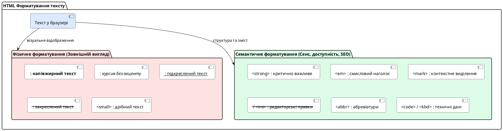
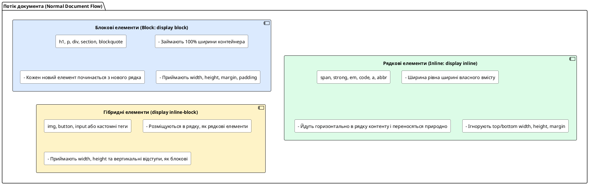
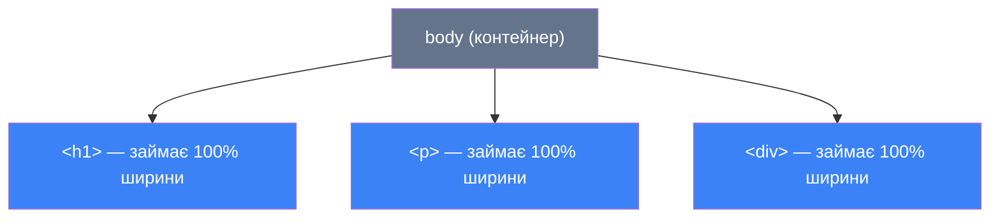
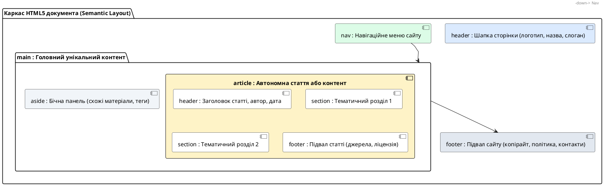

# Форматування тексту в HTML

## Чому форматування — це більше, ніж «зробити жирним»

Уявіть дві сторінки газети. На першій — суцільний текст без виділень, відступів, підзаголовків. На другій — той самий текст, але з чіткою ієрархією: жирні ключові слова, курсивні цитати, підкреслені посилання, виноски малим шрифтом.

Яку читати приємніше? Відповідь очевидна.

HTML надає два механізми форматування:

1. **Фізичне форматування** (_physical formatting_) — змінює зовнішній вигляд тексту: `<b>`, `<i>`, `<u>`, `<s>`, `<small>`
2. **Логічне (семантичне) форматування** (_logical / semantic formatting_) — описує _значення_ тексту: `<strong>`, `<em>`, `<del>`, `<ins>`, `<mark>`, `<abbr>`

::note
В HTML5 ці межі розмились: навіть теги «фізичного» форматування (`<b>`, `<i>`) отримали семантичний зміст. Але різниця у підходах залишається важливою для SEO та доступності.

::

{.diagram-img}

::plant-uml{alt="Фізичне vs Семантичне форматування тексту в HTML"}



::

---

## Блокові та рядкові елементи: фундаментальна різниця

Перш ніж вивчати конкретні теги, розберемо їхню класифікацію за типом відображення.

{.diagram-img}

::plant-uml{alt="Поведінка блокових, рядкових та гібридних елементів"}



::

### Блокові елементи (Block Elements)

**Блоковий елемент** завжди починається з нового рядка і займає всю доступну ширину свого контейнера — навіть якщо вміст займає лише пару слів.

```html
<p>Короткий абзац</p>
<p>Наступний абзац автоматично на новому рядку</p>
```

::mermaid



::

**Основні блокові елементи HTML5:**

| Тег                        | Призначення                                     |
| -------------------------- | ----------------------------------------------- |
| `<h1>`–`<h6>`              | Заголовки шести рівнів                          |
| `<p>`                      | Абзац                                           |
| `<div>`                    | Блоковий контейнер (без семантики)              |
| `<header>`                 | Шапка сторінки або розділу                      |
| `<nav>`                    | Блок навігації                                  |
| `<main>`                   | Основний вміст сторінки                         |
| `<section>`                | Тематичний розділ                               |
| `<article>`                | Самостійна стаття або контент                   |
| `<aside>`                  | Бічна колонка, пов'язана інформація             |
| `<footer>`                 | Футер сторінки або розділу                      |
| `<blockquote>`             | Блокова цитата                                  |
| `<pre>`                    | Преформатований текст                           |
| `<ul>`, `<ol>`, `<dl>`     | Ненумерований, нумерований, визначальний списки |
| `<figure>`, `<figcaption>` | Підпис до зображення/медіа                      |
| `<details>`, `<summary>`   | Інтерактивний спойлер                           |

### Рядкові елементи (Inline Elements)

**Рядковий елемент** розміщується в потоці тексту і займає рівно стільки місця, скільки займає його вміст. Він не «розривається» на новий рядок.

```html
<p>Тут звичайний текст, а ось <strong>жирне слово</strong>, і далі текст продовжується на тому ж рядку.</p>
```

**Основні рядкові елементи:**

| Тег        | Призначення                                |
| ---------- | ------------------------------------------ |
| `<a>`      | Гіперпосилання                             |
| `<span>`   | Рядковий контейнер (без семантики)         |
| `<strong>` | Важливий текст (жирний)                    |
| `<em>`     | Наголошений текст (курсив)                 |
| `<b>`      | Виділений текст (жирний, без посилення)    |
| `<i>`      | Альтернативний текст (курсив, без акценту) |
| `<u>`      | Підкреслений текст                         |
| `<s>`      | Закреслений (неактуальний) текст           |
| `<del>`    | Видалений текст                            |
| `<ins>`    | Доданий текст                              |
| `<mark>`   | Виділений маркером текст                   |
| `<small>`  | Дрібніший текст (правова інформація)       |
| `<sub>`    | Нижній індекс                              |
| `<sup>`    | Верхній індекс                             |
| `<abbr>`   | Абревіатура                                |
| `<code>`   | Inline-код                                 |
| `<kbd>`    | Введення з клавіатури                      |
| `<var>`    | Змінна                                     |
| `<cite>`   | Джерело цитати                             |
| `<q>`      | Коротка цитата                             |
| `<br>`     | Перенос рядка                              |
| ``    | Зображення                                 |

### CSS-відмінності між типами

З погляду CSS, різниця між типами задається властивістю `display`:

```css
/* Блоковий елемент */
div {
    display: block;
}

/* Рядковий елемент */
span {
    display: inline;
}

/* Гібрид: рядковий, але приймає розміри блоку */
img {
    display: inline-block;
}
```

::html-preview

```html
<!-- Демонстрація поведінки display: block vs inline vs inline-block -->
<div class="box-container">
    <div class="demo-block">Блок 1 (display: block) — займає 100% ширини контейнера</div>
    <div class="demo-block">Блок 2 (display: block) — починається з нового рядка</div>

    <p class="demo-paragraph">
        Звичайний текст з
        <span class="demo-inline">inline-елементом 1</span>
        та
        <span class="demo-inline">inline-елементом 2</span>, які продовжують рядок і обтікаються текстом.
    </p>

    <div class="demo-ib-group">
        <span class="demo-inline-block">Елемент 1 (inline-block)</span>
        <span class="demo-inline-block">Елемент 2 (inline-block)</span>
        <span class="demo-inline-block">Елемент 3 (inline-block)</span>
    </div>
</div>
```

```css
.box-container {
    background-color: #f8fafc;
    border: 1px solid #e2e8f0;
    padding: 1rem;
    border-radius: 8px;
    font-family: system-ui, sans-serif;
    font-size: 0.9rem;
}

.demo-block {
    display: block;
    background-color: #dbeafe;
    border: 1px solid #3b82f6;
    color: #1e3a8a;
    padding: 0.5rem 0.75rem;
    margin-bottom: 0.5rem;
    border-radius: 4px;
}

.demo-paragraph {
    margin: 1rem 0;
    color: #334155;
    line-height: 1.8;
}

.demo-inline {
    display: inline;
    background-color: #dcfce7;
    border: 1px solid #22c55e;
    color: #14532d;
    padding: 2px 6px;
    border-radius: 4px;
    font-weight: 600;
}

.demo-ib-group {
    margin-top: 0.75rem;
}

.demo-inline-block {
    display: inline-block;
    width: 140px;
    height: 48px;
    background-color: #fef3c7;
    border: 1px solid #f59e0b;
    color: #78350f;
    padding: 6px;
    margin-right: 6px;
    border-radius: 6px;
    text-align: center;
    vertical-align: middle;
}
```

::

::tip
За допомогою CSS можна змінити тип відображення будь-якого елемента: `display: block` зробить `<span>` блоковим, а `display: inline` зробить `<div>` рядковим. Це потужний інструмент для створення макетів.

::

---

## Теги фізичного та семантичного форматування

### `<b>` — Виділений текст (Bold)

**Тег `<b>`** (_bring attention to_) відображає текст **напівжирним накресленням**. В HTML5 він позначає текст, до якого автор хоче привернути увагу суто візуально, але без надання йому особливої смислової ваги та без зміни інтонації скринрідера.

**Коли використовувати `<b>`:**

- Ключові слова в резюме (наприклад, перелік навичок)
- Назви товарів або інгредієнтів у кулінарному рецепті
- Назви кнопок та елементів інтерфейсу в інструкціях користувача

**`<b>` vs `<strong>`** — головна відмінність:

::html-preview

```html
<!-- <b>: візуальне виділення без зміни критичної важливості -->
<p>Для завершення натисніть кнопку <b>OK</b>, а потім перевірте пошту.</p>

<p>Склад пирога: <b>яблука</b>, <b>кориця</b>, <b>цукор</b>, <b>борошно</b>.</p>

<!-- <strong>: критична важливість та зміна інтонації для доступності -->
<p><strong class="alert-text">Увага!</strong> Не вимикайте живлення під час оновлення.</p>
```

```css
b {
    font-weight: 700;
    color: #0f172a;
}

strong.alert-text {
    font-weight: 700;
    color: #dc2626;
    background-color: #fee2e2;
    padding: 2px 6px;
    border-radius: 4px;
}
```

::

---

### `<strong>` — Важливий текст (Strong Importance)

**Тег `<strong>`** позначає текст як **критично важливий** за змістом. Браузер відображає його напівжирним, а скринрідери змінюють тембр і висоту голосу при озвучуванні. Пошукові системи враховують ключові фрази всередині `<strong>` як пріоритетні для індексації сторінки.

::html-preview

```html
<p><strong>Заборонено</strong> залишати дітей без нагляду.</p>

<p>Термін здачі проєкту — <strong>15 березня 2024 року</strong>.</p>

<p>Для входу необхідний <strong>дійсний паспорт або ID-картка</strong>.</p>

<!-- Вкладений strong посилює рівень важливості -->
<p class="nested-box">
    <strong>Це обов'язково. <strong>Не забудьте зберегти файл!</strong></strong>
</p>
```

```css
strong {
    font-weight: 700;
    color: #1e293b;
}

.nested-box strong {
    color: #b91c1c;
}

.nested-box strong strong {
    color: #991b1b;
    text-decoration: underline;
    background-color: #fef2f2;
    padding: 1px 4px;
    border-radius: 3px;
}
```

::

::note
Скринрідери (наприклад, NVDA, JAWS) можуть виділяти текст у `<strong>` інтонаційно при зачитуванні — підвищувати голос або робити паузу. Тому семантика `<strong>` vs `<b>` має практичне значення для доступності.

::

---

### `<i>` — Альтернативний текст (Italic)

**Тег `<i>`** (_idiomatic text_) відображає текст _курсивом_. В HTML5 він отримав чітку семантику: текст, який відрізняється від основного тексту за тональністю, якістю чи стилем викладу, але не має наголосу чи критичної ваги.

**Типові випадки використання `<i>`:**

- Технічні терміни та назви класифікацій (біологічні види, родові назви)
- Іншомовні вирази, ідіоми, латинські фрази (рекомендовано вказувати атрибут `lang`)
- Назви суден, кораблів, потягів
- Внутрішні думки персонажів у художній розповіді

::html-preview

```html
<!-- Технічні терміни -->
<p>Алгоритм <i>quicksort</i> має середню часову складність O(n log n).</p>

<!-- Іноземні фрази з атрибутом мови -->
<p>Юристи часто повторюють правило: <i lang="la">dura lex, sed lex</i>.</p>

<!-- Назви транспортних засобів та суден -->
<p>Крейсер <i>«Варяг»</i> увійшов у порт на світанку.</p>

<!-- Внутрішні думки персонажа -->
<p>Він поглянув на розбитий сервер. <i>«І як це полагодити до ранку?»</i> — прошепотів він.</p>
```

```css
i {
    font-style: italic;
    color: #334155;
}

i[lang='la'] {
    font-family: 'Georgia', serif;
    font-style: italic;
    color: #4338ca;
    background-color: #eef2ff;
    padding: 1px 5px;
    border-radius: 3px;
}
```

::

---

### `<em>` — Емфатичний наголос (Emphasis)

**Тег `<em>`** (_emphasis_ — наголос) позначає текст із **смисловим наголосом** — так, ніби ви підкреслюєте слово інтонацією у живій бесіді. Зміна місця `<em>` повністю змінює зміст речення. Скринрідери роблять на ньому інтонаційну паузу або підвищують тон голосу.

::html-preview

```html
<!-- Зміна змісту речення залежно від позиції емфази -->
<p><em>Я</em> не брав твою книгу. (Хтось інший взяв, але не я)</p>

<p>Я <em>не брав</em> твою книгу. (Категоричне заперечення самої дії)</p>

<p>Я не брав <em>твою</em> книгу. (Я взяв книгу, але чужу)</p>

<p class="warning-callout">Пам'ятайте: пароль <em>ніколи</em> не слід передавати відкритим текстом.</p>
```

```css
em {
    font-style: italic;
    font-weight: 600;
    color: #1d4ed8;
    background-color: #eff6ff;
    padding: 1px 4px;
    border-radius: 3px;
}

.warning-callout {
    border-left: 3px solid #3b82f6;
    padding-left: 10px;
    color: #1e293b;
}

.warning-callout em {
    color: #b91c1c;
    background-color: #fee2e2;
}
```

::

::tip
Один з найкращих тестів для розуміння `<em>`: уявіть, що ви читаєте текст вголос. Де ви підвищуєте голос або робите наголос? — Ось де потрібен `<em>`.

::

---

### `<u>` — Підкреслений текст (Underline)

**Тег `<u>`** підкреслює текст. В HTML5 отримав специфічне семантичне значення: текст із **нетекстовою анотацією** (наприклад, орфографічна помилка, позначка).

::html-preview

```html
<!-- Орфографічна помилка зі стилем -->
<p>Він написав <u class="spelling-error">карова</u> замість «корова».</p>

<!-- Власні назви в китайській літературі (традиційне використання) -->
<p><u>東京</u> — столиця Японії.</p>

<!-- Декоративне підкреслення через CSS -->
<p class="custom-underline">Стильне підкреслення через CSS</p>
```

```css
.spelling-error {
    text-decoration: underline wavy red;
}
.custom-underline {
    text-decoration: underline;
    text-decoration-color: #3b82f6;
    text-decoration-style: wavy;
    text-underline-offset: 3px;
}
```

::

::warning
**Будьте обережні з `<u>`!** Підкреслений текст асоціюється у користувачів із **посиланнями**. Підкреслення звичайного тексту без стилізації може дезорієнтувати. Для декоративного підкреслення завжди використовуйте CSS.

::

---

### `<s>` — Закреслений текст (Strikethrough)

**Тег `<s>`** позначає текст, який **більше не є правильним або актуальним**, але не є «видаленим» у сенсі редагування документа (для цього є `<del>`).

::html-preview

```html
<!-- Старі ціни в магазині -->
<p>
    Навушники Sony WH-1000XM5:
    <s>8 999 грн</s>
    <strong>6 499 грн</strong>
    ⬇️ -28%
</p>

<!-- Скасована умова -->
<p>Мінімальне замовлення: <s>500 грн</s> безкоштовна доставка від 1 грн!</p>
```

```css
s {
    color: #94a3b8;
    text-decoration: line-through;
    text-decoration-color: #ef4444;
}
```

::

---

### `<del>` та `<ins>` — Відслідковування змін

Ці теги призначені для показу **редакторських правок** у документі — як режим «Відстежування змін» в Microsoft Word.

**`<del>`** (_deleted_ — видалений) позначає текст, що був **видалений** з документа.
**`<ins>`** (_inserted_ — вставлений) позначає текст, що був **доданий** до документа.

::html-preview

```html
<!-- Редакторська правка -->
<p>
    Зустріч відбудеться
    <del datetime="2024-03-10">в понеділок о 14:00</del>
    <ins datetime="2024-03-12">у середу о 16:00</ins>.
</p>

<!-- Виправлення помилки -->
<p>
    Автор статті —
    <del>Іван Петренко</del>
    <ins>Марія Коваленко</ins>.
</p>

<!-- Атрибут datetime вказує ISO 8601 дату змін -->
<p>
    <del datetime="2024-03-15T14:30:00Z">видалений текст</del>
    <ins datetime="2024-03-15">доданий текст</ins>
</p>
```

```css
del {
    color: #dc2626;
    background-color: #fee2e2;
    text-decoration: line-through;
}

ins {
    color: #16a34a;
    background-color: #dcfce7;
    text-decoration: none;
}
```

::

---

### `<mark>` — Виділення маркером

**Тег `<mark>`** позначає текст, **виділений як важливий** у поточному контексті — наче підкреслений жовтим маркером.

::html-preview

```html
<!-- Результати пошуку -->
<p>Результати за запитом «<mark>HTML форматування</mark>»:</p>

<!-- Ключові слова у статті -->
<p>
    Для розуміння каскадності CSS важливо зрозуміти поняття
    <mark>специфічності</mark> та <mark class="blue-highlight">спадкування</mark>.
</p>

<!-- Виділення у цитаті -->
<blockquote>
    «Будь-який досить просунутий тег — це
    <mark>неможливо відрізнити від магії</mark>.»
</blockquote>
```

```css
/* Браузерний default: жовтий фон */
mark {
    background-color: #fef08a;
    color: black;
    border-radius: 2px;
    padding: 0 2px;
}

/* Кастомний синій варіант */
mark.blue-highlight {
    background-color: #bfdbfe;
    color: #1e3a8a;
    border-radius: 3px;
    padding: 0 2px;
}

blockquote {
    border-left: 4px solid #3b82f6;
    padding: 0.5em 1em;
    margin: 1em 0;
    font-style: italic;
    color: #475569;
    background: #f8fafc;
}
```

::

---

### `<small>` — Дрібніший текст

**Тег `<small>`** зменшує розмір шрифту на один рівень (зазвичай з `1em` до `0.8em`). В HTML5 семантика тегу суворо визначена: **правова інформація, відмова від відповідальності, авторські права, примітки до цін та умов**.

::html-preview

```html
<!-- Авторське право у футері -->
<footer>
    <small class="copyright">&copy; 2024 Мій сайт. Усі права захищені.</small>
</footer>

<!-- Правові застереження під формою реєстрації -->
<form class="legal-form">
    <button type="button" class="btn">Зареєструватись</button>
    <small class="disclaimer">
        Натискаючи кнопку, ви погоджуєтесь з
        <a href="#">Умовами використання</a> та політикою приватності.
    </small>
</form>

<!-- Примітки під заголовком акції -->
<div class="promo-box">
    <h3>Акція «Чорна п'ятниця»</h3>
    <small class="promo-date">Дійсно до 30 листопада або до вичерпання запасів на складі</small>
</div>
```

```css
.copyright {
    display: block;
    font-size: 0.8125rem;
    color: #64748b;
    border-top: 1px solid #e2e8f0;
    padding-top: 0.5rem;
}

.legal-form {
    margin: 1rem 0;
}

.btn {
    background-color: #2563eb;
    color: white;
    border: none;
    padding: 6px 14px;
    border-radius: 4px;
    font-weight: 500;
}

.disclaimer {
    display: block;
    margin-top: 0.35rem;
    font-size: 0.75rem;
    color: #94a3b8;
    line-height: 1.4;
}

.promo-box {
    background-color: #fefce8;
    border: 1px solid #fef08a;
    padding: 0.75rem;
    border-radius: 6px;
}

.promo-box h3 {
    margin: 0 0 0.25rem 0;
    font-size: 1.1rem;
    color: #854d0e;
}

.promo-date {
    display: inline-block;
    font-size: 0.75rem;
    color: #a16207;
    font-weight: 500;
}
```

::

---

### `<sub>` та `<sup>` — Індекси

**`<sub>`** (_subscript_ — нижній індекс): опускає базову лінію символів униз та зменшує розмір. Використовується для хімічних формул ($H_2O$) та математичних систем числення ($1011_2$).
**`<sup>`** (_superscript_ — верхній індекс): піднімає символи вище базової лінії. Використовується для степенів ($a^2$), бібліографічних виносок та порядкових скорочень ($1^{st}$).

::html-preview

```html
<!-- Хімічні формули (нижній індекс) -->
<p>
    Хімія: <b>H<sub>2</sub>O</b> (вода) та <b>H<sub>2</sub>SO<sub>4</sub></b> (сірчана кислота).
</p>

<!-- Математичні формули (верхній індекс) -->
<p>Алгебра: <var>a</var><sup>2</sup> + <var>b</var><sup>2</sup> = <var>c</var><sup>2</sup></p>

<!-- Виноски до тексту -->
<p>
    Станом на 2024 рік веб-стандарти підтримують понад 100 HTML5 тегів<sup class="fn-ref"><a href="#fn1">[1]</a></sup
    >.
</p>

<!-- Порядкові скорочення -->
<p>Студент зайняв 1<sup>-е</sup> місце на олімпіаді з програмування.</p>
```

```css
sub,
sup {
    font-size: 0.75em;
    line-height: 0;
    position: relative;
    vertical-align: baseline;
}

sup {
    top: -0.5em;
    color: #2563eb;
    font-weight: 600;
}

sub {
    bottom: -0.25em;
    color: #059669;
    font-weight: 600;
}

.fn-ref a {
    text-decoration: none;
    color: #7c3aed;
    background-color: #f3e8ff;
    padding: 0 3px;
    border-radius: 3px;
}
```

::

---

### `<abbr>` — Абревіатури та акроніми

**Тег `<abbr>`** (_abbreviation_ — скорочення) позначає абревіатури та акроніми. Атрибут `title` містить повну розшифровку, яку браузер показує у вигляді спливаючої підказки (_tooltip_) при наведенні курсора.

::html-preview

```html
<p><abbr title="HyperText Markup Language">HTML</abbr> — мова розмітки веб-сторінок.</p>

<p>
    Для стилізації використовуємо
    <abbr title="Cascading Style Sheets" class="abbr-accent">CSS</abbr>
    та редактор
    <abbr title="Visual Studio Code">VS Code</abbr>.
</p>

<p>
    Веб-інтерфейс повинен відповідати міжнародному стандарту
    <abbr title="Web Content Accessibility Guidelines" class="abbr-accent">WCAG</abbr> 2.2.
</p>
```

```css
abbr[title] {
    text-decoration: underline dotted;
    text-underline-offset: 4px;
    cursor: help;
    color: #1e40af;
}

abbr.abbr-accent {
    text-decoration-color: #3b82f6;
    background-color: #eff6ff;
    padding: 1px 4px;
    border-radius: 3px;
}
```

::

---

### `<span>` — Рядковий універсальний контейнер

**Тег `<span>`** — це нейтральний рядковий елемент, який сам по собі не несе семантичного змісту і не змінює візуальне відображення тексту. Він створений як **ідеальний «гачок» для CSS-класів та JavaScript**. Коли жоден семантичний тег не підходить, але частину тексту треба пофарбувати, виділити бейджем або анімувати — використовують `<span>`.

::html-preview

```html
<p>
    Статус сервера:
    <span class="status-badge status-online">Онлайн</span>
    або
    <span class="status-badge status-busy">Високе навантаження</span>
</p>

<p>
    Створюємо сучасний
    <span class="gradient-text">градієнтний акцент</span>
    прямо всередині тексту.
</p>

<p>
    Ціна за підписку:
    <span class="price-currency">$</span><span class="price-value">19</span><span class="price-period">/міс</span>
</p>
```

```css
.status-badge {
    display: inline-block;
    font-size: 0.75rem;
    font-weight: 600;
    padding: 2px 8px;
    border-radius: 9999px;
    text-transform: uppercase;
    letter-spacing: 0.05em;
}

.status-online {
    background-color: #dcfce7;
    color: #15803d;
    border: 1px solid #86efac;
}

.status-busy {
    background-color: #fef3c7;
    color: #b45309;
    border: 1px solid #fde047;
}

.gradient-text {
    background: linear-gradient(135deg, #2563eb, #9333ea, #ec4899);
    -webkit-background-clip: text;
    -webkit-text-fill-color: transparent;
    font-weight: 700;
    font-size: 1.1em;
}

.price-currency {
    font-size: 0.85em;
    color: #64748b;
    vertical-align: super;
}

.price-value {
    font-size: 1.5em;
    font-weight: 800;
    color: #0f172a;
}

.price-period {
    font-size: 0.85em;
    color: #64748b;
}
```

::

---

### `<time>` — Семантична дата та час

**Тег `<time>`** позначає точний час або дату у форматі, зрозумілому людині, зв'язуючи його з машинночитним форматом через атрибут `datetime`. Це дозволяє пошуковим системам (Google) генерувати розширені сніпети (_rich snippets_), а браузерам — додавати події в календарі.

Формати атрибута `datetime`:

- Дата: `YYYY-MM-DD` (`2024-03-15`)
- Час: `HH:MM:SS` (`14:30:00`)
- Дата і час: `2024-03-15T14:30:00Z`
- Тривалість: `PT2H30M` (2 години 30 хвилин)

::html-preview

```html
<!-- Дата публікації статті -->
<article class="news-item">
    <h4>Реліз версії 2.0</h4>
    <p>
        Опубліковано:
        <time datetime="2024-10-12" class="post-date">12 жовтня 2024</time>
    </p>
    <p>
        Тривалість вебінару:
        <time datetime="PT1H45M" class="duration-badge">1 год 45 хв</time>
    </p>
</article>
```

```css
.news-item {
    background: #f8fafc;
    border: 1px solid #e2e8f0;
    padding: 1rem;
    border-radius: 8px;
}

.news-item h4 {
    margin: 0 0 0.5rem 0;
    color: #1e293b;
}

.post-date {
    font-weight: 600;
    color: #2563eb;
    background-color: #eff6ff;
    padding: 2px 6px;
    border-radius: 4px;
}

.duration-badge {
    font-family: ui-monospace, monospace;
    font-size: 0.85rem;
    color: #059669;
    background-color: #d1fae5;
    padding: 2px 6px;
    border-radius: 4px;
}
```

::

---

### `<dfn>` — Термін, що визначається

**Тег `<dfn>`** (_definition element_) позначає **першу або визначальну появу терміна** в документі. Найближчий батьківський абзац, список або розділ вважається офіційним визначенням цього терміна.

::html-preview

```html
<p>
    <dfn id="def-api">API</dfn> (Application Programming Interface) — це набір правил та протоколів, що дозволяють
    різним програмним компонентам взаємодіяти між собою.
</p>

<p>
    У веб-розробці термін <dfn class="glossary-term">DOM</dfn> (Document Object Model) представляє HTML-документ як
    деревоподібну структуру об'єктів.
</p>
```

```css
dfn {
    font-style: italic;
    font-weight: 700;
    color: #1e40af;
}

.glossary-term {
    border-bottom: 2px dashed #3b82f6;
    padding-bottom: 1px;
}
```

::

---

### `<bdi>` та `<bdo>` — Двонаправлений текст (Bi-Directional)

Більшість мов (українська, англійська) пишуться зліва направо (**LTR** — _Left-to-Right_), але арабська та іврит пишуться справа наліво (**RTL** — _Right-to-Left_). Коли вони змішуються в одному рядку (наприклад, ім'я користувача в інтерфейсі), браузерний алгоритм двонаправленості може поламати порядок розділових знаків чи чисел.

- **`<bdi>`** (_Bi-Directional Isolation_): ізолює напрямок тексту всередині себе від оточуючого середовища. Обов'язковий при виведенні імен користувачів або динамічного контенту з бази даних, напрямок мови якого заздалегідь невідомий.
- **`<bdo>`** (_Bi-Directional Override_): примусово змінює напрямок відображення тексту на протилежний через обов'язковий атрибут `dir="rtl"` або `dir="ltr"`.

::html-preview

```html
<!-- Проблема: без bdi число або дужка прилипають не до того боку арабського тексту -->
<div class="user-list">
    <p>Користувач з bdi: <bdi class="user-name">إبراهيم</bdi> — 1-е місце (150 балів)</p>
    <p>Користувач без bdi: إبراهيم — 2-е місце (120 балів)</p>

    <!-- Примусовий переворот напрямку через bdo -->
    <p>Дзеркальний текст: <bdo dir="rtl">Цей текст виведено з права на ліво.</bdo></p>
</div>
```

```css
.user-list {
    background: #f8fafc;
    border: 1px solid #e2e8f0;
    padding: 0.75rem 1rem;
    border-radius: 6px;
    font-family: system-ui, sans-serif;
    font-size: 0.9rem;
}

.user-name {
    font-weight: 700;
    color: #0284c7;
    background-color: #e0f2fe;
    padding: 1px 6px;
    border-radius: 3px;
}

bdo {
    color: #d97706;
    font-weight: 600;
}
```

::

---

### `<wbr>` — Можливість перенесення рядка (Word Break Opportunity)

**Тег `<wbr>`** підказує браузеру: «якщо рядок занадто довгий і не вміщується в ширину контейнера, **тут можна перенести слово на новий рядок**». На відміну від дефіса чи `&shy;`, тег `<wbr>` **не додає знак дефіса** при перенесенні. Ідеально підходить для довгих URL-адрес та імен файлів.

::html-preview

```html
<div class="narrow-card">
    <h5>Посилання з переносом &lt;wbr&gt;:</h5>
    <p class="url-text">
        https://developer.mozilla.org/<wbr />uk/<wbr />docs/<wbr />Web/<wbr />HTML/<wbr />Element/<wbr />text_formatting
    </p>
</div>
```

```css
.narrow-card {
    width: 220px;
    background: #ffffff;
    border: 2px dashed #3b82f6;
    padding: 10px;
    border-radius: 6px;
    font-family: system-ui, sans-serif;
}

.narrow-card h5 {
    margin: 0 0 6px 0;
    font-size: 0.8rem;
    color: #1e293b;
}

.url-text {
    margin: 0;
    font-family: ui-monospace, monospace;
    font-size: 0.75rem;
    color: #2563eb;
    background: #eff6ff;
    padding: 6px;
    border-radius: 4px;
}
```

::

---

## Теги для коду та технічного тексту

### `<code>` — Фрагмент коду

**Тег `<code>`** позначає фрагмент програмного коду — рядковий елемент для `inline`-коду:

::html-preview

```html
<p>
    Для зміни кольору використовуйте властивість
    <code>color: red;</code>.
</p>

<p>Функція <code>getElementById()</code> повертає елемент DOM.</p>

<p>Використовуйте тег <code>&lt;pre&gt;&lt;code&gt;</code> для блоку коду:</p>

<pre><code>function greet(name) {
    return `Привіт, ${name}!`;
}

console.log(greet('Світ'));</code></pre>
```

```css
code {
    font-family: 'Consolas', 'Monaco', monospace;
    font-size: 0.875em;
    background-color: #f1f5f9;
    border: 1px solid #e2e8f0;
    border-radius: 4px;
    padding: 0.1em 0.4em;
    color: #be185d;
}
pre {
    background-color: #1e293b;
    color: #e2e8f0;
    border-radius: 8px;
    padding: 1rem;
    overflow-x: auto;
}
pre code {
    background: none;
    border: none;
    padding: 0;
    color: inherit;
    font-size: 0.875rem;
}
```

::

### `<kbd>` — Клавіатурний ввід

**Тег `<kbd>`** (_keyboard_ — клавіатура) позначає клавіші або комбінації клавіш:

::html-preview

```html
<p>Збережіть файл: <kbd>Ctrl</kbd> + <kbd>S</kbd></p>
<p>Відкрийте командний рядок: <kbd>Win</kbd> + <kbd>R</kbd></p>
<p>Для виходу натисніть <kbd>Esc</kbd></p>
```

```css
kbd {
    display: inline-block;
    padding: 2px 8px;
    font-family: monospace;
    font-size: 0.85em;
    background-color: #f1f5f9;
    border: 1px solid #cbd5e1;
    border-radius: 4px;
    box-shadow: 0 2px 0 #94a3b8;
}
```

::

### `<var>` — Змінна

**Тег `<var>`** (_variable_) позначає математичні змінні або змінні у програмному коді. Браузер за замовчуванням відображає його курсивом, а в сучасній веб-типографіці його стилізують класичними математичними шрифтами.

::html-preview

```html
<p class="formula">Площа круга: <var>S</var> = &pi; &times; <var>r</var><sup>2</sup></p>

<p class="formula">Рівняння прямої: <var>y</var> = <var>k</var><var>x</var> + <var>b</var></p>

<p>У функції обчислення передайте параметр <var>userId</var> у форматі цілого числа.</p>
```

```css
var {
    font-family: 'Cambria Math', 'KaTeX_Math', 'Times New Roman', serif;
    font-style: italic;
    font-weight: 600;
    color: #1e3a8a;
    padding: 0 2px;
}

.formula {
    background: #f8fafc;
    border-left: 3px solid #3b82f6;
    padding: 8px 12px;
    font-size: 1.1rem;
    border-radius: 0 4px 4px 0;
}
```

::

---

### `<samp>` — Зразок виводу комп'ютерної програми

**Тег `<samp>`** (_sample output_) позначає результат роботи комп'ютерної програми, сценарію, операційної системи або терміналу. Він відображається моноширинним шрифтом і дозволяє відокремити введення користувача (`<kbd>`) та код (`<code>`) від того, що повернула сама машина.

::html-preview

```html
<div class="terminal">
    <div class="terminal-header">
        <span class="dot red"></span>
        <span class="dot yellow"></span>
        <span class="dot green"></span>
        <span class="term-title">bash — 80×24</span>
    </div>
    <div class="terminal-body">
        <p><span class="prompt">$</span> git status</p>
        <p>
            <samp class="log-success"
                >On branch main<br />Your branch is up to date with 'origin/main'.<br />nothing to commit, working tree
                clean</samp
            >
        </p>

        <p><span class="prompt">$</span> ping google.com</p>
        <p><samp class="log-info">64 bytes from 142.250.186.78: icmp_seq=1 ttl=116 time=14.2 ms</samp></p>

        <p><span class="prompt">$</span> curl https://api.site.com/broken</p>
        <p><samp class="log-error">HTTP/1.1 500 Internal Server Error</samp></p>
    </div>
</div>
```

```css
.terminal {
    background-color: #0f172a;
    border-radius: 8px;
    overflow: hidden;
    font-family: ui-monospace, 'Courier New', monospace;
    font-size: 0.85rem;
    box-shadow: 0 10px 20px rgba(0, 0, 0, 0.25);
    margin: 1rem 0;
}

.terminal-header {
    background-color: #1e293b;
    padding: 8px 12px;
    display: flex;
    align-items: center;
    gap: 6px;
    border-bottom: 1px solid #334155;
}

.dot {
    width: 10px;
    height: 10px;
    border-radius: 50%;
}
.dot.red {
    background-color: #ef4444;
}
.dot.yellow {
    background-color: #f59e0b;
}
.dot.green {
    background-color: #10b981;
}

.term-title {
    margin-left: 8px;
    color: #94a3b8;
    font-size: 0.75rem;
}

.terminal-body {
    padding: 12px 16px;
    color: #f1f5f9;
}

.terminal-body p {
    margin: 0.35rem 0;
}

.prompt {
    color: #38bdf8;
    font-weight: bold;
    margin-right: 6px;
}

samp {
    font-family: inherit;
    display: block;
}

.log-success {
    color: #4ade80;
}
.log-info {
    color: #cbd5e1;
}
.log-error {
    color: #f87171;
    font-weight: 600;
}
```

::

---

## Цитати: `<blockquote>`, `<q>`, `<cite>`

### `<blockquote>` — Блокова цитата

**Тег `<blockquote>`** (_block quote_) — великі цитати з зовнішніх джерел, що виносяться в окремий блок. Браузер відступає його від основного тексту.

::html-preview

```html
<blockquote cite="https://uk.wikipedia.org/wiki/HTML">
    <p>
        HTML (від англ. HyperText Markup Language — «мова гіпертекстової розмітки») — стандартна мова розмітки для
        документів, що передаються в мережі Інтернет.
    </p>
    <footer>— <cite>Вікіпедія, «HTML»</cite></footer>
</blockquote>
```

```css
blockquote {
    border-left: 4px solid #3b82f6;
    margin: 1.5em 0;
    padding: 1em 1.5em;
    background-color: #f8fafc;
    font-style: italic;
    color: #475569;
}

blockquote footer {
    margin-top: 0.5em;
    font-style: normal;
    font-size: 0.9em;
    color: #64748b;
}
```

::

**Атрибут `cite`** містить URL джерела (не відображається користувачу, але корисний для машин).

### `<q>` — Коротка рядкова цитата

**Тег `<q>`** (_inline quotation_) — коротка рядкова цитата всередині тексту. Браузер **автоматично розставляє типографічні лапки** відповідно до атрибута мови (`lang`), тому ставити лапки вручну всередині `<q>` не потрібно.

::html-preview

```html
<p>
    Як сказав Стів Джобс:
    <q cite="https://example.com/jobs" class="styled-q">Ваш час обмежений, тому не витрачайте його на чуже життя.</q>
</p>

<!-- З lang="uk" браузер застосує лапки-«ялинки» або „лапки-лапки“ -->
<p lang="uk">Українська приказка: <q>Сім раз відміряй, один раз відріж.</q></p>
```

```css
q {
    quotes: '«' '»' '“' '”';
    font-style: italic;
    color: #1e293b;
}

.styled-q {
    color: #1d4ed8;
    background-color: #eff6ff;
    padding: 2px 4px;
    border-radius: 3px;
}
```

::

---

### `<cite>` — Посилання на джерело або назву твору

**Тег `<cite>`** позначає **назву творчої роботи**: книги, наукової статті, фільму, пісні, виставки, специфікації чи веб-сайту. За стандартом W3C тег `<cite>` не повинен містити ім'я людини чи автора — тільки назву твору!

::html-preview

```html
<div class="book-card">
    <p>
        Рекомендована література для курсу:
        <cite class="work-title">«Чистий код»</cite> Роберта Мартіна.
    </p>

    <p>
        Стандарт структури документовано у
        <cite class="spec-title">HTML Living Standard від WHATWG</cite>.
    </p>
</div>
```

```css
.book-card {
    background: #f8fafc;
    border: 1px solid #e2e8f0;
    padding: 0.75rem 1rem;
    border-radius: 6px;
    font-size: 0.95rem;
}

cite {
    font-style: italic;
}

.work-title {
    color: #4338ca;
    font-weight: 600;
}

.spec-title {
    color: #0284c7;
    font-weight: 500;
}
```

::

---

### `<address>` — Контактна інформація автора або організації

**Тег `<address>`** — семантичний блок для розміщення **контактної інформації** особи або організації, яка є автором статті або всього сайту. Якщо він розміщений всередині `<article>`, контакти стосуються цієї статті. Якщо всередині `<body>` чи `<footer>` — це контакти сайту. Браузер за замовчуванням робить текст курсивним, що зазвичай скидають через `font-style: normal` в CSS.

::html-preview

```html
<address class="contact-card">
    <strong>Команда підтримки платформи</strong><br />
    Email: <a href="mailto:support@example.com">support@example.com</a><br />
    вул. Шевченка, 10, м. Львів, 79000, Україна<br />
    Телефон: <a href="tel:+380441234567">+38 (044) 123-45-67</a>
</address>
```

```css
.contact-card {
    font-style: normal;
    background: #f8fafc;
    border: 1px solid #cbd5e1;
    border-left: 4px solid #10b981;
    padding: 10px 14px;
    border-radius: 4px;
    line-height: 1.6;
    font-size: 0.9rem;
    color: #334155;
}

.contact-card strong {
    color: #0f172a;
}

.contact-card a {
    color: #2563eb;
    text-decoration: none;
}

.contact-card a:hover {
    text-decoration: underline;
}
```

::

---

## Тег `<pre>` — Преформатований текст

**Тег `<pre>`** (_preformatted_) зберігає **всі пробіли, табуляції та переноси рядків** такими, якими вони є в HTML-коді. Незамінний для показу коду, ASCII-арту, поезії.

::html-preview

```html
<pre>
  Ти знаєш, що ти — людина?
  Ти знаєш про це чи ні?
  Усмішка твоя — єдина,
  мука твоя — єдина,
  очі твої — одні.
                — Василь Симоненко
</pre>

<!-- ASCII-арт -->
<pre>
    /\_____/\
   /  o   o  \
  ( ==  ^  == )
   )         (
  (           )
 ( (  )   (  ) )
(__(__)___(__)__)
</pre>
```

```css
pre {
    background-color: #0f172a;
    color: #e2e8f0;
    font-family: ui-monospace, Menlo, Monaco, monospace;
    font-size: 0.85rem;
    line-height: 1.6;
    padding: 1rem;
    border-radius: 8px;
    overflow-x: auto;
    tab-size: 4;
}
```

::

::note
`<pre>` використовує моноширинний шрифт за замовчуванням. Для показу коду завжди вкладайте `<code>` всередину `<pre>`: `<pre><code>...</code></pre>`.

::

---

## Тег `<br>` — Примусовий перенос рядка

**Тег `<br>`** (_line break_) — одинарний тег, що переносить текст на наступний рядок без початку нового абзацу.

::html-preview

```html
<!-- Адреса організації -->
<div class="address-box">
    ТОВ «Веб-Студія»<br />
    вул. Хрещатик, 1<br />
    м. Київ, 01001<br />
    Україна
</div>

<!-- Поетичний текст -->
<p class="poem-lines">
    Садок вишневий коло хати,<br />
    Хрущі над вишнями гудуть,<br />
    Плугатарі з плугами йдуть,<br />
    Співають ідучи дівчата.
</p>
```

```css
.address-box {
    background: #f8fafc;
    border: 1px solid #e2e8f0;
    padding: 10px 14px;
    border-radius: 6px;
    font-family: system-ui, sans-serif;
    line-height: 1.6;
    color: #334155;
}

.poem-lines {
    font-family: 'Georgia', serif;
    font-style: italic;
    line-height: 1.8;
    color: #1e293b;
    border-left: 3px solid #8b5cf6;
    padding-left: 12px;
}
```

::

::caution
Ніколи не використовуйте `<br><br>` для створення відступу між абзацами! Для цього є тег `<p>` або CSS `margin`. Два або більше `<br>` підряд — ознака поганого коду.

::

---

## Тег `<hr>` — Горизонтальна лінія

**Тег `<hr>`** (_horizontal rule_) — **блоковий**, одинарний тег. Позначає тематичний розрив між блоками контенту. Відображається як горизонтальна лінія.

::html-preview

```html
<h2>Розділ 1</h2>
<p>Вміст першого розділу.</p>

<hr />

<h2>Розділ 2</h2>
<p>Вміст другого розділу.</p>

<hr class="gradient" />

<p>Після градієнтної лінії.</p>
```

```css
hr {
    border: none;
    border-top: 2px solid #e2e8f0;
    margin: 1.5em 0;
}

/* Декоративна лінія з градієнтом */
hr.gradient {
    border: none;
    height: 2px;
    background: linear-gradient(to right, #3b82f6, #8b5cf6, #ec4899);
    margin: 1.5em 0;
}
```

::

---

<h2>Спецсимволи HTML (HTML Entities)</h2>

<h3>Чому потрібні спецсимволи?</h3>

Деякі символи мають **спеціальне значення** в HTML (`<`, `>`, `&`, `"`) або **відсутні на клавіатурі** (©, ®, →, ×). Для їхнього відображення використовуються **HTML entities** (мнемоніки).

**Синтаксис:**

- Іменні: `&copy;` → ©
- Числові (десяткові): `&#169;` → ©
- Числові (шістнадцяткові): `&#xA9;` → ©

<h3>Обов'язкові спецсимволи</h3>

::warning
Ці символи **НЕМОЖНА** вводити безпосередньо в HTML, де вони мають певну роль — тільки через entity:

| Символ | Entity   | Опис                  |
| ------ | -------- | --------------------- |
| `<`    | `&lt;`   | Менше (left than)     |
| `>`    | `&gt;`   | Більше (greater than) |
| `&`    | `&amp;`  | Амперсанд             |
| `"`    | `&quot;` | Подвійні лапки        |
| `'`    | `&apos;` | Апостроф              |

::

::html-preview

```html
<!-- Показуємо HTML-код як текст -->
<p>Тег &lt;p&gt; — це абзац.</p>

<!-- Назва компанії з амперсандом -->
<p>Компанія «Марк &amp; Спенсер»</p>

<!-- Типографіка і спецсимволи -->
<p>&copy; 2024 Мій Сайт</p>
<p>Nike&trade; — спортивний бренд</p>
<p>Apple&reg; — зареєстрована марка</p>

<!-- Тире -->
<p>Київ&ndash;Львів — 540 км</p>
<p>Відпустка&mdash;найкращий час</p>

<!-- Лапки і стрілки -->
<p>&laquo;Кобзар&raquo;</p>
<p>&larr; Назад &middot; Далі &rarr;</p>

<!-- Математика -->
<p class="math-expr">5 &times; 3 = 15</p>
<p class="math-expr">10 &divide; 2 = 5</p>
<p class="math-expr">a &ne; b</p>
<p class="math-expr">&pi; = 3.14159...</p>
<p class="math-expr">&infin;</p>
```

```css
p {
    margin: 0.35rem 0;
    font-family: system-ui, sans-serif;
    color: #1e293b;
}

.math-expr {
    font-family: 'Cambria Math', 'Times New Roman', serif;
    font-size: 1.05rem;
    color: #1e40af;
}
```

::

<h3>Нерозривний пробіл `&nbsp;`</h3>

**Нерозривний пробіл** (_non-breaking space_, `&nbsp;`) — особливий символ: браузер **ніколи не розірве рядок** у місці цього пробілу.

Він є золотим правилом професійної веб-типографіки і запобігає виникненню «висячих рядків» та відриву:

- коротких прийменників та сполучників від наступного слова («в&nbsp;Києві», «на&nbsp;сервері»);
- чисел від їхніх одиниць виміру («10&nbsp;кг», «250&nbsp;грн», «100&nbsp;%»);
- скорочень назв міст і вулиць («м.&nbsp;Київ», «вул.&nbsp;Хрещатик»);
- прізвищ від ініціалів («Т.&nbsp;Г.&nbsp;Шевченко»).

::html-preview

```html
<div class="space-demo">
    <div class="col">
        <h5>Звичайний пробіл (висячий прийменник):</h5>
        <div class="narrow-text-box">Ми зустрінемось в місті Київ о 10 годині.</div>
    </div>

    <div class="col">
        <h5>З нерозривним пробілом &amp;nbsp;:</h5>
        <div class="narrow-text-box highlight">Ми зустрінемось в&nbsp;місті Київ о&nbsp;10&nbsp;годині.</div>
    </div>
</div>
```

```css
.space-demo {
    display: flex;
    gap: 12px;
    flex-wrap: wrap;
    font-family: system-ui, sans-serif;
}

.col h5 {
    margin: 0 0 6px 0;
    font-size: 0.8rem;
    color: #475569;
}

.narrow-text-box {
    width: 175px;
    background: #ffffff;
    border: 1px solid #cbd5e1;
    padding: 8px 10px;
    border-radius: 4px;
    font-size: 0.9rem;
    line-height: 1.5;
    color: #0f172a;
}

.narrow-text-box.highlight {
    border-color: #22c55e;
    background: #f0fdf4;
}
```

::

<h3>М'який перенос `&shy;`</h3>

**М'який перенос** (_soft hyphen_, `&shy;`) — невидимий символ-підказка браузеру, де **дозволено перенести довге слово**, якщо воно не поміщається в ширину свого блоку. Якщо слово вміщується — дефіс не відображається. Якщо не вміщується — слово ділиться саме в цій точці з додаванням дефіса.

::html-preview

```html
<div class="shy-demo">
    <h5>Вузька колонка (160px) з &amp;shy;:</h5>
    <div class="narrow-col">
        Використовуємо ди&shy;фе&shy;рен&shy;ці&shy;аль&shy;не чис&shy;лен&shy;ня для оп&shy;ти&shy;мі&shy;за&shy;ції
        мо&shy;де&shy;лі.
    </div>
</div>
```

```css
.shy-demo {
    font-family: system-ui, sans-serif;
}

.shy-demo h5 {
    margin: 0 0 6px 0;
    font-size: 0.85rem;
    color: #334155;
}

.narrow-col {
    width: 160px;
    background: #f8fafc;
    border: 2px dashed #6366f1;
    padding: 8px 10px;
    border-radius: 6px;
    font-size: 0.9rem;
    line-height: 1.5;
    color: #1e1b4b;
}
```

::

---

<h2>CSS — мова стилів: короткий вступ</h2>

Ми вже бачили в прикладах шматочки `css`-коду — наприклад `color: red` або `text-decoration: line-through`. Настав час розібратися, що це таке і як підключити CSS до HTML-сторінки. Детально про CSS ми будемо вчитися на наступних заняттях, але базові речі потрібні вже зараз.

<h3>Що таке CSS?</h3>

**CSS** (_Cascading Style Sheets_ — каскадні таблиці стилів) — це окрема мова, яка відповідає **виключно за візуальне оформлення** HTML-сторінки. HTML описує _що є_ на сторінці, CSS — _як це виглядає_.

::note
Розподіл обов'язків:

- **HTML** — структура та зміст: заголовки, абзаци, посилання, зображення
- **CSS** — зовнішній вигляд: колір, шрифт, розміри, відступи, анімації

Якщо HTML — це скелет і органи тіла, то CSS — одяг і макіяж.

::

CSS-правило складається з **селектора** (кого стилізуємо) і **блоку оголошень** (як саме):

```css
/* селектор { властивість: значення; } */
p {
    color: #333; /* колір тексту */
    font-size: 16px; /* розмір шрифту */
    line-height: 1.6; /* міжрядковий інтервал */
}
```

<h3>Три способи підключення CSS</h3>

::tabs
::tabs-item{label="1. Inline-стилі (атрибут style)"}

Стилі прямо в атрибуті HTML-тегу. Найпростіший спосіб, але найгірший для підтримки — стилі розкидані по всьому HTML.

```html
<p style="color: red; font-size: 20px;">Цей текст буде червоним і великим.</p>

<h2 style="text-align: center; text-decoration: underline;">Підкреслений заголовок по центру</h2>
```

**Коли використовувати:** для швидкого тестування або коли потрібен унікальний стиль для одного конкретного елементу (наприклад, динамічно заданий через JavaScript).

Ніколи не стилізуйте весь сайт через `style=""` — код стане нечитабельним і важким для редагування. Якщо треба змінити колір усіх абзаців — доведеться редагувати кожен тег окремо.

::

::tabs-item{label="2. Тег style (внутрішні стилі)"}

CSS у блоці `<style>` всередині `<head>`. Всі стилі — в одному місці, але тільки для цієї одної HTML-сторінки.

```html
<!DOCTYPE html>
<html lang="uk">
    <head>
        <meta charset="UTF-8" />
        <title>Моя сторінка</title>

        <style>
            /* Тут пишемо CSS */
            body {
                font-family: Arial, sans-serif;
                background-color: #f8f9fa;
            }

            h1 {
                color: #2563eb;
                text-align: center;
            }

            p {
                color: #374151;
                line-height: 1.7;
            }

            strong {
                color: #dc2626;
            }
        </style>
    </head>
    <body>
        <h1>Привіт, CSS!</h1>
        <p>Цей текст стилізований через тег <strong>style</strong>.</p>
    </body>
</html>
```

**Коли використовувати:** для невеликих навчальних прикладів або односторінкових документів.

::
::tabs-item{label="3. Зовнішній файл (рекомендовано)"}

Стилі у окремому `.css`-файлі, підключеному через тег `<link>`. Це **єдиний правильний підхід** для реальних проєктів.

**Структура проєкту:**

```
my-project/
├── index.html
└── style.css
```

**style.css:**

```css
body {
    font-family: Arial, sans-serif;
    margin: 0;
    padding: 20px;
}

h1 {
    color: #2563eb;
}

p {
    line-height: 1.6;
}
```

**index.html:**

```html
<!DOCTYPE html>
<html lang="uk">
    <head>
        <meta charset="UTF-8" />
        <title>Моя сторінка</title>
        <!-- Підключаємо зовнішній CSS -->
        <link rel="stylesheet" href="style.css" />
    </head>
    <body>
        <h1>Заголовок</h1>
        <p>Стилізований текст.</p>
    </body>
</html>
```

**Переваги зовнішнього файлу:**

- Один CSS-файл стилізує **всі** сторінки сайту
- Браузер кешує `.css`-файл — сторінки завантажуються швидше
- Зрозуміла структура: HTML окремо, стилі окремо
- Легко знайти і змінити будь-який стиль

::

::

<h3>Для навчальних вправ: тег `<style>` або `style=""`</h3>

На цьому занятті та при виконанні домашніх завдань ми використовуємо **тег `<style>` в `<head>`** або коротко **`style=""`** прямо в тегах — так простіше бачити зв'язок між HTML та CSS в одному файлі.

```html
<!DOCTYPE html>
<html lang="uk">
    <head>
        <meta charset="UTF-8" />
        <title>Вправа</title>
        <style>
            /* Ваші стилі — тут */
            strong {
                color: #dc2626;
            }
            em {
                color: #2563eb;
            }
            mark {
                background-color: #fef08a;
                border-radius: 3px;
            }
        </style>
    </head>
    <body>
        <p><strong>Важливо:</strong> це <em>дуже</em> цікаво, а особливо <mark>ця частина</mark>.</p>
    </body>
</html>
```

---

<h2>CSS-властивості для оформлення тексту</h2>

Розглянемо найважливіші CSS-властивості, пов'язані з форматуванням тексту.

<h3>`font-weight` — Товщина шрифту</h3>

::html-preview

```html
<p class="thin">100 — Thin</p>
<p class="light">300 — Light</p>
<p class="regular">400 — Regular</p>
<p class="medium">500 — Medium</p>
<p class="semibold">600 — Semibold</p>
<p class="bold">700 — Bold</p>
<p class="black">900 — Black</p>
```

```css
* {
    margin: 0.2em 0;
    font-family: system-ui;
}
.thin {
    font-weight: 100;
}
.light {
    font-weight: 300;
}
.regular {
    font-weight: 400;
}
.medium {
    font-weight: 500;
}
.semibold {
    font-weight: 600;
}
.bold {
    font-weight: 700;
}
.black {
    font-weight: 900;
}
```

::

<h3>`font-style` — Стиль шрифту</h3>

Властивість `font-style` керує нахилом шрифту: звичайне пряме накреслення (`normal`), справжній курсив (`italic`) або штучний механічний нахил прямого шрифту (`oblique`).

::html-preview

```html
<p class="style-normal">normal — прямий звичайний текст</p>
<p class="style-italic">italic — справжній гарнітурний курсив</p>
<p class="style-oblique">oblique — механічно нахилене накреслення</p>
<p class="style-oblique-deg">oblique 20deg — нахил під точним кутом у 20°</p>
```

```css
p {
    font-family: Georgia, serif;
    font-size: 1.05rem;
    margin: 0.4rem 0;
}

.style-normal {
    font-style: normal;
    color: #1e293b;
}

.style-italic {
    font-style: italic;
    color: #2563eb;
}

.style-oblique {
    font-style: oblique;
    color: #7c3aed;
}

.style-oblique-deg {
    font-style: oblique 20deg;
    color: #059669;
}
```

::

<h3>`text-decoration` — Декорація тексту</h3>

::html-preview

```html
<p class="underline">Підкреслення (underline)</p>
<p class="strikethrough">Закреслення (line-through)</p>
<p class="overline">Надлінійне (overline)</p>
<p class="fancy-underline">Фігурна хвиля (wavy red)</p>
```

```css
* {
    margin: 0.4em 0;
    font-family: system-ui;
    font-size: 1rem;
}
.underline {
    text-decoration: underline;
}
.strikethrough {
    text-decoration: line-through;
}
.overline {
    text-decoration: overline;
}
.fancy-underline {
    text-decoration-line: underline;
    text-decoration-style: wavy;
    text-decoration-color: #ef4444;
    text-decoration-thickness: 2px;
}
```

::

<h3>`text-transform` — Регістр тексту</h3>

::html-preview

```html
<p class="uppercase">все великими (uppercase)</p>
<p class="lowercase">ВСЕ МАЛИМИ (lowercase)</p>
<p class="capitalize">перша літера кожного слова (capitalize)</p>
```

```css
* {
    margin: 0.4em 0;
    font-family: system-ui;
    font-size: 1rem;
}
.uppercase {
    text-transform: uppercase;
}
.lowercase {
    text-transform: lowercase;
}
.capitalize {
    text-transform: capitalize;
}
```

::

<h3>`letter-spacing` та `text-align`</h3>

::html-preview

```html
<p class="caps-label">стильний лейбл</p>
<h2 class="heading">Заголовок з літерним розташуванням</h2>
<p class="left">Вирівнювання ліворуч</p>
<p class="center">Вирівнювання по центру</p>
<p class="right">Вирівнювання праворуч</p>
<p class="justify">
    Текст по ширині. Це дозволяє рівномірно розташовувати слова по альбому краю рядка, що виглядає красиво у газетах.
</p>
```

```css
* {
    font-family: system-ui;
}
.caps-label {
    text-transform: uppercase;
    letter-spacing: 0.15em;
    font-size: 0.75rem;
    font-weight: 600;
    color: #6366f1;
}
.heading {
    letter-spacing: 0.05em;
}
.left {
    text-align: left;
}
.center {
    text-align: center;
}
.right {
    text-align: right;
}
.justify {
    text-align: justify;
}
```

::

<h3>`word-spacing` — Міжслівний інтервал</h3>

Властивість `word-spacing` збільшує або зменшує відстань між окремими словами у тексті.

::html-preview

```html
<p class="ws-tight">Стиснуті пробіли між словами (word-spacing: -2px)</p>
<p class="ws-normal">Звичайний стандартний міжслівний інтервал (word-spacing: normal)</p>
<p class="ws-loose">Розширені пробіли для розрідженого читання (word-spacing: 0.4em)</p>
<p class="ws-extra">Акцентний постерний інтервал слів (word-spacing: 12px)</p>
```

```css
p {
    font-family: system-ui, sans-serif;
    font-size: 1rem;
    margin: 0.5rem 0;
    color: #1e293b;
}

.ws-tight {
    word-spacing: -2px;
    color: #64748b;
}
.ws-normal {
    word-spacing: normal;
}
.ws-loose {
    word-spacing: 0.4em;
    color: #0284c7;
}
.ws-extra {
    word-spacing: 12px;
    font-weight: 600;
    color: #4338ca;
}
```

::

<h3>`line-height` — Міжрядковий інтервал</h3>

Властивість `line-height` встановлює висоту рядка тексту. **Найкраща інженерна практика** — задавати безрозмірне відносне число (наприклад, `line-height: 1.6`), яке автоматично масштабується при зміні `font-size`.

::html-preview

```html
<div class="lh-box lh-tight">
    <h5>line-height: 1.1 (Занадто тісно)</h5>
    <p>
        Малий міжрядковий інтервал ускладнює читання: виносні елементи літер («й», «р», «д») зливаються із сусідніми
        рядками, а погляд втрачає фокус.
    </p>
</div>

<div class="lh-box lh-optimal">
    <h5>line-height: 1.6 (Золотий стандарт вебу)</h5>
    <p>
        Міжрядковий інтервал 1.5–1.6 вважається еталоном для комфортного читання довгих статей: очі легко перестрибують
        на наступний рядок без втоми.
    </p>
</div>

<div class="lh-box lh-loose">
    <h5>line-height: 2.2 (Підвищена доступність)</h5>
    <p>
        Збільшений інтервал використовується для поетичних текстів або для сайтів із підвищеними вимогами до доступності
        для людей із дислексією.
    </p>
</div>
```

```css
.lh-box {
    margin-bottom: 0.85rem;
    padding: 0.75rem 1rem;
    border-radius: 6px;
    background: #f8fafc;
    border: 1px solid #e2e8f0;
    font-family: system-ui, sans-serif;
}

.lh-box h5 {
    margin: 0 0 0.4rem 0;
    font-size: 0.85rem;
    color: #0f172a;
}

.lh-box p {
    margin: 0;
    font-size: 0.95rem;
    color: #334155;
}

.lh-tight p {
    line-height: 1.1;
}
.lh-optimal p {
    line-height: 1.6;
    border-left: 3px solid #10b981;
    padding-left: 8px;
}
.lh-loose p {
    line-height: 2.2;
}
```

::

<h3>`text-shadow` — Тінь тексту</h3>

::html-preview

```html
<h2 class="shadow">Звичайна тінь</h2>
<h2 class="glow">Світиння (glow)</h2>
<h2 class="three-d">Тривимірний ефект</h2>
```

```css
body {
    background: #1e293b;
    padding: 2rem;
}
h2 {
    font-family: system-ui;
    margin: 0.75rem 0;
    font-size: 1.5rem;
}

.shadow {
    color: #fff;
    text-shadow: 2px 2px 4px rgba(0, 0, 0, 0.5);
}
.glow {
    color: #93c5fd;
    text-shadow:
        0 0 10px #3b82f6,
        0 0 20px #3b82f6,
        0 0 40px #3b82f6;
}
.three-d {
    color: #e2e8f0;
    text-shadow:
        1px 1px 0 #999,
        2px 2px 0 #888,
        3px 3px 0 #777;
}
```

::

### `white-space` — Обробка пробілів

Ця властивість визначає, як браузер поводиться з пробілами, табуляціями та перенесеннями рядків усередині HTML:

::html-preview

```html
<div class="ws-demo">
    <div class="ws-item">
        <span class="label">normal (стискає пробіли, автоперенос):</span>
        <div class="box ws-normal">Рядок 1 багато пробілів Рядок 2 довгий текст переноситься по ширині блоку</div>
    </div>

    <div class="ws-item">
        <span class="label">nowrap (весь текст в один рядок):</span>
        <div class="box ws-nowrap">Цей довгий текст ніколи не перенесеться на новий рядок</div>
    </div>

    <div class="ws-item">
        <span class="label">pre (як у тезі &lt;pre&gt;):</span>
        <div class="box ws-pre">Рядок 1 зберігає всі відступи і переноси</div>
    </div>

    <div class="ws-item">
        <span class="label">pre-wrap (зберігає пробіли та переносить по краю):</span>
        <div class="box ws-pre-wrap">
            Рядок 1 зберігає пробіли, але коли текст досягає правого краю, переносить його
        </div>
    </div>

    <div class="ws-item">
        <span class="label">pre-line (стискає пробіли, зберігає переноси Enter):</span>
        <div class="box ws-pre-line">Рядок 1 стискає пробіли Рядок 2 перенесено через Enter</div>
    </div>
</div>
```

```css
.ws-demo {
    display: flex;
    flex-direction: column;
    gap: 10px;
    font-family: ui-monospace, monospace;
    font-size: 0.8rem;
}

.ws-item .label {
    display: block;
    font-family: system-ui, sans-serif;
    font-weight: 600;
    margin-bottom: 3px;
    color: #475569;
    font-size: 0.75rem;
}

.box {
    width: 270px;
    background: #f8fafc;
    border: 1px dashed #64748b;
    padding: 6px 10px;
    border-radius: 4px;
    color: #0f172a;
    overflow: hidden;
}

.ws-normal {
    white-space: normal;
}
.ws-nowrap {
    white-space: nowrap;
}
.ws-pre {
    white-space: pre;
}
.ws-pre-wrap {
    white-space: pre-wrap;
}
.ws-pre-line {
    white-space: pre-line;
}
```

::

### `word-break` та `overflow-wrap` — Перенос довгих слів

Коли в тексті зустрічаються довгі URL-адреси або нерозривні слова, вони можуть «випасти» за межі картки. Для контролю використовують `overflow-wrap` та `word-break`:

::html-preview

```html
<div class="break-demo">
    <div class="break-card">
        <h5>За замовчуванням (випадає з блоку):</h5>
        <p class="break-default">НайдовшеСловоУкраїнськоїМовиДиференціальноРентгеноелектрокардіографічний</p>
    </div>

    <div class="break-card">
        <h5>overflow-wrap: break-word</h5>
        <p class="break-wrap">НайдовшеСловоУкраїнськоїМовиДиференціальноРентгеноелектрокардіографічний</p>
    </div>

    <div class="break-card">
        <h5>word-break: break-all (для довгих URL):</h5>
        <p class="break-all">https://api.github.com/repos/organization/project/commits?sha=abcdef1234567890</p>
    </div>
</div>
```

```css
.break-demo {
    display: flex;
    gap: 12px;
    flex-wrap: wrap;
    font-family: system-ui, sans-serif;
}

.break-card {
    width: 180px;
    background: #f8fafc;
    border: 1px solid #cbd5e1;
    border-radius: 6px;
    padding: 8px 10px;
}

.break-card h5 {
    margin: 0 0 6px 0;
    font-size: 0.75rem;
    color: #334155;
    line-height: 1.3;
}

.break-card p {
    margin: 0;
    font-size: 0.8rem;
    background: #ffffff;
    border: 1px dashed #94a3b8;
    padding: 4px;
    color: #dc2626;
}

.break-default {
    /* Без перенесення */
}

.break-wrap {
    overflow-wrap: break-word;
    color: #16a34a !important;
}

.break-all {
    word-break: break-all;
    color: #2563eb !important;
}
```

::

### `text-align` — Вирівнювання тексту

Властивість `text-align` визначає горизонтальне вирівнювання тексту всередині блокового контейнера:

::html-preview

```html
<div class="align-card align-left">
    <strong>left:</strong> Вирівнювання ліворуч (стандарт для української та англійської мов).
</div>

<div class="align-card align-center"><strong>center:</strong> Вирівнювання по центру (заголовки, бейджи, цитати).</div>

<div class="align-card align-right">
    <strong>right:</strong> Вирівнювання праворуч (числові стовпчики, підписи авторів).
</div>

<div class="align-card align-justify">
    <strong>justify:</strong> Вирівнювання по ширині з автоматичним розширенням міжслівних інтервалів (книжковий або
    газетний стиль).
</div>

<div class="align-card align-start">
    <strong>start / end:</strong> Сучасні логічні властивості: <code>start</code> автоматично рівняє ліворуч для LTR
    (українська) і праворуч для RTL (арабська).
</div>
```

```css
.align-card {
    background: #f8fafc;
    border: 1px solid #e2e8f0;
    border-radius: 6px;
    padding: 8px 12px;
    margin-bottom: 8px;
    font-family: system-ui, sans-serif;
    font-size: 0.9rem;
    color: #334155;
    line-height: 1.5;
}

.align-left {
    text-align: left;
}
.align-center {
    text-align: center;
}
.align-right {
    text-align: right;
}
.align-justify {
    text-align: justify;
}
.align-start {
    text-align: start;
}
```

::

### `color` та `opacity` — Колір та прозорість тексту

Колір тексту задається властивістю `color` у форматах HEX, RGB або HSL, а також ключовим словом `currentColor`, яке успадковує колір тексту для меж і піктограм:

::html-preview

```html
<p class="c-hex">HEX колір: #2563eb</p>
<p class="c-rgb">RGB з альфа-каналом: rgb(15 23 42 / 75%)</p>
<p class="c-hsl">HSL формат: hsl(142 71% 45%)</p>
<p class="c-current">Межа успадковує колір через currentColor</p>
<p class="c-opacity">Напівпрозорий блок тексту (opacity: 0.5)</p>
```

```css
p {
    font-family: system-ui, sans-serif;
    font-size: 0.95rem;
    font-weight: 600;
    margin: 0.4rem 0;
}

.c-hex {
    color: #2563eb;
}
.c-rgb {
    color: rgb(15 23 42 / 0.75);
}
.c-hsl {
    color: hsl(142 71% 35%);
}
.c-current {
    color: #9333ea;
    border: 2px solid currentColor;
    display: inline-block;
    padding: 4px 8px;
    border-radius: 4px;
}
.c-opacity {
    color: #0f172a;
    opacity: 0.5;
}
```

::

---

## Семантична структура сторінки: HTML5-теги

HTML5 надав потужний набір **структурних семантичних тегів**, що замінили застарілу практику створення десятків несемантичних блоків `<div id="header">` або `<div class="sidebar">`. Ці теги вказують браузерам, пошуковим роботам та програмам доступності призначення кожної частини сторінки.

{.diagram-img}

::plant-uml{alt="Каркас HTML5 документа (Semantic Layout)"}



::

::html-preview

```html
<!-- Інтерактивний макет семантичної структури HTML5 -->
<div class="layout-wrapper">
    <header class="sem-header">
        <div class="logo">PORTAL</div>
        <nav class="sem-nav">
            <a href="#">Головна</a>
            <a href="#">Новини</a>
            <a href="#">Технології</a>
        </nav>
    </header>

    <div class="sem-body-grid">
        <main class="sem-main">
            <article class="sem-article">
                <header class="article-head">
                    <h3>Заголовок публікації</h3>
                    <p><time datetime="2024-03-15">15 березня 2024</time> • <cite>Технічний дайджест</cite></p>
                </header>
                <section class="sem-section">
                    <p>Основний зміст першого розділу статті з акцентом на <strong>семантиці</strong>.</p>
                </section>
                <footer class="article-foot">
                    <small>Автор: Марія Коваленко</small>
                </footer>
            </article>
        </main>

        <aside class="sem-aside">
            <h4>Бічна колонка (&lt;aside&gt;)</h4>
            <ul>
                <li><a href="#">Схожа новина 1</a></li>
                <li><a href="#">Схожа новина 2</a></li>
            </ul>
        </aside>
    </div>

    <footer class="sem-footer">
        <small>&copy; 2024 Навчальний портал. Усі права захищені.</small>
    </footer>
</div>
```

```css
.layout-wrapper {
    font-family: system-ui, sans-serif;
    border: 1px solid #cbd5e1;
    border-radius: 8px;
    overflow: hidden;
    background: #ffffff;
}

.sem-header {
    background: #dbeafe;
    border-bottom: 2px solid #3b82f6;
    padding: 10px 16px;
    display: flex;
    justify-content: space-between;
    align-items: center;
}

.sem-header .logo {
    font-weight: 800;
    color: #1e40af;
    letter-spacing: 0.05em;
}

.sem-nav a {
    margin-left: 12px;
    color: #1e3a8a;
    text-decoration: none;
    font-size: 0.85rem;
    font-weight: 500;
}

.sem-body-grid {
    display: flex;
    gap: 12px;
    padding: 12px;
    background: #f8fafc;
}

.sem-main {
    flex: 2;
    background: #ffffff;
    border: 1px solid #e2e8f0;
    border-radius: 6px;
    padding: 12px;
}

.sem-article .article-head h3 {
    margin: 0 0 4px 0;
    color: #0f172a;
    font-size: 1.1rem;
}

.sem-article .article-head p {
    margin: 0 0 8px 0;
    font-size: 0.8rem;
    color: #64748b;
}

.sem-section p {
    margin: 0;
    font-size: 0.9rem;
    color: #334155;
    line-height: 1.5;
}

.article-foot {
    margin-top: 10px;
    padding-top: 6px;
    border-top: 1px dashed #e2e8f0;
    color: #64748b;
}

.sem-aside {
    flex: 1;
    background: #fef3c7;
    border: 1px solid #fde047;
    border-radius: 6px;
    padding: 10px;
}

.sem-aside h4 {
    margin: 0 0 6px 0;
    font-size: 0.85rem;
    color: #78350f;
}

.sem-aside ul {
    margin: 0;
    padding-left: 16px;
    font-size: 0.8rem;
}

.sem-aside a {
    color: #92400e;
    text-decoration: none;
}

.sem-footer {
    background: #e2e8f0;
    padding: 8px 16px;
    text-align: center;
    color: #475569;
    font-size: 0.8rem;
    border-top: 1px solid #cbd5e1;
}
```

::

```html
<!DOCTYPE html>
<html lang="uk">
    <head>
        <meta charset="UTF-8" />
        <title>Новини — Мій портал</title>
    </head>
    <body>
        <header>
            <h1>Мій новинний портал</h1>
            <nav>
                <a href="/">Головна</a>
                <a href="/ukraine">Україна</a>
                <a href="/world">Світ</a>
                <a href="/tech">Технології</a>
            </nav>
        </header>

        <main>
            <article>
                <header>
                    <h2>Заголовок головної новини</h2>
                    <p><time datetime="2024-03-15">15 березня 2024</time></p>
                </header>
                <section>
                    <h3>Передісторія</h3>
                    <p>Текст передісторії...</p>
                </section>
                <section>
                    <h3>Деталі події</h3>
                    <p>Детальний опис...</p>
                </section>
                <footer>
                    <p>Автор: <cite>Іван Петренко</cite></p>
                </footer>
            </article>

            <aside>
                <h2>Також читайте</h2>
                <ul>
                    <li><a href="#">Інша новина 1</a></li>
                    <li><a href="#">Інша новина 2</a></li>
                </ul>
            </aside>
        </main>

        <footer>
            <p><small>&copy; 2024 Мій портал. Усі права захищені.</small></p>
        </footer>
    </body>
</html>
```

---

## Застарілі теги: чого уникати

З переходом на HTML5 низку тегів визнано застарілими (_deprecated_ або _obsolete_). Валідатор їх відкидає.

::accordion
::accordion-item{label="<font> — Форматування шрифту" icon="i-lucide-x-circle"}

Тег `<font>` дозволяв задати шрифт, розмір і колір. Зараз — `font-family`, `font-size`, `color` в CSS.

```html
<!-- ❌ Застарілий підхід -->
<font face="Arial" size="5" color="red">Текст</font>

<!-- ✅ Сучасний CSS -->
<p style="font-family: Arial; font-size: 1.5em; color: red;">Текст</p>
```

::
::accordion-item{label="<center> — Центрування" icon="i-lucide-x-circle"}

Тег `<center>` центрував вміст. Зараз — `text-align: center` або `margin: auto` в CSS.

```html
<!-- ❌ -->
<center>Текст по центру</center>

<!-- ✅ -->
<p style="text-align: center;">Текст по центру</p>
```

::
::accordion-item{label="<big> — Збільшення тексту" icon="i-lucide-x-circle"}

Тег `<big>` збільшував шрифт. Зараз — `font-size` в CSS. На відміну від нього `<small>` залишається актуальним!

```html
<!-- ❌ -->
<big>Великий текст</big>

<!-- ✅ -->
<span style="font-size: 1.25em;">Великий текст</span>
```

::
::accordion-item{label="<strike> і <tt> — Застарілі аналоги" icon="i-lucide-x-circle"}

`<strike>` — застарілий аналог `<s>` та `<del>`. `<tt>` (teletype) — моноширинний шрифт, замінений `<code>`.

::

::

---

## Практичне завдання

Застосуйте знання з форматування на практиці.

::steps

### Крок 1: Створення файлу

Створіть `article.html` з базовою структурою HTML5 (`!` + Tab у VS Code).

### Крок 2: Структура статті

```html
<body>
    <article>
        <header>
            <h1>Як почати вивчати програмування</h1>
            <p>Автор: <cite>Марія Коваленко</cite> | <time datetime="2024-03-15">15 березня 2024</time></p>
        </header>
    </article>
</body>
```

### Крок 3: Вміст з форматуванням

Наповніть статтю, використовуючи:

- `<h2>`, `<h3>` для підрозділів
- `<p>` для абзаців
- `<strong>` для важливих термінів
- `<em>` для емоційних наголосів
- `<code>` для назв технологій і команд
- `<mark>` для ключових думок
- `<abbr>` для розшифровки абревіатур

### Крок 4: Цитата та спецсимволи

```html
<blockquote>
    <p>«Кожен експерт колись був початківцем. Головне &mdash; почати.»</p>
</blockquote>
```

### Крок 5: Футер статті

```html
        <footer>
            <small>
                &copy; 2024 Навчальна платформа.
                Усі права захищені&reg;.
            </small>
        </footer>
    </article>
</body>
```

### Крок 6: CSS-стилізація

Додайте в `<head>`:

```html
<style>
    body {
        font-family: 'Georgia', serif;
        line-height: 1.7;
        color: #1e293b;
        max-width: 720px;
        margin: 2rem auto;
        padding: 0 1rem;
    }

    article > header h1 {
        font-size: 2rem;
        letter-spacing: -0.02em;
    }
    blockquote {
        border-left: 4px solid #3b82f6;
        padding: 1em 1.5em;
        margin: 2em 0;
        font-style: italic;
        background: #f0f9ff;
    }
    code {
        background: #f1f5f9;
        padding: 2px 6px;
        border-radius: 4px;
        font-size: 0.9em;
    }
    mark {
        background: #fef08a;
        padding: 1px 3px;
        border-radius: 2px;
    }
</style>
```

::

---

## Підсумок: Обирайте теги за змістом

Ключовий принцип HTML5: **теги повинні відображати зміст, а не зовнішній вигляд**.

::card-group

::card{title="🔤 Фізичне vs. Семантичне" icon="i-heroicons-scale"}

Замість `<b>` думайте: «Ця інформація _важлива_? → `<strong>`. Це лише _ключове слово_? → `<b>`». Замість `<i>` думайте: «Це _термін чи цитата_? → `<i>`. Це _емоційний наголос_? → `<em>`».

::

::card{title="♿ Доступність" icon="i-heroicons-eye"}

Семантичні теги (`<strong>`, `<em>`, `<abbr>`, `<mark>`) допомагають скринрідерам коректно озвучувати контент для людей з порушеннями зору.

::

::card{title="📈 SEO" icon="i-heroicons-magnifying-glass"}

Пошукові системи враховують семантику тегів. Правильно позначений `<strong>` сигналізує Google про важливість слова.

::

::card{title="🎨 CSS — для вигляду" icon="i-heroicons-paint-brush"}

Візуальне форматування — через CSS. HTML-теги лише позначають структуру та зміст. Ніколи не використовуйте `<h3>` лише тому, що він «підходить за розміром».

::

::

---

## Перевірка знань

::tally-embed{id="html-formatting-quiz" title="Тест: Форматування тексту в HTML"}

::

::note
**Примітка**: Якщо тест не відображається, перейдіть за [прямим посиланням](https://tally.so/r/html-formatting-quiz).

::

---

## Корисні посилання

- 📖 [MDN: Текст та шрифт](https://developer.mozilla.org/uk/docs/Web/CSS/CSS_fonts) — документація CSS-шрифтів
- 📖 [MDN: Семантичні HTML-елементи](https://developer.mozilla.org/uk/docs/Glossary/Semantics#semantics_in_html) — пояснення семантики
- 🔣 [HTML Entities Reference](https://html.spec.whatwg.org/multipage/named-characters.html) — повна таблиця спецсимволів
- 🌐 [Can I Use](https://caniuse.com/) — підтримка браузерами
- 🔧 [HTML5 Outliner](https://chrome.google.com/webstore/detail/html5-outliner/) — розширення для перевірки структури
- ✅ [W3C Validator](https://validator.w3.org/) — валідація HTML
