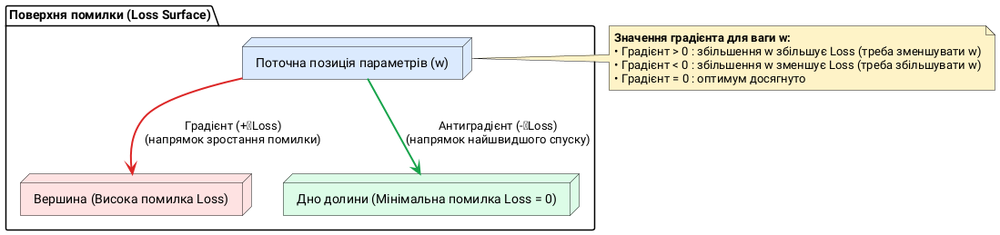
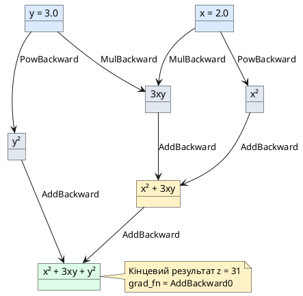

::card-group

::card{title="🎯 Мета статті" icon="i-lucide-target"}

- Розібратися в апаратній архітектурі (CPU/GPU, Compute Capability) та правильно налаштувати середовище з CUDA
- Зрозуміти, що таке тензори та чим вони відрізняються від NumPy масивів
- Навчитися створювати та маніпулювати тензорами в PyTorch
- Опанувати операції broadcasting для ефективних обчислень
- Розібратися у механізмі автоматичного диференціювання (autograd)
- Навчитися обчислювати градієнти для складних функцій автоматично

::

::card{title="🔑 Ключові концепції" icon="i-lucide-key"}

- **Тензор (_tensor_)** — багатовимірний масив даних, основна структура PyTorch
- **Compute Capability & CUDA** — архітектурна сумісність та апаратне прискорення GPU
- **Autograd** — система автоматичного обчислення градієнтів
- **Граф обчислень (_computational graph_)** — структура для відстеження операцій
- **Broadcasting** — автоматичне розширення форм для сумісності операцій
- **Backpropagation** — алгоритм зворотного поширення помилки

::

::

## Вступ: Чому NumPy недостатньо для Deep Learning

У попередніх модулях ми активно використовували NumPy для роботи з даними, побудови лінійних моделей та базових нейронних мереж. NumPy — чудова бібліотека для наукових обчислень, але коли справа доходить до створення глибоких нейронних мереж, вона має три критичні обмеження:

{.diagram-img}

::plant-uml{alt="Архітектурне порівняння CPU та GPU для тензорних обчислень"}
@startuml
skinparam backgroundColor #FFFFFF
skinparam defaultFontName -apple-system, BlinkMacSystemFont, "Segoe UI", Roboto, sans-serif
skinparam roundcorner 8
skinparam shadowing false
skinparam handwritten false

skinparam rectangle {
RoundCorner 8
BorderColor #94A3B8
FontSize 12
}

rectangle "Центральний процесор (CPU)" as cpu #EFF6FF {
card "Мала кількість потужних ядер (4-16 ядер)\nОптимізовано для послідовних складних інструкцій" as cpu_cores
card "Велика кеш-пам'ять (L1/L2/L3) + Низька затримка" as cpu_cache
card "Швидкість: базова для послідовних задач" as cpu_speed
cpu_cores -down-> cpu_cache
cpu_cache -down-> cpu_speed
}

rectangle "Графічний процесор (GPU)" as gpu #ECFDF5 {
card "Тисячі паралельних мікроядер (CUDA Cores, Tensor Cores)\nОптимізовано для масових паралельних операцій SIMD" as gpu_cores
card "Висока пропускна здатність пам'яті (HBM / GDDR6)" as gpu_mem
card "Швидкість: у 20-100 разів швидше для матричних множень" as gpu_speed
gpu_cores -down-> gpu_mem
gpu_mem -down-> gpu_speed
}

@enduml
::

<video controls autoplay loop muted playsinline poster="/videos/ai-python/pytorch-intro/tensors-and-autograd/cpu-gpu-race_poster.png" class="diagram-img rounded-xl shadow-lg w-full my-6">
  <source src="/videos/ai-python/pytorch-intro/tensors-and-autograd/cpu-gpu-race.mp4" type="video/mp4">
  <source src="/videos/ai-python/pytorch-intro/tensors-and-autograd/cpu-gpu-race.webm" type="video/webm">
  
</video>

::card-group

::card{title="🚫 Обмеження NumPy" icon="i-lucide-alert-triangle"}

**1. Відсутність підтримки GPU**
NumPy виконує всі обчислення на центральному процесорі (CPU). Для великих нейронних мереж це означає години або навіть дні тренування.

**2. Немає автоматичного диференціювання**
Щоб навчити нейронну мережу, потрібно обчислити градієнти для тисяч параметрів. У NumPy це доводиться робити вручну — десятки рядків коду для кожного шару.

**3. Відсутність високорівневих компонентів**
Немає готових реалізацій згорткових шарів, рекурентних мереж, attention-механізмів. Доводиться писати все з нуля.

::

::card{title="✅ Рішення: PyTorch" icon="i-lucide-check-circle"}

PyTorch вирішує всі ці проблеми:

- **GPU-прискорення:** тренування у 20-100 разів швидше
- **Autograd:** градієнти обчислюються автоматично для будь-якої функції
- **Neural Networks API:** готові шари, функції втрат та оптимізатори
- **Динамічні графи:** гнучкість як у Python, швидкість як у C++

::

::

> **Аналогія:** Якщо NumPy — це як збирати меблі IKEA без інструкції та інструментів, то PyTorch — це повний набір професійних інструментів із покроковою інструкцією та підказками на кожному етапі.

## Апаратна та програмна архітектура: CPU, GPU та екосистема CUDA

Під час тренування глибоких нейромереж обчислювальна система працює за гетерогенною схемою, де центральний процесор (_Central Processing Unit / CPU_) та графічний процесор (_Graphics Processing Unit / GPU_) вирішують різні завдання:

- **Хост (CPU):** Керуючий процесор із малою кількістю швидких ядер (4-64). Забезпечує загальну логіку програми, завантажує батчі даних із накопичувача (SSD) в оперативну пам'ять (RAM), виконує попередню обробку та відправляє команди на виконання у відеокарту.
- **Пристрій (GPU):** Спеціалізований співпроцесор із тисячами паралельних мікроядер (_CUDA cores_) та тензорними ядрами (_tensor cores_). Оптимізований під паралельне виконання однакових математичних інструкцій над великими масивами даних (_SIMD_).

### Показник обчислювальної здатності (Compute Capability)

Відеокарти NVIDIA мають апаратну версію архітектури чіпа, яка називається **обчислювальною здатністю** (_Compute Capability_) і позначається як `X.Y`:

- **X (мажорна версія):** Визначає покоління мікроархітектури.
- **Y (мінорна версія):** Позначає апаратні ревізії та можливості тензорних ядер.

| Архітектура NVIDIA | Compute Capability | Популярні відеокарти                | Ключові апаратні можливості                     |
| :----------------- | :----------------: | :---------------------------------- | :---------------------------------------------- |
| **Pascal**         |       `6.1`        | GTX 1080 Ti, GTX 1070               | Базові операції FP32, без тензорних ядер        |
| **Volta**          |       `7.0`        | Tesla V100                          | Перше покоління Tensor Cores (FP16)             |
| **Turing**         |       `7.5`        | RTX 2080 Ti, GTX 1660               | Tensor Cores 2-го покоління, INT8/INT4          |
| **Ampere**         |    `8.0 / 8.6`     | A100 (`8.0`), RTX 3080/3090 (`8.6`) | Підтримка формату TF32, прискорення FP32        |
| **Ada Lovelace**   |       `8.9`        | RTX 4080, RTX 4090, L40             | Tensor Cores 4-го покоління, підтримка FP8      |
| **Hopper**         |       `9.0`        | H100, H200                          | Transformer Engine, динамічне масштабування FP8 |

::warning
_Compute Capability_ — це фізична характеристика чіпа, яку неможливо оновити програмно. Бібліотека PyTorch повинна бути скомпільована з підтримкою саме вашої версії Compute Capability.
::

### Програмний стек: Як код виконується на GPU

Взаємодія Python-коду з графічним процесором проходить крізь кілька рівнів:

1. **GPU Hardware:** Кремнієвий чіп із ядрами та відеопам'яттю (_VRAM_).
2. **NVIDIA Driver:** Драйвер рівня ядра операційної системи (_kernel space_), що керує шиною PCIe та надає _CUDA Driver API_.
3. **CUDA Toolkit:** Бібліотеки простору користувача (_user space_):
    - **CUDA Runtime:** Керування потоками виконання та синхронізація буферів.
    - **cuBLAS:** Швидка лінійна алгебра та матричне множення (_GEMM_).
    - **cuDNN:** Алгоритми для нейромереж (згортки, функції активації, нормалізація).
4. **PyTorch (LibTorch C++ Core & Python API):** Високорівневий інтерфейс. Виклик оператора `a @ b` у Python транслюється через LibTorch у підпрограму cuBLAS або ядро тензорних ядер на GPU.

::plant-uml{alt="Програмний стек взаємодії PyTorch з апаратним забезпеченням NVIDIA"}
@startuml
skinparam style plain
skinparam backgroundColor #FFFFFF
skinparam defaultFontName -apple-system, BlinkMacSystemFont, "Segoe UI", Roboto, sans-serif
skinparam roundcorner 8
skinparam shadowing false

rectangle "Рівень застосунку (Python Application)" as app #EFF6FF {
card "Користувацький код (PyTorch Python API)\nimport torch, torch.nn" as py_code
}

rectangle "Рівень фреймворку (PyTorch C++ Core)" as torch_core #DBEAFE {
card "LibTorch / ATen Engine\n(Диспетчеризація операцій, Autograd, виділення пам'яті)" as aten
}

rectangle "Рівень прискорення CUDA (CUDA Toolkit & Libraries)" as cuda_toolkit #FEF3C7 {
card "cuBLAS (Базова лінійна алгебра: GEMM, множення матриць)" as cublas
card "cuDNN (Глибокі нейромережі: згортки, пулінг, функції активації)" as cudnn
card "CUDA Runtime API (керування потоками, пам'ять VRAM)" as cuda_rt
}

rectangle "Рівень ядра ОС (Kernel Space)" as os_kernel #F1F5F9 {
card "NVIDIA Display Driver\n(CUDA Driver API, пряма взаємодія з шиною PCIe)" as nvd_driver
}

rectangle "Апаратний рівень (Hardware Layer)" as hardware #DCFCE7 {
card "NVIDIA GPU (Тензорні ядра, CUDA Cores, VRAM GDDR6/HBM)" as gpu_chip
}

py_code -down-> aten : CPython C-Bindings
aten -down-> cublas
aten -down-> cudnn
aten -down-> cuda_rt
cublas -down-> nvd_driver
cudnn -down-> nvd_driver
cuda_rt -down-> nvd_driver
nvd_driver -down-> gpu_chip : PCIe Bus / NVLink
@enduml
::

---

## Стратегія встановлення: Покроковий алгоритм розгортання

Для уникнення несумісності між драйвером, бібліотекою CUDA та PyTorch застосовуйте чотирикроковий алгоритм:

::steps

### Крок 1. Діагностика відеокарти через nvidia-smi

Виконайте в терміналі команду:

```bash
nvidia-smi
```

Зверніть увагу на вивід утиліти:

::terminal-preview{title="nvidia-smi" :cursor="true"}

<div class="line"><span class="opacity-40">$</span> <strong class="font-bold">nvidia-smi</strong></div>
<div class="line">+-----------------------------------------------------------------------------------------+</div>
<div class="line">| NVIDIA-SMI <span class="text-green-400 font-bold">535.129.03</span>             Driver Version: <span class="text-blue-400 font-bold">535.129.03</span>   CUDA Version: <span class="text-yellow-400 font-bold">12.2</span>     |</div>
<div class="line">|-----------------------------------------+------------------------+----------------------+</div>
<div class="line">| GPU  Name                  Persistence-M| Bus-Id          Disp.A | Volatile Uncorr. ECC |</div>
<div class="line">| Fan  Temp   Perf          Pwr:Usage/Cap |           Memory-Usage | GPU-Util  Compute M. |</div>
<div class="line">|=========================================+========================+======================|</div>
<div class="line">|   0  <strong class="font-bold">NVIDIA GeForce RTX 3080</strong>        Off |   00000000:01:00.0  On |                  N/A |</div>
<div class="line">| 30%   45C    P8             28W /  320W |    1024MiB / <span class="text-green-400 font-bold">10240MiB</span> |      2%      Default |</div>
<div class="line">+-----------------------------------------+------------------------+----------------------+</div>
::

- **Driver Version:** Версія встановленого драйвера NVIDIA в операційній системі.
- **CUDA Version:** **Максимальна** версія CUDA Toolkit, яку підтримує поточний драйвер (це верхня межа сумісності, а не версія бібліотеки в системі).

### Крок 2. Зіставлення версій PyTorch та CUDA Runtime

PyTorch постачається з власними попередньо скомпільованими бібліотеками CUDA Runtime. Вам не потрібно встановлювати системний CUDA Toolkit вручну.

Правило сумісності:

::math-formula
\text{CUDA}_{\text{PyTorch}} \le \text{CUDA}_{\text{nvidia-smi}}
::

Якщо `nvidia-smi` вказує CUDA `12.2`, можна встановлювати PyTorch зі збіркою `cu121` (CUDA 12.1) або `cu118` (CUDA 11.8).

### Крок 3. Підготовка ізольованого середовища

Використовуйте окреме віртуальне оточення, щоб уникнути конфліктів системних пакетів:

::tabs

:::tabs-item{label="Conda / Mamba"}

```bash
conda create -n torch-env python=3.11 -y
conda activate torch-env
```

:::

:::tabs-item{label="uv"}

```bash
uv venv .venv --python 3.11
source .venv/bin/activate  # Linux/macOS
# .venv\Scripts\activate   # Windows
```

:::

:::tabs-item{label="Python venv"}

```bash
python -m venv .venv
source .venv/bin/activate  # Linux/macOS
# .venv\Scripts\activate   # Windows
```

:::

::

### Крок 4. Встановлення PyTorch

::tabs

::tabs-item{label="pip (CUDA 12.1)"}

```bash
# Рекомендовано для сучасних GPU (RTX 20xx, 30xx, 40xx)
pip install torch torchvision torchaudio --index-url https://download.pytorch.org/whl/cu121
```

::

::tabs-item{label="pip (CUDA 11.8)"}

```bash
# Для старіших карт (GTX 10xx, Tesla V100)
pip install torch torchvision torchaudio --index-url https://download.pytorch.org/whl/cu118
```

::

::tabs-item{label="Conda (CUDA 12.1)"}

```bash
conda install pytorch torchvision torchaudio pytorch-cuda=12.1 -c pytorch -c nvidia
```

::

::tabs-item{label="uv (CUDA 12.1)"}

```bash
uv pip install torch torchvision torchaudio --index-url https://download.pytorch.org/whl/cu121
```

::

::tabs-item{label="pip (CPU-only)"}

```bash
pip install torch torchvision torchaudio --index-url https://download.pytorch.org/whl/cpu
```

::

::

::

---

## Верифікація середовища та бенчмарк матричного множення

Перевіримо працездатність налаштованого середовища та порівняємо швидкість множення матриць на CPU та GPU:

::jupyter-notebook{title="pytorch_verification_benchmark.ipynb" executionCount="1"}

```python
import time
import torch

print(f"Версія PyTorch: {torch.__version__}")
print(f"Підтримка CUDA: {torch.cuda.is_available()}")

if torch.cuda.is_available():
    device_idx = 0
    gpu_name = torch.cuda.get_device_name(device_idx)
    capability = torch.cuda.get_device_capability(device_idx)
    cuda_runtime = torch.version.cuda
    total_mem_gb = torch.cuda.get_device_properties(device_idx).total_memory / (1024**3)

    print(f"Відеокарта: {gpu_name}")
    print(f"Compute Capability: {capability[0]}.{capability[1]}")
    print(f"CUDA Runtime: {cuda_runtime}")
    print(f"Відеопам'ять VRAM: {total_mem_gb:.2f} GB")

    # Тест матричного множення 5000 x 5000
    size = 5000

    # 1. CPU
    x_cpu = torch.randn(size, size, device="cpu", dtype=torch.float32)
    y_cpu = torch.randn(size, size, device="cpu", dtype=torch.float32)

    start_cpu = time.perf_counter()
    _ = x_cpu @ y_cpu
    time_cpu = time.perf_counter() - start_cpu
    print(f"Час CPU: {time_cpu:.4f} с")

    # 2. GPU
    x_gpu = torch.randn(size, size, device="cuda", dtype=torch.float32)
    y_gpu = torch.randn(size, size, device="cuda", dtype=torch.float32)

    # Прогрів ядра
    _ = x_gpu @ y_gpu
    torch.cuda.synchronize()

    start_gpu = time.perf_counter()
    _ = x_gpu @ y_gpu
    torch.cuda.synchronize()  # Очікування завершення асинхронних обчислень GPU
    time_gpu = time.perf_counter() - start_gpu

    print(f"Час GPU: {time_gpu:.4f} с")
    print(f"Прискорення: {time_cpu / time_gpu:.1f}x")
```

#output
Версія PyTorch: 2.3.1+cu121
Підтримка CUDA: True
Відеокарта: NVIDIA GeForce RTX 3080
Compute Capability: 8.6
CUDA Runtime: 12.1
Відеопам'ять VRAM: 10.00 GB
Час CPU: 1.4280 с
Час GPU: 0.0245 с
Прискорення: 58.3x

::

::tip
Обчислення на GPU в PyTorch виконуються асинхронно. Щоб точно виміряти час роботи ядра (_kernel_), перед фіксацією таймера обов'язково викликайте `torch.cuda.synchronize()`.
::

---

## Діагностика типових збоїв та сумісність архітектур

::::accordion

:::accordion-item{label="❓ Чому torch.cuda.is_available() повертає False?" icon="i-lucide-help-circle"}

1. **Встановлено CPU-збірку PyTorch:** Якщо ви виконали `pip install torch` без прапорця `--index-url`, встановлено пакет без підтримки CUDA. Видаліть його (`pip uninstall torch`) та перевстановіть з вказівкою офіційного індексу з потрібною CUDA версією (наприклад, `cu121`).
2. **Відсутній або застарілий драйвер NVIDIA:** Оновіть графічний драйвер з офіційного сайту NVIDIA.

:::

:::accordion-item{label="❓ Чому виникає помилка «no kernel image is available for execution»?" icon="i-lucide-alert-triangle"}

Помилка свідчить про те, що бінарні файли PyTorch не містять скомпільованого коду під апаратну архітектуру (Compute Capability) вашої відеокарти:

```text
RuntimeError: CUDA error: no kernel image is available for execution on the device
```

**Шляхи вирішення:**

1. Встановити іншу збірку PyTorch (наприклад, з CUDA 11.8 замість CUDA 12.1 для старіших карт).
2. Скомпілювати PyTorch із сирців з прапорцем вашої архітектури:
    ```bash
    export TORCH_CUDA_ARCH_LIST="8.6"
    python setup.py install
    ```

:::

:::accordion-item{label="❓ Що робити при помилці «CUDA out of memory (OOM)»?" icon="i-lucide-cpu"}

Відеопам'ять VRAM вичерпана розміром батчу або графом обчислень:

::terminal-preview{title="CUDA OOM Error"}

<div class="line"><span class="text-red-500 font-bold">torch.cuda.OutOfMemoryError:</span> CUDA out of memory. Tried to allocate 2.00 GiB. GPU 0 has 10.00 GiB total capacity; 8.50 GiB already allocated.</div>
::

**Кроки виправлення:**

1. Зменшити розмір батчу (_batch size_) у 2 або 4 рази.
2. Використовувати контекст `with torch.no_grad():` під час оцінки моделі та інференсу.
3. Очистити неактивний кеш алокатора за допомогою `torch.cuda.empty_cache()`.
4. Застосувати змішану точність (_mixed precision_): `torch.autocast("cuda", dtype=torch.float16)`.

:::

::::

---

## Частина 1: Тензори — основа PyTorch

### Що таке тензор?

**Тензор (_tensor_)** — це багатовимірний масив чисел, основна структура даних у PyTorch. Тензори схожі на NumPy масиви, але мають додаткові можливості: можуть виконуватися на GPU та автоматично відстежувати операції для обчислення градієнтів.

> **Аналогія:** Тензор — це як універсальний контейнер для даних. Скаляр (одне число) — тензор 0-го рангу, вектор (список чисел) — тензор 1-го рангу, матриця (таблиця) — тензор 2-го рангу, а зображення RGB (висота × ширина × 3 канали кольору) — тензор 3-го рангу.

{.diagram-img}

::plant-uml{alt="Ієрархія розмірностей тензорів у PyTorch"}
@startuml
skinparam backgroundColor #FFFFFF
skinparam defaultFontName -apple-system, BlinkMacSystemFont, "Segoe UI", Roboto, sans-serif
skinparam roundcorner 8
skinparam shadowing false
skinparam handwritten false

skinparam state {
BackgroundColor #F8FAFC
BorderColor #94A3B8
FontColor #0F172A
FontSize 12
ArrowColor #64748B
}

title Ієрархія рангів тензорів: від скаляра до пакетів зображень

state "0D: Скаляр (torch.tensor(42))" as D0 #EFF6FF : Одне число без осей (shape: [])
state "1D: Вектор (torch.tensor([1, 2, 3]))" as D1 #F0FDF4 : Одновимірний масив (shape: [3])
state "2D: Матриця (torch.zeros(3, 3))" as D2 #FEF3C7 : Рядки та стовпці (shape: [3, 3])
state "3D: Об'ємний тензор (Зображення RGB)" as D3 #FEE2E2 : Канали x Висота x Ширина (shape: [3, H, W])
state "4D: Батч тензорів (Пакет зображень)" as D4 #F3E8FF : Батч x Канали x Висота x Ширина (shape: [B, C, H, W])

D0 -down-> D1 : Додавання осі виміру
D1 -down-> D2 : Додавання площини
D2 -down-> D3 : Додавання глибини (RGB канали)
D3 -down-> D4 : Об'єднання у пакет (Batch)

@enduml
::

<video controls autoplay loop muted playsinline poster="/videos/ai-python/pytorch-intro/tensors-and-autograd/tensor-ranks_poster.png" class="diagram-img rounded-xl shadow-lg w-full my-6">
  <source src="/videos/ai-python/pytorch-intro/tensors-and-autograd/tensor-ranks.mp4" type="video/mp4">
  <source src="/videos/ai-python/pytorch-intro/tensors-and-autograd/tensor-ranks.webm" type="video/webm">
  
</video>

::card-group

::card{title="📊 Ранги тензорів" icon="i-lucide-layers"}

| Ранг | Форма             | Приклад використання     |
| :--- | :---------------- | :----------------------- |
| 0D   | `()`              | Скаляр: температура, вік |
| 1D   | `(n,)`            | Вектор: ціни, оцінки     |
| 2D   | `(n, m)`          | Матриця: таблиця даних   |
| 3D   | `(h, w, c)`       | Зображення RGB           |
| 4D   | `(b, c, h, w)`    | Батч зображень           |
| 5D   | `(b, c, d, h, w)` | Батч 3D-сканів (МРТ, КТ) |

::

::card{title="🔄 NumPy vs PyTorch" icon="i-lucide-git-compare"}

| Операція         | NumPy              | PyTorch               |
| :--------------- | :----------------- | :-------------------- |
| Створення масиву | `np.array([1,2])`  | `torch.tensor([1,2])` |
| Нулі             | `np.zeros((3,3))`  | `torch.zeros(3,3)`    |
| Випадкові числа  | `np.random.rand()` | `torch.rand()`        |
| Форма            | `arr.shape`        | `tensor.shape`        |
| Зміна форми      | `arr.reshape()`    | `tensor.view()`       |
| Транспонування   | `arr.T`            | `tensor.T`            |

::

::

### Створення тензорів

Робота з PyTorch починається з імпорту модуля:

```python
import torch
```

#### Створення з існуючих даних: `torch.tensor`

Для перетворення списків, кортежів або чисел у тензор використовується функція `torch.tensor`:

```python
torch.tensor(data, dtype=None, device=None, requires_grad=False, pin_memory=False) -> Tensor
```

- **`data`**: вхідні дані (список, кортеж, скаляр або масив чисел).
- **`dtype`**: тип даних (`torch.float32`, `torch.int64`, `torch.bool`). Якщо `None`, тип визначається автоматично за значеннями `data`.
- **`device`**: пристрій для розміщення (`"cpu"` або `"cuda"`).
- **`requires_grad`**: якщо `True`, Autograd відстежує операції над цим тензором для розрахунку градієнтів (за замовчуванням `False`).
- **`pin_memory`**: якщо `True`, тензор виділяється у зафіксованій пам'яті хоста для швидкого трансферу на GPU.

::jupyter-notebook{title="tensor_from_list.ipynb"}

::jupyter-cell{executionCount="1"}

```python
import torch

# Одновимірний тензор (вектор)
vector = torch.tensor([1, 2, 3, 4, 5])
print(f"Вектор: {vector}")
print(f"Форма: {vector.shape}")
print(f"Ранг: {vector.ndim}")
```

#output
Вектор: tensor([1, 2, 3, 4, 5])
Форма: torch.Size([5])
Ранг: 1

::

::jupyter-cell{executionCount="2"}

```python
# Двовимірний тензор (матриця)
matrix = torch.tensor([
    [1, 2, 3],
    [4, 5, 6]
])
print(f"Матриця:\n{matrix}")
print(f"Форма: {matrix.shape}")
print(f"Ранг: {matrix.ndim}")
```

#output
Матриця:
tensor([[1, 2, 3],
        [4, 5, 6]])
Форма: torch.Size([2, 3])
Ранг: 2

::

::jupyter-cell{executionCount="3"}

```python
# Тривимірний тензор (наприклад, RGB зображення 2×2 пікселі)
image = torch.tensor([
    [[255, 0, 0], [0, 255, 0]],      # перший рядок пікселів
    [[0, 0, 255], [255, 255, 0]]     # другий рядок пікселів
])
print(f"Зображення:\n{image}")
print(f"Форма: {image.shape}")  # (висота, ширина, канали)
```

#output
Зображення:
tensor([[[255,   0,   0],
         [  0, 255,   0]],

        [[  0,   0, 255],
         [255, 255,   0]]])

Форма: torch.Size([2, 2, 3])

::

::

::tip
Для створення тензорів використовуйте `torch.tensor()`, а не `torch.Tensor()`. Перший автоматично визначає тип даних або приймає аргумент `dtype`, тоді як другий є конструктором класу за замовчуванням і завжди створює тип `float32`.
::

#### Взаємодія з NumPy: `from_numpy` та `numpy`

```python
torch.from_numpy(ndarray) -> Tensor
tensor.numpy(force=False) -> ndarray
```

- **`torch.from_numpy(ndarray)`**: перетворює NumPy-масив у тензор без копіювання пам'яті (_zero-copy_). Зміна значень у тензорі змінює масив NumPy і навпаки.
- **`tensor.numpy()`**: експортує тензор у NumPy-масив. Працює лише для тензорів у пам'яті CPU без активного розрахунку градієнтів (для GPU-тензорів перед цим викликають `.detach().cpu()`).

::jupyter-notebook{title="numpy_to_torch.ipynb"}

::jupyter-cell{executionCount="1"}

```python
import numpy as np
import torch

# NumPy масив → PyTorch тензор
np_array = np.array([[1, 2, 3], [4, 5, 6]])
tensor = torch.from_numpy(np_array)

print(f"NumPy масив:\n{np_array}")
print(f"PyTorch тензор:\n{tensor}")
print(f"Тип даних NumPy: {np_array.dtype}")
print(f"Тип даних PyTorch: {tensor.dtype}")
```

#output
NumPy масив:
[[1 2 3]
 [4 5 6]]
PyTorch тензор:
tensor([[1, 2, 3],
        [4, 5, 6]])
Тип даних NumPy: int64
Тип даних PyTorch: torch.int64

::

::jupyter-cell{executionCount="2"}

```python
# PyTorch тензор → NumPy масив
tensor = torch.tensor([[1.5, 2.5], [3.5, 4.5]])
np_array = tensor.numpy()

print(f"PyTorch тензор:\n{tensor}")
print(f"NumPy масив:\n{np_array}")
```

#output
PyTorch тензор:
tensor([[1.5000, 2.5000],
        [3.5000, 4.5000]])
NumPy масив:
[[1.5 2.5]
 [3.5 4.5]]

::

::

::warning
`torch.from_numpy()` ділить пам'ять з оригінальним масивом NumPy. Для отримання незалежної копії викликайте `torch.tensor(np_array)` або `.clone()`.
::

#### Спеціальні генератори: `zeros`, `ones`, `zeros_like`, `ones_like`, `arange`

Функції для швидкої генерації тензорів із фіксованими значеннями або за шаблоном:

```python
torch.zeros(*size, out=None, dtype=None, device=None, requires_grad=False) -> Tensor
torch.ones(*size, out=None, dtype=None, device=None, requires_grad=False) -> Tensor
torch.zeros_like(input, dtype=None, device=None, requires_grad=False) -> Tensor
torch.ones_like(input, dtype=None, device=None, requires_grad=False) -> Tensor
torch.arange(start=0, end, step=1, out=None, dtype=None, device=None, requires_grad=False) -> Tensor
```

- **`*size`**: розмірності тензора (наприклад, `3, 4` або кортеж `(3, 4)`).
- **`input`**: опорний тензор для `zeros_like` та `ones_like`, з якого копіюються форма (`shape`), тип даних (`dtype`) та пристрій (`device`), якщо вони не перевизначені явно.
- **`start`, `end`, `step`**: ліва межа, права межа (не включається) та крок числової послідовності.

::jupyter-notebook{title="special_tensors.ipynb"}

::jupyter-cell{executionCount="1"}

```python
import torch

# Базові генератори
zeros = torch.zeros(3, 4)
ones = torch.ones(2, 3)
identity = torch.eye(4)

# Генерація за формою іншого тензора
template = torch.tensor([[10.0, 20.0], [30.0, 40.0]])
zeros_like_t = torch.zeros_like(template)  # форма (2, 2) та тип float32 як у template
ones_like_t = torch.ones_like(template)

print(f"zeros (3×4):\n{zeros}\n")
print(f"ones (2×3):\n{ones}\n")
print(f"zeros_like (шаблон template):\n{zeros_like_t}")
```

#output
zeros (3×4):
tensor([[0., 0., 0., 0.],
        [0., 0., 0., 0.],
        [0., 0., 0., 0.]])

ones (2×3):
tensor([[1., 1., 1.],
        [1., 1., 1.]])

zeros_like (шаблон template):
tensor([[0., 0.],
        [0., 0.]])

::

::jupyter-cell{executionCount="2"}

```python
# Послідовність чисел (аналог range)
sequence = torch.arange(0, 10, 2)  # від 0 до 10 з кроком 2
linspace = torch.linspace(0, 1, 5)  # 5 точок на [0, 1]

print(f"Послідовність arange: {sequence}")
print(f"Рівномірний linspace: {linspace}")
```

#output
Послідовність arange: tensor([0, 2, 4, 6, 8])
Рівномірний linspace: tensor([0.0000, 0.2500, 0.5000, 0.7500, 1.0000])

::

::

#### 4. Випадкові тензори

Ініціалізація випадковими значеннями — критично важлива для навчання нейронних мереж. PyTorch пропонує кілька розподілів:

::jupyter-notebook{title="random_tensors.ipynb"}

::jupyter-cell{executionCount="1"}

```python
import torch

# Випадкові числа з рівномірного розподілу [0, 1)
uniform = torch.rand(2, 3)
print(f"Рівномірний розподіл [0, 1):\n{uniform}\n")

# Випадкові числа з нормального розподілу N(0, 1)
normal = torch.randn(2, 3)
print(f"Нормальний розподіл N(0, 1):\n{normal}\n")

# Випадкові цілі числа
randint = torch.randint(low=0, high=10, size=(3, 4))
print(f"Випадкові цілі [0, 10):\n{randint}")
```

#output
Рівномірний розподіл [0, 1):
tensor([[0.5780, 0.2237, 0.0554],
        [0.4827, 0.6808, 0.6638]])

Нормальний розподіл N(0, 1):
tensor([[-0.3242,  0.1987, -0.5066],
        [ 1.3944,  1.0851,  0.1132]])

Випадкові цілі [0, 10):
tensor([[8, 6, 2, 6],
        [6, 9, 1, 8],
        [8, 7, 1, 6]])

::

::

::warning
**Відтворюваність експериментів:** За замовчуванням випадкові числа генеруються з різним зерном (_seed_) при кожному запуску, що ускладнює відтворення результатів. Для детермінованих експериментів використовуйте `torch.manual_seed()`.
::

::jupyter-notebook{title="reproducibility.ipynb"}

::jupyter-cell{executionCount="1"}

```python
import torch

# Без фіксації зерна — різні результати
print("Перший запуск:", torch.randn(3))
print("Другий запуск:", torch.randn(3))
```

#output
Перший запуск: tensor([ 1.0360, 0.1445, -0.3142])
Другий запуск: tensor([-0.3459, -0.5126, -1.1204])

::

::jupyter-cell{executionCount="2"}

```python
# З фіксацією зерна — ідентичні результати
torch.manual_seed(42)
print("Перший запуск:", torch.randn(3))

torch.manual_seed(42)
print("Другий запуск:", torch.randn(3))
```

#output
Перший запуск: tensor([0.3367, 0.1288, 0.2345])
Другий запуск: tensor([0.3367, 0.1288, 0.2345])

::

::

#### Типи даних та керування пристроями (Device Management)

Кожен тензор має два визначальні параметри: **тип даних** (_dtype_) та **апаратний пристрій** (_device_), де фізично виділено буфер пам'яті.

```python
torch.device(type: str | torch.device, index: int | None = None) -> torch.device
tensor.to(device: torch.device | str | None = None, dtype: torch.dtype | None = None, non_blocking: bool = False, copy: bool = False) -> Tensor
tensor.cpu() -> Tensor
torch.cuda.is_available() -> bool
torch.cuda.current_device() -> int
torch.cuda.memory_allocated(device: int | torch.device | None = None) -> int
torch.cuda.memory_reserved(device: int | torch.device | None = None) -> int
torch.cuda.empty_cache() -> None
```

- **`torch.device(type, index=None)`**: створює дескриптор цільового апаратного вузла (`'cpu'`, `'cuda'`, `'mps'`). Якщо доступно декілька відеокарт, індекс вказує конкретну плату (наприклад, `torch.device('cuda', 1)` або `'cuda:1'`).
- **`tensor.to(...)`**: переносить буфер тензора на новий пристрій або конвертує у вказаний тип даних. Працює ліниво: якщо пристрій і тип уже збігаються, операція повертає той самий об'єкт без копіювання.
- **`tensor.cpu()`**: переносить копію тензора у системну пам'ять CPU (RAM).
- **`torch.cuda.is_available()`**: перевіряє наявність драйвера та сумісної відеокарти з підтримкою CUDA.
- **`torch.cuda.current_device()`**: повертає числовий індекс активного GPU-пристрою в системі.
- **`torch.cuda.memory_allocated()`**: повертає точний обсяг відеопам'яті (у байтах), зайнятий активними тензорами.
- **`torch.cuda.memory_reserved()`**: повертає загальний обсяг VRAM (у байтах), зарезервований кешуючим алокатором PyTorch у драйвера.
- **`torch.cuda.empty_cache()`**: повертає всю незайняту зарезервовану пам'ять драйверу відеокарти. Не видаляє самі тензори.

::jupyter-notebook{title="dtype_device.ipynb"}

::jupyter-cell{executionCount="1"}

```python
import torch

# За замовчуванням: float32 на CPU
default_tensor = torch.tensor([1.0, 2.0, 3.0])
print(f"Тип даних: {default_tensor.dtype}")
print(f"Пристрій: {default_tensor.device}\n")

# Явне задання типу даних
int_tensor = torch.tensor([1, 2, 3], dtype=torch.int32)
float64_tensor = torch.tensor([1.0, 2.0], dtype=torch.float64)

print(f"int32: {int_tensor} → dtype={int_tensor.dtype}")
print(f"float64: {float64_tensor} → dtype={float64_tensor.dtype}")
```

#output
Тип даних: torch.float32
Пристрій: cpu

int32: tensor([1, 2, 3], dtype=torch.int32) → dtype=torch.int32
float64: tensor([1., 2.], dtype=torch.float64) → dtype=torch.float64

::

::jupyter-cell{executionCount="2"}

```python
# Агностичний вибір пристрою (device-agnostic pattern)
device = torch.device('cuda' if torch.cuda.is_available() else 'cpu')
print(f"Робочий пристрій: {device}")

# Створення тензора безпосередньо на цільовому пристрої
t_accel = torch.tensor([1.0, 2.0, 3.0], device=device)
print(f"Тензор t_accel: {t_accel.device}")

# Перевірка правила сумісності пристроїв
if torch.cuda.is_available():
    t_cpu = torch.tensor([10.0, 20.0, 30.0])  # розміщений на CPU
    try:
        # Пряма операція між CPU та GPU викликає RuntimeError
        invalid_op = t_accel + t_cpu
    except RuntimeError as err:
        print(f"Помилка несумісності: {err}")

    # Коректне вирівнювання через .to(device)
    valid_result = t_accel + t_cpu.to(device)
    print(f"Коректна сума на GPU: {valid_result}")

    # Повернення на CPU для NumPy-експорту:
    # Тензор на GPU неможливо передати в .numpy() напряму
    numpy_arr = valid_result.cpu().numpy()
    print(f"NumPy масив: {numpy_arr}, тип: {type(numpy_arr)}")
```

#output
Робочий пристрій: cuda:0
Тензор t_accel: cuda:0
Помилка несумісності: Expected all tensors to be on the same device, but found at least two: cuda:0 and cpu!
Коректна сума на GPU: tensor([11., 22., 33.], device='cuda:0')
NumPy масив: [11. 22. 33.], тип: <class 'numpy.ndarray'>

::

::jupyter-cell{executionCount="3"}

```python
# Телеметрія пам'яті GPU та очищення кешу
if torch.cuda.is_available():
    print(f"Індекс GPU: {torch.cuda.current_device()}")
    print(f"Назва прискорювача: {torch.cuda.get_device_name(0)}")
    print(f"Версія CUDA: {torch.version.cuda}")

    # Виділяємо масив на 50 млн чисел float32 (~200 МБ)
    buffer = torch.zeros((5000, 10000), device='cuda')

    mb = 1024 ** 2
    print(f"Виділено тензорами (allocated): {torch.cuda.memory_allocated() / mb:.2f} MB")
    print(f"Зарезервовано кешем (reserved): {torch.cuda.memory_reserved() / mb:.2f} MB\n")

    # Знищуємо посилання на тензор
    del buffer
    print(f"Після del (allocated): {torch.cuda.memory_allocated() / mb:.2f} MB")
    print(f"Після del (reserved): {torch.cuda.memory_reserved() / mb:.2f} MB")

    # Очищуємо зарезервований кеш PyTorch
    torch.cuda.empty_cache()
    print(f"Після empty_cache() (reserved): {torch.cuda.memory_reserved() / mb:.2f} MB")
else:
    print("CUDA недоступна, виклики телеметрії пам'яті пропущено")
```

#output
Індекс GPU: 0
Назва прискорювача: NVIDIA GeForce RTX 3080
Версія CUDA: 12.1
Виділено тензорами (allocated): 190.73 MB
Зарезервовано кешем (reserved): 200.00 MB

Після del (allocated): 0.00 MB
Після del (reserved): 200.00 MB
Після empty_cache() (reserved): 0.00 MB

::

::

{.diagram-img}

::plant-uml{alt="Потік переміщення тензорів між CPU та GPU"}
@startuml
skinparam backgroundColor #FFFFFF
skinparam defaultFontName -apple-system, BlinkMacSystemFont, "Segoe UI", Roboto, sans-serif
skinparam roundcorner 8
skinparam shadowing false
skinparam handwritten false

skinparam sequence {
ActorBorderColor #64748B
LifeLineBorderColor #94A3B8
ParticipantBorderColor #3B82F6
ParticipantBackgroundColor #EFF6FF
ArrowColor #2563EB
}

participant "Хост-пам'ять (CPU RAM)" as RAM #EFF6FF
participant "PCIe 4.0 / Unified Bus" as BUS #FEF3C7
participant "Відеопам'ять (GPU VRAM)" as VRAM #ECFDF5

RAM -> BUS : t_cpu (тензор у системній пам'яті)
BUS -> VRAM : .to('cuda') або .cuda()
note over VRAM : Високошвидкісні обчислення\nна тензорних ядрах GPU
VRAM -> BUS : t_gpu.to('cpu')
BUS -> RAM : Повернення результату в NumPy / Python

@enduml
::

::tip
**Найпопулярніші типи даних:**

- `torch.float32` (або `torch.float`) — за замовчуванням для нейронних мереж
- `torch.int64` (або `torch.long`) — для індексів та міток класів
- `torch.float16` — для економії пам'яті на GPU (mixed precision training)
- `torch.bool` — для булевих масок та фільтрації

::

### Анатомія та базові методи тензора

Кожен об'єкт тензора в PyTorch містить набір службових метаданих та методів інспектування:

- **`tensor.dtype`**: тип даних (`torch.float32`, `torch.int64`, `torch.bool`).
- **`tensor.shape`**: форма тензора (об'єкт класу `torch.Size`).
- **`tensor.ndim`**: кількість осей (еквівалент `len(tensor.shape)`).
- **`tensor.device`**: пристрій, де фізично виділено буфер (`cpu` або `cuda:0`).
- **`tensor.requires_grad`**: чи бере тензор участь у побудові графа Autograd для розрахунку градієнтів.

#### Розмір осей: `tensor.size`

```python
tensor.size(dim=None) -> torch.Size | int
```

- Якщо `dim=None`: повертає кортеж розмірів усіх осей (`torch.Size`), повний еквівалент атрибута `tensor.shape`.
- Якщо `dim` задано цілим числом: повертає розмір лише вказаної осі (еквівалентно індексації кортежу форми `tensor.shape[dim]`).

#### Отримання Python-числа: `tensor.item`

```python
tensor.item() -> int | float | bool
```

Витягує числове значення з тензора у вигляді стандартного скаляра Python.

::warning
Метод `item()` працює **виключно для одноелементних тензорів** (скаляри або масиви розмірності `[1]`, `[1, 1]`). Якщо викликати його для тензора з двома і більше елементами, PyTorch кине помилку `RuntimeError: only one element tensors can be converted to Python scalars`.
::

> **Практичне правило для тренувальних циклів:**
> При розрахунку функції втрат (loss) PyTorch повертає одноелементний тензор, прив'язаний до всього графа обчислень. Якщо зберігати історію помилок у список через `history.append(loss)`, графічний процесор не зможе вивільнити пам'ять під збережені градієнти, що спричинить переповнення відеопам'яті (_CUDA out of memory_). Завжди витягуйте чисте число: `history.append(loss.item())`.

::jupyter-notebook{title="tensor_attributes_and_methods.ipynb" executionCount="1"}

```python
import torch

tensor = torch.randn(3, 4, 5)

print(f"Форма через shape: {tensor.shape}")
print(f"Форма через size(): {tensor.size()}")
print(f"Розмір осі 1 (size(1)): {tensor.size(1)}")
print(f"Розмір осі 1 (shape[1]): {tensor.shape[1]}")
print(f"Кількість осей (ndim): {tensor.ndim}")
print(f"Всього елементів: {tensor.numel()}")

# Демонстрація методу item()
scalar_tensor = torch.tensor(3.14159)
print(f"Тензор: {scalar_tensor}, тип: {type(scalar_tensor)}")
print(f"Значення через item(): {scalar_tensor.item()}, тип: {type(scalar_tensor.item())}")
```

#output
Форма через shape: torch.Size([3, 4, 5])
Форма через size(): torch.Size([3, 4, 5])
Розмір осі 1 (size(1)): 4
Розмір осі 1 (shape[1]): 4
Кількість осей (ndim): 3
Всього елементів: 60
Тензор: 3.141590118408203, тип: <class 'torch.Tensor'>
Значення через item(): 3.141590118408203, тип: <class 'float'>

::

{.diagram-img}

::plant-uml{alt="Внутрішня організація пам'яті: Storage, Shape та Strides"}
@startuml
skinparam backgroundColor #FFFFFF
skinparam defaultFontName -apple-system, BlinkMacSystemFont, "Segoe UI", Roboto, sans-serif
skinparam roundcorner 8
skinparam shadowing false
skinparam handwritten false

!define BUF_COLOR E2E8F0
!define VIEW_COLOR EFF6FF

rectangle "Фізичний буфер у пам'яті: Storage (1D масив)" as storage #BUF_COLOR {
card "[0] = 1 | [1] = 2 | [2] = 3 | [3] = 4 | [4] = 5 | [5] = 6" as raw_mem
}

rectangle "Метадані представлення: View A" as view_a #VIEW_COLOR {
card "shape = [2, 3]\nstrides = [3, 1]\n(Матриця 2 рядки x 3 стовпці)" as va_info
}

rectangle "Метадані представлення: View B" as view_b #VIEW_COLOR {
card "shape = [3, 2]\nstrides = [2, 1]\n(Матриця 3 рядки x 2 стовпці)" as vb_info
}

va_info -down-> raw_mem : спільний буфер (zero-copy)
vb_info -down-> raw_mem : спільний буфер (zero-copy)

@enduml
::

<video controls autoplay loop muted playsinline poster="/videos/ai-python/pytorch-intro/tensors-and-autograd/storage-strides_poster.png" class="diagram-img rounded-xl shadow-lg w-full my-6">
  <source src="/videos/ai-python/pytorch-intro/tensors-and-autograd/storage-strides.mp4" type="video/mp4">
  <source src="/videos/ai-python/pytorch-intro/tensors-and-autograd/storage-strides.webm" type="video/webm">
  
</video>

#### Зміна форми: `view()`, `reshape()` та неперервність у пам'яті

```python
tensor.view(*shape) -> Tensor
tensor.reshape(*shape) -> Tensor
tensor.is_contiguous() -> bool
tensor.contiguous() -> Tensor
```

- **`tensor.view(*shape)`**: змінює форму без переміщення байтів у пам'яті. Працює лише за умови, що тензор є неперервним (_contiguous_).
- **`tensor.reshape(*shape)`**: універсальний метод. Якщо тензор неперервний, повертає `view()` без копіювання. Якщо байти в пам'яті не йдуть підряд — автоматично виділяє новий буфер і копіює дані.
- **`tensor.is_contiguous()`**: перевіряє, чи розташовані елементи тензора в пам'яті послідовно за порядком індексів.
- **`tensor.contiguous()`**: якщо тензор вже неперервний, повертає сам тензор. Якщо ні — створює новий неперервний буфер у пам'яті.
- **Автовизначення розмірності `-1`**: дозволяє передати `-1` для однієї з осей. PyTorch самостійно розрахує її довжину з огляду на загальну кількість елементів `numel()`.

::jupyter-notebook{title="view_reshape_contiguous.ipynb"}

::jupyter-cell{executionCount="1"}

```python
import torch

# Створюємо матрицю 2x3
x = torch.tensor([[1, 2, 3], [4, 5, 6]])
print(f"Початковий тензор (2x3):\n{x}")
print(f"Чи неперервний (is_contiguous): {x.is_contiguous()}\n")

# Зміна форми через view
v = x.view(3, 2)
print(f"x.view(3, 2):\n{v}\n")

# Автоматичний розрахунок розмірності через -1
flat = x.view(-1)
print(f"x.view(-1): {flat}")
```

#output
Початковий тензор (2x3):
tensor([[1, 2, 3],
        [4, 5, 6]])
Чи неперервний (is_contiguous): True

x.view(3, 2):
tensor([[1, 2],
        [3, 4],
        [5, 6]])

x.view(-1): tensor([1, 2, 3, 4, 5, 6])

::

::jupyter-cell{executionCount="2"}

```python
# Порушення неперервності через транспонування
t = x.t()  # форма стала (3, 2), але фізичний порядок байтів не змінився
print(f"Транспонований тензор t:\n{t}")
print(f"Чи неперервний t: {t.is_contiguous()}")

# Спроба викликати view() на не-contiguous тензорі викличе RuntimeError:
try:
    t.view(2, 3)
except RuntimeError as err:
    print(f"\nПомилка view(): {err}")

# Спосіб 1: зробити contiguous перед view
fixed_view = t.contiguous().view(2, 3)
print(f"\nСпосіб 1 (t.contiguous().view):\n{fixed_view}")

# Спосіб 2: використати універсальний reshape
fixed_reshape = t.reshape(2, 3)
print(f"Спосіб 2 (t.reshape):\n{fixed_reshape}")
```

#output
Транспонований тензор t:
tensor([[1, 4],
        [2, 5],
        [3, 6]])
Чи неперервний t: False

Помилка view(): view size is not compatible with input tensor's size and stride (at least one dimension spans across two contiguous subspaces). Use .reshape(...) instead.

Спосіб 1 (t.contiguous().view):
tensor([[1, 4, 2],
        [5, 3, 6]])
Спосіб 2 (t.reshape):
tensor([[1, 4, 2],
        [5, 3, 6]])

::

::

#### Копіювання тензорів: `clone()`, `detach()` та `clone().detach()`

Для дублювання тензорів та керування їхньою участю в графі Autograd передбачено два базові методи:

```python
tensor.clone(*, memory_format: torch.memory_format = torch.preserve_format) -> Tensor
tensor.detach() -> Tensor
```

- **`tensor.clone()`**: виділяє новий фізичний буфер пам'яті та копіює значення. **Зберігає зв'язок із графом Autograd**: вузол клонування отримує функцію `<CloneBackward0>`. Якщо далі обчислити градієнти щодо клону, вони безперешкодно протечуть крізь нього до вихідного тензора.
- **`tensor.detach()`**: повертає новий об'єкт тензора, який посилається на **той самий буфер пам'яті** (_zero-copy_), але має `requires_grad=False` та `grad_fn=None`. Відсікає зв'язок з історією обчислень, але не захищає оригінал від in-place змін.
- **`tensor.clone().detach()`**: золотий інженерний стандарт створення **повністю незалежної копії**. Виділяє окрему пам'ять у RAM/VRAM та гарантує нульовий вплив на граф обчислень початкового тензора.

::jupyter-notebook{title="clone_detach.ipynb"}

::jupyter-cell{executionCount="1"}

```python
import torch

# Створюємо вхідний тензор із відстеженням градієнтів
original = torch.tensor([1.0, 2.0, 3.0], requires_grad=True)
print(f"Оригінал: {original}, data_ptr={original.data_ptr()}\n")

# 1. clone() — новий буфер, АЛЕ залишається в графі обчислень
cloned = original.clone()
print(f"clone(): {cloned}")
print(f"  Окрема пам'ять? {cloned.data_ptr() != original.data_ptr()}")
print(f"  Вузол у графі: {cloned.grad_fn}\n")

# 2. detach() — від'єднано від графа, АЛЕ пам'ять спільна
detached = original.detach()
print(f"detach(): {detached}")
print(f"  Спільна пам'ять? {detached.data_ptr() == original.data_ptr()}")
print(f"  requires_grad: {detached.requires_grad}\n")

# 3. clone().detach() — повна ізоляція (нова пам'ять + поза графом)
isolated = original.clone().detach()
print(f"clone().detach(): {isolated}")
print(f"  Окрема пам'ять? {isolated.data_ptr() != original.data_ptr()}")
print(f"  requires_grad: {isolated.requires_grad}")
```

#output
Оригінал: tensor([1., 2., 3.], requires_grad=True), data_ptr=515979942272

clone(): tensor([1., 2., 3.], grad_fn=<CloneBackward0>)
Окрема пам'ять? True
Вузол у графі: <CloneBackward0 object at 0x112324160>

detach(): tensor([1., 2., 3.])
Спільна пам'ять? True
requires_grad: False

clone().detach(): tensor([1., 2., 3.])
Окрема пам'ять? True
requires_grad: False

::

::jupyter-cell{executionCount="2"}

```python
# Демонстрація поширення градієнтів через clone()
w = torch.tensor([2.0, 4.0], requires_grad=True)

# Клон бере участь у формуванні функції втрат
w_cloned = w.clone()
loss = (w_cloned * 3).sum()
loss.backward()

print(f"Градієнт оригінального w після backward клону: {w.grad}")

# In-place мутація: detach() пошкоджує оригінал, clone().detach() — ні
base = torch.tensor([10.0, 20.0])
view_detached = base.detach()
safe_isolated = base.clone().detach()

safe_isolated.add_(100)
print(f"\nПісля safe_isolated.add_(100) -> base залишається: {base}")

view_detached.add_(500)
print(f"Після view_detached.add_(500) -> base змінено: {base}")
```

#output
Градієнт оригінального w після backward клону: tensor([3., 3.])

Після safe*isolated.add*(100) -> base залишається: tensor([10., 20.])
Після view*detached.add*(500) -> base змінено: tensor([510., 520.])

::

::

{.diagram-img}

::plant-uml{alt="Граф Autograd для операції клонування тензора clone()"}
@startuml
skinparam style plain
skinparam backgroundColor #FFFFFF

class "w (оригінал)\n[2.0, 4.0]" as w #DBEAFE
class "CloneBackward0" as clone #E2E8F0
class "MulBackward0 (\*3)" as mul #E2E8F0
class "SumBackward0" as sum #E2E8F0
class "Loss (вихід)" as loss #DCFCE7

loss --> sum
sum --> mul
mul --> clone
clone --> w

note right of clone #FEF3C7
CloneBackward0 передає
градієнти назад в w.grad
end note
@enduml
::

::card-group

::card{title="🔄 .clone()" icon="i-lucide-copy"}

- Створює **новий буфер** даних у RAM/VRAM
- **Залишається в графі** Autograd (`grad_fn=<CloneBackward0>`)
- Градієнти протікають крізь копію до початкового тензора
- Використовується для розгалуження графа або збереження проміжних активацій

::

::card{title="✂️ .detach()" icon="i-lucide-scissors"}

- **Ділить буфер** пам'яті з оригінальним тензором (_zero-copy_)
- **Відключає** тензор від графа Autograd (`requires_grad=False`)
- Градієнти НЕ розповсюджуються через цей вузол
- Небезпечний для in-place змін (`_`), бо мутує оригінальні дані

::

::card{title="🛡️ .clone().detach()" icon="i-lucide-shield-check"}

- Створює **новий незалежний буфер**
- **Повністю ізольований** від графа Autograd
- Запобігає побічним ефектам як у пам'яті, так і в градієнтах
- Рекомендований спосіб створення константних копій тензорів

::

::

#### In-place операції

PyTorch підтримує операції, які змінюють тензор **на місці** (_in-place_), без створення нової копії. Такі методи завжди закінчуються символом підкреслення `_`:

::jupyter-notebook{title="inplace_operations.ipynb"}

::jupyter-cell{executionCount="1"}

```python
import torch

tensor = torch.tensor([1.0, 2.0, 3.0])
print(f"Оригінал: {tensor}")
print(f"ID об'єкта: {id(tensor)}\n")

# Звичайна операція — створює новий тензор
result = tensor.add(10)
print(f"Після add(10): {result}")
print(f"ID нового тензора: {id(result)}")
print(f"Оригінал не змінився: {tensor}\n")

# In-place операція — змінює існуючий тензор
tensor.add_(10)
print(f"Після add_(10): {tensor}")
print(f"ID залишився той самий: {id(tensor)}")
```

#output
Оригінал: tensor([1., 2., 3.])
ID об'єкта: 4600205648

Після add(10): tensor([11., 12., 13.])
ID нового тензора: 4600207056
Оригінал не змінився: tensor([1., 2., 3.])

Після add\_(10): tensor([11., 12., 13.])
ID залишився той самий: 4600205648

::

::

::warning
**Обережно з in-place операціями!**

1. **Можуть порушити autograd:** якщо тензор використовується для обчислення градієнтів, in-place зміна може призвести до помилки.
2. **Ускладнюють налагодження:** важче відстежити, де саме змінилося значення.

**Рекомендація:** Використовуйте in-place операції лише для оптимізації пам'яті у критичних місцях (наприклад, при inference на великих моделях).
::

### Операції з тензорами

Розглянемо основні операції, які можна виконувати над тензорами.

#### Індексація та slicing

Індексація в PyTorch працює точно так само, як у NumPy:

::jupyter-notebook{title="indexing.ipynb"}

::jupyter-cell{executionCount="1"}

```python
import torch

# Двовимірний тензор (матриця)
matrix = torch.tensor([
    [10, 20, 30, 40],
    [50, 60, 70, 80],
    [90, 100, 110, 120]
])

# 1. Звичайні зрізи (Slicing)
print("Елемент [1, 2]:", matrix[1, 2])        # рядок 1, стовпчик 2 -> 70
print("Другий рядок:", matrix[1, :])          # [50, 60, 70, 80]
print("Третій стовпчик:", matrix[:, 2])       # [30, 70, 110]
print("Підматриця 2x2:\n", matrix[0:2, 1:3])

# 2. Просунута спискова індексація (Fancy indexing)
# Вибірка рядків 0 та 2:
print("\nРядки 0 та 2:\n", matrix[[0, 2]])

# Вибірка за координатами: (0, 1) та (2, 3) -> [20, 120]
print("Елементи (0, 1) та (2, 3):", matrix[[0, 2], [1, 3]])
```

#output
Елемент [1, 2]: tensor(70)
Другий рядок: tensor([50, 60, 70, 80])
Третій стовпчик: tensor([ 30, 70, 110])
Підматриця 2x2:
tensor([[20, 30],
        [60, 70]])

Рядки 0 та 2:
tensor([[10,  20,  30,  40],
        [ 90, 100, 110, 120]])
Елементи (0, 1) та (2, 3): tensor([ 20, 120])

::

::

#### Булеві маски (Boolean Masking)

Порівняння тензора зі скаляром створює булеву маску (`torch.bool`), яку використовують для фільтрації елементів (`tensor[tensor > 0]`):

::jupyter-notebook{title="boolean_masking.ipynb"}

::jupyter-cell{executionCount="1"}

```python
import torch

scores = torch.tensor([45, 78, 92, 34, 88, 67])

# Булева маска
mask = scores >= 70
print(f"Маска (scores >= 70): {mask}")

# Вибірка за маскою
passed = scores[mask]
print(f"Відфільтровані оцінки: {passed}")
```

#output
Маска (scores >= 70): tensor([False, True, True, False, True, False])
Відфільтровані оцінки: tensor([78, 92, 88])

::

::jupyter-cell{executionCount="2"}

```python
# torch.where() — аналог NumPy np.where
temperatures = torch.tensor([28, 15, 32, 19, 35, 22])

# Якщо температура > 30, повернути "Спека", інакше — "Нормально"
status = torch.where(temperatures > 30,
                     torch.tensor(1),  # "Спека"
                     torch.tensor(0))  # "Нормально"

print(f"Температури: {temperatures}")
print(f"Статус (1=Спека, 0=Норм): {status}")
```

#output
Температури: tensor([28, 15, 32, 19, 35, 22])
Статус (1=Спека, 0=Норм): tensor([0, 0, 1, 0, 1, 0])

::

::

> **Аналогія:** Булеві маски — це як фільтри в Excel: ви задаєте умову (наприклад, "показати лише рядки, де оцінка >= 70"), і таблиця автоматично приховує всі інші рядки.

---

#### Broadcasting — автоматичне розширення форм

**Broadcasting** — це потужний механізм, який дозволяє виконувати операції над тензорами різних форм без явного копіювання даних. PyTorch автоматично розширює менший тензор до форми більшого.

{.diagram-img}

::plant-uml{alt="Механізм Broadcasting при операціях з різними формами"}
@startuml
skinparam backgroundColor #FFFFFF
skinparam defaultFontName -apple-system, BlinkMacSystemFont, "Segoe UI", Roboto, sans-serif
skinparam roundcorner 8
skinparam shadowing false
skinparam handwritten false

skinparam rectangle {
RoundCorner 8
BorderColor #94A3B8
FontSize 12
}

rectangle "Тензор A (Матриця 2x3)" as A #EFF6FF {
card "[[1, 2, 3],\n [4, 5, 6]]" as a_data
}

rectangle "Тензор B (Вектор-рядок 1x3)" as B #FEF3C7 {
card "[10, 20, 30]" as b_orig
card "Віртуальне копіювання по рядках:\n[[10, 20, 30],\n [10, 20, 30]]" as b_broadcast
b_orig -down-> b_broadcast : Автоматичне розширення
}

rectangle "Результат: A + B (Матриця 2x3)" as RES #ECFDF5 {
card "[[11, 22, 33],\n [14, 25, 36]]" as res_data
}

A -right-> RES : +
b_broadcast -right-> RES : +

@enduml
::

<video controls autoplay loop muted playsinline poster="/videos/ai-python/pytorch-intro/tensors-and-autograd/broadcasting_poster.png" class="diagram-img rounded-xl shadow-lg w-full my-6">
  <source src="/videos/ai-python/pytorch-intro/tensors-and-autograd/broadcasting.mp4" type="video/mp4">
  <source src="/videos/ai-python/pytorch-intro/tensors-and-autograd/broadcasting.webm" type="video/webm">
  
</video>

::jupyter-notebook{title="broadcasting_intro.ipynb"}

::jupyter-cell{executionCount="1"}

```python
import torch

# Додавання скаляра до вектора
vector = torch.tensor([1, 2, 3, 4])
result = vector + 10

print(f"Вектор: {vector}")
print(f"Вектор + 10: {result}")
print("Broadcasting: скаляр 10 розширюється до [10, 10, 10, 10]")
```

#output
Вектор: tensor([1, 2, 3, 4])
Вектор + 10: tensor([11, 12, 13, 14])
Broadcasting: скаляр 10 розширюється до [10, 10, 10, 10]

::

::jupyter-cell{executionCount="2"}

```python
# Додавання вектора до матриці
matrix = torch.tensor([
    [1, 2, 3],
    [4, 5, 6]
])
vector = torch.tensor([10, 20, 30])

result = matrix + vector
print(f"Матриця (2×3):\n{matrix}\n")
print(f"Вектор (3,): {vector}\n")
print(f"Результат:\n{result}")
print("\nBroadcasting: вектор розширюється до матриці [[10,20,30], [10,20,30]]")
```

#output
Матриця (2×3):
tensor([[1, 2, 3],
        [4, 5, 6]])

Вектор (3,): tensor([10, 20, 30])

Результат:
tensor([[11, 22, 33],
        [14, 25, 36]])

Broadcasting: вектор розширюється до матриці [[10,20,30], [10,20,30]]

::

::

> **Аналогія:** Уявіть, що ви маляр і вам потрібно пофарбувати 5 стін у один колір. Замість того, щоб змішувати фарбу окремо для кожної стіни (копіювання даних), ви використовуєте одну банку для всіх (broadcasting).

**Правила broadcasting** (такі ж, як у NumPy):

1. Вирівнюємо форми праворуч, додаючи одиниці зліва до коротшої форми
2. Порівнюємо розміри по кожній вісі:
    - Якщо розміри рівні — OK
    - Якщо один з розмірів = 1 — розтягуємо його
    - Інакше — помилка

::jupyter-notebook{title="broadcasting_rules.ipynb"}

::jupyter-cell{executionCount="1"}

```python
import torch

# Приклад 1: Сумісні форми
a = torch.ones(3, 1)      # форма (3, 1)
b = torch.ones(1, 4)      # форма (1, 4)
result = a + b            # результат (3, 4)

print(f"a форма: {a.shape} → розтягнеться до (3, 4)")
print(f"b форма: {b.shape} → розтягнеться до (3, 4)")
print(f"Результат форма: {result.shape}\n")

# Приклад 2: Несумісні форми (помилка)
try:
    a = torch.ones(3, 2)
    b = torch.ones(3, 3)
    result = a + b
except RuntimeError as e:
    print(f"Помилка: {e}")
```

#output
a форма: torch.Size([3, 1]) → розтягнеться до (3, 4)
b форма: torch.Size([1, 4]) → розтягнеться до (3, 4)
Результат форма: torch.Size([3, 4])

Помилка: The size of tensor a (2) must match the size of tensor b (3) at non-singleton dimension 1

::

::

::tip
**Практичне правило для broadcasting:**

- **(n, 1)** + **(1, m)** → **(n, m)** ✅
- **(n,)** + **(n, m)** → **(n, m)** ✅
- **(n, m)** + **(m,)** → **(n, m)** ✅
- **(n, k)** + **(n, m)** → **помилка** ❌ (якщо k ≠ m)

::

#### Математичні операції

PyTorch підтримує величезний набір математичних операцій. Розглянемо найважливіші:

##### Поелементні операції

::jupyter-notebook{title="elementwise_ops.ipynb"}

::jupyter-cell{executionCount="1"}

```python
import torch

a = torch.tensor([1.0, 2.0, 3.0, 4.0])
b = torch.tensor([10.0, 20.0, 30.0, 40.0])

print(f"a: {a}")
print(f"b: {b}\n")

# Арифметичні операції
print(f"a + b: {a + b}")
print(f"a - b: {a - b}")
print(f"a * b: {a * b}")  # поелементне множення
print(f"a / b: {a / b}")
print(f"a ** 2: {a ** 2}")  # піднесення до степеня
```

#output
a: tensor([1., 2., 3., 4.])
b: tensor([10., 20., 30., 40.])

a + b: tensor([11., 22., 33., 44.])
a - b: tensor([ -9., -18., -27., -36.])
a \* b: tensor([ 10., 40., 90., 160.])
a / b: tensor([0.1000, 0.1000, 0.1000, 0.1000])
a \*\* 2: tensor([ 1., 4., 9., 16.])

::

::jupyter-cell{executionCount="2"}

```python
# Математичні функції
x = torch.tensor([0.0, 1.0, 2.0, 3.0])

print(f"exp(x): {torch.exp(x)}")      # e^x
print(f"log(x+1): {torch.log(x+1)}")  # натуральний логарифм
print(f"sqrt(x): {torch.sqrt(x)}")    # квадратний корінь
print(f"sin(x): {torch.sin(x)}")      # синус
```

#output
exp(x): tensor([ 1.0000, 2.7183, 7.3891, 20.0855])
log(x+1): tensor([0.0000, 0.6931, 1.0986, 1.3863])
sqrt(x): tensor([0.0000, 1.0000, 1.4142, 1.7321])
sin(x): tensor([0.0000, 0.8415, 0.9093, 0.1411])

::

::

##### Матричні операції

Для нейронних мереж критично важливі операції лінійної алгебри:

::jupyter-notebook{title="matrix_ops.ipynb"}

::jupyter-cell{executionCount="1"}

```python
import torch

A = torch.tensor([
    [1, 2],
    [3, 4]
])
B = torch.tensor([
    [5, 6],
    [7, 8]
])

print(f"Матриця A:\n{A}\n")
print(f"Матриця B:\n{B}\n")

# Поелементне множення (НЕ матричне!)
print(f"A * B (поелементне):\n{A * B}\n")

# Матричне множення (правильне)
print(f"A @ B (матричне):\n{A @ B}\n")

# Альтернативні способи матричного множення
print(f"torch.matmul(A, B):\n{torch.matmul(A, B)}\n")
print(f"torch.mm(A, B):\n{torch.mm(A, B)}")
```

#output
Матриця A:
tensor([[1, 2],
        [3, 4]])

Матриця B:
tensor([[5, 6],
        [7, 8]])

A \* B (поелементне):
tensor([[5, 12],
        [21, 32]])

A @ B (матричне):
tensor([[19, 22],
        [43, 50]])

torch.matmul(A, B):
tensor([[19, 22],
        [43, 50]])

torch.mm(A, B):
tensor([[19, 22],
        [43, 50]])

::

::

::warning
**Увага:** Оператор `*` у PyTorch виконує **поелементне** множення, а не матричне! Для матричного множення використовуйте `@` або `torch.matmul()`.

Це відрізняється від NumPy, де `*` також виконує поелементне множення, але `@` з'явився лише у Python 3.5+.
::

{.diagram-img}

::plant-uml{alt="Порівняння матричного множення (matmul) та поелементного (Hadamard)"}
@startuml
skinparam backgroundColor #FFFFFF
skinparam defaultFontName -apple-system, BlinkMacSystemFont, "Segoe UI", Roboto, sans-serif
skinparam roundcorner 8
skinparam shadowing false
skinparam handwritten false

rectangle "Поелементне множення: A \* B" as elem #EFF6FF {
card "Кожен елемент cᵢⱼ = aᵢⱼ · bᵢⱼ\nВимога: ідентичні форми матриць" as e_desc
}

rectangle "Матричне множення: A @ B (torch.matmul)" as matmul #ECFDF5 {
card "Скалярний добуток рядка A на стовпець B:\ncᵢⱼ = Σₖ aᵢₖ · bₖⱼ\nВимога: внутрішні розмірності (m x k) @ (k x n) = (m x n)" as m_desc
}

@enduml
::

<video controls autoplay loop muted playsinline poster="/videos/ai-python/pytorch-intro/tensors-and-autograd/hadamard-matmul_poster.png" class="diagram-img rounded-xl shadow-lg w-full my-6">
  <source src="/videos/ai-python/pytorch-intro/tensors-and-autograd/hadamard-matmul.mp4" type="video/mp4">
  <source src="/videos/ai-python/pytorch-intro/tensors-and-autograd/hadamard-matmul.webm" type="video/webm">
  
</video>

##### Агрегатні операції: `sum`, `mean`, `std`

Функції для статистичної редукції значень тензора:

```python
tensor.sum(dim=None, keepdim=False, dtype=None) -> Tensor
tensor.mean(dim=None, keepdim=False, dtype=None) -> Tensor
tensor.std(dim=None, keepdim=False, unbiased=True) -> Tensor
```

- **`dim`**: вісь (індекс або кортеж індексів), за якою виконується стиснення. Якщо `None`, операція згортає весь тензор у єдиний скаляр.
- **`keepdim`**: якщо `True`, згорнута вісь зберігається з довжиною 1 (наприклад, форма `(2, 3)` при `dim=1, keepdim=True` перетворюється на `(2, 1)` замість `(2,)`). Це дозволяє уникнути ручного відновлення вимірів для broadcasting.
- **`unbiased`**: у методі `std()` прапорець `True` застосовує поправку Бесселя (ділення на $N-1$), `False` — розраховує дисперсію генеральної сукупності (ділення на $N$).

::jupyter-notebook{title="aggregation.ipynb"}

::jupyter-cell{executionCount="1"}

```python
import torch

matrix = torch.tensor([
    [1.0, 2.0, 3.0],
    [4.0, 5.0, 6.0]
])

print(f"Матриця:\n{matrix}\n")

# Редукція по всьому тензору (dim=None)
print(f"Сума всіх елементів: {matrix.sum()}")
print(f"Середнє всіх елементів: {matrix.mean()}")
print(f"Стандартне відхилення: {matrix.std()}")
print(f"Максимум / Мінімум: {matrix.max()} / {matrix.min()}")
```

#output
Матриця:
tensor([[1., 2., 3.],
        [4., 5., 6.]])

Сума всіх елементів: 21.0
Середнє всіх елементів: 3.5
Стандартне відхилення: 1.8708287477493286
Максимум / Мінімум: 6.0 / 1.0

::

::jupyter-cell{executionCount="2"}

```python
# Операції по конкретній вісі
print("Сума по рядках (вісь 0):", matrix.sum(dim=0))
print("Сума по стовпцях (вісь 1):", matrix.sum(dim=1))
print("\nСереднє по рядках:", matrix.mean(dim=0))
print("Середнє по стовпцях:", matrix.mean(dim=1))
```

#output
Сума по рядках (вісь 0): tensor([5., 7., 9.])
Сума по стовпцях (вісь 1): tensor([ 6., 15.])

Середнє по рядках: tensor([2.5000, 3.5000, 4.5000])
Середнє по стовпцях: tensor([2., 5.])

::

::jupyter-cell{executionCount="3"}

```python
# argmax та argmin — повертають ІНДЕКСИ екстремумів
values = torch.tensor([3.2, 1.7, 5.9, 2.4, 4.1])

print(f"Значення: {values}")
print(f"Індекс максимуму: {values.argmax()}")   # 2 (бо values[2] = 5.9)
print(f"Індекс мінімуму: {values.argmin()}")     # 1 (бо values[1] = 1.7)
```

#output
Значення: tensor([3.2000, 1.7000, 5.9000, 2.4000, 4.1000])
Індекс максимуму: 2
Індекс мінімуму: 1

::

::

> **Що означає вісь (_dimension_)?** У двовимірному тензорі вісь 0 — це рядки (вертикаль), вісь 1 — стовпці (горизонталь). Операція `sum(dim=0)` означає "просумуй по рядках" і поверне вектор довжини, рівної кількості стовпців.

### Практичні кейси з тензорами

Розглянемо реальні задачі обробки даних, які виникають при підготовці датасетів для нейронних мереж.

#### Кейс 1: Нормалізація зображення

Зображення зазвичай представлені пікселями зі значеннями від 0 до 255. Для нейронних мереж краще нормалізувати їх до діапазону `[-1, 1]` або `[0, 1]`:

::jupyter-notebook{title="image_normalization.ipynb"}

::jupyter-cell{executionCount="1"}

```python
import torch

# Імітуємо зображення 2×2 пікселі, RGB (3 канали)
# Форма: (height, width, channels)
image = torch.tensor([
    [[255, 0, 128], [200, 50, 100]],
    [[150, 200, 75], [100, 100, 100]]
], dtype=torch.float32)

print(f"Оригінальне зображення [0, 255]:\n{image}\n")
print(f"Форма: {image.shape}")
print(f"Мін: {image.min()}, Макс: {image.max()}\n")

# Нормалізація до [0, 1]
normalized_01 = image / 255.0
print(f"Нормалізація [0, 1]:\n{normalized_01}\n")

# Нормалізація до [-1, 1]
normalized_11 = (image / 255.0) * 2.0 - 1.0
print(f"Нормалізація [-1, 1]:\n{normalized_11}\n")
print(f"Мін: {normalized_11.min():.4f}, Макс: {normalized_11.max():.4f}")
```

#output
Оригінальне зображення [0, 255]:
tensor([[[255.,   0., 128.],
         [200.,  50., 100.]],

        [[150., 200.,  75.],
         [100., 100., 100.]]])

Форма: torch.Size([2, 2, 3])
Мін: 0.0, Макс: 255.0

Нормалізація [0, 1]:
tensor([[[1.0000, 0.0000, 0.5020],
         [0.7843, 0.1961, 0.3922]],

        [[0.5882, 0.7843, 0.2941],
         [0.3922, 0.3922, 0.3922]]])

Нормалізація [-1, 1]:
tensor([[[ 1.0000, -1.0000,  0.0039],
         [ 0.5686, -0.6078, -0.2157]],

        [[ 0.1765,  0.5686, -0.4118],
         [-0.2157, -0.2157, -0.2157]]])

Мін: -1.0000, Макс: 1.0000

::

::

::tip
**Чому нормалізація важлива?**

Нейронні мережі навчаються значно швидше та стабільніше, коли вхідні дані мають середнє близьке до 0 та невелику дисперсію. Без нормалізації великі значення пікселів можуть призвести до вибуху градієнтів (_gradient explosion_).
::

#### Кейс 2: One-hot encoding для класів

У задачах класифікації часто потрібно перетворити мітки класів (наприклад, `[0, 2, 1]`) у one-hot вектори:

::jupyter-notebook{title="one_hot_encoding.ipynb"}

::jupyter-cell{executionCount="1"}

```python
import torch

# Мітки класів для 5 прикладів, 3 класи всього
labels = torch.tensor([0, 2, 1, 0, 2])
num_classes = 3

print(f"Оригінальні мітки: {labels}\n")

# One-hot encoding через torch.nn.functional
import torch.nn.functional as F
one_hot = F.one_hot(labels, num_classes=num_classes)

print(f"One-hot encoding:\n{one_hot}\n")
print(f"Форма: {one_hot.shape}")  # (5, 3) — 5 прикладів, 3 класи
```

#output
Оригінальні мітки: tensor([0, 2, 1, 0, 2])

One-hot encoding:
tensor([[1, 0, 0],
        [0, 0, 1],
        [0, 1, 0],
        [1, 0, 0],
        [0, 0, 1]])

Форма: torch.Size([5, 3])

::

::jupyter-cell{executionCount="2"}

```python
# Альтернативний спосіб через scatter_
labels = torch.tensor([0, 2, 1])
num_classes = 3

one_hot_manual = torch.zeros(labels.size(0), num_classes)
one_hot_manual.scatter_(1, labels.unsqueeze(1), 1)

print(f"One-hot через scatter_:\n{one_hot_manual}")
```

#output
One-hot через scatter\_:
tensor([[1., 0., 0.],
        [0., 0., 1.],
        [0., 1., 0.]])

::

::

> **Що таке one-hot encoding?** Уявіть, що у вас є 3 кнопки для 3 класів (кіт, собака, птах). Замість того, щоб зберігати число класу (0, 1, 2), ми "натискаємо" відповідну кнопку: [1, 0, 0] для кота, [0, 1, 0] для собаки, [0, 0, 1] для птаха.

#### Кейс 3: Батчування даних

Нейронні мережі обробляють дані **батчами** (групами прикладів) для ефективності:

::jupyter-notebook{title="batching.ipynb"}

::jupyter-cell{executionCount="1"}

```python
import torch

# Датасет: 100 прикладів, кожен з 10 ознаками
dataset = torch.randn(100, 10)
print(f"Датасет форма: {dataset.shape}\n")

# Розділення на батчі по 16 прикладів
batch_size = 16
num_batches = len(dataset) // batch_size

for i in range(num_batches):
    start = i * batch_size
    end = start + batch_size
    batch = dataset[start:end]
    print(f"Батч {i+1}: форма {batch.shape}")
```

#output
Датасет форма: torch.Size([100, 10])

Батч 1: форма torch.Size([16, 10])
Батч 2: форма torch.Size([16, 10])
Батч 3: форма torch.Size([16, 10])
Батч 4: форма torch.Size([16, 10])
Батч 5: форма torch.Size([16, 10])
Батч 6: форма torch.Size([16, 10])

::

::

::note
У реальних проєктах для батчування використовується `torch.utils.data.DataLoader`, який автоматично розбиває датасет на батчі, перемішує дані та завантажує їх паралельно. Детально це буде розглянуто у наступній статті (4.3).
::

---

#### Кейс 4: Стандартизація датасету

Стандартизація (перетворення до розподілу з нульовим середнім та одиничною дисперсією) — стандартна процедура перед тренуванням:

::jupyter-notebook{title="standardization.ipynb"}

::jupyter-cell{executionCount="1"}

```python
import torch

# Імітуємо датасет: 1000 прикладів, 5 ознак
data = torch.randn(1000, 5) * 10 + 50  # середнє ~50, std ~10

print(f"Оригінальні дані:")
print(f"  Форма: {data.shape}")
print(f"  Середнє по ознаках: {data.mean(dim=0)}")
print(f"  Std по ознаках: {data.std(dim=0)}\n")

# Стандартизація: (x - mean) / std
mean = data.mean(dim=0, keepdim=True)
std = data.std(dim=0, keepdim=True)
standardized = (data - mean) / std

print(f"Після стандартизації:")
print(f"  Середнє: {standardized.mean(dim=0)}")
print(f"  Std: {standardized.std(dim=0)}")
```

#output
Оригінальні дані:
Форма: torch.Size([1000, 5])
Середнє по ознаках: tensor([49.9467, 49.7278, 49.8681, 50.0120, 50.3414])
Std по ознаках: tensor([10.0008, 10.0544, 9.7303, 10.4269, 10.1454])

Після стандартизації:
Середнє: tensor([-3.6478e-07, -1.9073e-09, -6.8855e-07, 3.6049e-07, -1.4210e-07])
Std: tensor([1., 1., 1., 1., 1.])

::

::

::warning
**Критична помилка при стандартизації:** Обчислюйте `mean` та `std` **тільки на тренувальному наборі**, а потім застосовуйте ці ж параметри до валідації та тесту. Якщо обчислити окремо для кожного набору — виникне **витік інформації** (_data leakage_), і модель буде переоцінювати якість.
::

---

## Частина 2: Автоматичне диференціювання (Autograd)

Тепер, коли ми знаємо, як працювати з тензорами, перейдемо до головного обчислювального рушія PyTorch — автоматичного обчислення градієнтів (_Autograd_).

### Що таке градієнт: інтуїція на схилі гори

Уявіть, що ви опинилися на схилі пагорба в **густому тумані**. Ви не бачите вершини й не бачите низини під ногами. Проте, обережно намацавши ногою поверхню навколо себе на всі 360 градусів, ви чітко відчуваєте нахил рельєфу.

У цій точці ви миттєво здатні визначити дві речі:

1. **Напрямок**: куди схил підіймається найстрімкіше вгору.
2. **Крутизну**: наскільки різким є цей підйом (пологий пагорб чи круте урвище).

> **Градієнт** — це **вектор (стрілка)**, прив'язаний до вашої поточної точки, який вказує **напрямок найкрутішого зростання величини**, а його довжина показує **крутизну (швидкість) цього зростання**.

#### Чому в машинному навчанні ми йдемо проти градієнта?

У навчанні нейронних мереж висота рельєфу позначає **помилку моделі** (_Loss_):

- **Вершина гори** — гігантська помилка (модель робить випадкові здогадки або видає шум).
- **Дно долини** — мінімальна помилка (модель робить точні передбачення).

Наша мета — спуститися з вершини в долину, тобто **мінімізувати помилку**. Оскільки градієнт за своєю математичною природою завжди вказує **вгору** (в бік найбільшого зростання помилки), алгоритм оптимізації робить крок у **протилежний бік**:

::math-formula{tex="w*{\text{новий}} = w*{\text{поточний}} - (\alpha \cdot \nabla \text{Loss})"}

::

Знак **«мінус»** розвертає стрілку донизу — цей напрямок називають **антиградієнтом**, а коефіцієнт :math-formula{tex="\alpha" inline} (_learning rate_ / швидкість навчання) визначає розмір вашого кроку.

::plant-uml{alt="Інтуїтивне розуміння градієнта та антиградієнта на схилі втрат"}



::

<video controls autoplay loop muted playsinline poster="/videos/ai-python/pytorch-intro/tensors-and-autograd/gradient-descent_poster.png" class="diagram-img rounded-xl shadow-lg w-full my-6">
  <source src="/videos/ai-python/pytorch-intro/tensors-and-autograd/gradient-descent.mp4" type="video/mp4">
  <source src="/videos/ai-python/pytorch-intro/tensors-and-autograd/gradient-descent.webm" type="video/webm">
  
</video>

<video controls autoplay loop muted playsinline poster="/videos/ai-python/pytorch-intro/tensors-and-autograd/gradient-mountain_poster.png" class="diagram-img rounded-xl shadow-lg w-full my-6">
  <source src="/videos/ai-python/pytorch-intro/tensors-and-autograd/gradient-mountain.mp4" type="video/mp4">
  <source src="/videos/ai-python/pytorch-intro/tensors-and-autograd/gradient-mountain.webm" type="video/webm">
  
</video>

### Проблема: Backpropagation вручну

Щоб зрозуміти, чому autograd — це революція, спробуємо обчислити градієнти вручну для простої функції.

**Задача:** Є функція :math-formula{tex="f(x, y) = x^2 + 3xy + y^2" inline}. Потрібно знайти градієнти :math-formula{tex="\frac{\partial f}{\partial x}" inline} та :math-formula{tex="\frac{\partial f}{\partial y}" inline} у точці :math-formula{tex="(x=2, y=3)" inline}.

**Аналітичне розв'язання:**

::math-formula{tex="\frac{\partial f}{\partial x} = 2x + 3y"}
::

::math-formula{tex="\frac{\partial f}{\partial y} = 3x + 2y"}
::

При :math-formula{tex="x=2, y=3" inline}:

::math-formula{tex="\frac{\partial f}{\partial x} = 2 \cdot 2 + 3 \cdot 3 = 13"}
::

::math-formula{tex="\frac{\partial f}{\partial y} = 3 \cdot 2 + 2 \cdot 3 = 12"}
::

Тепер спробуємо реалізувати це в NumPy (без autograd):

::jupyter-notebook{title="manual_gradients.ipynb"}

::jupyter-cell{executionCount="1"}

```python
import numpy as np

# Функція та її градієнти (обчислені вручну!)
def f(x, y):
    return x**2 + 3*x*y + y**2

def df_dx(x, y):
    return 2*x + 3*y

def df_dy(x, y):
    return 3*x + 2*y

# Обчислення
x, y = 2.0, 3.0
print(f"f({x}, {y}) = {f(x, y)}")
print(f"∂f/∂x = {df_dx(x, y)}")
print(f"∂f/∂y = {df_dy(x, y)}")
```

#output
f(2.0, 3.0) = 31.0
∂f/∂x = 13.0
∂f/∂y = 12.0

::

::

Здається просто, чи не так? Але тепер уявіть нейронну мережу з **10 мільйонами параметрів** та **100 шарами**. Для кожного параметра потрібно вручну вивести формулу градієнта, врахувавши всі проміжні обчислення. Це:

1. **Надзвичайно трудомістко** — сотні рядків коду лише для градієнтів
2. **Схильно до помилок** — легко помилитися у знаках або множниках
3. **Нерозширюється** — кожна зміна архітектури вимагає перезаписування градієнтів

> **Аналогія:** Обчислення градієнтів вручну — це як розраховувати траєкторію ракети на папері олівцем. Можна для простих випадків, але для реальних завдань потрібен комп'ютер.

### Граф обчислень (Computational Graph)

PyTorch будує **граф обчислень** (_computational graph_) — структуру даних, яка відстежує всі операції, виконані над тензорами. Це дозволяє автоматично обчислити градієнти через алгоритм зворотного поширення (_backpropagation_).

::jupyter-notebook{title="computational_graph_intro.ipynb"}

::jupyter-cell{executionCount="1"}

```python
import torch

# Створюємо тензори з увімкненим відстеженням градієнтів
x = torch.tensor(2.0, requires_grad=True)
y = torch.tensor(3.0, requires_grad=True)

# Виконуємо обчислення
z = x**2 + 3*x*y + y**2

print(f"Результат z: {z}")
print(f"Тип z: {type(z)}")
print(f"z.grad_fn: {z.grad_fn}")  # функція, що створила цей тензор
```

#output
Результат z: 31.0
Тип z: <class 'torch.Tensor'>
z.grad_fn: <AddBackward0 object at 0x1122bb700>

::

::

Що сталося під капотом? PyTorch побудував **ланцюг операцій**:

{.diagram-img}

::plant-uml{alt="Граф обчислень для f(x, y)"}



::

<video controls autoplay loop muted playsinline poster="/videos/ai-python/pytorch-intro/tensors-and-autograd/comp-graph-backward_poster.png" class="diagram-img rounded-xl shadow-lg w-full my-6">
  <source src="/videos/ai-python/pytorch-intro/tensors-and-autograd/comp-graph-backward.mp4" type="video/mp4">
  <source src="/videos/ai-python/pytorch-intro/tensors-and-autograd/comp-graph-backward.webm" type="video/webm">
  
</video>

Кожна операція створює **вузол графа** з функцією `grad_fn`, яка знає, як обчислити градієнт. Коли ми викликаємо `.backward()`, PyTorch проходить граф у зворотному напрямку та обчислює градієнти автоматично.

### `requires_grad` та відстеження операцій

Не всі тензори потребують обчислення градієнтів. Наприклад, вхідні дані (зображення, текст) — це константи, а параметри моделі (ваги, зміщення) — це змінні, які ми оптимізуємо.

::jupyter-notebook{title="requires_grad.ipynb"}

::jupyter-cell{executionCount="1"}

```python
import torch

# Тензори без градієнтів (константи)
a = torch.tensor(5.0)
b = torch.tensor(10.0)

print(f"a.requires_grad: {a.requires_grad}")
print(f"b.requires_grad: {b.requires_grad}\n")

# Операції над тензорами без градієнтів
c = a + b
print(f"c = {c}")
print(f"c.grad_fn: {c.grad_fn}")  # None, бо вхідні тензори не мають градієнтів
```

#output
a.requires_grad: False
b.requires_grad: False

c = 15.0
c.grad_fn: None

::

::jupyter-cell{executionCount="2"}

```python
# Тензор з увімкненим відстеженням градієнтів
x = torch.tensor(3.0, requires_grad=True)
y = torch.tensor(4.0, requires_grad=True)

# Операції автоматично створюють граф
z = x * y + x**2

print(f"z = {z}")
print(f"z.grad_fn: {z.grad_fn}")
print(f"z.requires_grad: {z.requires_grad}")  # True, бо успадковується
```

#output
z = 21.0
z.grad_fn: <AddBackward0 object at 0x1122bb8e0>
z.requires_grad: True

::

::

::note
**Правило успадкування `requires_grad`:**

Якщо хоча б один з вхідних тензорів має `requires_grad=True`, результат також матиме `requires_grad=True`. Це дозволяє автоматично відстежувати весь ланцюг обчислень від вхідних параметрів до фінальної функції втрат.
::

#### Leaf тензори vs проміжні тензори

У графі обчислень існує два типи тензорів:

- **Leaf тензори** (_листові_) — створені користувачем з `requires_grad=True`. Це параметри моделі.
- **Проміжні тензори** — результати операцій над leaf тензорами.

::jupyter-notebook{title="leaf_vs_non_leaf.ipynb"}

::jupyter-cell{executionCount="1"}

```python
import torch

# Leaf тензори
w = torch.tensor(2.0, requires_grad=True)
b = torch.tensor(3.0, requires_grad=True)

print(f"w.is_leaf: {w.is_leaf}")
print(f"b.is_leaf: {b.is_leaf}\n")

# Проміжні тензори (результати операцій)
x = torch.tensor(5.0)
y = w * x + b  # лінійна модель

print(f"y = {y}")
print(f"y.is_leaf: {y.is_leaf}")
print(f"y.grad_fn: {y.grad_fn}")
```

#output
w.is_leaf: True
b.is_leaf: True

y = 13.0
y.is_leaf: False
y.grad_fn: <AddBackward0 object at 0x1122bbd00>

::

::

Градієнти зберігаються **лише для leaf тензорів**. Для проміжних тензорів градієнти не зберігаються за замовчуванням (для економії пам'яті), але їх можна отримати через `retain_grad()`.

### Метод `.backward()` — автоматичний зворотний прохід (Backpropagation)

Метод `.backward()` викликається в кінцевій точці графа обчислень (зазвичай на скалярному значенні функції втрат _Loss_) для автоматичного розрахунку часткових похідних щодо всіх вхідних тензорів із прапорцем `requires_grad=True`.

```python
tensor.backward(
    gradient: Tensor | None = None,
    retain_graph: bool | None = None,
    create_graph: bool = False,
    inputs: Sequence[Tensor] | None = None,
) -> None
```

- **`gradient`**: вектор ваг зовнішнього градієнта. Обов'язковий, якщо цільовий `tensor` не є скаляром (має форму з кількома елементами), оскільки PyTorch обчислює добуток вектора на матрицю Якобі (_vector-Jacobian product_). Для скалярного результату (`tensor.ndim == 0`) за замовчуванням дорівнює `torch.tensor(1.0)`.
- **`retain_graph`**: визначає, чи зберігати граф обчислень у пам'яті після виконання диференціювання. За замовчуванням `False` — граф знищується для негайного звільнення VRAM/RAM. Якщо встановити `True`, можна повторно запускати `.backward()` на тому ж дереві операцій.
- **`create_graph`**: якщо `True`, зворотний прохід записується у новий граф Autograd. Це необхідно для обчислення похідних вищих порядків (наприклад, градієнтного штрафу у WGAN-GP або матриць Гессе).
- **`inputs`**: вибірковий список тензорів, для яких потрібно порахувати градієнти (замість оновлення поля `.grad` усіх листових вузлів графа).

::jupyter-notebook{title="backward_simple.ipynb"}

::jupyter-cell{executionCount="1"}

```python
import torch

# Створюємо вхідні змінні з відстеженням градієнтів
x = torch.tensor(2.0, requires_grad=True)
y = torch.tensor(3.0, requires_grad=True)

# Формуємо граф: z = x^2 + 3xy + y^2
z = x**2 + 3*x*y + y**2
print(f"Результат прямого проходу z: {z}")

# Запускаємо зворотний прохід
z.backward()

print(f"∂z/∂x = {x.grad}")  # Аналітично: 2x + 3y = 2*2 + 3*3 = 13
print(f"∂z/∂y = {y.grad}")  # Аналітично: 3x + 2y = 3*2 + 2*3 = 12
```

#output
Результат прямого проходу z: 31.0
∂z/∂x = 13.0
∂z/∂y = 12.0

::

::

#### Backpropagation для складніших функцій

Розглянемо приклад лінійної моделі :math-formula{tex="\hat{y} = wx + b" inline} та функції втрат MSE:

::jupyter-notebook{title="backward_linear_model.ipynb"}

::jupyter-cell{executionCount="1"}

```python
import torch

# Параметри моделі (навчаються)
w = torch.tensor(0.5, requires_grad=True)
b = torch.tensor(0.2, requires_grad=True)

# Вхідні дані (константи)
x = torch.tensor(3.0)
y_true = torch.tensor(2.0)

# Forward pass
y_pred = w * x + b
loss = (y_pred - y_true) ** 2  # MSE для одного прикладу

print(f"Передбачення: {y_pred.item():.4f}")
print(f"Справжнє значення: {y_true.item()}")
print(f"Функція втрат (MSE): {loss.item():.4f}\n")

# Backward pass
loss.backward()

print(f"∂loss/∂w = {w.grad}")
print(f"∂loss/∂b = {b.grad}")
```

#output
Передбачення: 1.7000
Справжнє значення: 2.0
Функція втрат (MSE): 0.0900

∂loss/∂w = -1.799999713897705
∂loss/∂b = -0.5999999046325684

::

::

Градієнти показують, **у який бік** та **наскільки сильно** потрібно змінити параметри, щоб зменшити функцію втрат. Від'ємний градієнт для `w` означає, що потрібно **збільшити** вагу.

{.diagram-img}

::plant-uml{alt="Граф зворотного поширення помилки Autograd для MSE втрат"}
@startuml
skinparam style plain
skinparam backgroundColor #FFFFFF

class "w (вага)" as w #DBEAFE
class "b (зміщення)" as b #DBEAFE
class "x = 3.0" as x #F1F5F9
class "y_true = 2.0" as y_true #F1F5F9

class "MulBackward0 (w \* x)" as mul #E2E8F0
class "AddBackward0 (+ b)" as add #E2E8F0
class "SubBackward0 (- y_true)" as sub #E2E8F0
class "PowBackward0 ((...)^2)" as pow #E2E8F0
class "Loss MSE" as loss #DCFCE7

x --> mul
w --> mul
mul --> add
b --> add
add --> sub
y_true --> sub
sub --> pow
pow --> loss

note right of pow #FEF3C7
Під час .backward()
градієнти розраховуються
ланцюговим правилом для w та b
end note
@enduml
::

#### Градієнти накопичуються

Важлива деталь: градієнти **не перезаписуються**, а **додаються** при кожному виклику `.backward()`:

::jupyter-notebook{title="gradient_accumulation.ipynb"}

::jupyter-cell{executionCount="1"}

```python
import torch

x = torch.tensor(3.0, requires_grad=True)

# Перший backward
y = x ** 2
y.backward()
print(f"Після першого backward: x.grad = {x.grad}")

# Другий backward (БЕЗ zero_grad!)
y = x ** 2
y.backward()
print(f"Після другого backward: x.grad = {x.grad}")  # 12, а не 6!
```

#output
Після першого backward: x.grad = 6.0
Після другого backward: x.grad = 12.0

::

::jupyter-cell{executionCount="2"}

```python
# Правильний спосіб: обнуляємо градієнти перед кожним backward
x = torch.tensor(3.0, requires_grad=True)

y = x ** 2
y.backward()
print(f"Перший backward: x.grad = {x.grad}")

x.grad.zero_()  # обнулюємо!
y = x ** 2
y.backward()
print(f"Другий backward (з zero_): x.grad = {x.grad}")
```

#output
Перший backward: x.grad = 6.0
Другий backward (з zero\_): x.grad = 6.0

::

::

::warning
**Критична помилка:** Забути викликати `.grad.zero_()` або `optimizer.zero_grad()` перед кожною ітерацією тренування. Це призведе до накопичення градієнтів з попередніх батчів та невірного навчання моделі.
::

---

### Управління градієнтами

Іноді потрібно тимчасово вимкнути обчислення градієнтів — наприклад, при валідації моделі або генерації передбачень. PyTorch пропонує кілька способів.

#### `with torch.no_grad():` — контекстний менеджер

Найпопулярніший спосіб вимкнути autograd для блоку коду:

::jupyter-notebook{title="no_grad_context.ipynb"}

::jupyter-cell{executionCount="1"}

```python
import torch

w = torch.tensor(2.0, requires_grad=True)
x = torch.tensor(3.0)

# З градієнтами (зазвичай для тренування)
y_train = w * x
print(f"Тренування: y = {y_train}")
print(f"y.requires_grad: {y_train.requires_grad}")
print(f"y.grad_fn: {y_train.grad_fn}\n")

# Без градієнтів (для inference)
with torch.no_grad():
    y_inference = w * x
    print(f"Інференс: y = {y_inference}")
    print(f"y.requires_grad: {y_inference.requires_grad}")
    print(f"y.grad_fn: {y_inference.grad_fn}")
```

#output
Тренування: y = 6.0
y.requires_grad: True
y.grad_fn: <MulBackward0 object at 0x1122bbf10>

Інференс: y = 6.0
y.requires_grad: False
y.grad_fn: None

::

::

::tip
**Коли використовувати `torch.no_grad()`:**

- Валідація моделі на тестових даних
- Генерація передбачень (_inference_)
- Обчислення метрик (accuracy, F1-score)
- Будь-які операції, де не потрібні градієнти

**Переваги:** Економія пам'яті та прискорення обчислень (не потрібно будувати граф).

::

#### `.detach()` — розрив ребра графа обчислень

Метод `.detach()` ізолює конкретний тензор від історії автоматичного диференціювання. Він розриває ребро у спрямованому графі обчислень (_directed acyclic graph_): під час прямого проходу (_forward pass_) числові значення вільно беруть участь у подальших операціях, але під час зворотного проходу (_backward pass_) потік градієнтів повністю блокується на цьому вузлі.

```python
tensor.detach() -> Tensor
```

- Повертає новий об'єкт `Tensor`, що посилається на той самий буфер пам'яті (_view_), але має `requires_grad=False` та `grad_fn=None`.
- Якщо викликати `.backward()` на виході, що використовував від'єднаний тензор, градієнти щодо вхідних параметрів, які створили вихідний тензор, не обчислюються (залишаються `None`).
- Обов'язковий крок перед конвертацією в NumPy: `tensor.detach().cpu().numpy()`, оскільки масиви NumPy не підтримують графи Autograd.

::jupyter-notebook{title="detach_method.ipynb"}

::jupyter-cell{executionCount="1"}

```python
import torch

# 1. Поведінка без detach(): градієнти течуть крізь весь ланцюг
x1 = torch.tensor(2.0, requires_grad=True)
y1 = x1 ** 3       # y1 = 8.0, dy1/dx1 = 3*(2^2) = 12.0
loss1 = y1 * 5     # loss1 = 40.0, dloss1/dy1 = 5.0
loss1.backward()

print("--- Без .detach() ---")
print(f"loss1 = {loss1.item()}")
print(f"x1.grad = {x1.grad} (очікувано 5 * 12 = 60.0)\n")

# 2. Поведінка з .detach(): блокування розповсюдження градієнтів
x2 = torch.tensor(2.0, requires_grad=True)
y2 = x2 ** 3

# Розриваємо зв'язок: дані y2 залишаються (8.0), але граф обрізано
y2_detached = y2.detach()
print("--- З .detach() на ребрі y2 ---")
print(f"y2_detached.grad_fn: {y2_detached.grad_fn}")

# Спроба викликати backward на від'єднаній гілці
loss2 = y2_detached * 5
try:
    loss2.backward()
except RuntimeError as err:
    print(f"Помилка backward: {err}")

print(f"x2.grad: {x2.grad} (градієнт не дійшов до x2)")
```

#output
--- Без .detach() ---
loss1 = 40.0
x1.grad = 60.0 (очікувано 5 \* 12 = 60.0)

Спроба backward: element 0 of tensors does not require grad and does not have a grad_fn
--- З .detach() на ребрі y2 ---
loss2 = 40.0
y2_detached.grad_fn: None
x2.grad: None (градієнт заблоковано, похідна не дійшла до x2)

::

::

{.diagram-img}

::plant-uml{alt="Розрив зв'язку в графі обчислень за допомогою detach"}
@startuml
skinparam style plain
skinparam backgroundColor #FFFFFF

package "Початковий ланцюг" {
class "x (requires_grad=True)" as x #DBEAFE
class "PowBackward0 (x^3)" as pow #E2E8F0
x --> pow
}

package "Відокремлений ланцюг через .detach()" {
class "y_detached (відокремлено)" as y_det #FEF3C7
class "MulBackward0 (\* 5)" as mul #E2E8F0
class "AddBackward0 (+ x)" as add #E2E8F0
class "Loss" as loss #DCFCE7

y_det --> mul
mul --> add
add --> loss
}

pow -[dotted,thickness=2]-> y_det : ⛔ Зв'язок розірвано .detach()

note bottom of y_det #FEE2E2
Градієнти НЕ протікають
крізь y_detached до вузла x
end note
@enduml
::

::note
**Порівняння стратегій вимикання градієнтів:**

| Метод                         | Область дії            |     Новий буфер пам'яті?      | Типовий сценарій                                          |
| :---------------------------- | :--------------------- | :---------------------------: | :-------------------------------------------------------- |
| **`torch.no_grad()`**         | Блок коду (`with`)     |             ❌ Ні             | Інференс усієї моделі, валідація, розрахунок метрик       |
| **`tensor.detach()`**         | Конкретний вузол графа |   ❌ Ні (_shared storage_)    | Заморожування окремого шару, обрізка графа в GAN/RL       |
| **`tensor.clone().detach()`** | Конкретний вузол графа | ✅ Так (_independent memory_) | Безпечне збереження ваг або констант без побічних ефектів |

::

#### `torch.set_grad_enabled(False)` — глобальне вимикання

Рідко використовується, але корисний для умовного вимикання gradients:

::jupyter-notebook{title="set_grad_enabled.ipynb" executionCount="1"}

```python
import torch

def compute(x, training=True):
    torch.set_grad_enabled(training)
    y = x ** 2
    return y

x = torch.tensor(3.0, requires_grad=True)

# Режим тренування
result_train = compute(x, training=True)
print(f"Тренування: {result_train}, requires_grad={result_train.requires_grad}")

# Режим інференсу
result_inference = compute(x, training=False)
print(f"Інференс: {result_inference}, requires_grad={result_inference.requires_grad}")
```

#output
Тренування: 9.0, requires_grad=True
Інференс: 9.0, requires_grad=False

::

### Практичні приклади autograd

Розглянемо кілька реальних сценаріїв використання автоматичного диференціювання.

#### Приклад 1: Градієнти для простих функцій

Обчислимо градієнти для функції :math-formula{tex="f(x) = x^3 - 4x^2 + 6x - 2" inline}:

::jupyter-notebook{title="polynomial_gradients.ipynb"}

::jupyter-cell{executionCount="1"}

```python
import torch
import matplotlib.pyplot as plt

# Функція та її похідна
def f(x):
    return x**3 - 4*x**2 + 6*x - 2

# Обчислюємо градієнти для кількох точок
x_values = torch.linspace(-1, 4, 100, requires_grad=True)
y_values = f(x_values)

# Обчислюємо градієнт у кожній точці
gradients = []
for i in range(len(x_values)):
    if x_values.grad is not None:
        x_values.grad.zero_()

    y = f(x_values[i])
    y.backward()
    gradients.append(x_values.grad[i].item())

print(f"Градієнт у точці x=0: {gradients[50]:.4f}")
print(f"Градієнт у точці x=1: {gradients[60]:.4f}")
print(f"Градієнт у точці x=2: {gradients[70]:.4f}")
```

#output
Градієнт у точці x=0: 0.7772
Градієнт у точці x=1: 2.1240
Градієнт у точці x=2: 5.0012

::

::

#### Приклад 2: Градієнтний спуск вручну

Реалізуємо простий градієнтний спуск для мінімізації функції :math-formula{tex="f(x) = (x - 3)^2" inline}:

::jupyter-notebook{title="gradient_descent_manual.ipynb"}

::jupyter-cell{executionCount="1"}

```python
import torch

# Початкове значення (далеко від мінімуму)
x = torch.tensor(-2.0, requires_grad=True)
learning_rate = 0.1
num_iterations = 50

print(f"Початок: x = {x.item():.4f}, f(x) = {((x - 3)**2).item():.4f}\n")

for i in range(num_iterations):
    # Forward pass
    loss = (x - 3) ** 2

    # Backward pass
    loss.backward()

    # Оновлення параметра (gradient descent step)
    with torch.no_grad():
        x -= learning_rate * x.grad

    # Обнулення градієнтів
    x.grad.zero_()

    if i % 10 == 0:
        print(f"Ітерація {i:2d}: x = {x.item():.4f}, loss = {loss.item():.4f}")

print(f"\nКінець: x = {x.item():.4f} (оптимум: x=3)")
```

#output
Початок: x = -2.0000, f(x) = 25.0000

Ітерація 0: x = -1.0000, loss = 25.0000
Ітерація 10: x = 2.5705, loss = 0.2882
Ітерація 20: x = 2.9539, loss = 0.0033
Ітерація 30: x = 2.9950, loss = 0.0000
Ітерація 40: x = 2.9995, loss = 0.0000

Кінець: x = 2.9999 (оптимум: x=3)

::

::

<video controls autoplay loop muted playsinline poster="/videos/ai-python/pytorch-intro/tensors-and-autograd/manual-gradient-descent_poster.png" class="diagram-img rounded-xl shadow-lg w-full my-6">
  <source src="/videos/ai-python/pytorch-intro/tensors-and-autograd/manual-gradient-descent.mp4" type="video/mp4">
  <source src="/videos/ai-python/pytorch-intro/tensors-and-autograd/manual-gradient-descent.webm" type="video/webm">
  
</video>

> **Що відбувається?** На кожній ітерації ми обчислюємо градієнт функції втрат, який показує напрямок найбільшого зростання. Рухаючись у **протилежному напрямку** (мінус градієнт), ми поступово наближаємося до мінімуму.

{.diagram-img}

::plant-uml{alt="Алгоритм градієнтного спуску за допомогою Autograd"}
@startuml
skinparam backgroundColor #FFFFFF
skinparam defaultFontName -apple-system, BlinkMacSystemFont, "Segoe UI", Roboto, sans-serif
skinparam roundcorner 8
skinparam shadowing false
skinparam handwritten false

start
:Ініціалізація параметрів x (requires*grad=True);
repeat
:Прямий прохід: обчислення f(x) = (x - 3)²;
:Зворотний прохід: loss.backward();
:Отримання градієнта ∇f = x.grad;
partition "torch.no_grad()" {
:Оновлення параметра: x := x - α \* ∇f;
:Очищення градієнта: x.grad.zero*();
}
repeat while (критерій зупинки / епохи досягнуто?) is (ні)
->так;
:Оптимальне значення параметра x\*;
stop
@enduml
::

#### Приклад 3: Навчання лінійної регресії

Повний приклад навчання простої моделі на синтетичних даних:

::jupyter-notebook{title="linear_regression_autograd.ipynb"}

::jupyter-cell{executionCount="1"}

```python
import torch
import torch.nn.functional as F

# Генеруємо синтетичні дані: y = 3x + 2 + шум
torch.manual_seed(42)
X = torch.randn(100, 1)
y_true = 3 * X + 2 + torch.randn(100, 1) * 0.3

# Ініціалізація параметрів моделі
w = torch.randn(1, 1, requires_grad=True)
b = torch.randn(1, requires_grad=True)

print(f"Початкові параметри:")
print(f"  w = {w.item():.4f}, b = {b.item():.4f}\n")

# Навчання
learning_rate = 0.01
epochs = 100

for epoch in range(epochs):
    # Forward pass
    y_pred = X @ w + b
    loss = F.mse_loss(y_pred, y_true)

    # Backward pass
    loss.backward()

    # Оновлення параметрів
    with torch.no_grad():
        w -= learning_rate * w.grad
        b -= learning_rate * b.grad

    # Обнулення градієнтів
    w.grad.zero_()
    b.grad.zero_()

    if (epoch + 1) % 20 == 0:
        print(f"Епоха {epoch+1:3d}: loss = {loss.item():.4f}, w = {w.item():.4f}, b = {b.item():.4f}")

print(f"\nІстинні параметри: w = 3.0, b = 2.0")
print(f"Навчені параметри: w = {w.item():.4f}, b = {b.item():.4f}")
```

#output
Початкові параметри:
w = 0.3932, b = -0.2148

Епоха 20: loss = 5.5739, w = 1.2730, b = 0.5673
Епоха 40: loss = 2.4450, w = 1.8558, b = 1.0752
Епоха 60: loss = 1.0954, w = 2.2420, b = 1.4048
Епоха 80: loss = 0.5130, w = 2.4979, b = 1.6186
Епоха 100: loss = 0.2616, w = 2.6677, b = 1.7571

Істинні параметри: w = 3.0, b = 2.0
Навчені параметри: w = 2.6677, b = 1.7571

::

::

<video controls autoplay loop muted playsinline poster="/videos/ai-python/pytorch-intro/tensors-and-autograd/linear-regression_poster.png" class="diagram-img rounded-xl shadow-lg w-full my-6">
  <source src="/videos/ai-python/pytorch-intro/tensors-and-autograd/linear-regression.mp4" type="video/mp4">
  <source src="/videos/ai-python/pytorch-intro/tensors-and-autograd/linear-regression.webm" type="video/webm">
  
</video>

Модель успішно знайшла параметри, дуже близькі до істинних! Це фундаментальний принцип навчання будь-яких нейронних мереж.

{.diagram-img}

::plant-uml{alt="Граф обчислень лінійної регресії з MmBackward0 та MseLossBackward0"}
@startuml
skinparam style plain
skinparam backgroundColor #FFFFFF

class "w (матриця ваг 1x1)" as w #DBEAFE
class "b (зміщення 1)" as b #DBEAFE
class "X (батч ознак 100x1)" as X #F1F5F9
class "y_true (мітки 100x1)" as Y #F1F5F9

class "MmBackward0 (X @ w)" as mm #E2E8F0
class "AddBackward0 (+ b)" as add #E2E8F0
class "MseLossBackward0" as mse #E2E8F0
class "Loss MSE" as loss #DCFCE7

X --> mm
w --> mm
mm --> add
b --> add
add --> mse
Y --> mse
mse --> loss

note right of mm #FEF3C7
Векторизоване матричне
множення X @ w
end note
@enduml
::

---

## Резюме

::card-group

::card{title="📊 Тензори" icon="i-lucide-database"}

- Тензор — багатовимірний масив, основа PyTorch
- Створення: `torch.tensor()`, `torch.zeros()`, `torch.randn()`
- Атрибути: `shape`, `dtype`, `device`, `requires_grad`
- Операції: індексація, broadcasting, математичні функції
- GPU-прискорення через `.to('cuda')`

::

::card{title="🔄 Autograd" icon="i-lucide-git-branch"}

- Автоматичне обчислення градієнтів через граф обчислень
- `requires_grad=True` увімкнути відстеження операцій
- `.backward()` — запуск backpropagation
- `.grad` — доступ до обчислених градієнтів
- Завжди викликайте `.grad.zero_()` перед новим backward

::

::card{title="🎛️ Управління градієнтами" icon="i-lucide-settings"}

- `torch.no_grad()` — вимкнути autograd для блоку коду
- `.detach()` — відокремити тензор від графа
- `.clone()` — створити незалежну копію
- In-place операції (`add_()`) — економія пам'яті

::

::card{title="💡 Практичні кейси" icon="i-lucide-lightbulb"}

- Нормалізація зображень до [-1, 1]
- One-hot encoding для класів
- Батчування даних
- Стандартизація датасету
- Градієнтний спуск вручну
- Лінійна регресія з нуля

::

::

::::accordion

:::accordion-item{label="❓ Чому використовують float32 замість float64?" icon="i-lucide-help-circle"}

**Float32 (32-біт)** є стандартом для нейронних мереж, незважаючи на меншу точність порівняно з float64 (64-біт):

1. **Економія пам'яті:** Вдвічі менше пам'яті — можна тренувати більші моделі або використовувати більші батчі.
2. **Швидкість GPU:** Сучасні GPU оптимізовані саме для float32. Float64 може бути у 2-10 разів повільніше.
3. **Достатня точність:** Для більшості задач ML точність float32 (~7 значущих цифр) цілком достатня. Нейронні мережі стійкі до невеликих похибок.

Виняток: наукові обчислення з високими вимогами до точності (наприклад, фізичне моделювання).

:::

:::accordion-item{label="❓ Що станеться, якщо забути викликати .zero_grad()?" icon="i-lucide-help-circle"}

Градієнти **накопичуються** з кожним викликом `.backward()`. Замість оновлення на основі поточного батча, модель буде оновлюватися на основі суми градієнтів усіх попередніх батчів.

**Результат:**

- Нестабільне навчання (loss стрибає)
- Модель не збігається до оптимуму
- Градієнти можуть вибухнути (_gradient explosion_)

**Правильний порядок:**

```python
optimizer.zero_grad()  # 1. Обнулити
loss = model(X, y)      # 2. Forward
loss.backward()         # 3. Backward
optimizer.step()        # 4. Оновити
```

:::

:::accordion-item{label="❓ Чому broadcasting корисний для Deep Learning?" icon="i-lucide-help-circle"}

Broadcasting дозволяє **векторизувати** операції, що критично важливо для швидкості:

**Без broadcasting (повільно):**

```python
for i in range(batch_size):
    output[i] = model(X[i]) + bias  # Цикл по батчу
```

**З broadcasting (швидко):**

```python
output = model(X) + bias  # Одна операція для всього батча
```

GPU виконують векторні операції у тисячі разів швидше за послідовні цикли. Broadcasting автоматично розширює форми для векторизації.

:::

:::accordion-item{label="❓ Коли використовувати .detach() vs torch.no_grad()?" icon="i-lucide-help-circle"}

**Використовуйте `.detach()`**, коли потрібно:

- Відокремити проміжний результат від графа
- Використати значення як константу у подальших обчисленнях
- Реалізувати техніки на кшталт stop-gradient

**Використовуйте `torch.no_grad()`**, коли потрібно:

- Валідація моделі на тестових даних
- Inference (генерація передбачень)
- Обчислення метрик без графа обчислень
- Економія пам'яті для великих обчислень

**Головна різниця:** `.detach()` для окремого тензора, `no_grad()` для цілого блоку коду.

:::

::::

---

## Що далі?

Тепер ви знаєте основи роботи з тензорами та автоматичного диференціювання — фундамент для будь-яких задач Deep Learning. У наступній статті **«Побудова та тренування нейронних мереж у PyTorch»** ми:

- Познайомимося з модулем `nn.Module` для побудови моделей
- Вивчимо функції втрат та оптимізатори
- Реалізуємо повний цикл тренування від простого до production-ready
- Побудуємо нейронну мережу для класифікації на реальному датасеті

::tip
**Практика:** Спробуйте реалізувати градієнтний спуск для функції :math-formula{tex="f(x, y) = x^2 + y^2" inline} з початкової точки `(5, 5)` до мінімуму `(0, 0)`. Використовуйте `learning_rate=0.1` та 100 ітерацій.
::
