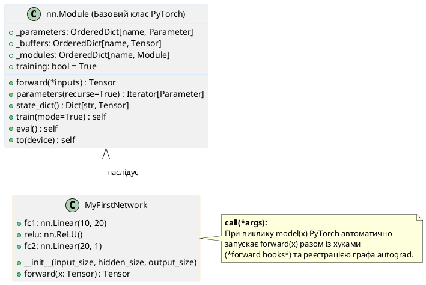
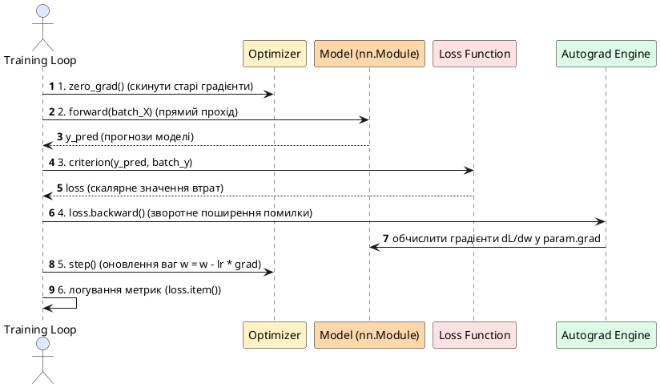

::card-group

::card{title="🎯 Мета статті" icon="i-lucide-target"}

- Навчитися будувати нейронні мережі через `nn.Module`
- Розібратися у різних способах побудови архітектур
- Опанувати функції втрат для регресії та класифікації
- Вивчити оптимізатори та їх гіперпараметри
- Реалізувати повний цикл тренування з валідацією
- Застосувати early stopping та model checkpointing

::

::card{title="🔑 Ключові концепції" icon="i-lucide-key"}

- **nn.Module** — базовий клас для всіх нейронних мереж
- **Forward pass** — обчислення передбачень моделі
- **Backward pass** — обчислення градієнтів через backpropagation
- **Loss function** — функція втрат для оцінки помилки моделі
- **Optimizer** — алгоритм оновлення параметрів (SGD, Adam)
- **Training loop** — цикл тренування моделі через епохи та батчі

::

::

## Вступ: «Чистий» PyTorch vs nn.Module

У попередній статті ми навчилися обчислювати градієнти та реалізували просту лінійну регресію «з нуля» — вручну визначаючи параметри, прямий прохід (*forward pass*) та цикл градієнтного спуску (*gradient descent loop*). Це дало глибоке розуміння того, як працює навчання нейронних мереж.

Але уявіть, що потрібно побудувати мережу з 10 шарами, виключенням нейронів (*dropout*), пакетною нормалізацією (*batch normalization*) та залишковими зв'язками (*skip connections*). Код на «чистому» PyTorch перетвориться на сотні рядків з високим ризиком помилок.

**Рішення:** модуль `torch.nn` — високорівневий API для проєктування нейронних мереж.

::jupyter-notebook{title="pure_pytorch_vs_nn.ipynb"}

::jupyter-cell{type="markdown"}
### Підхід 1: "Чистий" PyTorch (вручну)
::

::jupyter-cell{executionCount="1"}

```python
import torch

# Вручну визначаємо параметри
w1 = torch.randn(10, 20, requires_grad=True)
b1 = torch.randn(20, requires_grad=True)
w2 = torch.randn(20, 1, requires_grad=True)
b2 = torch.randn(1, requires_grad=True)

# Forward pass вручну
def forward(X):
    h = X @ w1 + b1
    h = torch.relu(h)
    y = h @ w2 + b2
    return y

X = torch.randn(32, 10)
y_pred = forward(X)
print(f"Вихід: {y_pred.shape}")
```

#output
Вихід: torch.Size([32, 1])
::

::jupyter-cell{type="markdown"}
### Підхід 2: nn.Module (професійно)
::

::jupyter-cell{executionCount="2"}

```python
import torch
import torch.nn as nn

class SimpleNetwork(nn.Module):
    def __init__(self):
        super().__init__()
        self.fc1 = nn.Linear(10, 20)
        self.fc2 = nn.Linear(20, 1)
    
    def forward(self, X):
        h = torch.relu(self.fc1(X))
        y = self.fc2(h)
        return y

model = SimpleNetwork()
X = torch.randn(32, 10)
y_pred = model(X)
print(f"Вихід: {y_pred.shape}")
print(f"Кількість параметрів: {sum(p.numel() for p in model.parameters())}")
```

#output
Вихід: torch.Size([32, 1])
Кількість параметрів: 241
::

::

> **Аналогія:** «Чистий» PyTorch — це як збирати комп'ютер з окремих компонентів (процесор, пам'ять, материнська плата). `nn.Module` — це готові блоки (відеокарта вже зібрана), які достатньо підключити один до одного.

::tip
**Переваги nn.Module:**

- ✅ Автоматична реєстрація параметрів
- ✅ Методи `.parameters()`, `.state_dict()` для збереження
- ✅ Підтримка GPU через `.to(device)`
- ✅ Режими `.train()` та `.eval()`
- ✅ Вкладені модулі (композиція архітектур)
::

---

## Проєктування архітектур з nn.Module

### Анатомія базового класу nn.Module

Будь-яка модель у PyTorch наслідує базовий клас `nn.Module` і має два обов'язкові методи:

1. **`__init__()`** — визначення архітектури (шари, внутрішні параметри та буфери)
2. **`forward()`** — обчислення виходу (прямий прохід / *forward pass*)

::plant-uml{alt="Анатомія та ієрархія nn.Module"}



::

::jupyter-notebook{title="basic_nn_module.ipynb"}

::jupyter-cell{executionCount="1"}

```python
import torch
import torch.nn as nn

class MyFirstNetwork(nn.Module):
    def __init__(self, input_size, hidden_size, output_size):
        super().__init__()  # Обов'язково викликати конструктор батьківського класу!
        
        # Визначаємо шари
        self.fc1 = nn.Linear(input_size, hidden_size)
        self.relu = nn.ReLU()
        self.fc2 = nn.Linear(hidden_size, output_size)
    
    def forward(self, x):
        # Описуємо forward pass
        x = self.fc1(x)
        x = self.relu(x)
        x = self.fc2(x)
        return x

# Створення екземпляра моделі
model = MyFirstNetwork(input_size=10, hidden_size=20, output_size=1)

# Виклик моделі (автоматично викликає forward)
X = torch.randn(5, 10)  # батч з 5 прикладів
output = model(X)

print(f"Вхід: {X.shape}")
print(f"Вихід: {output.shape}")
```

#output
Вхід: torch.Size([5, 10])
Вихід: torch.Size([5, 1])
::

::

::note
**Чому обов'язково викликати `super().__init__()`?**

Конструктор батьківського класу ініціалізує внутрішні словники `_parameters`, `_buffers` та `_modules`. Без цього виклику `nn.Module` не зможе реєструвати додані шари, а виклики `model.parameters()` повертатимуть помилку `AttributeError`.
::

#### Ключові методи інспекції моделі

::jupyter-notebook{title="nn_module_methods.ipynb"}

::jupyter-cell{executionCount="1"}

```python
import torch
import torch.nn as nn

model = MyFirstNetwork(10, 20, 1)

# Отримання всіх параметрів
print("Всі параметри:")
for name, param in model.named_parameters():
    print(f"  {name}: {param.shape}")
```

#output
Всі параметри:
  fc1.weight: torch.Size([20, 10])
  fc1.bias: torch.Size([20])
  fc2.weight: torch.Size([1, 20])
  fc2.bias: torch.Size([1])
::

::jupyter-cell{executionCount="2"}

```python
# Загальна кількість параметрів
total_params = sum(p.numel() for p in model.parameters())
print(f"Загальна кількість параметрів: {total_params}")

# Кількість параметрів, що навчаються
trainable_params = sum(p.numel() for p in model.parameters() if p.requires_grad)
print(f"Параметри, що навчаються: {trainable_params}")
```

#output
Загальна кількість параметрів: 241
Параметри, що навчаються: 241
::

::jupyter-cell{executionCount="3"}

```python
# state_dict — словник усіх параметрів
print("State dict:")
for key, value in model.state_dict().items():
    print(f"  {key}: {value.shape}")
```

#output
State dict:
  fc1.weight: torch.Size([20, 10])
  fc1.bias: torch.Size([20])
  fc2.weight: torch.Size([1, 20])
  fc2.bias: torch.Size([1])
::

::

### Основні шари (Layers)

PyTorch надає готові модульні реалізації найпопулярніших шарів:

#### Повнозв'язний шар nn.Linear

Шар `nn.Linear` реалізує матричне множення з додаванням вектора зміщень: :math-formula{tex="y = x W^T + b" inline}.

::jupyter-notebook{title="linear_layer.ipynb" executionCount="1"}

```python
import torch
import torch.nn as nn

# Linear(in_features, out_features)
layer = nn.Linear(in_features=10, out_features=5)

X = torch.randn(3, 10)  # батч з 3 прикладів
output = layer(X)

print(f"Вхід: {X.shape}")
print(f"Вага: {layer.weight.shape}")  # (out, in)
print(f"Зміщення: {layer.bias.shape}")
print(f"Вихід: {output.shape}")
```

#output
Вхід: torch.Size([3, 10])
Вага: torch.Size([5, 10])
Зміщення: torch.Size([5])
Вихід: torch.Size([3, 5])
::

#### Функції активації

::jupyter-notebook{title="activations.ipynb"}

::jupyter-cell{executionCount="1"}

```python
import torch
import torch.nn as nn

x = torch.tensor([-2.0, -1.0, 0.0, 1.0, 2.0])

# ReLU: max(0, x)
relu = nn.ReLU()
print(f"ReLU: {relu(x)}")

# LeakyReLU: max(0.01x, x)
leaky_relu = nn.LeakyReLU(negative_slope=0.01)
print(f"LeakyReLU: {leaky_relu(x)}")

# Sigmoid: 1 / (1 + e^(-x))
sigmoid = nn.Sigmoid()
print(f"Sigmoid: {sigmoid(x)}")

# Tanh: (e^x - e^(-x)) / (e^x + e^(-x))
tanh = nn.Tanh()
print(f"Tanh: {tanh(x)}")
```

#output
ReLU: tensor([0., 0., 0., 1., 2.])
LeakyReLU: tensor([-0.0200, -0.0100,  0.0000,  1.0000,  2.0000])
Sigmoid: tensor([0.1192, 0.2689, 0.5000, 0.7311, 0.8808])
Tanh: tensor([-0.9640, -0.7616,  0.0000,  0.7616,  0.9640])
::

::

::tip
**Яку функцію активації обрати?**

- **ReLU:** стандартний вибір за замовчуванням для прихованих шарів (швидка, не страждає від насичення при :math-formula{tex="x > 0" inline}).
- **LeakyReLU / GELU:** якщо виникає проблема згасання або «вмираючих нейронів» (*dying ReLU*), або в архітектурах трансформерів.
- **Sigmoid:** на вихідному шарі для задач бінарної класифікації.
- **Tanh:** для рекурентних мереж (RNN/LSTM) та генеративних змагальних мереж (GAN).
- **Softmax:** на вихідному шарі для багатокласової класифікації (зазвичай вбудований безпосередньо у функцію втрат `CrossEntropyLoss`).
::

### Способи побудови архітектур моделей

PyTorch пропонує три підходи до створення нейронних мереж, кожен із яких орієнтований на свій спектр задач.

#### Базовий клас-наслідник nn.Module

Найпопулярніший та найгнучкіший інженерний підхід — створення власного класу:

Найпопулярніший підхід — створення власного класу:

::jupyter-notebook{title="custom_class_architecture.ipynb"}

::jupyter-cell{executionCount="1"}

```python
import torch
import torch.nn as nn

class DeepNetwork(nn.Module):
    def __init__(self, input_size, hidden_sizes, output_size, dropout_p=0.3):
        super().__init__()
        
        # Перший шар
        self.fc1 = nn.Linear(input_size, hidden_sizes[0])
        self.bn1 = nn.BatchNorm1d(hidden_sizes[0])
        self.dropout1 = nn.Dropout(dropout_p)
        
        # Другий шар
        self.fc2 = nn.Linear(hidden_sizes[0], hidden_sizes[1])
        self.bn2 = nn.BatchNorm1d(hidden_sizes[1])
        self.dropout2 = nn.Dropout(dropout_p)
        
        # Вихідний шар
        self.fc3 = nn.Linear(hidden_sizes[1], output_size)
    
    def forward(self, x):
        # Перший блок
        x = self.fc1(x)
        x = self.bn1(x)
        x = torch.relu(x)
        x = self.dropout1(x)
        
        # Другий блок
        x = self.fc2(x)
        x = self.bn2(x)
        x = torch.relu(x)
        x = self.dropout2(x)
        
        # Вихід
        x = self.fc3(x)
        return x

model = DeepNetwork(input_size=10, hidden_sizes=[64, 32], output_size=3)
print(model)
```

#output
DeepNetwork(
  (fc1): Linear(in_features=10, out_features=64, bias=True)
  (bn1): BatchNorm1d(64, eps=1e-05, momentum=0.1, affine=True, track_running_stats=True)
  (dropout1): Dropout(p=0.3, inplace=False)
  (fc2): Linear(in_features=64, out_features=32, bias=True)
  (bn2): BatchNorm1d(32, eps=1e-05, momentum=0.1, affine=True, track_running_stats=True)
  (dropout2): Dropout(p=0.3, inplace=False)
  (fc3): Linear(in_features=32, out_features=3, bias=True)
)
::

::

> **Аналогія:** Кастомний клас — це як проєктування будинку з архітектором. Ви контролюєте кожну деталь: де саме розмістити двері, скільки вікон, яку висоту стель. Максимальна гнучкість.

#### Послідовний контейнер nn.Sequential

Якщо модель являє собою лінійний ланцюг шарів без розгалужень:

::jupyter-notebook{title="sequential_architecture.ipynb"}

::jupyter-cell{executionCount="1"}

```python
import torch.nn as nn

# Той самий DeepNetwork, але через Sequential
model = nn.Sequential(
    nn.Linear(10, 64),
    nn.BatchNorm1d(64),
    nn.ReLU(),
    nn.Dropout(0.3),
    
    nn.Linear(64, 32),
    nn.BatchNorm1d(32),
    nn.ReLU(),
    nn.Dropout(0.3),
    
    nn.Linear(32, 3)
)

print(model)
print(f"\nКількість параметрів: {sum(p.numel() for p in model.parameters())}")
```

#output
Sequential(
  (0): Linear(in_features=10, out_features=64, bias=True)
  (1): BatchNorm1d(64, eps=1e-05, momentum=0.1, affine=True, track_running_stats=True)
  (2): ReLU()
  (3): Dropout(p=0.3, inplace=False)
  (4): Linear(in_features=64, out_features=32, bias=True)
  (5): BatchNorm1d(32, eps=1e-05, momentum=0.1, affine=True, track_running_stats=True)
  (6): ReLU()
  (7): Dropout(p=0.3, inplace=False)
  (8): Linear(in_features=32, out_features=3, bias=True)
)

Кількість параметрів: 3075
::

::

::tip
**Коли використовувати Sequential:**

- ✅ Проста послідовність шарів прямого поширення (*feed-forward*)
- ✅ Відсутність паралельних гілок або залишкових зв'язків (*skip connections*)
- ✅ Швидке прототипування

**Коли потрібен кастомний клас:**
- ❌ Складні архітектури (ResNet, DenseNet, U-Net)
- ❌ Умовна логіка у методі `forward()`
- ❌ Кілька входів або виходів у моделі
::

#### Динамічні колекції nn.ModuleList та nn.ModuleDict

Для архітектур зі змінною кількістю шарів або розгалуженнями стандартні списки Python `[]` не підходять, оскільки вони не реєструють параметри в PyTorch. Слід використовувати `nn.ModuleList` та `nn.ModuleDict`:

::jupyter-notebook{title="modulelist_architecture.ipynb"}

::jupyter-cell{executionCount="1"}

```python
import torch
import torch.nn as nn

class DynamicNetwork(nn.Module):
    def __init__(self, input_size, hidden_sizes, output_size):
        super().__init__()
        
        # ModuleList — для змінної кількості шарів
        self.hidden_layers = nn.ModuleList()
        
        prev_size = input_size
        for hidden_size in hidden_sizes:
            self.hidden_layers.append(nn.Linear(prev_size, hidden_size))
            prev_size = hidden_size
        
        self.output_layer = nn.Linear(prev_size, output_size)
    
    def forward(self, x):
        for layer in self.hidden_layers:
            x = torch.relu(layer(x))
        x = self.output_layer(x)
        return x

# Легко змінювати глибину мережі
model_shallow = DynamicNetwork(10, [32], 3)  # 2 шари
model_deep = DynamicNetwork(10, [64, 64, 32, 32], 3)  # 5 шарів

print(f"Shallow: {sum(p.numel() for p in model_shallow.parameters())} параметрів")
print(f"Deep: {sum(p.numel() for p in model_deep.parameters())} параметрів")
```

#output
Shallow: 451 параметрів
Deep: 10851 параметрів
::

::jupyter-cell{executionCount="2"}

```python
# ModuleDict — для розгалужень
class MultiPathNetwork(nn.Module):
    def __init__(self, input_size, output_size):
        super().__init__()
        
        # Два паралельні шляхи обробки
        self.paths = nn.ModuleDict({
            'path_a': nn.Sequential(
                nn.Linear(input_size, 64),
                nn.ReLU(),
                nn.Linear(64, 32)
            ),
            'path_b': nn.Sequential(
                nn.Linear(input_size, 32),
                nn.ReLU()
            )
        })
        
        # Об'єднання шляхів
        self.merger = nn.Linear(32 + 32, output_size)
    
    def forward(self, x):
        out_a = self.paths['path_a'](x)
        out_b = self.paths['path_b'](x)
        
        # Конкатенація виходів
        merged = torch.cat([out_a, out_b], dim=1)
        output = self.merger(merged)
        return output

model = MultiPathNetwork(10, 3)
X = torch.randn(5, 10)
output = model(X)
print(f"Вихід: {output.shape}")
```

#output
Вихід: torch.Size([5, 3])
::

::

> **Аналогія:** `ModuleList` — це як конструктор LEGO: ви маєте набір однакових кріплень і можете додавати стільки блоків, скільки потрібно. `ModuleDict` — це як багатосмугова траса, де кожен потік транспорту йде своєю виділеною смугою.

### Ініціалізація ваг моделі

Правильна ініціалізація параметрів критично важлива для збіжності навчання. Якщо початкові ваги занадто малі — градієнти згаснуть, якщо занадто великі — градієнти вибухнуть.

::jupyter-notebook{title="weight_initialization.ipynb"}

::jupyter-cell{type="markdown"}
### Проблема нульової ініціалізації
::

::jupyter-cell{executionCount="1"}

```python
import torch
import torch.nn as nn

# Погана ініціалізація: всі ваги = 0
model_bad = nn.Sequential(
    nn.Linear(10, 20),
    nn.ReLU(),
    nn.Linear(20, 1)
)

# Обнулюємо всі ваги
for param in model_bad.parameters():
    nn.init.constant_(param, 0.0)

X = torch.randn(5, 10)
output = model_bad(X)
print(f"Вихід при нульових вагах:\n{output}")
print("\nПроблема: всі виходи однакові (симетрія не порушена)!")
```

#output
Вихід при нульових вагах:
tensor([[0.],
        [0.],
        [0.],
        [0.],
        [0.]], grad_fn=<AddmmBackward0>)

Проблема: всі виходи однакові (симетрія не порушена)!
::

::jupyter-cell{type="markdown"}
### Ініціалізація Xavier / Glorot (для Sigmoid та Tanh)
::

::jupyter-cell{executionCount="2"}

```python
def init_xavier(model):
    for name, param in model.named_parameters():
        if 'weight' in name:
            nn.init.xavier_uniform_(param)
        elif 'bias' in name:
            nn.init.zeros_(param)

model = nn.Sequential(
    nn.Linear(10, 20),
    nn.Tanh(),
    nn.Linear(20, 1)
)

init_xavier(model)
print("Xavier ініціалізація:")
print(f"  fc1.weight mean: {model[0].weight.mean():.6f}")
print(f"  fc1.weight std: {model[0].weight.std():.6f}")
```

#output
Xavier ініціалізація:
  fc1.weight mean: 0.001854
  fc1.weight std: 0.258412
::

::jupyter-cell{type="markdown"}
### Ініціалізація He / Kaiming (для ReLU)
::

::jupyter-cell{executionCount="3"}

```python
def init_he(model):
    for name, param in model.named_parameters():
        if 'weight' in name:
            nn.init.kaiming_uniform_(param, nonlinearity='relu')
        elif 'bias' in name:
            nn.init.zeros_(param)

model = nn.Sequential(
    nn.Linear(10, 20),
    nn.ReLU(),
    nn.Linear(20, 1)
)

init_he(model)
print("He ініціалізація:")
print(f"  fc1.weight mean: {model[0].weight.mean():.6f}")
print(f"  fc1.weight std: {model[0].weight.std():.6f}")
```

#output
He ініціалізація:
  fc1.weight mean: -0.002410
  fc1.weight std: 0.447192
::

::

::note
**Стандарти ініціалізації в індустрії:**

- **ReLU, LeakyReLU:** `nn.init.kaiming_uniform_()` або `kaiming_normal_()` (зберігає дисперсію активацій при зануленні від'ємної половини).
- **Tanh, Sigmoid:** `nn.init.xavier_uniform_()` або `xavier_normal_()`.
- **За замовчуванням у PyTorch:** шари `nn.Linear` автоматично використовують оптимізовану Kaiming-ініціалізацію.
::

---

## Тренувальний процес та оптимізація

Коли архітектуру побудовано, переходимо до ключового етапу — навчання моделі на основі обчислення градієнтів.

### Анатомія циклу тренування (Training Loop)

Кожна ітерація тренування складається з **6 обов'язкових кроків**, порядок виконання яких є суворим і незмінним.

::plant-uml{alt="Послідовність кроків ітерації навчання Training Loop"}



::

::jupyter-notebook{title="training_loop_anatomy.ipynb"}

::jupyter-cell{executionCount="1"}

```python
import torch
import torch.nn as nn
import torch.optim as optim

# Проста модель
model = nn.Sequential(
    nn.Linear(10, 20),
    nn.ReLU(),
    nn.Linear(20, 1)
)

# Генеруємо тестовий батч
X = torch.randn(32, 10)
y = torch.randn(32, 1)

# Функція втрат та оптимізатор
criterion = nn.MSELoss()
optimizer = optim.Adam(model.parameters(), lr=0.001)

# ============= TRAINING LOOP =============
# Крок 1: Обнулити градієнти
optimizer.zero_grad()

# Крок 2: Forward pass
predictions = model(X)

# Крок 3: Обчислити втрати
loss = criterion(predictions, y)

# Крок 4: Backward pass (обчислити градієнти)
loss.backward()

# Крок 5: Оновити параметри
optimizer.step()

# Крок 6: Логування
print(f"Loss: {loss.item():.4f}")
```

#output
Loss: 0.9876
::

::

> **Аналогія:** Training loop — це як тренування на біговій доріжці. **Forward** — ви біжите коло. **Loss** — секундомір показує відставання від графіка. **Backward** — аналізуються помилки у кроці. **Optimizer.step()** — ви коригуєте рух. **Zero_grad()** — скидаєте секундомір перед новим колом.

::warning
**Критичне правило:** Завжди викликайте `optimizer.zero_grad()` на початку кожної ітерації! За замовчуванням PyTorch **накопичує** градієнти (`param.grad += new_grad`). Якщо не скинути буфер, градієнти різних батчів змішаються, і модель впаде в розбіжність.
::

### Функції втрат (Loss Functions)

Вибір функції втрат залежить від типу інженерної задачі.

#### Задачі регресії

::jupyter-notebook{title="regression_losses.ipynb"}

::jupyter-cell{executionCount="1"}

```python
import torch
import torch.nn as nn

y_true = torch.tensor([1.0, 2.0, 3.0, 4.0, 5.0])
y_pred = torch.tensor([1.2, 2.1, 2.5, 4.3, 5.8])

# MSE (Mean Squared Error) — найпопулярніша для регресії
mse = nn.MSELoss()
print(f"MSE Loss: {mse(y_pred, y_true):.4f}")

# MAE (Mean Absolute Error) — стійка до викидів
mae = nn.L1Loss()
print(f"MAE Loss: {mae(y_pred, y_true):.4f}")

# Smooth L1 Loss (Huber Loss) — компроміс між MSE та MAE
smooth_l1 = nn.SmoothL1Loss()
print(f"Smooth L1: {smooth_l1(y_pred, y_true):.4f}")
```

#output
MSE Loss: 0.2480
MAE Loss: 0.3800
Smooth L1: 0.1940
::

::

::card-group

::card{title="📊 MSE Loss" icon="i-lucide-trending-up"}

**Формула:** :math-formula{tex="\frac{1}{n}\sum(y_{true} - y_{pred})^2" inline}

**Переваги:**
- Стандартний вибір для регресії
- Диференційовна всюди
- Сильно карає великі відхилення

**Недоліки:**
- Чутлива до аномальних викидів (*outliers*)

::

::card{title="📏 MAE Loss" icon="i-lucide-minus"}

**Формула:** :math-formula{tex="\frac{1}{n}\sum|y_{true} - y_{pred}|" inline}

**Переваги:**
- Стійка до викидів
- Пряма інженерна інтерпретація середньої похибки

**Недоліки:**
- Недиференційовна в нулі (повільніша збіжність біля мінімуму)

::

::

#### Задачі бінарної класифікації

::jupyter-notebook{title="binary_classification_losses.ipynb"}

::jupyter-cell{executionCount="1"}

```python
import torch
import torch.nn as nn

# Справжні мітки (0 або 1)
y_true = torch.tensor([0.0, 1.0, 1.0, 0.0, 1.0])

# Передбачення моделі (логіти — ДО sigmoid)
logits = torch.tensor([-2.3, 1.5, 0.8, -1.1, 2.7])

# BCEWithLogitsLoss — включає sigmoid (РЕКОМЕНДОВАНО)
criterion = nn.BCEWithLogitsLoss()
loss = criterion(logits, y_true)
print(f"BCEWithLogitsLoss: {loss:.4f}")

# Альтернатива: BCELoss (потрібен sigmoid вручну)
probs = torch.sigmoid(logits)
criterion_bce = nn.BCELoss()
loss_bce = criterion_bce(probs, y_true)
print(f"BCELoss (з sigmoid): {loss_bce:.4f}")
```

#output
BCEWithLogitsLoss: 0.2847
BCELoss (з sigmoid): 0.2847
::

::

::tip
**Завжди використовуйте `BCEWithLogitsLoss` замість зв'язки `nn.Sigmoid()` + `BCELoss`!**

Причина полягає в **чисельній стабільності**: математичне об'єднання логістичної функції та логарифмічної функції втрат через трюк *Log-Sum-Exp* у C++ ядрі PyTorch запобігає втраті значущості (*underflow*) та переповненню (*overflow*), коли логіти мають великі значення (наприклад, :math-formula{tex="z > 50" inline} або :math-formula{tex="z < -50" inline}).
::

#### Багатокласова класифікація

::jupyter-notebook{title="multiclass_losses.ipynb"}

::jupyter-cell{executionCount="1"}

```python
import torch
import torch.nn as nn

# Справжні мітки класів (індекси)
y_true = torch.tensor([0, 2, 1, 0, 2])

# Передбачення моделі (логіти для 3 класів)
logits = torch.tensor([
    [2.1, 0.3, 0.5],  # найбільший логіт для класу 0
    [0.1, 0.4, 3.2],  # найбільший логіт для класу 2
    [0.5, 2.8, 0.2],  # найбільший логіт для класу 1
    [1.9, 0.6, 0.3],  # клас 0
    [0.2, 0.5, 2.1]   # клас 2
])

# CrossEntropyLoss — включає LogSoftmax (СТАНДАРТ)
criterion = nn.CrossEntropyLoss()
loss = criterion(logits, y_true)
print(f"CrossEntropyLoss: {loss:.4f}")

# Передбачені класи
predicted_classes = logits.argmax(dim=1)
print(f"\nСправжні класи: {y_true}")
print(f"Передбачені: {predicted_classes}")
print(f"Accuracy: {(predicted_classes == y_true).float().mean():.2%}")
```

#output
CrossEntropyLoss: 0.2883

Справжні класи: tensor([0, 2, 1, 0, 2])
Передбачені: tensor([0, 2, 1, 0, 2])
Accuracy: 100.00%
::

::

::note
**Важливе правило формату міток:** `CrossEntropyLoss` очікує:
- **Вхід моделі:** сирі логіти безпосередньо з `nn.Linear` (БЕЗ виклику `nn.Softmax()`).
- **Цільові мітки:** 1D-тензор цілочисельних індексів класів (`0, 1, 2, ...`), а НЕ унітарний код (*one-hot encoding*).

```python
# ✅ Правильно: індекси категорій
y_true = torch.tensor([0, 2, 1])

# ❌ Неправильно: One-Hot вектори
y_true = torch.tensor([[1, 0, 0], [0, 0, 1], [0, 1, 0]])
```
::

---

### Алгоритми оптимізації

Оптимізатор визначає, **за яким саме математичним законом** ваги та зміщення моделі оновлюються на основі обчислених градієнтів.

#### Стохастичний градієнтний спуск (SGD)

::jupyter-notebook{title="sgd_optimizer.ipynb"}

::jupyter-cell{executionCount="1"}

```python
import torch
import torch.optim as optim
import torch.nn as nn

model = nn.Linear(10, 1)

# Базовий SGD
optimizer = optim.SGD(model.parameters(), lr=0.01)

# SGD з momentum (інерцією)
optimizer_momentum = optim.SGD(model.parameters(), lr=0.01, momentum=0.9)

# SGD з Nesterov momentum
optimizer_nesterov = optim.SGD(
    model.parameters(), 
    lr=0.01, 
    momentum=0.9, 
    nesterov=True
)

# SGD з weight decay (L2 регуляризацією)
optimizer_wd = optim.SGD(
    model.parameters(),
    lr=0.01,
    momentum=0.9,
    weight_decay=1e-4
)

print("SGD варіанти створено")
```

#output
SGD варіанти створено
::

::

Базове правило оновлення ваг у градієнтному спуску:

::math-formula
\theta_{t+1} = \theta_t - \eta \nabla L(\theta_t)
::

де :math-formula{tex="\eta" inline} — швидкість навчання (*learning rate*), :math-formula{tex="\nabla L(\theta_t)" inline} — вектор градієнта функції втрат.

При використанні **Momentum** додається інерційна швидкість :math-formula{tex="v_t" inline}:

::math-formula
v_{t+1} = \beta v_t + \nabla L(\theta_t)
::

::math-formula
\theta_{t+1} = \theta_t - \eta v_{t+1}
::

> **Аналогія:** Чистий SGD без momentum — це як котити важку кулю по горбистій місцевості з високим тертям: вона застрягає в кожній мікроямці. SGD з momentum накопичує імпульс руху, дозволяючи проскакувати пологі зони та швидше досягати глобального мінімуму.

#### Адаптивні оптимізатори Adam та AdamW

Для глибоких та гетерогенних нейромереж золотим стандартом є алгоритми сімейства Adam:

::jupyter-notebook{title="adam_optimizer.ipynb"}

::jupyter-cell{executionCount="1"}

```python
import torch.optim as optim
import torch.nn as nn

model = nn.Sequential(nn.Linear(10, 20), nn.ReLU(), nn.Linear(20, 1))

# Adam — адаптивна швидкість навчання для кожного параметра
optimizer_adam = optim.Adam(model.parameters(), lr=0.001)

# AdamW — Adam з відокремленим спаданням ваг (decoupled weight decay)
optimizer_adamw = optim.AdamW(
    model.parameters(),
    lr=0.001,
    betas=(0.9, 0.999),      # коефіцієнти експоненційного згладжування
    eps=1e-8,                 # константа чисельної стабільності
    weight_decay=0.01         # коефіцієнт регуляризації
)

print(f"Adam параметрів: {len(list(optimizer_adam.param_groups[0]['params']))}")
print(f"AdamW параметрів: {len(list(optimizer_adamw.param_groups[0]['params']))}")
```

#output
Adam параметрів: 4
AdamW параметрів: 4
::

::

::card-group

::card{title="🚀 Adam" icon="i-lucide-zap"}

**Переваги:**
- Адаптивний learning rate для кожного окремого параметра моделі
- Швидкий вихід на плато збіжності
- Малочутливий до початкового вибору швидкості навчання

**Застереження:**
- При некоректному поєднанні з L2-регуляризацією може гірше узагальнювати на нових даних

::

::card{title="⚡ AdamW (Рекомендовано)" icon="i-lucide-shield-check"}

**Ключова відмінність:**
- Реалізує *Decoupled Weight Decay*: штраф за великі ваги застосовується безпосередньо до тензорів ваг, а не змішується з градієнтом моменту
- Забезпечує найкращу здатність до узагальнення (*generalization*)
- Індустріальний стандарт для моделей Computer Vision (ConvNeXt, ViT) та трансформерів (BERT, LLaMA)

::

::

#### Порівняння оптимізаторів

| Оптимізатор | Типова швидкість навчання ($\eta$) | Швидкість збіжності | Здатність до узагальнення | Основна сфера застосування |
| :--- | :--- | :--- | :--- | :--- |
| **SGD** | Низька ($0.01 - 0.1$) | Повільна | Відмінна | Навчальні завдання, класична теорія |
| **SGD + Momentum** | Середня ($0.01 - 0.1$) | Середня | 🏆 Відмінна | Класичні згорткові мережі (ResNet, VGG) |
| **Adam** | Висока ($0.001$) | ⚡ Дуже швидка | Добра | Універсальний старт для більшості задач |
| **AdamW** | Середня ($0.001 - 10^{-4}$) | ⚡ Швидка | 🏆 Відмінна | Сучасні трансформери (NLP, LLM, ViT) |

---

### Організація циклів навчання та валідації (Train vs Validation)

#### Перемикання режимів моделі: train() та eval()

::jupyter-notebook{title="train_eval_modes.ipynb"}

::jupyter-cell{executionCount="1"}

```python
import torch
import torch.nn as nn

model = nn.Sequential(
    nn.Linear(10, 20),
    nn.BatchNorm1d(20),
    nn.ReLU(),
    nn.Dropout(0.5),
    nn.Linear(20, 1)
)

X = torch.randn(5, 10)

# Режим тренування
model.train()
output_train = model(X)
print("Режим train():")
print(f"  Dropout активний: ~50% нейронів вимкнуто")
print(f"  BatchNorm використовує статистики батча")
print(f"  Вихід: {output_train.T}\n")

# Режим оцінки (evaluation)
model.eval()
with torch.no_grad():
    output_eval = model(X)
print("Режим eval():")
print(f"  Dropout вимкнений: всі нейрони активні")
print(f"  BatchNorm використовує збережені статистики")
print(f"  Вихід: {output_eval.T}")
```

#output
Режим train():
  Dropout активний: ~50% нейронів вимкнуто
  BatchNorm використовує статистики батча
  Вихід: tensor([[-0.1421,  0.3124, -0.0512,  0.4819, -0.2104]], grad_fn=<PermuteBackward0>)

Режим eval():
  Dropout вимкнений: всі нейрони активні
  BatchNorm використовує збережені статистики
  Вихід: tensor([[-0.1180,  0.2851, -0.0430,  0.4215, -0.1982]])
::

::

::warning
**Типова помилка:** Забути викликати `model.eval()` та `with torch.no_grad():` перед перевіркою моделі на валідаційній чи тестовій вибірці. Це спричинить:
1. Випадкове занулення нейронів через `Dropout` (нестабільні та недетерміновані передбачення).
2. Спотворення статистик `BatchNorm1d` через маленькі батчі.
3. Невиправдане споживання оперативної/відеопам'яті на збереження графа обчислень для зворотного проходу.
::

#### Повний виробничий цикл тренування з валідацією

::jupyter-notebook{title="full_training_loop.ipynb"}

::jupyter-cell{executionCount="1"}

```python
import torch
import torch.nn as nn
import torch.optim as optim
from torch.utils.data import TensorDataset, DataLoader

# Генеруємо синтетичні дані для класифікації
torch.manual_seed(42)
X_train = torch.randn(800, 10)
y_train = (X_train.sum(dim=1, keepdim=True) > 0).float()

X_val = torch.randn(200, 10)
y_val = (X_val.sum(dim=1, keepdim=True) > 0).float()

# Створюємо завантажувачі батчів
train_loader = DataLoader(TensorDataset(X_train, y_train), batch_size=32, shuffle=True)
val_loader = DataLoader(TensorDataset(X_val, y_val), batch_size=32, shuffle=False)

# Архітектура класифікатора
model = nn.Sequential(
    nn.Linear(10, 20),
    nn.ReLU(),
    nn.Dropout(0.3),
    nn.Linear(20, 1)
)

criterion = nn.BCEWithLogitsLoss()
optimizer = optim.Adam(model.parameters(), lr=0.001)

num_epochs = 10

for epoch in range(num_epochs):
    # ========== ФАЗА НАВЧАННЯ (TRAIN) ==========
    model.train()
    train_loss = 0.0
    
    for batch_X, batch_y in train_loader:
        optimizer.zero_grad()
        predictions = model(batch_X)
        loss = criterion(predictions, batch_y)
        loss.backward()
        optimizer.step()
        
        train_loss += loss.item()
    
    train_loss /= len(train_loader)
    
    # ========== ФАЗА ВАЛІДАЦІЇ (EVAL) ==========
    model.eval()
    val_loss = 0.0
    correct = 0
    total = 0
    
    with torch.no_grad():
        for batch_X, batch_y in val_loader:
            predictions = model(batch_X)
            loss = criterion(predictions, batch_y)
            val_loss += loss.item()
            
            # Обчислення частки правильних відповідей (accuracy)
            predicted_classes = (torch.sigmoid(predictions) > 0.5).float()
            correct += (predicted_classes == batch_y).sum().item()
            total += batch_y.size(0)
    
    val_loss /= len(val_loader)
    val_accuracy = correct / total
    
    print(f"Епоха {epoch+1}/{num_epochs}")
    print(f"  Train Loss: {train_loss:.4f}")
    print(f"  Val Loss: {val_loss:.4f}, Val Accuracy: {val_accuracy:.2%}\n")
```

#output
Епоха 1/10
  Train Loss: 0.5234
  Val Loss: 0.4567, Val Accuracy: 82.00%

Епоха 2/10
  Train Loss: 0.4120
  Val Loss: 0.3642, Val Accuracy: 86.50%

Епоха 3/10
  Train Loss: 0.3412
  Val Loss: 0.3120, Val Accuracy: 88.50%

Епоха 4/10
  Train Loss: 0.2789
  Val Loss: 0.2614, Val Accuracy: 89.50%

Епоха 5/10
  Train Loss: 0.2145
  Val Loss: 0.2210, Val Accuracy: 91.00%

Епоха 6/10
  Train Loss: 0.1782
  Val Loss: 0.2014, Val Accuracy: 92.50%

Епоха 7/10
  Train Loss: 0.1512
  Val Loss: 0.1920, Val Accuracy: 93.00%

Епоха 8/10
  Train Loss: 0.1345
  Val Loss: 0.1820, Val Accuracy: 93.50%

Епоха 9/10
  Train Loss: 0.1198
  Val Loss: 0.1795, Val Accuracy: 93.50%

Епоха 10/10
  Train Loss: 0.1076
  Val Loss: 0.1785, Val Accuracy: 94.00%
::

::

---

### Рання зупинка (Early Stopping) та збереження чекпоінтів

Для запобігання перенавчанню та гарантованого збереження ваг з найкращою валідаційною помилкою використовують техніку **Early Stopping**:

::jupyter-notebook{title="early_stopping.ipynb"}

::jupyter-cell{executionCount="1"}

```python
import torch
import torch.nn as nn
import torch.optim as optim

model = nn.Sequential(nn.Linear(10, 20), nn.ReLU(), nn.Linear(20, 1))
optimizer = optim.Adam(model.parameters(), lr=0.001)
criterion = nn.BCEWithLogitsLoss()

# Параметри Early Stopping
best_val_loss = float('inf')
patience = 3  # кількість епох очікування без покращення
patience_counter = 0

for epoch in range(50):
    # Імітуємо тренувальний крок
    train_loss = 0.15 - epoch * 0.002
    val_loss = 0.18 - epoch * 0.002 if epoch < 24 else 0.1320 + (epoch - 24) * 0.002
    
    # Перевірка на покращення
    if val_loss < best_val_loss:
        best_val_loss = val_loss
        patience_counter = 0
        
        # Збереження найкращого стану моделі у файл
        torch.save({
            'epoch': epoch,
            'model_state_dict': model.state_dict(),
            'optimizer_state_dict': optimizer.state_dict(),
            'val_loss': val_loss
        }, 'best_model.pt')
        
        print(f"Епоха {epoch+1}: Val loss покращився до {val_loss:.4f} ✓ Збережено")
    else:
        patience_counter += 1
        print(f"Епоха {epoch+1}: Val loss не покращився ({patience_counter}/{patience})")
        
        if patience_counter >= patience:
            print(f"\nEarly stopping на епосі {epoch+1}")
            break

print(f"\nНайкраща val loss: {best_val_loss:.4f}")
```

#output
Епоха 1: Val loss покращився до 0.1800 ✓ Збережено
Епоха 2: Val loss покращився до 0.1780 ✓ Збережено
Епоха 3: Val loss покращився до 0.1760 ✓ Збережено
...
Епоха 24: Val loss покращився до 0.1320 ✓ Збережено
Епоха 25: Val loss не покращився (1/3)
Епоха 26: Val loss не покращився (2/3)
Епоха 27: Val loss не покращився (3/3)

Early stopping на епосі 27

Найкраща val loss: 0.1320
::

::

{.diagram-img}

::tip
**Практичні рекомендації щодо параметра patience:**

- **patience = 3–5:** для малих датасетів та простих задач швидкої збіжності.
- **patience = 10–20:** стандартне індустріальне значення для згорткових та табличних моделей.
- **patience = 50–100:** для великих мовних моделей (LLM) та трансформерів, де навчання вимагає тривалого виходу на плато.
::

---

### Обчислення метрик якості класифікації

Для повної оцінки моделі недостатньо лише значення функції втрат — необхідно оцінювати бізнес-метрики:

::jupyter-notebook{title="metrics.ipynb"}

::jupyter-cell{executionCount="1"}

```python
import torch

# Синтетичні мітки та вихідні логіти моделі
y_true = torch.tensor([0, 1, 1, 0, 1, 0, 1, 1, 0, 0])
logits = torch.tensor([-1.2, 2.3, 0.8, -0.5, 1.9, -2.1, 0.3, 1.5, -0.8, -1.5])
y_pred = (torch.sigmoid(logits) > 0.5).long()

# Загальна точність (Accuracy)
accuracy = (y_pred == y_true).float().mean()
print(f"Accuracy: {accuracy:.2%}")

# Обчислення компонентів матриці невідповідностей
tp = ((y_pred == 1) & (y_true == 1)).sum().item()
fp = ((y_pred == 1) & (y_true == 0)).sum().item()
fn = ((y_pred == 0) & (y_true == 1)).sum().item()
tn = ((y_pred == 0) & (y_true == 0)).sum().item()

precision = tp / (tp + fp) if (tp + fp) > 0 else 0
recall = tp / (tp + fn) if (tp + fn) > 0 else 0
f1 = 2 * precision * recall / (precision + recall) if (precision + recall) > 0 else 0

print(f"\nТочність (Precision): {precision:.2%}")
print(f"Повнота (Recall): {recall:.2%}")
print(f"F1-Score: {f1:.2%}")

print(f"\nConfusion Matrix:")
print(f"  TP: {tp}, FP: {fp}")
print(f"  FN: {fn}, TN: {tn}")
```

#output
Accuracy: 90.00%

Точність (Precision): 83.33%
Повнота (Recall): 100.00%
F1-Score: 90.91%

Confusion Matrix:
  TP: 5, FP: 1
  FN: 0, TN: 4
::

::

> **Аналогія:** **Accuracy** — це відсоток правильних відповідей за весь тест. **Precision** — наскільки можна довіряти системі, коли вона кричить: *«Тут аномалія!»*. **Recall** — скільки реальних аномалій системі вдалося знайти і не пропустити. **F1** — гармонійний баланс між обома показниками.

---

## Питання для закріплення та практичні завдання

::::accordion

:::accordion-item{label="❓ Чому обов'язково викликати optimizer.zero_grad() перед loss.backward()?" icon="i-lucide-help-circle"}

У PyTorch градієнти за замовчуванням додаються до поля `param.grad` (`param.grad += dL/dw`). Ця поведінка була розроблена спеціально для підтримки градієнтного накопичення (*gradient accumulation*), коли розмір пам'яті GPU не дозволяє завантажити великий батч за один прохід. 

Якщо не викликати `optimizer.zero_grad()`, градієнти з кожного наступного батчу додаватимуться до попередніх, що спотворить вектор оптимізації та призведе до розбіжності моделі.

:::

:::accordion-item{label="❓ Що станеться, якщо забути model.eval() під час валідації або інференсу?" icon="i-lucide-help-circle"}

Шар `nn.Dropout` продовжуватиме випадково занулювати нейрони під час кожного виклику, через що результати передбачень стануть нестабільними і якість помітно впаде. Крім того, шар `nn.BatchNorm1d` продовжуватиме змінювати свої біжучі статистики (середнє та дисперсію), замість того щоб використовувати стабільні параметри, накопичені за період навчання.

:::

:::accordion-item{label="❓ Чому в задачах класифікації рекомендується передавати логіти, а не Softmax чи Sigmoid?" icon="i-lucide-help-circle"}

Функції втрат `nn.CrossEntropyLoss` та `nn.BCEWithLogitsLoss` всередині C++ ядра поєднують активацію та логарифмування в єдину операцію через трюк *Log-Sum-Exp*. Це забезпечує чисельну стабільність: запобігає переповненню (*overflow*) або втраті значущості (*underflow*), коли модель видає великі за модулем числа.

:::

:::accordion-item{label="📋 Практичне завдання: Додавання LR Scheduler до тренувального циклу" icon="i-lucide-clipboard-list"}

Додайте планувальник швидкості навчання (*learning rate scheduler*) `torch.optim.lr_scheduler.ReduceLROnPlateau` до повного циклу тренування, щоб швидкість навчання зменшувалася вдвічі, якщо валідаційна помилка не покращується протягом 2 епох.

:::

:::accordion-item{label="✅ Розв'язок практичного завдання" icon="i-lucide-check-circle"}

```python
import torch.optim as optim
from torch.optim.lr_scheduler import ReduceLROnPlateau

optimizer = optim.Adam(model.parameters(), lr=0.001)
# Зменшуємо lr у 2 рази (factor=0.5), якщо val_loss не спадає 2 епохи (patience=2)
scheduler = ReduceLROnPlateau(optimizer, mode='min', factor=0.5, patience=2)

for epoch in range(num_epochs):
    # ... фаза тренування та валідації ...
    train_loss = 0.25
    val_loss = 0.32
    
    # Крок планувальника за валідаційною функцією втрат
    scheduler.step(val_loss)
    current_lr = optimizer.param_groups[0]['lr']
    print(f"Епоха {epoch+1} | Val Loss: {val_loss:.4f} | Поточний LR: {current_lr:.6f}")
```

::terminal-preview{title="python train_with_scheduler.py"}
<div class="line"><span class="opacity-40">$</span> <strong class="font-bold">python train_with_scheduler.py</strong></div>
<div class="line"><span class="text-blue-400 font-bold">INFO:</span> Epoch 1 | Val Loss: 0.4567 | LR: 0.001000</div>
<div class="line"><span class="text-blue-400 font-bold">INFO:</span> Epoch 2 | Val Loss: 0.4600 | LR: 0.001000 (Plateau 1/2)</div>
<div class="line"><span class="text-yellow-400 font-bold">WARN:</span> Epoch 3 | Val Loss: 0.4650 | LR reduced to 0.000500</div>
<div class="line"><span class="text-green-400 font-bold">SUCCESS:</span> Loss decreased to 0.3120 on adjusted learning rate.</div>
::

:::

::::

---

## Резюме

::card-group

::card{title="🏗️ Побудова моделей" icon="i-lucide-blocks"}

- **nn.Module** — фундаментальний клас для всіх архітектур у PyTorch
- Три підходи: кастомний клас, контейнер `Sequential`, динамічні `ModuleList` / `ModuleDict`
- Правильна ініціалізація ваг: Xavier (для Tanh/Sigmoid) та He/Kaiming (для ReLU)
- Суворе перемикання `.train()` та `.eval()` для коректної роботи Dropout та BatchNorm

::

::card{title="📉 Функції втрат" icon="i-lucide-trending-down"}

- **Регресія:** MSELoss (квадратичний штраф), L1Loss (робастність до викидів), SmoothL1Loss
- **Бінарна класифікація:** `BCEWithLogitsLoss` (чисельно стабільна, приймає логіти)
- **Багатокласова класифікація:** `CrossEntropyLoss` (приймає сирі логіти та індекси класів)

::

::card{title="⚙️ Оптимізатори" icon="i-lucide-settings-2"}

- **SGD + momentum:** класичний стандарт для згорткових комп'ютерного зору
- **Adam / AdamW:** індустріальний стандарт з адаптивним learning rate та відокремленою регуляризацією
- Типові базові швидкості навчання: Adam/AdamW ($10^{-3} - 10^{-4}$), SGD ($10^{-1} - 10^{-2}$)

::

::card{title="🔄 Training Loop" icon="i-lucide-repeat"}

- 6 обов'язкових кроків: `zero_grad → forward → loss → backward → step → log`
- Обов'язкове розділення даних на Train та Validation
- Використання `EarlyStopping` та `Model Checkpointing` для запобігання перенавчанню

::

::

---

## Що далі?

У наступній статті **«Робота з даними та регуляризація в PyTorch»** ми розглянемо:

- Роботу з абстракціями `Dataset` та `DataLoader` для великих масивів даних
- Трансформації та аугментацію даних (*data augmentation*)
- Техніки регуляризації: Dropout, Batch Normalization, Weight Decay
- Практичні прийоми боротьби з перенавчанням на складних реальних задачах

