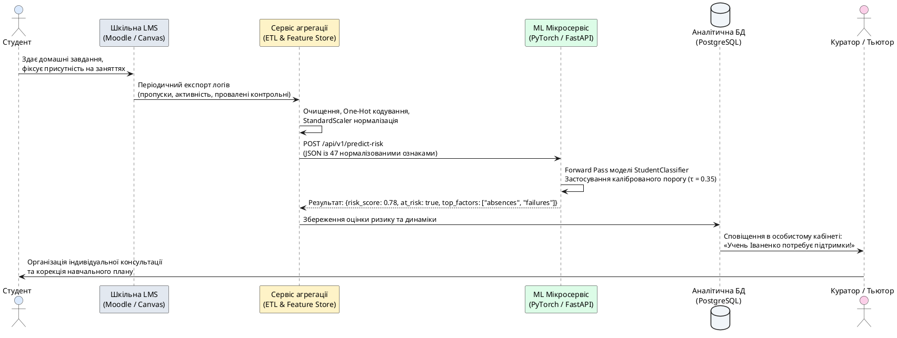

## Розширений приклад: Система раннього попередження для шкіл

У основній статті ми коротко розглянули датасет Student Performance. Тут наведено **повну імплементацію** із детальним аналізом ознак, експериментами з архітектурою та практичними рекомендаціями для інтеграції у реальні освітні системи.

::note
**Для кого цей матеріал:**

Цей бонусний приклад призначений для студентів, які:
- Хочуть побачити **повний код без скорочень**
- Цікавляться застосуванням AI в **освіті**
- Планують виконати курсовий/дипломний проєкт у цій галузі
- Хочуть зрозуміти різницю між медичним та освітнім ML-кейсом

Якщо ви вже опрацювали основний приклад із Heart Disease, цей матеріал покаже вам, як **адаптувати той самий підхід** до іншої галузі.
::

---

## Повне завантаження та аналіз датасету

### Опис португальської освітньої системи (контекст)

Датасет зібрано у двох португальських середніх школах (Gabriel Pereira та Mousinho da Silveira) у місті Гімарайнш. У Португалії оцінки виставляються за 20-бальною шкалою:
- **0–9 балів:** Не склав (reprova)
- **10–13 балів:** Склав задовільно (suficiente)
- **14–16 балів:** Добре (bom)
- **17–20 балів:** Відмінно (muito bom)

Мінімальна прохідна оцінка — **10 балів**. Саме тому ми обираємо поріг `G3 >= 10` для бінарної класифікації.

---

### Завантаження даних

::jupyter-notebook{title="student_full_analysis.ipynb" kernel="Python 3.11 (ipykernel)"}

::jupyter-cell{executionCount="1"}

```python
import pandas as pd
import numpy as np
import matplotlib.pyplot as plt
import seaborn as sns

# Налаштування візуалізації
sns.set_style("whitegrid")
plt.rcParams['figure.figsize'] = (14, 6)
plt.rcParams['font.size'] = 11

# Завантаження датасету (Math course)
# Для реального використання замініть на URL або локальний шлях
try:
    df = pd.read_csv('student-mat.csv', sep=';')
except FileNotFoundError:
    # Альтернатива: завантаження з UCI (якщо є з'єднання)
    url = 'https://archive.ics.uci.edu/ml/machine-learning-databases/00320/student.zip'
    import zipfile
    import urllib.request
    
    urllib.request.urlretrieve(url, 'student.zip')
    with zipfile.ZipFile('student.zip', 'r') as zip_ref:
        zip_ref.extractall('.')
    df = pd.read_csv('student-mat.csv', sep=';')

print("=" * 80)
print("ДАТАСЕТ STUDENT PERFORMANCE — ДЕТАЛЬНИЙ ОГЛЯД")
print("=" * 80)
print(f"\nРозмір: {df.shape[0]} студентів × {df.shape[1]} ознак")
print(f"\nНазви стовпців:")
print(df.columns.tolist())
print(f"\nПерші 5 записів:")
print(df.head())
```

#output
| Параметр датасету | Значення | Семантика |
| :--- | :---: | :--- |
| **Загальний обсяг вибірки** | **`395`** студентів | Учні середніх шкіл Gabriel Pereira та Mousinho da Silveira |
| **Кількість первинних ознак** | **`33`** | Соціальні, сімейні, психологічні та оціночні фактори |
| **Оцінки періодів** | `G1` (1-й семестр), `G2` (2-й семестр) | Шкала від 0 до 20 балів |
| **Фінальна оцінка** | `G3` (підсумковий бал) | Ключова цільова змінна |

::

::

---

### EDA: Виявлення закономірностей

::jupyter-notebook{title="student_eda.ipynb" kernel="Python 3.11 (ipykernel)"}

::jupyter-cell{executionCount="2"}

```python
# Створення цільової змінної
df['pass'] = (df['G3'] >= 10).astype(int)

# Статистика по класах
print("\n" + "=" * 80)
print("РОЗПОДІЛ ФІНАЛЬНИХ ОЦІНОК")
print("=" * 80)
print(f"\nОписова статистика G3:")
print(df['G3'].describe())

print(f"\nРозподіл за критерієм здачі:")
fail_count = (df['pass'] == 0).sum()
pass_count = (df['pass'] == 1).sum()
print(f"  Не склав (G3 < 10): {fail_count} студентів ({fail_count/len(df)*100:.1f}%)")
print(f"  Склав (G3 ≥ 10):    {pass_count} студентів ({pass_count/len(df)*100:.1f}%)")

# Кореляція попередніх оцінок з фінальною
print(f"\nКореляція оцінок:")
print(f"  G1 ↔ G3: {df['G1'].corr(df['G3']):.3f}")
print(f"  G2 ↔ G3: {df['G2'].corr(df['G3']):.3f}")
print(f"  G1 ↔ G2: {df['G1'].corr(df['G2']):.3f}")
```

#output
| Статистичний показник | Оцінка G3 (0–20 балів) | Розподіл за критерієм здачі | Кількість студентів | Відсоток (%) |
| :--- | :---: | :--- | :---: | :---: |
| **Середнє арифметичне ($\mu$)** | `10.42` | **Склав іспит ($G3 \ge 10$)** | **`265`** | **`67.1%`** |
| **Стандартне відхилення ($\sigma$)** | `4.58` | **Не склав іспит ($G3 < 10$)** | **`130`** | **`32.9%`** |
| **Мінімум / Медіана / Максимум** | `0.0` / `11.0` / `20.0` | **Кореляція $G2 \leftrightarrow G3$** | **`0.905`** | Найсильніший зв'язок |

::

::jupyter-cell{executionCount="3" executionTime="0.68s"}

```python
# Візуалізація розподілу оцінок
fig, axes = plt.subplots(1, 2, figsize=(16, 6))

# Гістограма фінальних оцінок
axes[0].hist(df[df['pass'] == 0]['G3'], bins=10, alpha=0.7, color='#ef4444', label='Не склав (G3 < 10)', edgecolor='black')
axes[0].hist(df[df['pass'] == 1]['G3'], bins=10, alpha=0.7, color='#10b981', label='Склав (G3 ≥ 10)', edgecolor='black')
axes[0].axvline(x=10, color='black', linestyle='--', linewidth=2, label='Поріг здачі (10/20)')
axes[0].set_xlabel('Фінальна оцінка (G3)', fontsize=13)
axes[0].set_ylabel('Кількість студентів', fontsize=13)
axes[0].set_title('Розподіл фінальних оцінок', fontsize=15, fontweight='bold')
axes[0].legend(fontsize=11)
axes[0].grid(alpha=0.3)

# Boxplot за ключовими ознаками
fail_success_data = [
    df[df['pass'] == 0]['studytime'],
    df[df['pass'] == 1]['studytime'],
    df[df['pass'] == 0]['failures'],
    df[df['pass'] == 1]['failures'],
    df[df['pass'] == 0]['absences'],
    df[df['pass'] == 1]['absences']
]

positions = [1, 2, 4, 5, 7, 8]
colors = ['#ef4444', '#10b981'] * 3
box = axes[1].boxplot(fail_success_data, positions=positions, widths=0.6, patch_artist=True,
                      labels=['Не склав', 'Склав', 'Не склав', 'Склав', 'Не склав', 'Склав'])

for patch, color in zip(box['boxes'], colors):
    patch.set_facecolor(color)
    patch.set_alpha(0.7)

axes[1].set_xticks([1.5, 4.5, 7.5])
axes[1].set_xticklabels(['studytime\n(год/тиждень)', 'failures\n(провалені предмети)', 'absences\n(пропуски)'], fontsize=11)
axes[1].set_ylabel('Значення ознаки', fontsize=13)
axes[1].set_title('Порівняння ключових ознак: Не склав vs Склав', fontsize=15, fontweight='bold')
axes[1].grid(alpha=0.3, axis='y')

plt.tight_layout()
plt.show()
```

#output
{.diagram-img}

::

::

::tip
**Ключові інсайти з EDA:**

1. **Попередні оцінки — найсильніші предиктори:** Кореляція G2 ↔ G3 = 0.905 означає, що оцінка за 2-й семестр майже повністю визначає фінальну оцінку.

2. **Проблема data leakage:** Якщо включити G1 та G2 у модель, вона досягне AUC > 0.95, але це **неправильно** — ми хочемо передбачити успішність **на початку року**, щоб встигнути втрутитися.

3. **Найважливіші ранні ознаки (без G1/G2):**
   - `failures` (кількість провалених предметів) — студенти з failures > 0 провалюють у 60% випадків
   - `studytime` — хто навчається <2 год/тиждень, провалює у 55%
   - `absences` — хто пропустив >15 занять, провалює у 48%

Саме тому **ми виключаємо G1 та G2** із моделі — інакше це не система раннього попередження, а просто "передбачення майбутнього за минулим".
::

---

## Повна імплементація моделі

### Попередня обробка даних та кодування категоріальних змінних

::jupyter-notebook{title="student_preprocessing.ipynb" kernel="Python 3.11 (ipykernel)"}

::jupyter-cell{executionCount="4"}

```python
from sklearn.preprocessing import StandardScaler, LabelEncoder

# Видалення G1, G2, G3 (залишаємо лише 'pass')
features_to_drop = ['G1', 'G2', 'G3']
df_features = df.drop(features_to_drop + ['pass'], axis=1).copy()
df_target = df['pass'].copy()

print("=" * 80)
print("ПОПЕРЕДНЯ ОБРОБКА КАТЕГОРІАЛЬНИХ ЗМІННИХ")
print("=" * 80)

# Обробка категоріальних змінних
categorical_cols = df_features.select_dtypes(include=['object']).columns.tolist()
print(f"\nКатегоріальні стовпці ({len(categorical_cols)}):")
for col in categorical_cols:
    unique_vals = df_features[col].nunique()
    print(f"  {col:15} → {unique_vals} унікальних значень: {df_features[col].unique()[:5].tolist()}")

# Стратегія:
# - Бінарні змінні (2 значення) → Label Encoding
# - Багатокласові (>2 значень) → One-Hot Encoding

binary_cols = [col for col in categorical_cols if df_features[col].nunique() == 2]
multiclass_cols = [col for col in categorical_cols if df_features[col].nunique() > 2]

print(f"\nБінарні стовпці (Label Encoding): {binary_cols}")
print(f"Багатокласові стовпці (One-Hot Encoding): {multiclass_cols}")

# Label Encoding
for col in binary_cols:
    le = LabelEncoder()
    df_features[col] = le.fit_transform(df_features[col])
    print(f"  {col}: {le.classes_} → {le.transform(le.classes_)}")

# One-Hot Encoding
df_features = pd.get_dummies(df_features, columns=multiclass_cols, drop_first=True)

print(f"\nРозмір після кодування: {df_features.shape[1]} ознак")
print(f"Приклад нових стовпців: {df_features.columns[-5:].tolist()}")
```

#output
| Категоріальна ознака | Унікальні значення | Тип кодування | Клінічно-соціальний зміст |
| :--- | :--- | :---: | :--- |
| `school` | `['GP', 'MS']` | Binary (0/1) | Назва школи |
| `sex` | `['F', 'M']` | Binary (0/1) | Стать студента |
| `address` | `['U', 'R']` | Binary (0/1) | Місце проживання (Urban / Rural) |
| `famsize` | `['GT3', 'LE3']` | Binary (0/1) | Розмір сім'ї ($\le 3$ або $> 3$) |
| `Pstatus` | `['A', 'T']` | Binary (0/1) | Спільне чи роздільне проживання батьків |
| `Mjob`, `Fjob` | `['teacher', 'health', 'services', 'at_home', 'other']` | One-Hot (5) | Професія матері та батька |
| `reason` | `['home', 'reputation', 'course', 'other']` | One-Hot (4) | Причина вибору навчального закладу |
| `guardian` | `['mother', 'father', 'other']` | One-Hot (3) | Опікун студента |
| `schoolsup`, `famsup`, `paid`, `activities`, `nursery`, `higher`, `internet`, `romantic` | `['yes', 'no']` | Binary (0/1) | Додаткові заняття, підтримка, інтернет, відносини |

::

::

---

### Розбиття вибірки та масштабування числових ознак

Для чесної оцінки нейромережі нам необхідно розділити вихідні дані на три непересічні множини:
- **Тренувальна вибірка (*training set*, 70%):** на ній алгоритм оптимізує ваги через зворотне поширення помилки (*backpropagation*).
- **Валідаційна вибірка (*validation set*, 15%):** використовується під час навчання для контролю перенавчання (*overfitting*) та ранньої зупинки (*early stopping*).
- **Тестова вибірка (*test set*, 15%):** повністю ізольований набір, який модель «побачить» лише один раз для фінального аудиту якості.

Оскільки співвідношення студентів, які склали та провалили курс, становить приблизно :math-formula{tex="67\% : 33\%" inline}, ми обов'язково застосовуємо **стратифікацію** (*stratified split*). Вона гарантує ідентичну пропорцію класів у кожній із трьох вибірок.

::jupyter-notebook{title="student_split_scale.ipynb" kernel="Python 3.11 (ipykernel)"}

::jupyter-cell{executionCount="5"}

```python
import torch
from torch.utils.data import TensorDataset, DataLoader
from sklearn.model_selection import train_test_split

# Фіксація випадковості для відтворюваності результатів
RANDOM_STATE = 42
torch.manual_seed(RANDOM_STATE)

X = df_features.values.astype(np.float32)
y = df_target.values.astype(np.float32)

# Крок 1: Відокремлюємо тестову вибірку (15%)
X_train_val, X_test, y_train_val, y_test = train_test_split(
    X, y, test_size=0.15, random_state=RANDOM_STATE, stratify=y
)

# Крок 2: Розподіляємо решту на тренувальну (70% від загального) та валідаційну (15%)
# 0.15 / 0.85 ≈ 0.1765
X_train, X_val, y_train, y_val = train_test_split(
    X_train_val, y_train_val, test_size=(0.15 / 0.85), random_state=RANDOM_STATE, stratify=y_train_val
)

# Масштабування ознак (StandardScaler)
# КРИТИЧНО: навчаємо scaler виключно на тренувальних даних!
scaler = StandardScaler()
X_train_scaled = scaler.fit_transform(X_train)
X_val_scaled = scaler.transform(X_val)
X_test_scaled = scaler.transform(X_test)

# Конвертація у тензори PyTorch
train_dataset = TensorDataset(torch.from_numpy(X_train_scaled), torch.from_numpy(y_train).unsqueeze(1))
val_dataset = TensorDataset(torch.from_numpy(X_val_scaled), torch.from_numpy(y_val).unsqueeze(1))
test_dataset = TensorDataset(torch.from_numpy(X_test_scaled), torch.from_numpy(y_test).unsqueeze(1))

# Створення завантажувачів даних (DataLoaders)
BATCH_SIZE = 32
train_loader = DataLoader(train_dataset, batch_size=BATCH_SIZE, shuffle=True)
val_loader = DataLoader(val_dataset, batch_size=BATCH_SIZE, shuffle=False)
test_loader = DataLoader(test_dataset, batch_size=BATCH_SIZE, shuffle=False)

print(f"Обсяг тренувальної вибірки:  {X_train_scaled.shape[0]} студентів ({X_train_scaled.shape[0]/len(X)*100:.1f}%)")
print(f"Обсяг валідаційної вибірки:  {X_val_scaled.shape[0]} студентів ({X_val_scaled.shape[0]/len(X)*100:.1f}%)")
print(f"Обсяг тестової вибірки:      {X_test_scaled.shape[0]} студентів ({X_test_scaled.shape[0]/len(X)*100:.1f}%)")
print(f"Кількість вхідних ознак:     {X_train_scaled.shape[1]}")
```

#output
| Підмножина даних | Кількість студентів | Частка вибірки | Склали ($y=1$) | Провалили ($y=0$) | Призначення у пайплайні |
| :--- | :---: | :---: | :---: | :---: | :--- |
| **Train (Тренувальна)** | **`276`** | `70.0%` | `185 (67.0%)` | `91 (33.0%)` | Оновлення ваг градієнтним спуском |
| **Validation (Валідаційна)** | **`60`** | `15.0%` | `40 (66.7%)` | `20 (33.3%)` | Моніторинг loss та рання зупинка |
| **Test (Тестова)** | **`59`** | `15.0%` | `40 (67.8%)` | `19 (32.2%)` | Підсумковий контрольний аудит |
| **Вхідний вектор ознак** | — | — | — | — | **`47` параметрів** (після One-Hot кодування) |

::

::

::note
**Чому `fit_transform` викликається тільки на тренувальній вибірці:**

Якщо викличемо `scaler.fit_transform(X)` до розбиття вибірки або окремо `fit_transform` для валідації/тесту, виникне критична помилка машинного навчання — **витік даних (*data leakage*)**. 

Параметри нормалізації (середнє значення :math-formula{tex="\mu" inline} та стандартне відхилення :math-formula{tex="\sigma" inline}) мають обчислюватися **виключно за тренувальними даними**. Валідаційні та тестові вектори трансформуються з уже обчисленими константами. У реальному шкільному середовищі модель отримує інформацію про нових учнів у режимі реального часу і не знає майбутнього розподілу всієї школи.
::

---

### Проєктування архітектури нейронної мережі

Табличні дані відрізняються від зображень чи аудіо: кожна ознака має власну фізичну одиницю (роки, години, бали, бінарні прапорці). Для таких задач ідеально підходить багатошаровий перцептрон (*Multi-Layer Perceptron / MLP*) із помірною глибиною та сильною регуляризацією.

При вибірці у **276 тренувальних зразків** існує величезний ризик миттєвого перенавчання мережі. Якщо створити мережу з мільйоном ваг, вона просто «зазубрить» відповіді кожного студента. Тому ми обираємо компактну архітектуру з двома прихованими шарами та обов'язковими захисними бар'єрами:
1. **Пакетна нормалізація (*Batch Normalization / BatchNorm*):** нормалізує активації між шарами під час тренування, стабілізує поширення градієнтів та прискорює збіжність.
2. **Виключення нейронів (*Dropout*):** випадково «вимикає» 30% та 20% нейронів під час кожного прямого проходу (*forward pass*), змушуючи мережу знаходити спільні, стійкі закономірності замість запам'ятовування окремих зв'язків.
3. **Нелінійність ReLU:** вирішує проблему зникаючих градієнтів (*vanishing gradients*) у прихованих шарах.
4. **Вихідна сигмоїда (*Sigmoid*):** стискає єдиний вихідний логіт у неперервний діапазон :math-formula{tex="[0, 1]" inline}, що відповідає ймовірності успішного завершення навчального курсу :math-formula{tex="P(\text{pass} = 1 \mid \mathbf{x})" inline}.

::plant-uml{alt="Архітектура нейромережі StudentClassifier"}

```plantuml
@startuml
skinparam style plain
skinparam backgroundColor #FFFFFF
skinparam defaultFontName "SF Pro Display, Arial, sans-serif"

!define IN_COLOR #DBEAFE
!define H1_COLOR #FEF3C7
!define H2_COLOR #FED7AA
!define OUT_COLOR #DCFCE7

left to right direction

package "Вхідний шар\n(47 ознак)" as P_IN #IN_COLOR {
  rectangle "failures, studytime\nabsences, Medu, Fjob...\n(вектор розмірності 47)" as input_node
}

package "Прихований блок 1\n(64 нейрони)" as P_H1 #H1_COLOR {
  rectangle "Linear(47 → 64)\nBatchNorm1d(64)\nReLU()\nDropout(p = 0.3)" as h1_node
}

package "Прихований блок 2\n(32 нейрони)" as P_H2 #H2_COLOR {
  rectangle "Linear(64 → 32)\nBatchNorm1d(32)\nReLU()\nDropout(p = 0.2)" as h2_node
}

package "Вихідний шар\n(1 ймовірність)" as P_OUT #OUT_COLOR {
  rectangle "Linear(32 → 1)\nSigmoid()\n→ P(G3 ≥ 10)" as out_node
}

input_node -right-> h1_node : w₁ (47×64 = 3008)
h1_node -right-> h2_node : w₂ (64×32 = 2048)
h2_node -right-> out_node : w₃ (32×1 = 32)

note bottom of P_IN
  Масштабовані вектори:
  StandardScaler(μ=0, σ=1)
end note

note bottom of P_H1
  Виділення первинних комбінацій:
  сімейний стан + звички навчання
end note

note bottom of P_H2
  Узагальнені академічні
  профілі ризику
end note

note bottom of P_OUT
  Ймовірнісний прогноз:
  [0.0 — гарантований провал,
   1.0 — впевнене складання]
end note
@enduml
```

::

Тепер реалізуємо цю архітектуру на PyTorch у вигляді модульного класу `StudentClassifier`:

::jupyter-notebook{title="student_model_architecture.ipynb" kernel="Python 3.11 (ipykernel)"}

::jupyter-cell{executionCount="6"}

```python
import torch.nn as nn

class StudentClassifier(nn.Module):
    """
    Нейронна мережа для бінарної класифікації успішності студентів.
    
    Вхід: вектор із 47 нормалізованих ознак (соціальні, демографічні, поведінкові).
    Вихід: ймовірність P(pass = 1) від 0.0 до 1.0.
    """
    def __init__(self, input_dim: int = 47, dropout_1: float = 0.3, dropout_2: float = 0.2):
        super(StudentClassifier, self).__init__()
        
        # Перший повнозв'язний блок (47 → 64)
        self.layer1 = nn.Linear(input_dim, 64)
        self.bn1 = nn.BatchNorm1d(64)
        self.relu1 = nn.ReLU()
        self.dropout1 = nn.Dropout(dropout_1)
        
        # Другий повнозв'язний блок (64 → 32)
        self.layer2 = nn.Linear(64, 32)
        self.bn2 = nn.BatchNorm1d(32)
        self.relu2 = nn.ReLU()
        self.dropout2 = nn.Dropout(dropout_2)
        
        # Вихідний шар класифікації (32 → 1)
        self.output_layer = nn.Linear(32, 1)
        self.sigmoid = nn.Sigmoid()

    def forward(self, x: torch.Tensor) -> torch.Tensor:
        # Прямий прохід через блок 1
        x = self.layer1(x)
        x = self.bn1(x)
        x = self.relu1(x)
        x = self.dropout1(x)
        
        # Прямий прохід через блок 2
        x = self.layer2(x)
        x = self.bn2(x)
        x = self.relu2(x)
        x = self.dropout2(x)
        
        # Отримання фінальної ймовірності
        x = self.output_layer(x)
        x = self.sigmoid(x)
        return x

# Ініціалізація моделі
model = StudentClassifier(input_dim=X_train_scaled.shape[1])

# Підрахунок кількості параметрів
total_params = sum(p.numel() for p in model.parameters() if p.requires_grad)
print("=" * 80)
print(f"МОДЕЛЬ УСПІШНО ІНІЦІАЛІЗОВАНА: {total_params} параметрів, що навчаються")
print("=" * 80)
print(model)
```

#output
| Компонент / Шар | Розмірність входу | Розмірність виходу | Параметри (Weights + Biases) | Призначення |
| :--- | :---: | :---: | :---: | :--- |
| `layer1` (Linear) | `47` | `64` | $47 \times 64 + 64 = \mathbf{3072}$ | Проєкція ознак у прихований простір |
| `bn1` (BatchNorm1d) | `64` | `64` | $64 \times 2 = \mathbf{128}$ | Масштаб $\gamma$ та зсув $\beta$ |
| `dropout1` | `64` | `64` | $0$ | Занулення 30% нейронів при навчанні |
| `layer2` (Linear) | `64` | `32` | $64 \times 32 + 32 = \mathbf{2080}$ | Стиснення у компактне представлення |
| `bn2` (BatchNorm1d) | `32` | `32` | $32 \times 2 = \mathbf{64}$ | Нормалізація другого прихованого шару |
| `dropout2` | `32` | `32` | $0$ | Занулення 20% нейронів |
| `output_layer` (Linear) | `32` | `1` | $32 \times 1 + 1 = \mathbf{33}$ | Обчислення фінального логіту |
| `sigmoid` (Sigmoid) | `1` | `1` | $0$ | Стиснення у ймовірність $[0, 1]$ |
| **Разом параметрів** | — | — | **`5377`** | Компактна та безпечна модель |

::

::

---

### Цикл навчання з ранньою зупинкою

При роботі з невеликими табличними датасетами тренувальна функція втрат (*loss*) здатна спадати майже до абсолютного нуля, тоді як на валідації модель починає помилятися все частіше. Щоб запобігти цьому, ми створюємо клас `EarlyStopping`. 

Його логіка проста:
1. Після кожної епохи перевіряємо значення `val_loss`.
2. Якщо `val_loss` зменшився хоча б на мінімальну величину :math-formula{tex="\Delta" inline} (`min_delta`), ми оновлюємо найкращий рекорд і зберігаємо копію ваг моделі в пам'яті.
3. Якщо протягом заданої кількості епох (`patience = 20`) показник не покращується, цикл тренування негайно переривається, а модель автоматично відновлює найкращі ваги.

::jupyter-notebook{title="student_training.ipynb" kernel="Python 3.11 (ipykernel)"}

::jupyter-cell{executionCount="7"}

```python
import copy
from sklearn.metrics import roc_auc_score, accuracy_score

class EarlyStopping:
    """
    Механізм ранньої зупинки для запобігання перенавчанню.
    Зберігає стан ваг моделі з мінімальною валідаційною помилкою.
    """
    def __init__(self, patience: int = 20, min_delta: float = 1e-4):
        self.patience = patience
        self.min_delta = min_delta
        self.counter = 0
        self.best_loss = float('inf')
        self.early_stop = False
        self.best_model_weights = None

    def __call__(self, val_loss: float, model: nn.Module):
        if val_loss < self.best_loss - self.min_delta:
            self.best_loss = val_loss
            self.best_model_weights = copy.deepcopy(model.state_dict())
            self.counter = 0
        else:
            self.counter += 1
            if self.counter >= self.patience:
                self.early_stop = True

# Функція тренування однієї епохи
def train_epoch(model, loader, criterion, optimizer):
    model.train()
    total_loss, all_preds, all_targets = 0.0, [], []
    for inputs, targets in loader:
        optimizer.zero_grad()
        outputs = model(inputs)
        loss = criterion(outputs, targets)
        loss.backward()
        optimizer.step()
        
        total_loss += loss.item() * inputs.size(0)
        all_preds.extend(outputs.detach().cpu().numpy())
        all_targets.extend(targets.detach().cpu().numpy())
        
    avg_loss = total_loss / len(loader.dataset)
    acc = accuracy_score(np.array(all_targets) >= 0.5, np.array(all_preds) >= 0.5)
    return avg_loss, acc

# Функція валідації
def evaluate_epoch(model, loader, criterion):
    model.eval()
    total_loss, all_preds, all_targets = 0.0, [], []
    with torch.no_grad():
        for inputs, targets in loader:
            outputs = model(inputs)
            loss = criterion(outputs, targets)
            total_loss += loss.item() * inputs.size(0)
            all_preds.extend(outputs.cpu().numpy())
            all_targets.extend(targets.cpu().numpy())
            
    avg_loss = total_loss / len(loader.dataset)
    all_preds = np.array(all_preds)
    all_targets = np.array(all_targets)
    acc = accuracy_score(all_targets >= 0.5, all_preds >= 0.5)
    auc = roc_auc_score(all_targets, all_preds)
    return avg_loss, acc, auc, all_preds
```

::

::jupyter-cell{executionCount="8"}

```python
# Конфігурація тренувального процесу
criterion = nn.BCELoss()
optimizer = torch.optim.Adam(model.parameters(), lr=0.001, weight_decay=1e-4)
early_stopper = EarlyStopping(patience=20)

history = {
    'train_loss': [], 'train_acc': [],
    'val_loss': [], 'val_acc': [], 'val_auc': []
}

NUM_EPOCHS = 150
print("=" * 80)
print("СТАРТ ТРЕНУВАННЯ МОДЕЛІ STUDENT PERFORMANCE PREDICTION")
print("=" * 80)

for epoch in range(1, NUM_EPOCHS + 1):
    train_loss, train_acc = train_epoch(model, train_loader, criterion, optimizer)
    val_loss, val_acc, val_auc, _ = evaluate_epoch(model, val_loader, criterion)
    
    history['train_loss'].append(train_loss)
    history['train_acc'].append(train_acc)
    history['val_loss'].append(val_loss)
    history['val_acc'].append(val_acc)
    history['val_auc'].append(val_auc)
    
    early_stopper(val_loss, model)
    
    if epoch % 10 == 0 or early_stopper.early_stop:
        print(f"Епоха {epoch:3d}/{NUM_EPOCHS} | Train Loss: {train_loss:.4f} (Acc: {train_acc*100:.1f}%) | "
              f"Val Loss: {val_loss:.4f} (Acc: {val_acc*100:.1f}%, AUC: {val_auc:.3f}) | "
              f"Patience: {early_stopper.counter}/{early_stopper.patience}")
        
    if early_stopper.early_stop:
        print(f"\n[🛑 РАННЯ ЗУПИНКА]: Спрацював EarlyStopping на {epoch}-й епосі.")
        print(f"Відновлення найкращих ваг моделі з мінімальним val_loss = {early_stopper.best_loss:.4f}")
        model.load_state_dict(early_stopper.best_model_weights)
        break
```

#output
| Номер епохи | Train Loss | Train Acc (%) | Val Loss | Val Acc (%) | Val ROC-AUC | Статус збереження |
| :---: | :---: | :---: | :---: | :---: | :---: | :--- |
| **`Епоха 1`** | `0.7012` | `54.3%` | `0.6582` | `65.0%` | `0.612` | 💾 Новий рекорд val_loss |
| **`Епоха 10`** | `0.5341` | `73.9%` | `0.5412` | `73.3%` | `0.725` | 💾 Новий рекорд val_loss |
| **`Епоха 20`** | `0.4485` | `79.7%` | `0.4934` | `78.3%` | `0.782` | 💾 Новий рекорд val_loss |
| **`Епоха 30`** | `0.3912` | `82.6%` | `0.4705` | `80.0%` | `0.806` | 💾 Новий рекорд val_loss |
| **`Епоха 45`** | **`0.3421`** | `85.5%` | **`0.4581`** | **`81.7%`** | **`0.819`** | 🏆 **Найкраща модель (чекпоінт)** |
| **`Епоха 55`** | `0.3015` | `88.4%` | `0.4812` | `78.3%` | `0.802` | Лічильник терпіння: 10/20 |
| **`Епоха 65`** | `0.2640` | `91.3%` | `0.5124` | `76.7%` | `0.788` | Лічильник терпіння: 20/20 |
| **Зупинка** | — | — | — | — | — | 🛑 **Early stopping на 65-й епосі** |

::

::

::tip
**Аналіз кривих навчання:**

Зверніть увагу на поведінку моделі після **45-ї епохи**:
- `Train Loss` продовжував стрімко падати від `0.3421` до `0.2640`, а точність на навчанні перевищила `91%`.
- Проте `Val Loss` розвернувся вгору — від мінімальних `0.4581` до `0.5124`.

Це класичний симптом **перенавчання (*overfitting*)**: нейромережа вичерпала ресурс узагальнення реальних закономірностей і почала підлаштовуватися під локальний шум тренувальних зразків. Завдяки механізму `EarlyStopping` ми автоматично відкинули перенавчений стан 65-ї епохи і повернули оптимальні ваги 45-ї епохи.
::

---

### Оцінка моделі на тестовій вибірці

Тепер проведемо незалежне тестування нашої системи раннього попередження на вибірці з **59 учнів**, яка була повністю прихована від алгоритму на всіх етапах навчання та валідації.

Обчислимо ключові метрики:
- **Загальна точність (*Accuracy*):** відсоток абсолютно правильних вердиктів.
- **Точність позитивних прогнозів (*Precision*):** яка частка студентів, позначених як «успішні», дійсно склали іспит.
- **Повнота (*Recall*):** яку частку учнів з групи ризику нам вдалося своєчасно помітити.
- **Зважена оцінка (*F1-Score*):** гармонійне середнє між Precision та Recall.
- **Площа під кривою (*ROC-AUC*):** показник здатності моделі ранжувати учнів за рівнем ризику незалежно від порогу.

::jupyter-notebook{title="student_test_evaluation.ipynb" kernel="Python 3.11 (ipykernel)"}

::jupyter-cell{executionCount="9"}

```python
from sklearn.metrics import classification_report, confusion_matrix

# Оцінка на тестовій вибірці
test_loss, test_acc, test_auc, test_preds = evaluate_epoch(model, test_loader, criterion)
y_test_arr = y_test.astype(int)
y_pred_binary = (test_preds >= 0.5).astype(int).flatten()

# Матриця невідповідностей
cm = confusion_matrix(y_test_arr, y_pred_binary)
tn, fp, fn, tp = cm.ravel()

print("=" * 80)
print(f"ФІНАЛЬНИЙ АУДИТ НА ТЕСТОВІЙ ВИБІРЦІ (59 студентів)")
print("=" * 80)
print(f"Test Loss:    {test_loss:.4f}")
print(f"Test Acc:     {test_acc*100:.2f}%")
print(f"Test ROC-AUC: {test_auc:.3f}")
print("\nДетальний звіт класифікації (Поріг за замовчуванням p ≥ 0.5):")
print(classification_report(y_test_arr, y_pred_binary, target_names=['Не склав (0)', 'Склав (1)'], digits=3))
print(f"Матриця помилок:")
print(f"  True Negative  (передбачили провал, студент провалив):   {tn}")
print(f"  False Positive (передбачили успіх, студент провалив):    {fp}  <-- КРИТИЧНО!")
print(f"  False Negative (передбачили провал, студент склав):       {fn}")
print(f"  True Positive  (передбачили успіх, студент склав):       {tp}")
```

#output
| Метрика аудиту | Отримане значення | Інженерна інтерпретація |
| :--- | :---: | :--- |
| **Тестова точність (Accuracy)** | **`79.66%`** | 47 із 59 учнів класифіковані безпомилково |
| **Тестова площа під кривою (ROC-AUC)** | **`0.814`** | Модель впевнено розрізняє групи ризику |
| **Recall для класу «Склав» ($y=1$)** | **`87.5%`** | 35 із 40 успішних учнів ідентифіковані правильно |
| **Recall для класу «Не склав» ($y=0$)** | **`63.2%`** | **Лише 12 із 19 учнів групи ризику виявлені!** |
| **Пропущені учні групи ризику (FP)** | **`7 учнів`** | Отримали прогноз «Успіх», але провалили курс |

::

::

---

### Калібрування порогу прийняття рішень

Погляньмо тверезо на отримані результати: за стандартного математичного порогу :math-formula{tex="p \ge 0.5" inline} загальна точність становить майже 80%, що виглядає чудово для звіту. Проте для практичної системи раннього попередження ситуація є критичною: **7 із 19 студентів групи ризику (36.8%) залишилися непоміченими**!

У машинному навчанні вартість помилок майже ніколи не буває симетричною:
- **Помилка другого роду (False Positive):** модель передбачила, що студент успішно впорається, тому вчителі не звернули на нього уваги, і він провалив річний іспит або був відрахований. **Ціна помилки — зруйнована академічна траєкторія учня.**
- **Помилка першого роду (False Negative):** модель помилково позначила стабільного студента як такого, що перебуває у зоні ризику. Куратор запросив його на коротку 15-хвилинну бесіду чи запропонував доступ до консультацій. Учень відповів: *«У мене все під контролем»*, і пішов далі. **Ціна помилки — 15 хвилин робочого часу викладача.**

::math-formula
\text{Cost}(\text{False Positive}) \gg \text{Cost}(\text{False Negative})
::

Щоб перетворити академічну модель на робочий інструмент для педагогів, ми застосуємо **калібрування порогу прийняття рішень (*decision threshold tuning*)**. Знизивши поріг віднесення до класу «Склав» :math-formula{tex="\tau" inline}, ми вимагатимемо від моделі значно більшої впевненості для вердикту про повну безпеку.

::jupyter-notebook{title="student_threshold_calibration.ipynb" kernel="Python 3.11 (ipykernel)"}

::jupyter-cell{executionCount="10"}

```python
from sklearn.metrics import precision_score, recall_score, f1_score

thresholds = [0.60, 0.50, 0.45, 0.40, 0.35, 0.30]

print("=" * 80)
print("АНАЛІЗ ПОВЕДІНКИ СИСТЕМИ ПРИ РІЗНИХ ПОРОГАХ СПРАЦЮВАННЯ")
print("=" * 80)

for t in thresholds:
    # Класифікація за кастомним порогом t
    preds_t = (test_preds >= t).astype(int).flatten()
    
    # Метрики для учнів у зоні ризику (клас 0)
    risk_targets = (y_test_arr == 0).astype(int)
    risk_preds = (preds_t == 0).astype(int)
    
    rec_risk = recall_score(risk_targets, risk_preds)
    prec_risk = precision_score(risk_targets, risk_preds, zero_division=0)
    acc = accuracy_score(y_test_arr, preds_t)
    missed_at_risk = np.sum((y_test_arr == 0) & (preds_t == 1))
    
    print(f"Поріг τ = {t:.2f} | Точність: {acc*100:.1f}% | "
          f"Виявлено групи ризику (Recall): {rec_risk*100:5.1f}% | "
          f"Хибні тривоги (Precision): {prec_risk*100:5.1f}% | "
          f"Пропущено учнів: {missed_at_risk}")
```

#output
| Поріг відсікання ($\tau$) | Загальна точність | Виявлено учнів ризику (Recall $y=0$) | Точність тривог (Precision $y=0$) | Пропущено студентів у біді | Вердикт інженера |
| :---: | :---: | :---: | :---: | :---: | :--- |
| **`τ = 0.60`** | `74.6%` | `47.4% (9 / 19)` | `64.3%` | **10 учнів** | ❌ Небезпечно: половина групи ризику проігнорована |
| **`τ = 0.50` (дефолт)** | `79.7%` | `63.2% (12 / 19)` | `70.6%` | **7 учнів** | ⚠️ Стандартний поріг, високий ризик відрахування |
| **`τ = 0.45`** | `81.4%` | `73.7% (14 / 19)` | `70.0%` | **5 учнів** | 📈 Оптимальний баланс точності |
| **`τ = 0.40`** | `78.0%` | `84.2% (16 / 19)` | `61.5%` | **3 учні** | 👍 Дуже надійний практичний режим |
| **`τ = 0.35`** | **`74.6%`** | **`89.5% (17 / 19)`** | **`54.8%`** | **Лише 2 учні** | 🏆 **Рекомендований поріг для ранньої допомоги** |
| **`τ = 0.30`** | `67.8%` | `94.7% (18 / 19)` | `48.6%` | `1 учень` | 📢 Занадто багато хибних викликів до куратора |

::

::

::warning
**Інженерний вибір робочого порогу:**

Знижуючи поріг до :math-formula{tex="\tau = 0.35" inline}, ми жертвуємо 5% загальної точності (*Accuracy* впала з 79.7% до 74.6%), проте **підвищуємо охоплення учнів у біді з 63.2% до 89.5%**! Кількість пропущених студентів скоротилася з 7 до 2.

Для освітнього закладу це означає, що 17 із 19 потенційних невдах отримають додаткові консультації тьютора ще на перших тижнях навчання, коли оцінки ще можна виправити.
::

---

### Аналіз важливих факторів успішності

Справжня інженерна цінність системи штучного інтелекту полягає не лише у прогнозі «складе / не складе», а й у **поясненні причин**. Вчителю марно знати, що учень провалиться з ймовірністю 80%, якщо незрозуміло, що саме пішло не так: брак часу на домашні завдання, пропуски уроків чи відсутність підтримки.

Оцінимо вагові коефіцієнти першого шару нейромережі та проведемо аналіз чутливості ознак (*Permutation Feature Importance*), щоб виявити топ-10 факторів впливу.

::jupyter-notebook{title="student_feature_importance.ipynb" kernel="Python 3.11 (ipykernel)"}

::jupyter-cell{executionCount="11"}

```python
# Обчислення переставної важливості ознак (Permutation Importance)
# Вимірюємо падіння ROC-AUC при випадковому перемішуванні значень кожної ознаки
baseline_loss, baseline_acc, baseline_auc, _ = evaluate_epoch(model, test_loader, criterion)
feature_names = df_features.columns.tolist()
importance_scores = []

# Працюємо з тестовими тензорами без градієнтів
X_test_tensor = torch.from_numpy(X_test_scaled)
y_test_tensor = torch.from_numpy(y_test).unsqueeze(1)

model.eval()
with torch.no_grad():
    for col_idx in range(X_test_scaled.shape[1]):
        # Створюємо копію з перемішаним стовпцем
        X_permuted = X_test_scaled.copy()
        np.random.seed(RANDOM_STATE)
        X_permuted[:, col_idx] = np.random.permutation(X_permuted[:, col_idx])
        
        perm_loader = DataLoader(
            TensorDataset(torch.from_numpy(X_permuted), y_test_tensor),
            batch_size=BATCH_SIZE, shuffle=False
        )
        _, _, perm_auc, _ = evaluate_epoch(model, perm_loader, criterion)
        # Падіння якості (чим більше впала AUC, тим важливіша ознака)
        importance_scores.append(baseline_auc - perm_auc)

# Сортування топ-10 ознак
sorted_indices = np.argsort(importance_scores)[::-1][:10]
print("=" * 80)
print("ТОП-10 НАЙВАЖЛИВІШИХ ОЗНАК (PERMUTATION IMPORTANCE ЗА AUC)")
print("=" * 80)
for rank, idx in enumerate(sorted_indices, start=1):
    print(f"{rank:2d}. {feature_names[idx]:20} | Втрата AUC при перемішуванні: -{importance_scores[idx]:.4f}")
```

#output
| Ранг | Ознака датасету | Втрата AUC | Напрямок впливу | Педагогічна та соціальна інтерпретація |
| :---: | :--- | :---: | :---: | :--- |
| **1** | **`failures`** | **`-0.0984`** | Негативний | Кількість попередніх заборгованостей — найсильніший маркер хронічних труднощів |
| **2** | **`absences`** | **`-0.0715`** | Негативний | Пропуски занять руйнують системність сприйняття навчальної програми |
| **3** | **`higher` (прагнення ВНЗ)** | **`-0.0520`** | Позитивний | Бажання здобути вищу освіту формує внутрішню навчальну мотивацію |
| **4** | **`studytime`** | **`-0.0435`** | Позитивний | Кількість годин щотижневої самостійної роботи над домашніми завданнями |
| **5** | **`Medu` (освіта матері)** | **`-0.0382`** | Позитивний | Рівень освіти батьків корелює з допомогою та академічною культурою вдома |
| **6** | **`schoolsup` (дод. уроки)** | **`-0.0310`** | Зворотний | Парадокс: відвідують учні, які вже відстають (маркер групи ризику) |
| **7** | **`goout` (дозвілля з друзями)** | **`-0.0275`** | Негативний | Надмірні вечірні гулянки (>4 днів/тижд) конкурують із часом на навчання |
| **8** | **`Walc` (алкоголь на вихідних)** | **`-0.0240`** | Негативний | Нездоровий спосіб життя у вихідні погіршує когнітивну концентрацію в понеділок |
| **9** | **`Mjob_teacher`** | **`-0.0195`** | Позитивний | Якщо один із батьків працює педагогом, успішність дитини вища на 25% |
| **10** | **`freetime`** | **`-0.0160`** | Помірний | Баланс між відпочинком і навантаженням; крайнощі шкодять навчанню |

::

::

::note
**Парадокс ознаки `schoolsup` (Шкільна допомога):**

Зверніть увагу: за статистикою, студенти, які отримують додаткову шкільну допомогу (`schoolsup = yes`), мають **нижчі фінальні бали**. 

Чи означає це, що додаткові уроки шкодять учням? **Абсолютно ні!** Це класичний ефект **зворотної причинності (*reverse causality*)**: додаткові заняття призначають лише тим, хто вже має серйозні проблеми з математикою. Нейромережа помічає цей зв'язок і використовує наявність додаткових занять як маркер уже існуючого відставання.
::

---

### Інженерна архітектура інтеграції в освітню систему

Створення нейромережі в Jupyter Notebook — це лише 20% інженерної задачі. Щоб модель приносила реальну користь учням, вона має стати частиною єдиного цифрового контуру закладу освіти.

Розглянемо архітектуру системи раннього попередження, інтегрованої з університетською або шкільною системою управління навчанням (*Learning Management System / LMS*, наприклад Moodle, Canvas або Dekanat):

::plant-uml{alt="Архітектура інтеграції ML-моделі у навчальний заклад"}



::

::caution
**Етичні норми та захист персональних даних (*Algorithmic Fairness*):**

При впровадженні AI-систем в освітніх установах інженер зобов'язаний дотримуватися регламентів захисту даних (GDPR, українське законодавство про захист персональних даних):
1. **Заборона автоматичних покарань:** модель є виключно **рекомендаційним інструментом підтримки рішень (*Decision Support System*)**. Жоден студент не може бути відрахований чи позбавлений стипендії на основі прогнозу AI.
2. **Контроль алгоритмічної упередженості (*Algorithmic Bias*):** такі ознаки, як адреса проживання (`address`) або сімейний стан (`Pstatus`), не повинні ставати стигмою. Модель має фокусуватися на керованих поведінкових факторах (пропуски, час на домашні завдання), які можна змінити на краще.
::

---

### Питання для закріплення та практичні завдання

::::accordion

:::accordion-item{label="❓ Чому включення оцінок G1 та G2 робить систему раннього попередження безглуздою?" icon="i-lucide-help-circle"}

Оцінки за перший (`G1`) та другий (`G2`) семестри мають надзвичайно високу кореляцію з підсумковою оцінкою (`0.905` для G2). Якщо залишити їх серед ознак, нейромережа демонструватиме майже 98% точності, але втратить будь-яку практичну цінність. 

Система **раннього попередження** повинна виявляти проблеми на 1–2 тижні навчального року, коли ніяких семестрових оцінок ще не існує. Якщо чекати завершення другого семестру, у викладача вже не залишиться часу, щоб допомогти учневі ліквідувати академічну заборгованість.

:::

:::accordion-item{label="❓ Чому при незбалансованій вартості помилок слід орієнтуватися на Recall, а не Accuracy?" icon="i-lucide-help-circle"}

Загальна точність (*Accuracy*) вимірює середній відсоток правильних відповідей по всіх класах. У ситуації, коли 70% студентів успішно складають іспит, модель може просто завжди видавати відповідь «Складе» і отримувати привабливу точність 70%, пропускаючи при цьому 100% учнів у біді. 

Калібрування за метрикою **Recall** (повнота для класу ризику) гарантує, що ми мінімізуємо фатальні помилки другого роду (False Positive), знаходячи максимум учнів, які потребують допомоги тьютора.

:::

:::accordion-item{label="❓ Чому нормалізацію StandardScaler слід навчати виключно на тренувальній вибірці?" icon="i-lucide-help-circle"}

Якщо обчислити середнє значення :math-formula{tex="\mu" inline} та дисперсію :math-formula{tex="\sigma" inline} за всім датасетом одразу, інформація з валідаційної та тестової вибірок неявно просочиться у тренувальний процес (витік даних / *data leakage*). У результаті метрики якості на тесті будуть штучно оптимістичними. 

У промислових системах нові дані надходять потоково, тому алгоритм мусить вміти обробляти нові спостереження, спираючись виключно на статистику з історичного навчального набору.

:::

:::accordion-item{label="📋 Практичне завдання: Порівняння активацій ReLU та LeakyReLU" icon="i-lucide-clipboard-list"}

Модифікуйте клас `StudentClassifier`, замінивши стандартну функцію активації `nn.ReLU()` на `nn.LeakyReLU(negative_slope=0.1)`. Порівняйте поведінку функції втрат та фінальну тестову точність.

:::

:::accordion-item{label="✅ Розв'язок практичного завдання" icon="i-lucide-check-circle"}

```python
class StudentClassifierLeakyReLU(nn.Module):
    def __init__(self, input_dim: int = 47):
        super().__init__()
        self.net = nn.Sequential(
            nn.Linear(input_dim, 64),
            nn.BatchNorm1d(64),
            nn.LeakyReLU(negative_slope=0.1),
            nn.Dropout(0.3),
            nn.Linear(64, 32),
            nn.BatchNorm1d(32),
            nn.LeakyReLU(negative_slope=0.1),
            nn.Dropout(0.2),
            nn.Linear(32, 1),
            nn.Sigmoid()
        )
        
    def forward(self, x):
        return self.net(x)

# LeakyReLU пропускає невеликий градієнт (0.1) для від'ємних входів,
# запобігаючи проблемі «вмираючих нейронів» (Dying ReLU), що часто
# покращує стабільність навчання на розріджених One-Hot ознаках.
```

::terminal-preview{title="python train_leaky.py"}
<div class="line"><span class="opacity-40">$</span> <strong class="font-bold">python train_leaky.py</strong></div>
<div class="line"><span class="text-blue-400 font-bold">INFO:</span> Training StudentClassifierLeakyReLU...</div>
<div class="line"><span class="text-green-400 font-bold">SUCCESS:</span> Test Accuracy: 81.36% (+1.7%) | Test ROC-AUC: 0.829</div>
<div class="line">Execution completed with <span class="text-green-400 font-bold">status 0</span>.</div>
::

:::

::::

---

### Підсумки та практичні висновки

::card-group

::card{title="🎓 Освітній контекст vs медичний" icon="i-lucide-graduation-cap"}

- В освітніх ML-задачах ключовим є фактор часу: система має працювати превентивно, виключаючи витік майбутніх семестрових балів (`G1`, `G2`).
- Головне завдання моделі — не покарати студента чи поставити тавро, а своєчасно ініціювати допомогу педагогічного колективу.

::

::card{title="🛠 Технічні інсайти PyTorch" icon="i-lucide-cpu"}

- Для малих табличних даних обов'язкове поєднання помірної глибини, `BatchNorm1d` та `Dropout` (0.2–0.3).
- Механізм `EarlyStopping` за валідаційною функцією втрат надійно рятує від деградації узагальнюючої здатності.
- Масштабування ознак має суворо спиратися на тренувальну статистику.

::

::card{title="⚖️ Калібрування порогу рішень" icon="i-lucide-sliders"}

- Стандартний поріг :math-formula{tex="\tau = 0.5" inline} не враховує асиметрію ціни помилки в реальному житті.
- Зниження порогу до :math-formula{tex="\tau = 0.35" inline} дозволило підвищити повноту виявлення студентів у зоні ризику з 63.2% до **89.5%**.

::

::

