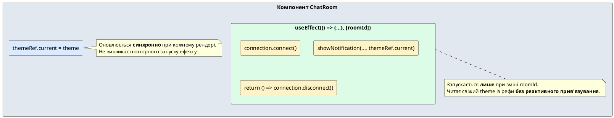
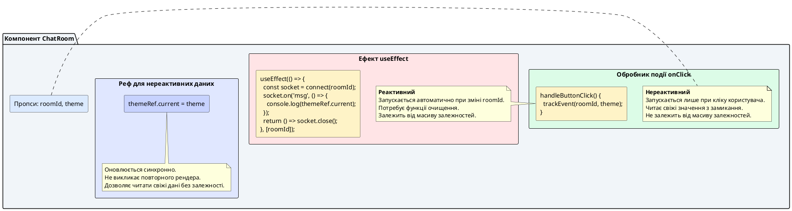

# Розділення подій та ефектів: реактивна проти нереактивної логіки

> 🔗 **Офіційний референс:** [Розділення подій та ефектів (Separating Events from Effects)](https://uk.react.dev/learn/separating-events-from-effects)

::card-group

::card{title="🎯 Мета лекції" icon="i-lucide-target"}

- Зрозуміти фундаментальну різницю між логікою обробки подій та логікою синхронізації ефектів.
- Опанувати концепцію реактивних залежностей: що повинно перезапускати ефект, а що ні.
- Навчитися виявляти ситуації, коли ефект потребує свіжих даних без реактивного прив'язування.
- Застосувати патерн збереження нереактивної логіки через рефи для уникнення зайвих ре-синхронізацій.

::

::card{title="🔑 Ключові терміни" icon="i-lucide-key"}

- **Обробник події (*Event Handler*):** функція, що запускається виключно у відповідь на конкретну дію користувача (клік, введення, submit форми).
- **Реактивна залежність (*Reactive Dependency*):** змінна, зміна якої призводить до повторного виконання ефекту.
- **Нереактивна логіка (*Non-Reactive Logic*):** код, який потребує свіжих даних, але не повинен перезапускати синхронізацію.
- **Ref-патерн (*Ref Pattern*):** техніка збереження актуальних значень без включення їх до масиву залежностей.

::

::

---

## Дві категорії логіки у React: події проти синхронізації

У попередніх лекціях ми встановили, що React-компоненти містять два типи коду:

1. **Логіка рендерингу** — чисті обчислення, які приймають пропси та стан і повертають JSX-розмітку.
2. **Побічні ефекти** — усе інше: мережеві запити, підписки, маніпуляція DOM.

Але всередині побічних ефектів існує ще один критичний поділ, про який часто забувають початківці:

::note
**Існує два фундаментально різних види побічних ефектів:**

- **Обробники подій (*Event Handlers*)** — запускаються виключно як реакція на конкретну взаємодію користувача (клік кнопки, відправка форми, натискання клавіші). Вони **не є реактивними** — їх виконання не залежить від змін пропсів або стану автоматично.

- **Ефекти (*Effects*)** — запускаються автоматично щоразу, коли змінюються реактивні залежності. Вони **є реактивними** — їхня мета полягає в підтриманні синхронізації компонента з зовнішньою системою.
::

Розуміння цієї різниці критично важливе для написання правильного коду. Початківці часто плутають ці два типи логіки, що призводить до зайвих повторних підключень, витоків пам'яті або застарілих замикань (*stale closures*).

---

## Обробники подій: нереактивна логіка за визначенням

Обробники подій запускаються **виключно** тоді, коли користувач виконує певну дію. Вони не «слідкують» за змінами пропсів або стану — вони просто виконуються один раз у відповідь на подію.

```tsx
interface ProductCardProps {
  productId: string;
  productName: string;
  theme: "light" | "dark";
}

function ProductCard({ productId, productName, theme }: ProductCardProps) {
  function handleAddToCart() {
    // Ця функція виконується ЛИШЕ при кліку на кнопку
    // Вона прочитає актуальні значення productId та theme
    console.log(`Додано товар ${productId} до кошика (тема: ${theme})`);
    
    // Відправка аналітичної події з поточною темою
    trackEvent("add_to_cart", {
      product_id: productId,
      theme: theme,
    });
  }

  return (
    <div className={`product-card ${theme}`}>
      <h3>{productName}</h3>
      <button onClick={handleAddToCart}>Додати до кошика</button>
    </div>
  );
}
```

::tip
**Чому обробники подій завжди читають свіжі значення?**

Кожен рендер компонента створює нову версію функції `handleAddToCart` із замкненими (*captured*) значеннями `productId`, `productName` та `theme` з поточного рендера. Коли користувач натискає кнопку, React викликає останню версію обробника, яка має доступ до найсвіжіших даних. Це відбувається автоматично завдяки механізму замикань JavaScript.
::

---

## Ефекти: реактивна синхронізація з зовнішніми системами

На відміну від обробників подій, ефекти призначені для **автоматичної синхронізації** компонента з зовнішніми системами (чат-сервер, браузерний API, WebSocket, таймери).

Розглянемо класичний приклад — підключення до чат-кімнати:

```tsx
import { useEffect } from "react";

interface ChatRoomProps {
  roomId: string;
}

function createConnection(roomId: string) {
  return {
    connect() {
      console.log(`✅ Підключення до кімнати "${roomId}"`);
    },
    disconnect() {
      console.log(`❌ Відключення від кімнати "${roomId}"`);
    },
  };
}

export function ChatRoom({ roomId }: ChatRoomProps) {
  useEffect(() => {
    const connection = createConnection(roomId);
    connection.connect();

    return () => {
      connection.disconnect();
    };
  }, [roomId]); // ← Ефект реагує на зміну roomId

  return <h3>Кімната: {roomId}</h3>;
}
```

**Що відбувається при зміні `roomId` з `"general"` на `"travel"`:**

1. React виявляє зміну реактивної залежності `roomId`.
2. React **спочатку викликає функцію очищення** (disconnect від старої кімнати `"general"`).
3. React **потім запускає новий ефект** (connect до нової кімнати `"travel"`).

Це є **реактивною поведінкою** — ефект автоматично повторно синхронізується щоразу, коли змінюється `roomId`.

::note
Ключова відмінність: обробники подій запускаються **вручну** (користувач натиснув кнопку), а ефекти запускаються **автоматично** (React виявив зміну залежності).
::

---

## Проблема: коли логіка має бути частково реактивною

Тепер уявімо реальну ситуацію: при підключенні до чату ми хочемо показати сповіщення (*notification*), і це сповіщення повинно мати колір, який залежить від поточної теми інтерфейсу (`theme: "light" | "dark"`).

Наївна спроба виглядатиме так:

```tsx
interface ChatRoomProps {
  roomId: string;
  theme: "light" | "dark";
}

function showNotification(message: string, theme: "light" | "dark") {
  console.log(`[${theme}] ${message}`);
}

export function ChatRoom({ roomId, theme }: ChatRoomProps) {
  useEffect(() => {
    const connection = createConnection(roomId);
    connection.connect();
    
    // Показуємо сповіщення з урахуванням поточної теми
    showNotification(`Підключено до кімнати ${roomId}`, theme);

    return () => {
      connection.disconnect();
    };
  }, [roomId, theme]); // ❌ Додали theme до залежностей

  return <h3>Кімната: {roomId}</h3>;
}
```

::warning
**Проблема цього підходу:**

Тепер ефект залежить **і від `roomId`, і від `theme`**. Це означає, що коли користувач просто перемикає світлу/темну тему (не змінюючи кімнату), React:

1. Розірве TCP/WebSocket-з'єднання з чат-сервером.
2. Створить нове підключення до тієї самої кімнати.
3. Користувач на мить втратить зв'язок, отримає event «reconnected», пропустить повідомлення.

Це абсурд — перемикання теми інтерфейсу не повинно розривати мережеве з'єднання!
::

Ось у чому полягає дилема:

- Ефект **потребує** свіжого значення `theme`, щоб правильно показати сповіщення.
- Але зміна `theme` **не повинна** перезапускати весь ефект (розривати сокет та повторно підключатися).

**Як бути?** Нам потрібна логіка, яка:
- Реагує на зміну `roomId` (реактивна частина).
- Читає актуальне значення `theme` (нереактивна частина).

---

## Патерн рішення: збереження нереактивної логіки через рефи

Щоб вирішити цю проблему, використовують патерн із `useRef` — зберігаємо актуальне значення у рефі, яка оновлюється при кожному рендері, але **не викликає повторного запуску ефекту**:

```tsx
import { useEffect, useRef } from "react";

export function ChatRoom({ roomId, theme }: ChatRoomProps) {
  // Створюємо рефу для зберігання актуальної теми
  const themeRef = useRef(theme);
  
  // Оновлюємо рефу при кожному рендері
  // Це синхронно, тому ref.current завжди містить найсвіжіше значення
  themeRef.current = theme;

  useEffect(() => {
    const connection = createConnection(roomId);
    connection.connect();
    
    // Читаємо theme із рефи, а не напряму із пропсів
    showNotification(`Підключено до кімнати ${roomId}`, themeRef.current);

    return () => {
      connection.disconnect();
    };
  }, [roomId]); // ✅ Тільки roomId у залежностях!

  return <h3>Кімната: {roomId}</h3>;
}
```

::plant-uml{alt="Патерн рефи для нереактивної логіки"}



::


**Що відбувається тепер:**

1. При кожному рендері (навіть якщо тільки `theme` змінилася) рядок `themeRef.current = theme` синхронно оновлює значення у рефі.
2. Ефект запускається **виключно** при зміні `roomId`, бо тільки він у масиві залежностей.
3. Коли ефект виконується, він читає актуальне значення `themeRef.current`, яке гарантовано містить останню тему.
4. Якщо `theme` змінюється (користувач перемикає світлу/темну тему), реф оновлюється, але ефект **не перезапускається** — з'єднання залишається активним.

::tip
**Чому `themeRef.current = theme` потрібно писати поза `useEffect`?**

Оновлення `.current` має відбуватися **синхронно** під час фази рендерингу, **до** того, як React запустить ефект. Якщо помістити це присвоювання всередину ефекту, ви отримаєте застаріле значення при першому запуску ефекту після зміни теми.
::

---

## Приклад із реального світу: аналітика та чат

Розглянемо більш складний практичний сценарій — коли користувач переходить між чат-кімнатами, ми хочемо:

1. Записати подію аналітики `room_visited` з переданням поточної кімнати та теми інтерфейсу.
2. Підключитися до WebSocket-серверу кімнати.

**Неправильний підхід (обидві залежності в одному ефекті):**

```tsx
// ❌ ПОГАНО: theme викликає розрив сокета
useEffect(() => {
  const socket = connectToWebSocket(roomId);
  
  // Аналітика з урахуванням теми
  trackEvent("room_visited", { roomId, theme });
  
  return () => {
    socket.close();
  };
}, [roomId, theme]); // Зміна theme розриває сокет!
```

**Правильний підхід (рефа для теми):**

```tsx
interface ChatAnalyticsProps {
  roomId: string;
  theme: "light" | "dark";
}

export function ChatWithAnalytics({ roomId, theme }: ChatAnalyticsProps) {
  const themeRef = useRef(theme);
  themeRef.current = theme;

  useEffect(() => {
    const socket = connectToWebSocket(roomId);
    
    // Читаємо свіжу тему з рефи, але вона не є залежністю
    trackEvent("room_visited", {
      roomId,
      theme: themeRef.current, // Завжди актуальна тема
    });
    
    socket.on("message", (msg: string) => {
      console.log(`[${themeRef.current}] ${msg}`);
    });
    
    return () => {
      socket.close();
    };
  }, [roomId]); // Тільки roomId перезапускає ефект

  return <div className={`chat-room ${theme}`}>...</div>;
}
```

::note
**Чому це працює безпечно?**

- Функція `trackEvent` викликається **один раз** при підключенні до кімнати — вона фіксує стан теми в цей момент.
- Обробник `socket.on("message", ...)` читає `themeRef.current` при кожному отриманні повідомлення, тому завжди бачить свіжу тему.
- Зміна `theme` **не розриває** WebSocket-з'єднання, бо `theme` не є залежністю ефекту.
::

---

## Майбутнє: експериментальний хук `useEffectEvent`

Команда React розробляє новий хук `useEffectEvent`, який вирішуватиме цю проблему більш елегантно. Наразі він знаходиться у статусі RFC (*Request for Comments*) і **недоступний у стабільній версії React**.

**Концепція `useEffectEvent`:**

```tsx
import { useEffect, experimental_useEffectEvent as useEffectEvent } from "react";

export function ChatRoom({ roomId, theme }: ChatRoomProps) {
  // Оголошуємо "подію ефекту" — функцію, яка НЕ є реактивною
  const onConnected = useEffectEvent(() => {
    showNotification(`Підключено до ${roomId}`, theme);
  });

  useEffect(() => {
    const connection = createConnection(roomId);
    connection.connect();
    
    // Викликаємо подію ефекту — вона завжди бачить свіжі значення
    onConnected();
    
    return () => {
      connection.disconnect();
    };
  }, [roomId]); // theme не потрібна у залежностях!

  return <h3>Кімната: {roomId}</h3>;
}
```

::warning
**Станом на React 19.1 `useEffectEvent` досі є експериментальним API.**

Його не можна використовувати у продакшн-коді без явного імпорту з `react/experimental`. Документація рекомендує поки що застосовувати патерн із рефами, описаний вище. Слідкуйте за офіційними анонсами — коли API стабілізується, його варто буде застосовувати для кращої читабельності коду.
::

---

## Ключові правила вибору: подія чи ефект?

Щоб не помилитися під час проєктування логіки компонента, задайте собі це питання:

::steps

### Крок 1: Логіка виконується у відповідь на конкретну взаємодію користувача?

Якщо так — це **обробник події**.

Приклади:
- Відправка форми → `onSubmit`
- Клік на кнопку «Завантажити файл» → `onClick`
- Зміна значення інпуту → `onChange`

### Крок 2: Логіка повинна синхронізувати компонент із зовнішньою системою?

Якщо так — це **ефект**.

Приклади:
- Підключення до WebSocket при зміні кімнати.
- Підписка на події клавіатури при монтуванні компонента.
- Запуск таймера, який оновлює поточний час кожну секунду.

### Крок 3: Чи потрібна логіці свіжа змінна, яка не повинна перезапускати синхронізацію?

Якщо так — використайте **патерн рефи** (`useRef` для збереження актуального значення).

::

---

## Практичне завдання: відстеження перегляду сторінки з темою

::::accordion

:::accordion-item{label="📋 Завдання: аналітика без перезапуску ефекту" icon="i-lucide-clipboard-list"}

Реалізуйте компонент `PageView`, який:

1. При монтуванні відправляє подію аналітики `page_viewed` з URL-адресою сторінки (`url: string`) та поточною темою інтерфейсу (`theme: "light" | "dark"`).
2. Ефект повинен запускатися **виключно** при зміні `url` (користувач перейшов на іншу сторінку).
3. Зміна `theme` (користувач перемикає світлу/темну тему) **не повинна** повторно відправляти подію аналітики.

**Початковий код із помилкою:**

```tsx
interface PageViewProps {
  url: string;
  theme: "light" | "dark";
}

function trackPageView(url: string, theme: string) {
  console.log(`📊 Сторінка переглянута: ${url} (тема: ${theme})`);
}

export function PageView({ url, theme }: PageViewProps) {
  useEffect(() => {
    trackPageView(url, theme);
  }, [url, theme]); // ❌ theme викликає повторну відправку події!

  return null;
}
```

**Очікувана поведінка:**

- Користувач відкрив `/home` з темою `light` → `📊 Сторінка переглянута: /home (тема: light)`
- Користувач перемикає тему на `dark` → **подія НЕ відправляється**
- Користувач переходить на `/profile` → `📊 Сторінка переглянута: /profile (тема: dark)`

:::

:::accordion-item{label="✅ Розв'язок та покроковий аналіз" icon="i-lucide-check-circle"}

**Правильна реалізація через рефу:**

```tsx
import { useEffect, useRef } from "react";

interface PageViewProps {
  url: string;
  theme: "light" | "dark";
}

function trackPageView(url: string, theme: string) {
  console.log(`📊 Сторінка переглянута: ${url} (тема: ${theme})`);
}

export function PageView({ url, theme }: PageViewProps) {
  // Крок 1: Створюємо рефу для збереження актуальної теми
  const themeRef = useRef(theme);
  
  // Крок 2: Синхронно оновлюємо рефу при кожному рендері
  themeRef.current = theme;

  useEffect(() => {
    // Крок 3: Читаємо свіжу тему з рефи без реактивного прив'язування
    trackPageView(url, themeRef.current);
  }, [url]); // Крок 4: Тільки url у залежностях!

  return null;
}
```

**Покрокове пояснення:**

1. **Рядок `const themeRef = useRef(theme)`** — створюємо рефу один раз при першому рендері. Початкове значення `theme` зберігається у `themeRef.current`, але далі ми вручну оновлюватимемо його.

2. **Рядок `themeRef.current = theme`** — при кожному рендері (навіть якщо тільки `theme` змінилася) синхронно записуємо нове значення у `themeRef.current`. Це присвоювання **не викликає повторний рендер** і **не є реактивним** — воно просто оновлює мутабельну властивість об'єкта.

3. **Всередині ефекту `trackPageView(url, themeRef.current)`** — при запуску ефекту ми читаємо `themeRef.current`, яка завжди містить останню тему завдяки синхронному оновленню на кроці 2.

4. **Масив залежностей `[url]`** — ефект залежить виключно від `url`. Коли змінюється `theme`, реф оновлюється, але ефект **не перезапускається**, тому подія аналітики не відправляється повторно.

**Чому це безпечно:**

- Присвоювання `themeRef.current = theme` відбувається синхронно під час фази рендерингу, тому React гарантує, що `.current` завжди актуальна до моменту запуску ефекту.
- Зміна `.current` не викликає повторний рендер — це мутація об'єкта, а не зміна стану.
- Ми точно контролюємо, коли ефект повинен перезапуститися (`url`), і коли він повинен просто прочитати свіжі дані (`theme`).

:::

::::

---

## Типові помилки та антипатерни

### Помилка 1: Вимикання лінтера exhaustive-deps

```tsx
useEffect(() => {
  trackEvent("room_visited", { roomId, theme });
  // eslint-disable-next-line react-hooks/exhaustive-deps
}, [roomId]); // ❌ Лінтер скаже, що theme має бути у залежностях
```

::caution
Директива `eslint-disable-next-line` приховує проблему, але не вирішує її. Якщо `theme` змінюється між рендерами, але ефект не перезапускається, функція всередині ефекту читатиме **застаріле** (*stale*) значення `theme` із замикання попереднього рендера. Це призведе до помилок: аналітична подія буде відправлена з неправильною темою.
::

**Правильне рішення:** використати патерн рефи.

---

### Помилка 2: Створення об'єкта або функції всередині залежностей

```tsx
useEffect(() => {
  const options = { roomId, theme }; // ❌ Новий об'єкт при кожному рендері
  trackEvent("room_visited", options);
}, [options]); // React бачить різні посилання на об'єкти
```

Кожен рендер створює новий об'єкт `options` із новим посиланням у пам'яті, тому `options` ніколи не дорівнює `options` з попереднього рендера (навіть якщо вміст ідентичний). Це призводить до запуску ефекту при **кожному** рендері.

**Правильне рішення:** якщо об'єкт потрібен лише цьому ефекту, створіть його **всередині** ефекту:

```tsx
useEffect(() => {
  const options = { roomId, theme };
  trackEvent("room_visited", options);
}, [roomId, theme]); // Залежність від примітивів, а не від об'єкта
```

---

### Помилка 3: Змішування реактивної та нереактивної логіки в одному ефекті

```tsx
useEffect(() => {
  const socket = connectToRoom(roomId); // Реактивна частина (має перезапускатися)
  const userPreferences = fetchUserPrefs(userId); // Нереактивна частина (достатньо один раз)
  return () => socket.close();
}, [roomId, userId]); // userId викликає розрив сокета!
```

**Правильне рішення:** розділіть на два незалежних ефекти:

```tsx
// Ефект 1: підключення до кімнати (реагує на roomId)
useEffect(() => {
  const socket = connectToRoom(roomId);
  return () => socket.close();
}, [roomId]);

// Ефект 2: завантаження налаштувань (реагує на userId)
useEffect(() => {
  fetchUserPrefs(userId);
}, [userId]);
```

---

## Додаткові приклади використання патерну рефи

### Приклад 1: Логування кліків із поточною темою

```tsx
interface ButtonWithLoggingProps {
  onClick: () => void;
  theme: "light" | "dark";
  children: React.ReactNode;
}

export function ButtonWithLogging({
  onClick,
  theme,
  children,
}: ButtonWithLoggingProps) {
  const themeRef = useRef(theme);
  themeRef.current = theme;

  function handleClick() {
    // Виконуємо оригінальний обробник
    onClick();
    
    // Логуємо подію з актуальною темою
    console.log(`[${themeRef.current}] Кнопка "${children}" натиснута`);
  }

  return <button onClick={handleClick}>{children}</button>;
}
```

::note
У цьому прикладі реф не використовується всередині `useEffect`, а читається в обробнику події `handleClick`. Це демонструє, що патерн рефи корисний не тільки для ефектів — він підходить для будь-якого випадку, коли потрібно прочитати свіжі дані без створення нових замикань.
::

---


### Приклад 2: Таймер із динамічним інтервалом

Розглянемо компонент, що показує оновлюваний лічильник. Інтервал оновлення передається через пропс, але зміна інтервалу **не повинна** скидати лічильник до нуля.

```tsx
import { useState, useEffect, useRef } from "react";

interface AutoCounterProps {
  intervalMs: number; // Інтервал оновлення в мілісекундах
}

export function AutoCounter({ intervalMs }: AutoCounterProps) {
  const [count, setCount] = useState(0);
  const intervalRef = useRef(intervalMs);
  
  // Оновлюємо рефу при кожному рендері
  intervalRef.current = intervalMs;

  useEffect(() => {
    // Створюємо таймер один раз при монтуванні
    const id = setInterval(() => {
      setCount((prev) => prev + 1);
      
      // Можна використати intervalRef.current для логування
      console.log(`Оновлення через ${intervalRef.current}мс`);
    }, intervalRef.current);

    return () => {
      clearInterval(id);
    };
  }, []); // Порожній масив залежностей — таймер створюється один раз!

  return (
    <div>
      <p>Лічильник: {count}</p>
      <p>Інтервал: {intervalMs}мс</p>
    </div>
  );
}
```

::warning
**Цей приклад демонструє важливу особливість:**

Таймер створюється **один раз** при монтуванні компонента з початковим значенням `intervalRef.current`. Якщо потім змінити `intervalMs`, `intervalRef.current` оновиться, але **існуючий таймер продовжить працювати з початковим інтервалом**, бо `setInterval` було викликано лише один раз.

Якщо потрібно, щоб зміна `intervalMs` перестворювала таймер із новим інтервалом, додайте `intervalMs` до залежностей:

```tsx
useEffect(() => {
  const id = setInterval(() => {
    setCount((prev) => prev + 1);
  }, intervalMs);

  return () => clearInterval(id);
}, [intervalMs]); // Тепер таймер перестворюється при зміні інтервалу
```

Вибір підходу залежить від бізнес-логіки: чи потрібно зберігати існуючий таймер незмінним (рефа), чи його слід перезапускати (залежність).
::

---

## Візуалізація різниці: обробники подій проти ефектів

::plant-uml{alt="Обробники подій проти ефектів"}



::

---

## Інтерактивна демонстрація патерну

::react-project-preview{title="Розділення подій та ефектів" entry="src/App.tsx" :height="640"}

```tsx [src/App.tsx]
import { useState } from 'react';
import { ChatRoom } from './components/ChatRoom';
import './styles.css';

export default function App() {
  const [roomId, setRoomId] = useState<string>('general');
  const [theme, setTheme] = useState<'light' | 'dark'>('light');

  return (
    <div className={`app ${theme}`}>
      <header className="header">
        <h1>Чат-застосунок</h1>
        <button
          className="theme-toggle"
          onClick={() => setTheme(theme === 'light' ? 'dark' : 'light')}
        >
          {theme === 'light' ? '🌙' : '☀️'} Перемкнути тему
        </button>
      </header>

      <div className="controls">
        <label>
          Оберіть кімнату:
          <select value={roomId} onChange={(e) => setRoomId(e.target.value)}>
            <option value="general">general</option>
            <option value="travel">travel</option>
            <option value="music">music</option>
          </select>
        </label>
      </div>

      <ChatRoom roomId={roomId} theme={theme} />
    </div>
  );
}
```

```tsx [src/components/ChatRoom.tsx]
import { useEffect, useRef } from 'react';

interface ChatRoomProps {
  roomId: string;
  theme: 'light' | 'dark';
}

function createConnection(roomId: string) {
  return {
    connect() {
      console.log(`✅ Підключення до кімнати "${roomId}"`);
    },
    disconnect() {
      console.log(`❌ Відключення від кімнати "${roomId}"`);
    },
  };
}

function showNotification(message: string, theme: 'light' | 'dark') {
  console.log(`[Тема: ${theme}] 🔔 ${message}`);
}

export function ChatRoom({ roomId, theme }: ChatRoomProps) {
  // Патерн рефи: зберігаємо актуальну тему без реактивності
  const themeRef = useRef(theme);
  themeRef.current = theme;

  useEffect(() => {
    const connection = createConnection(roomId);
    connection.connect();

    // Показуємо сповіщення з актуальною темою
    showNotification(`Ви підключилися до кімнати ${roomId}`, themeRef.current);

    return () => {
      connection.disconnect();
    };
  }, [roomId]); // Тільки roomId у залежностях!

  return (
    <div className="chat-room">
      <h2>Кімната: {roomId}</h2>
      <p className="hint">
        💡 Спробуйте перемкнути тему — з'єднання не розірветься!
      </p>
      <p className="hint">
        💡 Змініть кімнату — побачите відключення та нове підключення у консолі.
      </p>
    </div>
  );
}
```

```css [src/styles.css]
* {
  box-sizing: border-box;
  margin: 0;
  padding: 0;
}

.app {
  min-height: 100vh;
  font-family: system-ui, -apple-system, sans-serif;
  transition: background-color 0.3s, color 0.3s;
}

.app.light {
  background: #f8fafc;
  color: #0f172a;
}

.app.dark {
  background: #0f172a;
  color: #f8fafc;
}

.header {
  display: flex;
  justify-content: space-between;
  align-items: center;
  padding: 1.5rem 2rem;
  border-bottom: 2px solid;
}

.app.light .header {
  border-color: #e2e8f0;
}

.app.dark .header {
  border-color: #334155;
}

.header h1 {
  font-size: 1.5rem;
  font-weight: 700;
}

.theme-toggle {
  padding: 0.5rem 1rem;
  border-radius: 0.5rem;
  border: none;
  font-size: 0.95rem;
  font-weight: 600;
  cursor: pointer;
  transition: all 0.2s;
}

.app.light .theme-toggle {
  background: #0284c7;
  color: white;
}

.app.dark .theme-toggle {
  background: #38bdf8;
  color: #0c4a6e;
}

.theme-toggle:hover {
  transform: scale(1.05);
}

.controls {
  padding: 2rem;
}

.controls label {
  display: flex;
  flex-direction: column;
  gap: 0.5rem;
  font-weight: 600;
}

.controls select {
  padding: 0.75rem;
  border-radius: 0.5rem;
  border: 2px solid;
  font-size: 1rem;
  cursor: pointer;
}

.app.light .controls select {
  background: white;
  border-color: #cbd5e1;
  color: #0f172a;
}

.app.dark .controls select {
  background: #1e293b;
  border-color: #475569;
  color: #f8fafc;
}

.chat-room {
  margin: 2rem;
  padding: 2rem;
  border-radius: 1rem;
  border: 2px solid;
}

.app.light .chat-room {
  background: white;
  border-color: #e2e8f0;
}

.app.dark .chat-room {
  background: #1e293b;
  border-color: #334155;
}

.chat-room h2 {
  font-size: 1.25rem;
  margin-bottom: 1rem;
}

.hint {
  margin-top: 0.75rem;
  font-size: 0.9rem;
  opacity: 0.8;
}
```

::

**Що демонструє цей приклад:**

1. При виборі іншої кімнати у селекті — консоль покаже `❌ Відключення` та потім `✅ Підключення` до нової кімнати.
2. При натисканні кнопки перемикання теми — сповіщення у консолі **не з'являться**, бо ефект не перезапускається.
3. `themeRef.current` завжди містить актуальну тему, тому якщо додати логування всередині обробника події (наприклад, при надсиланні повідомлення), воно покаже правильну тему.

---

## Резюме: коли використовувати який підхід

::card-group

::card{title="✅ Використовуйте обробники подій" icon="i-lucide-mouse-pointer-click"}

- Код запускається у відповідь на конкретну взаємодію користувача.
- Приклади: клік кнопки, відправка форми, натискання клавіші.
- Завжди читають свіжі значення завдяки замиканням.
- **Не є реактивними** — не залежать від змін пропсів автоматично.

::

::card{title="✅ Використовуйте ефекти" icon="i-lucide-refresh-cw"}

- Код синхронізує компонент із зовнішньою системою.
- Приклади: підключення до WebSocket, підписка на події, таймери.
- Запускаються автоматично при зміні залежностей.
- **Є реактивними** — залежать від масиву залежностей.

::

::card{title="✅ Використовуйте рефи для нереактивних даних" icon="i-lucide-link"}

- Ефект потребує свіжих даних, але зміна цих даних **не повинна** перезапускати синхронізацію.
- Приклади: тема інтерфейсу для аналітики, налаштування користувача для логування.
- Патерн: `const ref = useRef(value); ref.current = value;` поза ефектом, читання `ref.current` всередині ефекту.

::

::

---

## Практичні завдання для самостійного опрацювання

::::accordion

:::accordion-item{label="📋 Завдання 1: Завантаження даних із збереженням фільтра" icon="i-lucide-clipboard-list"}

Створіть компонент `ProductList`, що завантажує список товарів з API при зміні категорії (`category: string`), але фільтрує їх клієнтськи за пошуковим запитом (`searchQuery: string`) без повторного запиту до сервера.

**Вимоги:**

- Ефект повинен запускатися **лише** при зміні `category`.
- Зміна `searchQuery` не повинна викликати повторний запит до API.
- При завантаженні нових даних потрібно відправити подію аналітики `products_loaded` з переданням `category` та `searchQuery`.

:::

:::accordion-item{label="✅ Розв'язок завдання 1" icon="i-lucide-check-circle"}

```tsx
import { useState, useEffect, useRef } from 'react';

interface Product {
  id: string;
  name: string;
  category: string;
}

interface ProductListProps {
  category: string;
  searchQuery: string;
}

async function fetchProducts(category: string): Promise<Product[]> {
  const response = await fetch(`/api/products?category=${category}`);
  return response.json();
}

function trackEvent(eventName: string, params: Record<string, any>) {
  console.log(`📊 ${eventName}:`, params);
}

export function ProductList({ category, searchQuery }: ProductListProps) {
  const [products, setProducts] = useState<Product[]>([]);
  const [isLoading, setIsLoading] = useState(false);
  
  // Зберігаємо актуальний пошуковий запит у рефі
  const searchQueryRef = useRef(searchQuery);
  searchQueryRef.current = searchQuery;

  useEffect(() => {
    setIsLoading(true);
    
    fetchProducts(category)
      .then((data) => {
        setProducts(data);
        
        // Читаємо свіжий searchQuery з рефи для аналітики
        trackEvent('products_loaded', {
          category,
          searchQuery: searchQueryRef.current,
          count: data.length,
        });
      })
      .finally(() => {
        setIsLoading(false);
      });
  }, [category]); // Тільки category у залежностях!

  // Клієнтська фільтрація за пошуковим запитом
  const filteredProducts = products.filter((product) =>
    product.name.toLowerCase().includes(searchQuery.toLowerCase())
  );

  if (isLoading) {
    return <p>Завантаження...</p>;
  }

  return (
    <ul>
      {filteredProducts.map((product) => (
        <li key={product.id}>{product.name}</li>
      ))}
    </ul>
  );
}
```

**Пояснення:**

- Ефект залежить виключно від `category` — при зміні категорії відбувається новий запит до API.
- `searchQueryRef.current` оновлюється синхронно при кожному рендері, тому подія аналітики завжди містить актуальний пошуковий запит.
- Фільтрація виконується на рівні рендерингу (`filteredProducts`), без повторних запитів.

:::

:::accordion-item{label="📋 Завдання 2: Автозбереження форми з підрахунком символів" icon="i-lucide-clipboard-list"}

Створіть компонент `AutoSaveForm`, що автоматично зберігає введений текст на сервер через 2 секунди після останнього натискання клавіші (debounce), але логує кількість символів та поточну мову інтерфейсу (`locale: string`) без перезапуску таймера.

**Вимоги:**

- Таймер автозбереження повинен скидатися при зміні `content`.
- Зміна `locale` не повинна скидати таймер або запускати нове збереження.
- При збереженні потрібно відправити подію `form_saved` з `contentLength` та `locale`.

:::

:::accordion-item{label="✅ Розв'язок завдання 2" icon="i-lucide-check-circle"}

```tsx
import { useState, useEffect, useRef } from 'react';

interface AutoSaveFormProps {
  locale: string;
}

async function saveContent(content: string) {
  console.log(`💾 Збереження на сервер: "${content}"`);
  // Імітація мережевого запиту
  await new Promise((resolve) => setTimeout(resolve, 500));
}

function trackEvent(eventName: string, params: Record<string, any>) {
  console.log(`📊 ${eventName}:`, params);
}

export function AutoSaveForm({ locale }: AutoSaveFormProps) {
  const [content, setContent] = useState('');
  
  // Зберігаємо актуальну мову у рефі
  const localeRef = useRef(locale);
  localeRef.current = locale;

  useEffect(() => {
    // Таймер автозбереження з debounce 2 секунди
    const timeoutId = setTimeout(() => {
      if (content.trim()) {
        saveContent(content).then(() => {
          // Читаємо свіжу мову з рефи для аналітики
          trackEvent('form_saved', {
            contentLength: content.length,
            locale: localeRef.current,
          });
        });
      }
    }, 2000);

    return () => {
      clearTimeout(timeoutId);
    };
  }, [content]); // Тільки content у залежностях!

  return (
    <div>
      <textarea
        value={content}
        onChange={(e) => setContent(e.target.value)}
        placeholder="Введіть текст..."
        rows={5}
        style={{ width: '100%', padding: '0.5rem' }}
      />
      <p>Символів: {content.length} | Мова: {locale}</p>
    </div>
  );
}
```

**Пояснення:**

- Ефект створює новий таймер при кожній зміні `content` — це забезпечує debounce (відкладене збереження).
- `localeRef.current` оновлюється синхронно, тому подія аналітики завжди бачить актуальну мову.
- Зміна `locale` не скидає таймер, бо `locale` не у масиві залежностей.

:::

::::

---

## Підсумок лекції

::card-group

::card{title="✅ Ви навчилися" icon="i-lucide-check-circle-2"}

- Розрізняти обробники подій (нереактивні, запускаються вручну) та ефекти (реактивні, запускаються автоматично).
- Виявляти ситуації, коли ефект потребує свіжих даних без реактивного прив'язування.
- Застосовувати патерн рефи для збереження нереактивної логіки: `const ref = useRef(value); ref.current = value;`.
- Уникати типових помилок: вимикання лінтера, створення об'єктів у залежностях, змішування реактивної та нереактивної логіки.

::

::card{title="🔮 Наступні кроки" icon="i-lucide-arrow-right"}

У наступній лекції ми вивчимо **видалення зайвих залежностей ефектів** — як рефакторити код, щоб масив залежностей містив мінімально необхідний набір змінних, та як використовувати функціональне оновлення стану для повного усунення залежностей.

::

::

