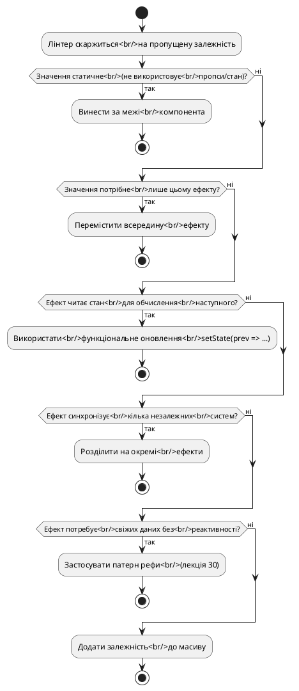
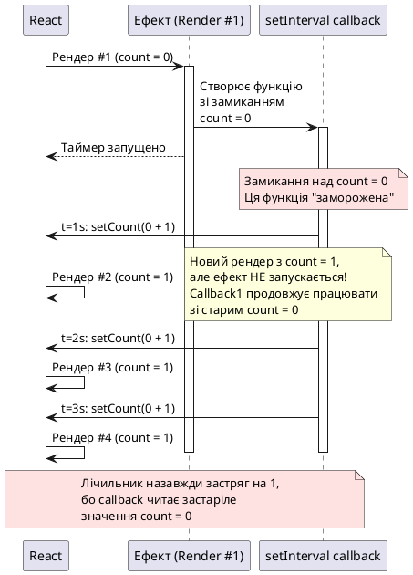

# Видалення зайвих залежностей ефектів та оптимізація синхронізації

> 🔗 **Офіційний референс:** [Видалення залежностей ефектів (Removing Effect Dependencies)](https://uk.react.dev/learn/removing-effect-dependencies)

::card-group

::card{title="🎯 Мета лекції" icon="i-lucide-target"}

- Зрозуміти, чому вимикання лінтера `exhaustive-deps` є небезпечним антипатерном.
- Опанувати чотири стратегії усунення непотрібних залежностей без компромісу коректності.
- Навчитися розпізнавати ситуації, коли одна залежність маскує проблему архітектури ефекту.
- Застосувати функціональні оновлення стану для повного усунення залежностей від стану.

::

::card{title="🔑 Ключові терміни" icon="i-lucide-key"}

- **Exhaustive Dependencies:** правило ESLint, що вимагає включення всіх реактивних значень у масив залежностей.
- **Застаріле замикання (*Stale Closure*):** ситуація, коли ефект читає значення з попереднього рендера замість актуального.
- **Функціональне оновлення стану (*Functional State Update*):** передача функції `prev => nextValue` у setter стану замість нового значення напряму.
- **Стабільне посилання (*Stable Reference*):** об'єкт або функція, посилання на які не змінюється між рендерами.

::

::

---

## Проблема: коли лінтер скаржиться на пропущені залежності

Уявімо типовий сценарій — ви пишете ефект, що підключається до чат-кімнати, і лінтер React Hooks видає попередження:

```tsx
interface ChatRoomProps {
  roomId: string;
  serverUrl: string;
}

function ChatRoom({ roomId, serverUrl }: ChatRoomProps) {
  const options = {
    serverUrl: serverUrl,
    roomId: roomId,
  };

  useEffect(() => {
    const connection = createConnection(options);
    connection.connect();
    return () => connection.disconnect();
  }, [roomId]); // ⚠️ React Hook useEffect has a missing dependency: 'options'

  return <h3>Кімната: {roomId}</h3>;
}
```

::warning
**Типова помилка початківця:**

Багато розробників у цьому місці просто додають коментар:

```tsx
}, [roomId]); // eslint-disable-next-line react-hooks/exhaustive-deps
```

**Це небезпечно!** Директива `eslint-disable` приховує проблему, але не вирішує її. Якщо `serverUrl` змінюється між рендерами, ефект продовжуватиме використовувати **застаріле** (*stale*) значення `serverUrl` із замикання попереднього рендера. Це призведе до того, що компонент залишиться підключеним до старого сервера, навіть якщо пропс `serverUrl` змінився.
::

Правильне питання не «як вимкнути лінтер», а **«як переписати код так, щоб залежність перестала бути проблемою»**.

---

## Стратегія 1: Винесення статичного коду за межі компонента

Якщо об'єкт, функція або будь-яке значення **не залежать від пропсів або стану**, їх слід оголосити **поза компонентом**. У такому випадку їхнє посилання залишається стабільним між рендерами, і вони не є реактивними значеннями.

### Приклад: константні налаштування підключення

```tsx
// ✅ Константа оголошена поза компонентом — стабільне посилання
const DEFAULT_OPTIONS = {
  reconnectInterval: 3000,
  maxRetries: 5,
  timeout: 10000,
};

function NetworkMonitor() {
  useEffect(() => {
    const monitor = createMonitor(DEFAULT_OPTIONS);
    monitor.start();
    
    return () => {
      monitor.stop();
    };
  }, []); // DEFAULT_OPTIONS не є залежністю!

  return <div>Моніторинг мережі активний</div>;
}
```

::tip
**Чому це працює?**

Об'єкт `DEFAULT_OPTIONS` створюється **один раз** при завантаженні модуля. Його посилання в пам'яті залишається незмінним протягом усього життя застосунку. React розпізнає, що це значення не є реактивним (не оголошене всередині компонента), і не вимагає додавати його до залежностей.
::

### Приклад: допоміжні функції без доступу до стану

```tsx
// ✅ Функція не використовує пропси чи стан — стабільне посилання
function createChatConnection(roomId: string, serverUrl: string) {
  return {
    connect() {
      console.log(`Підключення до ${serverUrl}/${roomId}`);
    },
    disconnect() {
      console.log(`Відключення від ${roomId}`);
    },
  };
}

function ChatRoom({ roomId, serverUrl }: ChatRoomProps) {
  useEffect(() => {
    const connection = createChatConnection(roomId, serverUrl);
    connection.connect();
    return () => connection.disconnect();
  }, [roomId, serverUrl]); // createChatConnection не є залежністю!

  return <h3>Кімната: {roomId}</h3>;
}
```

::note
Зверніть увагу: `createChatConnection` оголошена **поза компонентом**, тому її посилання стабільне. Але аргументи, які ми їй передаємо (`roomId`, `serverUrl`), є реактивними — вони приходять із пропсів, тому мають бути у масиві залежностей.
::

---

## Стратегія 2: Переміщення створення об'єкта всередину ефекту

Якщо об'єкт або функція потрібні **виключно цьому ефекту**, створіть їх безпосередньо всередині тіла `useEffect`. У такому випадку вони не стануть залежностями, бо не існують у зовнішній області видимості компонента.

### Проблема: об'єкт створюється при кожному рендері

```tsx
function ChatRoom({ roomId, serverUrl }: ChatRoomProps) {
  // ❌ Новий об'єкт при кожному рендері — нове посилання в пам'яті
  const options = {
    serverUrl: serverUrl,
    roomId: roomId,
  };

  useEffect(() => {
    const connection = createConnection(options);
    connection.connect();
    return () => connection.disconnect();
  }, [options]); // ⚠️ options змінюється при кожному рендері — ефект запускається щоразу!
}
```

**Що відбувається:**

При кожному рендері створюється **новий об'єкт** `options` із новим посиланням у пам'яті. Навіть якщо `serverUrl` та `roomId` не змінилися, React бачить різні посилання на об'єкти (`options !== options`), тому запускає ефект повторно.

### Рішення: створити об'єкт всередині ефекту

```tsx
function ChatRoom({ roomId, serverUrl }: ChatRoomProps) {
  useEffect(() => {
    // ✅ Об'єкт створюється всередині ефекту
    const options = {
      serverUrl: serverUrl,
      roomId: roomId,
    };
    
    const connection = createConnection(options);
    connection.connect();
    return () => connection.disconnect();
  }, [roomId, serverUrl]); // Залежність від примітивів, а не від об'єкта!

  return <h3>Кімната: {roomId}</h3>;
}
```

::tip
**Чому це краще?**

Тепер ефект залежить від **примітивних значень** `roomId` та `serverUrl`, а не від об'єкта `options`. Примітиви порівнюються за значенням (`===`), тому ефект запускається **лише** тоді, коли реально змінюється `roomId` або `serverUrl`, а не при кожному рендері.
::

---

## Стратегія 3: Функціональне оновлення стану для усунення залежності від стану

Одна з найпоширеніших причин зайвих залежностей — ефект читає поточний стан лише для того, щоб обчислити наступне значення. У такому випадку використання **функціонального оновлення стану** дозволяє повністю усунути залежність.

### Проблема: таймер залежить від стану

```tsx
function Counter() {
  const [count, setCount] = useState(0);

  useEffect(() => {
    const id = setInterval(() => {
      setCount(count + 1); // ❌ Читаємо count — він має бути у залежностях
    }, 1000);

    return () => clearInterval(id);
  }, [count]); // ⚠️ Таймер перестворюється щосекунди!

  return <h1>{count}</h1>;
}
```

**Що відбувається:**

1. При кожному тіку таймера (кожну секунду) `setCount(count + 1)` оновлює стан.
2. React перерендерює компонент із новим значенням `count`.
3. Ефект бачить зміну залежності `count` і **перестворює таймер** (очищає старий `setInterval`, створює новий).
4. Таймер ніколи не працює більше однієї секунди — кожну секунду він створюється заново.

Це не тільки неефективно, а й потенційно небезпечно: якщо очищення має побічні ефекти (наприклад, розрив WebSocket-з'єднання), вони виконуватимуться щосекунди.

### Рішення: функціональне оновлення стану

```tsx
function Counter() {
  const [count, setCount] = useState(0);

  useEffect(() => {
    const id = setInterval(() => {
      setCount((prevCount) => prevCount + 1); // ✅ Не читаємо count напряму
    }, 1000);

    return () => clearInterval(id);
  }, []); // Порожній масив — таймер створюється лише один раз!

  return <h1>{count}</h1>;
}
```

::plant-uml{alt="Функціональне оновлення стану"}

```plantuml
@startuml
skinparam style plain
skinparam backgroundColor #FFFFFF

rectangle "Компонент Counter (count = 0)" #E2E8F0 {
  rectangle "useEffect(() => {...}, [])" #DBEAFE {
    note right
      Виконується **один раз** при монтуванні.
      Таймер більше ніколи не перестворюється.
    end note
    
    rectangle "setInterval(() => {\n  setCount(prev => prev + 1);\n}, 1000);" #DCFCE7
    
    note bottom of "setInterval(() => {\n  setCount(prev => prev + 1);\n}, 1000);"
      Кожна секунда викликається функція-оновлювач.
      React передає актуальне значення count у параметр prev.
      Замикання не зберігає застаріле значення count.
    end note
  }
}

rectangle "React State Management" #FEF3C7 {
  rectangle "t=0s: prev=0 → count=1" #DCFCE7
  rectangle "t=1s: prev=1 → count=2" #DCFCE7
  rectangle "t=2s: prev=2 → count=3" #DCFCE7
  rectangle "t=3s: prev=3 → count=4" #DCFCE7
}

@enduml
```

::

**Що відбувається тепер:**

1. Ефект запускається **один раз** при монтуванні компонента (порожній масив залежностей `[]`).
2. Таймер створюється один раз і більше ніколи не очищується до розмонтування компонента.
3. Кожну секунду викликається `setCount((prevCount) => prevCount + 1)`.
4. React **автоматично** передає актуальне значення `count` у параметр `prevCount` функції-оновлювача.
5. Замикання не зберігає застаріле значення `count` — кожен виклик отримує свіжий `prevCount` від React.

::tip
**Золоте правило функціонального оновлення:**

Якщо новий стан обчислюється на основі попереднього (`next = prev + delta`), завжди використовуйте функціональне оновлення: `setState(prev => prev + delta)`. Це усуває залежність від поточного стану і дозволяє ефекту працювати з порожнім масивом залежностей.
::

---

## Стратегія 4: Розділення одного ефекту на кілька незалежних

Іноді один ефект намагається синхронізувати **декілька незалежних зовнішніх систем** одночасно. Це призводить до того, що зміна однієї залежності перезапускає синхронізацію всіх систем, навіть тих, які не потребують оновлення.

### Проблема: один ефект для двох незалежних систем

```tsx
function Dashboard({ userId, theme }: { userId: string; theme: string }) {
  useEffect(() => {
    // Система 1: завантаження даних користувача
    fetchUserData(userId).then((data) => {
      console.log("Дані користувача завантажені:", data);
    });

    // Система 2: відправка події аналітики з темою
    trackEvent("dashboard_viewed", { userId, theme });
    
    // Система 3: підписка на оновлення профілю
    const unsubscribe = subscribeToProfileUpdates(userId, (update) => {
      console.log("Оновлення профілю:", update);
    });

    return () => {
      unsubscribe();
    };
  }, [userId, theme]); // ⚠️ Зміна theme перезавантажує дані користувача!

  return <div>Панель користувача</div>;
}
```

**Проблема:**

Коли користувач просто перемикає тему інтерфейсу (світла/темна), ефект:

1. Відписується від оновлень профілю.
2. Повторно завантажує дані користувача з сервера (навіть якщо `userId` не змінився).
3. Повторно відправляє подію аналітики.
4. Повторно підписується на оновлення профілю.

Це марнує ресурси та може призвести до блимання інтерфейсу.

### Рішення: три окремих ефекти з точковими залежностями

```tsx
function Dashboard({ userId, theme }: { userId: string; theme: string }) {
  // Ефект 1: завантаження даних користувача (залежить тільки від userId)
  useEffect(() => {
    fetchUserData(userId).then((data) => {
      console.log("Дані користувача завантажені:", data);
    });
  }, [userId]);

  // Ефект 2: аналітика (залежить від обох, але не має очищення)
  useEffect(() => {
    trackEvent("dashboard_viewed", { userId, theme });
  }, [userId, theme]);

  // Ефект 3: підписка на оновлення (залежить тільки від userId)
  useEffect(() => {
    const unsubscribe = subscribeToProfileUpdates(userId, (update) => {
      console.log("Оновлення профілю:", update);
    });

    return () => {
      unsubscribe();
    };
  }, [userId]);

  return <div>Панель користувача</div>;
}
```

::note
**Чому це краще?**

Тепер кожен ефект синхронізує **одну конкретну зовнішню систему** і має **мінімальний набір залежностей**:

- Ефект 1 та 3 запускаються **лише** при зміні `userId` (новий користувач увійшов).
- Ефект 2 запускається при зміні **або** `userId`, **або** `theme`, але не має функції очищення — він просто відправляє подію аналітики.

Зміна `theme` більше не викликає повторне завантаження даних або повторну підписку.
::

---

## Практичний приклад: оптимізація чат-застосунку

Розглянемо реальний кейс — компонент чату, що поєднує кілька систем синхронізації.

### Неоптимальна версія (один великий ефект)

```tsx
interface ChatProps {
  roomId: string;
  userId: string;
  theme: "light" | "dark";
}

function Chat({ roomId, userId, theme }: ChatProps) {
  const [messages, setMessages] = useState<string[]>([]);

  useEffect(() => {
    // Система 1: WebSocket-підключення до кімнати
    const socket = connectToRoom(roomId);
    socket.on("message", (msg: string) => {
      setMessages((prev) => [...prev, msg]);
    });

    // Система 2: завантаження історії повідомлень
    fetchMessageHistory(roomId, userId).then((history) => {
      setMessages(history);
    });

    // Система 3: відправка події аналітики
    trackEvent("room_joined", { roomId, userId, theme });

    return () => {
      socket.disconnect();
    };
  }, [roomId, userId, theme]); // ⚠️ Зміна theme або userId розриває сокет!

  return (
    <div className={`chat ${theme}`}>
      {messages.map((msg, i) => (
        <div key={i}>{msg}</div>
      ))}
    </div>
  );
}
```

**Проблеми:**

- Зміна `userId` (користувач увійшов під іншим акаунтом) розриває WebSocket-з'єднання навіть із тією самою кімнатою.
- Зміна `theme` (користувач перемикає світлу/темну тему) розриває WebSocket-з'єднання.
- Історія повідомлень завантажується повторно при кожній зміні будь-якої залежності.

### Оптимізована версія (три окремих ефекти)

```tsx
function Chat({ roomId, userId, theme }: ChatProps) {
  const [messages, setMessages] = useState<string[]>([]);

  // Ефект 1: WebSocket-підключення (залежить тільки від roomId)
  useEffect(() => {
    const socket = connectToRoom(roomId);
    socket.on("message", (msg: string) => {
      setMessages((prev) => [...prev, msg]); // Функціональне оновлення!
    });

    return () => {
      socket.disconnect();
    };
  }, [roomId]); // Тільки roomId — зміна userId або theme не розриває сокет

  // Ефект 2: завантаження історії (залежить від roomId та userId)
  useEffect(() => {
    fetchMessageHistory(roomId, userId).then((history) => {
      setMessages(history);
    });
  }, [roomId, userId]);

  // Ефект 3: аналітика з темою (патерн рефи з попередньої лекції)
  const themeRef = useRef(theme);
  themeRef.current = theme;

  useEffect(() => {
    trackEvent("room_joined", {
      roomId,
      userId,
      theme: themeRef.current, // Читаємо свіжу тему без залежності
    });
  }, [roomId, userId]);

  return (
    <div className={`chat ${theme}`}>
      {messages.map((msg, i) => (
        <div key={i}>{msg}</div>
      ))}
    </div>
  );
}
```

::tip
**Комбінація стратегій:**

- Ефект 1: функціональне оновлення стану (`setMessages(prev => [...]`)) дозволяє не включати `messages` у залежності.
- Ефект 2: точкові залежності — історія завантажується **лише** при зміні `roomId` або `userId`.
- Ефект 3: патерн рефи (із попередньої лекції) дозволяє прочитати свіжу `theme` без включення її у залежності.
::

---


## Таблиця стратегій: коли застосовувати який підхід

| Ситуація | Стратегія | Приклад |
|----------|-----------|---------|
| Об'єкт або функція не використовують пропси/стан | **1. Винести за межі компонента** | `const API_CONFIG = { url: "..." }` оголосити поза компонентом |
| Об'єкт потрібен лише одному ефекту | **2. Перемістити всередину ефекту** | `useEffect(() => { const opts = { roomId }; ... }, [roomId])` |
| Ефект читає стан для обчислення наступного значення | **3. Функціональне оновлення** | `setCount(prev => prev + 1)` замість `setCount(count + 1)` |
| Один ефект синхронізує кілька незалежних систем | **4. Розділити на окремі ефекти** | Окремі `useEffect` для WebSocket, аналітики, завантаження даних |
| Ефект потребує свіжих даних без реактивності | **Патерн рефи (лекція 30)** | `const ref = useRef(value); ref.current = value; useEffect(() => { log(ref.current); }, [])` |

---

## Типові антипатерни та як їх виправити

### Антипатерн 1: Вимикання лінтера без розуміння проблеми

```tsx
// ❌ ПОГАНО: приховування проблеми замість вирішення
useEffect(() => {
  fetchData(userId, config);
  // eslint-disable-next-line react-hooks/exhaustive-deps
}, [userId]); // config пропущено — ризик застарілого замикання!
```

**Правильне рішення:**

Якщо `config` статичний — винесіть за межі компонента. Якщо динамічний — створіть всередині ефекту або додайте до залежностей.

---

### Антипатерн 2: Використання `useMemo` для стабілізації посилань на об'єкти

```tsx
// ❌ ПОГАНО: зайва складність
const options = useMemo(() => ({
  serverUrl,
  roomId,
}), [serverUrl, roomId]);

useEffect(() => {
  const conn = createConnection(options);
  conn.connect();
  return () => conn.disconnect();
}, [options]);
```

**Правильне рішення:**

Просто створіть об'єкт всередині ефекту — це простіше та ефективніше:

```tsx
// ✅ ДОБРЕ: простіше і без useMemo
useEffect(() => {
  const options = { serverUrl, roomId };
  const conn = createConnection(options);
  conn.connect();
  return () => conn.disconnect();
}, [serverUrl, roomId]);
```

::note
**Коли `useMemo` справді потрібен:**

`useMemo` має сенс для **обчислювально важких операцій** (сортування великих масивів, складні математичні обчислення), а не для створення простих об'єктів. Створення об'єкта `{ a, b }` виконується за наносекунди — `useMemo` тут додає більше накладних витрат, ніж економить.
::

---

### Антипатерн 3: Створення функцій всередині компонента, які потім стають залежностями

```tsx
function SearchResults({ query }: { query: string }) {
  // ❌ Нова функція при кожному рендері
  const performSearch = () => {
    return fetch(`/api/search?q=${query}`).then((r) => r.json());
  };

  useEffect(() => {
    performSearch().then((results) => {
      console.log(results);
    });
  }, [performSearch]); // ⚠️ performSearch змінюється при кожному рендері!
}
```

**Правильне рішення:**

Винесіть функцію за межі компонента або створіть всередині ефекту:

```tsx
// Варіант 1: функція поза компонентом
function performSearch(query: string) {
  return fetch(`/api/search?q=${query}`).then((r) => r.json());
}

function SearchResults({ query }: { query: string }) {
  useEffect(() => {
    performSearch(query).then((results) => {
      console.log(results);
    });
  }, [query]); // performSearch стабільна, query — єдина залежність
}

// Варіант 2: інлайн всередині ефекту
function SearchResults({ query }: { query: string }) {
  useEffect(() => {
    const performSearch = () => {
      return fetch(`/api/search?q=${query}`).then((r) => r.json());
    };
    
    performSearch().then((results) => {
      console.log(results);
    });
  }, [query]);
}
```

---

## Практичні завдання для закріплення

::::accordion

:::accordion-item{label="📋 Завдання 1: Оптимізація лічильника з кроком" icon="i-lucide-clipboard-list"}

Наступний компонент містить помилку — таймер перестворюється при кожному оновленні `count` або `step`. Оптимізуйте код так, щоб таймер створювався **лише один раз** при монтуванні компонента.

**Початковий код із проблемою:**

```tsx
function Counter() {
  const [count, setCount] = useState(0);
  const [step, setStep] = useState(1);

  useEffect(() => {
    const id = setInterval(() => {
      setCount(count + step); // ❌ Читаємо count та step
    }, 1000);

    return () => clearInterval(id);
  }, [count, step]); // ⚠️ Таймер перестворюється щосекунди!

  return (
    <div>
      <h1>Лічильник: {count}</h1>
      <button onClick={() => setStep(step + 1)}>
        Збільшити крок (зараз: {step})
      </button>
    </div>
  );
}
```

**Очікувана поведінка:**

- Таймер створюється один раз при монтуванні.
- Лічильник збільшується на поточне значення `step` кожну секунду.
- Зміна `step` через кнопку відразу впливає на наступний тік таймера (без перестворення таймера).

:::

:::accordion-item{label="✅ Розв'язок завдання 1" icon="i-lucide-check-circle"}

**Правильна реалізація через рефу та функціональне оновлення:**

```tsx
import { useState, useEffect, useRef } from 'react';

function Counter() {
  const [count, setCount] = useState(0);
  const [step, setStep] = useState(1);
  
  // Зберігаємо актуальний step у рефі
  const stepRef = useRef(step);
  stepRef.current = step;

  useEffect(() => {
    const id = setInterval(() => {
      // Функціональне оновлення з читанням stepRef
      setCount((prevCount) => prevCount + stepRef.current);
    }, 1000);

    return () => clearInterval(id);
  }, []); // Порожній масив — таймер створюється один раз!

  return (
    <div>
      <h1>Лічильник: {count}</h1>
      <button onClick={() => setStep(step + 1)}>
        Збільшити крок (зараз: {step})
      </button>
    </div>
  );
}
```

**Покрокове пояснення:**

1. **`const stepRef = useRef(step)`** — створюємо рефу для збереження актуального кроку.

2. **`stepRef.current = step`** — синхронно оновлюємо рефу при кожному рендері. Якщо користувач натисне кнопку і `step` зміниться на `2`, реф негайно оновиться до `2`.

3. **`setCount((prevCount) => prevCount + stepRef.current)`** — функціональне оновлення стану:
   - `prevCount` — актуальне значення `count`, яке React передає автоматично.
   - `stepRef.current` — актуальне значення кроку, яке ми читаємо з рефи.
   - Замикання не зберігає застарілі значення — кожен тік таймера читає свіжі дані.

4. **`}, [])`** — порожній масив залежностей означає, що ефект виконується **один раз** при монтуванні. Таймер більше ніколи не перестворюється.

**Чому це працює:**

- Зміна `step` оновлює `stepRef.current`, але **не перезапускає ефект** (бо `step` не у залежностях).
- Зміна `count` також **не перезапускає ефект** (бо ми використовуємо функціональне оновлення).
- Таймер працює безперервно від монтування до розмонтування компонента.

:::

:::accordion-item{label="📋 Завдання 2: Розділення ефектів у формі" icon="i-lucide-clipboard-list"}

Компонент форми реєстрації містить один великий ефект, що синхронізує три незалежних системи. Розділіть його на три окремих ефекти з точковими залежностями.

**Початковий код із проблемою:**

```tsx
interface RegistrationFormProps {
  country: string;
  email: string;
  marketingConsent: boolean;
}

function RegistrationForm({
  country,
  email,
  marketingConsent,
}: RegistrationFormProps) {
  useEffect(() => {
    // Система 1: завантаження списку міст країни
    fetchCitiesByCountry(country).then((cities) => {
      console.log("Міста завантажені:", cities);
    });

    // Система 2: перевірка унікальності email
    checkEmailAvailability(email).then((isAvailable) => {
      console.log("Email доступний:", isAvailable);
    });

    // Система 3: підписка на розсилку
    if (marketingConsent) {
      const unsubscribe = subscribeToNewsletter(email);
      return () => unsubscribe();
    }
  }, [country, email, marketingConsent]); // ⚠️ Зміна будь-чого перезапускає все!

  return <div>Форма реєстрації</div>;
}
```

**Проблема:**

- Зміна `marketingConsent` (користувач поставив/зняв галочку) перезавантажує список міст та перевіряє email.
- Зміна `country` (вибір іншої країни) повторно перевіряє email та керує підпискою.
- Зміна `email` повторно завантажує міста.

:::

:::accordion-item{label="✅ Розв'язок завдання 2" icon="i-lucide-check-circle"}

**Правильна реалізація через три незалежних ефекти:**

```tsx
function RegistrationForm({
  country,
  email,
  marketingConsent,
}: RegistrationFormProps) {
  // Ефект 1: завантаження міст (залежить тільки від country)
  useEffect(() => {
    fetchCitiesByCountry(country).then((cities) => {
      console.log("Міста завантажені:", cities);
    });
  }, [country]);

  // Ефект 2: перевірка email (залежить тільки від email)
  useEffect(() => {
    checkEmailAvailability(email).then((isAvailable) => {
      console.log("Email доступний:", isAvailable);
    });
  }, [email]);

  // Ефект 3: підписка на розсилку (залежить від email та marketingConsent)
  useEffect(() => {
    if (marketingConsent) {
      const unsubscribe = subscribeToNewsletter(email);
      return () => unsubscribe();
    }
  }, [email, marketingConsent]);

  return <div>Форма реєстрації</div>;
}
```

**Покрокове пояснення:**

1. **Ефект 1** синхронізує список міст з вибраною країною. Він запускається **виключно** при зміні `country`. Зміна `email` або `marketingConsent` не впливає на завантаження міст.

2. **Ефект 2** перевіряє доступність email на сервері. Він запускається **виключно** при зміні `email`. Зміна `country` або `marketingConsent` не викликає повторну перевірку.

3. **Ефект 3** керує підпискою на розсилку. Він запускається при зміні **або** `email` (потрібно відписатися зі старого email та підписатися на новий), **або** `marketingConsent` (користувач поставив/зняв галочку). Умова `if (marketingConsent)` гарантує, що підписка відбувається лише за згоди користувача.

**Переваги:**

- Кожен ефект має **мінімальний набір залежностей** — лише ті, що реально впливають на його синхронізацію.
- Зміна однієї змінної не викликає зайвих побічних ефектів у незалежних системах.
- Код стає читабельнішим — одна відповідальність на один ефект.

:::

:::accordion-item{label="📋 Завдання 3: Усунення залежності від об'єкта фільтрів" icon="i-lucide-clipboard-list"}

Компонент списку товарів приймає об'єкт фільтрів через пропси. Лінтер вимагає додати `filters` до залежностей, але це призводить до зайвих запитів. Оптимізуйте код.

**Початковий код із проблемою:**

```tsx
interface Filters {
  category: string;
  minPrice: number;
  maxPrice: number;
}

interface ProductListProps {
  filters: Filters;
}

function ProductList({ filters }: ProductListProps) {
  const [products, setProducts] = useState([]);

  useEffect(() => {
    fetchProducts(filters).then((data) => {
      setProducts(data);
    });
  }, [filters]); // ⚠️ filters — новий об'єкт при кожному рендері батьківського компонента!

  return <ul>{/* ... */}</ul>;
}
```

**Проблема:**

Батьківський компонент може створювати новий об'єкт `filters` при кожному рендері, навіть якщо значення всередині не змінилися. Це призводить до повторних запитів до API.

:::

:::accordion-item{label="✅ Розв'язок завдання 3" icon="i-lucide-check-circle"}

**Варіант 1: Деструктуризація пропсів та залежність від примітивів**

```tsx
function ProductList({ filters }: ProductListProps) {
  const [products, setProducts] = useState([]);
  
  // Деструктуризуємо об'єкт filters на окремі примітиви
  const { category, minPrice, maxPrice } = filters;

  useEffect(() => {
    // Створюємо об'єкт filters всередині ефекту
    const filterParams = { category, minPrice, maxPrice };
    
    fetchProducts(filterParams).then((data) => {
      setProducts(data);
    });
  }, [category, minPrice, maxPrice]); // Залежність від примітивів!

  return <ul>{/* ... */}</ul>;
}
```

**Варіант 2: Винесення API-функції та передача окремих параметрів**

```tsx
// Поза компонентом
async function fetchProducts(
  category: string,
  minPrice: number,
  maxPrice: number
) {
  const response = await fetch(
    `/api/products?category=${category}&minPrice=${minPrice}&maxPrice=${maxPrice}`
  );
  return response.json();
}

function ProductList({ filters }: ProductListProps) {
  const [products, setProducts] = useState([]);
  const { category, minPrice, maxPrice } = filters;

  useEffect(() => {
    fetchProducts(category, minPrice, maxPrice).then((data) => {
      setProducts(data);
    });
  }, [category, minPrice, maxPrice]);

  return <ul>{/* ... */}</ul>;
}
```

**Пояснення:**

- Деструктуризація `{ category, minPrice, maxPrice } = filters` витягує примітивні значення з об'єкта.
- Примітиви порівнюються за значенням (`===`), а не за посиланням у пам'яті.
- Ефект запускається **лише** тоді, коли реально змінюється одне з цих значень, навіть якщо батьківський компонент передає новий об'єкт `filters`.

:::

::::

---

## Діаграма прийняття рішень: як усунути залежність

::plant-uml{alt="Алгоритм усунення залежностей"}



::

---

## Інтерактивна демонстрація: таймер із динамічним інтервалом

::react-project-preview{title="Оптимізація залежностей таймера" entry="src/App.tsx" :height="640"}

```tsx [src/App.tsx]
import { useState } from 'react';
import { OptimizedTimer } from './components/OptimizedTimer';
import { UnoptimizedTimer } from './components/UnoptimizedTimer';
import './styles.css';

export default function App() {
  const [showOptimized, setShowOptimized] = useState(true);

  return (
    <div className="app">
      <header className="header">
        <h1>Оптимізація залежностей ефектів</h1>
        <div className="toggle">
          <button
            className={showOptimized ? 'active' : ''}
            onClick={() => setShowOptimized(true)}
          >
            ✅ Оптимізована
          </button>
          <button
            className={!showOptimized ? 'active' : ''}
            onClick={() => setShowOptimized(false)}
          >
            ❌ Неоптимізована
          </button>
        </div>
      </header>

      {showOptimized ? <OptimizedTimer /> : <UnoptimizedTimer />}
    </div>
  );
}
```

```tsx [src/components/OptimizedTimer.tsx]
import { useState, useEffect, useRef } from 'react';

export function OptimizedTimer() {
  const [count, setCount] = useState(0);
  const [interval, setInterval] = useState(1000);
  const [renderCount, setRenderCount] = useState(0);
  
  const intervalRef = useRef(interval);
  intervalRef.current = interval;

  useEffect(() => {
    console.log('✅ Таймер створено (оптимізована версія)');
    
    const id = setInterval(() => {
      setCount((prev) => prev + 1);
    }, intervalRef.current);

    return () => {
      console.log('🗑️ Таймер очищено (оптимізована версія)');
      clearInterval(id);
    };
  }, []); // Порожній масив!

  useEffect(() => {
    setRenderCount((prev) => prev + 1);
  });

  return (
    <div className="timer">
      <div className="card">
        <h2>✅ Оптимізована версія</h2>
        <div className="counter">Лічильник: {count}</div>
        <div className="meta">Рендерів: {renderCount}</div>
        <div className="controls">
          <label>
            Інтервал (мс):
            <input
              type="range"
              min="100"
              max="2000"
              step="100"
              value={interval}
              onChange={(e) => setInterval(Number(e.target.value))}
            />
            <span>{interval}мс</span>
          </label>
        </div>
        <div className="info">
          💡 Таймер створюється <strong>один раз</strong> при монтуванні.
          Зміна інтервалу не перестворює таймер.
        </div>
      </div>
    </div>
  );
}
```

```tsx [src/components/UnoptimizedTimer.tsx]
import { useState, useEffect, useRef } from 'react';

export function UnoptimizedTimer() {
  const [count, setCount] = useState(0);
  const [interval, setInterval] = useState(1000);
  const [renderCount, setRenderCount] = useState(0);

  useEffect(() => {
    console.log('❌ Таймер створено (неоптимізована версія)');
    
    const id = setInterval(() => {
      setCount(count + 1); // Читаємо count напряму
    }, interval);

    return () => {
      console.log('🗑️ Таймер очищено (неоптимізована версія)');
      clearInterval(id);
    };
  }, [count, interval]); // count та interval у залежностях!

  useEffect(() => {
    setRenderCount((prev) => prev + 1);
  });

  return (
    <div className="timer">
      <div className="card danger">
        <h2>❌ Неоптимізована версія</h2>
        <div className="counter">Лічильник: {count}</div>
        <div className="meta">Рендерів: {renderCount}</div>
        <div className="controls">
          <label>
            Інтервал (мс):
            <input
              type="range"
              min="100"
              max="2000"
              step="100"
              value={interval}
              onChange={(e) => setInterval(Number(e.target.value))}
            />
            <span>{interval}мс</span>
          </label>
        </div>
        <div className="info danger">
          ⚠️ Таймер перестворюється при <strong>кожному</strong> оновленні
          count або interval. Консоль показує постійні create/cleanup.
        </div>
      </div>
    </div>
  );
}
```

```css [src/styles.css]
* {
  box-sizing: border-box;
  margin: 0;
  padding: 0;
}

.app {
  min-height: 100vh;
  background: #f8fafc;
  font-family: system-ui, -apple-system, sans-serif;
}

.header {
  padding: 2rem;
  background: white;
  border-bottom: 2px solid #e2e8f0;
}

.header h1 {
  font-size: 1.5rem;
  margin-bottom: 1rem;
}

.toggle {
  display: flex;
  gap: 0.5rem;
}

.toggle button {
  padding: 0.75rem 1.5rem;
  border: 2px solid #cbd5e1;
  border-radius: 0.5rem;
  background: white;
  font-weight: 600;
  cursor: pointer;
  transition: all 0.2s;
}

.toggle button.active {
  background: #0284c7;
  color: white;
  border-color: #0284c7;
}

.timer {
  padding: 2rem;
}

.card {
  max-width: 600px;
  margin: 0 auto;
  padding: 2rem;
  background: white;
  border-radius: 1rem;
  border: 2px solid #cbd5e1;
  box-shadow: 0 4px 6px rgba(0, 0, 0, 0.05);
}

.card.danger {
  border-color: #f87171;
}

.card h2 {
  font-size: 1.25rem;
  margin-bottom: 1.5rem;
}

.counter {
  font-size: 2.5rem;
  font-weight: 700;
  text-align: center;
  padding: 2rem;
  background: #f1f5f9;
  border-radius: 0.75rem;
  margin-bottom: 1rem;
}

.meta {
  text-align: center;
  color: #64748b;
  font-size: 0.9rem;
  margin-bottom: 1.5rem;
}

.controls {
  margin-bottom: 1.5rem;
}

.controls label {
  display: flex;
  flex-direction: column;
  gap: 0.5rem;
  font-weight: 600;
}

.controls input[type="range"] {
  width: 100%;
  cursor: pointer;
}

.controls span {
  text-align: center;
  color: #0284c7;
  font-weight: 700;
}

.info {
  padding: 1rem;
  background: #e0f2fe;
  border-left: 4px solid #0284c7;
  border-radius: 0.5rem;
  font-size: 0.9rem;
  line-height: 1.6;
}

.info.danger {
  background: #fee2e2;
  border-color: #f87171;
}
```

::

**Що демонструє цей приклад:**

1. **Неоптимізована версія** (`count` та `interval` у залежностях):
   - Консоль показує постійні повідомлення `❌ Таймер створено` / `🗑️ Таймер очищено`.
   - При кожному тіку лічильника або зміні слайдера таймер перестворюється.

2. **Оптимізована версія** (функціональне оновлення + реф для `interval`):
   - Консоль показує `✅ Таймер створено` **лише один раз** при монтуванні.
   - Зміна слайдера не перестворює таймер — `intervalRef.current` оновлюється синхронно.
   - Лічильник продовжує працювати без переривань.

---


## Поглиблене розуміння: чому React вимагає exhaustive dependencies

Правило `exhaustive-deps` існує не для того, щоб дратувати розробників, а щоб **запобігти застарілим замиканням** (*stale closures*) — однієї з найпідступніших категорій багів у React.

### Що таке застаріле замикання?

Замикання (*closure*) — це механізм JavaScript, за яким функція «запам'ятовує» змінні з зовнішньої області видимості, де вона була оголошена. У React кожен рендер створює **новий снапшот** усіх змінних (пропсів, стану, обчислених значень), і функції, оголошені в цьому рендері, замикаються над цим конкретним снапшотом.

```tsx
function BuggyCounter() {
  const [count, setCount] = useState(0);

  useEffect(() => {
    // Ця функція замикається над count = 0 (перший рендер)
    const id = setInterval(() => {
      console.log("Поточний count:", count); // Завжди виводить 0!
      setCount(count + 1); // Завжди встановлює 0 + 1 = 1
    }, 1000);

    return () => clearInterval(id);
  }, []); // count не у залежностях — застаріле замикання!

  return <h1>{count}</h1>;
}
```

**Що відбувається:**

1. При першому рендері `count = 0`, ефект створює функцію всередині `setInterval`, яка замикається над `count = 0`.
2. Функція запускається кожну секунду і виконує `setCount(0 + 1)`, встановлюючи `count` у `1`.
3. React перерендерює компонент із `count = 1`, але ефект **не перезапускається** (порожній масив залежностей).
4. Таймер продовжує виконувати **ту саму функцію** із замиканням над `count = 0`.
5. Результат: лічильник завжди показує `1`, незалежно від кількості секунд.

::plant-uml{alt="Застаріле замикання"}



::

### Як exhaustive-deps запобігає цьому

Якщо додати `count` до залежностей:

```tsx
useEffect(() => {
  const id = setInterval(() => {
    console.log("Поточний count:", count);
    setCount(count + 1);
  }, 1000);

  return () => clearInterval(id);
}, [count]); // ✅ count у залежностях
```

React буде **перезапускати ефект** щоразу, коли змінюється `count`, створюючи нову функцію callback із свіжим замиканням. Але це призведе до постійного перестворення таймера (як ми бачили раніше) — тому правильне рішення — функціональне оновлення.

---

## Рецепти для типових сценаріїв

### Рецепт 1: Завантаження даних з AbortController

**Проблема:** При швидкій зміні параметра запиту (користувач швидко вводить у пошук) старі запити продовжують виконуватися і можуть оновити стан після нових запитів (*race condition*).

**Рішення:** Використання `AbortController` для скасування попередніх запитів.

```tsx
function SearchResults({ query }: { query: string }) {
  const [results, setResults] = useState<string[]>([]);
  const [isLoading, setIsLoading] = useState(false);

  useEffect(() => {
    // Створюємо AbortController всередині ефекту
    const controller = new AbortController();
    const { signal } = controller;

    setIsLoading(true);

    fetch(`/api/search?q=${query}`, { signal })
      .then((response) => response.json())
      .then((data) => {
        setResults(data);
        setIsLoading(false);
      })
      .catch((error) => {
        if (error.name !== 'AbortError') {
          console.error('Помилка завантаження:', error);
          setIsLoading(false);
        }
        // AbortError ігноруємо — це нормальне скасування
      });

    return () => {
      // При перезапуску ефекту скасовуємо попередній запит
      controller.abort();
    };
  }, [query]); // Залежність від query

  if (isLoading) return <div>Завантаження...</div>;

  return (
    <ul>
      {results.map((item, i) => (
        <li key={i}>{item}</li>
      ))}
    </ul>
  );
}
```

::tip
**Чому це важливо:**

Якщо користувач вводить `"react"` → `"react hooks"` → `"react hooks tutorial"` за 300мс, без `AbortController` усі три запити виконаються паралельно. Результати першого запиту (`"react"`) можуть прийти **після** третього (`"react hooks tutorial"`) і перезаписати правильні дані старими. `AbortController` гарантує, що лише останній запит оновить стан.
::

---

### Рецепт 2: Підписка на події клавіатури з динамічним обробником

**Проблема:** Обробник події клавіатури потребує доступу до поточного стану, але зміна стану не повинна відписувати та повторно підписувати listener.

**Рішення:** Патерн рефи для нереактивного доступу до стану.

```tsx
function KeyboardShortcuts() {
  const [mode, setMode] = useState<'normal' | 'insert'>('normal');
  const [log, setLog] = useState<string[]>([]);

  const modeRef = useRef(mode);
  modeRef.current = mode;

  useEffect(() => {
    function handleKeyDown(event: KeyboardEvent) {
      // Читаємо актуальний режим з рефи
      const currentMode = modeRef.current;

      if (event.key === 'i' && currentMode === 'normal') {
        setMode('insert');
        setLog((prev) => [...prev, 'Перехід у режим вставки']);
      } else if (event.key === 'Escape' && currentMode === 'insert') {
        setMode('normal');
        setLog((prev) => [...prev, 'Перехід у звичайний режим']);
      }
    }

    window.addEventListener('keydown', handleKeyDown);

    return () => {
      window.removeEventListener('keydown', handleKeyDown);
    };
  }, []); // Listener створюється один раз!

  return (
    <div>
      <h2>Режим: {mode}</h2>
      <ul>
        {log.map((entry, i) => (
          <li key={i}>{entry}</li>
        ))}
      </ul>
    </div>
  );
}
```

---

### Рецепт 3: Синхронізація з localStorage без зайвих записів

**Проблема:** При кожному рендері (навіть якщо стан не змінився) ефект записує у `localStorage`.

**Рішення:** Порівняння попереднього значення через рефу або виклик setter лише при реальній зміні.

```tsx
function usePersistentState<T>(key: string, initialValue: T) {
  const [state, setState] = useState<T>(() => {
    const stored = localStorage.getItem(key);
    return stored ? JSON.parse(stored) : initialValue;
  });

  const prevStateRef = useRef<T>(state);

  useEffect(() => {
    // Записуємо у localStorage лише якщо стан реально змінився
    if (prevStateRef.current !== state) {
      localStorage.setItem(key, JSON.stringify(state));
      prevStateRef.current = state;
      console.log(`✅ Збережено у localStorage: ${key}`);
    }
  }, [key, state]);

  return [state, setState] as const;
}

// Використання
function Settings() {
  const [theme, setTheme] = usePersistentState<'light' | 'dark'>('theme', 'light');

  return (
    <div>
      <button onClick={() => setTheme('light')}>Світла</button>
      <button onClick={() => setTheme('dark')}>Темна</button>
      <p>Поточна тема: {theme}</p>
    </div>
  );
}
```

::note
Реф `prevStateRef` запам'ятовує попереднє значення стану. Якщо `state` не змінився (користувач натиснув ту саму кнопку двічі), запис у `localStorage` не відбувається. Це економить ресурси та запобігає зайвим викликам синхронного API браузера.
::

---

## Чеклист перед відправкою коду на code review

::steps

### 1. Перевірте, чи всі реактивні значення у залежностях

Запустіть лінтер ESLint із правилом `react-hooks/exhaustive-deps`. Якщо є попередження — не ігноруйте його, а застосуйте одну з чотирьох стратегій.

### 2. Переконайтеся, що функції очищення коректні

Кожен ефект, що створює підписку, таймер, з'єднання або listener, **має** повертати функцію очищення. Інакше виникне витік пам'яті (*memory leak*).

### 3. Уникайте зайвих залежностей від об'єктів

Якщо об'єкт створюється всередині компонента і передається в ефект — створіть його всередині ефекту або деструктуризуйте на примітиви.

### 4. Застосуйте функціональне оновлення для стану

Якщо ефект читає стан лише для обчислення наступного значення — використайте `setState(prev => ...)`.

### 5. Розділіть складні ефекти на прості

Один ефект = одна синхронізація з зовнішньою системою. Не намагайтеся «оптимізувати», об'єднуючи логічно незалежні синхронізації в один ефект.

::

---

## Резюме: чотири стратегії усунення залежностей

::card-group

::card{title="1️⃣ Винесення статичного коду" icon="i-lucide-arrow-up-from-line"}

Якщо об'єкт, функція або константа **не залежать** від пропсів чи стану — оголосіть їх **поза компонентом**. Посилання стане стабільним, залежність не потрібна.

**Приклад:** `const API_URL = "...";` поза компонентом.

::

::card{title="2️⃣ Переміщення всередину ефекту" icon="i-lucide-arrow-down-to-line"}

Якщо об'єкт або функція потрібні **лише цьому ефекту** — створіть їх **всередині `useEffect`**. Залежність від об'єкта зникне, залишиться залежність від примітивів.

**Приклад:** `const options = { roomId };` всередині ефекту.

::

::card{title="3️⃣ Функціональне оновлення стану" icon="i-lucide-function-square"}

Якщо ефект читає стан **лише для обчислення наступного** — передайте функцію `setState(prev => ...)`. Залежність від стану зникне повністю.

**Приклад:** `setCount(prev => prev + 1)`.

::

::card{title="4️⃣ Розділення ефектів" icon="i-lucide-split"}

Якщо один ефект синхронізує **кілька незалежних систем** — розділіть його на окремі `useEffect`, кожен зі своїми точковими залежностями.

**Приклад:** Окремі ефекти для WebSocket, аналітики, завантаження даних.

::

::

---

## Підсумок лекції

::card-group

::card{title="✅ Ви навчилися" icon="i-lucide-check-circle-2"}

- Розуміти, чому правило `exhaustive-deps` критично важливе для запобігання застарілим замиканням.
- Застосовувати чотири стратегії усунення залежностей: винесення статичного коду, переміщення всередину ефекту, функціональне оновлення, розділення ефектів.
- Виявляти ситуації, коли один ефект синхронізує кілька незалежних систем, і рефакторити його.
- Використовувати `AbortController` для скасування застарілих мережевих запитів.

::

::card{title="🔮 Наступні кроки" icon="i-lucide-arrow-right"}

У наступній лекції ми вивчимо **кастомні хуки** — як витягувати повторювану реактивну логіку (поєднання стану, рефів та ефектів) в окремі функції для повторного використання між компонентами. Ви дізнаєтесь, як створювати власні `useFetch`, `useOnlineStatus`, `useLocalStorage` та інші корисні абстракції.

::

::

