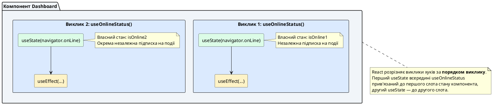
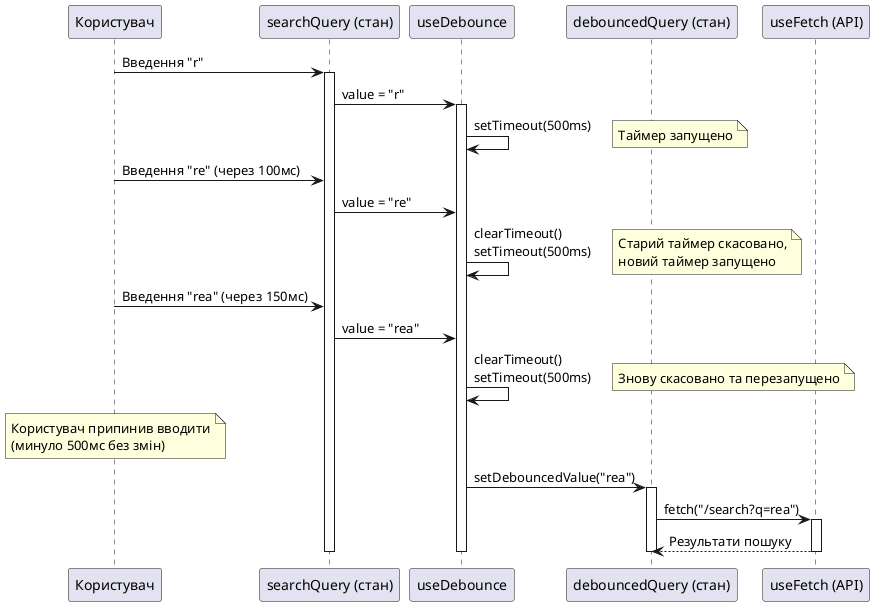

# Кастомні хуки: повторне використання та композиція реактивної логіки

> 🔗 **Офіційний референс:** [Повторне використання логіки з кастомними хуками (Reusing Logic with Custom Hooks)](https://uk.react.dev/learn/reusing-logic-with-custom-hooks)

::card-group

::card{title="🎯 Мета лекції" icon="i-lucide-target"}

- Зрозуміти філософію кастомних хуків як абстракції для повторного використання поведінки.
- Опанувати правила іменування, композиції та ізоляції стану між викликами хуків.
- Навчитися створювати типізовані кастомні хуки для типових сценаріїв (fetch, localStorage, debounce).
- Застосувати архітектурні патерни для організації хуків у великих проєктах.

::

::card{title="🔑 Ключові терміни" icon="i-lucide-key"}

- **Кастомний хук (*Custom Hook*):** TypeScript-функція, що починається з префікса `use` та може викликати інші хуки React.
- **Ізоляція стану (*State Isolation*):** кожен виклик кастомного хука отримує власний незалежний екземпляр стану.
- **Композиція хуків (*Hook Composition*):** побудова складних хуків шляхом комбінування простіших хуків.
- **Інверсія контролю (*Inversion of Control*):** компонент не знає, як реалізована логіка хука — він просто отримує результат.

::

::

---

## Чому існують кастомні хуки?

У попередніх лекціях ми вивчили вбудовані хуки React: `useState`, `useEffect`, `useRef`, `useReducer`, `useContext`. Вони дозволяють компонентам мати стан, синхронізуватися із зовнішніми системами та обмінюватися даними.

Проте, коли проєкт росте, ви починаєте помічати **повторювані патерни реактивної логіки**:

- Відстеження статусу мережевого з'єднання (`navigator.onLine`).
- Завантаження даних з API із обробкою станів `loading`, `error`, `data`.
- Збереження стану у `localStorage` із автоматичною синхронізацією.
- Відкладений (*debounced*) виклик функції при введенні тексту.
- Анімації, таймери, підписки на браузерні події.

Якщо копіювати цю логіку у кожен компонент, де вона потрібна, код стане громіздким, важко тестованим та схильним до помилок.

::note
**Фундаментальна ідея кастомних хуків:**

Якщо **компоненти** відповідають за повторне використання **UI-структури** (JSX-розмітки), то **кастомні хуки** відповідають за повторне використання **поведінки** (стану + ефектів + обчислень).

Кастомний хук інкапсулює складну реактивну логіку та надає простий API для компонентів, які його використовують.
::

---

## Правила створення кастомних хуків

React накладає лише дві суворі вимоги на кастомні хуки:

::steps

### Правило 1: Ім'я функції **завжди** починається з префікса `use`

```tsx
// ✅ ПРАВИЛЬНО
function useOnlineStatus() { ... }
function useFetch(url: string) { ... }
function useDebounce<T>(value: T, delay: number) { ... }

// ❌ НЕПРАВИЛЬНО
function getOnlineStatus() { ... } // Не починається з use
function fetchData(url: string) { ... } // Не починається з use
```

Префікс `use` — це **не конвенція, а технічна вимога**. Лінтер React Hooks перевіряє, що функції, які починаються з `use`, дотримуються правил хуків (виклик лише на верхньому рівні, не всередині умов/циклів). Без цього префікса лінтер не зможе валідувати ваш код.

### Правило 2: Хук може викликати інші хуки React

Всередині кастомного хука можна вільно використовувати:

- Вбудовані хуки: `useState`, `useEffect`, `useRef`, `useMemo`, `useCallback`, `useContext`, тощо.
- Інші кастомні хуки: `useOnlineStatus`, `useFetch`, `useLocalStorage`.

```tsx
function useOnlineStatus() {
  const [isOnline, setIsOnline] = useState(navigator.onLine); // ✅ useState

  useEffect(() => { // ✅ useEffect
    function handleOnline() { setIsOnline(true); }
    function handleOffline() { setIsOnline(false); }

    window.addEventListener("online", handleOnline);
    window.addEventListener("offline", handleOffline);

    return () => {
      window.removeEventListener("online", handleOnline);
      window.removeEventListener("offline", handleOffline);
    };
  }, []);

  return isOnline;
}
```

::

::warning
**Обмеження:**

Кастомні хуки підкоряються **тим самим правилам**, що й вбудовані хуки:

- ❌ Не можна викликати хуки всередині умов, циклів або вкладених функцій.
- ❌ Не можна викликати хуки після раннього повернення (`return`).
- ✅ Хуки завжди мають викликатися у **фіксованому порядку** при кожному рендері.

React покладається на порядок викликів хуків, щоб зв'язати стан із конкретним хуком. Порушення порядку призведе до непередбачуваних багів.
::

---

## Базовий приклад: `useOnlineStatus` — відстеження мережевого з'єднання

Почнемо з найпростішого прикладу — хука, що підписується на браузерні події `online` та `offline` для відстеження статусу з'єднання.

### Реалізація хука

```tsx
import { useState, useEffect } from "react";

export function useOnlineStatus(): boolean {
  // Початковий стан — поточний статус з'єднання
  const [isOnline, setIsOnline] = useState<boolean>(navigator.onLine);

  useEffect(() => {
    // Обробники подій
    function handleOnline() {
      setIsOnline(true);
    }

    function handleOffline() {
      setIsOnline(false);
    }

    // Підписка на події window
    window.addEventListener("online", handleOnline);
    window.addEventListener("offline", handleOffline);

    // Очищення підписок
    return () => {
      window.removeEventListener("online", handleOnline);
      window.removeEventListener("offline", handleOffline);
    };
  }, []); // Порожній масив — підписка створюється один раз

  return isOnline;
}
```

### Використання у компоненті

```tsx
function StatusIndicator() {
  const isOnline = useOnlineStatus(); // Простий виклик хука

  return (
    <div className={`status ${isOnline ? "online" : "offline"}`}>
      {isOnline ? "🟢 Онлайн" : "🔴 Офлайн"}
    </div>
  );
}
```

::tip
**Переваги кастомного хука:**

1. **Інкапсуляція:** Логіка роботи з `navigator.onLine` та браузерними подіями прихована всередині хука. Компонент не знає деталей реалізації.

2. **Повторне використання:** Будь-який компонент може викликати `useOnlineStatus()` — не потрібно копіювати код підписок.

3. **Тестованість:** Хук можна протестувати ізольовано, не рендерячи компонент.

4. **Читабельність:** Компонент виражає намір на високому рівні абстракції: «покажи статус з'єднання», а не «підпишись на події, оновлюй стан, не забудь відписатися».
::

---

## Ізоляція стану: кожен виклик хука має власний стан

Критично важливо зрозуміти: **кастомні хуки ділять логіку, але не ділять стан**. Кожен виклик хука отримує повністю незалежний екземпляр стану.

```tsx
function Dashboard() {
  const isOnline1 = useOnlineStatus(); // Власний стан isOnline
  const isOnline2 = useOnlineStatus(); // Інший незалежний стан isOnline

  // isOnline1 та isOnline2 — це дві різні змінні стану
  // Вони будуть мати однакове значення (true/false), бо обидві
  // читають navigator.onLine, але це окремі виклики useState всередині

  return (
    <div>
      <p>Індикатор 1: {isOnline1 ? "Онлайн" : "Офлайн"}</p>
      <p>Індикатор 2: {isOnline2 ? "Онлайн" : "Офлайн"}</p>
    </div>
  );
}
```

::plant-uml{alt="Ізоляція стану між викликами хука"}



::

Якщо потрібно **ділитися станом** між компонентами, використовуйте:

- **Context API** (`useContext`) для глобального стану.
- **Підйом стану** (*lifting state up*) до спільного батьківського компонента.
- **Зовнішні стор-менеджери** (Redux, Zustand), які ми вивчимо у наступних лекціях.

---

## Типізований хук завантаження даних: `useFetch`

Один із найпоширеніших сценаріїв — завантаження даних з API. Створимо узагальнений (*generic*) хук із підтримкою TypeScript та скасування запитів через `AbortController`.

### Реалізація `useFetch` з повною типізацією

```tsx
import { useState, useEffect } from "react";

interface UseFetchResult<T> {
  data: T | null;
  isLoading: boolean;
  error: string | null;
}

export function useFetch<T>(url: string): UseFetchResult<T> {
  const [data, setData] = useState<T | null>(null);
  const [isLoading, setIsLoading] = useState<boolean>(true);
  const [error, setError] = useState<string | null>(null);

  useEffect(() => {
    // Створюємо AbortController для скасування запиту
    const controller = new AbortController();
    const { signal } = controller;

    async function fetchData(): Promise<void> {
      try {
        setIsLoading(true);
        setError(null);

        const response = await fetch(url, { signal });

        if (!response.ok) {
          throw new Error(`HTTP помилка ${response.status}: ${response.statusText}`);
        }

        const result: T = await response.json();
        setData(result);
      } catch (err) {
        // Ігноруємо AbortError — це нормальне скасування
        if (err instanceof Error && err.name !== "AbortError") {
          setError(err.message);
        }
      } finally {
        // Оновлюємо isLoading лише якщо запит не було скасовано
        if (!signal.aborted) {
          setIsLoading(false);
        }
      }
    }

    fetchData();

    // Функція очищення: скасовує запит при розмонтуванні або зміні URL
    return () => {
      controller.abort();
    };
  }, [url]); // Ефект перезапускається при зміні URL

  return { data, isLoading, error };
}
```

### Використання `useFetch` у компоненті

```tsx
interface User {
  id: number;
  name: string;
  email: string;
}

function UserProfile({ userId }: { userId: number }) {
  const { data: user, isLoading, error } = useFetch<User>(
    `https://api.example.com/users/${userId}`
  );

  if (isLoading) {
    return <div className="spinner">Завантаження...</div>;
  }

  if (error) {
    return <div className="error">Помилка: {error}</div>;
  }

  if (!user) {
    return <div>Користувача не знайдено</div>;
  }

  return (
    <div className="user-card">
      <h2>{user.name}</h2>
      <p>{user.email}</p>
    </div>
  );
}
```

::note
**Чому `useFetch` краще за звичайний `useEffect` у компоненті:**

1. **DRY-принцип:** Логіка `fetch` не дублюється у кожному компоненті.
2. **Безпека:** `AbortController` автоматично скасовує застарілі запити — запобігає race conditions.
3. **Типізація:** TypeScript знає структуру `data` завдяки дженерику `<User>`.
4. **Стандартизація:** Усі компоненти обробляють стани `loading`, `error`, `data` однаково.
::

---

## Хук синхронізації з localStorage: `useLocalStorage`

Створимо хук, що зберігає стан у `localStorage` та автоматично синхронізує його між вкладками браузера.

### Реалізація `useLocalStorage`

```tsx
import { useState, useEffect } from "react";

export function useLocalStorage<T>(
  key: string,
  initialValue: T
): [T, (value: T | ((prev: T) => T)) => void] {
  // Ініціалізація стану: спочатку читаємо з localStorage
  const [storedValue, setStoredValue] = useState<T>(() => {
    try {
      const item = window.localStorage.getItem(key);
      return item ? (JSON.parse(item) as T) : initialValue;
    } catch (error) {
      console.error(`Помилка читання з localStorage (ключ: ${key}):`, error);
      return initialValue;
    }
  });

  // Функція оновлення стану з записом у localStorage
  const setValue = (value: T | ((prev: T) => T)) => {
    try {
      // Підтримка функціонального оновлення
      const valueToStore = value instanceof Function ? value(storedValue) : value;

      setStoredValue(valueToStore);

      // Записуємо у localStorage
      window.localStorage.setItem(key, JSON.stringify(valueToStore));
    } catch (error) {
      console.error(`Помилка запису у localStorage (ключ: ${key}):`, error);
    }
  };

  // Синхронізація між вкладками браузера
  useEffect(() => {
    function handleStorageChange(event: StorageEvent) {
      if (event.key === key && event.newValue !== null) {
        try {
          setStoredValue(JSON.parse(event.newValue) as T);
        } catch (error) {
          console.error("Помилка парсингу події storage:", error);
        }
      }
    }

    window.addEventListener("storage", handleStorageChange);

    return () => {
      window.removeEventListener("storage", handleStorageChange);
    };
  }, [key]);

  return [storedValue, setValue];
}
```

### Використання `useLocalStorage`

```tsx
function ThemeSelector() {
  const [theme, setTheme] = useLocalStorage<"light" | "dark">("theme", "light");

  function toggleTheme() {
    setTheme((prevTheme) => (prevTheme === "light" ? "dark" : "light"));
  }

  return (
    <div className={`app ${theme}`}>
      <button onClick={toggleTheme}>
        {theme === "light" ? "🌙 Темна тема" : "☀️ Світла тема"}
      </button>
    </div>
  );
}
```

::tip
**Магія синхронізації між вкладками:**

Коли користувач змінює тему в одній вкладці, подія `storage` автоматично спрацьовує в усіх інших відкритих вкладках того самого домену. Хук підписується на цю подію і оновлює стан — тема змінюється у всіх вкладках миттєво, без запитів до сервера.
::

---

## Хук відкладеного виклику: `useDebounce`

При введенні тексту у пошукове поле не варто викликати API після кожного натискання клавіші — це створить сотні зайвих запитів. **Debounce** відкладає виконання функції до моменту, коли користувач припинить вводити текст на певний час.

### Реалізація `useDebounce`

```tsx
import { useState, useEffect } from "react";

export function useDebounce<T>(value: T, delay: number): T {
  const [debouncedValue, setDebouncedValue] = useState<T>(value);

  useEffect(() => {
    // Створюємо таймер, що оновить debouncedValue через delay мілісекунд
    const timerId = setTimeout(() => {
      setDebouncedValue(value);
    }, delay);

    // Очищаємо таймер при кожній зміні value (користувач продовжує вводити)
    return () => {
      clearTimeout(timerId);
    };
  }, [value, delay]);

  return debouncedValue;
}
```

### Використання `useDebounce` для пошуку

```tsx
function SearchBar() {
  const [searchQuery, setSearchQuery] = useState("");
  const debouncedQuery = useDebounce(searchQuery, 500); // 500мс затримка

  const { data: results, isLoading } = useFetch<string[]>(
    debouncedQuery
      ? `https://api.example.com/search?q=${debouncedQuery}`
      : ""
  );

  return (
    <div>
      <input
        type="text"
        value={searchQuery}
        onChange={(e) => setSearchQuery(e.target.value)}
        placeholder="Введіть запит..."
      />

      {isLoading && <p>Пошук...</p>}

      {results && (
        <ul>
          {results.map((item, i) => (
            <li key={i}>{item}</li>
          ))}
        </ul>
      )}
    </div>
  );
}
```

::plant-uml{alt="Діаграма роботи useDebounce"}



::

**Що відбувається:**

1. Користувач вводить `"r"`, `"re"`, `"rea"` швидко (менше 500мс між натисканнями).
2. Кожне введення скидає таймер через `clearTimeout`.
3. Коли користувач припиняє вводити на 500мс, таймер спрацьовує і оновлює `debouncedQuery`.
4. `useFetch` бачить зміну `debouncedQuery` і виконує **один** запит до API.

**Результат:** Замість 3 запитів (`r`, `re`, `rea`) — лише 1 запит (`rea`).

---


## Композиція хуків: побудова складних хуків із простих

Одна з найпотужніших властивостей кастомних хуків — їхня **композиційність** (*composability*). Складні хуки можна будувати, комбінуючи простіші хуки.

### Приклад: `useSearchWithDebounce` — композиція `useDebounce` та `useFetch`

```tsx
interface UseSearchResult<T> {
  query: string;
  setQuery: (value: string) => void;
  results: T | null;
  isLoading: boolean;
  error: string | null;
}

export function useSearchWithDebounce<T>(
  baseUrl: string,
  delay: number = 500
): UseSearchResult<T> {
  const [query, setQuery] = useState("");
  
  // Композиція хука useDebounce
  const debouncedQuery = useDebounce(query, delay);
  
  // Композиція хука useFetch
  const { data: results, isLoading, error } = useFetch<T>(
    debouncedQuery ? `${baseUrl}?q=${debouncedQuery}` : ""
  );

  return {
    query,
    setQuery,
    results,
    isLoading,
    error,
  };
}
```

### Використання композитного хука

```tsx
interface SearchResult {
  items: string[];
  total: number;
}

function SearchComponent() {
  const { query, setQuery, results, isLoading, error } =
    useSearchWithDebounce<SearchResult>("https://api.example.com/search");

  return (
    <div>
      <input
        type="text"
        value={query}
        onChange={(e) => setQuery(e.target.value)}
        placeholder="Пошук..."
      />

      {isLoading && <p>Пошук...</p>}
      {error && <p className="error">{error}</p>}

      {results && (
        <div>
          <p>Знайдено: {results.total}</p>
          <ul>
            {results.items.map((item, i) => (
              <li key={i}>{item}</li>
            ))}
          </ul>
        </div>
      )}
    </div>
  );
}
```

::tip
**Переваги композиції:**

1. **Модульність:** `useSearchWithDebounce` побудовано з двох незалежних хуків (`useDebounce` + `useFetch`), які можна використовувати окремо.

2. **Тестованість:** Кожен простий хук можна протестувати ізольовано. Тест складного хука може покладатися на перевірені прості хуки.

3. **Підтримуваність:** Якщо логіка `useFetch` змінюється (наприклад, додаємо кешування), усі композитні хуки автоматично отримають це покращення.
::

---

## Хук відстеження розміру вікна: `useWindowSize`

Ще один корисний приклад — хук для responsive-дизайну, що відстежує ширину та висоту вікна браузера.

### Реалізація `useWindowSize`

```tsx
import { useState, useEffect } from "react";

interface WindowSize {
  width: number;
  height: number;
}

export function useWindowSize(): WindowSize {
  const [windowSize, setWindowSize] = useState<WindowSize>({
    width: window.innerWidth,
    height: window.innerHeight,
  });

  useEffect(() => {
    function handleResize() {
      setWindowSize({
        width: window.innerWidth,
        height: window.innerHeight,
      });
    }

    // Підписка на зміну розміру вікна
    window.addEventListener("resize", handleResize);

    return () => {
      window.removeEventListener("resize", handleResize);
    };
  }, []);

  return windowSize;
}
```

### Використання для адаптивного UI

```tsx
function ResponsiveLayout() {
  const { width } = useWindowSize();

  // Визначаємо breakpoints
  const isMobile = width < 768;
  const isTablet = width >= 768 && width < 1024;
  const isDesktop = width >= 1024;

  return (
    <div className="layout">
      {isMobile && <MobileNavigation />}
      {isTablet && <TabletNavigation />}
      {isDesktop && <DesktopNavigation />}

      <main>
        <p>Ширина вікна: {width}px</p>
        <p>Пристрій: {isMobile ? "Мобільний" : isTablet ? "Планшет" : "Десктоп"}</p>
      </main>
    </div>
  );
}
```

::note
**Оптимізація продуктивності:**

Подія `resize` може спрацьовувати десятки разів за секунду при перетягуванні вікна. Для продакшн-застосунків рекомендується комбінувати `useWindowSize` із `useDebounce` або використовувати `throttle` (обмеження частоти викликів).

```tsx
function useWindowSizeOptimized(): WindowSize {
  const rawSize = useWindowSize();
  const debouncedSize = useDebounce(rawSize, 200); // Затримка 200мс
  return debouncedSize;
}
```
::

---

## Практичні завдання для закріплення

::::accordion

:::accordion-item{label="📋 Завдання 1: Хук автозбереження форми" icon="i-lucide-clipboard-list"}

Створіть хук `useAutoSave`, що автоматично зберігає значення поля форми у `localStorage` через 2 секунди після останнього введення (debounce).

**Вимоги:**

- Хук приймає `key: string` (ключ для localStorage) та `initialValue: string`.
- Повертає кортеж `[value, setValue, isSaving]`, де `isSaving` вказує, чи відбувається збереження.
- Використовує композицію `useLocalStorage` та `useDebounce`.

**Сигнатура:**

```tsx
function useAutoSave(
  key: string,
  initialValue: string
): [string, (value: string) => void, boolean] {
  // Ваша реалізація
}
```

:::

:::accordion-item{label="✅ Розв'язок завдання 1" icon="i-lucide-check-circle"}

```tsx
import { useState, useEffect } from "react";

function useAutoSave(
  key: string,
  initialValue: string
): [string, (value: string) => void, boolean] {
  // Стан поточного значення (змінюється при кожному введенні)
  const [value, setValue] = useState<string>(() => {
    const stored = localStorage.getItem(key);
    return stored !== null ? stored : initialValue;
  });

  // Відкладене значення (оновлюється через 2 секунди після останнього введення)
  const [debouncedValue, setDebouncedValue] = useState<string>(value);

  // Індикатор збереження
  const [isSaving, setIsSaving] = useState<boolean>(false);

  // Debounce для value
  useEffect(() => {
    const timerId = setTimeout(() => {
      setDebouncedValue(value);
    }, 2000);

    return () => clearTimeout(timerId);
  }, [value]);

  // Збереження у localStorage при зміні debouncedValue
  useEffect(() => {
    if (debouncedValue !== value) {
      return; // Якщо значення ще не debounced — не зберігаємо
    }

    setIsSaving(true);
    
    // Імітація асинхронного збереження (у реальному застосунку — fetch)
    const saveTimer = setTimeout(() => {
      localStorage.setItem(key, debouncedValue);
      console.log(`✅ Збережено у localStorage: ${key} = "${debouncedValue}"`);
      setIsSaving(false);
    }, 500);

    return () => clearTimeout(saveTimer);
  }, [debouncedValue, key, value]);

  return [value, setValue, isSaving];
}

// Використання
function AutoSaveForm() {
  const [text, setText, isSaving] = useAutoSave("draft", "");

  return (
    <div>
      <textarea
        value={text}
        onChange={(e) => setText(e.target.value)}
        placeholder="Введіть текст..."
        rows={5}
        style={{ width: "100%", padding: "0.5rem" }}
      />
      {isSaving && <p className="saving-indicator">💾 Збереження...</p>}
      {!isSaving && text && <p className="saved-indicator">✅ Збережено</p>}
    </div>
  );
}
```

**Покрокове пояснення:**

1. **`useState(value)`** — основний стан, що оновлюється при кожному натисканні клавіші.

2. **`useState(debouncedValue)`** — відкладений стан, що оновлюється через 2 секунди після останнього введення.

3. **Перший `useEffect`** — створює таймер при кожній зміні `value`. Якщо користувач продовжує вводити (таймер скидається), `debouncedValue` не оновлюється.

4. **Другий `useEffect`** — спрацьовує, коли `debouncedValue` змінюється. Це означає, що користувач припинив вводити на 2 секунди. Тоді відбувається збереження у `localStorage`.

5. **`isSaving`** — індикатор стану збереження для відображення спінера у UI.

:::

:::accordion-item{label="📋 Завдання 2: Хук інтервального опитування API" icon="i-lucide-clipboard-list"}

Створіть хук `usePolling`, що виконує HTTP-запит до API кожні N секунд (polling) і автоматично зупиняється при розмонтуванні компонента.

**Вимоги:**

- Хук приймає `url: string` та `intervalMs: number`.
- Повертає `{ data, isLoading, error }`.
- Перший запит виконується негайно, наступні — через інтервал.
- При зміні `url` або `intervalMs` таймер перестворюється.

**Сигнатура:**

```tsx
function usePolling<T>(url: string, intervalMs: number): {
  data: T | null;
  isLoading: boolean;
  error: string | null;
} {
  // Ваша реалізація
}
```

:::

:::accordion-item{label="✅ Розв'язок завдання 2" icon="i-lucide-check-circle"}

```tsx
import { useState, useEffect, useRef } from "react";

function usePolling<T>(url: string, intervalMs: number): {
  data: T | null;
  isLoading: boolean;
  error: string | null;
} {
  const [data, setData] = useState<T | null>(null);
  const [isLoading, setIsLoading] = useState<boolean>(true);
  const [error, setError] = useState<string | null>(null);

  // Реф для зберігання функції fetch (уникаємо застарілих замикань)
  const fetchDataRef = useRef<() => Promise<void>>();

  fetchDataRef.current = async () => {
    try {
      setIsLoading(true);
      setError(null);

      const response = await fetch(url);

      if (!response.ok) {
        throw new Error(`HTTP ${response.status}: ${response.statusText}`);
      }

      const result: T = await response.json();
      setData(result);
    } catch (err) {
      if (err instanceof Error) {
        setError(err.message);
      }
    } finally {
      setIsLoading(false);
    }
  };

  useEffect(() => {
    // Перший запит негайно
    fetchDataRef.current?.();

    // Наступні запити через інтервал
    const intervalId = setInterval(() => {
      fetchDataRef.current?.();
    }, intervalMs);

    return () => {
      clearInterval(intervalId);
    };
  }, [url, intervalMs]);

  return { data, isLoading, error };
}

// Використання
interface ServerStatus {
  status: "online" | "offline";
  uptime: number;
  lastCheck: string;
}

function ServerMonitor() {
  const { data, isLoading, error } = usePolling<ServerStatus>(
    "https://api.example.com/status",
    5000 // Опитування кожні 5 секунд
  );

  if (error) {
    return <div className="error">Помилка: {error}</div>;
  }

  return (
    <div className="monitor">
      {isLoading && !data && <p>Ініціалізація...</p>}
      
      {data && (
        <>
          <h2>Статус сервера: {data.status === "online" ? "🟢 Онлайн" : "🔴 Офлайн"}</h2>
          <p>Uptime: {data.uptime} секунд</p>
          <p>Остання перевірка: {data.lastCheck}</p>
        </>
      )}
      
      {isLoading && <span className="refresh-indicator">🔄 Оновлення...</span>}
    </div>
  );
}
```

**Покрокове пояснення:**

1. **`fetchDataRef.current = async () => { ... }`** — зберігаємо функцію завантаження даних у рефі. Це дозволяє `setInterval` завжди викликати актуальну версію функції, яка має свіжі значення `url` із замикання.

2. **`fetchDataRef.current?.()`** — перший виклик відбувається негайно при монтуванні або зміні `url`/`intervalMs`.

3. **`setInterval(() => { fetchDataRef.current?.(); }, intervalMs)`** — створюємо таймер, що викликає функцію кожні `intervalMs` мілісекунд.

4. **`clearInterval(intervalId)`** — очищаємо таймер при розмонтуванні або зміні залежностей.

**Результат:** Компонент автоматично опитує API кожні 5 секунд, показуючи актуальний статус сервера без ручного оновлення сторінки.

:::

::::

---

## Архітектурні патерни організації кастомних хуків

У великих проєктах кількість кастомних хуків може зрости до десятків або сотень. Важливо організувати їх структуровано.

### Рекомендована структура папок

```text
src/
├── hooks/
│   ├── api/
│   │   ├── useFetch.ts
│   │   ├── usePolling.ts
│   │   └── useMutation.ts
│   ├── browser/
│   │   ├── useOnlineStatus.ts
│   │   ├── useWindowSize.ts
│   │   └── useMediaQuery.ts
│   ├── form/
│   │   ├── useFormValidation.ts
│   │   ├── useAutoSave.ts
│   │   └── useDebounce.ts
│   ├── storage/
│   │   ├── useLocalStorage.ts
│   │   └── useSessionStorage.ts
│   └── index.ts  // Barrel export
├── components/
└── ...
```

**Barrel export (`src/hooks/index.ts`):**

```tsx
// API хуки
export { useFetch } from "./api/useFetch";
export { usePolling } from "./api/usePolling";
export { useMutation } from "./api/useMutation";

// Browser хуки
export { useOnlineStatus } from "./browser/useOnlineStatus";
export { useWindowSize } from "./browser/useWindowSize";
export { useMediaQuery } from "./browser/useMediaQuery";

// Form хуки
export { useFormValidation } from "./form/useFormValidation";
export { useAutoSave } from "./form/useAutoSave";
export { useDebounce } from "./form/useDebounce";

// Storage хуки
export { useLocalStorage } from "./storage/useLocalStorage";
export { useSessionStorage } from "./storage/useSessionStorage";
```

**Використання:**

```tsx
import { useFetch, useOnlineStatus, useLocalStorage } from "@/hooks";
```

---

## Тестування кастомних хуків

Кастомні хуки можна тестувати ізольовано за допомогою `@testing-library/react-hooks` (для React ≤ 18) або `@testing-library/react` (для React 19+).

### Приклад тесту для `useDebounce`

```tsx
import { renderHook, act } from "@testing-library/react";
import { useDebounce } from "./useDebounce";

describe("useDebounce", () => {
  beforeEach(() => {
    jest.useFakeTimers();
  });

  afterEach(() => {
    jest.useRealTimers();
  });

  it("повертає початкове значення негайно", () => {
    const { result } = renderHook(() => useDebounce("initial", 500));
    expect(result.current).toBe("initial");
  });

  it("оновлює значення після затримки", () => {
    const { result, rerender } = renderHook(
      ({ value, delay }) => useDebounce(value, delay),
      { initialProps: { value: "first", delay: 500 } }
    );

    expect(result.current).toBe("first");

    // Змінюємо value
    rerender({ value: "second", delay: 500 });

    // Значення ще не оновилося
    expect(result.current).toBe("first");

    // Прокручуємо час на 500мс
    act(() => {
      jest.advanceTimersByTime(500);
    });

    // Тепер значення оновилося
    expect(result.current).toBe("second");
  });

  it("скидає таймер при повторній зміні", () => {
    const { result, rerender } = renderHook(
      ({ value }) => useDebounce(value, 500),
      { initialProps: { value: "a" } }
    );

    rerender({ value: "b" });
    act(() => { jest.advanceTimersByTime(300); });

    rerender({ value: "c" });
    act(() => { jest.advanceTimersByTime(300); });

    // Значення досі "a", бо таймер постійно скидався
    expect(result.current).toBe("a");

    // Тепер чекаємо повні 500мс
    act(() => { jest.advanceTimersByTime(500); });

    // Значення оновилося до останнього
    expect(result.current).toBe("c");
  });
});
```

---

## Інтерактивна демонстрація: композиція хуків

::react-project-preview{title="Кастомні хуки у дії" entry="src/App.tsx" :height="720"}

```tsx [src/App.tsx]
import { useState } from 'react';
import { OnlineStatusDemo } from './components/OnlineStatusDemo';
import { SearchDemo } from './components/SearchDemo';
import { ThemeDemo } from './components/ThemeDemo';
import './styles.css';

export default function App() {
  const [activeDemo, setActiveDemo] = useState<'online' | 'search' | 'theme'>('online');

  return (
    <div className="app">
      <header className="header">
        <h1>🎣 Кастомні хуки React</h1>
        <nav className="demo-tabs">
          <button
            className={activeDemo === 'online' ? 'active' : ''}
            onClick={() => setActiveDemo('online')}
          >
            📡 Online Status
          </button>
          <button
            className={activeDemo === 'search' ? 'active' : ''}
            onClick={() => setActiveDemo('search')}
          >
            🔍 Search + Debounce
          </button>
          <button
            className={activeDemo === 'theme' ? 'active' : ''}
            onClick={() => setActiveDemo('theme')}
          >
            🎨 LocalStorage
          </button>
        </nav>
      </header>

      <main className="main">
        {activeDemo === 'online' && <OnlineStatusDemo />}
        {activeDemo === 'search' && <SearchDemo />}
        {activeDemo === 'theme' && <ThemeDemo />}
      </main>
    </div>
  );
}
```

```tsx [src/components/OnlineStatusDemo.tsx]
import { useOnlineStatus } from '../hooks/useOnlineStatus';

export function OnlineStatusDemo() {
  const isOnline = useOnlineStatus();

  return (
    <div className="demo-card">
      <h2>Відстеження статусу з'єднання</h2>
      <div className={`status-indicator ${isOnline ? 'online' : 'offline'}`}>
        <div className="status-dot"></div>
        <span className="status-text">
          {isOnline ? '🟢 Ви онлайн' : '🔴 Ви офлайн'}
        </span>
      </div>
      <p className="hint">
        💡 Спробуйте вимкнути мережу у DevTools (Network → Offline)
      </p>
      <div className="code-preview">
        <code>const isOnline = useOnlineStatus();</code>
      </div>
    </div>
  );
}
```

```tsx [src/components/SearchDemo.tsx]
import { useState } from 'react';
import { useDebounce } from '../hooks/useDebounce';

const MOCK_RESULTS = [
  'React Hooks',
  'React Router',
  'React Context',
  'React Query',
  'React Testing Library',
  'React Spring',
  'React Native',
];

export function SearchDemo() {
  const [query, setQuery] = useState('');
  const debouncedQuery = useDebounce(query, 500);

  const results = debouncedQuery
    ? MOCK_RESULTS.filter((item) =>
        item.toLowerCase().includes(debouncedQuery.toLowerCase())
      )
    : [];

  return (
    <div className="demo-card">
      <h2>Пошук із затримкою (Debounce)</h2>
      <input
        type="text"
        className="search-input"
        value={query}
        onChange={(e) => setQuery(e.target.value)}
        placeholder="Введіть пошуковий запит..."
      />
      <div className="search-info">
        <p>Поточний запит: <strong>{query || '(порожньо)'}</strong></p>
        <p>Debounced запит: <strong>{debouncedQuery || '(порожньо)'}</strong></p>
      </div>
      {results.length > 0 && (
        <ul className="search-results">
          {results.map((item) => (
            <li key={item}>{item}</li>
          ))}
        </ul>
      )}
      <p className="hint">
        💡 API-запит виконується лише після 500мс без змін
      </p>
      <div className="code-preview">
        <code>const debouncedQuery = useDebounce(query, 500);</code>
      </div>
    </div>
  );
}
```

```tsx [src/components/ThemeDemo.tsx]
import { useLocalStorage } from '../hooks/useLocalStorage';

export function ThemeDemo() {
  const [theme, setTheme] = useLocalStorage<'light' | 'dark'>('demo-theme', 'light');
  const [count, setCount] = useLocalStorage<number>('demo-count', 0);

  return (
    <div className={`demo-card theme-${theme}`}>
      <h2>Синхронізація з LocalStorage</h2>
      
      <div className="theme-controls">
        <button
          className="theme-btn"
          onClick={() => setTheme(theme === 'light' ? 'dark' : 'light')}
        >
          {theme === 'light' ? '🌙 Темна тема' : '☀️ Світла тема'}
        </button>
      </div>

      <div className="counter">
        <p>Лічильник: <strong>{count}</strong></p>
        <div className="counter-controls">
          <button onClick={() => setCount(count + 1)}>+1</button>
          <button onClick={() => setCount(count - 1)}>-1</button>
          <button onClick={() => setCount(0)}>Скинути</button>
        </div>
      </div>

      <p className="hint">
        💡 Оновіть сторінку — дані збережуться!
      </p>
      <div className="code-preview">
        <code>const [theme, setTheme] = useLocalStorage('theme', 'light');</code>
      </div>
    </div>
  );
}
```

```tsx [src/hooks/useOnlineStatus.ts]
import { useState, useEffect } from 'react';

export function useOnlineStatus(): boolean {
  const [isOnline, setIsOnline] = useState(navigator.onLine);

  useEffect(() => {
    function handleOnline() {
      setIsOnline(true);
    }

    function handleOffline() {
      setIsOnline(false);
    }

    window.addEventListener('online', handleOnline);
    window.addEventListener('offline', handleOffline);

    return () => {
      window.removeEventListener('online', handleOnline);
      window.removeEventListener('offline', handleOffline);
    };
  }, []);

  return isOnline;
}
```

```tsx [src/hooks/useDebounce.ts]
import { useState, useEffect } from 'react';

export function useDebounce<T>(value: T, delay: number): T {
  const [debouncedValue, setDebouncedValue] = useState<T>(value);

  useEffect(() => {
    const timerId = setTimeout(() => {
      setDebouncedValue(value);
    }, delay);

    return () => clearTimeout(timerId);
  }, [value, delay]);

  return debouncedValue;
}
```

```tsx [src/hooks/useLocalStorage.ts]
import { useState, useEffect } from 'react';

export function useLocalStorage<T>(
  key: string,
  initialValue: T
): [T, (value: T | ((prev: T) => T)) => void] {
  const [storedValue, setStoredValue] = useState<T>(() => {
    try {
      const item = window.localStorage.getItem(key);
      return item ? (JSON.parse(item) as T) : initialValue;
    } catch {
      return initialValue;
    }
  });

  const setValue = (value: T | ((prev: T) => T)) => {
    try {
      const valueToStore = value instanceof Function ? value(storedValue) : value;
      setStoredValue(valueToStore);
      window.localStorage.setItem(key, JSON.stringify(valueToStore));
    } catch (error) {
      console.error('Помилка запису у localStorage:', error);
    }
  };

  useEffect(() => {
    function handleStorageChange(event: StorageEvent) {
      if (event.key === key && event.newValue !== null) {
        try {
          setStoredValue(JSON.parse(event.newValue) as T);
        } catch {}
      }
    }

    window.addEventListener('storage', handleStorageChange);
    return () => window.removeEventListener('storage', handleStorageChange);
  }, [key]);

  return [storedValue, setValue];
}
```

```css [src/styles.css]
* {
  box-sizing: border-box;
  margin: 0;
  padding: 0;
}

.app {
  min-height: 100vh;
  background: linear-gradient(135deg, #667eea 0%, #764ba2 100%);
  font-family: system-ui, -apple-system, sans-serif;
}

.header {
  padding: 2rem;
  background: rgba(255, 255, 255, 0.1);
  backdrop-filter: blur(10px);
  border-bottom: 1px solid rgba(255, 255, 255, 0.2);
}

.header h1 {
  color: white;
  font-size: 1.75rem;
  margin-bottom: 1rem;
  text-align: center;
}

.demo-tabs {
  display: flex;
  gap: 0.5rem;
  justify-content: center;
  flex-wrap: wrap;
}

.demo-tabs button {
  padding: 0.75rem 1.5rem;
  border: none;
  border-radius: 0.5rem;
  background: rgba(255, 255, 255, 0.2);
  color: white;
  font-weight: 600;
  cursor: pointer;
  transition: all 0.2s;
}

.demo-tabs button:hover {
  background: rgba(255, 255, 255, 0.3);
}

.demo-tabs button.active {
  background: white;
  color: #667eea;
}

.main {
  padding: 2rem;
  display: flex;
  justify-content: center;
  align-items: center;
  min-height: calc(100vh - 180px);
}

.demo-card {
  max-width: 600px;
  width: 100%;
  padding: 2rem;
  background: white;
  border-radius: 1rem;
  box-shadow: 0 20px 60px rgba(0, 0, 0, 0.3);
}

.demo-card h2 {
  font-size: 1.5rem;
  margin-bottom: 1.5rem;
  color: #1e293b;
}

.status-indicator {
  display: flex;
  align-items: center;
  gap: 1rem;
  padding: 1.5rem;
  border-radius: 0.75rem;
  margin-bottom: 1rem;
}

.status-indicator.online {
  background: #dcfce7;
  border: 2px solid #22c55e;
}

.status-indicator.offline {
  background: #fee2e2;
  border: 2px solid #ef4444;
}

.status-dot {
  width: 16px;
  height: 16px;
  border-radius: 50%;
}

.status-indicator.online .status-dot {
  background: #22c55e;
  box-shadow: 0 0 12px #22c55e;
}

.status-indicator.offline .status-dot {
  background: #ef4444;
  box-shadow: 0 0 12px #ef4444;
}

.status-text {
  font-size: 1.25rem;
  font-weight: 600;
}

.search-input {
  width: 100%;
  padding: 0.75rem 1rem;
  font-size: 1rem;
  border: 2px solid #e2e8f0;
  border-radius: 0.5rem;
  margin-bottom: 1rem;
}

.search-input:focus {
  outline: none;
  border-color: #667eea;
}

.search-info {
  padding: 1rem;
  background: #f1f5f9;
  border-radius: 0.5rem;
  margin-bottom: 1rem;
}

.search-info p {
  margin: 0.25rem 0;
  font-size: 0.9rem;
  color: #475569;
}

.search-results {
  list-style: none;
  padding: 0;
  margin: 1rem 0;
}

.search-results li {
  padding: 0.75rem 1rem;
  background: #f8fafc;
  border-left: 3px solid #667eea;
  margin-bottom: 0.5rem;
  border-radius: 0.25rem;
}

.theme-controls {
  margin-bottom: 1.5rem;
}

.theme-btn {
  padding: 0.75rem 1.5rem;
  border: none;
  border-radius: 0.5rem;
  background: #667eea;
  color: white;
  font-weight: 600;
  cursor: pointer;
  transition: all 0.2s;
}

.theme-btn:hover {
  background: #5568d3;
}

.demo-card.theme-dark {
  background: #1e293b;
  color: white;
}

.demo-card.theme-dark h2 {
  color: white;
}

.demo-card.theme-dark .search-info {
  background: #334155;
  color: #e2e8f0;
}

.counter {
  margin-bottom: 1.5rem;
}

.counter p {
  font-size: 1.25rem;
  margin-bottom: 1rem;
}

.counter-controls {
  display: flex;
  gap: 0.5rem;
}

.counter-controls button {
  padding: 0.5rem 1rem;
  border: 2px solid #e2e8f0;
  border-radius: 0.5rem;
  background: white;
  cursor: pointer;
  transition: all 0.2s;
}

.counter-controls button:hover {
  border-color: #667eea;
  color: #667eea;
}

.hint {
  margin: 1rem 0;
  padding: 0.75rem;
  background: #fef3c7;
  border-left: 3px solid #f59e0b;
  border-radius: 0.25rem;
  font-size: 0.9rem;
  color: #92400e;
}

.code-preview {
  margin-top: 1.5rem;
  padding: 1rem;
  background: #1e293b;
  border-radius: 0.5rem;
  overflow-x: auto;
}

.code-preview code {
  color: #e2e8f0;
  font-family: 'Courier New', monospace;
  font-size: 0.9rem;
}
```

::

---


## Просунуті патерни: хуки з параметрами конфігурації

Коли хук стає складнішим, передача безлічі окремих параметрів стає незручною. У таких випадках використовують **об'єкт конфігурації**.

### Приклад: `useFetchWithConfig`

```tsx
interface FetchConfig {
  method?: 'GET' | 'POST' | 'PUT' | 'DELETE';
  headers?: Record<string, string>;
  body?: any;
  enabled?: boolean; // Чи автоматично виконувати запит
  refetchInterval?: number; // Автоматичне повторне завантаження
  onSuccess?: (data: any) => void;
  onError?: (error: Error) => void;
}

interface UseFetchWithConfigResult<T> {
  data: T | null;
  isLoading: boolean;
  error: string | null;
  refetch: () => void;
}

export function useFetchWithConfig<T>(
  url: string,
  config: FetchConfig = {}
): UseFetchWithConfigResult<T> {
  const {
    method = 'GET',
    headers = {},
    body,
    enabled = true,
    refetchInterval,
    onSuccess,
    onError,
  } = config;

  const [data, setData] = useState<T | null>(null);
  const [isLoading, setIsLoading] = useState<boolean>(false);
  const [error, setError] = useState<string | null>(null);
  const [refetchTrigger, setRefetchTrigger] = useState<number>(0);

  useEffect(() => {
    if (!enabled) return;

    const controller = new AbortController();

    async function fetchData(): Promise<void> {
      try {
        setIsLoading(true);
        setError(null);

        const options: RequestInit = {
          method,
          headers: {
            'Content-Type': 'application/json',
            ...headers,
          },
          signal: controller.signal,
        };

        if (body && method !== 'GET') {
          options.body = JSON.stringify(body);
        }

        const response = await fetch(url, options);

        if (!response.ok) {
          throw new Error(`HTTP ${response.status}: ${response.statusText}`);
        }

        const result: T = await response.json();
        setData(result);

        if (onSuccess) {
          onSuccess(result);
        }
      } catch (err) {
        if (err instanceof Error && err.name !== 'AbortError') {
          setError(err.message);
          if (onError) {
            onError(err);
          }
        }
      } finally {
        if (!controller.signal.aborted) {
          setIsLoading(false);
        }
      }
    }

    fetchData();

    // Автоматичне повторне завантаження
    let intervalId: NodeJS.Timeout | undefined;
    if (refetchInterval) {
      intervalId = setInterval(() => {
        fetchData();
      }, refetchInterval);
    }

    return () => {
      controller.abort();
      if (intervalId) {
        clearInterval(intervalId);
      }
    };
  }, [url, method, enabled, refetchTrigger, refetchInterval]);

  const refetch = () => {
    setRefetchTrigger((prev) => prev + 1);
  };

  return { data, isLoading, error, refetch };
}
```

### Використання з конфігурацією

```tsx
interface Product {
  id: number;
  name: string;
  price: number;
}

function ProductList() {
  const [enabled, setEnabled] = useState(true);

  const { data, isLoading, error, refetch } = useFetchWithConfig<Product[]>(
    'https://api.example.com/products',
    {
      enabled,
      refetchInterval: 30000, // Автооновлення кожні 30 секунд
      headers: {
        Authorization: 'Bearer token123',
      },
      onSuccess: (products) => {
        console.log(`Завантажено ${products.length} товарів`);
      },
      onError: (err) => {
        console.error('Помилка завантаження:', err);
      },
    }
  );

  return (
    <div>
      <div className="controls">
        <button onClick={() => setEnabled(!enabled)}>
          {enabled ? 'Вимкнути' : 'Увімкнути'} автозавантаження
        </button>
        <button onClick={refetch} disabled={!enabled}>
          🔄 Оновити вручну
        </button>
      </div>

      {isLoading && <p>Завантаження...</p>}
      {error && <p className="error">{error}</p>}

      {data && (
        <ul>
          {data.map((product) => (
            <li key={product.id}>
              {product.name} — {product.price} грн
            </li>
          ))}
        </ul>
      )}
    </div>
  );
}
```

::tip
**Переваги об'єкта конфігурації:**

1. **Читабельність:** Явні назви параметрів у виклику хука.
2. **Розширюваність:** Легко додати нові опції без зміни сигнатури функції.
3. **Опціональність:** Більшість параметрів мають значення за замовчуванням.
4. **TypeScript-підказки:** IDE показує всі доступні опції при автодоповненні.
::

---

## Хук для роботи з формами: `useForm`

Створимо універсальний хук для управління станом форми із валідацією.

### Реалізація `useForm`

```tsx
interface ValidationRule<T> {
  validate: (value: T) => boolean;
  message: string;
}

interface FieldConfig<T> {
  initialValue: T;
  rules?: ValidationRule<T>[];
}

interface UseFormResult<T> {
  values: T;
  errors: Partial<Record<keyof T, string>>;
  touched: Partial<Record<keyof T, boolean>>;
  handleChange: (field: keyof T) => (value: any) => void;
  handleBlur: (field: keyof T) => () => void;
  handleSubmit: (onSubmit: (values: T) => void) => (e: React.FormEvent) => void;
  reset: () => void;
  isValid: boolean;
}

export function useForm<T extends Record<string, any>>(
  config: Record<keyof T, FieldConfig<T[keyof T]>>
): UseFormResult<T> {
  const initialValues = Object.keys(config).reduce((acc, key) => {
    acc[key as keyof T] = config[key as keyof T].initialValue;
    return acc;
  }, {} as T);

  const [values, setValues] = useState<T>(initialValues);
  const [errors, setErrors] = useState<Partial<Record<keyof T, string>>>({});
  const [touched, setTouched] = useState<Partial<Record<keyof T, boolean>>>({});

  const validateField = (field: keyof T, value: any): string | null => {
    const rules = config[field].rules;
    if (!rules) return null;

    for (const rule of rules) {
      if (!rule.validate(value)) {
        return rule.message;
      }
    }
    return null;
  };

  const handleChange = (field: keyof T) => (value: any) => {
    setValues((prev) => ({ ...prev, [field]: value }));

    const error = validateField(field, value);
    setErrors((prev) => ({
      ...prev,
      [field]: error || undefined,
    }));
  };

  const handleBlur = (field: keyof T) => () => {
    setTouched((prev) => ({ ...prev, [field]: true }));
  };

  const handleSubmit = (onSubmit: (values: T) => void) => (e: React.FormEvent) => {
    e.preventDefault();

    // Позначаємо всі поля як торкнуті
    const allTouched = Object.keys(config).reduce((acc, key) => {
      acc[key as keyof T] = true;
      return acc;
    }, {} as Partial<Record<keyof T, boolean>>);
    setTouched(allTouched);

    // Валідуємо всі поля
    const allErrors: Partial<Record<keyof T, string>> = {};
    let hasErrors = false;

    for (const field of Object.keys(config) as Array<keyof T>) {
      const error = validateField(field, values[field]);
      if (error) {
        allErrors[field] = error;
        hasErrors = true;
      }
    }

    setErrors(allErrors);

    if (!hasErrors) {
      onSubmit(values);
    }
  };

  const reset = () => {
    setValues(initialValues);
    setErrors({});
    setTouched({});
  };

  const isValid = Object.keys(errors).length === 0;

  return {
    values,
    errors,
    touched,
    handleChange,
    handleBlur,
    handleSubmit,
    reset,
    isValid,
  };
}
```

### Використання `useForm`

```tsx
interface LoginFormValues {
  email: string;
  password: string;
}

function LoginForm() {
  const { values, errors, touched, handleChange, handleBlur, handleSubmit, reset } =
    useForm<LoginFormValues>({
      email: {
        initialValue: '',
        rules: [
          {
            validate: (value) => value.length > 0,
            message: "Email є обов'язковим",
          },
          {
            validate: (value) => /^[^\s@]+@[^\s@]+\.[^\s@]+$/.test(value),
            message: 'Некоректний формат email',
          },
        ],
      },
      password: {
        initialValue: '',
        rules: [
          {
            validate: (value) => value.length >= 8,
            message: 'Пароль має містити мінімум 8 символів',
          },
        ],
      },
    });

  function onSubmit(data: LoginFormValues) {
    console.log('Відправка форми:', data);
    // Виклик API для входу
    reset();
  }

  return (
    <form onSubmit={handleSubmit(onSubmit)}>
      <div className="field">
        <label>Email:</label>
        <input
          type="email"
          value={values.email}
          onChange={(e) => handleChange('email')(e.target.value)}
          onBlur={handleBlur('email')}
        />
        {touched.email && errors.email && (
          <span className="error">{errors.email}</span>
        )}
      </div>

      <div className="field">
        <label>Пароль:</label>
        <input
          type="password"
          value={values.password}
          onChange={(e) => handleChange('password')(e.target.value)}
          onBlur={handleBlur('password')}
        />
        {touched.password && errors.password && (
          <span className="error">{errors.password}</span>
        )}
      </div>

      <button type="submit">Увійти</button>
    </form>
  );
}
```

---

## Найпоширеніші помилки при створенні кастомних хуків

### Помилка 1: Порушення правил хуків

```tsx
// ❌ ПОГАНО: хук викликається умовно
function useBadHook(shouldUse: boolean) {
  if (shouldUse) {
    const [state, setState] = useState(0); // Порушення правил!
    return state;
  }
  return null;
}

// ✅ ДОБРЕ: хук завжди викликається
function useGoodHook(shouldUse: boolean) {
  const [state, setState] = useState(0);
  
  if (!shouldUse) {
    return null;
  }
  
  return state;
}
```

---

### Помилка 2: Забування мемоізації колбеків

```tsx
// ❌ ПОГАНО: новий колбек при кожному рендері
function useBadCallback() {
  const [count, setCount] = useState(0);
  
  // Ця функція створюється заново при кожному рендері
  const increment = () => setCount(count + 1);
  
  return { count, increment };
}

// ✅ ДОБРЕ: мемоізований колбек
function useGoodCallback() {
  const [count, setCount] = useState(0);
  
  const increment = useCallback(() => {
    setCount((prev) => prev + 1);
  }, []); // Стабільне посилання
  
  return { count, increment };
}
```

---

### Помилка 3: Повернення нестабільних об'єктів

```tsx
// ❌ ПОГАНО: новий об'єкт при кожному рендері
function useBadReturn() {
  const [count, setCount] = useState(0);
  
  return {
    count,
    increment: () => setCount(count + 1),
  }; // Новий об'єкт щоразу — порушує референсну рівність
}

// ✅ ДОБРЕ: мемоізований об'єкт
function useGoodReturn() {
  const [count, setCount] = useState(0);
  
  const increment = useCallback(() => {
    setCount((prev) => prev + 1);
  }, []);
  
  return useMemo(() => ({
    count,
    increment,
  }), [count, increment]);
}
```

::note
**Коли мемоізація справді потрібна:**

У більшості випадків повернення нового об'єкта не є проблемою — React ефективно обробляє зміни. Мемоізація важлива лише коли:

1. Хук використовується у залежностях `useEffect` іншого компонента.
2. Об'єкт передається як пропс у компонент, обгорнутий у `React.memo`.
3. Виклик функції є дорогою операцією (складні обчислення).

Не оптимізуйте передчасно — додавайте `useMemo`/`useCallback` лише за наявності реальних проблем продуктивності.
::

---

## Резюме: переваги кастомних хуків

::card-group

::card{title="🎯 Повторне використання" icon="i-lucide-recycle"}

Витягуйте повторювану реактивну логіку (стан + ефекти) в окремі функції. Один хук може використовуватися у десятках компонентів без дублювання коду.

::

::card{title="🔒 Інкапсуляція" icon="i-lucide-lock"}

Компоненти не знають деталей реалізації — вони отримують лише простий API. Зміна логіки хука не впливає на компоненти, що його використовують.

::

::card{title="🧪 Тестованість" icon="i-lucide-flask-conical"}

Хуки можна тестувати ізольовано без рендерингу компонентів. Тести перевіряють логіку поведінки, а не UI-взаємодію.

::

::card{title="🧩 Композиційність" icon="i-lucide-boxes"}

Складні хуки будуються з простих через композицію. `useSearchWithDebounce` комбінує `useDebounce` + `useFetch` без дублювання логіки.

::

::card{title="📖 Читабельність" icon="i-lucide-book-open"}

Компоненти виражають намір на високому рівні абстракції: `const isOnline = useOnlineStatus()` замість 20 рядків коду підписок.

::

::card{title="⚡ Продуктивність" icon="i-lucide-zap"}

Правильно написані хуки оптимізують рендеринг через мемоізацію, уникають зайвих ефектів та автоматично очищають ресурси.

::

::

---

## Підсумок лекції

::card-group

::card{title="✅ Ви навчилися" icon="i-lucide-check-circle-2"}

- Створювати кастомні хуки за правилами React (префікс `use`, виклик на верхньому рівні).
- Розуміти ізоляцію стану: кожен виклик хука має власний незалежний стан.
- Будувати типізовані хуки для типових сценаріїв: `useFetch`, `useLocalStorage`, `useDebounce`, `useOnlineStatus`.
- Застосовувати композицію хуків для побудови складних абстракцій із простих.
- Організовувати хуки у великих проєктах через модульну структуру папок.
- Тестувати кастомні хуки ізольовано без рендерингу компонентів.

::

::card{title="🔮 Наступні кроки" icon="i-lucide-arrow-right"}

У наступній лекції ми вийдемо за межі ядра React та почнемо вивчати **екосистему React** — бібліотеки та інструменти, які використовуються у реальних продакшн-застосунках. Першою темою буде **React Router** — стандартна бібліотека маршрутизації для створення односторінкових застосунків (SPA) із вкладеними маршрутами, параметрами URL, захищеними роутами та обробкою помилок.

::

::

