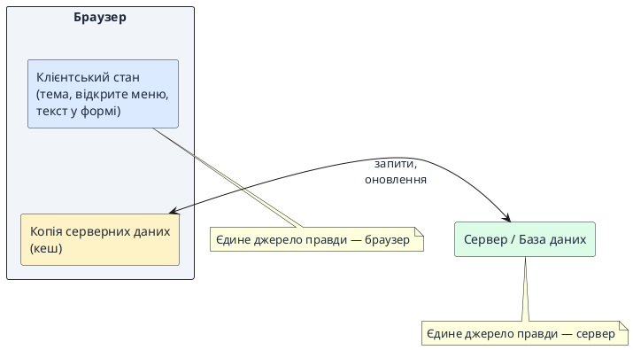
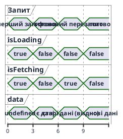
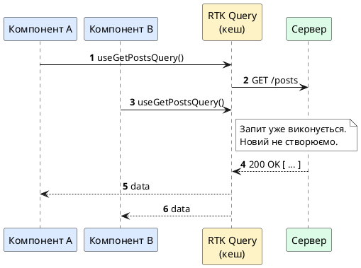
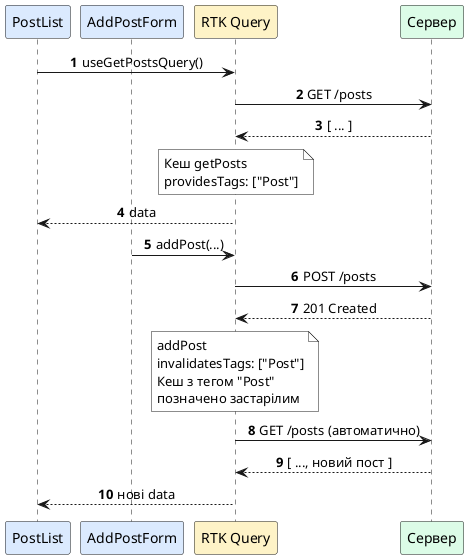
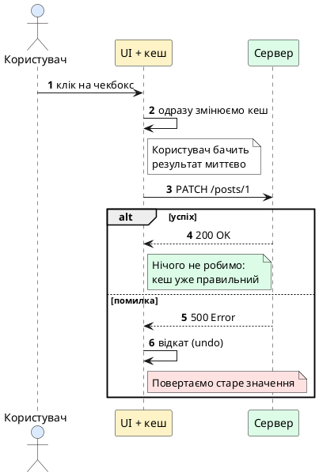

# RTK Query: запити до сервера без болю

::card-group

::card{title="🎯 Мета лекції" icon="i-lucide-target"}

- Зрозуміти, чим дані з сервера відрізняються від звичайного стану компонента.
- Налаштувати RTK Query з нуля: `createApi`, `fetchBaseQuery`, `Provider`.
- Робити запити на читання (*queries*) та зміну даних (*mutations*) через хуки.
- Опанувати кеш, теги та автоматичне оновлення списків після змін.
- Використати просунуті можливості: оптимістичні оновлення, пагінацію, polling, обробку помилок, автентифікацію.

::

::card{title="🔑 Ключові терміни" icon="i-lucide-key"}

- **Server state:** дані, власником яких є сервер, а в браузері лежить лише їхня копія.
- **Endpoint:** опис одного запиту до API (що запитати і як обробити відповідь).
- **Query / Mutation:** запит на читання даних / запит, що змінює дані на сервері.
- **Кеш (*cache*):** сховище вже отриманих відповідей у Redux store.
- **Tag (тег):** мітка, за якою RTK Query розуміє, які дані треба перезапитати.
- **Інвалідація (*invalidation*):** позначення кешу застарілим, що запускає повторний запит.

::

::

---

## Яку проблему вирішує RTK Query

Припустимо, у нас є сторінка зі списком постів. Є два «класичних» способи завантажити їх: `useEffect` з `fetch` (ми писали так у темах про ефекти та Axios) або `createAsyncThunk` у Redux Toolkit (попередня тема). Подивимося на обидва, якщо зробити все чесно.

### Спосіб 1: useEffect та fetch

```tsx
function PostList() {
  const [posts, setPosts] = useState<Post[]>([]);
  const [isLoading, setIsLoading] = useState(true);
  const [error, setError] = useState<string | null>(null);

  useEffect(() => {
    const controller = new AbortController();

    fetch("/api/posts", { signal: controller.signal })
      .then((res) => {
        if (!res.ok) throw new Error("Помилка завантаження");
        return res.json();
      })
      .then((data: Post[]) => setPosts(data))
      .catch((err) => {
        if (err.name !== "AbortError") setError(err.message);
      })
      .finally(() => setIsLoading(false));

    return () => controller.abort();
  }, []);

  // ...рендер
}
```

Це один компонент і один запит, а коду вже майже тридцять рядків. Стан живе всередині компонента, тому інші компоненти про ці дані нічого не знають.

### Спосіб 2: Redux Toolkit без RTK Query (createAsyncThunk)

Щоб дані були доступні всьому застосунку, їх кладуть у Redux. Для асинхронних запитів використовують *thunk* (функцію, що виконує запит і відправляє дії в store). Спочатку описуємо thunk та slice:

```ts [src/features/posts/postsSlice.ts]
import { createAsyncThunk, createSlice } from "@reduxjs/toolkit";
import type { Post } from "../../types";

export const fetchPosts = createAsyncThunk<
  Post[],
  void,
  { rejectValue: string }
>("posts/fetchPosts", async (_, { rejectWithValue, signal }) => {
  try {
    const res = await fetch("http://localhost:3001/posts", { signal });
    if (!res.ok) return rejectWithValue("Помилка завантаження");
    return (await res.json()) as Post[];
  } catch {
    return rejectWithValue("Немає зв'язку з сервером");
  }
});

interface PostsState {
  items: Post[];
  status: "idle" | "loading" | "succeeded" | "failed";
  error: string | null;
}

const initialState: PostsState = {
  items: [],
  status: "idle",
  error: null,
};

const postsSlice = createSlice({
  name: "posts",
  initialState,
  reducers: {},
  extraReducers: (builder) => {
    builder
      .addCase(fetchPosts.pending, (state) => {
        state.status = "loading";
        state.error = null;
      })
      .addCase(fetchPosts.fulfilled, (state, action) => {
        state.status = "succeeded";
        state.items = action.payload;
      })
      .addCase(fetchPosts.rejected, (state, action) => {
        state.status = "failed";
        state.error = action.payload ?? "Невідома помилка";
      });
  },
});

export default postsSlice.reducer;
```

А тепер компонент має запустити thunk і прочитати результат зі store:

```tsx [src/components/PostList.tsx]
function PostList() {
  const dispatch = useAppDispatch();
  const { items, status, error } = useAppSelector((state) => state.posts);

  useEffect(() => {
    if (status === "idle") {
      dispatch(fetchPosts());
    }
  }, [status, dispatch]);

  if (status === "loading") return <p>Завантаження...</p>;
  if (status === "failed") return <p>{error}</p>;

  return (
    <ul>
      {items.map((p) => <li key={p.id}>{p.title}</li>)}
    </ul>
  );
}
```

Тут уже краще: дані спільні для всіх компонентів, а стани запиту (`pending`, `fulfilled`, `rejected`) обробляються передбачувано. Але ціна висока: для **одного** запиту ми написали thunk, тип стану, початковий стан, три `addCase` і `useEffect` у компоненті. І це лише читання. Для створення, зміни та видалення доведеться писати ще по thunk і по три обробники на кожен.

### Що все одно піде не так

Обидва способи мають спільні проблеми, які зростають разом із застосунком:

1. **Дублювання коду.** Стан (`data`, `isLoading`, `error`) та обробники доведеться повторювати для кожного запиту.
2. **Зайві запити.** Якщо два компоненти просять ті самі пости, на сервер підуть два однакових запити. Перевірку `status === "idle"` ми дописали вручну, і вона не вирішує всіх випадків.
3. **Немає кешу.** Користувач перейшов на іншу сторінку і повернувся — дані завантажуються знову, і він знову бачить спінер.
4. **Ручне оновлення.** Після створення нового поста треба самому не забути перезавантажити список.
5. **Гонки запитів (*race conditions*).** Якщо користувач швидко перемикається між сторінками, відповідь на старий запит може прийти пізніше за новий і перезаписати правильні дані.

**RTK Query** — це частина пакета Redux Toolkit, яка бере всю цю рутину на себе. Ви описуєте *що* потрібно запитати, а бібліотека сама вирішує *коли* і *як* це зробити, зберігає результат і стежить за актуальністю.

::note
RTK Query не потребує окремого встановлення. Він входить до `@reduxjs/toolkit`, який ми вже використовували в темі про Redux Toolkit. Якщо ви ще не знайомі зі `store`, `Provider` та `useSelector`, повторіть попередню лекцію — тут ми на них спираємося.
::

### Клієнтський і серверний стан

Щоб зрозуміти, навіщо потрібна окрема бібліотека, розділимо стан застосунку на два види.

**Клієнтський стан** повністю належить браузеру: відкрите меню, обрана тема, текст у полі вводу. Ніхто, крім нашого коду, його не змінить.

**Серверний стан** — це дані, власник яких сервер: список постів, профіль користувача, замовлення. У браузері ми тримаємо лише *копію*, і вона може застаріти в будь-яку мить: інший користувач додав пост, адміністратор змінив ціну.

::plant-uml{alt="Клієнтський та серверний стан"}



::

Для клієнтського стану чудово підходять `useState` та Redux slices. А серверний стан потребує інших інструментів: кешування, перевірки актуальності, повторних спроб. Саме це й дає RTK Query.

---

## Підготовка: тестовий сервер

Щоб тренуватися, нам потрібен API, який справді зберігає зміни. Публічні сервіси на кшталт JSONPlaceholder лише *вдають*, що створили чи видалили запис, тому ефект від інвалідації кешу ми б не побачили. Підніміть локальний REST API за допомогою `json-server`.

Створіть файл `db.json` у корені проєкту:

```json
{
  "posts": [
    { "id": 1, "title": "Перший пост", "body": "Привіт, RTK Query!", "done": false },
    { "id": 2, "title": "Другий пост", "body": "Кеш — це круто", "done": true },
    { "id": 3, "title": "Третій пост", "body": "Теги керують оновленням", "done": false }
  ]
}
```

::tabs
::tabs-item{label="npm"}
```bash
npm install -D json-server@0.17.4
npx json-server --watch db.json --port 3001
```
::
::tabs-item{label="pnpm"}
```bash
pnpm add -D json-server@0.17.4
pnpm exec json-server --watch db.json --port 3001
```
::
::tabs-item{label="yarn"}
```bash
yarn add -D json-server@0.17.4
yarn json-server --watch db.json --port 3001
```
::
::

Тепер за адресою `http://localhost:3001/posts` доступні стандартні REST-маршрути:

| Метод | URL | Що робить |
|-------|-----|-----------|
| `GET` | `/posts` | Список усіх постів |
| `GET` | `/posts/1` | Один пост за `id` |
| `POST` | `/posts` | Створює новий пост |
| `PATCH` | `/posts/1` | Частково змінює пост |
| `DELETE` | `/posts/1` | Видаляє пост |

Також нам знадобиться Redux Toolkit та React-Redux. Якщо їх ще немає в проєкті:

::tabs
::tabs-item{label="npm"}
```bash
npm install @reduxjs/toolkit react-redux
```
::
::tabs-item{label="pnpm"}
```bash
pnpm add @reduxjs/toolkit react-redux
```
::
::tabs-item{label="yarn"}
```bash
yarn add @reduxjs/toolkit react-redux
```
::
::

---

## Перший запит: від нуля до працюючого списку

Розберемо мінімальний шлях. Він складається з чотирьох кроків: описати API, підключити його до store, обгорнути застосунок у `Provider` і використати хук у компоненті.

::steps

### Крок 1. Описуємо API через createApi
Створюємо один файл, у якому живе опис усіх запитів до сервера.

### Крок 2. Підключаємо API до store
Додаємо редʼюсер і мідлвар, які RTK Query згенерував для нас.

### Крок 3. Обгортаємо застосунок у Provider
Робимо store доступним усім компонентам.

### Крок 4. Використовуємо хук
Викликаємо згенерований хук і отримуємо `data`, `isLoading` та `error`.

::

### Крок 1. Описуємо API

Спочатку опишемо тип даних, з якими працюємо:

```ts [src/types.ts]
export interface Post {
  id: number;
  title: string;
  body: string;
  done: boolean;
}
```

Тепер створимо сам API. Уся магія починається з функції `createApi`:

```ts [src/api/postsApi.ts]
import { createApi, fetchBaseQuery } from "@reduxjs/toolkit/query/react";
import type { Post } from "../types";

export const postsApi = createApi({
  reducerPath: "postsApi",
  baseQuery: fetchBaseQuery({ baseUrl: "http://localhost:3001" }),
  endpoints: (builder) => ({
    getPosts: builder.query<Post[], void>({
      query: () => "/posts",
    }),
  }),
});

export const { useGetPostsQuery } = postsApi;
```

Розберемо кожну частину:

- **`reducerPath`** — ім'я, під яким кеш цього API буде лежати в Redux store (`state.postsApi`). Воно має бути унікальним серед усіх редʼюсерів.
- **`baseQuery`** — «двигун» запитів. `fetchBaseQuery` — це тонка обгортка над стандартним `fetch`, яка вже вміє розбирати JSON, додавати базову адресу та встановлювати заголовки. Axios тут не потрібен.
- **`endpoints`** — функція, яка отримує `builder` і повертає об'єкт з описом кожного запиту. Ключ (`getPosts`) стає іменем ендпоінта.
- **`builder.query<Post[], void>`** — описує запит на читання. Перший типовий параметр — що повертає сервер (`Post[]`), другий — який аргумент приймає запит (`void` означає «без аргументів»).
- **`query: () => "/posts"`** — функція, що повертає шлях. Він додається до `baseUrl`, тому запит піде на `http://localhost:3001/posts`.
- **`useGetPostsQuery`** — хук, який RTK Query автоматично згенерує з назви ендпоінта: `get Posts` → `useGetPostsQuery`.

::note
Правило імені хука просте: `use` + назва ендпоінта з великої літери + `Query` для запитів на читання або `Mutation` для мутацій. Ендпоінт `getPosts` дає `useGetPostsQuery`, а ендпоінт `addPost` дасть `useAddPostMutation`.
::

### Крок 2. Підключаємо до store

Створений `postsApi` містить готовий редʼюсер та мідлвар. Їх обов'язково потрібно додати до store, інакше кеш просто не працюватиме:

```ts [src/store.ts]
import { configureStore } from "@reduxjs/toolkit";
import { postsApi } from "./api/postsApi";

export const store = configureStore({
  reducer: {
    [postsApi.reducerPath]: postsApi.reducer,
  },
  middleware: (getDefaultMiddleware) =>
    getDefaultMiddleware().concat(postsApi.middleware),
});

export type RootState = ReturnType<typeof store.getState>;
export type AppDispatch = typeof store.dispatch;
```

Тут два нових рядки порівняно зі звичайним Redux Toolkit:

1. `[postsApi.reducerPath]: postsApi.reducer` — зберігаємо кеш у store під ключем `postsApi`. Квадратні дужки означають обчислюване ім'я ключа.
2. `.concat(postsApi.middleware)` — додаємо мідлвар, який керує життєвим циклом запитів: стежить за підписками, видаляє невикористані дані, запускає повторні запити.

### Крок 3. Provider

Це той самий `Provider`, який ви бачили в темі про Redux:

```tsx [src/main.tsx]
import { StrictMode } from "react";
import { createRoot } from "react-dom/client";
import { Provider } from "react-redux";
import { store } from "./store";
import App from "./App";

createRoot(document.getElementById("root")!).render(
  <StrictMode>
    <Provider store={store}>
      <App />
    </Provider>
  </StrictMode>,
);
```

### Крок 4. Використовуємо хук у компоненті

Усе готово. Тепер компонент отримує дані одним рядком:

```tsx [src/components/PostList.tsx]
import { useGetPostsQuery } from "../api/postsApi";

export function PostList() {
  const { data: posts, isLoading, isError } = useGetPostsQuery();

  if (isLoading) return <p>Завантаження...</p>;
  if (isError) return <p>Не вдалося завантажити пости</p>;

  return (
    <ul>
      {posts?.map((post) => (
        <li key={post.id}>
          <strong>{post.title}</strong>
          <p>{post.body}</p>
        </li>
      ))}
    </ul>
  );
}
```

Порівняйте з тридцятьма рядками на початку лекції. Немає `useState`, немає `useEffect`, немає ручного скасування запиту. Хук сам:

- відправляє запит при першому рендері компонента;
- повертає об'єкт зі станом запиту;
- перерендерує компонент, коли дані прийшли або сталася помилка;
- скасовує або ігнорує застарілі відповіді.

::tip
Ви могли помітити, що `posts?.` має знак питання. Поки дані не прийшли, `data` дорівнює `undefined`. TypeScript знає про це, тому змушує нас перевіряти. Після перевірки `isLoading` тип автоматично не звужується, тому оператор `?.` тут потрібен.
::

### Що повертає хук запиту

Хук повертає об'єкт з багатьма полями. Найважливіші з них:

| Поле | Тип | Значення |
|------|-----|----------|
| `data` | `T \| undefined` | Останні успішно отримані дані |
| `error` | `FetchBaseQueryError \| SerializedError \| undefined` | Помилка, якщо запит не вдався |
| `isLoading` | `boolean` | `true` лише при **першому** завантаженні, коли даних ще немає |
| `isFetching` | `boolean` | `true` при **будь-якому** запиті, включно з фоновим перезапитом |
| `isSuccess` | `boolean` | Дані успішно отримані |
| `isError` | `boolean` | Запит завершився помилкою |
| `isUninitialized` | `boolean` | Запит ще не запускався (наприклад, через `skip`) |
| `status` | `"uninitialized" \| "pending" \| "fulfilled" \| "rejected"` | Узагальнений статус |
| `refetch` | `() => void` | Функція для примусового перезапиту |

Особливу увагу зверніть на різницю між `isLoading` та `isFetching`. Це найчастіше джерело плутанини.

::plant-uml{alt="Різниця між isLoading та isFetching"}



::

Практичний висновок: `isLoading` використовуйте для великого спінера «на всю сторінку», коли показувати ще нічого. А `isFetching` — для маленького індикатора «оновлюємо» поверх старих даних, щоб користувач не втрачав те, що вже бачить.

```tsx
const { data: posts, isLoading, isFetching } = useGetPostsQuery();

if (isLoading) return <FullPageSpinner />;

return (
  <>
    {isFetching && <small>Оновлюємо...</small>}
    <ul>{posts?.map((p) => <li key={p.id}>{p.title}</li>)}</ul>
  </>
);
```

---

## Запит з параметром

Список — це добре, але часто потрібен один конкретний запис. Додамо ендпоінт, який приймає `id`:

```ts [src/api/postsApi.ts]
endpoints: (builder) => ({
  getPosts: builder.query<Post[], void>({
    query: () => "/posts",
  }),
  getPostById: builder.query<Post, number>({
    query: (id) => `/posts/${id}`,
  }),
}),
```

Тепер другий типовий параметр дорівнює `number`, і функція `query` отримує цей аргумент. Не забудьте експортувати новий хук:

```ts
export const { useGetPostsQuery, useGetPostByIdQuery } = postsApi;
```

У компоненті аргумент передається у хук:

```tsx
export function PostDetails({ postId }: { postId: number }) {
  const { data: post, isLoading, isError } = useGetPostByIdQuery(postId);

  if (isLoading) return <p>Завантаження...</p>;
  if (isError || !post) return <p>Пост не знайдено</p>;

  return (
    <article>
      <h2>{post.title}</h2>
      <p>{post.body}</p>
    </article>
  );
}
```

### Що відбувається, коли аргумент змінюється

Якщо `postId` зміниться з `1` на `2`, хук автоматично зробить новий запит. А якщо потім повернутися до `1` — дані візьмуться з кешу миттєво, без спінера. Щоб зрозуміти чому, розглянемо, як працює кеш.

---

## Як працює кеш

Це найважливіша частина лекції. Не зрозумівши кеш, ви не зрозумієте жодної іншої можливості RTK Query.

### Ключ кешу

RTK Query зберігає відповідь під ключем, що складається з **імені ендпоінта** та **аргументів** запиту:

| Виклик хука | Ключ кешу |
|-------------|-----------|
| `useGetPostsQuery()` | `getPosts(undefined)` |
| `useGetPostByIdQuery(1)` | `getPostById(1)` |
| `useGetPostByIdQuery(2)` | `getPostById(2)` |

Це означає: два компоненти, що викликають `useGetPostByIdQuery(1)`, ділять одну й ту саму відповідь у кеші. Другий компонент не робить нового запиту — він підписується на вже наявні дані.

### Дедуплікація

Якщо два компоненти одночасно викликали один і той самий запит, RTK Query надішле лише **один** мережевий запит, а результат віддасть обом.

::plant-uml{alt="Дедуплікація запитів у RTK Query"}



::

### Підписки та час життя даних

Кожен компонент, який використовує хук запиту, стає **підписником** на відповідний запис у кеші. RTK Query рахує підписників:

- Коли з'являється перший підписник, запит виконується.
- Поки є хоча б один підписник, дані лежать у кеші.
- Коли останній підписник зникає (компонент демонтовано), запускається таймер. За замовчуванням він триває **60 секунд**. Якщо за цей час ніхто знову не підписався, дані видаляються.

Цей час налаштовується параметром `keepUnusedDataFor` (у секундах):

```ts
export const postsApi = createApi({
  reducerPath: "postsApi",
  baseQuery: fetchBaseQuery({ baseUrl: "http://localhost:3001" }),
  keepUnusedDataFor: 120, // для всього API

  endpoints: (builder) => ({
    getPosts: builder.query<Post[], void>({
      query: () => "/posts",
      keepUnusedDataFor: 5, // тільки для цього ендпоінта
    }),
  }),
});
```

::note
Тому, якщо ви швидко перейшли зі списку на деталі і повернулися назад, список з'явиться миттєво: його ще не видалили з кешу. Через хвилину після закриття сторінки він зникне, і наступний візит почнеться із завантаження.
::

### Коли запит виконується повторно

За замовчуванням RTK Query **не** перезапитує дані щоразу, коли компонент монтується, якщо вони вже є в кеші. Але це можна змінити на рівні хука:

```tsx
const { data } = useGetPostsQuery(undefined, {
  refetchOnMountOrArgChange: true,
});
```

Другий аргумент хука — це об'єкт опцій. Його значення:

- `true` — завжди перезапитувати при монтуванні компонента або зміні аргументу;
- число, наприклад `30` — перезапитувати, якщо дані в кеші старші за 30 секунд;
- `false` (за замовчуванням) — використовувати кеш.

::warning
Не плутайте `keepUnusedDataFor` та `refetchOnMountOrArgChange`. Перший визначає, **як довго дані лежать у кеші без підписників**. Другий визначає, **чи оновлювати дані**, що вже є в кеші, коли компонент знову їх потребує.
::

---

## Мутації: змінюємо дані на сервері

Усе, що ми робили досі, — читання. Для створення, зміни та видалення даних використовується **мутація** (*mutation*). Відмінності від запиту прості:

- Запит виконується автоматично, коли компонент з'являється. Мутація виконується **тільки тоді, коли ви її викликаєте** (наприклад, при кліку на кнопку).
- Результат запиту кешується. Результат мутації — ні.

Додамо три мутації:

```ts [src/api/postsApi.ts]
endpoints: (builder) => ({
  getPosts: builder.query<Post[], void>({
    query: () => "/posts",
  }),

  addPost: builder.mutation<Post, Omit<Post, "id">>({
    query: (newPost) => ({
      url: "/posts",
      method: "POST",
      body: newPost,
    }),
  }),

  updatePost: builder.mutation<Post, Pick<Post, "id"> & Partial<Post>>({
    query: ({ id, ...patch }) => ({
      url: `/posts/${id}`,
      method: "PATCH",
      body: patch,
    }),
  }),

  deletePost: builder.mutation<void, number>({
    query: (id) => ({
      url: `/posts/${id}`,
      method: "DELETE",
    }),
  }),
}),
```

```ts
export const {
  useGetPostsQuery,
  useAddPostMutation,
  useUpdatePostMutation,
  useDeletePostMutation,
} = postsApi;
```

Розберемо нові деталі:

- Для запиту на читання `query` повертав просто рядок. Тепер ми повертаємо **об'єкт**, бо нам потрібно задати метод (`method`) та тіло (`body`). `fetchBaseQuery` сам перетворить `body` на JSON і додасть заголовок `Content-Type`.
- `Omit<Post, "id">` означає «пост без `id`»: сервер сам його призначить.
- `Pick<Post, "id"> & Partial<Post>` означає «`id` обов'язковий, а решта полів необов'язкові»: для часткового оновлення (`PATCH`) ми надсилаємо тільки змінені поля.
- `{ id, ...patch }` — деструктуризація: виділяємо `id` для адреси, а решту відправляємо в тілі.

### Використання хука мутації

Хук мутації повертає **масив із двох елементів**: функцію для запуску та об'єкт зі станом:

```tsx [src/components/AddPostForm.tsx]
import { useState } from "react";
import { useAddPostMutation } from "../api/postsApi";

export function AddPostForm() {
  const [title, setTitle] = useState("");
  const [body, setBody] = useState("");
  const [addPost, { isLoading, isError }] = useAddPostMutation();

  async function handleSubmit(e: React.FormEvent) {
    e.preventDefault();
    try {
      await addPost({ title, body, done: false }).unwrap();
      setTitle("");
      setBody("");
    } catch {
      // помилку показуємо через isError
    }
  }

  return (
    <form onSubmit={handleSubmit}>
      <input
        value={title}
        onChange={(e) => setTitle(e.target.value)}
        placeholder="Заголовок"
        required
      />
      <textarea
        value={body}
        onChange={(e) => setBody(e.target.value)}
        placeholder="Текст"
      />
      <button type="submit" disabled={isLoading}>
        {isLoading ? "Додаємо..." : "Додати"}
      </button>
      {isError && <p>Не вдалося створити пост</p>}
    </form>
  );
}
```

Зверніть увагу на `.unwrap()`. Функція `addPost` повертає проміс, який **ніколи не відхиляється** — навіть при помилці сервера він завершується успішно, просто з об'єктом `{ error }` всередині. Метод `unwrap()` перетворює цей результат у звичайну поведінку: при успіху повертає дані, при помилці кидає виняток. Тільки так працює `try/catch`.

Спробуйте додати пост. Ви побачите, що він з'явився на сервері, але **список на екрані не змінився**. Це не помилка. Ми ще не сказали RTK Query, що кеш списку застарів. Саме для цього існують теги.

---

## Теги та інвалідація кешу

Це серце RTK Query. Ідея проста: ми **позначаємо** дані тегами, а мутації **вказують**, які теги вони зіпсували. Після цього бібліотека сама перезапитує все, що позначене зіпсованим тегом.

::plant-uml{alt="Життєвий цикл тегів у RTK Query"}



::

### Три кроки з тегами

1. У `createApi` оголошуємо перелік допустимих тегів: `tagTypes`.
2. У запитів на читання додаємо `providesTags` — «ці дані мають такий тег».
3. У мутацій додаємо `invalidatesTags` — «після мене дані з цим тегом застаріли».

```ts [src/api/postsApi.ts]
export const postsApi = createApi({
  reducerPath: "postsApi",
  baseQuery: fetchBaseQuery({ baseUrl: "http://localhost:3001" }),
  tagTypes: ["Post"],

  endpoints: (builder) => ({
    getPosts: builder.query<Post[], void>({
      query: () => "/posts",
      providesTags: ["Post"],
    }),

    addPost: builder.mutation<Post, Omit<Post, "id">>({
      query: (newPost) => ({
        url: "/posts",
        method: "POST",
        body: newPost,
      }),
      invalidatesTags: ["Post"],
    }),

    deletePost: builder.mutation<void, number>({
      query: (id) => ({
        url: `/posts/${id}`,
        method: "DELETE",
      }),
      invalidatesTags: ["Post"],
    }),
  }),
});
```

Тепер повторіть експеримент: додайте пост. Тільки-но сервер відповість, список сам оновиться. Ми не писали жодного рядка для перезавантаження: це зробила інвалідація.

::note
Інвалідація не видаляє дані зі сторінки. Користувач і далі бачить старий список, поки йде фоновий перезапит (тут `isFetching` дорівнює `true`, а `isLoading` — `false`). Коли нова відповідь прийде, список плавно оновиться.
::

### Точкові теги з id

Є проблема: тег `"Post"` позначає **усі** пости разом. Якщо ми змінимо один пост, перезапитається весь список, а також усі окремі запити `getPostById`. Це надлишково. Теги можуть бути точнішими: об'єкт з типом і `id`.

```ts
tagTypes: ["Post"],

endpoints: (builder) => ({
  getPosts: builder.query<Post[], void>({
    query: () => "/posts",
    providesTags: (result) =>
      result
        ? [
            ...result.map(({ id }) => ({ type: "Post" as const, id })),
            { type: "Post", id: "LIST" },
          ]
        : [{ type: "Post", id: "LIST" }],
  }),

  getPostById: builder.query<Post, number>({
    query: (id) => `/posts/${id}`,
    providesTags: (result, error, id) => [{ type: "Post", id }],
  }),

  addPost: builder.mutation<Post, Omit<Post, "id">>({
    query: (body) => ({ url: "/posts", method: "POST", body }),
    invalidatesTags: [{ type: "Post", id: "LIST" }],
  }),

  updatePost: builder.mutation<Post, Pick<Post, "id"> & Partial<Post>>({
    query: ({ id, ...patch }) => ({
      url: `/posts/${id}`,
      method: "PATCH",
      body: patch,
    }),
    invalidatesTags: (result, error, { id }) => [{ type: "Post", id }],
  }),

  deletePost: builder.mutation<void, number>({
    query: (id) => ({ url: `/posts/${id}`, method: "DELETE" }),
    invalidatesTags: (result, error, id) => [
      { type: "Post", id },
      { type: "Post", id: "LIST" },
    ],
  }),
}),
```

Розберемо логіку:

- Список дає **кожному** елементу власний тег `{ type: "Post", id: 3 }` і ще один спеціальний тег `{ type: "Post", id: "LIST" }`, який означає «склад списку».
- `"LIST"` — це не магічне слово, а просто домовленість: довільний рядок, що не збігається з реальним `id`.
- Додавання поста змінює **склад** списку, тому інвалідує тільки `LIST`. Перезапитується лише список, а картки окремих постів не чіпаються.
- Редагування поста змінює тільки його, тому інвалідується тег з його `id`. Це зачепить і список (бо кожен його елемент має цей тег), і запит `getPostById` для цього `id`, але не чужі пости.
- Видалення змінює і сам пост (він зник), і склад списку, тому інвалідує обидва теги.

::tip
`as const` біля `"Post"` потрібен для TypeScript: без нього рядок розширюється до `string`, і компілятор не впізнає його як допустимий тип тега.
::

### Таблиця: який тег коли використовувати

| Ситуація | Рекомендований тег |
|----------|---------------------|
| Просте API, мало даних, продуктивність не критична | Один тег: `"Post"` |
| Є список і окремі записи | `{ type: "Post", id }` + `{ type: "Post", id: "LIST" }` |
| Мутація змінює один запис | `{ type: "Post", id }` |
| Мутація додає або видаляє записи у списку | `{ type: "Post", id: "LIST" }` |

---

## Налаштування запитів і хуків

Після основ розглянемо, як керувати поведінкою запитів.

### skip: відкладений запит

Іноді запит не можна виконувати, поки не готовий його аргумент. Наприклад, `userId` ще невідомий. Для цього є опція `skip`:

```tsx
function UserPosts({ userId }: { userId?: number }) {
  const { data } = useGetPostsByUserQuery(userId!, {
    skip: userId === undefined,
  });

  // ...
}
```

Поки `skip` дорівнює `true`, запит не виконується, а `isUninitialized` дорівнює `true`. Щойно `userId` з'являється, запит запускається автоматично. Для цього ж ідеально підходить константа `skipToken`, яка прибирає потребу в оклику `!`:

```tsx
import { skipToken } from "@reduxjs/toolkit/query";

const { data } = useGetPostByIdQuery(postId ?? skipToken);
```

### Polling: автоматичне оновлення за таймером

Якщо дані мають оновлюватися регулярно (курс валют, статус завдання), увімкніть опитування:

```tsx
const { data } = useGetPostsQuery(undefined, {
  pollingInterval: 5000, // кожні 5 секунд
});
```

Опитування працює, поки компонент змонтований. Тільки-но він зникає, таймер зупиняється.

### Перезапит при поверненні на вкладку

Користувач залишив вкладку на годину, повернувся — і бачить застарілі дані. Щоб RTK Query сам оновлював кеш при поверненні фокуса або відновленні мережі, потрібні два кроки:

1. У `createApi` вмикаємо параметри:

```ts
export const postsApi = createApi({
  reducerPath: "postsApi",
  baseQuery: fetchBaseQuery({ baseUrl: "http://localhost:3001" }),
  refetchOnFocus: true,
  refetchOnReconnect: true,
  // ...
});
```

2. Викликаємо `setupListeners` один раз після створення store:

```ts [src/store.ts]
import { setupListeners } from "@reduxjs/toolkit/query";

export const store = configureStore({ /* ... */ });

setupListeners(store.dispatch);
```

`setupListeners` підписується на події браузера `focus` та `online` і передає їх у мідлвар RTK Query. Без цього рядка опції `refetchOnFocus` та `refetchOnReconnect` мовчки не працюватимуть.

### refetch: ручне оновлення

Хук повертає функцію `refetch`, яка примусово повторює запит. Зручно для кнопки «Оновити»:

```tsx
const { data, refetch, isFetching } = useGetPostsQuery();

<button onClick={refetch} disabled={isFetching}>
  Оновити
</button>
```

### transformResponse: змінюємо відповідь

Сервер іноді повертає дані не в зручному вигляді. Наприклад, обгортає масив в об'єкт `{ items: [...], total: 3 }`. Замість того, щоб розбирати це в кожному компоненті, зробіть перетворення один раз:

```ts
getPosts: builder.query<Post[], void>({
  query: () => "/posts",
  transformResponse: (response: { items: Post[]; total: number }) =>
    response.items,
}),
```

Тепер усі компоненти бачать у `data` готовий масив `Post[]`, а перетворення живе в одному місці.

### selectFromResult: менше зайвих перерендерів

Хук запиту перерендерює компонент при зміні будь-якого поля результату (`isFetching`, `data` тощо). Іноді компоненту потрібна лише частина даних. `selectFromResult` дозволяє вибрати тільки потрібне:

```tsx
function PostTitle({ id }: { id: number }) {
  const { post } = useGetPostsQuery(undefined, {
    selectFromResult: ({ data }) => ({
      post: data?.find((p) => p.id === id),
    }),
  });

  return <h3>{post?.title}</h3>;
}
```

Тепер `PostTitle` перерендериться, лише якщо змінився *саме його* пост, а не будь-який зі списку. Для списків із тисячами елементів це помітно прискорює інтерфейс.

---

## Lazy-запити: запит за дією користувача

Звичайний хук запиту стартує автоматично. А якщо запит має виконуватися за кліком або під час введення тексту в пошук? Для цього кожен ендпоінт на читання має ще одну версію хука — `useLazy...Query`:

```ts
export const { useLazyGetPostByIdQuery } = postsApi;
```

```tsx
function PostSearch() {
  const [id, setId] = useState("");
  const [trigger, { data, isFetching, isError }] = useLazyGetPostByIdQuery();

  return (
    <div>
      <input value={id} onChange={(e) => setId(e.target.value)} />
      <button onClick={() => trigger(Number(id))}>Знайти</button>

      {isFetching && <p>Шукаємо...</p>}
      {isError && <p>Нічого не знайдено</p>}
      {data && <h3>{data.title}</h3>}
    </div>
  );
}
```

Lazy-хук повертає кортеж: `trigger` (функція запуску) та об'єкт результату. Запит не стартує, поки ви не викличете `trigger`. При цьому кеш працює так само: повторний виклик із тим самим `id` візьме дані з кешу.

::note
Хочете, щоб хук просто реагував на зміни введеного значення? Тоді використовуйте звичайний `useGetPostByIdQuery` з `skip`. Lazy-хук — для ситуацій, коли запит прив'язаний до **події**, а не до значення.
::

---

## Оптимістичні оновлення

Тепер розберемо найцікавішу можливість. Уявіть чекбокс «виконано» біля кожного поста. При кліку RTK Query надсилає запит, чекає відповідь, потім перезапитує список — і тільки тоді галочка змінюється. Інтерфейс відчувається «ледачим».

**Оптимістичне оновлення** (*optimistic update*) працює навпаки: ми змінюємо інтерфейс **одразу**, ще до відповіді сервера, «оптимістично» припускаючи, що все буде добре. Якщо ж сервер відповів помилкою, ми відкочуємо зміни.

::plant-uml{alt="Оптимістичне оновлення"}



::

### Реалізація через onQueryStarted

Для цього в ендпоінті використовується функція життєвого циклу `onQueryStarted`. Вона викликається в момент старту запиту і дозволяє виконати код до та після відповіді:

```ts
updatePost: builder.mutation<Post, Pick<Post, "id"> & Partial<Post>>({
  query: ({ id, ...patch }) => ({
    url: `/posts/${id}`,
    method: "PATCH",
    body: patch,
  }),

  async onQueryStarted({ id, ...patch }, { dispatch, queryFulfilled }) {
    // 1. Одразу змінюємо кеш списку
    const patchResult = dispatch(
      postsApi.util.updateQueryData("getPosts", undefined, (draft) => {
        const post = draft.find((p) => p.id === id);
        if (post) Object.assign(post, patch);
      }),
    );

    try {
      // 2. Чекаємо відповіді сервера
      await queryFulfilled;
    } catch {
      // 3. Помилка — відкочуємо зміни
      patchResult.undo();
    }
  },
}),
```

Розберемо покроково:

- **`onQueryStarted(arg, api)`** — перший параметр — аргумент мутації, другий — набір помічників.
- **`dispatch`** — стандартна функція Redux для відправки дій.
- **`queryFulfilled`** — проміс, що завершиться, коли сервер відповість. Якщо відповідь помилкова, він відхиляється, тому ми обгортаємо `await` у `try/catch`.
- **`postsApi.util.updateQueryData(endpointName, arg, recipe)`** — пряма зміна кешу. Перший аргумент — ім'я ендпоінта, другий — аргумент, що ідентифікує запис кешу (для `getPosts` це `undefined`), третій — функція-рецепт.
- **`draft`** — чернетка стану. Завдяки бібліотеці Immer ми можемо «мутувати» її напряму (`Object.assign`, `push` тощо), а Redux сам створить новий незмінний стан. Це той самий механізм, що в `createSlice`.
- **`patchResult.undo()`** — відкочує саме цю зміну, повертаючи кеш до попереднього вигляду.

::warning
Оптимістичне оновлення змінює тільки ті записи кешу, які ви явно вказали. Якщо пост також відкритий через `getPostById`, його окремий запис кешу потрібно оновити окремим викликом `updateQueryData`. Інакше ви побачите розбіжність між списком і деталями.
::

### Коли додавати invalidatesTags разом з оптимізмом

Хороша практика — залишити в мутації і `invalidatesTags` (або викликати перезапит після завершення). Тоді, навіть якщо оптимістична зміна була трохи неточною (наприклад, сервер змінив ще якесь поле), після відповіді дані синхронізуються з реальністю.

Іноді зручніше робити синхронізацію вручну в блоці `finally`:

```ts
async onQueryStarted(arg, { dispatch, queryFulfilled }) {
  const patchResult = dispatch(/* ... */);
  try {
    await queryFulfilled;
  } catch {
    patchResult.undo();
  } finally {
    dispatch(postsApi.util.invalidateTags([{ type: "Post", id: "LIST" }]));
  }
},
```

Метод `util.invalidateTags` дозволяє інвалідувати теги вручну з будь-якого місця.

---

## Пагінація та фільтрація

Реальні API рідко віддають усе одразу. Розглянемо, як працювати з сторінками. `json-server` підтримує параметри `_page` та `_limit` і повертає загальну кількість у заголовку `X-Total-Count`.

### Передача кількох аргументів

Аргумент запиту може бути об'єктом. Це зручно, коли їх кілька:

```ts
interface GetPostsArgs {
  page: number;
  limit: number;
  search?: string;
}

getPostsPage: builder.query<Post[], GetPostsArgs>({
  query: ({ page, limit, search }) => ({
    url: "/posts",
    params: {
      _page: page,
      _limit: limit,
      ...(search ? { q: search } : {}),
    },
  }),
  providesTags: (result) =>
    result
      ? [
          ...result.map(({ id }) => ({ type: "Post" as const, id })),
          { type: "Post", id: "LIST" },
        ]
      : [{ type: "Post", id: "LIST" }],
}),
```

Властивість `params` — це об'єкт, який `fetchBaseQuery` сам перетворює на рядок запиту (`?_page=1&_limit=10`). Вам не потрібно склеювати URL вручну.

::note
Кожна унікальна комбінація аргументів — це **окремий запис кешу**. Сторінка 1 і сторінка 2 лежать у кеші одночасно, тому повернення на попередню сторінку відбувається миттєво.
::

### Сторінковий список у компоненті

```tsx
function PaginatedPosts() {
  const [page, setPage] = useState(1);
  const { data, isLoading, isFetching } = useGetPostsPageQuery({
    page,
    limit: 5,
  });

  if (isLoading) return <p>Завантаження...</p>;

  return (
    <div style={{ opacity: isFetching ? 0.6 : 1 }}>
      <ul>
        {data?.map((p) => <li key={p.id}>{p.title}</li>)}
      </ul>

      <button onClick={() => setPage((p) => p - 1)} disabled={page === 1}>
        Назад
      </button>
      <span> Сторінка {page} </span>
      <button
        onClick={() => setPage((p) => p + 1)}
        disabled={!data || data.length < 5}
      >
        Вперед
      </button>
    </div>
  );
}
```

Зверніть увагу: коли `page` змінюється, на мить `isLoading` залишається `false`, а `isFetching` стає `true`. Ми не показуємо спінер замість списку, а просто робимо його трохи прозорим. Старі дані видно, поки завантажується нова сторінка. Це дає плавніший досвід.

### Попереднє завантаження (prefetch)

Щоб наступна сторінка з'являлася миттєво, можна завантажити її наперед, поки користувач дивиться на поточну. Для цього є хук `usePrefetch`:

```tsx
const prefetchPage = postsApi.usePrefetch("getPostsPage");

<button
  onMouseEnter={() => prefetchPage({ page: page + 1, limit: 5 })}
  onClick={() => setPage((p) => p + 1)}
>
  Вперед
</button>
```

Тільки-но курсор наведено на кнопку, дані наступної сторінки вже їдуть до кешу. До кліку вони, ймовірно, вже будуть готові.

---

## Обробка помилок

У мережі все ламається: пропадає інтернет, сервер повертає 500, токен прострочено. Правильно обробити це — частина якісного інтерфейсу.

### Типи помилок

Поле `error` у хука може мати два види:

- **`FetchBaseQueryError`** — помилка запиту. Вона має поле `status`: число (код HTTP, наприклад `404`) або рядок (`"FETCH_ERROR"`, `"PARSING_ERROR"`, `"TIMEOUT_ERROR"`, `"CUSTOM_ERROR"`).
- **`SerializedError`** — помилка у вашому коді (наприклад, у `transformResponse`). Має поля `message` та `name`.

Щоб показати зрозуміле повідомлення, треба спочатку визначити, яка саме помилка прийшла. Для цього зручно написати допоміжну функцію:

```ts [src/utils/errors.ts]
import type { FetchBaseQueryError } from "@reduxjs/toolkit/query";
import type { SerializedError } from "@reduxjs/toolkit";

function isFetchBaseQueryError(
  error: unknown,
): error is FetchBaseQueryError {
  return typeof error === "object" && error != null && "status" in error;
}

export function getErrorMessage(
  error: FetchBaseQueryError | SerializedError | undefined,
): string {
  if (!error) return "";

  if (isFetchBaseQueryError(error)) {
    if (error.status === "FETCH_ERROR") return "Немає зв'язку з сервером";
    if (error.status === 404) return "Нічого не знайдено";
    if (error.status === 401) return "Потрібно увійти в систему";
    if (typeof error.status === "number" && error.status >= 500) {
      return "Помилка на сервері. Спробуйте пізніше";
    }
    return "Не вдалося виконати запит";
  }

  return error.message ?? "Невідома помилка";
}
```

Тепер у компоненті:

```tsx
const { data, error, isError, refetch } = useGetPostsQuery();

if (isError) {
  return (
    <div>
      <p>{getErrorMessage(error)}</p>
      <button onClick={refetch}>Спробувати ще раз</button>
    </div>
  );
}
```

::tip
Функція `isFetchBaseQueryError` — так званий *type guard* (захисник типу). Вона не лише перевіряє значення під час виконання, а й повідомляє TypeScript, що після `if` змінна має конкретний тип. Це дозволяє безпечно звертатися до `error.status`.
::

### Повторні спроби (retry)

Тимчасові збої мережі часто зникають самі. `retry` обгортає baseQuery і повторює запит із затримкою, що наростає:

```ts
import { retry } from "@reduxjs/toolkit/query/react";

const baseQuery = retry(
  fetchBaseQuery({ baseUrl: "http://localhost:3001" }),
  { maxRetries: 3 },
);

export const postsApi = createApi({
  reducerPath: "postsApi",
  baseQuery,
  // ...
});
```

Якщо запит не вдався, RTK Query спробує ще до трьох разів. Для конкретного ендпоінта кількість спроб можна змінити параметром `extraOptions: { maxRetries: 1 }`, а для мутацій, що не можна безпечно повторювати (наприклад, оплата), краще повтори вимкнути: `extraOptions: { maxRetries: 0 }`.

---

## Автентифікація та налаштування baseQuery

Більшість реальних API потребує токен. `fetchBaseQuery` дозволяє додавати заголовки до всіх запитів через `prepareHeaders`:

```ts [src/api/baseQuery.ts]
import { fetchBaseQuery } from "@reduxjs/toolkit/query/react";
import type { RootState } from "../store";

export const baseQuery = fetchBaseQuery({
  baseUrl: "http://localhost:3001",
  prepareHeaders: (headers, { getState }) => {
    const token = (getState() as RootState).auth.token;
    if (token) {
      headers.set("Authorization", `Bearer ${token}`);
    }
    return headers;
  },
});
```

Функція `prepareHeaders` викликається перед кожним запитом. Вона отримує поточні заголовки та доступ до `getState`, тому токен можна взяти з будь-якого slice. Не забудьте повернути `headers`.

### Автоматичне оновлення токена (reauth)

Що, якщо токен доступу прострочено і сервер відповів `401`? Можна написати власну обгортку над `baseQuery`, яка перехопить таку відповідь, оновить токен і повторить початковий запит:

```ts [src/api/baseQueryWithReauth.ts]
import type {
  BaseQueryFn,
  FetchArgs,
  FetchBaseQueryError,
} from "@reduxjs/toolkit/query";
import { baseQuery } from "./baseQuery";
import { logout, tokenReceived } from "../features/auth/authSlice";

export const baseQueryWithReauth: BaseQueryFn<
  string | FetchArgs,
  unknown,
  FetchBaseQueryError
> = async (args, api, extraOptions) => {
  let result = await baseQuery(args, api, extraOptions);

  if (result.error && result.error.status === 401) {
    // Пробуємо отримати новий токен
    const refreshResult = await baseQuery(
      { url: "/auth/refresh", method: "POST" },
      api,
      extraOptions,
    );

    if (refreshResult.data) {
      api.dispatch(tokenReceived(refreshResult.data as string));
      // Повторюємо оригінальний запит із новим токеном
      result = await baseQuery(args, api, extraOptions);
    } else {
      api.dispatch(logout());
    }
  }

  return result;
};
```

Після цього замінюємо `baseQuery` у `createApi` на `baseQueryWithReauth`, і весь застосунок отримує автоматичне оновлення токена без жодних змін у компонентах.

::warning
Якщо кілька запитів одночасно отримають `401`, кожен спробує оновити токен окремо. У production-коді додають м'ютекс (наприклад, з пакета `async-mutex`), щоб оновлення виконувалося лише один раз. Приклад такої реалізації є в офіційній документації RTK Query.
::

---

## Структура проєкту: розбиття API

Коли застосунок росте, один файл `createApi` на сотні ендпоінтів стає незручним. Офіційна рекомендація RTK Query: **один `createApi` на весь застосунок** (один базовий URL — один API), але ендпоінти розбиваються на файли за допомогою `injectEndpoints`.

Спочатку створюємо порожній базовий API:

```ts [src/api/baseApi.ts]
import { createApi } from "@reduxjs/toolkit/query/react";
import { baseQueryWithReauth } from "./baseQueryWithReauth";

export const baseApi = createApi({
  reducerPath: "api",
  baseQuery: baseQueryWithReauth,
  tagTypes: ["Post", "User"],
  endpoints: () => ({}),
});
```

Потім кожна функціональна частина додає свої ендпоінти:

```ts [src/features/posts/postsApi.ts]
import { baseApi } from "../../api/baseApi";
import type { Post } from "../../types";

export const postsApi = baseApi.injectEndpoints({
  endpoints: (builder) => ({
    getPosts: builder.query<Post[], void>({
      query: () => "/posts",
      providesTags: ["Post"],
    }),
    addPost: builder.mutation<Post, Omit<Post, "id">>({
      query: (body) => ({ url: "/posts", method: "POST", body }),
      invalidatesTags: ["Post"],
    }),
  }),
});

export const { useGetPostsQuery, useAddPostMutation } = postsApi;
```

У store тоді підключається лише базовий API:

```ts
reducer: { [baseApi.reducerPath]: baseApi.reducer },
middleware: (gDM) => gDM().concat(baseApi.middleware),
```

Така структура має великі переваги: один кеш на всіх, теги працюють між різними частинами застосунку (мутація користувача може інвалідувати пости), а код розділений за фічами.

::code-tree

```ts [src/api/baseApi.ts]
import { createApi } from "@reduxjs/toolkit/query/react";
import { baseQueryWithReauth } from "./baseQueryWithReauth";

export const baseApi = createApi({
  reducerPath: "api",
  baseQuery: baseQueryWithReauth,
  tagTypes: ["Post", "User"],
  endpoints: () => ({}),
});
```

```ts [src/features/posts/postsApi.ts]
import { baseApi } from "../../api/baseApi";

export const postsApi = baseApi.injectEndpoints({
  endpoints: (builder) => ({
    // ендпоінти постів
  }),
});
```

```ts [src/features/users/usersApi.ts]
import { baseApi } from "../../api/baseApi";

export const usersApi = baseApi.injectEndpoints({
  endpoints: (builder) => ({
    // ендпоінти користувачів
  }),
});
```

```ts [src/store.ts]
import { configureStore } from "@reduxjs/toolkit";
import { baseApi } from "./api/baseApi";

export const store = configureStore({
  reducer: { [baseApi.reducerPath]: baseApi.reducer },
  middleware: (gDM) => gDM().concat(baseApi.middleware),
});
```

::

---

## Читання даних поза компонентами

Іноді потрібно отримати дані не у JSX, а в звичайній функції: наприклад, у `createAsyncThunk`, роутері чи обробнику події. Для цього кожен ендпоінт має `initiate` та `select`:

```ts
const promise = store.dispatch(postsApi.endpoints.getPosts.initiate());

try {
  const posts = await promise.unwrap();
  console.log(posts);
} finally {
  promise.unsubscribe(); // обов'язково, інакше дані не очищуватимуться
}
```

А щоб просто *прочитати* вже наявні дані кешу без запиту, використовуйте селектор:

```ts
const result = postsApi.endpoints.getPosts.select()(store.getState());
console.log(result.data);
```

Це корисно для інтеграції з React Router: функція `loader` може завантажити дані ще до рендеру сторінки, а компонент потім одразу візьме їх із кешу.

::note
Метод `initiate` створює підписку. Якщо ви її не скасуєте через `unsubscribe()`, дані залишатимуться в кеші нескінченно. Мутація та виклик у хуках роблять це автоматично, а в ручному коді — ваша відповідальність.
::

---

## Інструменти розробника

Оскільки кеш лежить у звичайному Redux store, ви бачите його у **Redux DevTools**. Відкрийте вкладку State і знайдіть розділ `api` (або `postsApi`). Усередині є:

- `queries` — усі записи кешу для запитів зі статусом, даними та тегами;
- `mutations` — активні та нещодавні мутації;
- `provided` — відповідність тегів та записів кешу;
- `subscriptions` — кількість підписників на кожен запис.

На вкладці Actions ви побачите дії на кшталт `postsApi/executeQuery/pending`, `fulfilled`, `rejected`, а також `invalidateTags`. Це найкращий спосіб зрозуміти, чому запит виконався чи не виконався: просто подивіться послідовність дій.

::tip
Якщо після мутації список не оновлюється, перевірте у DevTools три речі: чи є в запиту `providesTags`; чи збігаються тип та `id` у `invalidatesTags`; чи підключений `middleware` до store. Це причина 90% проблем.
::

---

## Типізація хуків та помічників

У проєкті з TypeScript RTK Query вже виводить більшість типів із ваших `builder.query<Результат, Аргумент>`. Але є кілька місць, де корисно знати нюанси.

### Типи результатів та аргументів

Часто потрібно використати тип відповіді в інших місцях. Для цього є вбудовані утиліти:

```ts
import type { TypedUseQueryHookResult } from "@reduxjs/toolkit/query/react";

type PostsResult = ReturnType<typeof postsApi.endpoints.getPosts.select>;
```

Простіший спосіб — просто експортувати й використовувати власні інтерфейси (`Post`, `GetPostsArgs`), які ви вже оголосили для `builder.query<Post[], GetPostsArgs>`.

### Типізація мутацій із рядками, що не збігаються

Якщо аргумент мутації має складний тип, TypeScript підкаже помилку під час виклику. Це дуже допомагає: наприклад, виклик `addPost({ title: "Привіт" })` без обов'язкових полів не скомпілюється.

### Типізований useSelector

Якщо ви звертаєтесь до даних RTK Query через звичайні `useSelector`, використовуйте типізовані хуки з теми про Redux Toolkit (`useAppSelector`, `useAppDispatch`), щоб `RootState` містив ключ вашого API.

---

## Повний приклад: список постів з керуванням

Зберемо знання разом. Нижче компонент, що показує список постів, дозволяє перемикати статус «виконано» (оптимістично), видаляти пости та додавати нові (через інвалідацію тегів):

```tsx [src/components/PostsPage.tsx]
import {
  useGetPostsQuery,
  useUpdatePostMutation,
  useDeletePostMutation,
} from "../api/postsApi";
import { AddPostForm } from "./AddPostForm";
import { getErrorMessage } from "../utils/errors";

export function PostsPage() {
  const {
    data: posts,
    isLoading,
    isFetching,
    isError,
    error,
    refetch,
  } = useGetPostsQuery();
  const [updatePost] = useUpdatePostMutation();
  const [deletePost, { isLoading: isDeleting }] = useDeletePostMutation();

  if (isLoading) return <p>Завантаження...</p>;

  if (isError) {
    return (
      <div>
        <p>{getErrorMessage(error)}</p>
        <button onClick={refetch}>Спробувати ще раз</button>
      </div>
    );
  }

  return (
    <section>
      <h1>Пости {isFetching && <small>(оновлюємо...)</small>}</h1>

      <AddPostForm />

      <ul>
        {posts?.map((post) => (
          <li key={post.id}>
            <label>
              <input
                type="checkbox"
                checked={post.done}
                onChange={() => updatePost({ id: post.id, done: !post.done })}
              />
              <strong>{post.title}</strong>
            </label>
            <p>{post.body}</p>
            <button
              onClick={() => deletePost(post.id)}
              disabled={isDeleting}
            >
              Видалити
            </button>
          </li>
        ))}
      </ul>
    </section>
  );
}
```

Усе, що вимагало б сотні рядків у чистому Redux або в `useEffect`, тут займає один компонент і один API-файл:

- список завантажується та кешується;
- перемикання статусу відбувається миттєво (оптимістично) і відкочується при помилці;
- видалення та додавання автоматично оновлюють список через теги;
- помилки обробляються зрозуміло, а запит можна повторити;
- кілька компонентів із тим самим запитом не створюють зайвих мережевих викликів.

---

## Типові помилки та відповіді на запитання

::::accordion

:::accordion-item{label="❓ Я додав пост, він є на сервері, але список не оновився. Чому?" icon="i-lucide-help-circle"}

Найімовірніше, ви не налаштували теги. Перевірте три речі: у `createApi` оголошено `tagTypes`; запит на читання має `providesTags` з потрібним тегом; мутація має `invalidatesTags` з **таким самим** типом (і `id`, якщо ви використовуєте точкові теги). Якщо хоч одна ланка відсутня, RTK Query не знає, що список треба перезапитати.

:::

:::accordion-item{label="❓ Чим isLoading відрізняється від isFetching?" icon="i-lucide-help-circle"}

`isLoading` — це лише перше завантаження, коли в кеші ще немає даних. `isFetching` — будь-який активний запит, включно з фоновим оновленням, коли старі дані ще є. Для великого спінера на всю сторінку використовуйте `isLoading`, для невеликого індикатора поверх даних — `isFetching`.

:::

:::accordion-item{label="❓ Чому після мутації дані не змінилися, хоч сервер повернув 200?" icon="i-lucide-help-circle"}

Результат мутації **не потрапляє в кеш запитів автоматично**. Мутація — це лише команда серверу. Щоб інтерфейс оновився, потрібно або інвалідувати теги (`invalidatesTags`), або вручну змінити кеш (`updateQueryData`) в `onQueryStarted`.

:::

:::accordion-item{label="❓ Чому функція мутації не кидає помилку при збої сервера?" icon="i-lucide-help-circle"}

Вона повертає проміс із об'єктом `{ data }` або `{ error }`, а не відхиляє його. Щоб отримати звичайну поведінку з винятками, викличте `.unwrap()` і обгорніть у `try/catch`.

:::

:::accordion-item{label="❓ Чи потрібно використовувати RTK Query, якщо я вже маю Axios?" icon="i-lucide-help-circle"}

Вони розв'язують різні задачі. Axios лише відправляє запити. RTK Query керує кешем, підписками, оновленням та станами завантаження. Якщо вам потрібні можливості Axios (інтерцептори, прогрес завантаження), можна написати власний `baseQuery` на його основі, але для більшості застосунків достатньо `fetchBaseQuery`.

:::

:::accordion-item{label="❓ Чи замінює RTK Query звичайні slices?" icon="i-lucide-help-circle"}

Ні. RTK Query відповідає за **серверний** стан. Клієнтський стан (відкрите меню, фільтри інтерфейсу, тема) і далі зручно тримати в `createSlice`. Обидва механізми живуть в одному store і чудово співпрацюють.

:::

::::

---

## Практичні завдання

::::accordion

:::accordion-item{label="📋 Завдання 1: пошук із lazy-запитом" icon="i-lucide-clipboard-list"}

Додайте ендпоінт `searchPosts`, що приймає рядок і звертається до `/posts?q=...`. Зробіть компонент із полем вводу та кнопкою «Шукати», який використовує `useLazySearchPostsQuery`. Покажіть стани завантаження, помилки та порожнього результату.

:::

:::accordion-item{label="✅ Розв'язок завдання 1" icon="i-lucide-check-circle"}

```ts
searchPosts: builder.query<Post[], string>({
  query: (q) => ({ url: "/posts", params: { q } }),
}),
```

```tsx
function SearchPosts() {
  const [text, setText] = useState("");
  const [trigger, { data, isFetching, isError }] = useLazySearchPostsQuery();

  return (
    <div>
      <input value={text} onChange={(e) => setText(e.target.value)} />
      <button onClick={() => trigger(text)} disabled={!text.trim()}>
        Шукати
      </button>

      {isFetching && <p>Шукаємо...</p>}
      {isError && <p>Помилка пошуку</p>}
      {data?.length === 0 && <p>Нічого не знайдено</p>}
      <ul>{data?.map((p) => <li key={p.id}>{p.title}</li>)}</ul>
    </div>
  );
}
```

:::

:::accordion-item{label="📋 Завдання 2: оптимістичне видалення" icon="i-lucide-clipboard-list"}

Змініть мутацію `deletePost` так, щоб пост зникав зі списку одразу при кліку, а при помилці сервера повертався назад. Підказка: використайте `updateQueryData` та метод `filter` для чернетки.

:::

:::accordion-item{label="✅ Розв'язок завдання 2" icon="i-lucide-check-circle"}

```ts
deletePost: builder.mutation<void, number>({
  query: (id) => ({ url: `/posts/${id}`, method: "DELETE" }),

  async onQueryStarted(id, { dispatch, queryFulfilled }) {
    const patchResult = dispatch(
      postsApi.util.updateQueryData("getPosts", undefined, (draft) => {
        const index = draft.findIndex((p) => p.id === id);
        if (index !== -1) draft.splice(index, 1);
      }),
    );

    try {
      await queryFulfilled;
    } catch {
      patchResult.undo();
    }
  },
}),
```

Тут ми використали `splice`, бо Immer дозволяє мутувати чернетку напряму. Присвоєння `draft = draft.filter(...)` не спрацювало б: потрібно змінювати існуючий масив, а не підміняти змінну.

:::

:::accordion-item{label="📋 Завдання 3: автоматичне оновлення статусу" icon="i-lucide-clipboard-list"}

Додайте до списку постів автоматичне оновлення кожні 10 секунд та кнопку «Оновити зараз». Індикатор «оновлюємо...» має показуватися тільки під час фонового запиту, а не при першому завантаженні.

:::

:::accordion-item{label="✅ Розв'язок завдання 3" icon="i-lucide-check-circle"}

```tsx
const { data, isLoading, isFetching, refetch } = useGetPostsQuery(undefined, {
  pollingInterval: 10_000,
});

if (isLoading) return <p>Завантаження...</p>;

return (
  <>
    <button onClick={refetch} disabled={isFetching}>Оновити зараз</button>
    {isFetching && <small>оновлюємо...</small>}
    <ul>{data?.map((p) => <li key={p.id}>{p.title}</li>)}</ul>
  </>
);
```

:::

::::

---

## Підсумки

::card-group

::card{title="🧭 Що ми розглянули" icon="i-lucide-map"}

- Різницю між клієнтським і серверним станом та проблеми ручних запитів.
- `createApi`, `fetchBaseQuery`, підключення до store та `Provider`.
- Хуки запитів: `data`, `isLoading`, `isFetching`, `error`, `refetch`.
- Кеш: ключі, дедуплікація, підписки, `keepUnusedDataFor`.
- Мутації та `unwrap()`.
- Теги: `providesTags`, `invalidatesTags`, точкові теги з `id`.
- `skip`, `pollingInterval`, `refetchOnFocus`, `transformResponse`, `selectFromResult`.
- Lazy-запити, оптимістичні оновлення, пагінація, `prefetch`.
- Обробка помилок, `retry`, токени та reauth, `injectEndpoints`.

::

::card{title="✅ Короткий чек-лист" icon="i-lucide-list-checks"}

- Один `createApi` на застосунок; ендпоінти розбивайте через `injectEndpoints`.
- Редʼюсер і мідлвар API обов'язково підключені до store.
- Для списків використовуйте теги з `id` та спеціальним `"LIST"`.
- `isLoading` — перше завантаження, `isFetching` — будь-який запит.
- Мутації завжди викликайте з `.unwrap()`, якщо потрібен `try/catch`.
- Оптимістичні оновлення робіть через `onQueryStarted` і не забувайте `undo()`.
- `setupListeners(store.dispatch)` потрібен для `refetchOnFocus`.

::

::

::tip
Для подальшого вивчення відкрийте офіційну документацію RTK Query на сайті redux-toolkit.js.org: там є розділи про кодогенерацію ендпоінтів із OpenAPI-схеми, потокове оновлення кешу через WebSocket (`onCacheEntryAdded`) та нескінченну прокрутку.
::
