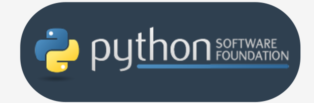
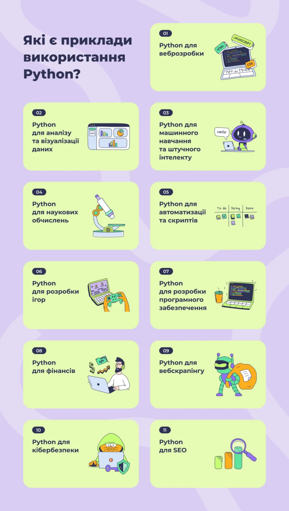
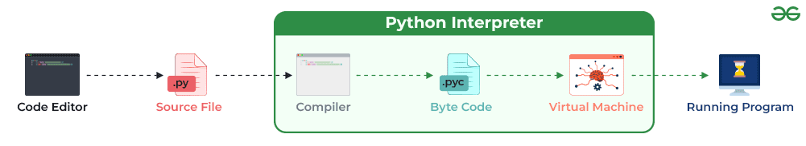
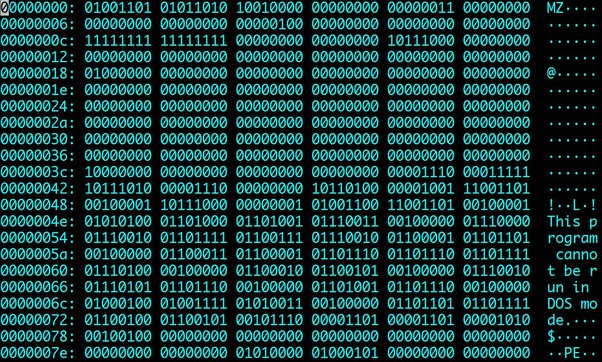
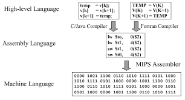
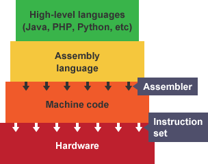
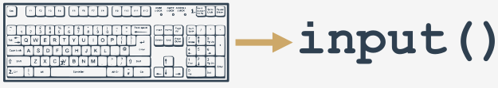
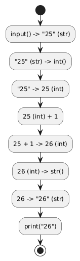

# **Вступ до програмування на Python**

## Урок 1: Основи



---

## **Що таке Python?**

**Python** — це популярна, високорівнева мова програмування.

-   **Інтерпретована:** Код виконується рядок за рядком, що спрощує розробку та тестування.
-   **Легша для вивчення:** Має простий та чистий синтаксис, схожий на англійську мову.
-   **Багатоцільова:** Використовується для веб-розробки, аналізу даних, штучного інтелекту, автоматизації та багато іншого.

---


---



---

## **Як працює комп'ютерна програма?**

Комп'ютер — це потужний інструмент, але він розуміє лише дуже прості команди.

**Програма** — це детальний рецепт або набір інструкцій, які ми даємо комп'ютеру для виконання певного завдання.

**Аналогія:** Уявіть комп'ютер як дуже слухняного, але не кмітливого робота. Він зробить _тільки те_, що ви йому накажете, і _саме так_, як ви це опишете.



---

## **Мови програмування: Міст між людиною та машиною**

Щоб давати комп'ютеру інструкції, нам потрібна спільна мова.

-   **Машинний код (низький рівень):** Мова з нулів та одиниць, яку розуміє процесор. Складна для людей.
-   **Мови високого рівня (Python, Java, C++):** Ближчі до людської мови, використовують слова та логічні конструкції.

Python — це мова високого рівня, яка дозволяє нам писати інструкції, не заглиблюючись у технічні деталі роботи "заліза".


---




---

## **Інтерпретація vs. Компіляція**

Як код високого рівня перетворюється на машинний?

-   **Компіляція:** Вся програма перекладається на машинний код _один раз_. Створюється окремий виконуваний файл (напр. `.exe`).

    -   _Аналогія:_ Переклад цілої книги перед її публікацією.

-   **Інтерпретація (шлях Python):** Кожен рядок коду перекладається та виконується _послідовно_ під час запуску програми.
    -   _Аналогія:_ Послідовний переклад речень під час розмови.

---

## **Ваша перша програма: `Hello, World!`**

Традиційно, знайомство з новою мовою починається з простої програми, що виводить вітання.

```python
print("Hello, World!")
```

-   `print` — це **функція**, вбудована команда Python.
-   `"Hello, World!"` — це **аргумент** функції, дані, які ми їй передаємо. В даному випадку, це текстовий рядок.

Цей код наказує комп'ютеру вивести на екран текст "Hello, World!".

---

## **Функція `print()`**

Функція `print()` — ваш основний інструмент для виведення інформації на екран.

-   Вона приймає один або більше **аргументів**.
-   Виводить їх у консоль, розділяючи пробілами за замовчуванням.
-   Після виведення автоматично переходить на новий рядок.

```python
print("Павучок повзе по стіні.")
print("Пішов дощ, і павучка змило.")
```

**Результат:**

```
Павучок повзе по стіні.
Пішов дощ, і павучка змило.
```

---

## **Що таке функція в Python?**

Функції Python гнучкіші, ніж їхні математичні аналоги.

**Функція** — це окрема частина коду, яка може:

1.  **Викликати ефект:** відправляти текст у термінал, створювати файл, рисувати зображення.
2.  **Обчислювати значення:** знаходити квадратний корінь, довжину тексту тощо.

_Багато функцій Python можуть робити і те, і інше одночасно._

---

## **Звідки беруться функції?**

-   **Вбудовані в Python:** Як функція `print()`. Вони доступні одразу.
-   **З модулів:** Це додаткові "бібліотеки", які можна підключати до коду.
-   **Написані вами:** Ви можете створювати власні функції, щоб робити код простішим та елегантнішим.

**Ім'я функції** має бути зрозумілим і описувати її призначення.

---

## **Синтаксис виклику функції**

Будь-яка функція в Python, незалежно від того, чи має вона аргументи, вимагає наявності круглих дужок `()` після її імені.

-   Якщо ви передаєте аргументи, вони розміщуються всередині цих дужок.
-   Якщо функція не приймає аргументів, дужки все одно потрібні, але вони залишаються порожніми.

**Угода про іменування:**
Щоб відрізнити імена функцій від звичайних слів чи змінних у тексті, прийнято додавати до них порожні дужки. Наприклад, ми говоримо про функцію `print()`.

---

## **Що відбувається під час виклику?**

1.  Python перевіряє, чи існує функція з таким іменем.
2.  Python перевіряє, чи правильну кількість аргументів ви передали.
3.  Виконання коду "стрибає" всередину функції, передаючи їй ваші аргументи.
4.  Функція виконує свій код: створює ефект та/або обчислює результат.
5.  Після завершення Python повертається до вашого коду і продовжує виконання з того місця, де зупинився.

---

## **Три питання про `print()`**

1.  **Який ефект?**

    -   Приймає аргументи.
    -   Перетворює їх на читабельний текст.
    -   Надсилає результат на пристрій виводу (зазвичай, на ваш екран).

2.  **Які аргументи?**

    -   Будь-які! `print()` може працювати з рядками, числами, логічними значеннями та іншими типами даних Python.

3.  **Який результат?**
    -   Жодного. Функція `print()` нічого не "повертає" чи не обчислює. Її завдання — лише показати щось на екрані.

---

## **Аргументи функції `print()`**

У нашому прикладі `print("Hello, World!")`, єдиним аргументом є рядок `"Hello, World!"`, який передається у функцію для виводу на екран.

---

## **Компоненти функції**

-   **Ефект:** Що функція робить (наприклад, виводить текст).
-   **Результат:** Яке значення вона повертає.
-   **Аргументи:** Дані, які передаються у функцію для роботи. На відміну від математики, у Python їх може бути будь-яка кількість.

---

## **Позиційні та ключові аргументи**

Функція `print()` приймає два типи аргументів:

-   **Позиційні** — ті, що ми передаємо зазвичай (рядки, числа). Їхній порядок важливий.
-   **Ключові** — спеціальні аргументи, які мають ім'я (ключ) і значення. Їх можна передавати в довільному порядку.

---

## **Ключовий аргумент `sep`**

Аргумент `sep` (від _separator_) визначає, який рядок буде використовуватися для розділення позиційних аргументів під час виводу.
За замовчуванням це пробіл.

**Приклад використання `sep`:**

```python
print("My", "name", "is", "Monty", "Python.", sep="-")
```

**Результат:**

```
My-name-is-Monty-Python.
```

---

## **Ключовий аргумент `end`**

Аргумент `end` визначає, який рядок буде додано в кінці виводу функції `print()`.
За замовчуванням це символ нового рядка (`\n`), тому кожен виклик `print()` починається з нового рядка.

**Приклад використання `end`:**

```python
print("My name is", end=" ")
print("Monty Python.")
```

**Результат:**

```
My name is Monty Python.
```

Це дозволяє об'єднати вивід кількох функцій `print()` в один рядок.

---

## **Літерали: "Сирі" дані в коді**

**Літерал** — це фіксоване значення, яке записане безпосередньо в коді. Це "сирі" дані, які не потребують обчислення.

-   `123` — це літерал. Ми одразу бачимо, що це число сто двадцять три.
-   `"Hello"` — це літерал. Ми бачимо, що це текстовий рядок "Hello".
-   `x` — це **не** літерал. Це змінна, і її значення нам невідоме без контексту.

---

## **Рядкові літерали (`str`)**

Рядки — це послідовності символів для представлення тексту.

-   Створюються за допомогою одинарних (`'`) або подвійних (`"`) лапок.
    -   `'Hello'`, `"World"`
-   **Порожній рядок:** `''` або `""`
-   **Екранування символів** (`\`): дозволяє вставити спеціальні символи всередину рядка.

```python
# Різні типи лапок для зручності
print("She said, 'Hi!'")
print('I\'m a programmer.') # Екранування одинарної лапки

# Результат буде однаковий
# She said, 'Hi!'
# I'm a programmer.
```

---

## **Проблема: Як вставити лапки всередину рядка?**

Що, якщо вам потрібно вивести такий текст?
`I'm a programmer.`
Або такий?
`She said, "I love Python!"`

Якщо ви спробуєте зробити це напряму, ви отримаєте помилку:

```python
# Цей код викличе помилку!
print("She said, "I love Python!"")
```

Python не розуміє, де закінчується рядок.

---

## **Рішення 1: Екранування символів**

Використовуйте зворотний слеш `\` (бекслеш) перед символом, який ви хочете "екранувати". Це каже Python, що наступний символ — це просто частина тексту, а не кінець рядка.

**Приклад:**

```python
print("She said, \"I love Python!\"")
print('I\'m a programmer.')
```

**Результат:**

```
She said, "I love Python!"
I'm a programmer.
```

---

## **Рішення 2: Використання різних типів лапок**

Ви можете просто чергувати типи лапок. Якщо рядок визначено подвійними лапками, всередині можна вільно використовувати одинарні, і навпаки.

**Приклад:**

```python
print("I'm a programmer.")
print('She said, "I love Python!"')
```

Цей спосіб часто є більш читабельним.

---

## **Популярні Escape-послідовності**

| Послідовність | Значення                |
| :------------ | :---------------------- |
| `\\`          | Зворотний слеш (\)      |
| `\'`          | Одинарні лапки (')      |
| `\"`          | Подвійні лапки (")      |
| `\n`          | Новий рядок             |
| `\t`          | Горизонтальна табуляція |
| `\r`          | Повернення каретки      |

---

## **Типи даних: Різні "коробки" для інформації**

Уявіть, що на кухні у вас є різні контейнери:

-   Пляшка для води (рідина).
-   Банка для цукру (сипучий продукт).
-   Коробка для яєць (крихкі предмети).

Ви не будете зберігати воду в коробці для яєць. Так само і в Python, для різних видів інформації існують різні **типи даних**.

---

## **Основні "будівельні блоки"**

Ми зосередимося на трьох основних типах:

-   `int` (Integer) — для цілих чисел (напр., `10`, `-5`, `0`).
-   `str` (String) — для тексту (напр., `"Привіт"`).
-   `float` (Floating-point) — для дробових чисел (напр., `3.14`).
-   `bool` (Boolean) — для значень істини (`True` або `False`).

---

## **Типи даних в анкеті**

Уявіть, що ви заповнюєте анкету:

-   Ваше ім'я: `"Олександр"` — це **рядок (`str`)**.
-   Ваш вік: `30` — це **ціле число (`int`)**.
-   Ваш середній бал: `4.5` — це **дробове число (`float`)**.
-   Чи є у вас водійські права: `True` — це **булеве значення (`bool`)**.

---

## **Вступ до числових типів**

Комп'ютери працюють з двома основними типами чисел:

-   **Цілі (integers):** числа без дробової частини (`1`, `100`, `-5`).
-   **З рухомою комою (floats):** числа, які можуть мати дробову частину (`1.5`, `0.0`, `-2.75`).

Ця різниця важлива, оскільки вони по-різному зберігаються в пам'яті.

Характеристика, що визначає вид, діапазон та застосування числа, називається **типом**. Форма літерала (напр., `123` vs `123.0`) визначає, який тип Python буде використовувати.

---

## **Цілі числа (Integers)**

-   Записуються як послідовність цифр. Не можна вставляти коми або пробіли.
-   Для полегшення читання великих чисел можна використовувати підкреслення: `11_111_111` (це те саме, що `11111111`).
-   Від'ємні числа записуються зі знаком мінус: `-11_111_111`.
-   Додатні числа можуть мати знак плюс, але це не обов'язково: `+123` і `123` — одне й те саме.

```python
positive_number = 1_000_000
negative_number = -50
print(positive_number) # Виведе: 1000000
```

---

## **Вісімкові та шістнадцяткові числа**

Окрім десяткової системи, Python підтримує інші системи числення.

-   **Вісімкові:** Починаються з префікса `0o` (нуль-о). Використовують цифри від 0 до 7.

    -   Приклад: `0o123` (дорівнює 83 в десятковій системі).
    -   `print(0o123)`

-   **Шістнадцяткові:** Починаються з префікса `0x` (нуль-ікс). Використовують цифри 0-9 та літери A-F.
    -   Приклад: `0x123` (дорівнює 291 в десятковій системі).
    -   `print(0x123)`

```python
print("0o123 =", 0o123) # Виведе: 0o123 = 83
print("0x123 =", 0x123) # Виведе: 0x123 = 291
```

---

## **Числа з рухомою комою (Floats)**

-   Це числа, що мають дробову частину, яка відділяється **крапкою**, а не комою.
    -   Правильно: `2.5`, `-0.4`.
    -   Неправильно: `2,5`.
-   Нулі можна опускати для стислості: `.4` (замість `0.4`), `4.` (замість `4.0`).
-   Наявність крапки змінює тип: `4` — це `integer`, а `4.0` — це `float`.

```python
print(4.0) # float
print(4)   # integer
print(.4)  # float (0.4)
```

---

## **Експоненційний запис (для Floats)**

Використовується для дуже великих або дуже маленьких чисел. Літера `E` (або `e`) означає "помножити на 10 у степені".

-   **Швидкість світла:** `300000000` можна записати як `3e8`.
-   **Постійна Планка:** `6.62607 * 10⁻³⁴` записується як `6.62607E-34`.

Python може автоматично обирати більш економічну форму запису.

```python
speed_of_light = 3e8
print(speed_of_light) # Виведе: 300000000.0

planck_constant = 6.62607E-34
print(planck_constant) # Виведе: 6.62607e-34

# Python сам переходить до експоненційного запису
print(0.0000000000000000000001) # Виведе: 1e-22
```

---

## **Рядки (`str`)**

-   Рядки використовуються для обробки тексту (імена, адреси тощо).
-   **Проблема:** Як вставити лапки (`"`) всередину рядка, який вже визначений подвійними лапками?

---

## **Рішення для рядків**

-   **Рішення 1: Екранування.** Використовуйте `\` перед лапками, щоб вони сприймалися як частина тексту.

    -   Приклад: `print("I like \"Monty Python\"")`

-   **Рішення 2: Чергування лапок.** Використовуйте одинарні лапки для визначення рядка, якщо всередині є подвійні.

    -   Приклад: `print('I like "Monty Python"')`

-   Те саме правило працює і для апострофів: `print('I\'m Monty Python.')`
-   **Порожній рядок** (`''` або `""`) — це теж рядок, просто без символів.

---

## **Булеві значення (`bool`)**

-   Використовуються для представлення **правдивості** — `True` (правда) або `False` (хибність).
-   Це відповідь на логічні питання, наприклад, "чи 5 більше 2?".
-   **Важливо:** Регістр має значення (`True`, а не `true`).

-   **Приклад:**
    ```python
    print(5 > 2)  # Виведе: True
    ```

---

## **Цікавий факт про `bool`**

-   Внутрішньо `True` поводиться як `1`, а `False` як `0`.
    -   `print(True > False)` → `True` (бо 1 > 0)
    -   `print(True < False)` → `False` (бо 1 < 0)

---

## **Булеві літерали (`bool`)**

Це спеціальні значення, що представляють істину та хибу.

-   Всього два значення: `True` та `False`.
-   Вони є результатом логічних порівнянь.
-   **Важливо:** пишуться з великої літери!

```python
is_active = True
is_greater = 5 > 2 # Результатом буде True

print(is_active)    # Виведе: True
print(is_greater)   # Виведе: True
print(10 < 1)       # Виведе: False
```

---

## **Python як калькулятор**

Функція `print()` може не тільки виводити текст, а й обчислювати математичні **вирази**.

**Вираз** — це комбінація даних (літералів, змінних) та операторів, яка обчислюється до певного значення.

**Оператор** — це символ, що виконує операцію над значеннями (операндами).

```python
# Python обчислить вираз 2 + 2 і виведе результат
print(2 + 2)
```

**Результат:**

```
4
```

---

## **Основні арифметичні оператори**

| Оператор | Опис                        |
| :------- | :-------------------------- |
| `+`      | Додавання                   |
| `-`      | Віднімання                  |
| `*`      | Множення                    |
| `/`      | Ділення                     |
| `**`     | Піднесення до степеня       |
| `//`     | Цілочисельне ділення        |
| `%`      | Остача від ділення (modulo) |

---

## Піднесення до степеня (`**`)

-   **Синтаксис:** `основа ** степінь`
-   Лівий аргумент — це основа, а правий — степінь.

```python
print(2 ** 3)   # 2 * 2 * 2
print(2. ** 3)  # Якщо хоча б один float, результат float
print(2 ** 3.)  # Аналогічно
```

**Результат:**

```
8
8.0
8.0
```

**Правило типів:**

-   `int ** int` → `int`
-   `float ** int` або `int ** float` → `float`

---

## **Множення (`*`) та Ділення (`/`)**

**Множення (`*`)**

-   Працює очікувано, дотримуючись правила типів `int`/`float`.
-   `2 * 3` → `6`
-   `2 * 3.0` → `6.0`

**Ділення (`/`)**

-   **Важливо:** Результат ділення `/` **завжди** є `float`, навіть якщо результат — ціле число.

```python
print(6 / 3)
print(7 / 2)
```

**Результат:**

```
2.0
3.5
```

---

## **Цілочисельне ділення (`//`)**

-   Результат **завжди** округлюється до **найближчого меншого цілого числа**.
-   Це не просто відкидання дробової частини!

```python
# Звичайний випадок
print(6 // 4)    # Реальний результат 1.5, округлюється до 1

# Випадок з від'ємними числами
print(-6 // 4)   # Реальний результат -1.5, округлюється до меншого, тобто -2
```

**Результат:**

```
1
-2
```

-   Правило типів `int`/`float` зберігається: `6. // 4` → `1.0`.

---

## **Остача від ділення (`%`, modulo)**

-   Повертає остачу від цілочисельного ділення.
-   Результат має той самий знак, що і ділене.

```python
# 14 = 3 * 4 + 2
print(14 % 4)

# 12 = 2 * 4.5 + 3
print(12 % 4.5)

# -14 = -4 * 4 + 2
print(-14 % 4)

# 14 = -3 * -4 + 2
print(14 % -4)
```

**Результат:**

```
2
3.0
2
-2
```

---

## **Унарні та бінарні оператори**

-   **Бінарні оператори** потребують двох аргументів (операндів): один зліва, інший справа. Більшість операторів, які ми бачили, є бінарними.

    -   `a + b`
    -   `c * d`

-   **Унарні оператори** мають лише один операнд.
    -   `-5` (оператор `-` змінює знак числа)
    -   `+10` (оператор `+` нічого не змінює, але є валідним)

```python
print(-3)  # Унарний мінус
print(5 - 3) # Бінарний мінус (віднімання)
```

---

## **Пріоритети та зв'язування**

**Ієрархія пріоритетів** визначає, які операції виконуються першими (як у математиці).

| Пріоритет   | Оператор            | Опис                      |
| :---------- | :------------------ | :------------------------ |
| **Високий** | `**`                | Піднесення до степеня     |
|             | `*`, `/`, `//`, `%` | Множення, ділення, остача |
| **Низький** | `+`, `-`            | Додавання, віднімання     |

**Зв'язування** визначає порядок для операторів з **однаковим** пріоритетом.

---

## **Зв'язування операторів**

-   **Лівостороннє зв'язування (більшість операторів):**

    -   Обчислення виконуються зліва направо.
    -   `9 % 6 % 2` → `(9 % 6) % 2` → `3 % 2` → `1`

-   **Правостороннє зв'язування (виняток):**
    -   Піднесення до степеня (`**`) виконується справа наліво.
    -   `2 ** 2 ** 3` → `2 ** (2 ** 3)` → `2 ** 8` → `256`

```python
print(9 % 6 % 2)
print(2 ** 2 ** 3)
```

**Результат:**

```
1
256
```

---

## **Дужки `()` — найвищий пріоритет**

-   Дужки дозволяють змінити природний порядок обчислень.
-   Вирази в дужках обчислюються в першу чергу.

```python
# Без дужок: 2 * 3 + 4 -> 6 + 4 -> 10
print(2 * 3 + 4)

# З дужками: 2 * (3 + 4) -> 2 * 7 -> 14
print(2 * (3 + 4))

# Складний приклад
print((5 * ((25 % 13) + 100) / (2 * 13)) // 2)
```

**Результат:**

```
10
14
10.0
```

---

## **Арифметичні оператори**

Python можна використовувати як потужний калькулятор.

| Оператор | Опис                  | Приклад   | Результат |
| :------- | :-------------------- | :-------- | :-------- |
| `+`      | Додавання             | `5 + 3`   | `8`       |
| `-`      | Віднімання            | `5 - 3`   | `2`       |
| `*`      | Множення              | `5 * 3`   | `15`      |
| `/`      | Ділення               | `10 / 3`  | `3.333`   |
| `//`     | Цілочисельне ділення  | `10 // 3` | `3`       |
| `%`      | Остача від ділення    | `10 % 3`  | `1`       |
| `**`     | Піднесення до степеня | `2 ** 3`  | `8`       |

---

## **Пріоритет операторів**

Як і в математиці, операції виконуються в певному порядку.

1.  `**` (піднесення до степеня)
2.  `*`, `/`, `//`, `%` (множення, ділення)
3.  `+`, `-` (додавання, віднімання)

Використовуйте дужки `()`, щоб змінити порядок обчислень.

```python
# 2 + (3 * 4) = 14
print(2 + 3 * 4)

# (2 + 3) * 4 = 20
print((2 + 3) * 4)
```

---

## **Що таке змінні?**

**Аналогія:** Змінні — це як підписані коробки або контейнери, в які можна покласти дані (результати обчислень, текст), щоб використати їх пізніше.

Кожна змінна має:

-   **Ім'я** (назва коробки).
-   **Значення** (вміст коробки).

---

## **Створення та використання змінних**

Змінна створюється в момент **присвоєння** їй значення за допомогою оператора `=`.

```python
user_age = 30
user_name = "John Doe"

print(user_name, "is", user_age, "years old.")
```

Не можна використовувати змінну, яка ще не була створена (якій не присвоєно значення).

```python
# Цей код викличе помилку, бо змінна 'capital' не існує
print(capital)
```

---

## **Правила іменування змінних**

-   Можна використовувати: великі та малі літери (`a-z`, `A-Z`), цифри (`0-9`), символ підкреслення (`_`).
-   Ім'я має починатися з літери або символу `_`.
-   **Регістр важливий:** `my_variable` і `My_Variable` — це дві різні змінні.
-   Ім'я не може бути **ключовим (зарезервованим) словом**.

**Приклади правильних імен:** `user_name`, `age`, `exchange_rate`, `_temp`.
**Приклади неправильних імен:** `1st_place` (починається з цифри), `exchange rate` (містить пробіл).

---

## **Ключові (зарезервовані) слова**

Це слова, зарезервовані Python для власних потреб. Їх не можна використовувати як імена змінних, функцій чи інших ідентифікаторів.

Приклади: `if`, `else`, `for`, `while`, `True`, `False`, `None`, `import`.

Спроба створити змінну з таким іменем викличе синтаксичну помилку:

```python
# SyntaxError: invalid syntax
import = 1
```

---

## **Оператор присвоєння (`=`)**

`=` — це не "дорівнює", а **"присвоїти"**. Він бере значення справа і кладе його в змінну зліва.

Можна оновлювати значення змінної, використовуючи її саму:

```python
counter = 1
print(counter)  # Виведе: 1

# Беремо поточне значення counter (1), додаємо 1, отримуємо 2
# і записуємо новий результат (2) назад у counter
counter = counter + 1
print(counter)  # Виведе: 2
```

---

## **Скорочені оператори присвоєння**

Часто потрібно змінити змінну на основі її ж значення (напр., `x = x + 1`). Для цього існують скорочені форми:

| Повний запис | Скорочений запис | Опис               |
| :----------- | :--------------- | :----------------- |
| `x = x + 1`  | `x += 1`         | Збільшити `x` на 1 |
| `x = x - 5`  | `x -= 5`         | Зменшити `x` на 5  |
| `x = x * 2`  | `x *= 2`         | Помножити `x` на 2 |
| `x = x / 2`  | `x /= 2`         | Розділити `x` на 2 |

---

## **Практичний приклад: Теорема Піфагора**

Обчислення гіпотенузи прямокутного трикутника з використанням змінних.

```python
# Катети трикутника
a = 3.0
b = 4.0

# Формула: c = (a² + b²) ^ ½
c = (a ** 2 + b ** 2) ** 0.5

print("Hypotenuse is:", c)
```

---

## **Взаємодія з користувачем: функція `input()`**

Функція `input()` дозволяє програмі отримувати дані від користувача.



-   Вона призупиняє виконання програми та чекає, поки користувач введе текст і натисне `Enter`.
-   **Завжди** повертає дані у вигляді **рядка (`str`)**.

```python
user_name = input("Як вас звати? ")
print("Привіт, " + user_name + "!")
```

**`+`** для рядків працює як **конкатенація** (з'єднання).

---

## **Перетворення типів**

Оскільки `input()` повертає рядок, для математичних операцій його потрібно перетворити на числовий тип.

-   `int()` — перетворює на ціле число.
-   `float()` — перетворює на число з рухомою крапкою.
-   `str()` — перетворює на рядок.

```python
age_str = input("Скільки вам років? ")
age_int = int(age_str)

next_year_age = age_int + 1
print("Наступного року вам буде " + str(next_year_age))
```

---



---

## **Практичний приклад: Калькулятор площі**

Поєднаємо все, що ми вивчили, у одній програмі.

```python
# 1. Отримуємо дані від користувача
width_str = input("Введіть ширину прямокутника: ")
height_str = input("Введіть висоту прямокутника: ")

# 2. Перетворюємо рядки на числа
width = float(width_str)
height = float(height_str)

# 3. Виконуємо обчислення
area = width * height

# 4. Виводимо результат
print("Площа прямокутника: " + str(area))
```

---

## **Коментарі: Нотатки для себе та інших**

**Коментар** — це текст у коді, який Python повністю ігнорує.
Він починається з символу `#`.

Коментарі використовуються, щоб:

-   Пояснити складну логіку.
-   Залишити нагадування.
-   Тимчасово "вимкнути" частину коду для тестування.

```python
# Ця програма обчислює гіпотенузу за теоремою Піфагора
a = 3.0  # Перший катет
b = 4.0  # Другий катет

# Формула: c = sqrt(a^2 + b^2)
c = (a**2 + b**2)**0.5

print("Гіпотенуза дорівнює:", c)
```

**Пишіть код так, щоб він був зрозумілим, а коментарі використовуйте для пояснення _чому_, а не _що_ він робить.**

---

## **Підсумок уроку**

Сьогодні ми вивчили:

-   Що таке Python та як працюють програми.
-   Функції `print()` для виводу та `input()` для вводу.
-   Основні типи даних: `str`, `int`, `float`, `bool`.
-   **Змінні** для зберігання даних.
-   **Арифметичні оператори** для обчислень.
-   **Перетворення типів** та **коментарі**.

Це фундаментальні "цеглинки", з яких будуються всі програми на Python!

<!-- image: Колаж з іконок: print, input, змінні, оператори, типи даних -->

---

## **Запитання та Практичне завдання**

**Запитання?**

---

**Практичне завдання:**

Напишіть програму-конвертер валют.

1.  Запитайте у користувача суму в гривнях (`UAH`).
2.  Запитайте поточний курс долара (`USD`).
3.  Обчисліть та виведіть на екран еквівалентну суму в доларах.

_Підказка: не забудьте про перетворення типів!_
