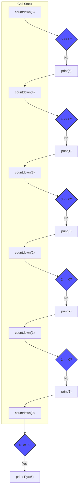
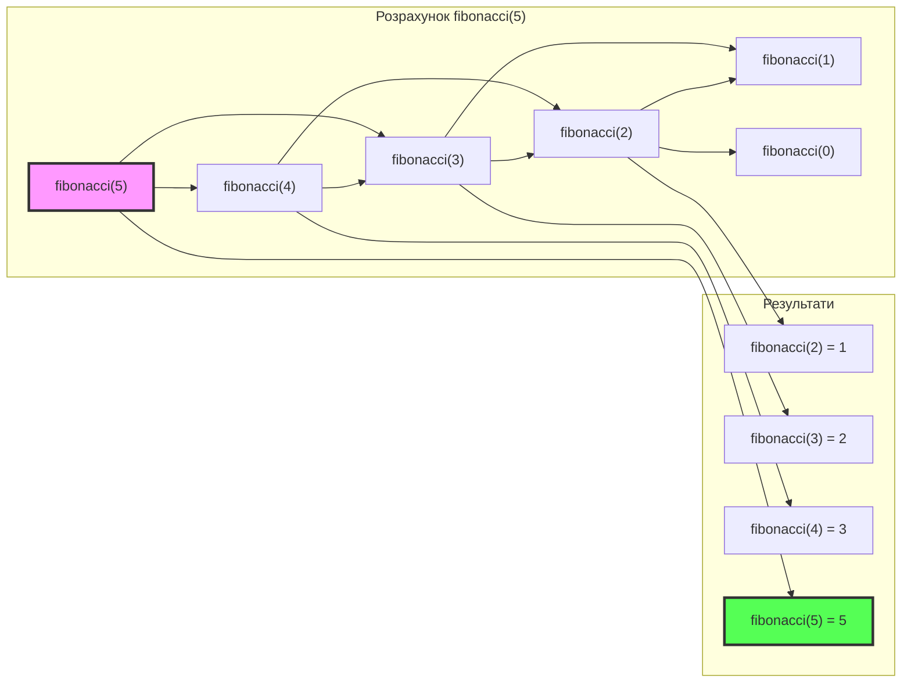

# 🔧 Повний посібник з функцій у Python

## Зміст

### Основи функцій

1. [Вступ до функцій](#вступ-до-функцій)
2. [Навіщо потрібні функції?](#навіщо-потрібні-функції)
3. [Створення функцій: def](#створення-функцій-def)
4. [Виклик функцій](#виклик-функцій)
5. [Параметри та аргументи](#параметри-та-аргументи)
6. [Повернення значень: return](#повернення-значень-return)
7. [Функції без return](#функції-без-return)
8. [Множинне повернення](#множинне-повернення)

### Параметри

9. [Позиційні параметри](#позиційні-параметри)
10. [Іменовані аргументи](#іменовані-аргументи)
11. [Значення за замовчуванням](#значення-за-замовчуванням)
12. [Змінна кількість аргументів: \*args](#змінна-кількість-аргументів-args)
13. [Іменовані аргументи: \*\*kwargs](#іменовані-аргументи-kwargs)
14. [Порядок параметрів](#порядок-параметрів)

### Область видимості

15. [Локальні змінні](#локальні-змінні)
16. [Глобальні змінні](#глобальні-змінні)
17. [Ключове слово global](#ключове-слово-global)
18. [Ключове слово nonlocal](#ключове-слово-nonlocal)
19. [LEGB правило](#legb-правило)

### Спеціальні теми

20. [Lambda функції](#lambda-функції)
21. [Функції вищого порядку](#функції-вищого-порядку)
22. [Рекурсія](#рекурсія)
23. [Docstrings](#docstrings)
24. [Анотації типів](#анотації-типів)
25. [Вкладені функції](#вкладені-функції)

### Практика

26. [Практичні приклади](#практичні-приклади)
27. [Поширені помилки](#поширені-помилки)
28. [Найкращі практики](#найкращі-практики)
29. [Вбудовані функції Python](#вбудовані-функції-python)

---

## Вступ до функцій

### Що таке функція?

**Функція** — це **іменований блок коду**, який виконує певну задачу і може бути викликаний багато разів.

**Простими словами:** Функція — це як рецепт. Ви пишете рецепт один раз, а використовуєте його багато разів.

### Аналогія з реальним життям:

**Кавоварка:**

-   **Вхід:** вода + кава
-   **Процес:** нагрівання, заварювання
-   **Вихід:** чашка кави

**Функція:**

-   **Вхід:** параметри (arguments)
-   **Процес:** код функції
-   **Вихід:** результат (return)

### Приклад:

```python
# Без функції (повторення коду)
print("Привіт, Іван!")
print("Привіт, Марія!")
print("Привіт, Петро!")

# З функцією (код пишемо один раз)
def greet(name):
    print(f"Привіт, {name}!")

greet("Іван")
greet("Марія")
greet("Петро")
```

---

## Навіщо потрібні функції?

### 1. Повторне використання коду (DRY)

**DRY = Don't Repeat Yourself**

```python
# ❌ Погано (повторення)
result1 = (5 + 10) * 2
print(result1)

result2 = (15 + 20) * 2
print(result2)

result3 = (25 + 30) * 2
print(result3)

# ✅ Добре (функція)
def calculate(a, b):
    return (a + b) * 2

print(calculate(5, 10))
print(calculate(15, 20))
print(calculate(25, 30))
```

### 2. Організація коду

**Розбиття великої програми на маленькі частини:**

```python
def read_data():
    # Читання даних
    pass

def process_data():
    # Обробка даних
    pass

def save_results():
    # Збереження результатів
    pass

# Головна програма
read_data()
process_data()
save_results()
```

### 3. Легше тестувати

```python
def add(a, b):
    return a + b

# Легко перевірити
assert add(2, 3) == 5
assert add(0, 0) == 0
```

### 4. Легше читати та розуміти

```python
# ❌ Важко зрозуміти
x = (a * 1.2 + b * 0.8) / 2

# ✅ Легко зрозуміти
def calculate_weighted_average(value1, value2):
    return (value1 * 1.2 + value2 * 0.8) / 2

x = calculate_weighted_average(a, b)
```

### 5. Абстракція складності

```python
# Користувач не бачить складну логіку
result = calculate_tax(salary)

# Вся складна логіка всередині функції
def calculate_tax(salary):
    # Багато складних обчислень
    # ...
    return tax_amount
```

---

## Створення функцій: def

### Синтаксис:

```python
def назва_функції(параметри):
    """Docstring (опціонально)"""
    # тіло функції
    return результат  # (опціонально)
```

### Базовий приклад:

```python
def say_hello():
    print("Привіт!")

# Виклик функції
say_hello()  # Привіт!
```

### З параметром:

```python
def greet(name):
    print(f"Привіт, {name}!")

greet("Іван")  # Привіт, Іван!
```

### З поверненням значення:

```python
def add(a, b):
    result = a + b
    return result

sum_result = add(5, 3)
print(sum_result)  # 8
```

### Правила іменування функцій:

1. ✅ Малі літери
2. ✅ Слова розділяються підкресленням `_`
3. ✅ Дієслово, що описує дію
4. ❌ Не починати з цифри
5. ❌ Не використовувати ключові слова Python

**Приклади:**

```python
# ✅ Добре
def calculate_area():
    pass

def get_user_name():
    pass

def send_email():
    pass

# ❌ Погано
def CalculateArea():  # PascalCase (для класів)
    pass

def x():  # Незрозуміла назва
    pass

def def():  # Ключове слово!
    pass
```

---

## Виклик функцій

### Базовий виклик:

```python
def say_hello():
    print("Привіт!")

# Виклик (з дужками!)
say_hello()  # Привіт!
```

### З аргументами:

```python
def greet(name):
    print(f"Привіт, {name}!")

greet("Іван")   # Привіт, Іван!
greet("Марія")  # Привіт, Марія!
```

### Кілька викликів:

```python
def add(a, b):
    return a + b

result1 = add(5, 3)
result2 = add(10, 20)
result3 = add(result1, result2)

print(result3)  # 38
```

### Виклик без дужок (помилка):

```python
def say_hello():
    print("Привіт!")

# ❌ Без дужок - не викликає функцію!
print(say_hello)  # <function say_hello at 0x...>

# ✅ З дужками - викликає функцію
say_hello()  # Привіт!
```

---

## Параметри та аргументи

### Різниця між параметрами та аргументами:

**Параметри** — змінні в визначенні функції  
**Аргументи** — значення, передані при виклику

```python
def greet(name):  # name - це ПАРАМЕТР
    print(f"Привіт, {name}!")

greet("Іван")  # "Іван" - це АРГУМЕНТ
```

### Функція без параметрів:

```python
def say_hello():
    print("Привіт!")

say_hello()
```

### Функція з одним параметром:

```python
def square(x):
    return x * x

print(square(5))  # 25
```

### Функція з кількома параметрами:

```python
def add(a, b):
    return a + b

print(add(5, 3))  # 8
```

```python
def greet(name, age):
    print(f"Привіт, {name}! Тобі {age} років.")

greet("Іван", 25)  # Привіт, Іван! Тобі 25 років.
```

### Кількість аргументів має співпадати:

```python
def add(a, b):
    return a + b

# ✅ Правильно
print(add(5, 3))  # 8

# ❌ Помилка (мало аргументів)
# print(add(5))  # TypeError!

# ❌ Помилка (багато аргументів)
# print(add(5, 3, 2))  # TypeError!
```

---

## Повернення значень: return

### Що таке return?

**`return`** — це ключове слово, яке **повертає** значення з функції.

### Базовий приклад:

```python
def add(a, b):
    result = a + b
    return result

sum_value = add(5, 3)
print(sum_value)  # 8
```

### Скорочена форма:

```python
def add(a, b):
    return a + b  # Можна відразу повернути вираз
```

### return зупиняє виконання:

```python
def check_age(age):
    if age < 18:
        return "Неповнолітній"

    # Цей код виконається тільки якщо age >= 18
    return "Повнолітній"

print(check_age(15))  # Неповнолітній
print(check_age(25))  # Повнолітній
```

### Рання перевірка:

```python
def divide(a, b):
    if b == 0:
        return "Помилка: ділення на нуль"

    return a / b

print(divide(10, 2))  # 5.0
print(divide(10, 0))  # Помилка: ділення на нуль
```

### Використання результату:

```python
def square(x):
    return x * x

# Використання в обчисленнях
result = square(5) + square(3)
print(result)  # 25 + 9 = 34

# В умовах
if square(5) > 20:
    print("Більше 20")

# В циклах
for i in range(5):
    print(square(i))
```

---

## Функції без return

### Функції, які нічого не повертають:

```python
def say_hello():
    print("Привіт!")

# Викликаємо, але не зберігаємо результат
say_hello()  # Привіт!
```

### Що повертають такі функції?

```python
def say_hello():
    print("Привіт!")

result = say_hello()  # Привіт!
print(result)         # None
```

**Відповідь:** `None` (спеціальне значення Python)

### None — це що?

**`None`** — спеціальний тип, який означає "нічого" або "відсутність значення".

```python
def print_message(text):
    print(text)
    # Немає return, повертається None

result = print_message("Тест")
print(type(result))  # <class 'NoneType'>
```

### Явне повернення None:

```python
def do_something():
    print("Щось робимо")
    return None  # Те саме, що без return

# Або коротше
def do_something():
    print("Щось робимо")
    return  # Теж повертає None
```

---

## Множинне повернення

### Повернення кількох значень:

```python
def get_min_max(numbers):
    minimum = min(numbers)
    maximum = max(numbers)
    return minimum, maximum  # Повертає кортеж

# Розпакування
min_val, max_val = get_min_max([1, 2, 3, 4, 5])
print(min_val)  # 1
print(max_val)  # 5
```

### Під капотом — кортеж:

```python
def get_coordinates():
    return 10, 20  # Насправді повертає кортеж (10, 20)

coords = get_coordinates()
print(type(coords))  # <class 'tuple'>
print(coords)        # (10, 20)

# Або розпакувати
x, y = get_coordinates()
```

### Приклади:

#### Поділ на ціле та остачу:

```python
def divide_with_remainder(a, b):
    quotient = a // b
    remainder = a % b
    return quotient, remainder

q, r = divide_with_remainder(17, 5)
print(f"Частка: {q}, Остача: {r}")  # Частка: 3, Остача: 2
```

#### Статистика:

```python
def calculate_stats(numbers):
    total = sum(numbers)
    count = len(numbers)
    average = total / count
    return total, count, average

s, c, a = calculate_stats([1, 2, 3, 4, 5])
print(f"Сума: {s}, Кількість: {c}, Середнє: {a}")
```

---

## Позиційні параметри

### Що це?

**Позиційні параметри** — параметри, які відповідають аргументам за їх **позицією**.

### Приклад:

```python
def greet(first_name, last_name):
    print(f"Привіт, {first_name} {last_name}!")

greet("Іван", "Петренко")  # Привіт, Іван Петренко!
```

**Порядок важливий!**

```python
def divide(a, b):
    return a / b

print(divide(10, 2))  # 5.0 (10 / 2)
print(divide(2, 10))  # 0.2 (2 / 10) - інший результат!
```

### Багато параметрів:

```python
def create_user(name, age, city, email):
    print(f"Користувач: {name}, {age} років, {city}, {email}")

create_user("Іван", 25, "Київ", "ivan@example.com")
```

**Проблема:** Легко переплутати порядок!

---

## Іменовані аргументи

### Keyword arguments (іменовані):

```python
def greet(first_name, last_name):
    print(f"Привіт, {first_name} {last_name}!")

# Порядок не важливий!
greet(last_name="Петренко", first_name="Іван")
# Привіт, Іван Петренко!
```

### Переваги:

1. **Читабельність** — зрозуміло, що означає кожен аргумент
2. **Гнучкість** — порядок не важливий
3. **Самодокументація** — код пояснює сам себе

### Приклад:

```python
def create_user(name, age, city, email):
    print(f"{name}, {age}, {city}, {email}")

# Позиційні (треба пам'ятати порядок)
create_user("Іван", 25, "Київ", "ivan@example.com")

# Іменовані (не треба пам'ятати порядок)
create_user(
    name="Іван",
    email="ivan@example.com",
    city="Київ",
    age=25
)
```

### Змішування позиційних та іменованих:

```python
def greet(first_name, last_name, age):
    print(f"{first_name} {last_name}, {age} років")

# Позиційні, потім іменовані
greet("Іван", "Петренко", age=25)

# ❌ Не можна: іменовані, потім позиційні
# greet(first_name="Іван", "Петренко", 25)  # SyntaxError!
```

**Правило:** Позиційні аргументи завжди перед іменованими!

---

## Значення за замовчуванням

### Параметри зі значеннями за замовчуванням:

```python
def greet(name, greeting="Привіт"):
    print(f"{greeting}, {name}!")

# Без другого аргумента - використовує значення за замовчуванням
greet("Іван")  # Привіт, Іван!

# З другим аргументом - замінює значення за замовчуванням
greet("Іван", "Добрий день")  # Добрий день, Іван!
```

### Кілька значень за замовчуванням:

```python
def create_user(name, age=18, city="Київ"):
    print(f"{name}, {age} років, {city}")

create_user("Іван")                    # Іван, 18 років, Київ
create_user("Марія", 25)               # Марія, 25 років, Київ
create_user("Петро", 30, "Львів")     # Петро, 30 років, Львів
create_user("Олена", city="Одеса")    # Олена, 18 років, Одеса
```

### Правило розташування:

**Параметри БЕЗ значень за замовчуванням повинні бути ПЕРЕД параметрами ЗІ значеннями.**

```python
# ✅ Правильно
def func(a, b, c=0, d=0):
    pass

# ❌ Неправильно
def func(a, b=0, c, d=0):  # SyntaxError!
    pass
```

### Типові приклади:

```python
def power(base, exponent=2):
    return base ** exponent

print(power(5))      # 25 (5^2)
print(power(5, 3))   # 125 (5^3)
```

```python
def log_message(message, level="INFO"):
    print(f"[{level}] {message}")

log_message("Програма запущена")              # [INFO] Програма запущена
log_message("Помилка!", level="ERROR")        # [ERROR] Помилка!
```

### Важливо про змінні об'єкти:

```python
# ❌ Типова помилка (не використовуйте [] як значення за замовчуванням!)
def add_item(item, my_list=[]):  # НЕБЕЗПЕЧНО!
    my_list.append(item)
    return my_list

print(add_item(1))  # [1]
print(add_item(2))  # [1, 2] - список зберігся між викликами!

# ✅ Правильно
def add_item(item, my_list=None):
    if my_list is None:
        my_list = []
    my_list.append(item)
    return my_list

print(add_item(1))  # [1]
print(add_item(2))  # [2] - новий список
```

---

## Змінна кількість аргументів: \*args

### Що таке \*args?

**`*args`** дозволяє передавати **довільну кількість** позиційних аргументів.

**`args`** — це скорочення від "arguments" (можна використовувати будь-яку назву з `*`)

### Синтаксис:

```python
def func(*args):
    # args - це кортеж
    pass
```

### Базовий приклад:

```python
def sum_all(*numbers):
    total = 0
    for num in numbers:
        total += num
    return total

print(sum_all(1, 2, 3))        # 6
print(sum_all(1, 2, 3, 4, 5))  # 15
print(sum_all(10))             # 10
print(sum_all())               # 0
```

### args — це кортеж:

```python
def show_args(*args):
    print(f"Тип: {type(args)}")
    print(f"Значення: {args}")

show_args(1, 2, 3, 4)
# Тип: <class 'tuple'>
# Значення: (1, 2, 3, 4)
```

### Комбінація з звичайними параметрами:

```python
def greet(greeting, *names):
    for name in names:
        print(f"{greeting}, {name}!")

greet("Привіт", "Іван", "Марія", "Петро")
# Привіт, Іван!
# Привіт, Марія!
# Привіт, Петро!
```

### Практичні приклади:

#### Середнє арифметичне:

```python
def average(*numbers):
    if len(numbers) == 0:
        return 0
    return sum(numbers) / len(numbers)

print(average(1, 2, 3, 4, 5))  # 3.0
print(average(10, 20))         # 15.0
```

#### Максимум:

```python
def maximum(*numbers):
    if len(numbers) == 0:
        return None

    max_val = numbers[0]
    for num in numbers:
        if num > max_val:
            max_val = num
    return max_val

print(maximum(3, 7, 2, 9, 1))  # 9
```

---

## Іменовані аргументи: \*\*kwargs

### Що таке \*\*kwargs?

**`**kwargs`** дозволяє передавати **довільну кількість\*\* іменованих аргументів.

**`kwargs`** — це скорочення від "keyword arguments"

### Синтаксис:

```python
def func(**kwargs):
    # kwargs - це словник
    pass
```

### Базовий приклад:

```python
def print_info(**info):
    for key, value in info.items():
        print(f"{key}: {value}")

print_info(name="Іван", age=25, city="Київ")
# name: Іван
# age: 25
# city: Київ
```

### kwargs — це словник:

```python
def show_kwargs(**kwargs):
    print(f"Тип: {type(kwargs)}")
    print(f"Значення: {kwargs}")

show_kwargs(a=1, b=2, c=3)
# Тип: <class 'dict'>
# Значення: {'a': 1, 'b': 2, 'c': 3}
```

### Комбінація параметрів:

```python
def create_profile(name, age, **additional):
    print(f"Ім'я: {name}")
    print(f"Вік: {age}")
    print("Додаткова інформація:")
    for key, value in additional.items():
        print(f"  {key}: {value}")

create_profile("Іван", 25, city="Київ", email="ivan@example.com", phone="123-456")
```

**Виведення:**

```
Ім'я: Іван
Вік: 25
Додаткова інформація:
  city: Київ
  email: ivan@example.com
  phone: 123-456
```

### Практичний приклад: налаштування:

```python
def configure_app(name, **settings):
    print(f"Налаштування для {name}:")

    # Значення за замовчуванням
    debug = settings.get("debug", False)
    port = settings.get("port", 8000)
    host = settings.get("host", "localhost")

    print(f"  Debug: {debug}")
    print(f"  Port: {port}")
    print(f"  Host: {host}")

configure_app("MyApp", debug=True, port=3000)
```

---

## Порядок параметрів

### Правильний порядок:

```python
def func(
    positional,           # 1. Позиційні обов'язкові
    *args,                # 2. Змінна кількість позиційних
    keyword_only,         # 3. Тільки іменовані (keyword-only)
    keyword_with_default=value,  # 4. Іменовані зі значенням
    **kwargs              # 5. Змінна кількість іменованих
):
    pass
```

### Приклад всіх типів разом:

```python
def full_example(a, b, *args, c, d=10, **kwargs):
    print(f"a: {a}")
    print(f"b: {b}")
    print(f"args: {args}")
    print(f"c: {c}")
    print(f"d: {d}")
    print(f"kwargs: {kwargs}")

full_example(1, 2, 3, 4, 5, c=6, d=7, e=8, f=9)
```

**Виведення:**

```
a: 1
b: 2
args: (3, 4, 5)
c: 6
d: 7
kwargs: {'e': 8, 'f': 9}
```

### Keyword-only параметри (після \*):

```python
def greet(name, *, greeting="Привіт"):
    print(f"{greeting}, {name}!")

# ✅ Правильно (іменований аргумент)
greet("Іван", greeting="Добрий день")

# ❌ Помилка (позиційний аргумент)
# greet("Іван", "Добрий день")  # TypeError!
```

### Positional-only параметри (до /):

```python
def func(a, b, /, c, d):
    # a, b - тільки позиційні
    # c, d - можуть бути позиційними або іменованими
    pass

func(1, 2, 3, 4)           # OK
func(1, 2, c=3, d=4)       # OK
# func(a=1, b=2, c=3, d=4)  # TypeError!
```

---

## Локальні змінні

### Що таке локальні змінні?

**Локальні змінні** — змінні, створені **всередині функції**. Вони існують тільки під час виконання функції.

### Приклад:

```python
def calculate():
    x = 10  # Локальна змінна
    y = 20  # Локальна змінна
    result = x + y  # Локальна змінна
    return result

print(calculate())  # 30

# ❌ Помилка: x не існує поза функцією
# print(x)  # NameError: name 'x' is not defined
```

### Час життя локальної змінної:

```python
def func():
    x = 100
    print(x)  # 100

func()  # x створюється
func()  # x створюється знову (нова змінна)

# x не існує поза функцією
```

### Локальна змінна затуляє глобальну:

```python
x = "глобальна"

def func():
    x = "локальна"
    print(x)  # локальна

func()       # локальна
print(x)     # глобальна
```

---

## Глобальні змінні

### Що таке глобальні змінні?

**Глобальні змінні** — змінні, створені **поза функціями**. Доступні всюди в коді.

### Приклад:

```python
counter = 0  # Глобальна змінна

def show_counter():
    print(counter)  # Можна читати глобальні

show_counter()  # 0
```

### Читання глобальних — OK:

```python
PI = 3.14159

def circle_area(radius):
    return PI * radius ** 2  # Читання глобальної

print(circle_area(5))  # 78.53975
```

### Зміна глобальних — проблема:

```python
counter = 0

def increment():
    counter = counter + 1  # ❌ UnboundLocalError!

increment()
```

**Чому помилка?** Python бачить `counter = ...` і вважає `counter` локальною змінною. Але справа `counter + 1` намагається прочитати локальну змінну, яка ще не існує!

---

## Ключове слово global

### Як змінити глобальну змінну?

Використовуйте **`global`**:

```python
counter = 0

def increment():
    global counter  # Вказуємо, що це глобальна змінна
    counter = counter + 1

increment()
print(counter)  # 1

increment()
print(counter)  # 2
```

### Створення глобальної змінної з функції:

```python
def create_global():
    global new_var
    new_var = "Я глобальна!"

create_global()
print(new_var)  # Я глобальна!
```

### Кілька глобальних:

```python
x = 0
y = 0

def update():
    global x, y
    x = 10
    y = 20

update()
print(x, y)  # 10 20
```

### Коли НЕ використовувати global:

**❌ Погано (глобальні змінні важко контролювати):**

```python
score = 0

def add_points(points):
    global score
    score += points

def remove_points(points):
    global score
    score -= points
```

**✅ Краще (повертати значення):**

```python
def add_points(score, points):
    return score + points

def remove_points(score, points):
    return score - points

score = 0
score = add_points(score, 10)
score = remove_points(score, 5)
```

---

## Ключове слово nonlocal

### Вкладені функції:

```python
def outer():
    x = "зовнішня"

    def inner():
        x = "внутрішня"  # Локальна для inner
        print(x)

    inner()
    print(x)  # Все ще "зовнішня"

outer()
# внутрішня
# зовнішня
```

### nonlocal для зміни змінної з outer:

```python
def outer():
    x = "зовнішня"

    def inner():
        nonlocal x  # Вказуємо на змінну з outer
        x = "змінена"

    print(x)  # зовнішня
    inner()
    print(x)  # змінена

outer()
```

### Практичний приклад: лічильник:

```python
def create_counter():
    count = 0

    def increment():
        nonlocal count
        count += 1
        return count

    return increment

counter = create_counter()
print(counter())  # 1
print(counter())  # 2
print(counter())  # 3
```

---

## LEGB правило

### Що таке LEGB?

**LEGB** — порядок пошуку змінних в Python:

1. **L**ocal — Локальна (всередині функції)
2. **E**nclosing — Замикаюча (вкладені функції)
3. **G**lobal — Глобальна (рівень модуля)
4. **B**uilt-in — Вбудована (вбудовані функції Python)

### Приклад:

```python
x = "global"  # Global

def outer():
    x = "enclosing"  # Enclosing

    def inner():
        x = "local"  # Local
        print(x)

    inner()

outer()  # local
```

### Пошук по LEGB:

```python
# Built-in
print(len([1, 2, 3]))  # Функція len вбудована

# Global
name = "Іван"

def outer():
    # Enclosing
    age = 25

    def inner():
        # Local
        city = "Київ"
        print(name)  # Знайде в Global
        print(age)   # Знайде в Enclosing
        print(city)  # Знайде в Local

    inner()

outer()
```

### Затулення вбудованих (поганий стиль):

```python
# ❌ Не робіть так!
list = [1, 2, 3]  # Затуляє вбудовану функцію list()

# Тепер list() не працює як функція
# new_list = list(range(5))  # TypeError!
```

---

## Lambda функції

### Що таке lambda?

**Lambda** — це **анонімна функція** (функція без імені), яку можна записати в один рядок.

### Синтаксис:

```python
lambda параметри: вираз
```

### Порівняння з def:

```python
# Звичайна функція
def add(a, b):
    return a + b

# Lambda функція
add = lambda a, b: a + b

print(add(5, 3))  # 8
```

### Базові приклади:

```python
# Без параметрів
greet = lambda: "Привіт!"
print(greet())  # Привіт!

# Один параметр
square = lambda x: x ** 2
print(square(5))  # 25

# Кілька параметрів
multiply = lambda a, b: a * b
print(multiply(3, 4))  # 12
```

### Lambda в sorted():

```python
students = [
    {"name": "Іван", "age": 25},
    {"name": "Марія", "age": 22},
    {"name": "Петро", "age": 30}
]

# Сортування за віком
sorted_students = sorted(students, key=lambda s: s["age"])

for student in sorted_students:
    print(student)
# {'name': 'Марія', 'age': 22}
# {'name': 'Іван', 'age': 25}
# {'name': 'Петро', 'age': 30}
```

### Lambda в filter():

```python
numbers = [1, 2, 3, 4, 5, 6, 7, 8, 9, 10]

# Тільки парні
evens = list(filter(lambda x: x % 2 == 0, numbers))
print(evens)  # [2, 4, 6, 8, 10]
```

### Lambda в map():

```python
numbers = [1, 2, 3, 4, 5]

# Квадрати
squares = list(map(lambda x: x ** 2, numbers))
print(squares)  # [1, 4, 9, 16, 25]
```

### Обмеження lambda:

1. ❌ Тільки один вираз (не можна кілька рядків)
2. ❌ Не можна використовувати statements (if, for, while тощо)
3. ❌ Важче читати для складної логіки

```python
# ❌ Не працює (кілька виразів)
# lambda x: print(x); return x * 2

# ✅ Для складного - краще def
def process(x):
    print(x)
    return x * 2
```

---

## Функції вищого порядку

### Що це?

**Функція вищого порядку** — функція, яка:

-   Приймає іншу функцію як аргумент, АБО
-   Повертає функцію

### Функція як аргумент:

```python
def apply_twice(func, value):
    return func(func(value))

def square(x):
    return x ** 2

result = apply_twice(square, 3)
print(result)  # 81 (спочатку 9, потім 81)
```

### Практичний приклад: map, filter:

```python
def apply_operation(numbers, operation):
    result = []
    for num in numbers:
        result.append(operation(num))
    return result

numbers = [1, 2, 3, 4, 5]

# Подвоїти
doubled = apply_operation(numbers, lambda x: x * 2)
print(doubled)  # [2, 4, 6, 8, 10]

# Квадрати
squares = apply_operation(numbers, lambda x: x ** 2)
print(squares)  # [1, 4, 9, 16, 25]
```

### Функція повертає функцію:

```python
def create_multiplier(n):
    def multiplier(x):
        return x * n
    return multiplier

times_2 = create_multiplier(2)
times_5 = create_multiplier(5)

print(times_2(10))  # 20
print(times_5(10))  # 50
```

### Декоратори (просто приклад):

```python
def uppercase_decorator(func):
    def wrapper():
        result = func()
        return result.upper()
    return wrapper

@uppercase_decorator
def greet():
    return "привіт"

print(greet())  # ПРИВІТ
```

---

## Рекурсія

### Що таке рекурсія?

**Рекурсія** — це коли функція **викликає сама себе**.

### Базовий приклад: зворотній відлік

```python
def countdown(n):
    if n <= 0:  # Базовий випадок (зупинка)
        print("Пуск!")
    else:
        print(n)
        countdown(n - 1)  # Рекурсивний виклик

countdown(5)
```

**Виведення:**

```
5
4
3
2
1
Пуск!
```

### Як це працює:

```
countdown(5)
  ├─ print(5)
  └─ countdown(4)
      ├─ print(4)
      └─ countdown(3)
          ├─ print(3)
          └─ countdown(2)
              ├─ print(2)
              └─ countdown(1)
                  ├─ print(1)
                  └─ countdown(0)
                      └─ print("Пуск!")
```

### Наочна діаграма рекурсії:

Here is a Mermaid diagram that visually represents the flow of the `countdown` function.



### Розкручування стеку (stack unwinding):

Here is a Mermaid diagram that visually represents how the call stack unwinds after reaching the base case.

```mermaid
graph LR
    subgraph "Call Stack (Building Up)"
        direction TB
        A["countdown(5)"]
        B["countdown(4)"]
        C["countdown(3)"]
        D["countdown(2)"]
        E["countdown(1)"]
        F["countdown(0)"]
    end

    subgraph "Base Case Reached"
        G["print('Пуск!')"]
    end

    subgraph "Stack Unwinding (Returning)"
        H["countdown(0) returns"]
        I["countdown(1) returns"]
        J["countdown(2) returns"]
        K["countdown(3) returns"]
        L["countdown(4) returns"]
        M["countdown(5) returns"]
    end

    A --> B
    B --> C
    C --> D
    D --> E
    E --> F
    F --> G
    G --> H
    H --> I
    I --> J
    J --> K
    K --> L
    L --> M

    style F fill:#55f,stroke:#333,stroke-width:2px
    style G fill:#5f5,stroke:#333,stroke-width:2px
    style M fill:#f55,stroke:#333,stroke-width:2px
```



### Факторіал (класичний приклад):

```python
def factorial(n):
    if n == 0 or n == 1:  # Базовий випадок
        return 1
    else:
        return n * factorial(n - 1)  # Рекурсія

print(factorial(5))  # 120
```

**Як працює `factorial(5)`:**

```
factorial(5)
= 5 * factorial(4)
= 5 * (4 * factorial(3))
= 5 * (4 * (3 * factorial(2)))
= 5 * (4 * (3 * (2 * factorial(1))))
= 5 * (4 * (3 * (2 * 1)))
= 5 * (4 * (3 * 2))
= 5 * (4 * 6)
= 5 * 24
= 120
```

### Числа Фібоначчі:

```python
def fibonacci(n):
    if n <= 1:
        return n
    else:
        return fibonacci(n - 1) + fibonacci(n - 2)

# Перші 10 чисел
for i in range(10):
    print(fibonacci(i), end=" ")
# 0 1 1 2 3 5 8 13 21 34
```

### Діаграма рекурсії для fibonacci(5):



### Сума списку (рекурсивно):

```python
def sum_list(numbers):
    if len(numbers) == 0:  # Базовий випадок
        return 0
    else:
        return numbers[0] + sum_list(numbers[1:])

print(sum_list([1, 2, 3, 4, 5]))  # 15
```

### Важливо про рекурсію:

1. **Базовий випадок** обов'язковий (інакше нескінченна рекурсія!)
2. **Обмеження глибини** — Python має ліміт рекурсії (~1000)
3. **Ефективність** — рекурсія часто повільніша за цикли

```python
# ❌ Нескінченна рекурсія (немає базового випадку)
def bad_recursion(n):
    return bad_recursion(n - 1)  # Ніколи не зупиниться!

# bad_recursion(5)  # RecursionError!
```

---

## Docstrings

### Що таке docstring?

**Docstring** — це **документація функції**, написана в потрійних лапках.

### Базовий синтаксис:

```python
def function_name(parameters):
    """Опис функції."""
    # код
```

### Приклад:

```python
def add(a, b):
    """
    Додає два числа.

    Параметри:
        a: перше число
        b: друге число

    Повертає:
        Суму a і b
    """
    return a + b

# Доступ до docstring
print(add.__doc__)
```

### Однорядковий docstring:

```python
def square(x):
    """Повертає квадрат числа."""
    return x ** 2
```

### Багаторядковий docstring:

```python
def calculate_area(width, height):
    """
    Обчислює площу прямокутника.

    Параметри:
        width (float): Ширина прямокутника
        height (float): Висота прямокутника

    Повертає:
        float: Площа прямокутника

    Приклад:
        >>> calculate_area(5, 10)
        50
    """
    return width * height
```

### Стилі docstring:

#### Google Style:

```python
def func(param1, param2):
    """
    Короткий опис.

    Args:
        param1: Опис першого параметра
        param2: Опис другого параметра

    Returns:
        Опис повернутого значення

    Raises:
        ValueError: Коли виникає
    """
    pass
```

#### NumPy Style:

```python
def func(param1, param2):
    """
    Короткий опис.

    Parameters
    ----------
    param1 : int
        Опис першого параметра
    param2 : str
        Опис другого параметра

    Returns
    -------
    bool
        Опис повернутого значення
    """
    pass
```

### Використання help():

```python
def greet(name):
    """Вітає користувача за іменем."""
    print(f"Привіт, {name}!")

help(greet)
```

---

## Анотації типів

### Що це?

**Анотації типів (Type hints)** — підказки про типи параметрів та повернутих значень.

**Важливо:** Це тільки підказки! Python не перевіряє типи під час виконання.

### Синтаксис:

```python
def func(param: тип) -> тип_повернення:
    pass
```

### Приклади:

```python
def add(a: int, b: int) -> int:
    return a + b

def greet(name: str) -> None:
    print(f"Привіт, {name}!")

def get_user() -> dict:
    return {"name": "Іван", "age": 25}
```

### Складні типи:

```python
from typing import List, Dict, Tuple, Optional

def process_numbers(numbers: List[int]) -> int:
    return sum(numbers)

def get_user_data() -> Dict[str, str]:
    return {"name": "Іван", "email": "ivan@example.com"}

def get_coordinates() -> Tuple[float, float]:
    return (10.5, 20.3)

def find_user(user_id: int) -> Optional[dict]:
    # Може повернути dict або None
    if user_id == 1:
        return {"name": "Іван"}
    return None
```

### Навіщо потрібні анотації?

1. **Читабельність** — зрозуміло, які типи очікуються
2. **IDE підтримка** — автодоповнення та перевірка
3. **Документація** — код самодокументується
4. **Статичний аналіз** — інструменти як mypy можуть перевіряти

---

## Вкладені функції

### Функція всередині функції:

```python
def outer():
    print("Зовнішня функція")

    def inner():
        print("Внутрішня функція")

    inner()  # Виклик внутрішньої

outer()
# Зовнішня функція
# Внутрішня функція
```

### Внутрішня функція має доступ до змінних outer:

```python
def outer(x):
    def inner(y):
        return x + y  # Доступ до x з outer

    return inner(10)

print(outer(5))  # 15
```

### Повернення внутрішньої функції:

```python
def create_multiplier(n):
    def multiplier(x):
        return x * n
    return multiplier  # Повертаємо функцію!

times_2 = create_multiplier(2)
times_5 = create_multiplier(5)

print(times_2(10))  # 20
print(times_5(10))  # 50
```

### Замикання (Closure):

```python
def make_counter():
    count = 0

    def increment():
        nonlocal count
        count += 1
        return count

    return increment

counter1 = make_counter()
counter2 = make_counter()

print(counter1())  # 1
print(counter1())  # 2
print(counter2())  # 1 (інший лічильник)
```

---

## Практичні приклади

### Приклад 1: Валідатор паролю

```python
def validate_password(password):
    """
    Перевіряє, чи пароль відповідає вимогам.

    Вимоги:
    - Мінімум 8 символів
    - Містить цифру
    - Містить велику літеру
    - Містить малу літеру
    """
    if len(password) < 8:
        return False, "Пароль занадто короткий"

    has_digit = False
    has_upper = False
    has_lower = False

    for char in password:
        if char.isdigit():
            has_digit = True
        if char.isupper():
            has_upper = True
        if char.islower():
            has_lower = True

    if not has_digit:
        return False, "Пароль має містити цифру"
    if not has_upper:
        return False, "Пароль має містити велику літеру"
    if not has_lower:
        return False, "Пароль має містити малу літеру"

    return True, "Пароль правильний"

# Тестування
valid, message = validate_password("Pass123")
print(message)  # Пароль правильний
```

### Приклад 2: Калькулятор

```python
def calculator(operation, a, b):
    """Виконує математичну операцію."""
    if operation == "+":
        return a + b
    elif operation == "-":
        return a - b
    elif operation == "*":
        return a * b
    elif operation == "/":
        if b == 0:
            return "Помилка: ділення на нуль"
        return a / b
    else:
        return "Невідома операція"

print(calculator("+", 5, 3))   # 8
print(calculator("/", 10, 2))  # 5.0
print(calculator("/", 10, 0))  # Помилка: ділення на нуль
```

### Приклад 3: Пошук у списку

```python
def find_in_list(lst, target):
    """
    Знаходить індекс елемента в списку.
    Повертає індекс або -1, якщо не знайдено.
    """
    for index, value in enumerate(lst):
        if value == target:
            return index
    return -1

numbers = [10, 20, 30, 40, 50]
print(find_in_list(numbers, 30))  # 2
print(find_in_list(numbers, 99))  # -1
```

### Приклад 4: Фільтрація списку

```python
def filter_by_condition(lst, condition):
    """Фільтрує список за умовою."""
    result = []
    for item in lst:
        if condition(item):
            result.append(item)
    return result

numbers = [1, 2, 3, 4, 5, 6, 7, 8, 9, 10]

# Парні числа
evens = filter_by_condition(numbers, lambda x: x % 2 == 0)
print(evens)  # [2, 4, 6, 8, 10]

# Більше 5
greater_than_5 = filter_by_condition(numbers, lambda x: x > 5)
print(greater_than_5)  # [6, 7, 8, 9, 10]
```

### Приклад 5: Форматування імені

```python
def format_name(first_name, last_name, middle_name=""):
    """Форматує повне ім'я."""
    if middle_name:
        return f"{last_name} {first_name[0]}.{middle_name[0]}."
    else:
        return f"{last_name} {first_name[0]}."

print(format_name("Іван", "Петренко", "Олександрович"))
# Петренко І.О.

print(format_name("Марія", "Коваленко"))
# Коваленко М.
```

---

## Поширені помилки

### Помилка 1: Забуті дужки при виклику

```python
def say_hello():
    print("Привіт!")

# ❌ Без дужок - не викликає функцію
say_hello  # Нічого не відбудеться

# ✅ З дужками - викликає функцію
say_hello()  # Привіт!
```

### Помилка 2: Неправильна кількість аргументів

```python
def add(a, b):
    return a + b

# ❌ Мало аргументів
# add(5)  # TypeError!

# ❌ Багато аргументів
# add(5, 3, 2)  # TypeError!

# ✅ Правильно
add(5, 3)  # 8
```

### Помилка 3: Змінний об'єкт як значення за замовчуванням

```python
# ❌ Неправильно
def add_item(item, lst=[]):
    lst.append(item)
    return lst

print(add_item(1))  # [1]
print(add_item(2))  # [1, 2] - список зберігся!

# ✅ Правильно
def add_item(item, lst=None):
    if lst is None:
        lst = []
    lst.append(item)
    return lst
```

### Помилка 4: Забути return

```python
# ❌ Забули return
def add(a, b):
    result = a + b
    # Забули return!

print(add(5, 3))  # None

# ✅ З return
def add(a, b):
    return a + b

print(add(5, 3))  # 8
```

### Помилка 5: Змінювати глобальну без global

```python
counter = 0

# ❌ Не працює
def increment():
    counter = counter + 1  # UnboundLocalError!

# ✅ З global
def increment():
    global counter
    counter = counter + 1
```

### Помилка 6: Рекурсія без базового випадку

```python
# ❌ Нескінченна рекурсія
def bad_recursion(n):
    return bad_recursion(n - 1)  # Немає зупинки!

# ✅ З базовим випадком
def good_recursion(n):
    if n <= 0:  # Базовий випадок
        return
    return good_recursion(n - 1)
```

---

## Найкращі практики

### 1. Одна задача — одна функція (Single Responsibility)

```python
# ❌ Погано (робить занадто багато)
def process_user(name, email):
    # Валідація
    if "@" not in email:
        return False
    # Збереження в базу
    save_to_db(name, email)
    # Відправка email
    send_welcome_email(email)
    return True

# ✅ Краще (розділили на функції)
def validate_email(email):
    return "@" in email

def save_user(name, email):
    save_to_db(name, email)

def send_welcome(email):
    send_welcome_email(email)
```

### 2. Функції повинні бути маленькими

**Рекомендація:** До 20-30 рядків

```python
# ✅ Добре (маленька, зрозуміла)
def calculate_discount(price, percent):
    return price * (percent / 100)
```

### 3. Використовуйте змістовні назви

```python
# ❌ Погано
def f(x, y):
    return x + y

# ✅ Добре
def calculate_total_price(base_price, tax):
    return base_price + tax
```

### 4. Уникайте побічних ефектів

```python
# ❌ Погано (змінює глобальну змінну)
total = 0
def add_to_total(value):
    global total
    total += value

# ✅ Краще (чиста функція)
def add_to_total(current_total, value):
    return current_total + value

total = 0
total = add_to_total(total, 10)
```

### 5. Документуйте функції

```python
# ✅ Добре (з docstring)
def calculate_area(width, height):
    """
    Обчислює площу прямокутника.

    Args:
        width: Ширина прямокутника
        height: Висота прямокутника

    Returns:
        Площа прямокутника
    """
    return width * height
```

### 6. Повертайте значення, а не змінюйте глобальні

```python
# ❌ Погано
result = 0
def calculate():
    global result
    result = 10 * 2

# ✅ Краще
def calculate():
    return 10 * 2

result = calculate()
```

### 7. Використовуйте type hints

```python
# ✅ Добре (зрозуміло, які типи)
def greet(name: str) -> str:
    return f"Привіт, {name}!"
```

---

## Вбудовані функції Python

### Найпопулярніші вбудовані функції:

```python
# print() - виведення
print("Привіт!")

# input() - введення
name = input("Ім'я: ")

# len() - довжина
print(len([1, 2, 3]))  # 3

# type() - тип
print(type(42))  # <class 'int'>

# int(), float(), str() - конвертація
print(int("42"))    # 42
print(float("3.14"))  # 3.14
print(str(42))      # "42"

# sum() - сума
print(sum([1, 2, 3, 4, 5]))  # 15

# min(), max() - мінімум, максимум
print(min([1, 2, 3]))  # 1
print(max([1, 2, 3]))  # 3

# abs() - модуль
print(abs(-10))  # 10

# round() - округлення
print(round(3.14159, 2))  # 3.14

# range() - діапазон
for i in range(5):
    print(i)

# sorted() - сортування
print(sorted([3, 1, 2]))  # [1, 2, 3]

# enumerate() - індекс + значення
for i, val in enumerate(["a", "b", "c"]):
    print(i, val)

# zip() - об'єднання
names = ["Іван", "Марія"]
ages = [25, 30]
for name, age in zip(names, ages):
    print(name, age)

# map() - застосувати функцію
squares = list(map(lambda x: x**2, [1, 2, 3]))
print(squares)  # [1, 4, 9]

# filter() - фільтрація
evens = list(filter(lambda x: x % 2 == 0, [1, 2, 3, 4]))
print(evens)  # [2, 4]

# all() - всі True?
print(all([True, True, False]))  # False

# any() - хоча б один True?
print(any([False, False, True]))  # True
```

---

## Підсумок

### Основні концепції:

1. **Функція** — іменований блок коду
2. **`def`** — створення функції
3. **Параметри** — змінні в визначенні
4. **Аргументи** — значення при виклику
5. **`return`** — повернення значення
6. **Локальні змінні** — існують тільки в функції
7. **Глобальні змінні** — доступні всюди

### Типи параметрів:

```python
def func(
    a,              # Позиційний обов'язковий
    b=10,           # Зі значенням за замовчуванням
    *args,          # Змінна кількість позиційних
    c,              # Тільки іменований
    **kwargs        # Змінна кількість іменованих
):
    pass
```

### Lambda:

```python
# Анонімна функція в один рядок
square = lambda x: x ** 2
```

### Рекурсія:

```python
# Функція викликає сама себе
def factorial(n):
    if n <= 1:
        return 1
    return n * factorial(n - 1)
```

### Найкращі практики:

1. ✅ Одна функція — одна задача
2. ✅ Змістовні назви
3. ✅ Маленькі функції (до 20-30 рядків)
4. ✅ Документуйте (docstrings)
5. ✅ Повертайте значення
6. ✅ Уникайте побічних ефектів
7. ✅ Використовуйте type hints

**Успіхів у створенні функцій! 🔧✨**
